# Advanced Warfare Tycoon

> 🏭 **Tycoon** · tycoon (military) · source file `Advanced Warfare Tycoon.rbxl`

[⬅ Back to the catalog](../../README.md) · [Assets inventory](ASSETS.md) · [Style numbers](reference.md) · [Scripts](source/scripts/) · [Code analysis](source/README.md)

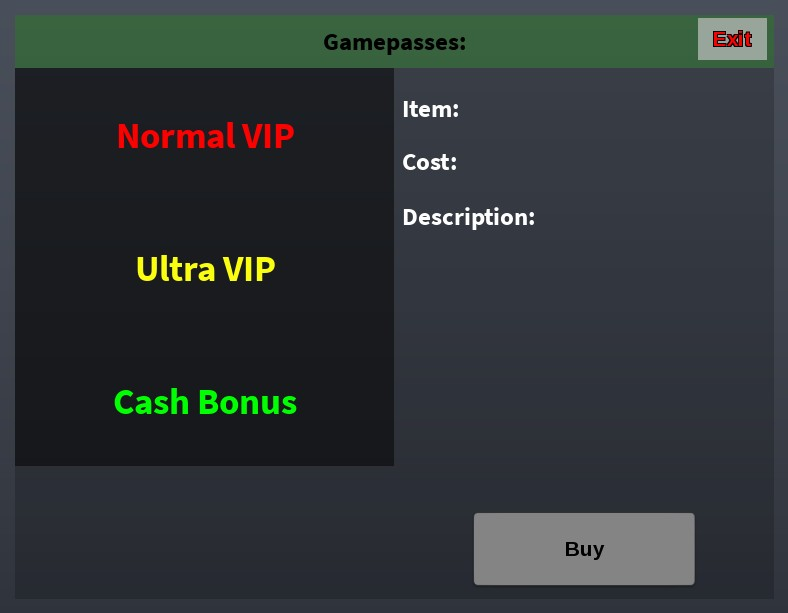

## At a glance

| | |
|---|---|
| Provenance | template with full source |
| Screens | 4 ScreenGuis, 61 GUI objects → **10 screenshots** |
| Models (.rbxm) | 46 models, 2 model sets, 0 VFX sets |
| Lua builders (.lua) | 6 UI screens, 0 animation packs, 2 audio packs |
| Code | 1581 scripts, 61,704 lines |
| Asset ids | 20 animations, 100 sounds |
| Safety scan | 5 HIGH / 4 MED flags ([flags.txt](source/flags.txt)) |

## UI screenshots

Captured in Studio from the place's own ScreenGuis (scripts stripped). Each panel was opened on its own; click a thumbnail for the full 1519×886 frame. Runtime-filled lists (shop items, inventories) show their template state.

### Shop & Robux store

<table>
<tr>
<td width="33%" valign="top"><a href="screenshots/22_ShopGui.jpg">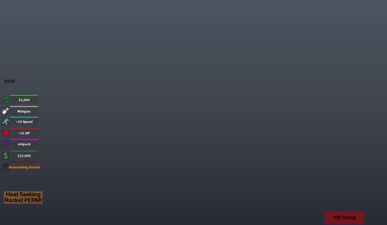</a> <b>ShopGui</b></td>
<td width="33%" valign="top"> <b>ShopGui</b> › vpi</td>
</tr>
</table>

### Popups, notifications, prompts

<table>
<tr>
<td width="33%" valign="top"><a href="screenshots/24_MusicTipGui.jpg">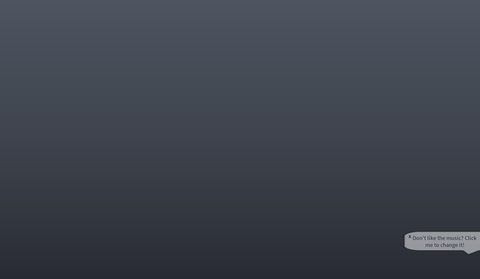</a> <b>MusicTipGui</b></td>
</tr>
</table>

### HUD & currency

<table>
<tr>
<td width="33%" valign="top"><a href="screenshots/25_WeaponHud.jpg">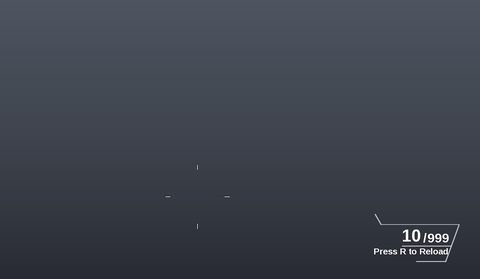</a> <b>WeaponHud</b></td>
</tr>
</table>

### Other

<table>
<tr>
<td width="33%" valign="top"><a href="screenshots/01_Frame.jpg">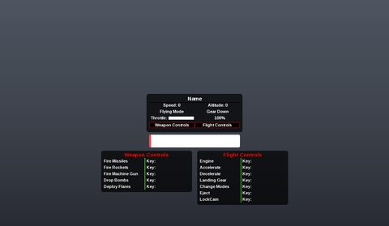</a> <b>Frame</b></td>
<td width="33%" valign="top"><a href="screenshots/02_RegenGui.jpg">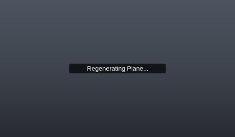</a> <b>RegenGui</b></td>
<td width="33%" valign="top"><a href="screenshots/19_ScreenGui.jpg">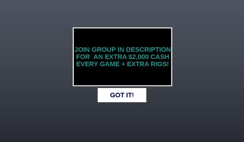</a> <b>ScreenGui</b></td>
</tr>
<tr>
<td width="33%" valign="top"><a href="screenshots/20_ScreenGui.jpg">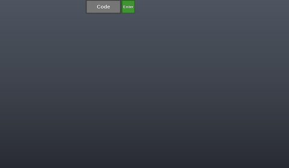</a> <b>ScreenGui</b></td>
<td width="33%" valign="top"><a href="screenshots/21_MusicGui__MusicPlayer.jpg">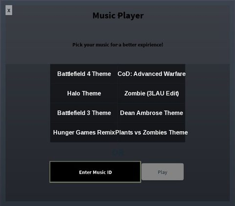</a> <b>MusicGui</b> › MusicPlayer</td>
<td width="33%" valign="top"> <b>FuelGui</b></td>
</tr>
</table>

## Model previews

<table>
<tr>
<td width="25%" valign="top"><a href="models/Workspace/Model~2/Hat%20Remover.rbxm">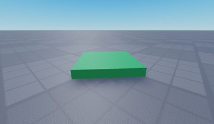</a> <b>Hat Remover</b> <code>models/Workspace/Model~2/Hat Remover.rbxm</code></td>
<td width="25%" valign="top"><a href="models/Lighting/JetPack.rbxm">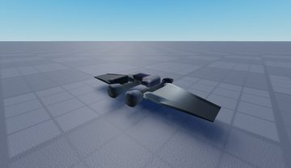</a> <b>JetPack</b> <code>models/Lighting/JetPack.rbxm</code></td>
<td width="25%" valign="top"><a href="models/StarterPack/Sword.rbxm">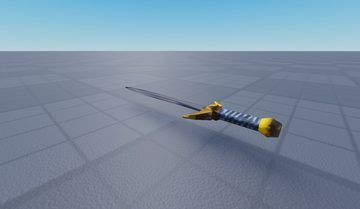</a> <b>Sword</b> <code>models/StarterPack/Sword.rbxm</code></td>
<td width="25%" valign="top"><a href="models/Lighting/Bow.rbxm">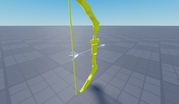</a> <b>Bow</b> <code>models/Lighting/Bow.rbxm</code></td>
</tr>
<tr>
<td width="25%" valign="top"><a href="models/Workspace/Model/VIP.rbxm">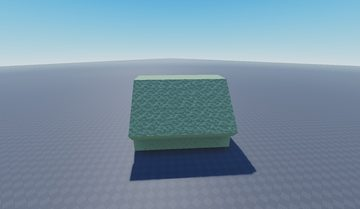</a> <b>VIP</b> <code>models/Workspace/Model/VIP.rbxm</code></td>
<td width="25%" valign="top"><a href="models/Lighting/AK47.rbxm">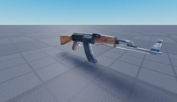</a> <b>AK47</b> <code>models/Lighting/AK47.rbxm</code></td>
<td width="25%" valign="top"><a href="models/Workspace/red.rbxm">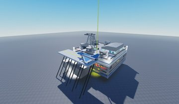</a> <b>red</b> <code>models/Workspace/red.rbxm</code></td>
<td width="25%" valign="top"><a href="models/Lighting/AUG.rbxm">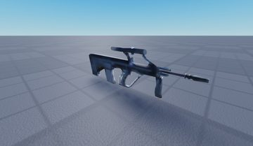</a> <b>AUG</b> <code>models/Lighting/AUG.rbxm</code></td>
</tr>
<tr>
<td width="25%" valign="top"><a href="models/Workspace/Model~2/Model.rbxm">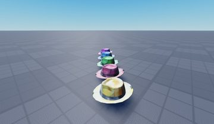</a> <b>Model</b> <code>models/Workspace/Model~2/Model.rbxm</code></td>
<td width="25%" valign="top"><a href="models/Workspace/blue.rbxm">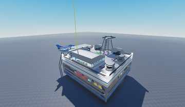</a> <b>blue</b> <code>models/Workspace/blue.rbxm</code></td>
<td width="25%" valign="top"><a href="models/Lighting/G-AK47.rbxm">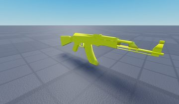</a> <b>G-AK47</b> <code>models/Lighting/G-AK47.rbxm</code></td>
<td width="25%" valign="top"><a href="models/Workspace/teal.rbxm">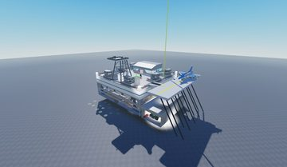</a> <b>teal</b> <code>models/Workspace/teal.rbxm</code></td>
</tr>
<tr>
<td width="25%" valign="top"><a href="models/Lighting/M1Grand.rbxm">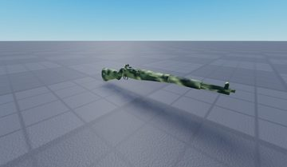</a> <b>M1Grand</b> <code>models/Lighting/M1Grand.rbxm</code></td>
<td width="25%" valign="top"><a href="models/Workspace/teal~2.rbxm">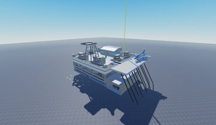</a> <b>teal~2</b> <code>models/Workspace/teal~2.rbxm</code></td>
</tr>
</table>

## Notable scripts

Top-scored scripts of this game per topic (full tree in [source/scripts](source/scripts/)).

| Topic | Scripts |
|---|---|
| UI controllers / window managers / menus | [`Local Gui`](source/scripts/Lighting/GRocket/Local%20Gui.client.lua) 481 lines |
| Camera, cutscenes, screen shake | [`ScreenSpace`](source/scripts/Lighting/VIP%20Rocket/ScreenSpace.lua) 192 lines |
| VFX, particles, beams, hit effects | [`Rocket`](source/scripts/Lighting/VIP%20Rocket/Script/Rocket.server.lua) 142 lines [`Rocket`](source/scripts/Lighting/HeatRocket/Launcher/Rocket.server.lua) 108 lines [`Script`](source/scripts/Lighting/Airstrike/LocalScript/Script.server.lua) 124 lines [`Main`](source/scripts/Workspace/blue/Bright%20blue/Purchases/Fighter/Plane/MainParts/Seat/Plane/Main.client.lua) 1434 lines |
| DataStore / player data | [`Music`](source/scripts/ServerScriptService/Music.server.lua) 38 lines |
| Monetization (dev products, game passes, receipts) | [`DevProductHandler`](source/scripts/ServerScriptService/DevProductHandler.server.lua) 120 lines |
| Combat, weapons, hitboxes, abilities | [`SwordScript`](source/scripts/Lighting/Venomshank/SwordScript.server.lua) 183 lines [`SwordScript`](source/scripts/StarterPack/Sword/SwordScript.server.lua) 173 lines [`Local Gui`](source/scripts/Lighting/GRocket/Local%20Gui.client.lua) 481 lines |
| Tycoon / plots / bases / building | [`PurchaseHandler`](source/scripts/Workspace/blue/Bright%20blue/PurchaseHandler.server.lua) 159 lines [`PurchaseHandler`](source/scripts/Workspace/violet/Bright%20violet/PurchaseHandler.server.lua) 160 lines |
| Leaderboards & stats | [`LinkedLeaderboard`](source/scripts/Workspace/violet/LinkedLeaderboard.server.lua) 192 lines |
| Sound & music | [`Music`](source/scripts/ServerScriptService/Music.server.lua) 38 lines |

### In the curated script library

- [Classic tycoon kit purchase handler](../../Scripts/14-Tycoon-Plots/PurchaseHandler__advanced-warfare-tycoon.lua) — Classic berezaa tycoon kit purchase handler: collector part turns 'Cash' drops into stored cash, a giver pad pays it out to the owner, and every button clones its purchase into the tycoon when bought
- [Classic tycoon kit parts (regen, gate, dropper, upgrader, conveyor)](../../Scripts/14-Tycoon-Plots/TycoonKitParts__advanced-warfare-tycoon.lua) — The remaining pieces of the classic tycoon kit: CoreScript (backs up each tycoon and regenerates it when the owner leaves), the claim gate, a dropper (spawns a Part with a Cash IntValue every few...

## ⚠️ Safety

HIGH flags (backdoors, `require(id)`, `loadstring`, webhooks). Review or delete before reusing:

- `scripts/ServerScriptService/Kohl's Admin Commands V2.server.lua`
- `scripts/ServerScriptService/Kohl's Admin Commands V2/LocalScriptBase.client.lua`
- `scripts/ServerScriptService/Kohl's Admin Commands V2/ScriptBase.server.lua`
- `scripts/ServerScriptService/Scripth's Admin.server.lua`
- `scripts/ServerScriptService/Scripth's Admin/SB.server.lua`

## Folders

| Folder | What |
|---|---|
| `screenshots/` | full frames; `crops/` = the panel only; `models/` = 3D previews; `thumbs/` = gallery thumbnails |
| `ui/` | every screen as a Lua builder (`require(module)()` returns the ScreenGui); `_StarterGui-all.lua` builds every StarterGui screen |
| `models/` | every model as .rbxm (the only .rbxm files), mirroring the place tree, scripts removed |
| `map/` | `workspace.rbxm` (the map as a model), `lighting.lua` (sky + post effects), `materials.lua`, `Environment.lua` |
| `animations/`, `audio/` | KeyframeSequence / Sound builders (.lua), `AnimationIds.lua`, `Sounds.lua` |
| `source/` | all scripts as .luau, `tree.txt`, `ui.txt`, `remotes.txt`, `assets.txt`, `flags.txt` |
