# Animal Hospital (horror, modded)

> 👻 **Horror** · horror roleplay (patients, skinwalkers, sanity) · source file `Animal modded.rbxl`

[⬅ Back to the catalog](../../README.md) · [Assets inventory](ASSETS.md) · [Style numbers](reference.md) · [Scripts](source/scripts/) · [Code analysis](source/README.md)

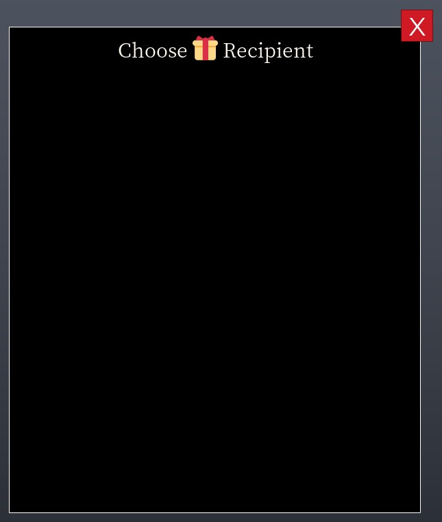

## At a glance

| | |
|---|---|
| Provenance | copy of a live game (saveinstance / decompiled client code) |
| Screens | 35 ScreenGuis, 833 GUI objects → **24 screenshots** |
| Models (.rbxm) | 359 models, 15 model sets, 5 VFX sets |
| Lua builders (.lua) | 52 UI screens, 3 animation packs, 8 audio packs |
| Code | 373 scripts, 61,037 lines |
| Asset ids | 386 animations, 713 sounds |
| Safety scan | 1 HIGH / 1 MED flags ([flags.txt](source/flags.txt)) |

**Fonts:** `GothamSSm ExtraBold`×74, `Noto Serif SC Bold`×63, `Noto Serif SC Regular`×35, `SourceSansPro Regular`×34, `SpecialElite Bold`×24

## UI screenshots

Captured in Studio from the place's own ScreenGuis (scripts stripped). Each panel was opened on its own; click a thumbnail for the full 1519×886 frame. Runtime-filled lists (shop items, inventories) show their template state.

### Shop & Robux store

<table>
<tr>
<td width="33%" valign="top"><a href="screenshots/16_Shop__Frame.jpg">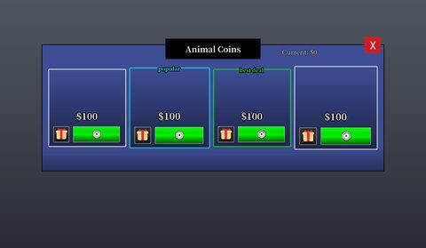</a> <b>Shop</b> › Frame</td>
</tr>
</table>

### Rewards, daily, spin, codes

<table>
<tr>
<td width="33%" valign="top"><a href="screenshots/18_GiftList__Frame.jpg">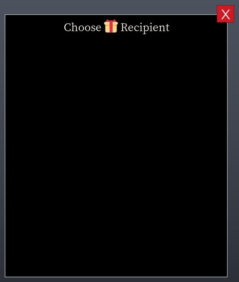</a> <b>GiftList</b> › Frame</td>
</tr>
</table>

### Popups, notifications, prompts

<table>
<tr>
<td width="33%" valign="top"><a href="screenshots/01_Dialogue__black.jpg">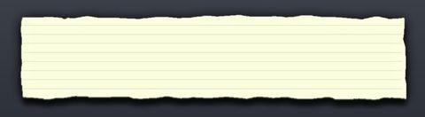</a> <b>Dialogue</b> › Frame.black</td>
</tr>
</table>

### Leaderboards & stats

<table>
<tr>
<td width="33%" valign="top"><a href="screenshots/07_RoundStatsDetailed__paper.jpg">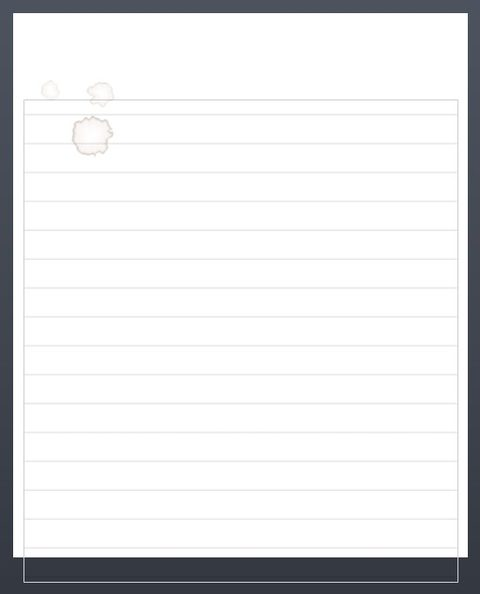</a> <b>RoundStatsDetailed</b> › Frame.paper</td>
<td width="33%" valign="top"><a href="screenshots/09_RoundStatsDetailed__Info.jpg">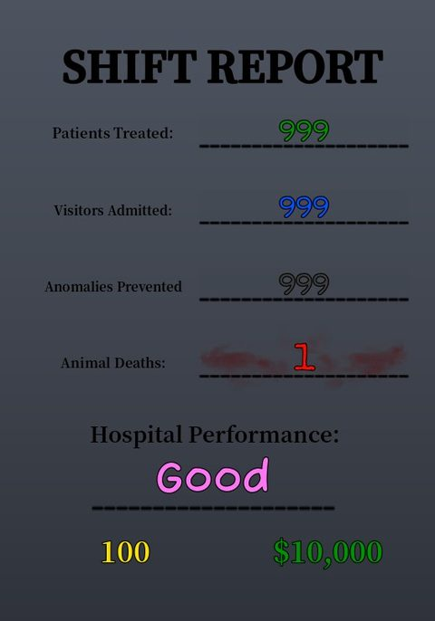</a> <b>RoundStatsDetailed</b> › Frame.Info</td>
<td width="33%" valign="top"><a href="screenshots/10_RoundStatsDetailed__Photo.jpg">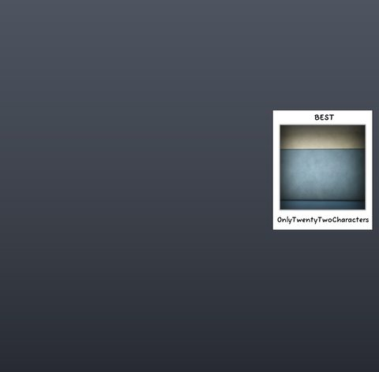</a> <b>RoundStatsDetailed</b> › Photo</td>
</tr>
</table>

### Admin panels

<table>
<tr>
<td width="33%" valign="top"><a href="screenshots/23_AdminPanel__AdminPanel.jpg">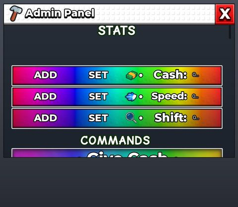</a> <b>AdminPanel</b> › AdminPanel</td>
</tr>
</table>

### Character / avatar / emotes

<table>
<tr>
<td width="33%" valign="top"><a href="screenshots/12_CharacterSelection__Selection.jpg">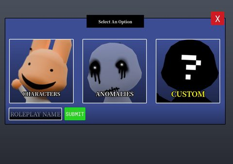</a> <b>CharacterSelection</b> › Selection</td>
<td width="33%" valign="top"><a href="screenshots/13_CharacterSelection__AnomalySelection.jpg">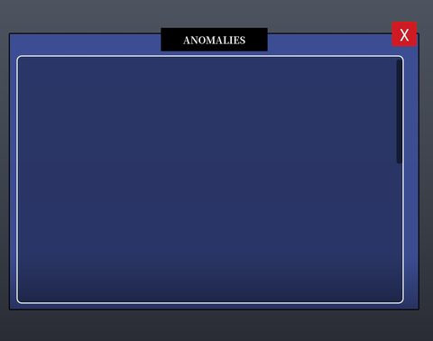</a> <b>CharacterSelection</b> › AnomalySelection</td>
<td width="33%" valign="top"><a href="screenshots/14_CharacterSelection__PremadeSelection.jpg">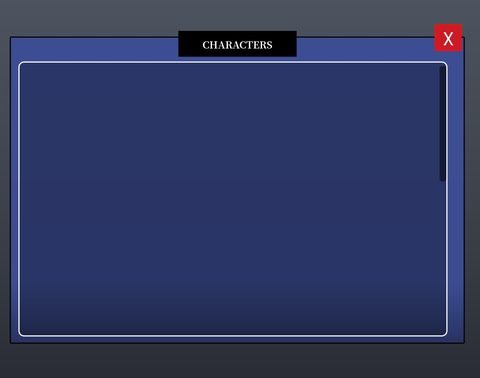</a> <b>CharacterSelection</b> › PremadeSelection</td>
</tr>
<tr>
<td width="33%" valign="top"><a href="screenshots/15_CharacterCreation.jpg">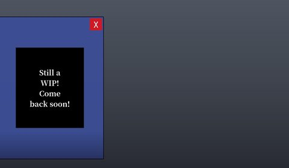</a> <b>CharacterCreation</b></td>
<td width="33%" valign="top"><a href="screenshots/17_Skins.jpg">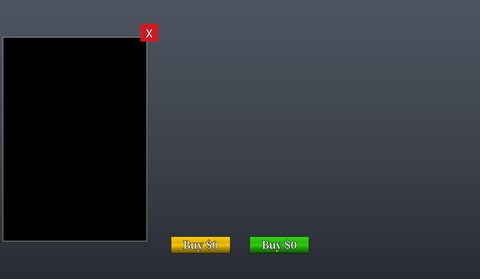</a> <b>Skins</b></td>
</tr>
</table>

### Map vote / teams / matchmaking

<table>
<tr>
<td width="33%" valign="top"><a href="screenshots/08_RoundStatsDetailed__background.jpg">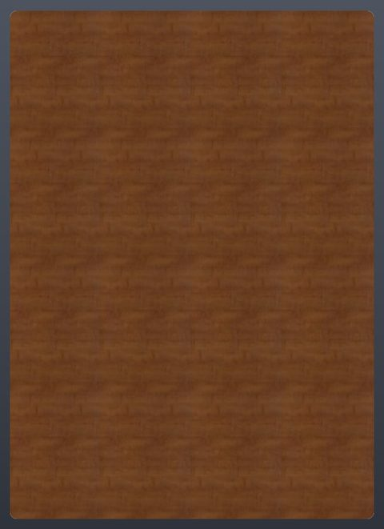</a> <b>RoundStatsDetailed</b> › Frame.background</td>
</tr>
</table>

### Other

<table>
<tr>
<td width="33%" valign="top"><a href="screenshots/02_CameraSystem__Container.jpg">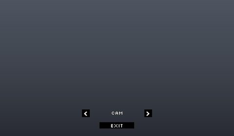</a> <b>CameraSystem</b> › Controls.Container</td>
<td width="33%" valign="top"><a href="screenshots/03_HeartbeatMinigameUI__Frame.jpg">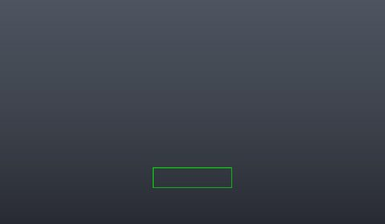</a> <b>HeartbeatMinigameUI</b> › Frame</td>
<td width="33%" valign="top"><a href="screenshots/04_Sanity.jpg">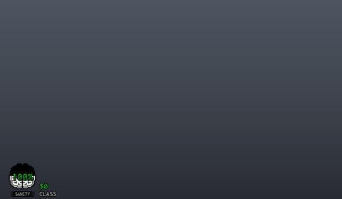</a> <b>Sanity</b></td>
</tr>
<tr>
<td width="33%" valign="top"> <b>MOBILE_BUTTONS</b></td>
<td width="33%" valign="top"><a href="screenshots/06_PlayerDied__Frame.jpg">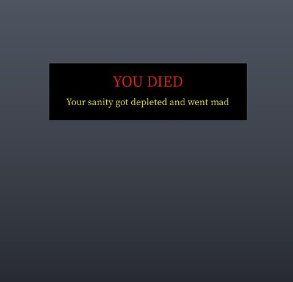</a> <b>PlayerDied</b> › Frame</td>
<td width="33%" valign="top"><a href="screenshots/11_Strikes__Frame.jpg">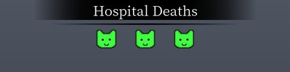</a> <b>Strikes</b> › Frame</td>
</tr>
<tr>
<td width="33%" valign="top"><a href="screenshots/19_Classes__Frame.jpg">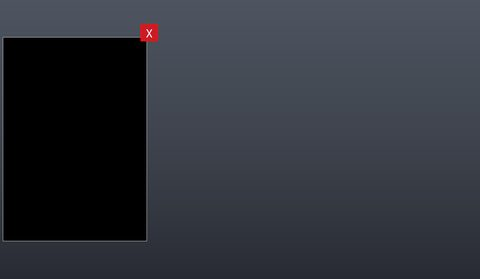</a> <b>Classes</b> › Frame</td>
<td width="33%" valign="top"><a href="screenshots/20_Classes__Info.jpg">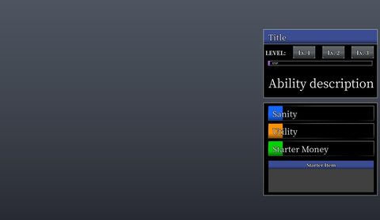</a> <b>Classes</b> › Info</td>
<td width="33%" valign="top"><a href="screenshots/21_Classes__Center.jpg">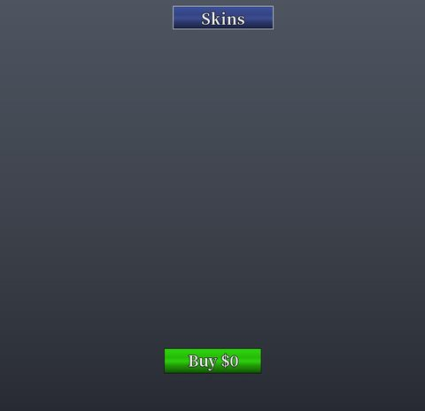</a> <b>Classes</b> › Center</td>
</tr>
<tr>
<td width="33%" valign="top"><a href="screenshots/22_Actions.jpg">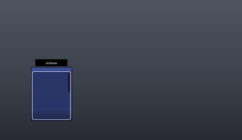</a> <b>Actions</b></td>
<td width="33%" valign="top"><a href="screenshots/24_RadioGui.jpg">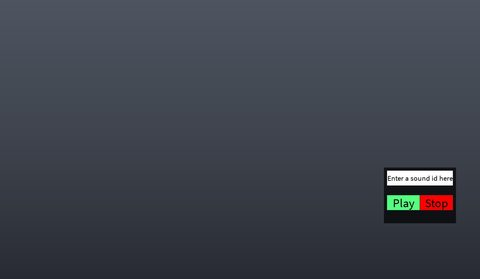</a> <b>RadioGui</b></td>
</tr>
</table>

## Model previews

<table>
<tr>
<td width="25%" valign="top"><a href="models/ReplicatedStorage/NPCs/Visitors/SkinDummy.rbxm">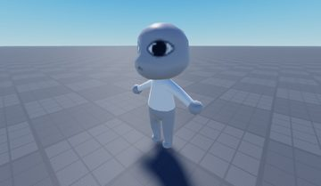</a> <b>SkinDummy</b> <code>models/ReplicatedStorage/NPCs/Visitors/SkinDummy.rbxm</code></td>
<td width="25%" valign="top"><a href="models/ReplicatedStorage/ShopItemModels/Gun.rbxm">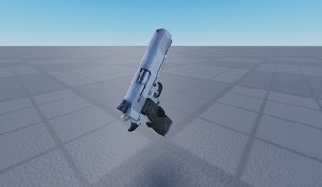</a> <b>Gun</b> <code>models/ReplicatedStorage/ShopItemModels/Gun.rbxm</code></td>
<td width="25%" valign="top"><a href="models/ReplicatedStorage/Misc/RoomFire.rbxm">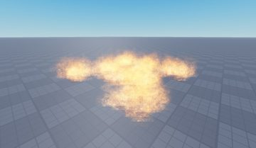</a> <b>RoomFire</b> <code>models/ReplicatedStorage/Misc/RoomFire.rbxm</code></td>
<td width="25%" valign="top"><a href="models/Workspace/Model__x102.rbxm">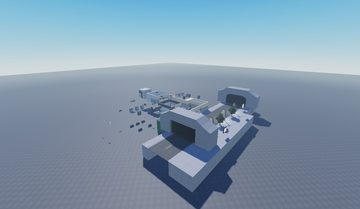</a> <b>Model__x102</b> <code>models/Workspace/Model__x102.rbxm</code></td>
</tr>
<tr>
<td width="25%" valign="top"><a href="models/ReplicatedStorage/ShopItemModels/CheckInSign.rbxm">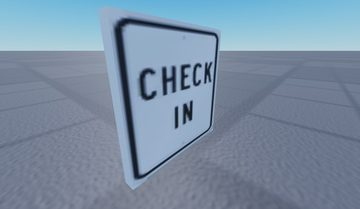</a> <b>CheckInSign</b> <code>models/ReplicatedStorage/ShopItemModels/CheckInSign.rbxm</code></td>
<td width="25%" valign="top"><a href="models/Workspace/Misc/ShopSign.rbxm">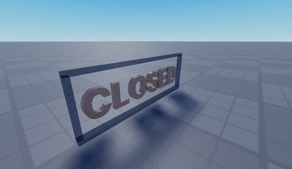</a> <b>ShopSign</b> <code>models/Workspace/Misc/ShopSign.rbxm</code></td>
<td width="25%" valign="top"><a href="models/ReplicatedStorage/Misc/RoomFires/Room1__x8.rbxm">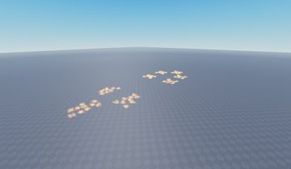</a> <b>Room1__x8</b> <code>models/ReplicatedStorage/Misc/RoomFires/Room1__x8.rbxm</code></td>
<td width="25%" valign="top"><a href="models/Workspace/Rooms/Emergency/Room8/MainSign.rbxm">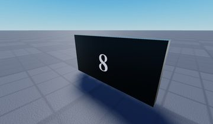</a> <b>MainSign</b> <code>models/Workspace/Rooms/Emergency/Room8/MainSign.rbxm</code></td>
</tr>
<tr>
<td width="25%" valign="top"><a href="models/Workspace/Potted%20Plant.rbxm">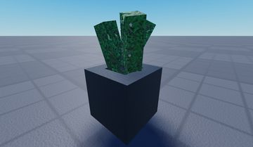</a> <b>Potted Plant</b> <code>models/Workspace/Potted Plant.rbxm</code></td>
<td width="25%" valign="top"><a href="models/ReplicatedStorage/Misc/RatthewKeyAndNote.rbxm">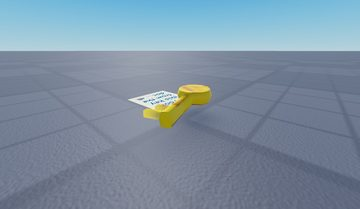</a> <b>RatthewKeyAndNote</b> <code>models/ReplicatedStorage/Misc/RatthewKeyAndNote.rbxm</code></td>
<td width="25%" valign="top"><a href="models/StarterPlayer/StarterCharacter.rbxm">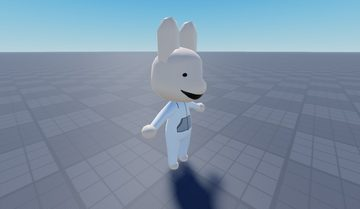</a> <b>StarterCharacter</b> <code>models/StarterPlayer/StarterCharacter.rbxm</code></td>
<td width="25%" valign="top"><a href="models/ReplicatedStorage/Misc/RoomFires/Room1.rbxm">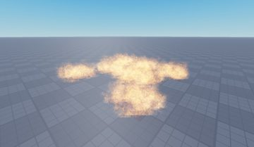</a> <b>Room1</b> <code>models/ReplicatedStorage/Misc/RoomFires/Room1.rbxm</code></td>
</tr>
<tr>
<td width="25%" valign="top"><a href="models/Workspace/Chocolate%20bar.rbxm">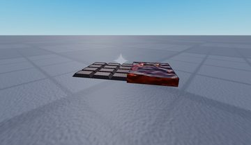</a> <b>Chocolate bar</b> <code>models/Workspace/Chocolate bar.rbxm</code></td>
<td width="25%" valign="top"><a href="models/Workspace/Rooms/Emergency/Room7/Minigame/StandIV.rbxm">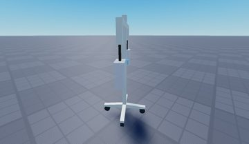</a> <b>StandIV</b> <code>models/Workspace/Rooms/Emergency/Room7/Minigame/StandIV.rbxm</code></td>
</tr>
</table>

## Notable scripts

Top-scored scripts of this game per topic (full tree in [source/scripts](source/scripts/)).

| Topic | Scripts |
|---|---|
| UI animation (tweens, hover / click, pop-ins, springs) | [`Buttons`](source/scripts/StarterPlayer/StarterPlayerScripts/Util/Buttons.lua) 184 lines [`ProximityPromptScript`](source/scripts/StarterPlayer/StarterPlayerScripts/ProximityPromptScript.client.lua) 653 lines [`SanityLocal`](source/scripts/StarterPlayer/StarterPlayerScripts/UI/SanityLocal.lua) 196 lines [`SpecialEffects`](source/scripts/StarterPlayer/StarterPlayerScripts/Util/SpecialEffects.lua) 99 lines [`Cutscenes`](source/scripts/StarterPlayer/StarterPlayerScripts/UI/Cutscenes.lua) 790 lines |
| UI controllers / window managers / menus | [`EmergencyDoor`](source/scripts/ServerScriptService/EmergencyDoor.server.lua) 126 lines [`StaffDoor`](source/scripts/ServerScriptService/StaffDoor.server.lua) 126 lines [`DoorService`](source/scripts/ServerScriptService/DoorService.lua) 92 lines [`Container`](source/scripts/ReplicatedStorage/TopbarIcon/Elements/Container.lua) 184 lines [`Menu`](source/scripts/ReplicatedStorage/TopbarIcon/Elements/Menu.lua) 203 lines |
| Notifications, toasts, popups, prompts | [`ProximityPromptScript`](source/scripts/StarterPlayer/StarterPlayerScripts/ProximityPromptScript.client.lua) 653 lines [`NotificationsLocal`](source/scripts/StarterPlayer/StarterPlayerScripts/UI/NotificationsLocal.lua) 84 lines [`CheckInService`](source/scripts/ServerScriptService/CheckInService.lua) 590 lines [`EmergencyService`](source/scripts/ServerScriptService/EmergencyService.lua) 285 lines [`DoorsService`](source/scripts/ServerScriptService/DoorsService.lua) 157 lines |
| Loading / intro screens | [`ver`](source/scripts/ServerScriptService/ver.server.lua) 2144 lines |
| Camera, cutscenes, screen shake | [`Cutscenes`](source/scripts/StarterPlayer/StarterPlayerScripts/UI/Cutscenes.lua) 790 lines [`ShadowCamera`](source/scripts/ReplicatedStorage/AnomalyEvents/Local/ShadowCamera.lua) 187 lines [`CameraSystem`](source/scripts/StarterPlayer/StarterPlayerScripts/UI/CameraSystem.lua) 448 lines [`Viewport`](source/scripts/StarterPlayer/StarterPlayerScripts/Util/Viewport.lua) 232 lines |
| VFX, particles, beams, hit effects | [`VisualEffects`](source/scripts/StarterPlayer/StarterPlayerScripts/UI/VisualEffects.lua) 216 lines [`CheckInService`](source/scripts/ServerScriptService/CheckInService.lua) 590 lines [`GunsLocal`](source/scripts/StarterPlayer/StarterPlayerScripts/Util/GunsLocal.lua) 48 lines [`MiscService`](source/scripts/ServerScriptService/MiscService.lua) 176 lines [`LocalBeam`](source/scripts/StarterPlayer/StarterPlayerScripts/Util/LocalBeam.lua) 29 lines |
| DataStore / player data | [`ProfileStore`](source/scripts/ServerScriptService/ProfileStore.lua) 2243 lines [`DataService`](source/scripts/ServerScriptService/DataService.lua) 210 lines |
| Monetization (dev products, game passes, receipts) | [`MonetizationBuys`](source/scripts/ServerScriptService/MonetizationBuys.server.lua) 179 lines [`GunService`](source/scripts/ServerScriptService/GunService.lua) 210 lines [`LocalScript`](source/scripts/StarterGui/AdminPanel/AdminPanel/Holder/ScrollingFrame/ModelsMorph/Frame/Brainrot/LocalScript.client.lua) 404 lines |
| RNG, eggs, gacha, rarity rolls, pets | [`RNG`](source/scripts/ReplicatedStorage/Util/RNG.lua) 88 lines [`AnomalyDirector`](source/scripts/ServerScriptService/AnomalyDirector.lua) 290 lines [`UpgradeShopWares`](source/scripts/ReplicatedStorage/Data/UpgradeShopWares.lua) 569 lines |
| Combat, weapons, hitboxes, abilities | [`MeleeTools`](source/scripts/ReplicatedStorage/Tools/MeleeTools.lua) 187 lines [`GunService`](source/scripts/ServerScriptService/GunService.lua) 210 lines [`SwordScript`](source/scripts/ReplicatedStorage/Items/ClassicSword/SwordScript.server.lua) 229 lines [`GunsLocal`](source/scripts/StarterPlayer/StarterPlayerScripts/Util/GunsLocal.lua) 48 lines |
| NPC / AI / monsters | [`PatientService`](source/scripts/ServerScriptService/PatientService.lua) 632 lines [`__MCP_CommandListener`](source/scripts/ServerScriptService/__MCP_CommandListener.server.lua) 67 lines |
| Character movement (sprint, dash, double jump, slide) | [`CheckInService`](source/scripts/ServerScriptService/CheckInService.lua) 590 lines |
| Tycoon / plots / bases / building | [`LocalScript`](source/scripts/StarterGui/AdminPanel/AdminPanel/Holder/ScrollingFrame/ModelsMorph/Frame/Brainrot/LocalScript.client.lua) 404 lines [`PatientCareService`](source/scripts/ServerScriptService/PatientCareService.lua) 612 lines [`ver`](source/scripts/ServerScriptService/ver.server.lua) 2144 lines |
| Admin panels & commands | [`AdminActionsServer`](source/scripts/ServerScriptService/AdminActionsServer.server.lua) 109 lines [`MonetizationBuys`](source/scripts/ServerScriptService/MonetizationBuys.server.lua) 179 lines |
| Sound & music | [`MusicService`](source/scripts/StarterPlayer/StarterPlayerScripts/Util/MusicService.lua) 205 lines [`MusicPlayer`](source/scripts/StarterPlayer/StarterPlayerScripts/UI/MusicPlayer.lua) 96 lines [`SanityLocal`](source/scripts/StarterPlayer/StarterPlayerScripts/UI/SanityLocal.lua) 196 lines |
| Utility modules (number format, signals, tables, timers) | [`Utility`](source/scripts/ReplicatedStorage/TopbarIcon/Utility.lua) 698 lines [`Signal`](source/scripts/ReplicatedStorage/Util/Signal.lua) 50 lines [`Maid`](source/scripts/ReplicatedStorage/Util/Maid.lua) 117 lines [`EmergencyService`](source/scripts/ServerScriptService/EmergencyService.lua) 285 lines [`NetworkOld`](source/scripts/ReplicatedStorage/Util/NetworkOld.lua) 793 lines |

### In the curated script library

- [Visitor / customer queue NPCs](../../Scripts/12-NPC-AI/PatientQueueNPCs__animal-hospital-horror.lua) — Service that spawns visitor NPCs (unique or generic), walks them through the front door to a counter with pathfinding + MoveTo timeouts, uses a collision group so they pass through doors, seats them in a waiting room (claim chair, sit pose), then leaves and despawns. Comments are in Spanish.

## ⚠️ Safety

HIGH flags (backdoors, `require(id)`, `loadstring`, webhooks). Review or delete before reusing:

- `scripts/Workspace/NexusAdminLoader.server.lua`

## Folders

| Folder | What |
|---|---|
| `screenshots/` | full frames; `crops/` = the panel only; `models/` = 3D previews; `thumbs/` = gallery thumbnails |
| `ui/` | every screen as a Lua builder (`require(module)()` returns the ScreenGui); `_StarterGui-all.lua` builds every StarterGui screen |
| `models/` | every model as .rbxm (the only .rbxm files), mirroring the place tree, scripts removed |
| `map/` | `workspace.rbxm` (the map as a model), `lighting.lua` (sky + post effects), `materials.lua`, `Environment.lua` |
| `animations/`, `audio/` | KeyframeSequence / Sound builders (.lua), `AnimationIds.lua`, `Sounds.lua` |
| `source/` | all scripts as .luau, `tree.txt`, `ui.txt`, `remotes.txt`, `assets.txt`, `flags.txt` |
