# Animal Hospital (modded)

> 🏙️ **Roleplay** · roleplay / tycoon · source file `VIP - ANIMAL HOSPITALMODDED.rbxl`

[⬅ Back to the catalog](../../README.md) · [Assets inventory](ASSETS.md) · [Style numbers](reference.md) · [Scripts](source/scripts/) · [Code analysis](source/README.md)

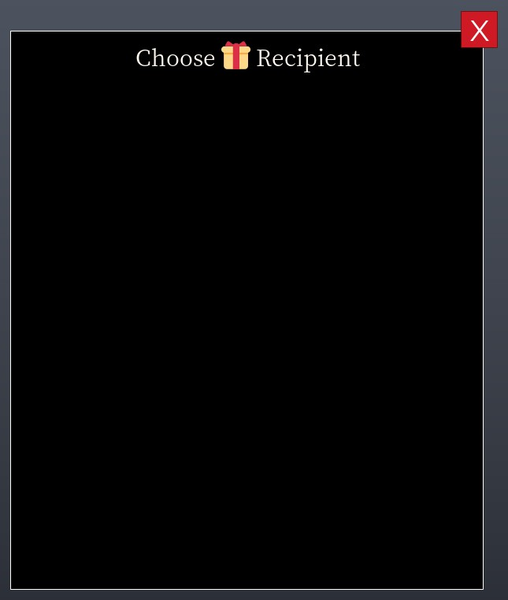

## At a glance

| | |
|---|---|
| Provenance | copy of a live game (saveinstance / decompiled client code) |
| Screens | 43 ScreenGuis, 1051 GUI objects → **94 screenshots** |
| Models (.rbxm) | 447 models, 16 model sets, 5 VFX sets |
| Lua builders (.lua) | 68 UI screens, 7 animation packs, 9 audio packs |
| Code | 916 scripts, 158,024 lines |
| Asset ids | 452 animations, 825 sounds |
| Safety scan | 3 HIGH / 17 MED flags ([flags.txt](source/flags.txt)) |

**Fonts:** `GothamSSm ExtraBold`×85, `Noto Serif SC Bold`×78, `SourceSansPro Regular`×46, `Noto Serif SC Regular`×35, `FredokaOne Regular`×26

## UI screenshots

Captured in Studio from the place's own ScreenGuis (scripts stripped). Each panel was opened on its own; click a thumbnail for the full 1519×886 frame. Runtime-filled lists (shop items, inventories) show their template state.

### Shop & Robux store

<table>
<tr>
<td width="33%" valign="top"><a href="screenshots/17_Shop__Frame.jpg">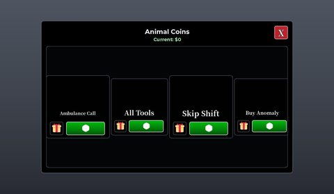</a> <b>Shop</b> › Frame</td>
</tr>
</table>

### Rewards, daily, spin, codes

<table>
<tr>
<td width="33%" valign="top"><a href="screenshots/19_GiftList__Frame.jpg">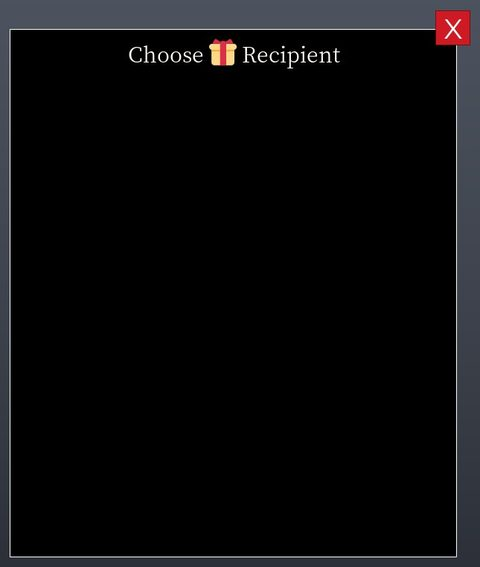</a> <b>GiftList</b> › Frame</td>
</tr>
</table>

### Settings & menus

<table>
<tr>
<td width="33%" valign="top"><a href="screenshots/12_Menu.jpg">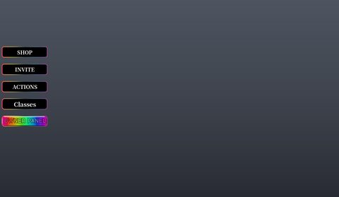</a> <b>Menu</b></td>
<td width="33%" valign="top"><a href="screenshots/36_HDAdminGUIs__Template4.jpg">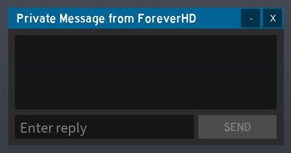</a> <b>HDAdminGUIs</b> › MenuTemplates.Template4</td>
<td width="33%" valign="top"><a href="screenshots/37_HDAdminGUIs__Template5.jpg">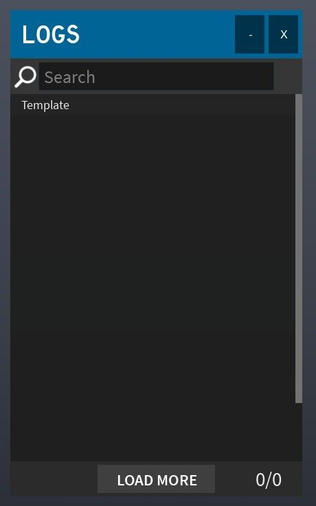</a> <b>HDAdminGUIs</b> › MenuTemplates.Template5</td>
</tr>
<tr>
<td width="33%" valign="top"><a href="screenshots/38_HDAdminGUIs__Template6.jpg">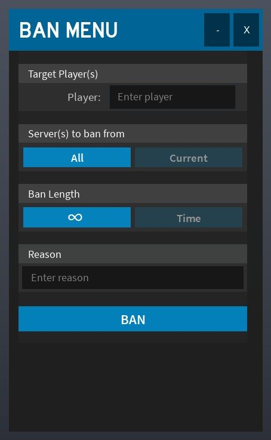</a> <b>HDAdminGUIs</b> › MenuTemplates.Template6</td>
<td width="33%" valign="top"><a href="screenshots/41_HDAdminGUIs__Template8.jpg">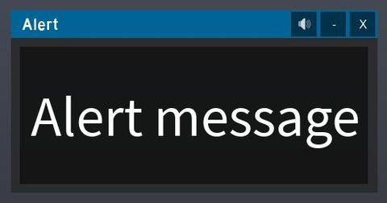</a> <b>HDAdminGUIs</b> › MenuTemplates.Template8</td>
<td width="33%" valign="top"><a href="screenshots/44_HDAdminGUIs__Template10.jpg">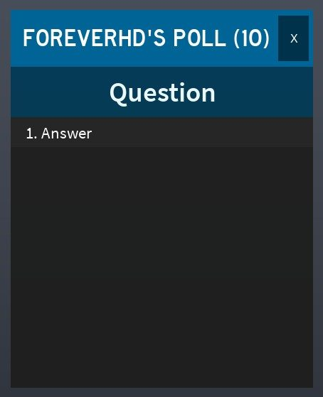</a> <b>HDAdminGUIs</b> › MenuTemplates.Template10</td>
</tr>
<tr>
<td width="33%" valign="top"><a href="screenshots/45_HDAdminGUIs__Template11.jpg">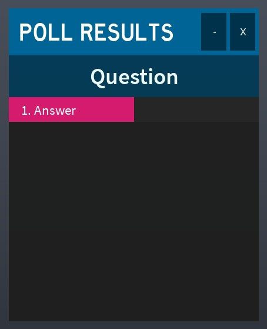</a> <b>HDAdminGUIs</b> › MenuTemplates.Template11</td>
</tr>
</table>

### Popups, notifications, prompts

<table>
<tr>
<td width="33%" valign="top"><a href="screenshots/01_Dialogue__black.jpg">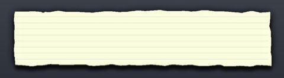</a> <b>Dialogue</b> › Frame.black</td>
<td width="33%" valign="top"><a href="screenshots/33_HDAdminGUIs__Warnings.jpg">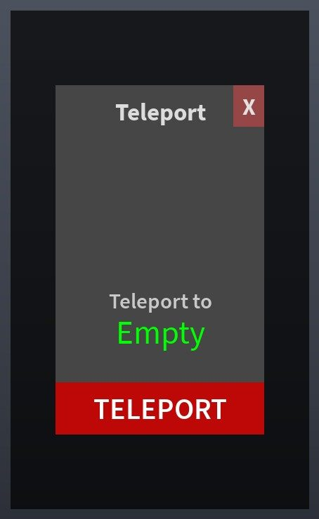</a> <b>HDAdminGUIs</b> › MainFrame.Warnings</td>
<td width="33%" valign="top"><a href="screenshots/48_HDAdminGUIs__Message.jpg">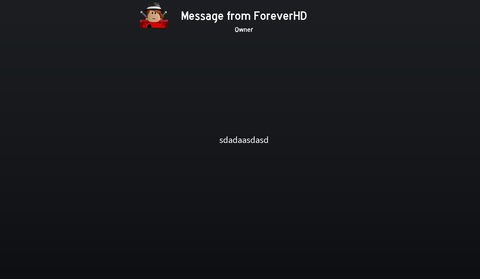</a> <b>HDAdminGUIs</b> › Templates.Message</td>
</tr>
<tr>
<td width="33%" valign="top"><a href="screenshots/49_HDAdminGUIs__GlobalAnnouncement.jpg">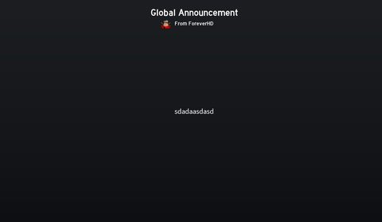</a> <b>HDAdminGUIs</b> › Templates.GlobalAnnouncement</td>
<td width="33%" valign="top"><a href="screenshots/63_ExportDialog.jpg">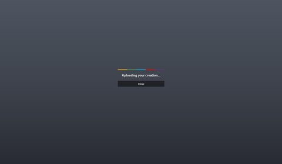</a> <b>ExportDialog</b></td>
</tr>
</table>

### Leaderboards & stats

<table>
<tr>
<td width="33%" valign="top"><a href="screenshots/07_RoundStatsDetailed__paper.jpg">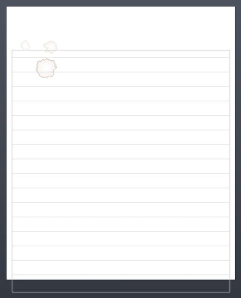</a> <b>RoundStatsDetailed</b> › Frame.paper</td>
<td width="33%" valign="top"><a href="screenshots/09_RoundStatsDetailed__Info.jpg">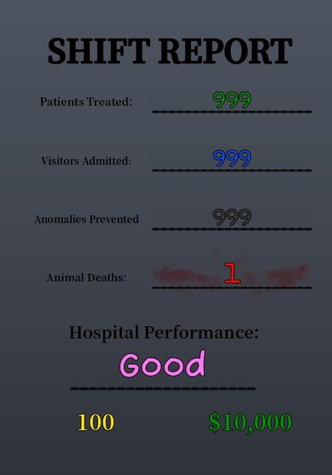</a> <b>RoundStatsDetailed</b> › Frame.Info</td>
<td width="33%" valign="top"><a href="screenshots/10_RoundStatsDetailed__Photo.jpg">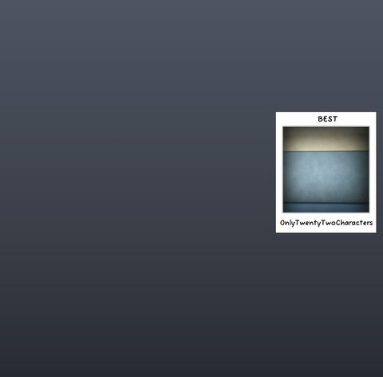</a> <b>RoundStatsDetailed</b> › Photo</td>
</tr>
</table>

### End of round, death, results

<table>
<tr>
<td width="33%" valign="top"><a href="screenshots/40_HDAdminGUIs__FinalResult.jpg">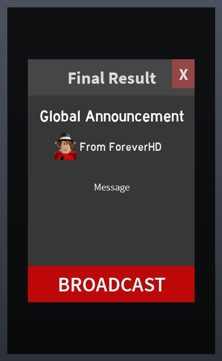</a> <b>HDAdminGUIs</b> › MenuTemplates.Template7.FinalResult</td>
<td width="33%" valign="top"><a href="screenshots/43_HDAdminGUIs__FinalResult.jpg">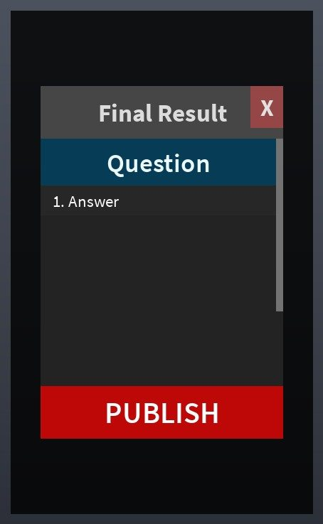</a> <b>HDAdminGUIs</b> › MenuTemplates.Template9.FinalResult</td>
<td width="33%" valign="top"><a href="screenshots/47_HDAdminGUIs__FinalResult.jpg">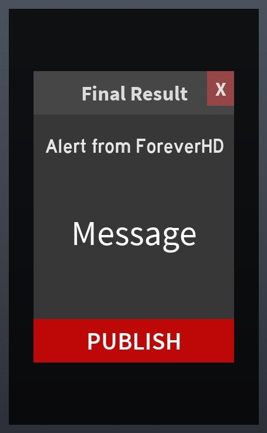</a> <b>HDAdminGUIs</b> › MenuTemplates.Template12.FinalResult</td>
</tr>
</table>

### Admin panels

<table>
<tr>
<td width="33%" valign="top"><a href="screenshots/24_AdminPanel__AdminPanel.jpg">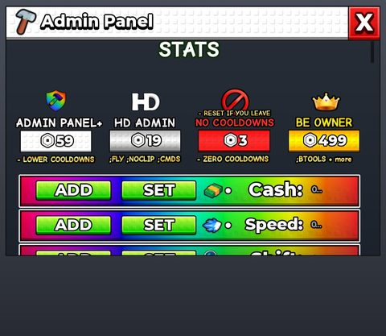</a> <b>AdminPanel</b> › AdminPanel</td>
<td width="33%" valign="top"><a href="screenshots/29_ExtraPanel.jpg">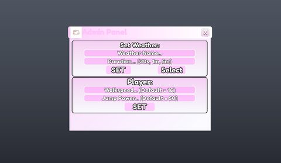</a> <b>ExtraPanel</b></td>
<td width="33%" valign="top"><a href="screenshots/30_ExtraPanel__Select.jpg">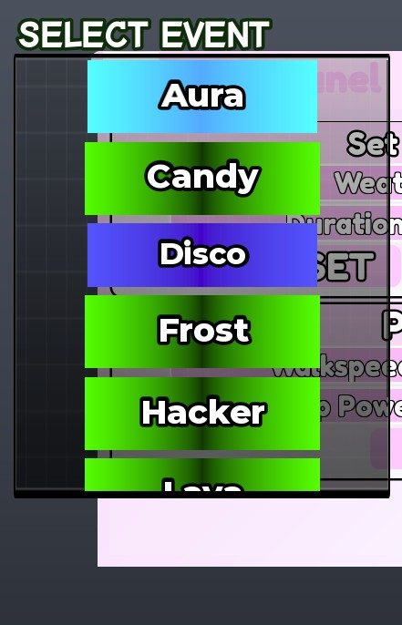</a> <b>ExtraPanel</b> › Main.Header.Select</td>
</tr>
<tr>
<td width="33%" valign="top"><a href="screenshots/32_HDAdminGUIs__Pages.jpg">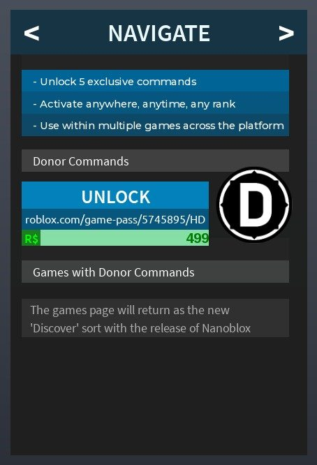</a> <b>HDAdminGUIs</b> › MainFrame.Pages</td>
<td width="33%" valign="top"> <b>HDAdminGUIs</b> › Notices</td>
<td width="33%" valign="top"><a href="screenshots/35_HDAdminGUIs__CmdBar.jpg">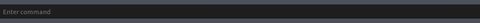</a> <b>HDAdminGUIs</b> › CmdBar</td>
</tr>
</table>

### HUD & currency

<table>
<tr>
<td width="33%" valign="top"><a href="screenshots/28_MainUI__PollVoting.jpg">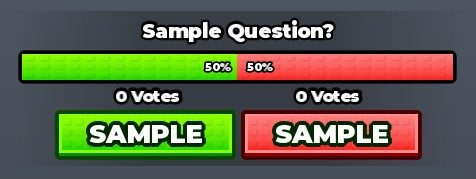</a> <b>MainUI</b> › PollVoting</td>
<td width="33%" valign="top"><a href="screenshots/39_HDAdminGUIs__MainFrame.jpg">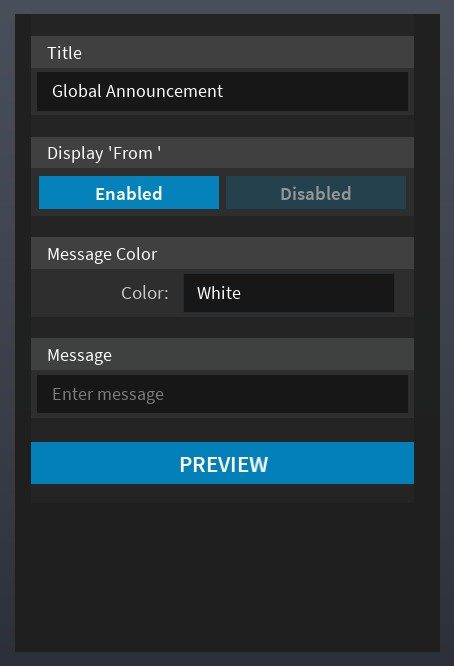</a> <b>HDAdminGUIs</b> › MenuTemplates.Template7.MainFrame</td>
<td width="33%" valign="top"><a href="screenshots/42_HDAdminGUIs__MainFrame.jpg">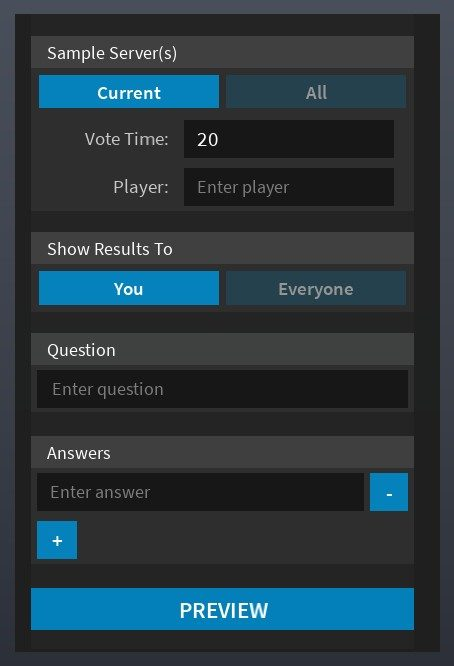</a> <b>HDAdminGUIs</b> › MenuTemplates.Template9.MainFrame</td>
</tr>
<tr>
<td width="33%" valign="top"><a href="screenshots/46_HDAdminGUIs__MainFrame.jpg">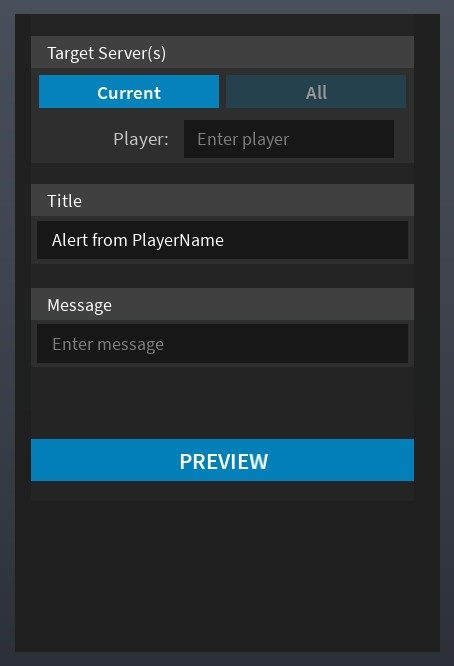</a> <b>HDAdminGUIs</b> › MenuTemplates.Template12.MainFrame</td>
</tr>
</table>

### Character / avatar / emotes

<table>
<tr>
<td width="33%" valign="top"><a href="screenshots/13_CharacterSelection__Selection.jpg">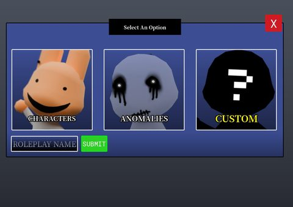</a> <b>CharacterSelection</b> › Selection</td>
<td width="33%" valign="top"><a href="screenshots/14_CharacterSelection__AnomalySelection.jpg">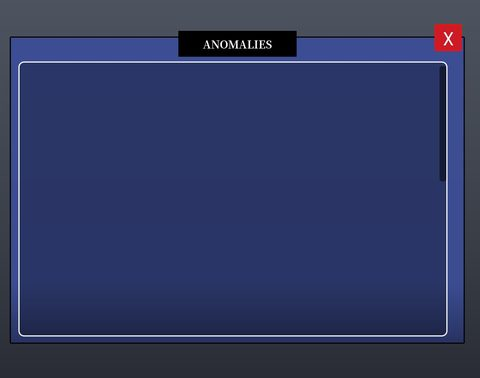</a> <b>CharacterSelection</b> › AnomalySelection</td>
<td width="33%" valign="top"><a href="screenshots/15_CharacterSelection__PremadeSelection.jpg">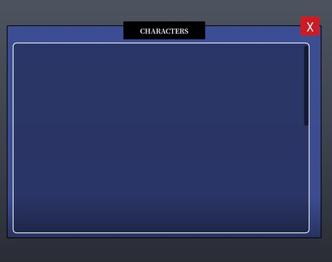</a> <b>CharacterSelection</b> › PremadeSelection</td>
</tr>
<tr>
<td width="33%" valign="top"><a href="screenshots/16_CharacterCreation.jpg">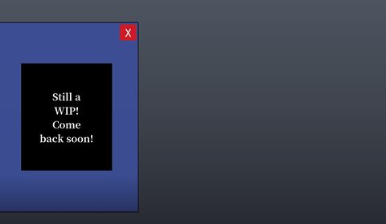</a> <b>CharacterCreation</b></td>
<td width="33%" valign="top"><a href="screenshots/18_Skins.jpg">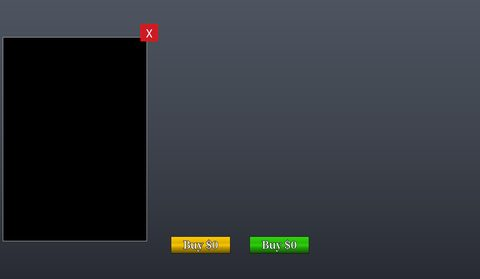</a> <b>Skins</b></td>
</tr>
</table>

### Map vote / teams / matchmaking

<table>
<tr>
<td width="33%" valign="top"><a href="screenshots/08_RoundStatsDetailed__background.jpg">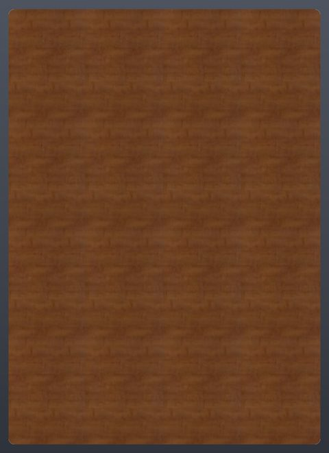</a> <b>RoundStatsDetailed</b> › Frame.background</td>
</tr>
</table>

### Other

<table>
<tr>
<td width="33%" valign="top"><a href="screenshots/02_CameraSystem__Container.jpg">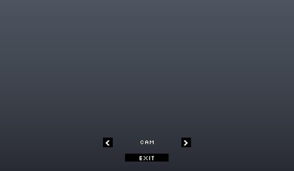</a> <b>CameraSystem</b> › Controls.Container</td>
<td width="33%" valign="top"><a href="screenshots/03_HeartbeatMinigameUI__Frame.jpg">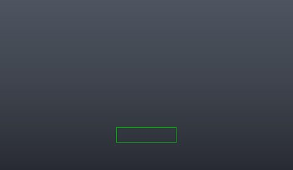</a> <b>HeartbeatMinigameUI</b> › Frame</td>
<td width="33%" valign="top"><a href="screenshots/04_Sanity.jpg">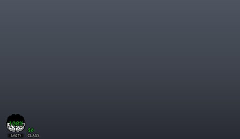</a> <b>Sanity</b></td>
</tr>
<tr>
<td width="33%" valign="top"><a href="screenshots/05_Shift.jpg">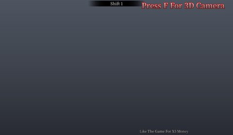</a> <b>Shift</b></td>
<td width="33%" valign="top"><a href="screenshots/06_PlayerDied__Frame.jpg">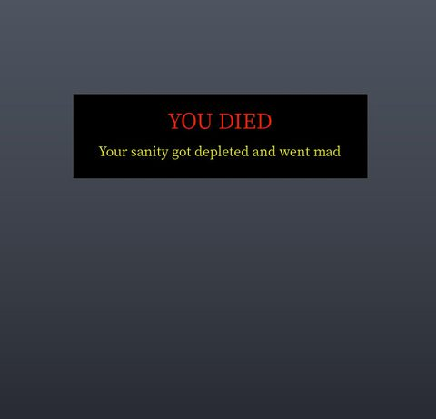</a> <b>PlayerDied</b> › Frame</td>
<td width="33%" valign="top"> <b>Strikes</b> › Frame</td>
</tr>
<tr>
<td width="33%" valign="top"><a href="screenshots/20_Classes__Frame.jpg">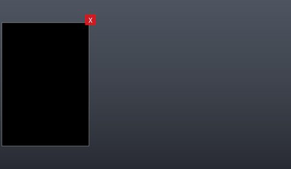</a> <b>Classes</b> › Frame</td>
<td width="33%" valign="top"><a href="screenshots/21_Classes__Info.jpg">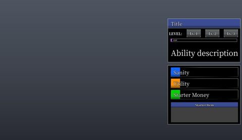</a> <b>Classes</b> › Info</td>
<td width="33%" valign="top"><a href="screenshots/22_Classes__Center.jpg">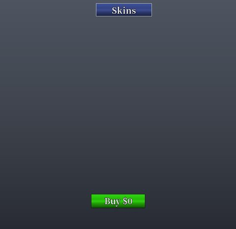</a> <b>Classes</b> › Center</td>
</tr>
<tr>
<td width="33%" valign="top"><a href="screenshots/23_Actions.jpg">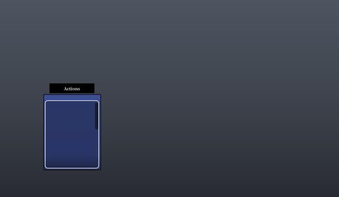</a> <b>Actions</b></td>
<td width="33%" valign="top"> <b>MOBILE_BUTTONS</b></td>
<td width="33%" valign="top"> <b>P2W</b></td>
</tr>
<tr>
<td width="33%" valign="top"><a href="screenshots/27_Troll.jpg">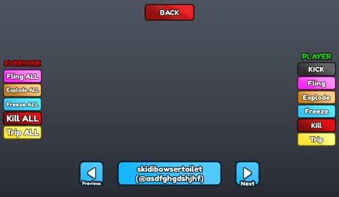</a> <b>Troll</b></td>
<td width="33%" valign="top"><a href="screenshots/31_RadioGui.jpg">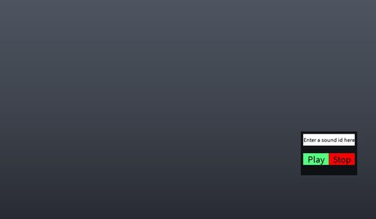</a> <b>RadioGui</b></td>
<td width="33%" valign="top"><a href="screenshots/50_BTAnchorToolGUI.jpg">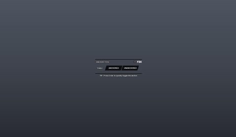</a> <b>BTAnchorToolGUI</b></td>
</tr>
<tr>
<td width="33%" valign="top"><a href="screenshots/51_BTCollisionToolGUI.jpg">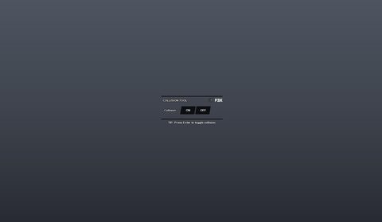</a> <b>BTCollisionToolGUI</b></td>
<td width="33%" valign="top"><a href="screenshots/52_BTDecorateToolGUI.jpg">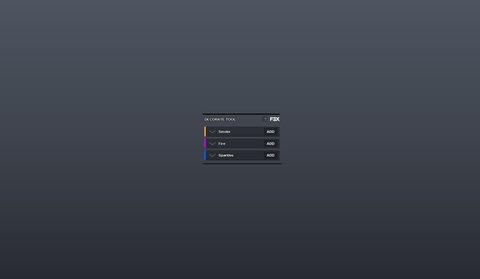</a> <b>BTDecorateToolGUI</b></td>
<td width="33%" valign="top"> <b>BTLightingToolGUI</b></td>
</tr>
<tr>
<td width="33%" valign="top"> <b>BTMaterialToolGUI</b></td>
<td width="33%" valign="top"> <b>BTMeshToolGUI</b></td>
<td width="33%" valign="top"> <b>BTMoveToolGUI</b></td>
</tr>
<tr>
<td width="33%" valign="top"> <b>BTPaintToolGUI</b></td>
<td width="33%" valign="top"> <b>BTResizeToolGUI</b></td>
<td width="33%" valign="top"> <b>BTRotateToolGUI</b></td>
</tr>
<tr>
<td width="33%" valign="top"> <b>BTSurfaceToolGUI</b></td>
<td width="33%" valign="top"> <b>BTTextureToolGUI</b></td>
<td width="33%" valign="top"> <b>BTWeldToolGUI</b></td>
</tr>
<tr>
<td width="33%" valign="top"> <b>BTAnchorToolGUI</b></td>
<td width="33%" valign="top"> <b>BTCollisionToolGUI</b></td>
<td width="33%" valign="top"> <b>BTGroupsGUI</b></td>
</tr>
<tr>
<td width="33%" valign="top"> <b>BTDecorateToolGUI</b></td>
<td width="33%" valign="top"> <b>Dock</b></td>
<td width="33%" valign="top"> <b>Dock</b> › HelpInfo</td>
</tr>
<tr>
<td width="33%" valign="top"> <b>Dock</b> › ToolInformation.PaintInfo</td>
<td width="33%" valign="top"> <b>Dock</b> › ToolInformation.SurfaceInfo</td>
<td width="33%" valign="top"> <b>Dock</b> › ToolInformation.MaterialInfo</td>
</tr>
<tr>
<td width="33%" valign="top"> <b>Dock</b> › ToolInformation.AnchorInfo</td>
<td width="33%" valign="top"> <b>Dock</b> › ToolInformation.NewPartInfo</td>
<td width="33%" valign="top"> <b>Dock</b> › ToolInformation.MeshInfo</td>
</tr>
<tr>
<td width="33%" valign="top"> <b>Dock</b> › ToolInformation.TextureInfo</td>
<td width="33%" valign="top"> <b>Dock</b> › ToolInformation.LightingInfo</td>
<td width="33%" valign="top"> <b>Dock</b> › ToolInformation.DecorateInfo</td>
</tr>
<tr>
<td width="33%" valign="top"> <b>Dock</b> › ToolInformation.WeldInfo</td>
<td width="33%" valign="top"> <b>Dock</b> › ToolInformation.CollisionInfo</td>
<td width="33%" valign="top"> <b>Dock</b> › ToolInformation.MoveInfo</td>
</tr>
<tr>
<td width="33%" valign="top"> <b>Dock</b> › ToolInformation.RotateInfo</td>
<td width="33%" valign="top"> <b>Dock</b> › ToolInformation.ResizeInfo</td>
<td width="33%" valign="top"> <b>BTLightingToolGUI</b></td>
</tr>
<tr>
<td width="33%" valign="top"> <b>BTMaterialToolGUI</b></td>
<td width="33%" valign="top"> <b>BTMeshToolGUI</b></td>
<td width="33%" valign="top"> <b>BTMoveToolGUI</b></td>
</tr>
<tr>
<td width="33%" valign="top"> <b>BTNewPartToolGUI</b></td>
<td width="33%" valign="top"> <b>BTPaintToolGUI</b></td>
<td width="33%" valign="top"> <b>BTResizeToolGUI</b></td>
</tr>
<tr>
<td width="33%" valign="top"> <b>BTRotateToolGUI</b></td>
<td width="33%" valign="top"> <b>BTSurfaceToolGUI</b></td>
<td width="33%" valign="top"> <b>BTTextureToolGUI</b></td>
</tr>
<tr>
<td width="33%" valign="top"> <b>BTHSVColorPicker</b></td>
</tr>
</table>

## Model previews

<table>
<tr>
<td width="25%" valign="top"> <b>Ben</b> <code>models/ServerScriptService/HD Admin Classic/CustomFeatures/Server/Morphs/Ben.rbxm</code></td>
<td width="25%" valign="top"> <b>Gun</b> <code>models/ReplicatedStorage/ShopItemModels/Gun.rbxm</code></td>
<td width="25%" valign="top"> <b>RoomFire</b> <code>models/ReplicatedStorage/Misc/RoomFire.rbxm</code></td>
<td width="25%" valign="top"> <b>Model__x102</b> <code>models/Workspace/Model__x102.rbxm</code></td>
</tr>
<tr>
<td width="25%" valign="top"> <b>CheckInSign</b> <code>models/ReplicatedStorage/ShopItemModels/CheckInSign.rbxm</code></td>
<td width="25%" valign="top"> <b>ShopSign</b> <code>models/Workspace/Misc/ShopSign.rbxm</code></td>
<td width="25%" valign="top"> <b>Room1__x8</b> <code>models/ReplicatedStorage/Misc/RoomFires/Room1__x8.rbxm</code></td>
<td width="25%" valign="top"> <b>MainSign</b> <code>models/Workspace/Rooms/Emergency/Room8/MainSign.rbxm</code></td>
</tr>
<tr>
<td width="25%" valign="top"> <b>Potted Plant</b> <code>models/Workspace/Potted Plant.rbxm</code></td>
<td width="25%" valign="top"> <b>RatthewKeyAndNote</b> <code>models/ReplicatedStorage/Misc/RatthewKeyAndNote.rbxm</code></td>
<td width="25%" valign="top"> <b>BaconMother</b> <code>models/ServerScriptService/HD Admin Classic/Settings/Loader/MainModule/Server/Morphs/BaconMother.rbxm</code></td>
<td width="25%" valign="top"> <b>Room1</b> <code>models/ReplicatedStorage/Misc/RoomFires/Room1.rbxm</code></td>
</tr>
<tr>
<td width="25%" valign="top"> <b>Chocolate bar</b> <code>models/Workspace/Chocolate bar.rbxm</code></td>
</tr>
</table>

## Notable scripts

Top-scored scripts of this game per topic (full tree in [source/scripts](source/scripts/)).

| Topic | Scripts |
|---|---|
| UI animation (tweens, hover / click, pop-ins, springs) | [`UITweening`](source/scripts/ReplicatedStorage/Modules/UITweening.lua) 218 lines [`Buttons`](source/scripts/StarterPlayer/StarterPlayerScripts/Util/Buttons.lua) 248 lines [`ExtraPanelClient`](source/scripts/StarterGui/ExtraPanel/ExtraPanelClient.client.lua) 202 lines [`Global`](source/scripts/StarterPlayer/StarterPlayerScripts/Global.client.lua) 576 lines [`TrollOpenClient`](source/scripts/StarterGui/TrollButton/Troll/TrollOpenClient.client.lua) 76 lines |
| UI controllers / window managers / menus | [`Window`](source/scripts/ServerScriptService/Cmdr/Cmdr/CmdrClient/CmdrInterface/Window.lua) 337 lines [`EmergencyDoor`](source/scripts/ServerScriptService/EmergencyDoor.server.lua) 126 lines [`StaffDoor`](source/scripts/ServerScriptService/StaffDoor.server.lua) 126 lines [`DoorService`](source/scripts/ServerScriptService/DoorService.lua) 92 lines [`MiscService`](source/scripts/ServerScriptService/MiscService.lua) 176 lines |
| Notifications, toasts, popups, prompts | [`AdminPanelPromptOpen`](source/scripts/StarterPlayer/StarterPlayerScripts/AdminPanelPromptOpen.client.lua) 37 lines [`TrollActionServer`](source/scripts/ServerScriptService/TrollActionServer.server.lua) 411 lines [`CheckInService`](source/scripts/ServerScriptService/CheckInService.lua) 598 lines [`EmergencyService`](source/scripts/ServerScriptService/EmergencyService.lua) 285 lines [`DoorsService`](source/scripts/ServerScriptService/DoorsService.lua) 182 lines |
| Camera, cutscenes, screen shake | [`CameraShaker`](source/scripts/ReplicatedStorage/Modules/CameraShaker.lua) 15 lines [`CameraShaker`](source/scripts/ReplicatedStorage/Modules/CameraShaker/CameraShaker.lua) 208 lines [`CameraShakeInstance`](source/scripts/ReplicatedStorage/Modules/CameraShaker/CameraShaker/CameraShakeInstance.lua) 168 lines [`CameraShakePresets`](source/scripts/ReplicatedStorage/Modules/CameraShaker/CameraShaker/CameraShakePresets.lua) 98 lines [`Global`](source/scripts/StarterPlayer/StarterPlayerScripts/Global.client.lua) 576 lines |
| VFX, particles, beams, hit effects | [`CheckInService`](source/scripts/ServerScriptService/CheckInService.lua) 598 lines [`MiscService`](source/scripts/ServerScriptService/MiscService.lua) 176 lines |
| DataStore / player data | [`DataService`](source/scripts/ServerScriptService/DataService.lua) 210 lines |
| Monetization (dev products, game passes, receipts) | [`MonetizationBuys`](source/scripts/ServerScriptService/MonetizationBuys.server.lua) 221 lines [`CashShopBuyWiring`](source/scripts/StarterGui/Shop/Frame/inv/inv/Cash/CashShopBuyWiring.client.lua) 85 lines |
| RNG, eggs, gacha, rarity rolls, pets | [`AnomalyDirector`](source/scripts/ServerScriptService/AnomalyDirector.lua) 414 lines [`TrollActionServer`](source/scripts/ServerScriptService/TrollActionServer.server.lua) 411 lines |
| Combat, weapons, hitboxes, abilities | [`GunService`](source/scripts/ServerScriptService/GunService.lua) 327 lines [`SwordScript`](source/scripts/ReplicatedStorage/Items/ClassicSword/SwordScript.server.lua) 229 lines |
| NPC / AI / monsters | [`PatientService`](source/scripts/ServerScriptService/PatientService.lua) 932 lines |
| Character movement (sprint, dash, double jump, slide) | [`Global`](source/scripts/StarterPlayer/StarterPlayerScripts/Global.client.lua) 576 lines [`CheckInService`](source/scripts/ServerScriptService/CheckInService.lua) 598 lines [`PatientService`](source/scripts/ServerScriptService/PatientService.lua) 932 lines |
| Tycoon / plots / bases / building | [`PatientCareService`](source/scripts/ServerScriptService/PatientCareService.lua) 641 lines |
| Admin panels & commands | [`AdminBanKick`](source/scripts/ServerScriptService/AdminBanKick.server.lua) 91 lines [`AdminGiftCommand`](source/scripts/ServerScriptService/AdminGiftCommand.server.lua) 249 lines [`AdminPanelExtrasServer`](source/scripts/ServerScriptService/AdminPanelExtrasServer.server.lua) 100 lines [`Commands`](source/scripts/ServerScriptService/HD%20Admin%20Classic/CustomFeatures/Server/Modules/Commands.lua) 75 lines [`Settings`](source/scripts/ServerScriptService/HD%20Admin%20Classic/Settings.lua) 212 lines |
| Sound & music | [`SanityLocal`](source/scripts/StarterPlayer/StarterPlayerScripts/UI/SanityLocal.lua) 198 lines |
| Utility modules (number format, signals, tables, timers) | [`Util`](source/scripts/ServerScriptService/Cmdr/Cmdr/Shared/Util.lua) 549 lines [`Window`](source/scripts/ServerScriptService/Cmdr/Cmdr/CmdrClient/CmdrInterface/Window.lua) 337 lines [`EmergencyService`](source/scripts/ServerScriptService/EmergencyService.lua) 285 lines [`ToolService`](source/scripts/ServerScriptService/ToolService.lua) 328 lines [`ToolService1`](source/scripts/ServerScriptService/ToolService1.lua) 300 lines |

### In the curated script library

- [Core SendNotification with button](../../Scripts/03-Notifications/JoinGroupCoreNotification__animal-hospital-modded.lua) — Uses the built-in StarterGui:SetCore("SendNotification") with a Join button + BindableFunction callback to prompt group join every few minutes if not a member.
- [Button + window toggle tweening](../../Scripts/01-UI-Animation/UITweening_ButtonAndWindowToggle__animal-hospital-modded.lua) — Button hover/press size tweens (original size stored as an attribute), keyboard-key press feedback, and a window toggle that grows from 5% with Back-out plus a camera FOV punch.

## ⚠️ Safety

HIGH flags (backdoors, `require(id)`, `loadstring`, webhooks). Review or delete before reusing:

- `scripts/ServerScriptService/HD Admin Classic/Settings/Loader/MainModule/Server/Assets/BuildingTools/Building Tools/AutomaticUpdating/MainModule/Building Tools/AutoUpdate/AutomaticUpdating.server.lua`
- `scripts/ServerScriptService/HD Admin Classic/Settings/Loader/MainModule/Server/Assets/BuildingTools/Building Tools/AutomaticUpdating/MainModule/Building Tools/Libraries/Cryo/List.lua`
- `scripts/ServerScriptService/HD Admin Classic/Settings/Loader/MainModule/Server/Assets/BuildingTools/Building Tools/AutomaticUpdating/MainModule/Building Tools/Libraries/Cryo/List/reverse.spec.lua`

## Folders

| Folder | What |
|---|---|
| `screenshots/` | full frames; `crops/` = the panel only; `models/` = 3D previews; `thumbs/` = gallery thumbnails |
| `ui/` | every screen as a Lua builder (`require(module)()` returns the ScreenGui); `_StarterGui-all.lua` builds every StarterGui screen |
| `models/` | every model as .rbxm (the only .rbxm files), mirroring the place tree, scripts removed |
| `map/` | `workspace.rbxm` (the map as a model), `lighting.lua` (sky + post effects), `materials.lua`, `Environment.lua` |
| `animations/`, `audio/` | KeyframeSequence / Sound builders (.lua), `AnimationIds.lua`, `Sounds.lua` |
| `source/` | all scripts as .luau, `tree.txt`, `ui.txt`, `remotes.txt`, `assets.txt`, `flags.txt` |
