# Aura Ascension (UPD 3)

> 🎲 **RNG** · RNG / aura rolling · source file `AuraAscensionUPD3%20(1).rbxl`

[⬅ Back to the catalog](../../README.md) · [Assets inventory](ASSETS.md) · [Style numbers](reference.md) · [Scripts](source/scripts/) · [Code analysis](source/README.md)

## At a glance

| | |
|---|---|
| Provenance | copy of a live game (saveinstance / decompiled client code) |
| Screens | 9 ScreenGuis, 761 GUI objects → **43 screenshots** |
| Models (.rbxm) | 178 models, 5 model sets, 5 VFX sets |
| Lua builders (.lua) | 124 UI screens, 1 animation packs, 7 audio packs |
| Code | 241 scripts, 55,618 lines |
| Asset ids | 209 animations, 47 sounds |
| Safety scan | 0 HIGH / 0 MED flags ([flags.txt](source/flags.txt)) |

**Fonts:** `FredokaOne Regular`×202, `GothamSSm Heavy`×20, `FredokaOne Bold`×14, `SourceSansPro Regular`×7, `GothamSSm ExtraBold`×6

## UI screenshots

Captured in Studio from the place's own ScreenGuis (scripts stripped). Each panel was opened on its own; click a thumbnail for the full 1519×886 frame. Runtime-filled lists (shop items, inventories) show their template state.

### Shop & Robux store

<table>
<tr>
<td width="33%" valign="top"><a href="screenshots/11_ScreenFrames__Contents.jpg">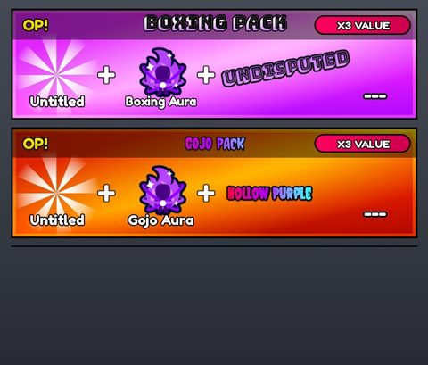</a> <b>ScreenFrames</b> › ShopFrame.Contents</td>
<td width="33%" valign="top"><a href="screenshots/41_ScreenFrames__Contents.jpg">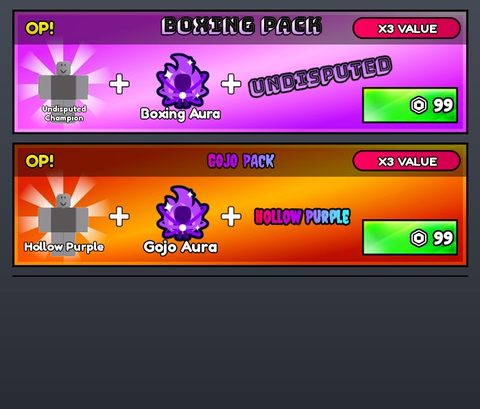</a> <b>ScreenFrames</b> › ShopFrame.Contents</td>
</tr>
</table>

### Inventory / backpack / pets

<table>
<tr>
<td width="33%" valign="top"><a href="screenshots/29_InventoryHud.jpg">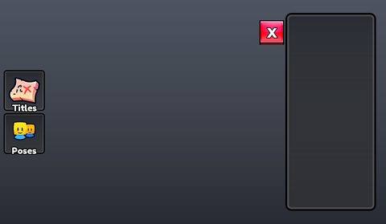</a> <b>InventoryHud</b></td>
<td width="33%" valign="top"><a href="screenshots/31_InventoryHud__ContentsPoses.jpg">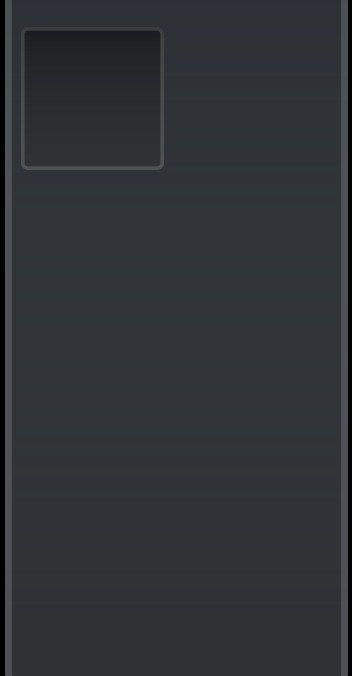</a> <b>InventoryHud</b> › Holder.ContentsPoses</td>
<td width="33%" valign="top"><a href="screenshots/62_InventoryHud.jpg">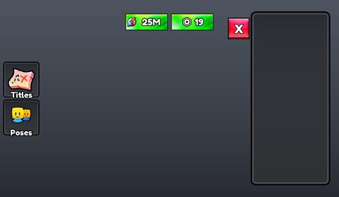</a> <b>InventoryHud</b></td>
</tr>
<tr>
<td width="33%" valign="top"><a href="screenshots/64_InventoryHud__ContentsPoses.jpg">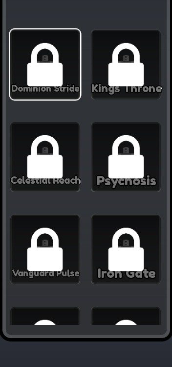</a> <b>InventoryHud</b> › Holder.ContentsPoses</td>
</tr>
</table>

### Settings & menus

<table>
<tr>
<td width="33%" valign="top"><a href="screenshots/05_ScreenFrames__BG.jpg">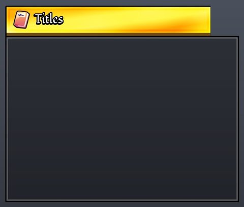</a> <b>ScreenFrames</b> › TitlesFrame.BG</td>
<td width="33%" valign="top"><a href="screenshots/06_ScreenFrames__Container.jpg">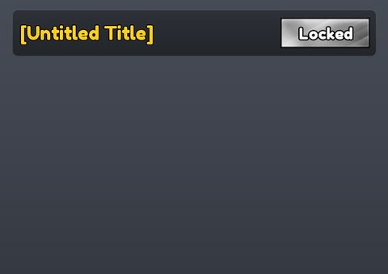</a> <b>ScreenFrames</b> › TitlesFrame.Container</td>
<td width="33%" valign="top"><a href="screenshots/12_ScreenFrames__Content.jpg">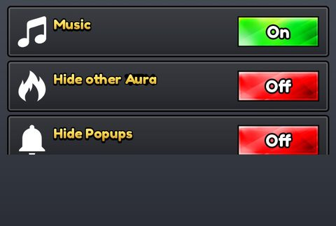</a> <b>ScreenFrames</b> › SettingsFrame.Content</td>
</tr>
<tr>
<td width="33%" valign="top"><a href="screenshots/30_InventoryHud__ContainerTitles.jpg">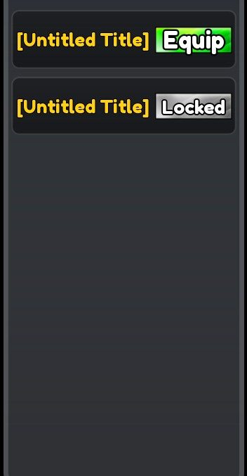</a> <b>InventoryHud</b> › Holder.ContainerTitles</td>
<td width="33%" valign="top"><a href="screenshots/36_ScreenFrames__Container.jpg">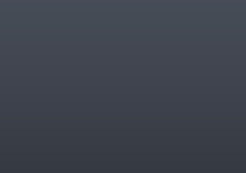</a> <b>ScreenFrames</b> › TitlesFrame.Container</td>
<td width="33%" valign="top"><a href="screenshots/42_ScreenFrames__Content.jpg">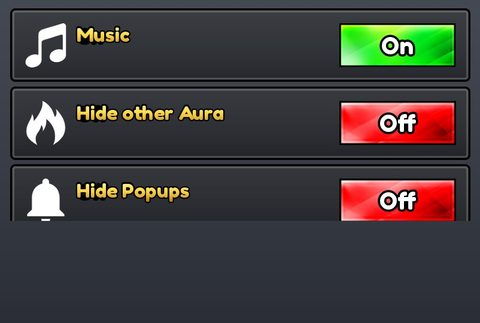</a> <b>ScreenFrames</b> › SettingsFrame.Content</td>
</tr>
<tr>
<td width="33%" valign="top"><a href="screenshots/63_InventoryHud__ContainerTitles.jpg">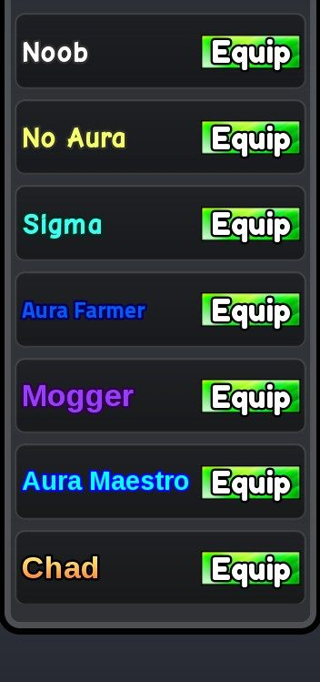</a> <b>InventoryHud</b> › Holder.ContainerTitles</td>
</tr>
</table>

### Popups, notifications, prompts

<table>
<tr>
<td width="33%" valign="top"><a href="screenshots/27_Hud__AreaNotification.jpg">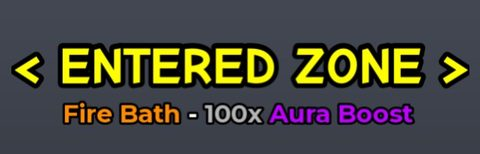</a> <b>Hud</b> › AreaNotification</td>
</tr>
</table>

### Loading & intro

<table>
<tr>
<td width="33%" valign="top"><a href="screenshots/01_LoadingScreen.jpg">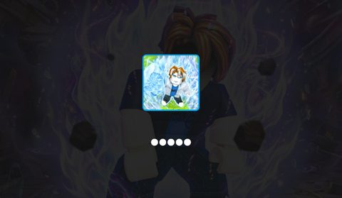</a> <b>LoadingScreen</b></td>
<td width="33%" valign="top"><a href="screenshots/02_LoadingScreen__Update.jpg">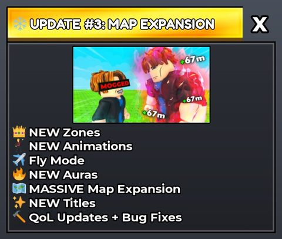</a> <b>LoadingScreen</b> › Update</td>
</tr>
</table>

### Leaderboards & stats

<table>
<tr>
<td width="33%" valign="top"><a href="screenshots/28_Hud__TopBar.jpg">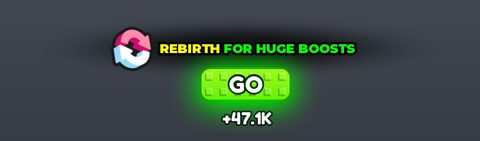</a> <b>Hud</b> › TopBar</td>
<td width="33%" valign="top"> <b>Hud</b> › TopBar</td>
</tr>
</table>

### End of round, death, results

<table>
<tr>
<td width="33%" valign="top"><a href="screenshots/07_ScreenFrames__BG.jpg">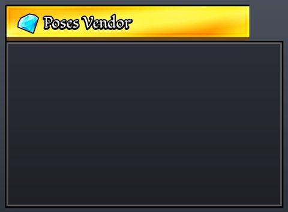</a> <b>ScreenFrames</b> › PosesVenderFrame.BG</td>
<td width="33%" valign="top"><a href="screenshots/08_ScreenFrames__Contents.jpg">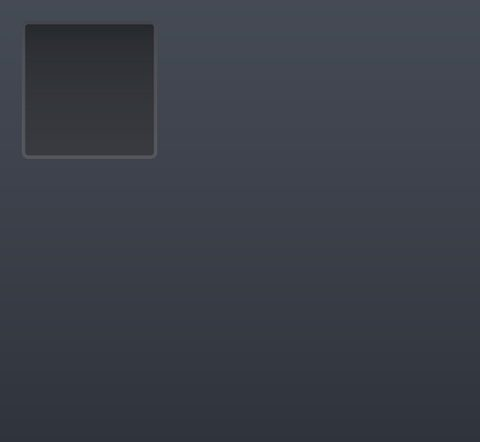</a> <b>ScreenFrames</b> › PosesVenderFrame.Contents</td>
<td width="33%" valign="top"><a href="screenshots/09_ScreenFrames__Preview.jpg">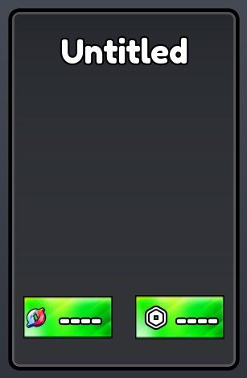</a> <b>ScreenFrames</b> › PosesVenderFrame.Preview</td>
</tr>
<tr>
<td width="33%" valign="top"> <b>ScreenFrames</b> › PosesVenderFrame.Preview</td>
</tr>
</table>

### HUD & currency

<table>
<tr>
<td width="33%" valign="top"><a href="screenshots/03_ScreenFrames__MainBG.jpg">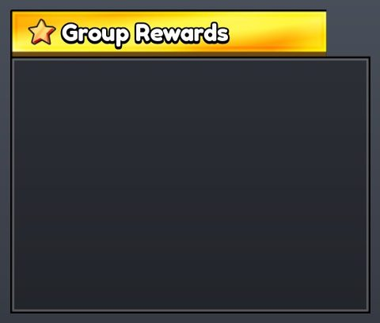</a> <b>ScreenFrames</b> › GroupRewards.MainBG</td>
<td width="33%" valign="top"><a href="screenshots/04_ScreenFrames__MainHolder.jpg">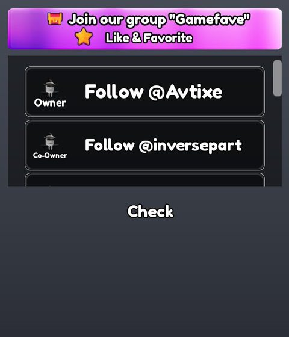</a> <b>ScreenFrames</b> › GroupRewards.MainHolder</td>
<td width="33%" valign="top"><a href="screenshots/10_ScreenFrames__MainBG.jpg">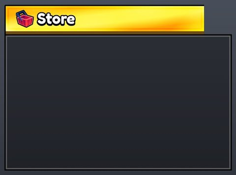</a> <b>ScreenFrames</b> › ShopFrame.MainBG</td>
</tr>
<tr>
<td width="33%" valign="top"><a href="screenshots/16_Plat__MainBG.jpg">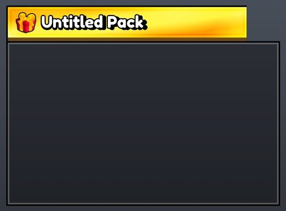</a> <b>Plat</b> › YellowPack.MainBG</td>
<td width="33%" valign="top"><a href="screenshots/17_Plat__LeftContainer.jpg">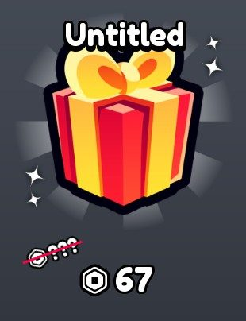</a> <b>Plat</b> › YellowPack.LeftContainer</td>
<td width="33%" valign="top"><a href="screenshots/18_Plat__RightContainer.jpg">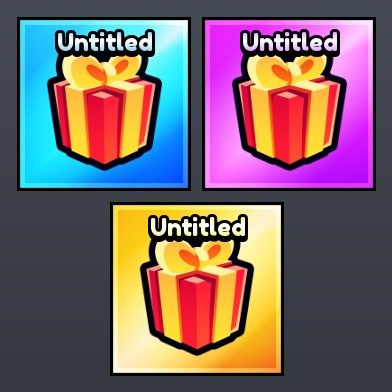</a> <b>Plat</b> › YellowPack.RightContainer</td>
</tr>
<tr>
<td width="33%" valign="top"><a href="screenshots/19_Plat__MainBG.jpg">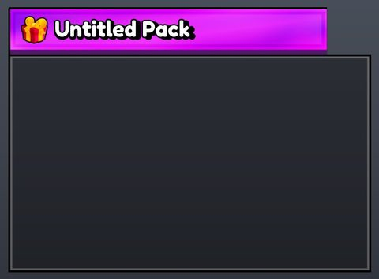</a> <b>Plat</b> › PurplePack.MainBG</td>
<td width="33%" valign="top"><a href="screenshots/20_Plat__LeftContainer.jpg">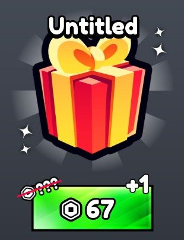</a> <b>Plat</b> › PurplePack.LeftContainer</td>
<td width="33%" valign="top"><a href="screenshots/22_Plat__MainBG.jpg">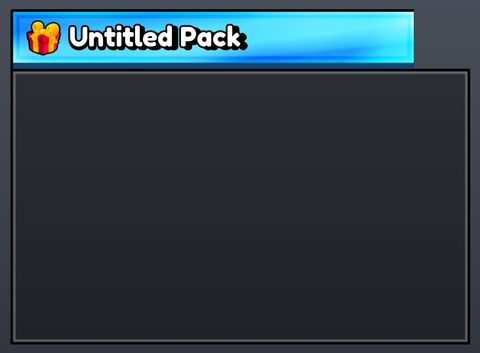</a> <b>Plat</b> › BluePack.MainBG</td>
</tr>
<tr>
<td width="33%" valign="top"><a href="screenshots/23_Plat__LeftContainer.jpg">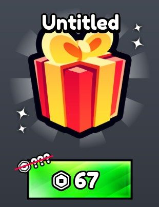</a> <b>Plat</b> › BluePack.LeftContainer</td>
<td width="33%" valign="top"><a href="screenshots/25_Hud.jpg">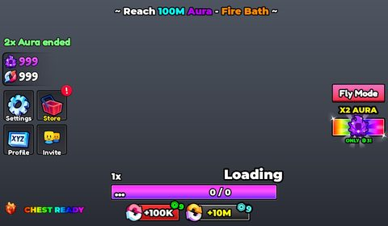</a> <b>Hud</b></td>
<td width="33%" valign="top"><a href="screenshots/26_Hud__TickTemplate.jpg">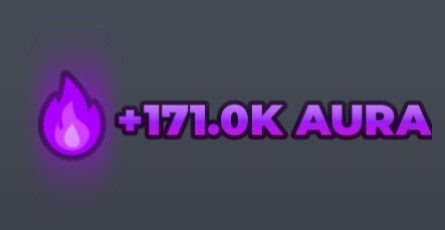</a> <b>Hud</b> › TickTemplate</td>
</tr>
<tr>
<td width="33%" valign="top"><a href="screenshots/34_ScreenFrames__MainHolder.jpg">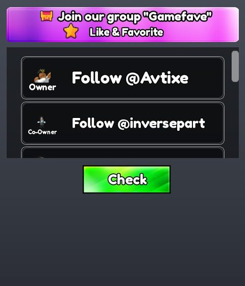</a> <b>ScreenFrames</b> › GroupRewards.MainHolder</td>
<td width="33%" valign="top"><a href="screenshots/55_Hud.jpg">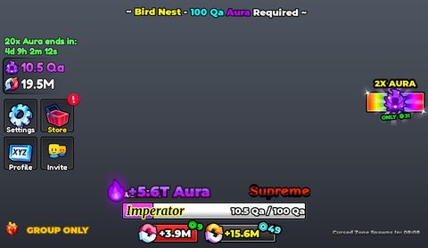</a> <b>Hud</b></td>
<td width="33%" valign="top"><a href="screenshots/59_Hud__TickTemplate.jpg">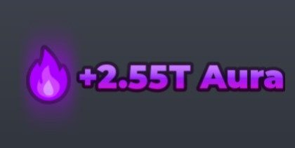</a> <b>Hud</b> › TickTemplate</td>
</tr>
<tr>
<td width="33%" valign="top"><a href="screenshots/60_Hud__TickTemplate.jpg">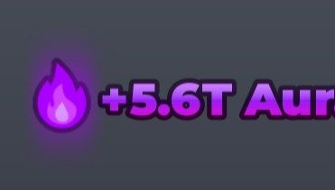</a> <b>Hud</b> › TickTemplate</td>
<td width="33%" valign="top"><a href="screenshots/61_Hud__TickTemplate.jpg">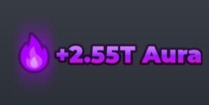</a> <b>Hud</b> › TickTemplate</td>
</tr>
</table>

### Map vote / teams / matchmaking

<table>
<tr>
<td width="33%" valign="top"><a href="screenshots/13_ScreenFrames__Background.jpg">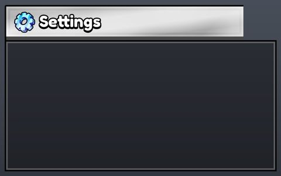</a> <b>ScreenFrames</b> › SettingsFrame.Background</td>
<td width="33%" valign="top"><a href="screenshots/15_ScreenFrames__Background.jpg">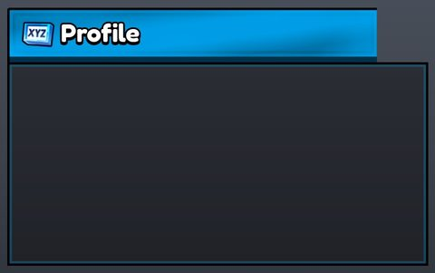</a> <b>ScreenFrames</b> › ProfileFrame.Background</td>
</tr>
</table>

### Other

<table>
<tr>
<td width="33%" valign="top"><a href="screenshots/14_ScreenFrames__Content.jpg">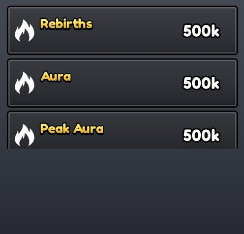</a> <b>ScreenFrames</b> › ProfileFrame.Content</td>
<td width="33%" valign="top"><a href="screenshots/44_ScreenFrames__Content.jpg">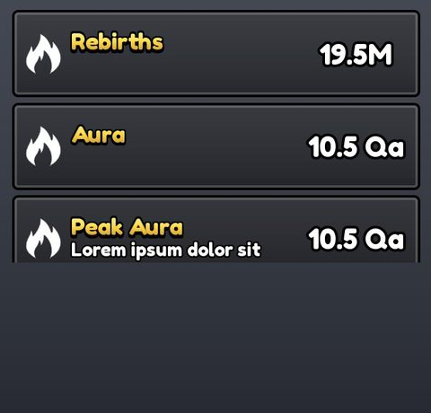</a> <b>ScreenFrames</b> › ProfileFrame.Content</td>
</tr>
</table>

## Model previews

<table>
<tr>
<td width="25%" valign="top"><a href="models/ServerStorage/Decompiled/LocalPlayer%20Character.rbxm">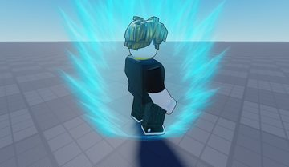</a> <b>LocalPlayer Character</b> <code>models/ServerStorage/Decompiled/LocalPlayer Character.rbxm</code></td>
<td width="25%" valign="top"><a href="models/Workspace/Map/Chest.rbxm">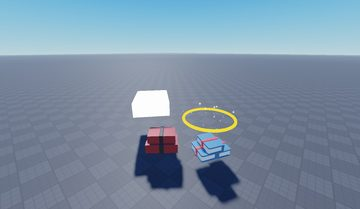</a> <b>Chest</b> <code>models/Workspace/Map/Chest.rbxm</code></td>
<td width="25%" valign="top"><a href="models/ReplicatedStorage/Assets/Auras/26.rbxm">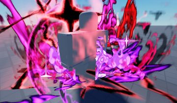</a> <b>26</b> <code>models/ReplicatedStorage/Assets/Auras/26.rbxm</code></td>
<td width="25%" valign="top"><a href="models/Workspace/Training%20Areas/Frozen%20Artifact.rbxm">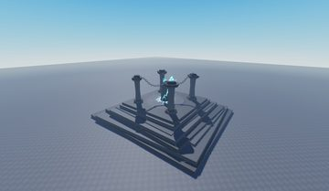</a> <b>Frozen Artifact</b> <code>models/Workspace/Training Areas/Frozen Artifact.rbxm</code></td>
</tr>
<tr>
<td width="25%" valign="top"><a href="models/Workspace/Leaderboards/SuffixBoard.rbxm">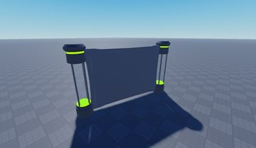</a> <b>SuffixBoard</b> <code>models/Workspace/Leaderboards/SuffixBoard.rbxm</code></td>
<td width="25%" valign="top"><a href="models/ReplicatedStorage/Assets/PoseProps/SilverSurfer/Cube.rbxm">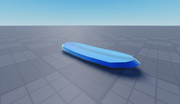</a> <b>Cube</b> <code>models/ReplicatedStorage/Assets/PoseProps/SilverSurfer/Cube.rbxm</code></td>
<td width="25%" valign="top"><a href="models/Workspace/Tree.rbxm">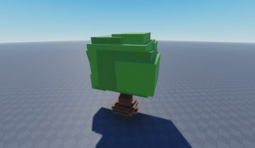</a> <b>Tree</b> <code>models/Workspace/Tree.rbxm</code></td>
<td width="25%" valign="top"><a href="models/Workspace/Inventory/InventoryRoom.rbxm">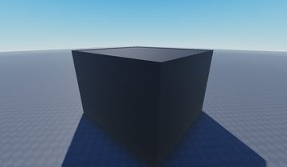</a> <b>InventoryRoom</b> <code>models/Workspace/Inventory/InventoryRoom.rbxm</code></td>
</tr>
<tr>
<td width="25%" valign="top"><a href="models/Workspace/Leaderboards/AuraLB.rbxm">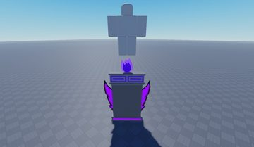</a> <b>AuraLB</b> <code>models/Workspace/Leaderboards/AuraLB.rbxm</code></td>
<td width="25%" valign="top"> <b>Divine Realm</b> <code>models/Workspace/Divine Realm.rbxm</code></td>
<td width="25%" valign="top"> <b>PlayTimeLB</b> <code>models/Workspace/Leaderboards/PlayTimeLB.rbxm</code></td>
<td width="25%" valign="top"> <b>RebirthPad</b> <code>models/Workspace/RebirthPad.rbxm</code></td>
</tr>
</table>

## Notable scripts

Top-scored scripts of this game per topic (full tree in [source/scripts](source/scripts/)).

| Topic | Scripts |
|---|---|
| UI animation (tweens, hover / click, pop-ins, springs) | [`Hud Handler`](source/scripts/StarterPlayer/StarterPlayerScripts/Hud%20Handler.client.lua) 1469 lines [`UIManager`](source/scripts/StarterPlayer/StarterPlayerScripts/Modules/UIManager.lua) 888 lines [`HudController`](source/scripts/StarterPlayer/StarterPlayerScripts/Controllers/HudController.lua) 882 lines [`Monetization`](source/scripts/StarterPlayer/StarterPlayerScripts/Monetization.client.lua) 263 lines [`Monetization`](source/scripts/ReplicatedStorage/Monetization.lua) 637 lines |
| UI controllers / window managers / menus | [`InventoryRoomController`](source/scripts/StarterPlayer/StarterPlayerScripts/Controllers/InventoryRoomController.lua) 551 lines [`InventoryHudController`](source/scripts/StarterPlayer/StarterPlayerScripts/Controllers/InventoryHudController.lua) 286 lines [`UIManager`](source/scripts/StarterPlayer/StarterPlayerScripts/Modules/UIManager.lua) 888 lines [`HudController`](source/scripts/StarterPlayer/StarterPlayerScripts/Controllers/HudController.lua) 882 lines [`InventoryTitlesPanel`](source/scripts/StarterPlayer/StarterPlayerScripts/Handlers/InventoryTitlesPanel.lua) 520 lines |
| Notifications, toasts, popups, prompts | [`Notifications`](source/scripts/ReplicatedStorage/Frameworks/Notifications.lua) 478 lines [`TrainingAreasService`](source/scripts/ServerScriptService/GameServer/Services/TrainingAreasService.lua) 601 lines [`CursedZoneService`](source/scripts/ServerScriptService/GameServer/Services/CursedZoneService.lua) 282 lines [`ChestController`](source/scripts/StarterPlayer/StarterPlayerScripts/Controllers/ChestController.lua) 599 lines [`Monetization`](source/scripts/ReplicatedStorage/Monetization.lua) 637 lines |
| Loading / intro screens | [`Loading`](source/scripts/StarterGui/LoadingScreen/Loading.client.lua) 147 lines |
| Camera, cutscenes, screen shake | [`CameraEffectsController`](source/scripts/StarterPlayer/StarterPlayerScripts/Controllers/CameraEffectsController.lua) 143 lines [`InventoryRoomController`](source/scripts/StarterPlayer/StarterPlayerScripts/Controllers/InventoryRoomController.lua) 551 lines [`AdminController`](source/scripts/StarterPlayer/StarterPlayerScripts/Controllers/AdminController.lua) 811 lines [`TrainingAreasController`](source/scripts/StarterPlayer/StarterPlayerScripts/Controllers/TrainingAreasController.lua) 538 lines [`Hud Handler`](source/scripts/StarterPlayer/StarterPlayerScripts/Hud%20Handler.client.lua) 1469 lines |
| VFX, particles, beams, hit effects | [`AuraCore`](source/scripts/ReplicatedStorage/Modules/AuraCore.lua) 790 lines [`VFX Scaler`](source/scripts/StarterPlayer/StarterPlayerScripts/VFX%20Scaler.client.lua) 576 lines [`RankFXController`](source/scripts/StarterPlayer/StarterPlayerScripts/Controllers/RankFXController.lua) 138 lines [`Hud Handler`](source/scripts/StarterPlayer/StarterPlayerScripts/Hud%20Handler.client.lua) 1469 lines [`Chest Handler`](source/scripts/StarterPlayer/StarterPlayerScripts/Chest%20Handler.client.lua) 697 lines |
| DataStore / player data | [`DataService`](source/scripts/ServerScriptService/GameServer/Data/DataService.lua) 330 lines |
| Monetization (dev products, game passes, receipts) | [`ReceiptService`](source/scripts/ServerScriptService/GameServer/Services/ReceiptService.lua) 112 lines [`Monetization`](source/scripts/ReplicatedStorage/Monetization.lua) 637 lines |
| RNG, eggs, gacha, rarity rolls, pets | [`AdminController`](source/scripts/StarterPlayer/StarterPlayerScripts/Controllers/AdminController.lua) 811 lines [`TrainingAreasController`](source/scripts/StarterPlayer/StarterPlayerScripts/Controllers/TrainingAreasController.lua) 538 lines [`AuraPopupController`](source/scripts/StarterPlayer/StarterPlayerScripts/Controllers/AuraPopupController.lua) 175 lines [`CameraEffectsController`](source/scripts/StarterPlayer/StarterPlayerScripts/Controllers/CameraEffectsController.lua) 143 lines [`Notifications`](source/scripts/ReplicatedStorage/Frameworks/Notifications.lua) 478 lines |
| Combat, weapons, hitboxes, abilities | [`ChestService`](source/scripts/ServerScriptService/GameServer/Services/ChestService.lua) 158 lines [`TrainingAreasService`](source/scripts/ServerScriptService/GameServer/Services/TrainingAreasService.lua) 601 lines [`Chest Handler`](source/scripts/StarterPlayer/StarterPlayerScripts/Chest%20Handler.client.lua) 697 lines [`ChestController`](source/scripts/StarterPlayer/StarterPlayerScripts/Controllers/ChestController.lua) 599 lines [`CursedZoneService`](source/scripts/ServerScriptService/GameServer/Services/CursedZoneService.lua) 282 lines |
| Character movement (sprint, dash, double jump, slide) | [`FlyModule`](source/scripts/StarterPlayer/StarterPlayerScripts/FlyModule.lua) 172 lines |
| Tycoon / plots / bases / building | [`Chest Handler`](source/scripts/StarterPlayer/StarterPlayerScripts/Chest%20Handler.client.lua) 697 lines [`ChestController`](source/scripts/StarterPlayer/StarterPlayerScripts/Controllers/ChestController.lua) 599 lines [`LeaderboardService`](source/scripts/ServerScriptService/GameServer/Services/LeaderboardService.lua) 1172 lines [`ShopFrame`](source/scripts/StarterPlayer/StarterPlayerScripts/Handlers/ShopFrame.lua) 591 lines [`InventoryPosePanel`](source/scripts/StarterPlayer/StarterPlayerScripts/Handlers/InventoryPosePanel.lua) 846 lines |
| Leaderboards & stats | [`LeaderboardService`](source/scripts/ServerScriptService/GameServer/Services/LeaderboardService.lua) 1172 lines |
| Admin panels & commands | [`AdminService`](source/scripts/ServerScriptService/GameServer/Services/AdminService.lua) 148 lines [`AdminConfig`](source/scripts/ServerScriptService/GameServer/Config/AdminConfig.lua) 15 lines |
| Sound & music | [`SmartAudio`](source/scripts/ReplicatedStorage/Frameworks/SmartAudio.lua) 97 lines [`SoundMuteUtil`](source/scripts/ReplicatedStorage/Modules/SoundMuteUtil.lua) 69 lines [`RankFXController`](source/scripts/StarterPlayer/StarterPlayerScripts/Controllers/RankFXController.lua) 138 lines |
| Daily rewards, quests, codes, playtime | [`LegacyBridgeService`](source/scripts/ServerScriptService/GameServer/Services/LegacyBridgeService.lua) 240 lines [`ChestService`](source/scripts/ServerScriptService/GameServer/Services/ChestService.lua) 158 lines [`TrainingAreasService`](source/scripts/ServerScriptService/GameServer/Services/TrainingAreasService.lua) 601 lines [`PlayerService`](source/scripts/ServerScriptService/GameServer/Services/PlayerService.lua) 588 lines |
| Utility modules (number format, signals, tables, timers) | [`LeaderboardService`](source/scripts/ServerScriptService/GameServer/Services/LeaderboardService.lua) 1172 lines [`AdminService`](source/scripts/ServerScriptService/GameServer/Services/AdminService.lua) 148 lines [`CharacterReplicaService`](source/scripts/ServerScriptService/GameServer/Services/CharacterReplicaService.lua) 313 lines [`PlayerService`](source/scripts/ServerScriptService/GameServer/Services/PlayerService.lua) 588 lines [`TableUtil`](source/scripts/ServerScriptService/GameServer/Core/TableUtil.lua) 58 lines |

### In the curated script library

- [Admin service with whitelist, rate limit, audit](../../Scripts/16-Admin/AdminService-AuditRateLimit__aura-ascension.lua) — Admin check by UserIds or group rank (from a config module), per-admin rate limit, an AllowedCommands whitelist, structured payloads, and an audit log of who ran what.
- [Lease session lock in UpdateAsync](../../Scripts/07-Data-Saving/DataService-LeaseLock__aura-ascension.lua) — Full data service: session lease stored inside the save and taken/checked in one UpdateAsync, dirty flags, retries, save slots, parallel shutdown flush with deadline.
- [Grouped profile template with _Meta](../../Scripts/07-Data-Saving/ProfileTemplate__aura-ascension.lua) — Data template grouped by purpose (Stats, Progression, Inventory, Monetization, Cooldowns, Admin audit trail) with a _Meta block holding version and session lease.
- [Sanitise, publish-on-change, merge (excerpt)](../../Scripts/15-Leaderboards/LeaderboardService-SanitizeMerge__aura-ascension.lua) — Clamps values (NaN/inf/negative/too big) before writing, publishes only changed values on an interval, formats durations and big numbers, and merges cached global entries with live players before sorting.
- [Abbreviated leaderstats (excerpt)](../../Scripts/15-Leaderboards/Leaderstats-Abbreviated__aura-ascension.lua) — Creates leaderstats with StringValue columns and fills them with FormatNumber text (1.2M) from the profile.
- [Receipt service with product maps](../../Scripts/08-Monetization/ReceiptService__aura-ascension.lua) — Small receipt service: waits for the profile, asks each owner service (boosts, rebirth packs, poses, packs) to grant by product id, returns NotProcessedYet when a grant fails, exposes an entitlements query.
- [Minimal table helpers](../../Scripts/19-Utility/TableUtil-Small__aura-ascension.lua) — DeepCopy (keys too), ShallowCopy, ArrayToSet, SetToArray (sorted) and SanitizeKey.
- [Remotes grouped per service](../../Scripts/19-Utility/RemoteBinder-PerService__aura-ascension.lua) — Creates RF/RE folders per service on demand (Knit-style layout) and binds functions / fires events by service + name.
- [Per-player per-key cooldown limiter](../../Scripts/19-Utility/RateLimiter-PerKey__aura-ascension.lua) — Allow(player, key, cooldown) returns false (and the time left) until the cooldown for that key has passed; Forget(player) on leave.

## Folders

| Folder | What |
|---|---|
| `screenshots/` | full frames; `crops/` = the panel only; `models/` = 3D previews; `thumbs/` = gallery thumbnails |
| `ui/` | every screen as a Lua builder (`require(module)()` returns the ScreenGui); `_StarterGui-all.lua` builds every StarterGui screen |
| `models/` | every model as .rbxm (the only .rbxm files), mirroring the place tree, scripts removed |
| `map/` | `workspace.rbxm` (the map as a model), `lighting.lua` (sky + post effects), `materials.lua`, `Environment.lua` |
| `animations/`, `audio/` | KeyframeSequence / Sound builders (.lua), `AnimationIds.lua`, `Sounds.lua` |
| `source/` | all scripts as .luau, `tree.txt`, `ui.txt`, `remotes.txt`, `assets.txt`, `flags.txt` |
