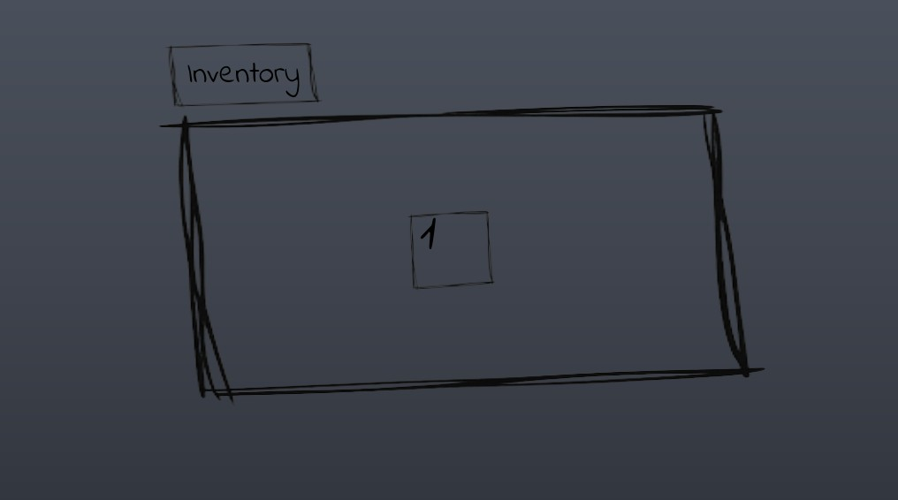
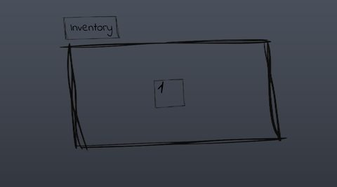
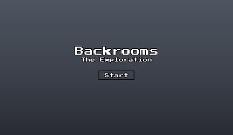
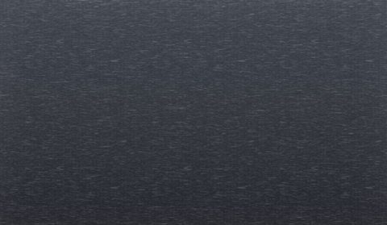
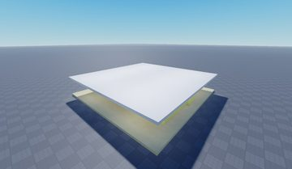
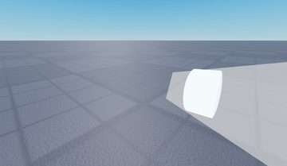
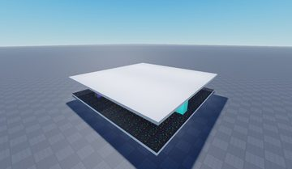
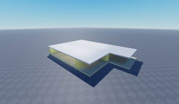

# Backrooms Exploration

> 👻 **Horror** · horror exploration · source file `🧀 I Backrooms Exploration By Fares.rbxl`

[⬅ Back to the catalog](../../README.md) · [Assets inventory](ASSETS.md) · [Style numbers](reference.md) · [Scripts](source/scripts/) · [Code analysis](source/README.md)

## At a glance

| | |
|---|---|
| Provenance | copy of a live game (saveinstance / decompiled client code) |
| Screens | 5 ScreenGuis, 32 GUI objects → **4 screenshots** |
| Models (.rbxm) | 12 models, 1 model sets, 0 VFX sets |
| Lua builders (.lua) | 7 UI screens, 5 animation packs, 1 audio packs |
| Code | 25 scripts, 2,270 lines |
| Asset ids | 4 animations, 239 sounds |
| Safety scan | 0 HIGH / 0 MED flags ([flags.txt](source/flags.txt)) |

**Fonts:** `LuckiestGuy Regular`×7, `IndieFlower Regular`×3, `PressStart2P Regular`×3

## UI screenshots

Captured in Studio from the place's own ScreenGuis (scripts stripped). Each panel was opened on its own; click a thumbnail for the full 1519×886 frame. Runtime-filled lists (shop items, inventories) show their template state.

### Inventory / backpack / pets

<table>
<tr>
<td width="33%" valign="top"> <b>MainInventory</b> › Holder</td>
</tr>
</table>

### Settings & menus

<table>
<tr>
<td width="33%" valign="top"> <b>TitleScreen</b></td>
</tr>
</table>

### Other

<table>
<tr>
<td width="33%" valign="top"> <b>VHSSTYLE</b></td>
<td width="33%" valign="top"> <b>DELETEME</b> › Frame</td>
</tr>
</table>

## Model previews

<table>
<tr>
<td width="25%" valign="top"> <b>Part_Spawn</b> <code>models/ReplicatedStorage/Parts/Level_0/Part_Spawn.rbxm</code></td>
<td width="25%" valign="top"> <b>Flashlight</b> <code>models/StarterPack/Flashlight.rbxm</code></td>
<td width="25%" valign="top"> <b>Part_1</b> <code>models/ReplicatedStorage/Parts/Level_Arcade/Part_1.rbxm</code></td>
<td width="25%" valign="top"> <b>Titlescreen</b> <code>models/Workspace/Titlescreen.rbxm</code></td>
</tr>
</table>

## Notable scripts

Top-scored scripts of this game per topic (full tree in [source/scripts](source/scripts/)).

| Topic | Scripts |
|---|---|
| UI animation (tweens, hover / click, pop-ins, springs) | [`LocalScript`](source/scripts/StarterGui/Slotsforinventory/LocalScript.client.lua) 228 lines |
| Camera, cutscenes, screen shake | [`CameraSystemAndMore`](source/scripts/StarterPlayer/StarterPlayerScripts/CameraSystemAndMore.client.lua) 343 lines [`Script`](source/scripts/Workspace/CameraPart/Script.server.lua) 115 lines |
| NPC / AI / monsters | [`AI Chase`](source/scripts/ReplicatedStorage/Parts/Level_0/Part_Spawn/Entity/AI%20Chase.server.lua) 420 lines |
| Character movement (sprint, dash, double jump, slide) | [`CameraSystemAndMore`](source/scripts/StarterPlayer/StarterPlayerScripts/CameraSystemAndMore.client.lua) 343 lines |
| Sound & music | [`MusicController`](source/scripts/ServerScriptService/MusicController.server.lua) 20 lines |

### In the curated script library

- [First-person bob, sway & breathing](../../Scripts/05-Camera-Cutscene/FirstPersonBobSway__backrooms-exploration.lua) — Best head-bob/sway reference: layered sine + noise offsets with every constant exposed at the top.
- [Stalker monster state machine](../../Scripts/12-NPC-AI/StalkerChaseStateMachine__backrooms-exploration.lua) — Backrooms entity with IDLE/STALK/FLEE/CHASE states: hears players in a radius, hides behind cover found by raycast sampling, peeks, flees when looked at (dot-product + raycast), sometimes snaps into a chase and plays a jumpscare kill.

## Folders

| Folder | What |
|---|---|
| `screenshots/` | full frames; `crops/` = the panel only; `models/` = 3D previews; `thumbs/` = gallery thumbnails |
| `ui/` | every screen as a Lua builder (`require(module)()` returns the ScreenGui); `_StarterGui-all.lua` builds every StarterGui screen |
| `models/` | every model as .rbxm (the only .rbxm files), mirroring the place tree, scripts removed |
| `map/` | `workspace.rbxm` (the map as a model), `lighting.lua` (sky + post effects), `materials.lua`, `Environment.lua` |
| `animations/`, `audio/` | KeyframeSequence / Sound builders (.lua), `AnimationIds.lua`, `Sounds.lua` |
| `source/` | all scripts as .luau, `tree.txt`, `ui.txt`, `remotes.txt`, `assets.txt`, `flags.txt` |
