# Bee Swarm Simulator (remake)

> ⛏️ **Simulator** · collecting simulator · source file `Bee20Sim(1).rbxl`

[⬅ Back to the catalog](../../README.md) · [Assets inventory](ASSETS.md) · [Style numbers](reference.md) · [Scripts](source/scripts/) · [Code analysis](source/README.md)

## At a glance

| | |
|---|---|
| Provenance | template with full source |
| Screens | 5 ScreenGuis, 622 GUI objects → **23 screenshots** |
| Models (.rbxm) | 739 models, 23 model sets, 3 VFX sets |
| Lua builders (.lua) | 47 UI screens, 18 animation packs, 4 audio packs |
| Code | 269 scripts, 29,930 lines |
| Asset ids | 37 animations, 17 sounds |
| Safety scan | 2 HIGH / 1 MED flags ([flags.txt](source/flags.txt)) |

**Fonts:** `FredokaOne Regular`×280, `SourceSansPro Regular`×18, `ComicNeueAngular Regular`×12, `ComicNeueAngular Bold`×11, `Poppins Bold`×3

## UI screenshots

Captured in Studio from the place's own ScreenGuis (scripts stripped). Each panel was opened on its own; click a thumbnail for the full 1519×886 frame. Runtime-filled lists (shop items, inventories) show their template state.

### Shop & Robux store

<table>
<tr>
<td width="33%" valign="top"><a href="screenshots/09_UI__Shop.jpg">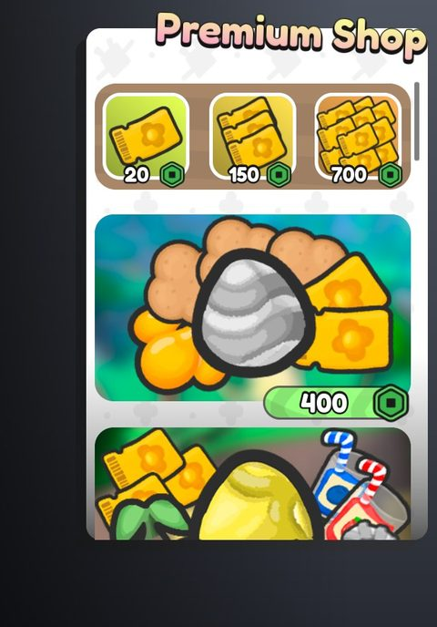</a> <b>UI</b> › Tabs.Shop</td>
<td width="33%" valign="top"><a href="screenshots/11_UI__Shop.jpg">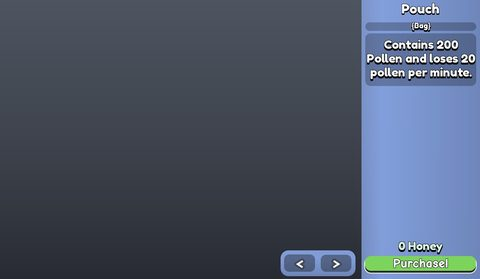</a> <b>UI</b> › Shop</td>
</tr>
</table>

### Inventory / backpack / pets

<table>
<tr>
<td width="33%" valign="top"><a href="screenshots/05_UI__Inventory.jpg">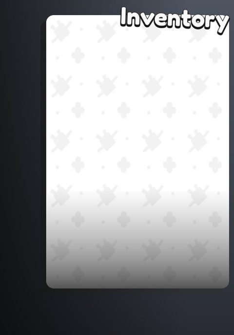</a> <b>UI</b> › Tabs.Inventory</td>
</tr>
</table>

### Index / codex / glossary

<table>
<tr>
<td width="33%" valign="top"><a href="screenshots/07_UI__Index.jpg">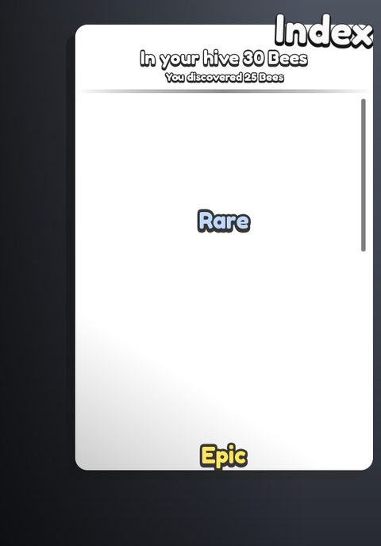</a> <b>UI</b> › Tabs.Index</td>
</tr>
</table>

### Rewards, daily, spin, codes

<table>
<tr>
<td width="33%" valign="top"><a href="screenshots/21_Create_Codes.jpg">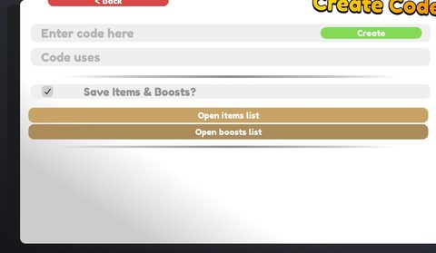</a> <b>Create Codes</b></td>
<td width="33%" valign="top"><a href="screenshots/22_Codes_Management.jpg">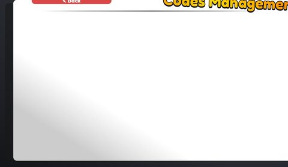</a> <b>Codes Management</b></td>
<td width="33%" valign="top"><a href="screenshots/24_Codes_Management__CodeExample.jpg">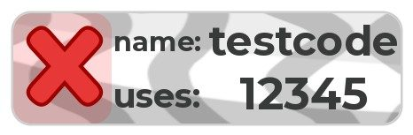</a> <b>Codes Management</b> › CodeExample</td>
</tr>
</table>

### Quests & progression

<table>
<tr>
<td width="33%" valign="top"><a href="screenshots/01_questgui.jpg">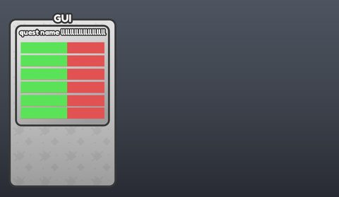</a> <b>questgui</b></td>
<td width="33%" valign="top"><a href="screenshots/06_UI__Quests.jpg">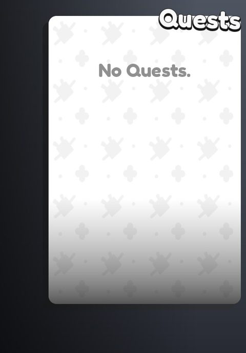</a> <b>UI</b> › Tabs.Quests</td>
<td width="33%" valign="top"><a href="screenshots/13_UI__TreatQuest.jpg">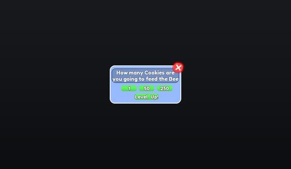</a> <b>UI</b> › TreatQuest</td>
</tr>
</table>

### Settings & menus

<table>
<tr>
<td width="33%" valign="top"><a href="screenshots/08_UI__Settings.jpg">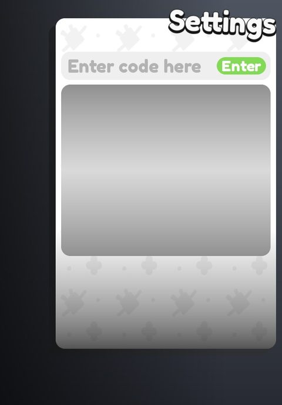</a> <b>UI</b> › Tabs.Settings</td>
<td width="33%" valign="top"><a href="screenshots/18_Developer_Menu.jpg">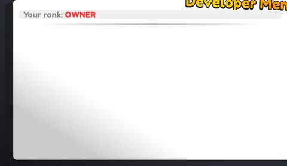</a> <b>Developer Menu</b></td>
<td width="33%" valign="top"> <b>Developer Menu</b> › FunctionExample</td>
</tr>
<tr>
<td width="33%" valign="top"> <b>Developer Menu</b> › NoAccessFunctionExample</td>
</tr>
</table>

### Popups, notifications, prompts

<table>
<tr>
<td width="33%" valign="top"><a href="screenshots/03_BeePopup2.jpg">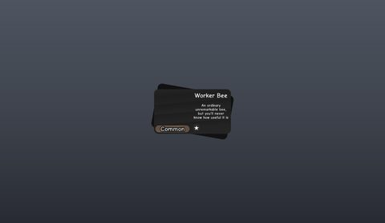</a> <b>BeePopup2</b></td>
<td width="33%" valign="top"><a href="screenshots/14_UI__Dialogue.jpg">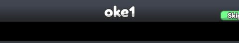</a> <b>UI</b> › Dialogue</td>
</tr>
</table>

### Loading & intro

<table>
<tr>
<td width="33%" valign="top"><a href="screenshots/16_UI__Loading.jpg">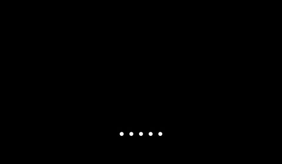</a> <b>UI</b> › Loading</td>
</tr>
</table>

### Other

<table>
<tr>
<td width="33%" valign="top"><a href="screenshots/02_DELETE_ME.jpg">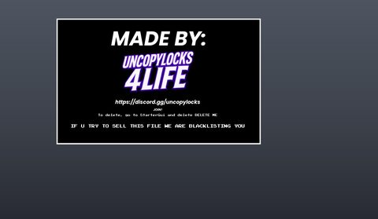</a> <b>DELETE ME</b></td>
<td width="33%" valign="top"><a href="screenshots/04_UI.jpg">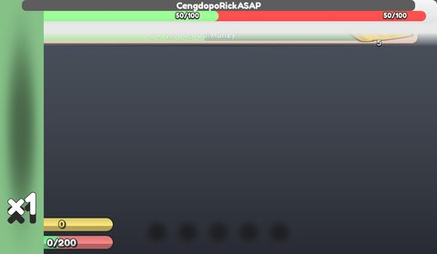</a> <b>UI</b></td>
<td width="33%" valign="top"><a href="screenshots/10_UI__Badges.jpg">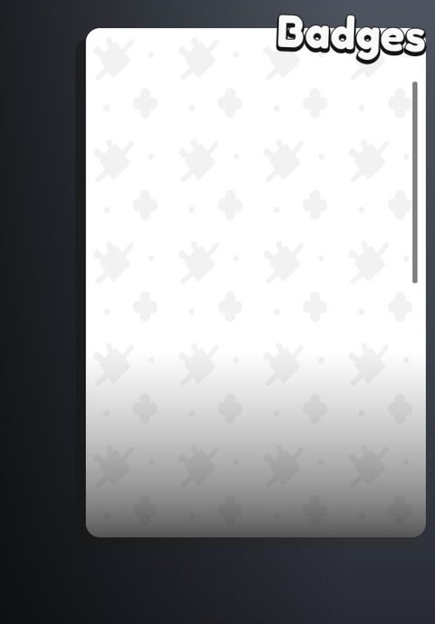</a> <b>UI</b> › Tabs.Badges</td>
</tr>
<tr>
<td width="33%" valign="top"><a href="screenshots/12_UI__BeeInfo.jpg">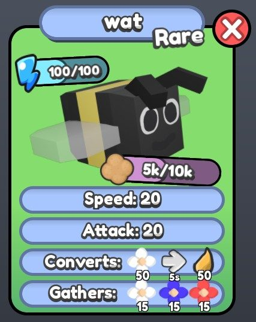</a> <b>UI</b> › BeeInfo</td>
<td width="33%" valign="top"><a href="screenshots/15_UI__Tutor.jpg">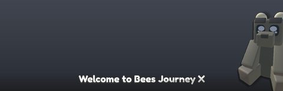</a> <b>UI</b> › Tutor</td>
<td width="33%" valign="top"><a href="screenshots/17_UI__Cooking.jpg">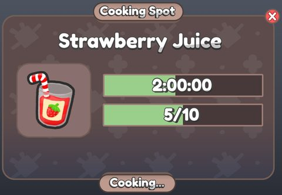</a> <b>UI</b> › Cooking</td>
</tr>
</table>

## Model previews

<table>
<tr>
<td width="25%" valign="top"><a href="models/ReplicatedStorage/Bees/Barbel/Gifted.rbxm">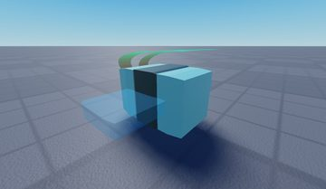</a> <b>Gifted</b> <code>models/ReplicatedStorage/Bees/Barbel/Gifted.rbxm</code></td>
<td width="25%" valign="top"><a href="models/Workspace/FieldDecorations/BlueFlowersField.rbxm">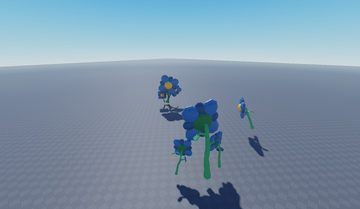</a> <b>BlueFlowersField</b> <code>models/Workspace/FieldDecorations/BlueFlowersField.rbxm</code></td>
<td width="25%" valign="top"><a href="models/Workspace/Caramel.rbxm">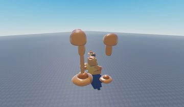</a> <b>Caramel</b> <code>models/Workspace/Caramel.rbxm</code></td>
<td width="25%" valign="top"><a href="models/ServerScriptService/Assets/Bags/Tall%20Grass%20Bag.rbxm">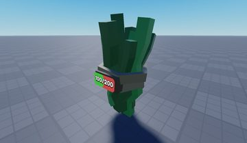</a> <b>Tall Grass Bag</b> <code>models/ServerScriptService/Assets/Bags/Tall Grass Bag.rbxm</code></td>
</tr>
<tr>
<td width="25%" valign="top"><a href="models/Workspace/greenhouse.rbxm">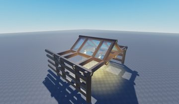</a> <b>greenhouse</b> <code>models/Workspace/greenhouse.rbxm</code></td>
<td width="25%" valign="top"><a href="models/ServerScriptService/Server/UseItem/Gem.rbxm">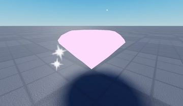</a> <b>Gem</b> <code>models/ServerScriptService/Server/UseItem/Gem.rbxm</code></td>
<td width="25%" valign="top"><a href="models/ServerScriptService/Assets/Tools/Axe.rbxm">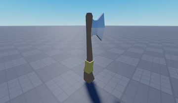</a> <b>Axe</b> <code>models/ServerScriptService/Assets/Tools/Axe.rbxm</code></td>
<td width="25%" valign="top"><a href="models/Workspace/AntSimIsShit%3Dtrue/Egg%20Shop.rbxm">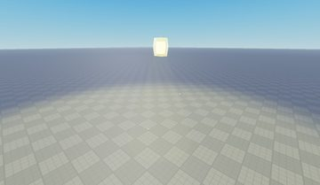</a> <b>Egg Shop</b> <code>models/Workspace/AntSimIsShit=true/Egg Shop.rbxm</code></td>
</tr>
<tr>
<td width="25%" valign="top"><a href="models/Workspace/Grass%5BMAP%5D/Plane.003.rbxm">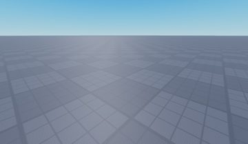</a> <b>Plane.003</b> <code>models/Workspace/Grass[MAP]/Plane.003.rbxm</code></td>
<td width="25%" valign="top"><a href="models/Workspace/Map/Shops/WorkerShop/PHItems/TwistingGrass.rbxm">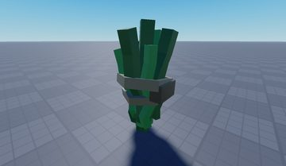</a> <b>TwistingGrass</b> <code>models/Workspace/Map/Shops/WorkerShop/PHItems/TwistingGrass.rbxm</code></td>
<td width="25%" valign="top"><a href="models/Workspace/BlenderModels/No%20model/Bag%20Flower.rbxm">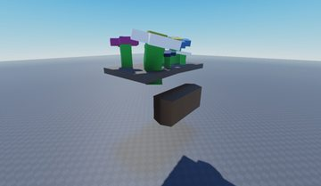</a> <b>Bag Flower</b> <code>models/Workspace/BlenderModels/No model/Bag Flower.rbxm</code></td>
<td width="25%" valign="top"><a href="models/Workspace/Map/Shops/WorkerShop/PHItems/Shovel.rbxm">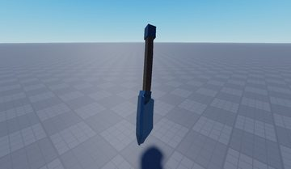</a> <b>Shovel</b> <code>models/Workspace/Map/Shops/WorkerShop/PHItems/Shovel.rbxm</code></td>
</tr>
<tr>
<td width="25%" valign="top"><a href="models/ServerStorage/RedHQPro/PHItems/Model.rbxm">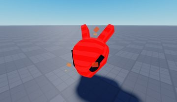</a> <b>Model</b> <code>models/ServerStorage/RedHQPro/PHItems/Model.rbxm</code></td>
<td width="25%" valign="top"><a href="models/Workspace/BlenderModels/No%20model/LeaderBoardBig.rbxm">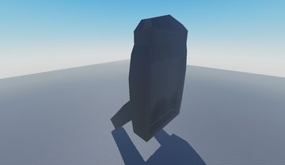</a> <b>LeaderBoardBig</b> <code>models/Workspace/BlenderModels/No model/LeaderBoardBig.rbxm</code></td>
</tr>
</table>

## Notable scripts

Top-scored scripts of this game per topic (full tree in [source/scripts](source/scripts/)).

| Topic | Scripts |
|---|---|
| UI animation (tweens, hover / click, pop-ins, springs) | [`Client`](source/scripts/ReplicatedStorage/StarterGui/UI/Client.client.lua) 1789 lines [`Shops`](source/scripts/ReplicatedStorage/Modules/UI/Shops.lua) 609 lines [`Hover`](source/scripts/ReplicatedStorage/StarterGui/UI/Client/Boost/Hover.client.lua) 125 lines [`MainScript`](source/scripts/ServerStorage/Developer/Tab/Developer%20Menu/MainScript.client.lua) 91 lines [`Quests`](source/scripts/ReplicatedStorage/Modules/UI/Quests.lua) 199 lines |
| UI controllers / window managers / menus | [`Client`](source/scripts/ReplicatedStorage/StarterGui/UI/Client.client.lua) 1789 lines [`Shops`](source/scripts/ReplicatedStorage/Modules/UI/Shops.lua) 609 lines [`MainScript`](source/scripts/ServerStorage/Developer/Tab/Dev/Create%20Codes/MainScript.client.lua) 166 lines |
| Notifications, toasts, popups, prompts | [`NEWAlerts`](source/scripts/ReplicatedStorage/Modules/NEWAlerts.lua) 91 lines [`Alerts`](source/scripts/ReplicatedStorage/Modules/Alerts.lua) 112 lines [`ClientUtilities`](source/scripts/ReplicatedStorage/ClientUtilities.lua) 42 lines [`HivesManager`](source/scripts/ReplicatedStorage/Modules/HivesManager.lua) 263 lines [`HivesManager`](source/scripts/ServerScriptService/Modules/HivesManager.lua) 381 lines |
| Camera, cutscenes, screen shake | [`Utils`](source/scripts/ReplicatedStorage/Modules/Utils.lua) 492 lines [`Quests2`](source/scripts/ReplicatedStorage/Modules/UI/Quests2.lua) 337 lines |
| VFX, particles, beams, hit effects | [`Client`](source/scripts/ReplicatedStorage/StarterGui/UI/Client.client.lua) 1789 lines |
| DataStore / player data | [`DataStore2`](source/scripts/ServerScriptService/DataStore2.lua) 581 lines [`CodeData`](source/scripts/ServerScriptService/CodeData.lua) 61 lines [`Data`](source/scripts/ServerScriptService/Server/Data.lua) 356 lines [`TesterData`](source/scripts/ServerStorage/TesterData.lua) 304 lines [`Script`](source/scripts/Workspace/AntSimIsShit%3Dtrue/Honey/Base/SurfaceGui/Script.server.lua) 113 lines |
| Monetization (dev products, game passes, receipts) | [`Donations`](source/scripts/ServerScriptService/Server/Donations.lua) 37 lines |
| RNG, eggs, gacha, rarity rolls, pets | [`Hives`](source/scripts/ServerScriptService/Server/Hives.lua) 227 lines [`Eggs`](source/scripts/ReplicatedStorage/Modules/Eggs.lua) 78 lines [`FlowerRegisterTEST`](source/scripts/ServerStorage/FlowerRegisterTEST.lua) 436 lines [`Client`](source/scripts/ReplicatedStorage/StarterGui/UI/Client.client.lua) 1789 lines [`Utilities`](source/scripts/ReplicatedStorage/Utilities.lua) 95 lines |
| Combat, weapons, hitboxes, abilities | [`Zone`](source/scripts/ReplicatedStorage/Zone.lua) 876 lines [`ZoneController`](source/scripts/ReplicatedStorage/Zone/ZoneController.lua) 534 lines [`Client`](source/scripts/ReplicatedStorage/StarterGui/UI/Client.client.lua) 1789 lines |
| Tycoon / plots / bases / building | [`Equipment`](source/scripts/ServerScriptService/Server/Equipment.lua) 298 lines [`Client`](source/scripts/ReplicatedStorage/StarterGui/UI/Client.client.lua) 1789 lines |
| Admin panels & commands | [`Equipment`](source/scripts/ServerScriptService/Server/Equipment.lua) 298 lines |
| Sound & music | [`Sounds`](source/scripts/ServerStorage/Sounds.client.lua) 13 lines |
| Daily rewards, quests, codes, playtime | [`Quests`](source/scripts/ServerScriptService/Server/Quests.lua) 146 lines [`Quests`](source/scripts/ReplicatedStorage/Modules/UI/Quests.lua) 199 lines [`Quests2`](source/scripts/ReplicatedStorage/Modules/UI/Quests2.lua) 337 lines [`Client`](source/scripts/ReplicatedStorage/StarterGui/UI/Client.client.lua) 1789 lines |
| Utility modules (number format, signals, tables, timers) | [`Utils`](source/scripts/ReplicatedStorage/Modules/Utils.lua) 492 lines [`Utilities`](source/scripts/ReplicatedStorage/Utilities.lua) 95 lines [`Promise`](source/scripts/ServerScriptService/DataStore2/Promise.lua) 672 lines [`Signal`](source/scripts/ReplicatedStorage/Zone/Signal.lua) 178 lines [`Quests`](source/scripts/ReplicatedStorage/Modules/UI/Quests.lua) 199 lines |

### In the curated script library

- [Clone HUD after game loaded](../../Scripts/04-Loading-Screens/CloneGuiAfterLoad__bee-swarm-sim.lua) — Waits for game.Loaded then clones every ScreenGui from ReplicatedStorage.StarterGui into PlayerGui, so the main UI only appears after loading.
- [Stacking item alerts](../../Scripts/03-Notifications/StackingItemAlerts__bee-swarm-sim.lua) — Item alert feed that merges repeated "+N Item" alerts into one running total instead of spamming new rows, with optional chat system message.
- [Elastic alert feed](../../Scripts/03-Notifications/ElasticAlertFeed__bee-swarm-sim.lua) — Classic bottom-up alert feed: max N rows, elastic slide-in, older alerts pushed up, slow fade out and cleanup.
- [Merging alert stack](../../Scripts/01-UI-Animation/AlertStack_MergingToasts__bee-swarm-sim.lua) — Stacked alerts that grow from 0 size with Back-out, merge repeated item alerts by summing amounts, and shrink away after a lifetime.

## ⚠️ Safety

HIGH flags (backdoors, `require(id)`, `loadstring`, webhooks). Review or delete before reusing:

- `scripts/ServerScriptService/Server/Events.lua`
- `scripts/ServerScriptService/Webhook Testing.server.lua`

## Folders

| Folder | What |
|---|---|
| `screenshots/` | full frames; `crops/` = the panel only; `models/` = 3D previews; `thumbs/` = gallery thumbnails |
| `ui/` | every screen as a Lua builder (`require(module)()` returns the ScreenGui); `_StarterGui-all.lua` builds every StarterGui screen |
| `models/` | every model as .rbxm (the only .rbxm files), mirroring the place tree, scripts removed |
| `map/` | `workspace.rbxm` (the map as a model), `lighting.lua` (sky + post effects), `materials.lua`, `Environment.lua` |
| `animations/`, `audio/` | KeyframeSequence / Sound builders (.lua), `AnimationIds.lua`, `Sounds.lua` |
| `source/` | all scripts as .luau, `tree.txt`, `ui.txt`, `remotes.txt`, `assets.txt`, `flags.txt` |
