# BIG Paintball! Classic

> 🔫 **Shooter** · arena FPS · source file `BIG Paintball! Classic 🔫-1.rbxl`

[⬅ Back to the catalog](../../README.md) · [Assets inventory](ASSETS.md) · [Style numbers](reference.md) · [Scripts](source/scripts/) · [Code analysis](source/README.md)

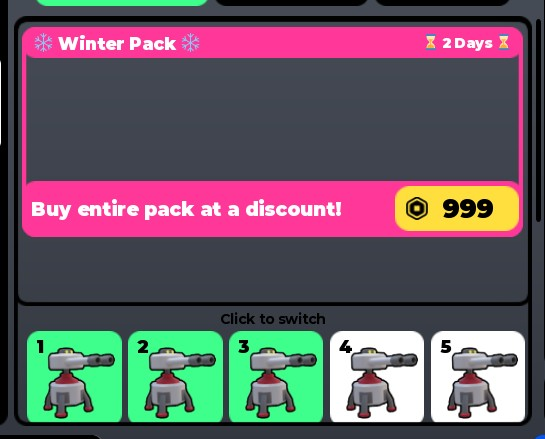

## At a glance

| | |
|---|---|
| Provenance | copy of a live game (saveinstance / decompiled client code) |
| Screens | 32 ScreenGuis, 506 GUI objects → **28 screenshots** |
| Models (.rbxm) | 260 models, 10 model sets, 36 VFX sets |
| Lua builders (.lua) | 120 UI screens, 4 animation packs, 1 audio packs |
| Code | 502 scripts, 68,941 lines |
| Asset ids | 1 animations, 4 sounds |
| Safety scan | 1 HIGH / 8 MED flags ([flags.txt](source/flags.txt)) |

**Fonts:** `GothamSSm Heavy`×106, `GothamSSm Bold`×39, `GothamSSm Medium`×12, `GothamSSm Regular`×7, `SourceSansPro Regular`×5

## UI screenshots

Captured in Studio from the place's own ScreenGuis (scripts stripped). Each panel was opened on its own; click a thumbnail for the full 1519×886 frame. Runtime-filled lists (shop items, inventories) show their template state.

### Shop & Robux store

<table>
<tr>
<td width="33%" valign="top"><a href="screenshots/15_BuyCredits.jpg">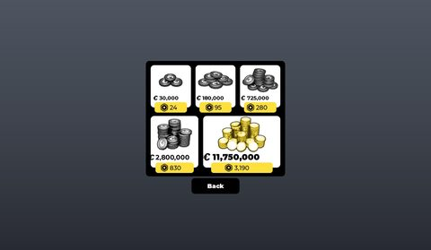</a> <b>BuyCredits</b></td>
</tr>
</table>

### Inventory / backpack / pets

<table>
<tr>
<td width="33%" valign="top"><a href="screenshots/03_OldItem.jpg">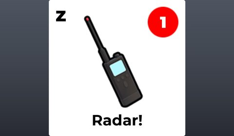</a> <b>OldItem</b></td>
<td width="33%" valign="top"><a href="screenshots/04_Item.jpg">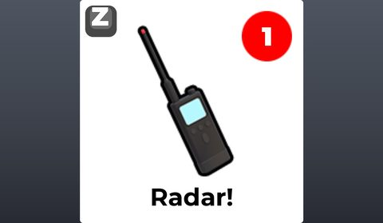</a> <b>Item</b></td>
</tr>
</table>

### Rewards, daily, spin, codes

<table>
<tr>
<td width="33%" valign="top"><a href="screenshots/22_DailyReward.jpg">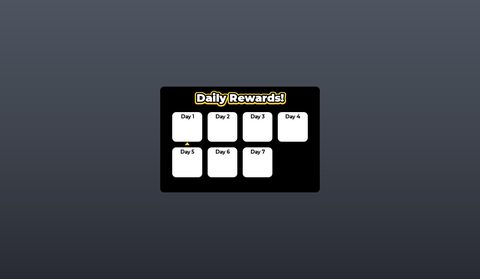</a> <b>DailyReward</b></td>
<td width="33%" valign="top"> <b>Menu</b> › Frame.Streaks</td>
</tr>
</table>

### Quests & progression

<table>
<tr>
<td width="33%" valign="top"><a href="screenshots/18_LeveledUp.jpg">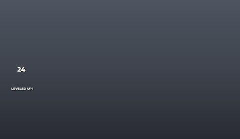</a> <b>LeveledUp</b></td>
<td width="33%" valign="top"><a href="screenshots/20_KOTHProgress.jpg">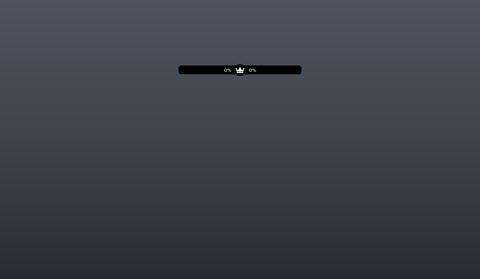</a> <b>KOTHProgress</b></td>
</tr>
</table>

### Settings & menus

<table>
<tr>
<td width="33%" valign="top"><a href="screenshots/23_Menu.jpg">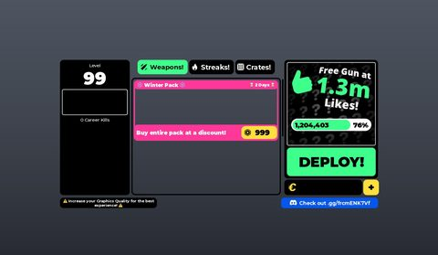</a> <b>Menu</b></td>
<td width="33%" valign="top"><a href="screenshots/25_Menu__Crates.jpg">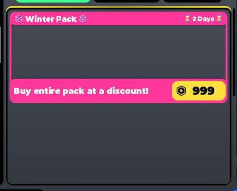</a> <b>Menu</b> › Frame.Crates</td>
</tr>
</table>

### Popups, notifications, prompts

<table>
<tr>
<td width="33%" valign="top"><a href="screenshots/06_Message.jpg">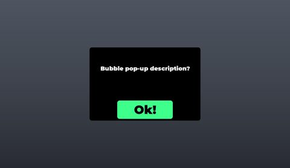</a> <b>Message</b></td>
</tr>
</table>

### Loading & intro

<table>
<tr>
<td width="33%" valign="top"> <b>IntroGui</b></td>
<td width="33%" valign="top"><a href="screenshots/02_IntroGui__Notice.jpg">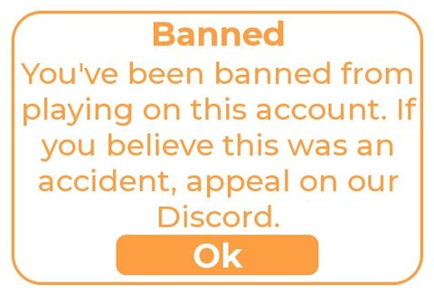</a> <b>IntroGui</b> › Frame.Notice</td>
</tr>
</table>

### Leaderboards & stats

<table>
<tr>
<td width="33%" valign="top"><a href="screenshots/07_Leaderboard.jpg">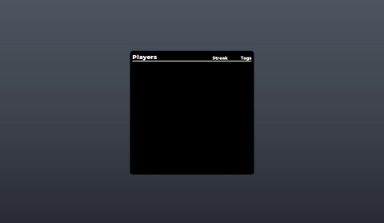</a> <b>Leaderboard</b></td>
<td width="33%" valign="top"><a href="screenshots/10_Top.jpg">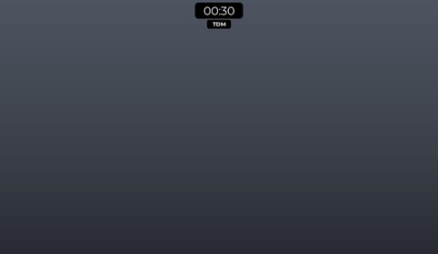</a> <b>Top</b></td>
</tr>
</table>

### End of round, death, results

<table>
<tr>
<td width="33%" valign="top"><a href="screenshots/17_MatchResults.jpg">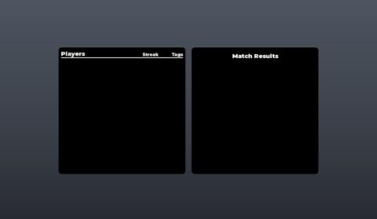</a> <b>MatchResults</b></td>
</tr>
</table>

### Admin panels

<table>
<tr>
<td width="33%" valign="top"><a href="screenshots/08_Admin_Commands.jpg">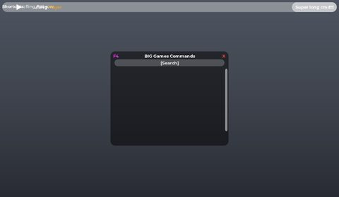</a> <b>Admin Commands</b></td>
</tr>
</table>

### Map vote / teams / matchmaking

<table>
<tr>
<td width="33%" valign="top"><a href="screenshots/11_MapVote.jpg">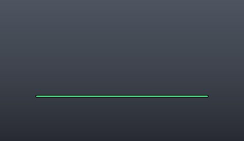</a> <b>MapVote</b></td>
</tr>
</table>

### Other

<table>
<tr>
<td width="33%" valign="top"><a href="screenshots/05_Pack.jpg">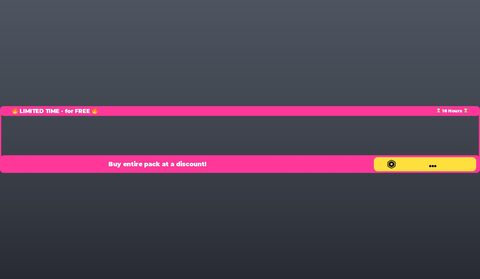</a> <b>Pack</b></td>
<td width="33%" valign="top"> <b>Side</b></td>
<td width="33%" valign="top"><a href="screenshots/12_Processing.jpg">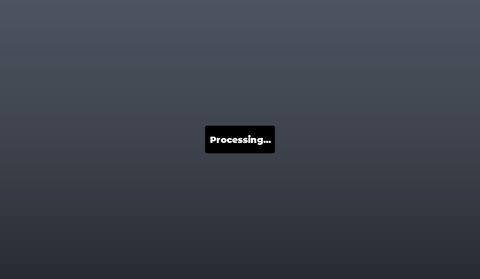</a> <b>Processing</b></td>
</tr>
<tr>
<td width="33%" valign="top"><a href="screenshots/13_Mobile.jpg">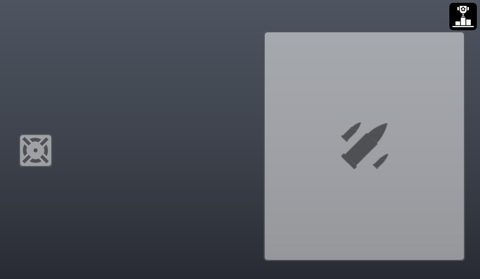</a> <b>Mobile</b></td>
<td width="33%" valign="top"> <b>SpawnGlow</b></td>
<td width="33%" valign="top"><a href="screenshots/16_Killcam.jpg">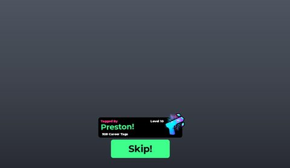</a> <b>Killcam</b></td>
</tr>
<tr>
<td width="33%" valign="top"><a href="screenshots/19_Scope.jpg">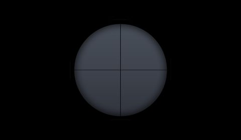</a> <b>Scope</b></td>
<td width="33%" valign="top"><a href="screenshots/21_CrateOpening.jpg">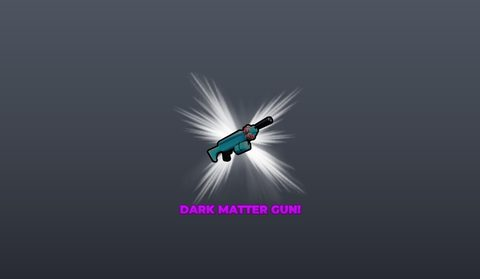</a> <b>CrateOpening</b></td>
<td width="33%" valign="top"><a href="screenshots/26_CustomCrosshairs.jpg">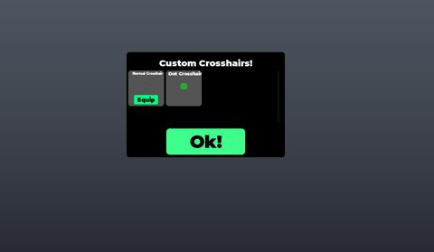</a> <b>CustomCrosshairs</b></td>
</tr>
<tr>
<td width="33%" valign="top"><a href="screenshots/27_Moderator_Util.jpg">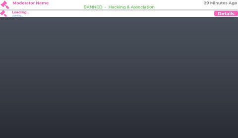</a> <b>Moderator Util</b></td>
<td width="33%" valign="top"><a href="screenshots/28_Moderator_Util__Frame.jpg">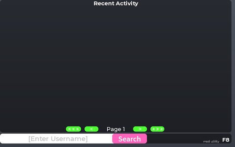</a> <b>Moderator Util</b> › Frame</td>
</tr>
</table>

## Model previews

<table>
<tr>
<td width="25%" valign="top"><a href="models/ReplicatedStorage/Assets/Guns/82.rbxm">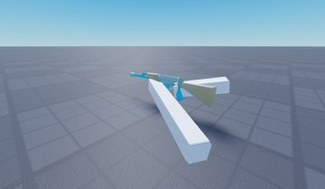</a> <b>82</b> <code>models/ReplicatedStorage/Assets/Guns/82.rbxm</code></td>
<td width="25%" valign="top"><a href="models/ReplicatedStorage/Kohl%27s%20Admin.rbxm">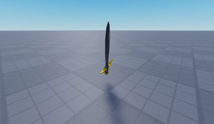</a> <b>Kohl's Admin</b> <code>models/ReplicatedStorage/Kohl's Admin.rbxm</code></td>
<td width="25%" valign="top"><a href="models/ReplicatedStorage/Assets/UnicornRainbow.rbxm">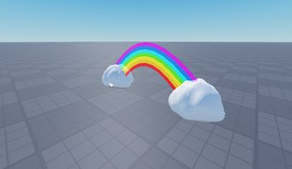</a> <b>UnicornRainbow</b> <code>models/ReplicatedStorage/Assets/UnicornRainbow.rbxm</code></td>
<td width="25%" valign="top"><a href="models/ReplicatedStorage/Assets/QuartzCrystals.rbxm">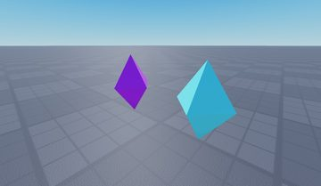</a> <b>QuartzCrystals</b> <code>models/ReplicatedStorage/Assets/QuartzCrystals.rbxm</code></td>
</tr>
<tr>
<td width="25%" valign="top"><a href="models/ReplicatedStorage/Assets/DarkMatterSentry.rbxm">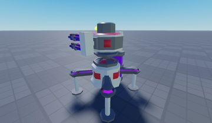</a> <b>DarkMatterSentry</b> <code>models/ReplicatedStorage/Assets/DarkMatterSentry.rbxm</code></td>
<td width="25%" valign="top"><a href="models/ReplicatedStorage/Assets/Drone.rbxm">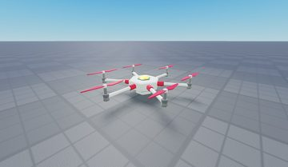</a> <b>Drone</b> <code>models/ReplicatedStorage/Assets/Drone.rbxm</code></td>
<td width="25%" valign="top"><a href="models/ReplicatedStorage/Assets/ArmoredSentry.rbxm">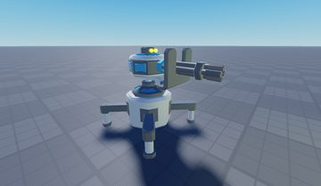</a> <b>ArmoredSentry</b> <code>models/ReplicatedStorage/Assets/ArmoredSentry.rbxm</code></td>
<td width="25%" valign="top"><a href="models/ReplicatedStorage/Assets/Sentry.rbxm">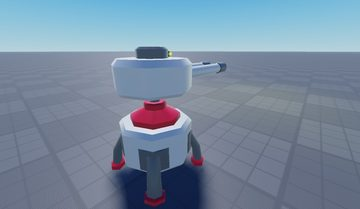</a> <b>Sentry</b> <code>models/ReplicatedStorage/Assets/Sentry.rbxm</code></td>
</tr>
<tr>
<td width="25%" valign="top"><a href="models/ReplicatedStorage/Assets/CarePackage.rbxm">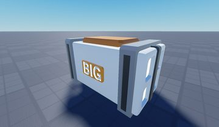</a> <b>CarePackage</b> <code>models/ReplicatedStorage/Assets/CarePackage.rbxm</code></td>
<td width="25%" valign="top"><a href="models/ReplicatedStorage/Assets/MiniSentry.rbxm">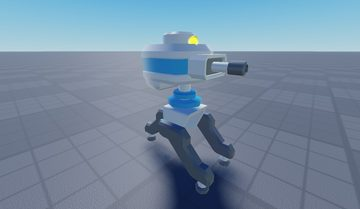</a> <b>MiniSentry</b> <code>models/ReplicatedStorage/Assets/MiniSentry.rbxm</code></td>
<td width="25%" valign="top"><a href="models/ReplicatedStorage/Assets/SentryPlacement.rbxm">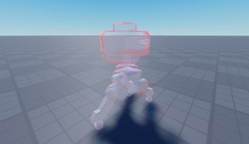</a> <b>SentryPlacement</b> <code>models/ReplicatedStorage/Assets/SentryPlacement.rbxm</code></td>
<td width="25%" valign="top"><a href="models/ReplicatedStorage/Assets/Guns/62~2.rbxm">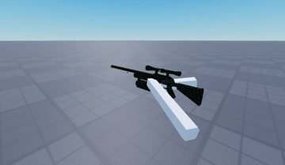</a> <b>62~2</b> <code>models/ReplicatedStorage/Assets/Guns/62~2.rbxm</code></td>
</tr>
</table>

## Notable scripts

Top-scored scripts of this game per topic (full tree in [source/scripts](source/scripts/)).

| Topic | Scripts |
|---|---|
| UI animation (tweens, hover / click, pop-ins, springs) | [`Intro`](source/scripts/ReplicatedFirst/Intro/Intro.client.lua) 501 lines [`4 _ Interact`](source/scripts/ReplicatedStorage/Framework/Modules/Client/4%20_%20Interact.lua) 350 lines [`Leveling`](source/scripts/StarterPlayer/StarterPlayerScripts/Scripts/GUIs/Leveling.client.lua) 133 lines [`Menu`](source/scripts/StarterPlayer/StarterPlayerScripts/Scripts/GUIs/Menu.client.lua) 3525 lines [`5 _ InfoOverlay`](source/scripts/ReplicatedStorage/Framework/Modules/Client/5%20_%20InfoOverlay.lua) 251 lines |
| UI controllers / window managers / menus | [`2 _ GUI`](source/scripts/ReplicatedStorage/Framework/Modules/Client/2%20_%20GUI.lua) 166 lines [`MenuPromotional`](source/scripts/StarterPlayer/StarterPlayerScripts/Scripts/GUIs/MenuPromotional.client.lua) 177 lines [`Menu`](source/scripts/StarterPlayer/StarterPlayerScripts/Scripts/GUIs/Menu.client.lua) 3525 lines [`Main`](source/scripts/ServerStorage/Moderator%20Util/Main.client.lua) 420 lines [`KOTH Interface`](source/scripts/StarterPlayer/StarterPlayerScripts/Scripts/GUIs/KOTH%20Interface.client.lua) 91 lines |
| Notifications, toasts, popups, prompts | [`5 _ Message`](source/scripts/ReplicatedStorage/Framework/Modules/Client/5%20_%20Message.lua) 244 lines [`Main`](source/scripts/ServerStorage/Moderator%20Util/Main.client.lua) 420 lines [`Library`](source/scripts/ReplicatedStorage/Framework/Library.lua) 254 lines [`Crate Opening`](source/scripts/StarterPlayer/StarterPlayerScripts/Scripts/GUIs/Crate%20Opening.client.lua) 166 lines [`MenuPromotional`](source/scripts/StarterPlayer/StarterPlayerScripts/Scripts/GUIs/MenuPromotional.client.lua) 177 lines |
| Loading / intro screens | [`Intro`](source/scripts/ReplicatedFirst/Intro/Intro.client.lua) 501 lines [`Library`](source/scripts/ReplicatedStorage/Framework/Library.lua) 254 lines |
| Camera, cutscenes, screen shake | [`5 _ Shake`](source/scripts/ReplicatedStorage/Framework/Modules/Client/5%20_%20Shake.lua) 166 lines [`Killcam`](source/scripts/StarterPlayer/StarterPlayerScripts/Scripts/GUIs/Killcam.client.lua) 219 lines [`Menu`](source/scripts/StarterPlayer/StarterPlayerScripts/Scripts/GUIs/Menu.client.lua) 3525 lines [`First Person Controller`](source/scripts/StarterPlayer/StarterPlayerScripts/Scripts/Game/First%20Person%20Controller.client.lua) 1212 lines |
| VFX, particles, beams, hit effects | [`6 _ Projectiles`](source/scripts/ReplicatedStorage/Framework/Modules/Client/6%20_%20Projectiles.lua) 550 lines [`guns _ Anime Rifle`](source/scripts/ReplicatedStorage/Framework/Modules/1%20_%20Directory/Guns/guns%20_%20Anime%20Rifle.lua) 119 lines [`guns _ Anime Sniper`](source/scripts/ReplicatedStorage/Framework/Modules/1%20_%20Directory/Guns/guns%20_%20Anime%20Sniper.lua) 119 lines [`guns _ Inferno Rifle`](source/scripts/ReplicatedStorage/Framework/Modules/1%20_%20Directory/Guns/guns%20_%20Inferno%20Rifle.lua) 125 lines [`guns _ Shattered Dual Pistols`](source/scripts/ReplicatedStorage/Framework/Modules/1%20_%20Directory/Guns/guns%20_%20Shattered%20Dual%20Pistols.lua) 79 lines |
| DataStore / player data | [`MockDataStoreManager`](source/scripts/ReplicatedStorage/DataStoreService/MockDataStoreService/MockDataStoreManager.lua) 426 lines [`MockGlobalDataStore`](source/scripts/ReplicatedStorage/DataStoreService/MockDataStoreService/MockGlobalDataStore.lua) 449 lines [`MockOrderedDataStore`](source/scripts/ReplicatedStorage/DataStoreService/MockDataStoreService/MockOrderedDataStore.lua) 530 lines [`2 _ Datastore`](source/scripts/ReplicatedStorage/Framework/Modules/Server/2%20_%20Datastore.lua) 245 lines [`MockDataStorePages`](source/scripts/ReplicatedStorage/DataStoreService/MockDataStoreService/MockDataStorePages.lua) 57 lines |
| Monetization (dev products, game passes, receipts) | [`3 _ Gamepasses`](source/scripts/ReplicatedStorage/Framework/Modules/Server/3%20_%20Gamepasses.lua) 259 lines [`3 _ Products`](source/scripts/ReplicatedStorage/Framework/Modules/Server/3%20_%20Products.lua) 148 lines [`PromptPurchase`](source/scripts/ReplicatedStorage/Framework/Modules/2%20_%20Functions/PromptPurchase.lua) 20 lines |
| RNG, eggs, gacha, rarity rolls, pets | [`Crate Opening`](source/scripts/StarterPlayer/StarterPlayerScripts/Scripts/GUIs/Crate%20Opening.client.lua) 166 lines [`6 _ Crates`](source/scripts/ReplicatedStorage/Framework/Modules/6%20_%20Crates.lua) 107 lines [`Crates`](source/scripts/ReplicatedStorage/Framework/Modules/1%20_%20Directory/Crates/Crates.lua) 25 lines [`Menu`](source/scripts/StarterPlayer/StarterPlayerScripts/Scripts/GUIs/Menu.client.lua) 3525 lines [`First Person Controller`](source/scripts/StarterPlayer/StarterPlayerScripts/Scripts/Game/First%20Person%20Controller.client.lua) 1212 lines |
| NPC / AI / monsters | [`Library`](source/scripts/ReplicatedStorage/Framework/Library.lua) 254 lines |
| Character movement (sprint, dash, double jump, slide) | [`Movement`](source/scripts/StarterPlayer/StarterPlayerScripts/Scripts/Game/Movement.client.lua) 198 lines [`First Person Controller`](source/scripts/StarterPlayer/StarterPlayerScripts/Scripts/Game/First%20Person%20Controller.client.lua) 1212 lines |
| Tycoon / plots / bases / building | [`FirebaseService`](source/scripts/ServerScriptService/FirebaseDS/FirebaseService.lua) 250 lines [`OwnerTitleV5Script`](source/scripts/ServerScriptService/OwnerTitleV5Script.server.lua) 116 lines |
| Leaderboards & stats | [`MockOrderedDataStore`](source/scripts/ReplicatedStorage/DataStoreService/MockDataStoreService/MockOrderedDataStore.lua) 530 lines |
| Admin panels & commands | [`TempCommands`](source/scripts/ServerScriptService/TempCommands.server.lua) 94 lines |
| Sound & music | [`3 _ Audio`](source/scripts/ReplicatedStorage/Framework/Modules/3%20_%20Audio.lua) 406 lines |
| Utility modules (number format, signals, tables, timers) | [`MockDataStoreUtils`](source/scripts/ReplicatedStorage/DataStoreService/MockDataStoreService/MockDataStoreUtils.lua) 282 lines [`MockGlobalDataStore`](source/scripts/ReplicatedStorage/DataStoreService/MockDataStoreService/MockGlobalDataStore.lua) 449 lines [`MockDataStoreService`](source/scripts/ReplicatedStorage/DataStoreService/MockDataStoreService.lua) 177 lines [`2 _ Signal`](source/scripts/ReplicatedStorage/Framework/Modules/2%20_%20Signal.lua) 210 lines [`MockDataStoreManager`](source/scripts/ReplicatedStorage/DataStoreService/MockDataStoreService/MockDataStoreManager.lua) 426 lines |

### In the curated script library

- [Shake via Humanoid.CameraOffset](../../Scripts/05-Camera-Cutscene/HumanoidOffsetShake__big-paintball.lua) — Shake without touching Camera.CFrame (uses Humanoid.CameraOffset) + controller vibration.
- [BIG Games DataStore wrapper](../../Scripts/07-Data-Saving/DatastoreWrapper__big-paintball.lua) — BIG Games framework wrapper: Get/Set/Update with retries, refuses nil writes, caches DataStore objects by name/scope.
- [Save loop with PlayingSession flag](../../Scripts/07-Data-Saving/Saving-PlayingSessionFlag__big-paintball.lua) — BIG Games saving: a PlayingSession flag in the save acts as a simple session lock (retry until the old server cleared it), new-stat backfill, staggered save loop, change-diff replication.
- [Intro with preload cap, ban check and Skip](../../Scripts/04-Loading-Screens/IntroPreloadAndSkip__big-paintball.lua) — Well-commented intro: removes default screen, hides core UI, preloads logo + intro sound with a 2 s cap, logo pop-in tween, loading dots, save confirmation, ban/warning notice, skip support, then restores game GUIs.
- [BIG Games ProcessReceipt](../../Scripts/08-Monetization/Products-ProcessReceipt__big-paintball.lua) — BIG Games framework receipt: looks the product up in a directory with a Callback, retries finding the player for a few seconds, pcall's the callback, fires analytics/client events, logs failures loudly.
- [Yielding message / yes-no dialog](../../Scripts/03-Notifications/MessageDialog__big-paintball.lua) — BIG Games framework dialog: one call shows an OK message, a Yes/No question, or a 2-option choice and yields until the player answers (with gamepad support).
- [All-in-one Audio module (SFX + crossfade music)](../../Scripts/17-Sound-Music/Audio__big-paintball.lua) — One module for all audio: Play() one-shot SFX on a part or at a world position (random pick from an ID list), PlayMusic() with automatic crossfade, StopMusic(), a mute toggle that caches volumes, and a garbage collector that cleans finished sounds. Server calls are forwarded to all clients.
- [GUI indexer + mouse unlock](../../Scripts/02-UI-Framework/GuiIndexer__big-paintball.lua) — Indexes every ScreenGui child by name and provides a Modal button to free the mouse in first person.

## ⚠️ Safety

HIGH flags (backdoors, `require(id)`, `loadstring`, webhooks). Review or delete before reusing:

- `scripts/ReplicatedStorage/Kohl's Admin/Legacy_Loader.server.lua`

## Folders

| Folder | What |
|---|---|
| `screenshots/` | full frames; `crops/` = the panel only; `models/` = 3D previews; `thumbs/` = gallery thumbnails |
| `ui/` | every screen as a Lua builder (`require(module)()` returns the ScreenGui); `_StarterGui-all.lua` builds every StarterGui screen |
| `models/` | every model as .rbxm (the only .rbxm files), mirroring the place tree, scripts removed |
| `map/` | `workspace.rbxm` (the map as a model), `lighting.lua` (sky + post effects), `materials.lua`, `Environment.lua` |
| `animations/`, `audio/` | KeyframeSequence / Sound builders (.lua), `AnimationIds.lua`, `Sounds.lua` |
| `source/` | all scripts as .luau, `tree.txt`, `ui.txt`, `remotes.txt`, `assets.txt`, `flags.txt` |
