# Bite By Night

> 👻 **Horror** · asymmetric horror (killer vs survivors) · source file `Bite By Night For Slbr Boosters !.rbxl`

[⬅ Back to the catalog](../../README.md) · [Assets inventory](ASSETS.md) · [Style numbers](reference.md) · [Scripts](source/scripts/) · [Code analysis](source/README.md)

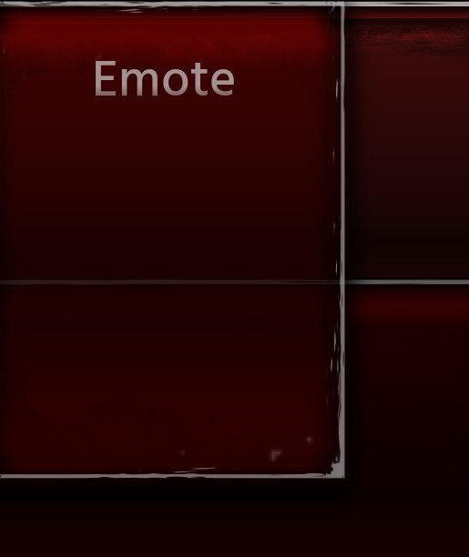

## At a glance

| | |
|---|---|
| Provenance | copy of a live game (saveinstance / decompiled client code) |
| Screens | 7 ScreenGuis, 2509 GUI objects → **35 screenshots** |
| Models (.rbxm) | 1150 models, 190 model sets, 32 VFX sets |
| Lua builders (.lua) | 15 UI screens, 78 animation packs, 207 audio packs |
| Code | 845 scripts, 102,542 lines |
| Asset ids | 808 animations, 877 sounds |
| Safety scan | 0 HIGH / 6 MED flags ([flags.txt](source/flags.txt)) |

**Fonts:** `Inconsolata Light`×122, `LegacyArial Regular`×76, `SourceSansPro SemiBold`×43, `Hind Siliguri SemiBold`×33, `Libre Baskerville Regular`×28

## UI screenshots

Captured in Studio from the place's own ScreenGuis (scripts stripped). Each panel was opened on its own; click a thumbnail for the full 1519×886 frame. Runtime-filled lists (shop items, inventories) show their template state.

### Shop & Robux store

<table>
<tr>
<td width="33%" valign="top"> <b>UI</b> › ShopCards.SkinCards.Owned</td>
<td width="33%" valign="top"><a href="screenshots/10_UI__Shop.jpg">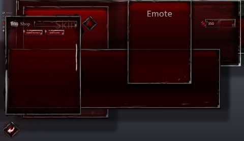</a> <b>UI</b> › LobbyUIContainer.Shop</td>
</tr>
</table>

### Inventory / backpack / pets

<table>
<tr>
<td width="33%" valign="top"><a href="screenshots/06_UI__Equipped.jpg">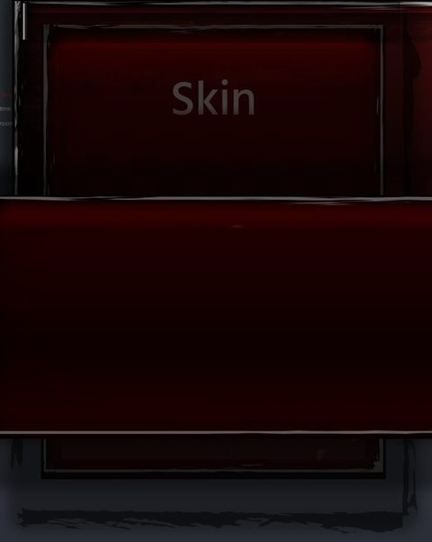</a> <b>UI</b> › InventoryCards.SkinCards.Button.Equipped</td>
<td width="33%" valign="top"><a href="screenshots/08_UI__Inventory.jpg">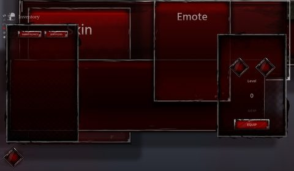</a> <b>UI</b> › LobbyUIContainer.Inventory</td>
</tr>
</table>

### Rewards, daily, spin, codes

<table>
<tr>
<td width="33%" valign="top"><a href="screenshots/15_UI__DailyRewards.jpg">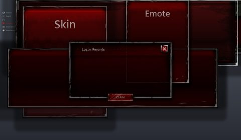</a> <b>UI</b> › LobbyUIContainer.DailyRewards</td>
</tr>
</table>

### Quests & progression

<table>
<tr>
<td width="33%" valign="top"><a href="screenshots/16_UI__Tasks.jpg">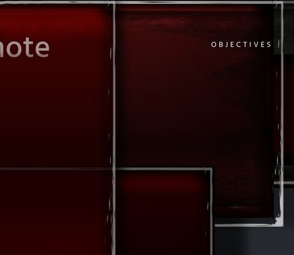</a> <b>UI</b> › GameUIContainer.Tasks</td>
</tr>
</table>

### Settings & menus

<table>
<tr>
<td width="33%" valign="top"><a href="screenshots/07_UI__Buttons.jpg">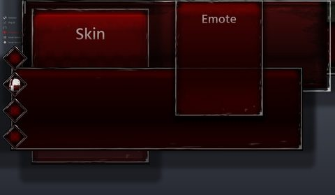</a> <b>UI</b> › LobbyUIContainer.Buttons</td>
<td width="33%" valign="top"><a href="screenshots/09_UI__Settings.jpg">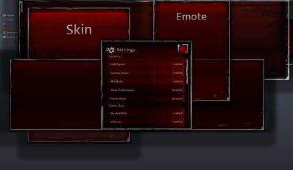</a> <b>UI</b> › LobbyUIContainer.Settings</td>
<td width="33%" valign="top"><a href="screenshots/11_UI__Spectate.jpg">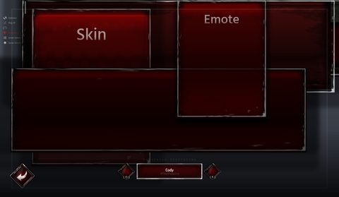</a> <b>UI</b> › LobbyUIContainer.Spectate</td>
</tr>
</table>

### Popups, notifications, prompts

<table>
<tr>
<td width="33%" valign="top"><a href="screenshots/02_MainFrame__Notification.jpg">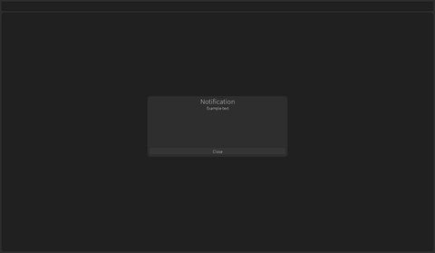</a> <b>MainFrame</b> › Notification</td>
<td width="33%" valign="top"><a href="screenshots/14_UI__Warning.jpg">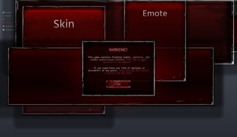</a> <b>UI</b> › LobbyUIContainer.Warning</td>
</tr>
</table>

### Loading & intro

<table>
<tr>
<td width="33%" valign="top"><a href="screenshots/23_UI__Loading.jpg">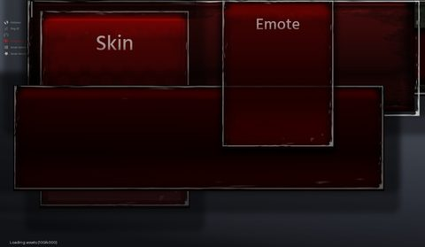</a> <b>UI</b> › Loading</td>
</tr>
</table>

### Leaderboards & stats

<table>
<tr>
<td width="33%" valign="top"><a href="screenshots/22_UI__GameStats.jpg">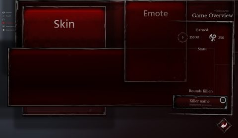</a> <b>UI</b> › GameStats</td>
</tr>
</table>

### HUD & currency

<table>
<tr>
<td width="33%" valign="top"><a href="screenshots/01_MainFrame.jpg">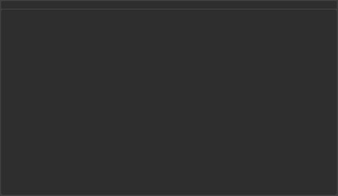</a> <b>MainFrame</b></td>
<td width="33%" valign="top"><a href="screenshots/12_UI__Currency.jpg">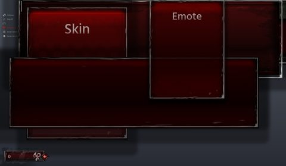</a> <b>UI</b> › LobbyUIContainer.Currency</td>
<td width="33%" valign="top"><a href="screenshots/28_Gen__Switch.jpg">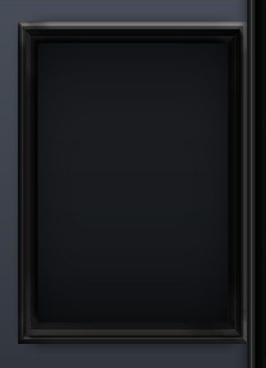</a> <b>Gen</b> › MainFrame.Generator.Switch</td>
</tr>
<tr>
<td width="33%" valign="top"><a href="screenshots/29_Gen__Rope.jpg">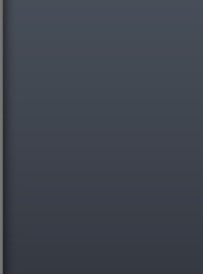</a> <b>Gen</b> › MainFrame.Generator.Lever.Rope</td>
<td width="33%" valign="top"><a href="screenshots/30_Gen__MetalFrame.jpg">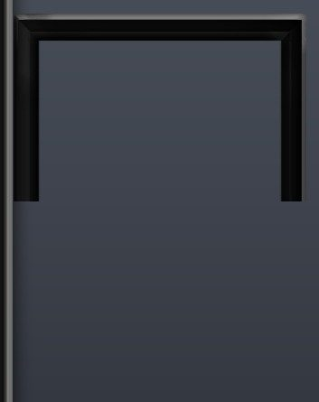</a> <b>Gen</b> › MainFrame.Generator.Lever.MetalFrame</td>
<td width="33%" valign="top"><a href="screenshots/31_Gen__MetalFrame2.jpg">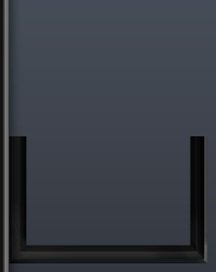</a> <b>Gen</b> › MainFrame.Generator.Lever.MetalFrame2</td>
</tr>
<tr>
<td width="33%" valign="top"><a href="screenshots/32_bar.jpg">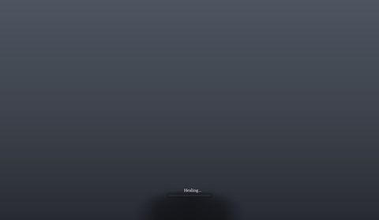</a> <b>bar</b></td>
</tr>
</table>

### Character / avatar / emotes

<table>
<tr>
<td width="33%" valign="top"><a href="screenshots/26_UI__Emote.jpg">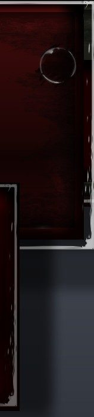</a> <b>UI</b> › MobileOverlay.Emote</td>
</tr>
</table>

### Map vote / teams / matchmaking

<table>
<tr>
<td width="33%" valign="top"><a href="screenshots/13_UI__Timer.jpg">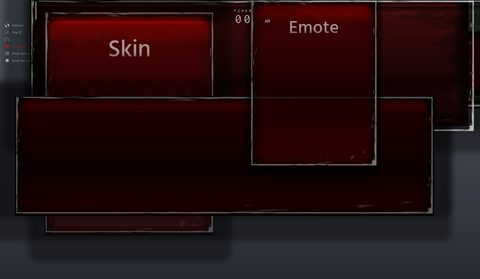</a> <b>UI</b> › LobbyUIContainer.Timer</td>
<td width="33%" valign="top"><a href="screenshots/21_UI__Timer.jpg">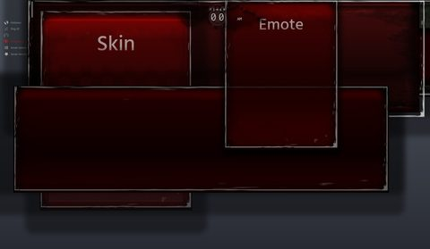</a> <b>UI</b> › GameUIContainer.Timer</td>
</tr>
</table>

### Other

<table>
<tr>
<td width="33%" valign="top"><a href="screenshots/03_UI.jpg">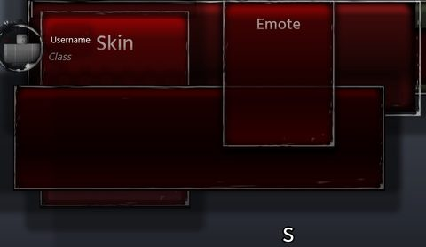</a> <b>UI</b></td>
<td width="33%" valign="top"><a href="screenshots/18_UI__Info.jpg">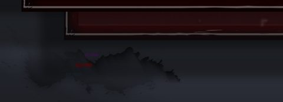</a> <b>UI</b> › GameUIContainer.Info</td>
<td width="33%" valign="top"><a href="screenshots/19_UI__Players.jpg">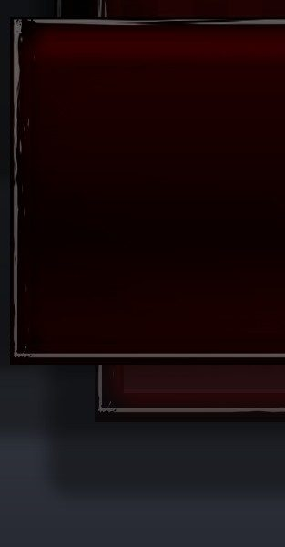</a> <b>UI</b> › GameUIContainer.Players</td>
</tr>
<tr>
<td width="33%" valign="top"><a href="screenshots/20_UI__LMS.jpg">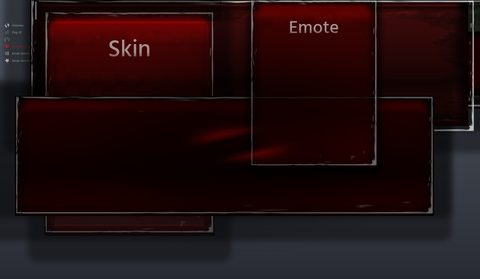</a> <b>UI</b> › GameUIContainer.LMS</td>
<td width="33%" valign="top"><a href="screenshots/25_UI__Holder.jpg">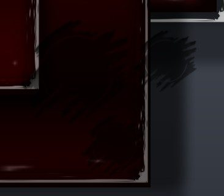</a> <b>UI</b> › MobileOverlay.Holder</td>
<td width="33%" valign="top"><a href="screenshots/27_Gen.jpg">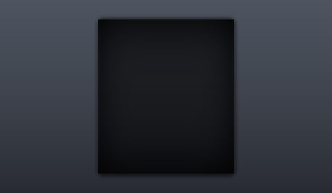</a> <b>Gen</b></td>
</tr>
<tr>
<td width="33%" valign="top"><a href="screenshots/33_Selection.jpg">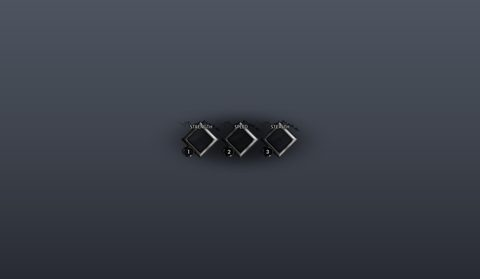</a> <b>Selection</b></td>
<td width="33%" valign="top"><a href="screenshots/34_EnnardVHS.jpg">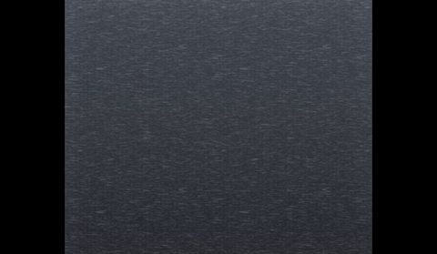</a> <b>EnnardVHS</b></td>
<td width="33%" valign="top"><a href="screenshots/35_SnakeGUI.jpg">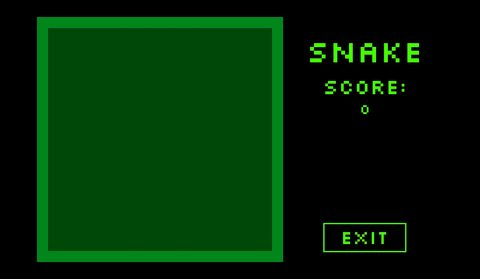</a> <b>SnakeGUI</b></td>
</tr>
<tr>
<td width="33%" valign="top"><a href="screenshots/36_Dot.jpg">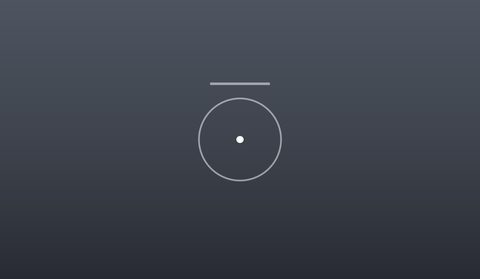</a> <b>Dot</b></td>
<td width="33%" valign="top"><a href="screenshots/48_Template.jpg">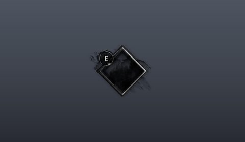</a> <b>Template</b></td>
<td width="33%" valign="top"><a href="screenshots/49_Template__USES.jpg">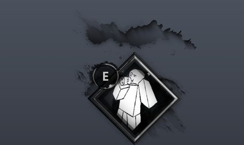</a> <b>Template</b> › USES</td>
</tr>
</table>

## Model previews

<table>
<tr>
<td width="25%" valign="top"><a href="models/ReplicatedStorage/Characters/Mimic/Normal/StarterCharacter.rbxm">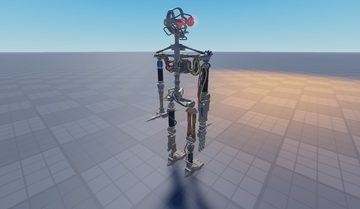</a> <b>StarterCharacter</b> <code>models/ReplicatedStorage/Characters/Mimic/Normal/StarterCharacter.rbxm</code></td>
<td width="25%" valign="top"><a href="models/ReplicatedStorage/Modules/CutscenesFolder/Intro/Springtrap-Toon/FolderModel/FIRE%20AXE%20BOX.rbxm">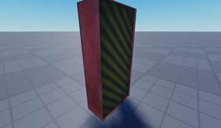</a> <b>FIRE AXE BOX</b> <code>models/ReplicatedStorage/Modules/CutscenesFolder/Intro/Springtrap-Toon/FolderModel/FIRE AXE BOX.rbxm</code></td>
<td width="25%" valign="top"><a href="models/ServerStorage/Assets/Maps/Forest/Other/Supply%20Crates/Supply%20Crate__x19.rbxm">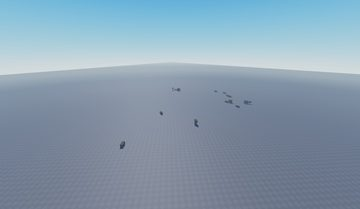</a> <b>Supply Crate__x19</b> <code>models/ServerStorage/Assets/Maps/Forest/Other/Supply Crates/Supply Crate__x19.rbxm</code></td>
<td width="25%" valign="top"><a href="models/ReplicatedStorage/Modules/CutscenesFolder/CutsceneMaps/MimicOutroMap/STRUCTURE/SKIRTBOARD/SkirtBoards%20Grouped.rbxm">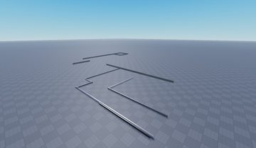</a> <b>SkirtBoards Grouped</b> <code>models/ReplicatedStorage/Modules/CutscenesFolder/CutsceneMaps/MimicOutroMap/STRUCTURE/SKIRTBOARD/SkirtBoards Grouped.rbxm</code></td>
</tr>
<tr>
<td width="25%" valign="top"><a href="models/ReplicatedStorage/Modules/CutscenesFolder/CutsceneMaps/MapSpringtrapIntro.rbxm">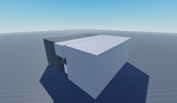</a> <b>MapSpringtrapIntro</b> <code>models/ReplicatedStorage/Modules/CutscenesFolder/CutsceneMaps/MapSpringtrapIntro.rbxm</code></td>
<td width="25%" valign="top"><a href="models/ServerStorage/Assets/Maps/Warehouse/Other/Item%20Classification/Item%20Classification__x49.rbxm">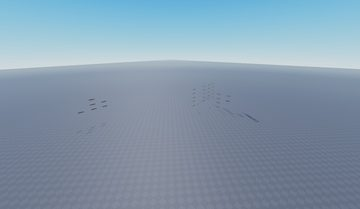</a> <b>Item Classification__x49</b> <code>models/ServerStorage/Assets/Maps/Warehouse/Other/Item Classification/Item Classification__x49.rbxm</code></td>
<td width="25%" valign="top"><a href="models/ReplicatedStorage/Modules/CutscenesFolder/CutsceneMaps/SpringtrapOutroMAP/DECORATION/Cardboard%20Boxes/CardBoard%20Boxes%20Grouped.rbxm">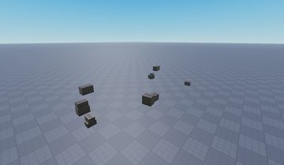</a> <b>CardBoard Boxes Grouped</b> <code>models/ReplicatedStorage/Modules/CutscenesFolder/CutsceneMaps/SpringtrapOutroMAP/DECORATION/Cardboard Boxes/CardBoard Boxes Grouped.rbxm</code></td>
<td width="25%" valign="top"><a href="models/ServerStorage/Assets/Maps/Warehouse/Other/Meshes_BBN_%20WAREHOUSE%20MAP%20_Plane.010.rbxm">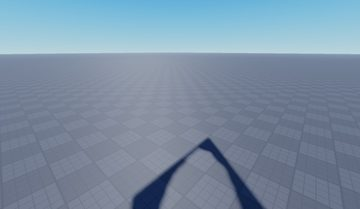</a> <b>Meshes_BBN_ WAREHOUSE MAP _Plane.010</b> <code>models/ServerStorage/Assets/Maps/Warehouse/Other/Meshes_BBN_ WAREHOUSE MAP _Plane.010.rbxm</code></td>
</tr>
<tr>
<td width="25%" valign="top"><a href="models/ReplicatedStorage/Modules/Emotes/Math/RightHand.rbxm">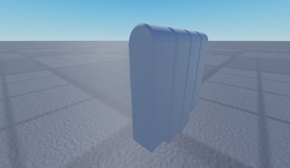</a> <b>RightHand</b> <code>models/ReplicatedStorage/Modules/Emotes/Math/RightHand.rbxm</code></td>
<td width="25%" valign="top"><a href="models/ReplicatedStorage/Modules/CutscenesFolder/CutsceneMaps/EnnardMap/SkirtBoard__x14.rbxm">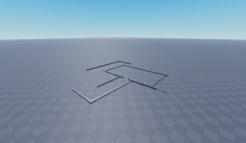</a> <b>SkirtBoard__x14</b> <code>models/ReplicatedStorage/Modules/CutscenesFolder/CutsceneMaps/EnnardMap/SkirtBoard__x14.rbxm</code></td>
<td width="25%" valign="top"><a href="models/ServerStorage/Assets/Maps/Forest/Other/Tree%20Logs/Tree%20Log%20Long__x11.rbxm">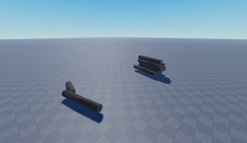</a> <b>Tree Log Long__x11</b> <code>models/ServerStorage/Assets/Maps/Forest/Other/Tree Logs/Tree Log Long__x11.rbxm</code></td>
<td width="25%" valign="top"><a href="models/ReplicatedStorage/Modules/CutscenesFolder/Intro/Ennard-Spaghetti/FolderModel/Ennard2.rbxm">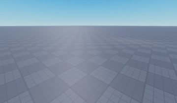</a> <b>Ennard2</b> <code>models/ReplicatedStorage/Modules/CutscenesFolder/Intro/Ennard-Spaghetti/FolderModel/Ennard2.rbxm</code></td>
</tr>
</table>

## Notable scripts

Top-scored scripts of this game per topic (full tree in [source/scripts](source/scripts/)).

| Topic | Scripts |
|---|---|
| UI animation (tweens, hover / click, pop-ins, springs) | [`Main`](source/scripts/StarterGui/UI/Main.client.lua) 3273 lines [`Animations`](source/scripts/StarterGui/UI/UI/LobbyUIContainer/Shop/Holder/RobuxFrame/ScrollingFrame/2nd%20Emote%20Page/2nd%20Emote%20Page/Frame/Animations.client.lua) 64 lines [`Animations`](source/scripts/StarterGui/UI/UI/LobbyUIContainer/Shop/Holder/RobuxFrame/ScrollingFrame/Scraps/2500/Button/Animations.client.lua) 58 lines [`Animations`](source/scripts/StarterGui/UI/UI/LobbyUIContainer/Buttons/Holder/Animations.client.lua) 171 lines [`Animations`](source/scripts/StarterGui/UI/UI/LobbyUIContainer/Inventory/Button/Animations.client.lua) 132 lines |
| UI controllers / window managers / menus | [`Window`](source/scripts/ReplicatedStorage/Modules/SmartBone/Dependencies/Iris/widgets/Window.lua) 897 lines [`Menu`](source/scripts/ReplicatedStorage/Modules/SmartBone/Dependencies/Iris/widgets/Menu.lua) 611 lines [`demoWindow`](source/scripts/ReplicatedStorage/Modules/SmartBone/Dependencies/Iris/demoWindow.lua) 1048 lines [`Combo`](source/scripts/ReplicatedStorage/Modules/SmartBone/Dependencies/Iris/widgets/Combo.lua) 461 lines [`DebugUi`](source/scripts/ReplicatedStorage/Modules/SmartBone/Dependencies/Debug/DebugUi.lua) 329 lines |
| Notifications, toasts, popups, prompts | [`SkinStealerThrow`](source/scripts/ServerStorage/Modules/Abilities/Ennard/SkinStealerThrow.lua) 93 lines [`Utilities`](source/scripts/ReplicatedStorage/Modules/SmartBone/Dependencies/Utilities.lua) 307 lines [`Window`](source/scripts/ReplicatedStorage/Modules/SmartBone/Dependencies/Iris/widgets/Window.lua) 897 lines [`Beartrap`](source/scripts/ServerStorage/Modules/Abilities/Springtrap/Beartrap.lua) 422 lines [`ProximityPromptScript`](source/scripts/StarterPlayer/StarterPlayerScripts/ProximityPromptScript.client.lua) 612 lines |
| Loading / intro screens | [`On Respawn`](source/scripts/ReplicatedStorage/Characters/Survivor/Lobby/Normal/Elevator/On%20Respawn.client.lua) 316 lines [`On Respawn`](source/scripts/ServerStorage/TemplateTest/madmaxxxhunter/Elevator/On%20Respawn.client.lua) 279 lines [`Icon`](source/scripts/ReplicatedStorage/Modules/Icon.lua) 1249 lines [`Theme`](source/scripts/Workspace/AssetReuploader/Plugin/UiLibrary/Theme.lua) 267 lines |
| Camera, cutscenes, screen shake | [`CutsceneHandler`](source/scripts/StarterPlayer/StarterPlayerScripts/CutsceneHandler.client.lua) 76 lines [`Cutscenes`](source/scripts/ReplicatedStorage/Modules/Cutscenes.lua) 269 lines [`CameraShakePresets`](source/scripts/ReplicatedStorage/Modules/CameraShaker/CameraShakePresets.lua) 207 lines [`On Respawn`](source/scripts/ReplicatedStorage/Characters/Survivor/Lobby/Normal/Elevator/On%20Respawn.client.lua) 316 lines [`Main`](source/scripts/StarterGui/UI/Main.client.lua) 3273 lines |
| VFX, particles, beams, hit effects | [`EffectUtility`](source/scripts/ReplicatedStorage/Modules/EffectUtility.lua) 148 lines [`DoorServer`](source/scripts/ServerStorage/Modules/Managers/DoorManager/DoorServer.server.lua) 1296 lines [`VFXHandler`](source/scripts/ReplicatedStorage/Modules/VFXHandler.lua) 178 lines [`Springtrap`](source/scripts/ReplicatedStorage/Modules/CutscenesFolder/Kills/Springtrap.lua) 268 lines [`Main`](source/scripts/StarterGui/UI/Main.client.lua) 3273 lines |
| DataStore / player data | [`PlayerData`](source/scripts/ServerStorage/Modules/General/PlayerData.lua) 118 lines |
| RNG, eggs, gacha, rarity rolls, pets | [`Icon`](source/scripts/ReplicatedStorage/Modules/Icon.lua) 1249 lines [`Main`](source/scripts/StarterGui/UI/Main.client.lua) 3273 lines [`Types`](source/scripts/ReplicatedStorage/Modules/Icon/Types.lua) 477 lines [`Animate2`](source/scripts/ReplicatedStorage/Characters/Survivor/Security%20Guard/Normal/Animate2.client.lua) 598 lines [`Animate2`](source/scripts/ReplicatedStorage/Characters/Springtrap/Normal/Animate2.client.lua) 542 lines |
| Combat, weapons, hitboxes, abilities | [`HitboxManager`](source/scripts/ServerStorage/Modules/Managers/HitboxManager.lua) 406 lines [`AxeThrow`](source/scripts/ServerStorage/Modules/Abilities/Springtrap/AxeThrow.lua) 493 lines [`Swing`](source/scripts/ServerStorage/Modules/Abilities/Fighter/Swing.lua) 94 lines [`Shared`](source/scripts/ServerStorage/Modules/Abilities/Ennard/Shared.lua) 1244 lines [`Shared`](source/scripts/ServerStorage/Modules/Abilities/Mimic/Shared.lua) 408 lines |
| NPC / AI / monsters | [`Shared`](source/scripts/ServerStorage/Modules/Abilities/Ennard/Shared.lua) 1244 lines [`ChaseThemes-Killer`](source/scripts/ServerStorage/Modules/Managers/CharacterManager/Client/ChaseThemes-Killer.client.lua) 98 lines |
| Character movement (sprint, dash, double jump, slide) | [`Movement`](source/scripts/ServerStorage/Modules/Managers/CharacterManager/Client/Movement.client.lua) 155 lines [`StaminaManager`](source/scripts/ServerStorage/Modules/Managers/CharacterManager/StaminaManager.lua) 230 lines [`Shared`](source/scripts/ServerStorage/Modules/Abilities/Ennard/Shared.lua) 1244 lines [`Drink`](source/scripts/ServerStorage/Modules/Abilities/Customer/Drink.lua) 66 lines [`Shared`](source/scripts/ServerStorage/Modules/Abilities/Mimic/Shared.lua) 408 lines |
| Tycoon / plots / bases / building | [`Beartrap`](source/scripts/ServerStorage/Modules/Abilities/Springtrap/Beartrap.lua) 422 lines |
| Admin panels & commands | [`ShopManager`](source/scripts/ServerStorage/Modules/Managers/ShopManager.lua) 244 lines [`Admin`](source/scripts/ServerScriptService/Cmdr/BuiltInTypes/Admin.lua) 83 lines |
| Sound & music | [`Main`](source/scripts/StarterGui/UI/Main.client.lua) 3273 lines [`Client`](source/scripts/StarterPlayer/StarterPlayerScripts/Client.client.lua) 338 lines |
| Utility modules (number format, signals, tables, timers) | [`ServerUtil`](source/scripts/ServerStorage/Modules/ServerUtil.lua) 412 lines [`Utility`](source/scripts/ReplicatedStorage/Modules/Icon/Utility.lua) 462 lines [`AbilityUtil`](source/scripts/ServerStorage/Modules/Abilities/AbilityUtil.lua) 792 lines [`Util`](source/scripts/ServerScriptService/Cmdr/Shared/Util.lua) 549 lines [`ArcadeManager`](source/scripts/ServerStorage/Modules/Managers/ArcadeManager.lua) 150 lines |

### In the curated script library

- [Kill cam / intro definitions](../../Scripts/05-Camera-Cutscene/CutsceneDefinitions__bite-by-night.lua) — Data-driven kill cams / intros / outros (rig + animation + FOV curve per cutscene).
- [Hitbox manager (box / radius / ray)](../../Scripts/11-Combat/HitboxManager__bite-by-night.lua) — Configurable hitbox with Box/Radius/Ray modes, 'continue until found' polling and debug drawing.
- [Ability kit definition](../../Scripts/11-Combat/AbilityKitFighter__bite-by-night.lua) — How an ability framework declares a kit: keybind, cooldown, uses, server callback.
- [Swing ability (uses parry charges)](../../Scripts/11-Combat/SwingAbility__bite-by-night.lua) — Charge-scaled attack: dash + polling hitbox + stun + stacking debuffs.
- [Parry ability](../../Scripts/11-Combat/ParryAbility__bite-by-night.lua) — Parry window as an attribute + punishment on a whiff.
- [Throwable weapon with retrieval](../../Scripts/11-Combat/AxeThrowAbility__bite-by-night.lua) — Full throwable: aim, projectile, stick in the world, ProximityPrompt to retrieve, timeout return.
- [Server stamina manager](../../Scripts/13-Movement/StaminaManager__bite-by-night.lua) — Best stamina reference: server-side, attribute-based, forward-only drain, regen delay, exhaustion.
- [Leap ability](../../Scripts/13-Movement/LeapAbility__bite-by-night.lua) — Leap / pounce ability as a movement move with a landing hit.
- [EffectUtility](../../Scripts/06-VFX/EffectUtility__bite-by-night.lua) — Attribute-driven emit helper + Beam transparency tween (keypoint by keypoint).

## Folders

| Folder | What |
|---|---|
| `screenshots/` | full frames; `crops/` = the panel only; `models/` = 3D previews; `thumbs/` = gallery thumbnails |
| `ui/` | every screen as a Lua builder (`require(module)()` returns the ScreenGui); `_StarterGui-all.lua` builds every StarterGui screen |
| `models/` | every model as .rbxm (the only .rbxm files), mirroring the place tree, scripts removed |
| `map/` | `workspace.rbxm` (the map as a model), `lighting.lua` (sky + post effects), `materials.lua`, `Environment.lua` |
| `animations/`, `audio/` | KeyframeSequence / Sound builders (.lua), `AnimationIds.lua`, `Sounds.lua` |
| `source/` | all scripts as .luau, `tree.txt`, `ui.txt`, `remotes.txt`, `assets.txt`, `flags.txt` |
