# Brainrot Lab

> 🧠 **Brainrot** · brainrot simulator (lab / fusing) · source file `brainrotlabfullworkingspoof.rbxl`

[⬅ Back to the catalog](../../README.md) · [Assets inventory](ASSETS.md) · [Style numbers](reference.md) · [Scripts](source/scripts/) · [Code analysis](source/README.md)

## At a glance

| | |
|---|---|
| Provenance | template with full source |
| Screens | 5 ScreenGuis, 1225 GUI objects → **16 screenshots** |
| Models (.rbxm) | 194 models, 12 model sets, 5 VFX sets |
| Lua builders (.lua) | 24 UI screens, 200 animation packs, 67 audio packs |
| Code | 174 scripts, 40,669 lines |
| Asset ids | 130 animations, 86 sounds |
| Safety scan | 0 HIGH / 1 MED flags ([flags.txt](source/flags.txt)) |

**Fonts:** `GothamSSm Heavy`×237, `SourceSansPro Regular`×87, `FredokaOne Regular`×72, `GothamSSm ExtraBold`×26, `font asset 11702779517 Heavy`×13

## UI screenshots

Captured in Studio from the place's own ScreenGuis (scripts stripped). Each panel was opened on its own; click a thumbnail for the full 1519×886 frame. Runtime-filled lists (shop items, inventories) show their template state.

### Shop & Robux store

<table>
<tr>
<td width="33%" valign="top"><a href="screenshots/07_GUI__Shop.jpg">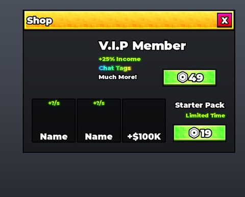</a> <b>GUI</b> › Frames.Shop</td>
<td width="33%" valign="top"><a href="screenshots/15_UI__ShoppingMachine.jpg">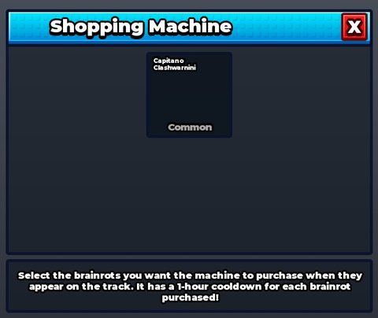</a> <b>UI</b> › ShoppingMachine</td>
</tr>
</table>

### Index / codex / glossary

<table>
<tr>
<td width="33%" valign="top"><a href="screenshots/08_GUI__Index.jpg">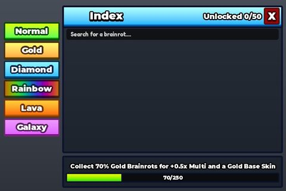</a> <b>GUI</b> › Frames.Index</td>
</tr>
</table>

### Rewards, daily, spin, codes

<table>
<tr>
<td width="33%" valign="top"><a href="screenshots/05_GUI__Wheel.jpg">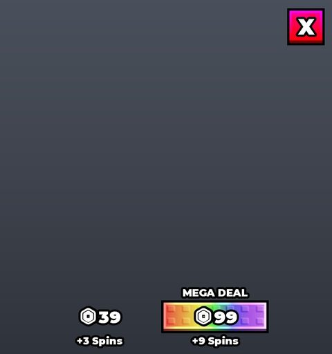</a> <b>GUI</b> › Frames.Wheel</td>
<td width="33%" valign="top"><a href="screenshots/06_GUI__Offline.jpg">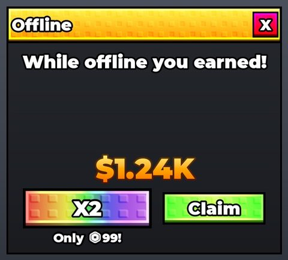</a> <b>GUI</b> › Frames.Offline</td>
</tr>
</table>

### Quests & progression

<table>
<tr>
<td width="33%" valign="top"><a href="screenshots/02_GUI__Upgrades.jpg">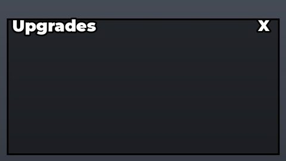</a> <b>GUI</b> › Frames.Upgrades</td>
<td width="33%" valign="top"><a href="screenshots/04_GUI__Rebirth.jpg">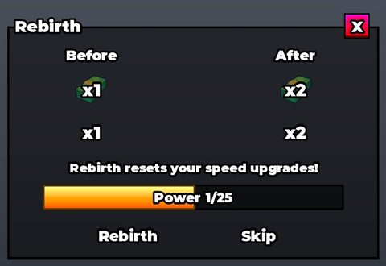</a> <b>GUI</b> › Frames.Rebirth</td>
<td width="33%" valign="top"><a href="screenshots/16_UpgradeTemplate.jpg">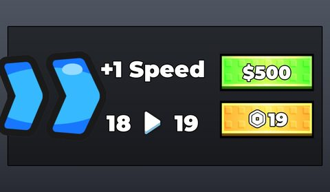</a> <b>UpgradeTemplate</b></td>
</tr>
</table>

### Trading

<table>
<tr>
<td width="33%" valign="top"><a href="screenshots/13_Trade__TradeSele_o.jpg">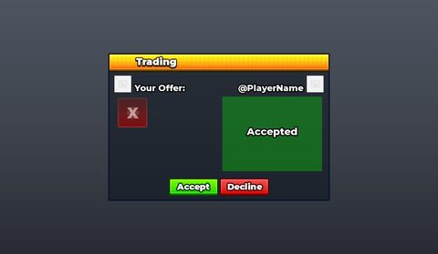</a> <b>Trade</b> › TradeSeleção</td>
<td width="33%" valign="top"><a href="screenshots/14_UI_Trade_machine__Ui_TRadeMachine.jpg">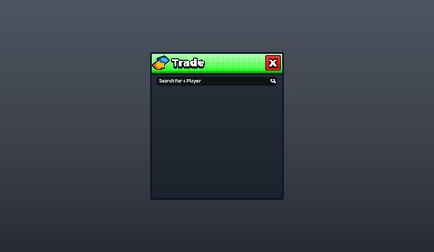</a> <b>UI Trade machine</b> › Ui TRadeMachine</td>
</tr>
</table>

### Admin panels

<table>
<tr>
<td width="33%" valign="top"><a href="screenshots/09_GUI__Admin.jpg">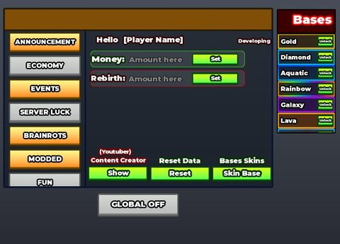</a> <b>GUI</b> › Frames.Admin</td>
</tr>
</table>

### Other

<table>
<tr>
<td width="33%" valign="top"><a href="screenshots/01_GUI.jpg">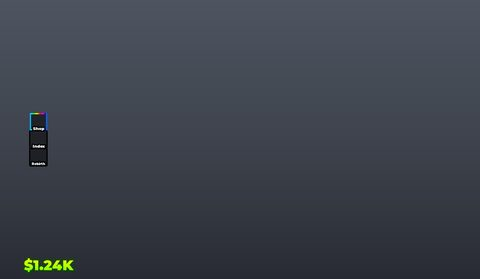</a> <b>GUI</b></td>
<td width="33%" valign="top"><a href="screenshots/03_GUI__Weights.jpg">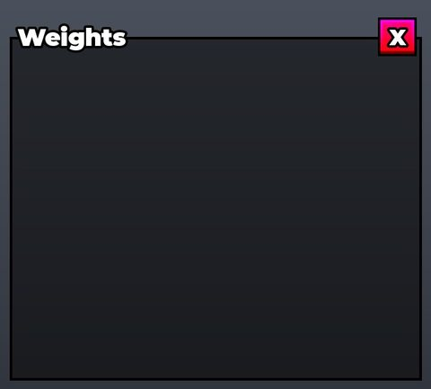</a> <b>GUI</b> › Frames.Weights</td>
<td width="33%" valign="top"><a href="screenshots/10_GUI__Ingredients.jpg">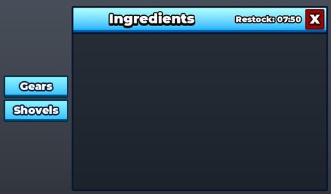</a> <b>GUI</b> › Frames.Ingredients</td>
</tr>
<tr>
<td width="33%" valign="top"> <b>GUI</b> › Effect</td>
<td width="33%" valign="top"><a href="screenshots/17_WeightTemplate.jpg">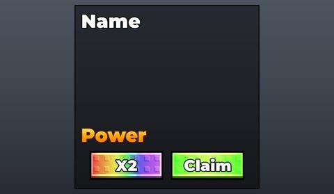</a> <b>WeightTemplate</b></td>
</tr>
</table>

## Model previews

<table>
<tr>
<td width="25%" valign="top"><a href="models/Workspace/Maquinas_Intera%C3%A7%C3%A3o/Characters/Miner.rbxm">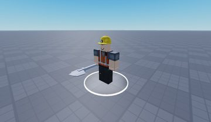</a> <b>Miner</b> <code>models/Workspace/Maquinas_Interação/Characters/Miner.rbxm</code></td>
<td width="25%" valign="top"><a href="models/ReplicatedStorage/Bases%20Skins/Aquatic%202%20floors.rbxm">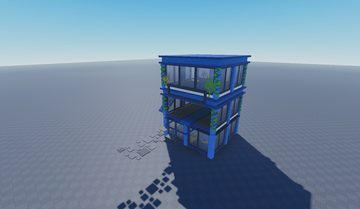</a> <b>Aquatic 2 floors</b> <code>models/ReplicatedStorage/Bases Skins/Aquatic 2 floors.rbxm</code></td>
<td width="25%" valign="top"><a href="models/ReplicatedStorage/Templates/Plot.rbxm">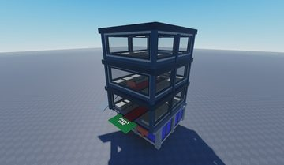</a> <b>Plot</b> <code>models/ReplicatedStorage/Templates/Plot.rbxm</code></td>
<td width="25%" valign="top"><a href="models/ReplicatedStorage/Ingredients/Flower.rbxm">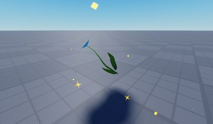</a> <b>Flower</b> <code>models/ReplicatedStorage/Ingredients/Flower.rbxm</code></td>
</tr>
<tr>
<td width="25%" valign="top"><a href="models/Workspace/Maquinas_Intera%C3%A7%C3%A3o/Assets/TradeMachine.rbxm">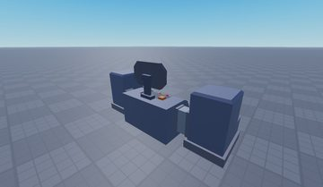</a> <b>TradeMachine</b> <code>models/Workspace/Maquinas_Interação/Assets/TradeMachine.rbxm</code></td>
<td width="25%" valign="top"><a href="models/ReplicatedStorage/Templates/Bullet.rbxm">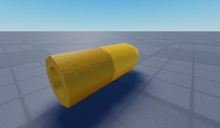</a> <b>Bullet</b> <code>models/ReplicatedStorage/Templates/Bullet.rbxm</code></td>
<td width="25%" valign="top"><a href="models/Workspace/Leaderboards/Money.rbxm">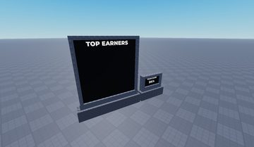</a> <b>Money</b> <code>models/Workspace/Leaderboards/Money.rbxm</code></td>
<td width="25%" valign="top"><a href="models/Workspace/Maquinas_Intera%C3%A7%C3%A3o/Characters/Missionary_psalms.rbxm">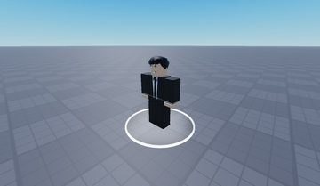</a> <b>Missionary_psalms</b> <code>models/Workspace/Maquinas_Interação/Characters/Missionary_psalms.rbxm</code></td>
</tr>
<tr>
<td width="25%" valign="top"><a href="models/ReplicatedStorage/Bases%20Skins/Aquatic%201%20floors.rbxm">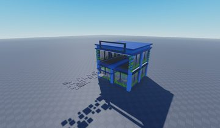</a> <b>Aquatic 1 floors</b> <code>models/ReplicatedStorage/Bases Skins/Aquatic 1 floors.rbxm</code></td>
<td width="25%" valign="top"><a href="models/Workspace/Plots/2.rbxm">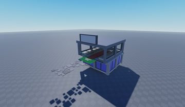</a> <b>2</b> <code>models/Workspace/Plots/2.rbxm</code></td>
<td width="25%" valign="top"><a href="models/ReplicatedStorage/Ingredients/Star.rbxm">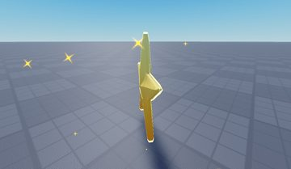</a> <b>Star</b> <code>models/ReplicatedStorage/Ingredients/Star.rbxm</code></td>
<td width="25%" valign="top"><a href="models/Workspace/Maquinas_Intera%C3%A7%C3%A3o/Assets/maquinha%20Spaw.rbxm">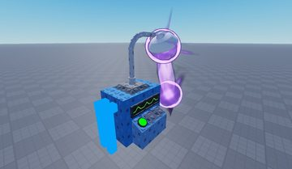</a> <b>maquinha Spaw</b> <code>models/Workspace/Maquinas_Interação/Assets/maquinha Spaw.rbxm</code></td>
</tr>
</table>

## Notable scripts

Top-scored scripts of this game per topic (full tree in [source/scripts](source/scripts/)).

| Topic | Scripts |
|---|---|
| UI animation (tweens, hover / click, pop-ins, springs) | [`UIEffects`](source/scripts/StarterPlayer/StarterCharacterScripts/UIEffects.client.lua) 573 lines [`AdminPanel`](source/scripts/StarterPlayer/StarterPlayerScripts/AdminPanel.client.lua) 2733 lines [`PopUpController`](source/scripts/StarterPlayer/StarterPlayerScripts/PopUpController.client.lua) 149 lines [`WeightsUIController`](source/scripts/StarterPlayer/StarterPlayerScripts/WeightsUIController.client.lua) 231 lines [`SellController`](source/scripts/StarterPlayer/StarterPlayerScripts/SellController.client.lua) 167 lines |
| UI controllers / window managers / menus | [`FrameManager`](source/scripts/ReplicatedStorage/Modules/FrameManager.lua) 97 lines [`UIInitializer`](source/scripts/StarterPlayer/StarterPlayerScripts/UIInitializer.client.lua) 184 lines [`OfflineUIController`](source/scripts/StarterPlayer/StarterPlayerScripts/OfflineUIController.client.lua) 103 lines [`HUDController`](source/scripts/StarterPlayer/StarterPlayerScripts/HUDController.client.lua) 156 lines [`LimitedItemUIController`](source/scripts/StarterPlayer/StarterPlayerScripts/LimitedItemUIController.client.lua) 165 lines |
| Notifications, toasts, popups, prompts | [`PopUpController`](source/scripts/StarterPlayer/StarterPlayerScripts/PopUpController.client.lua) 149 lines [`NotificationManager`](source/scripts/ReplicatedStorage/Modules/NotificationManager.lua) 113 lines [`PromptController`](source/scripts/StarterPlayer/StarterPlayerScripts/PromptController.client.lua) 141 lines [`AnnouncementReceiver`](source/scripts/StarterPlayer/StarterPlayerScripts/AnnouncementReceiver.client.lua) 1145 lines [`SlotManager`](source/scripts/ServerScriptService/Modules/SlotManager.lua) 606 lines |
| Camera, cutscenes, screen shake | [`WindShake`](source/scripts/StarterPlayer/StarterPlayerScripts/WindController/WindShake.lua) 316 lines [`CameraShaker`](source/scripts/ReplicatedStorage/Modules/CameraShaker.lua) 209 lines [`CameraShakePresets`](source/scripts/ReplicatedStorage/Modules/CameraShaker/CameraShakePresets.lua) 105 lines [`UIEffects`](source/scripts/StarterPlayer/StarterCharacterScripts/UIEffects.client.lua) 573 lines [`KickController`](source/scripts/StarterPlayer/StarterPlayerScripts/KickController.client.lua) 989 lines |
| VFX, particles, beams, hit effects | [`UIEffects`](source/scripts/StarterPlayer/StarterCharacterScripts/UIEffects.client.lua) 573 lines [`PlayerController`](source/scripts/ServerScriptService/Controllers/PlayerController.lua) 617 lines [`SlotManager`](source/scripts/ServerScriptService/Modules/SlotManager.lua) 606 lines [`Acid`](source/scripts/ReplicatedStorage/Eventos/AcidStorm/AcidStorm/Acid.lua) 641 lines [`Love`](source/scripts/ReplicatedStorage/Eventos/Love/Love/Love.lua) 588 lines |
| DataStore / player data | [`PlayerController`](source/scripts/ServerScriptService/Controllers/PlayerController.lua) 617 lines |
| Monetization (dev products, game passes, receipts) | [`MonetizationController`](source/scripts/ServerScriptService/Controllers/MonetizationController.lua) 258 lines [`ShopController`](source/scripts/StarterPlayer/StarterPlayerScripts/ShopController.client.lua) 259 lines [`IngredientShopController`](source/scripts/StarterPlayer/StarterPlayerScripts/IngredientShopController.client.lua) 130 lines [`PlayerController`](source/scripts/ServerScriptService/Controllers/PlayerController.lua) 617 lines |
| RNG, eggs, gacha, rarity rolls, pets | [`MonetizationController`](source/scripts/ServerScriptService/Controllers/MonetizationController.lua) 258 lines [`KickController`](source/scripts/StarterPlayer/StarterPlayerScripts/KickController.client.lua) 989 lines [`PlayerController`](source/scripts/ServerScriptService/Controllers/PlayerController.lua) 617 lines [`CollisionController`](source/scripts/ServerScriptService/CollisionController.server.lua) 95 lines [`BrainrotConveyor`](source/scripts/ServerScriptService/Modules/BrainrotConveyor.lua) 1138 lines |
| Trading systems | [`TradeServer`](source/scripts/ServerScriptService/Modules/TradeServer.lua) 366 lines [`TradeClient`](source/scripts/StarterPlayer/StarterPlayerScripts/TradeClient.client.lua) 669 lines |
| Combat, weapons, hitboxes, abilities | [`KickController`](source/scripts/StarterPlayer/StarterPlayerScripts/KickController.client.lua) 989 lines [`HitboxClass`](source/scripts/ReplicatedStorage/Modules/HitboxClass.lua) 892 lines [`HitboxMoverScript`](source/scripts/ServerScriptService/HitboxMoverScript.server.lua) 130 lines [`HitboxClassLocal`](source/scripts/ReplicatedStorage/Modules/HitboxClass/HitboxClassLocal.client.lua) 66 lines [`Types`](source/scripts/ReplicatedStorage/Modules/HitboxClass/Types.lua) 98 lines |
| Tycoon / plots / bases / building | [`BrainrotConveyor`](source/scripts/ServerScriptService/Modules/BrainrotConveyor.lua) 1138 lines [`PlotController`](source/scripts/StarterPlayer/StarterPlayerScripts/PlotController.client.lua) 179 lines [`SlotManager`](source/scripts/ServerScriptService/Modules/SlotManager.lua) 606 lines [`PlotManager`](source/scripts/ServerScriptService/PlotManager.server.lua) 484 lines [`UIEffects`](source/scripts/StarterPlayer/StarterCharacterScripts/UIEffects.client.lua) 573 lines |
| Admin panels & commands | [`AdminHandler`](source/scripts/ServerScriptService/Modules/AdminHandler.lua) 607 lines [`AdminPanel`](source/scripts/StarterPlayer/StarterPlayerScripts/AdminPanel.client.lua) 2733 lines |
| Sound & music | [`MusicController`](source/scripts/StarterPlayer/StarterPlayerScripts/MusicController.client.lua) 66 lines |
| Daily rewards, quests, codes, playtime | [`PlayerController`](source/scripts/ServerScriptService/Controllers/PlayerController.lua) 617 lines [`MorphRewardHandler`](source/scripts/ServerScriptService/MorphRewardHandler.server.lua) 39 lines |
| Utility modules (number format, signals, tables, timers) | [`NumberFormatter`](source/scripts/ReplicatedStorage/Modules/NumberFormatter.lua) 34 lines [`SlotManager`](source/scripts/ServerScriptService/Modules/SlotManager.lua) 606 lines [`PlotManager`](source/scripts/ServerScriptService/PlotManager.server.lua) 484 lines [`ItemManager`](source/scripts/ServerScriptService/Modules/ItemManager.lua) 651 lines [`BrainrotConveyor`](source/scripts/ServerScriptService/Modules/BrainrotConveyor.lua) 1138 lines |

### In the curated script library

- [Panel server: one handler per remote](../../Scripts/16-Admin/AdminHandler-PanelRemotes__brainrot-lab.lua) — Admin panel backend with one function per remote (spawn items, start/end events locally or globally, announcements, private-server tools, youtuber tags), each starting with an isAdmin check, plus player resolving by id or name.
- [Floating reward pop-ups](../../Scripts/03-Notifications/RewardPopUp__brainrot-lab.lua) — "+$123" reward pop-ups at a random spot near screen centre: pop-size + fade in, float up + fade out, with sound; driven by server RemoteEvents.
- [Server-wide pity timers](../../Scripts/09-RNG-Gacha-Pets/PityTimerSpawns__brainrot-lab.lua) — Conveyor spawner where Legendary / Mythical / Secret never roll randomly; instead a countdown per rarity guarantees one when it hits zero, with a world sign showing the time left.
- [State-driven music crossfade](../../Scripts/17-Sound-Music/MusicCrossfadeByState__brainrot-lab.lua) — Two looping tracks (background and run music) that crossfade with TweenService whenever the player state changes (here: a morph model exists on the character).
- [Event sound sequence with screen flash](../../Scripts/17-Sound-Music/EventSoundSequence__brainrot-lab.lua) — Server-triggered event stingers: plays a sequence of named sounds one after another (waiting on Ended) and syncs a full-screen white flash to one of them, using a token so overlapping flashes cancel cleanly.
- [Tool trade server](../../Scripts/10-Trading/ToolTradeServer__brainrot-lab.lua) — Clean trade module for Tool items with InTrade lock, request timeout and final re-validation.
- [Tool trade client](../../Scripts/10-Trading/ToolTradeClient__brainrot-lab.lua) — Client for tool trades: request toasts with countdown, player list, viewport item previews.
- [Fixed-plot manager with floor upgrades](../../Scripts/14-Tycoon-Plots/PlotManager__brainrot-lab.lua) — Simple, readable plot system: 8 fixed plots, first free index goes to the joining player, extra floors are shown/hidden as the player buys base upgrades (price + rebirth requirement per level),...
- [Podium slots: place, collect, upgrade](../../Scripts/14-Tycoon-Plots/SlotManager__brainrot-lab.lua) — Podium/slot logic for a brainrot tycoon: place the held tool on an empty slot, swap or pick up from an occupied one, slots accumulate money over time, touch a collect pad to cash out, and level up...
- [Conveyor belt spawner with pity and delivery to base](../../Scripts/14-Tycoon-Plots/BrainrotConveyor__brainrot-lab.lua) — Server conveyor belt: spawns a weighted-random brainrot every few seconds at point A, lerps it to point B, players press E in range to buy it, then it walks to the buyer's base (stealable in...
- [Universal button FX + tag-driven effects](../../Scripts/01-UI-Animation/UniversalButtonFX_TagEffects__brainrot-lab.lua) — Auto-hooks every GuiButton with hover/press UIScale tweens + sounds, and drives CollectionService-tagged effects (sunburst spin, rotating/panning UIGradient, random shine sparkles, looping UIScale pulse).
- [Floating reward popups](../../Scripts/01-UI-Animation/PopUpController_RewardFloat__brainrot-lab.lua) — "+$amount" reward popups at a random spot near screen centre: size pop with Back-out, content fade-in, then float up and fade out.
- [FrameManager (one frame at a time)](../../Scripts/02-UI-Framework/FrameManager__brainrot-lab.lua) — Opens one frame at a time with a slide-up tween; buttons wired as Open/Close/Toggle.
- [UI initializer with name-based button binding](../../Scripts/02-UI-Framework/UIInitializer__brainrot-lab.lua) — Hides frames on boot, binds HUD buttons to frames by name, hover/press animations, opens menus from pads or by distance.
- [HUD stats controller](../../Scripts/02-UI-Framework/HUDController__brainrot-lab.lua) — Syncs HUD labels with leaderstats and wires product, random-item and invite buttons with button animations.

## Folders

| Folder | What |
|---|---|
| `screenshots/` | full frames; `crops/` = the panel only; `models/` = 3D previews; `thumbs/` = gallery thumbnails |
| `ui/` | every screen as a Lua builder (`require(module)()` returns the ScreenGui); `_StarterGui-all.lua` builds every StarterGui screen |
| `models/` | every model as .rbxm (the only .rbxm files), mirroring the place tree, scripts removed |
| `map/` | `workspace.rbxm` (the map as a model), `lighting.lua` (sky + post effects), `materials.lua`, `Environment.lua` |
| `animations/`, `audio/` | KeyframeSequence / Sound builders (.lua), `AnimationIds.lua`, `Sounds.lua` |
| `source/` | all scripts as .luau, `tree.txt`, `ui.txt`, `remotes.txt`, `assets.txt`, `flags.txt` |
