# LvaH Casino

> 💬 **Social** · casino (roulette, blackjack, poker, horse racing, wheels) · source file `Public LvaH.rbxl`

[⬅ Back to the catalog](../../README.md) · [Assets inventory](ASSETS.md) · [Style numbers](reference.md) · [Scripts](source/scripts/) · [Code analysis](source/README.md)

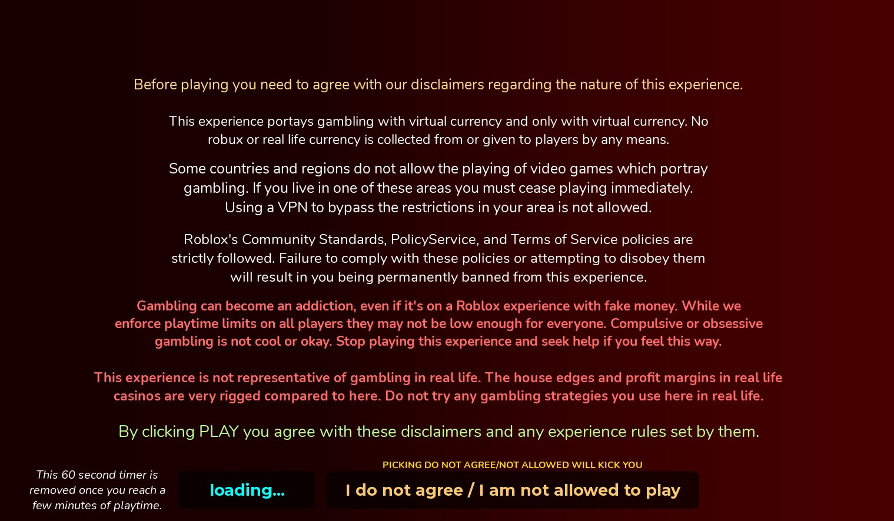

## At a glance

| | |
|---|---|
| Provenance | template with full source |
| Screens | 3 ScreenGuis, 1345 GUI objects → **39 screenshots** |
| Models (.rbxm) | 148 models, 27 model sets, 0 VFX sets |
| Lua builders (.lua) | 25 UI screens, 466 animation packs, 14 audio packs |
| Code | 597 scripts, 158,975 lines |
| Asset ids | 417 animations, 229 sounds |
| Safety scan | 2 HIGH / 3 MED flags ([flags.txt](source/flags.txt)) |

**Fonts:** `Nunito Bold`×372, `LuckiestGuy Regular`×150, `SourceSansPro Bold`×50, `Arial Bold`×39, `SourceSansPro Regular`×26

## UI screenshots

Captured in Studio from the place's own ScreenGuis (scripts stripped). Each panel was opened on its own; click a thumbnail for the full 1519×886 frame. Runtime-filled lists (shop items, inventories) show their template state.

### Inventory / backpack / pets

<table>
<tr>
<td width="33%" valign="top"><a href="screenshots/40_Backpack.jpg">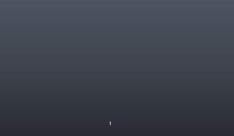</a> <b>Backpack</b></td>
</tr>
</table>

### Rewards, daily, spin, codes

<table>
<tr>
<td width="33%" valign="top"><a href="screenshots/25_Disclaimers__Disclaimer.jpg">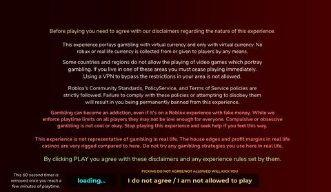</a> <b>Disclaimers</b> › Disclaimer</td>
<td width="33%" valign="top"><a href="screenshots/26_Disclaimers__Mobile.jpg">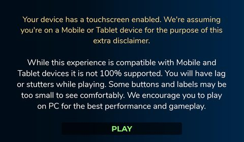</a> <b>Disclaimers</b> › Mobile</td>
<td width="33%" valign="top"><a href="screenshots/33_BigWheel.jpg">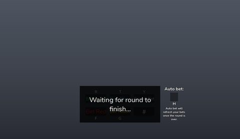</a> <b>BigWheel</b></td>
</tr>
<tr>
<td width="33%" valign="top"><a href="screenshots/37_CashWheel.jpg">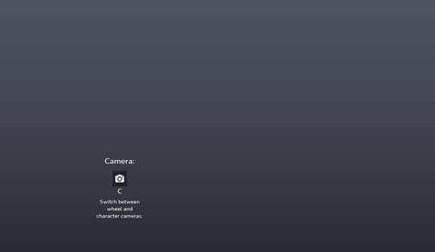</a> <b>CashWheel</b></td>
</tr>
</table>

### HUD & currency

<table>
<tr>
<td width="33%" valign="top"><a href="screenshots/02_Game__MainFrame.jpg">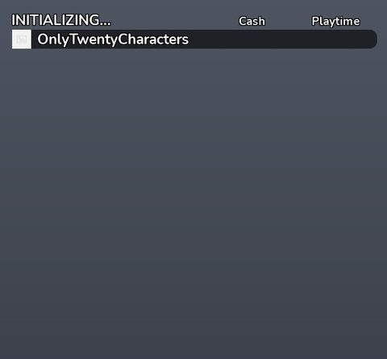</a> <b>Game</b> › Leaderboard.MainFrame</td>
</tr>
</table>

### Other

<table>
<tr>
<td width="33%" valign="top"> <b>Game</b></td>
<td width="33%" valign="top"><a href="screenshots/03_Game__1.jpg">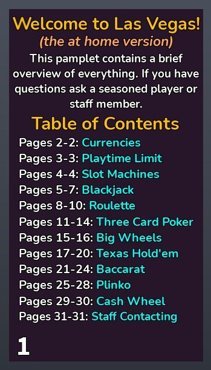</a> <b>Game</b> › GuidePamplet.1</td>
<td width="33%" valign="top"><a href="screenshots/04_Game__1.jpg">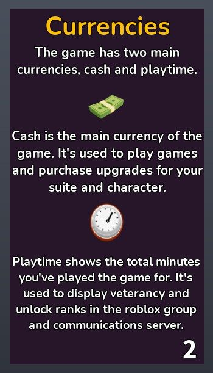</a> <b>Game</b> › GuidePamplet.1</td>
</tr>
<tr>
<td width="33%" valign="top"><a href="screenshots/05_Game__2.jpg">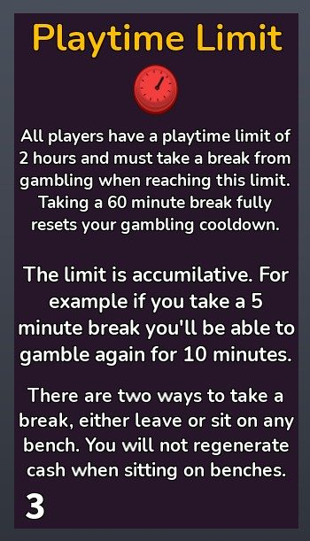</a> <b>Game</b> › GuidePamplet.2</td>
<td width="33%" valign="top"><a href="screenshots/06_Game__2.jpg">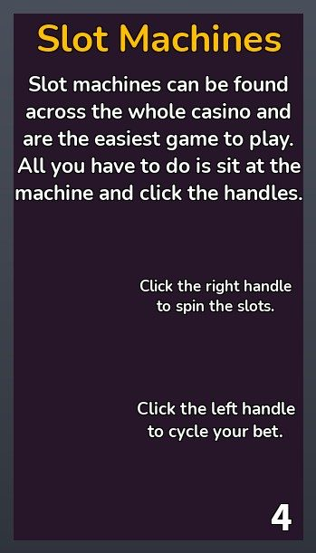</a> <b>Game</b> › GuidePamplet.2</td>
<td width="33%" valign="top"><a href="screenshots/07_Game__3.jpg">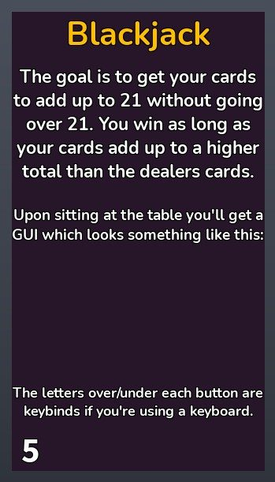</a> <b>Game</b> › GuidePamplet.3</td>
</tr>
<tr>
<td width="33%" valign="top"><a href="screenshots/08_Game__3.jpg">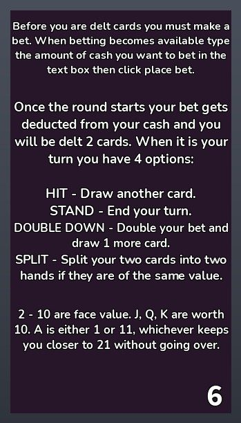</a> <b>Game</b> › GuidePamplet.3</td>
<td width="33%" valign="top"><a href="screenshots/09_Game__4.jpg">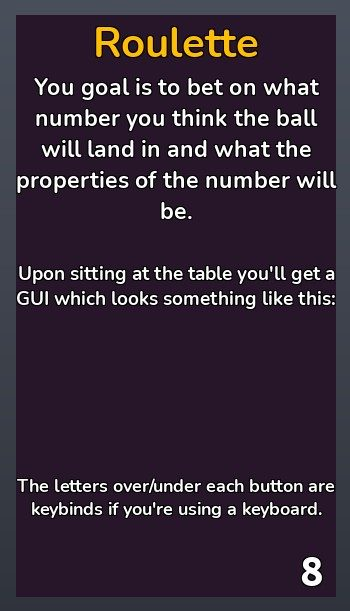</a> <b>Game</b> › GuidePamplet.4</td>
<td width="33%" valign="top"><a href="screenshots/10_Game__5.jpg">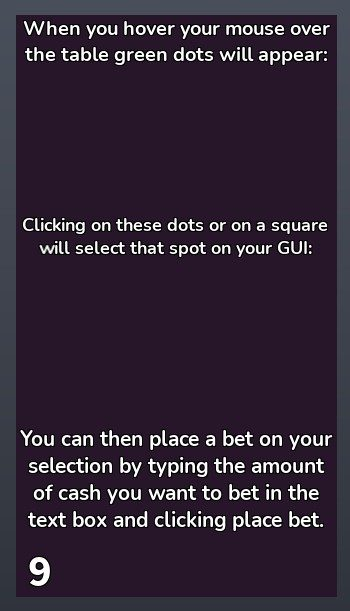</a> <b>Game</b> › GuidePamplet.5</td>
</tr>
<tr>
<td width="33%" valign="top"><a href="screenshots/11_Game__6.jpg">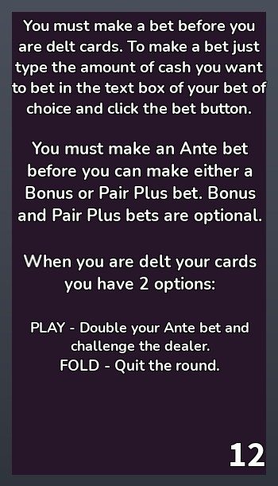</a> <b>Game</b> › GuidePamplet.6</td>
<td width="33%" valign="top"><a href="screenshots/12_Game__6.jpg">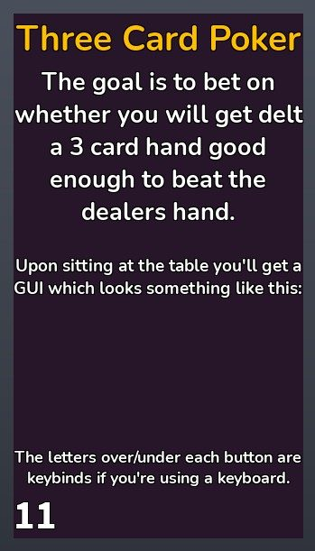</a> <b>Game</b> › GuidePamplet.6</td>
<td width="33%" valign="top"><a href="screenshots/13_Game__7.jpg">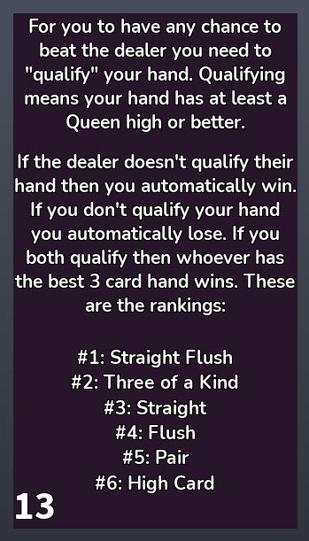</a> <b>Game</b> › GuidePamplet.7</td>
</tr>
<tr>
<td width="33%" valign="top"><a href="screenshots/14_Game__8.jpg">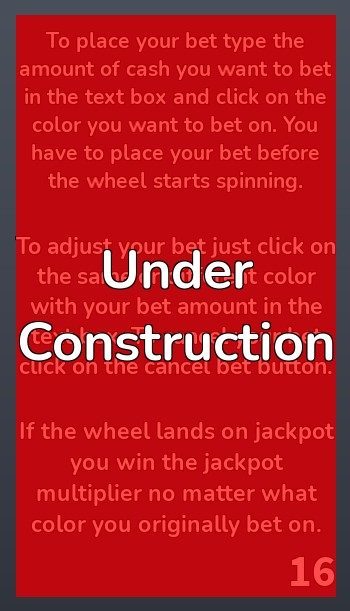</a> <b>Game</b> › GuidePamplet.8</td>
<td width="33%" valign="top"><a href="screenshots/15_Game__8.jpg">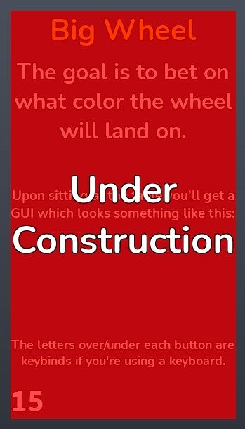</a> <b>Game</b> › GuidePamplet.8</td>
<td width="33%" valign="top"><a href="screenshots/16_Game__9.jpg">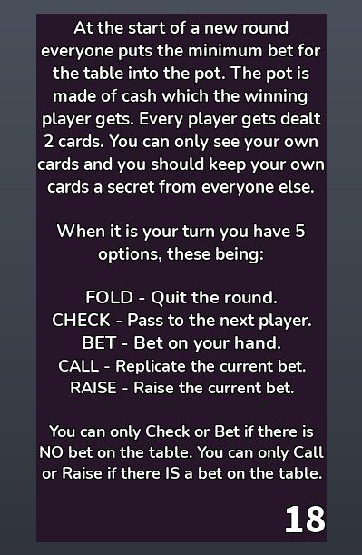</a> <b>Game</b> › GuidePamplet.9</td>
</tr>
<tr>
<td width="33%" valign="top"><a href="screenshots/17_Game__9.jpg">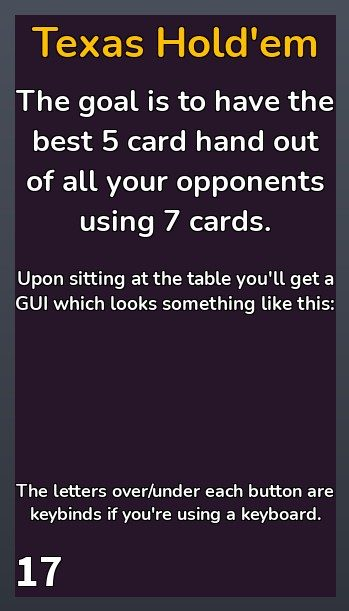</a> <b>Game</b> › GuidePamplet.9</td>
<td width="33%" valign="top"><a href="screenshots/18_Game__16.jpg">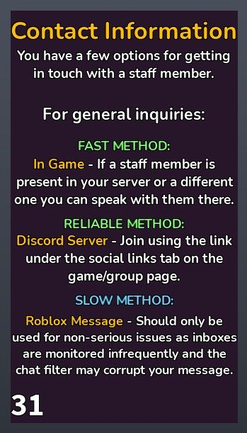</a> <b>Game</b> › GuidePamplet.16</td>
<td width="33%" valign="top"><a href="screenshots/19_Game__10.jpg">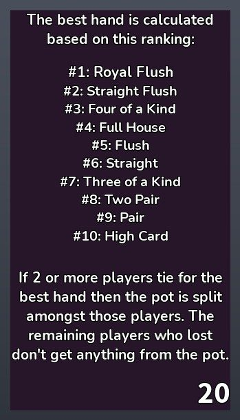</a> <b>Game</b> › GuidePamplet.10</td>
</tr>
<tr>
<td width="33%" valign="top"><a href="screenshots/20_Game__13.jpg">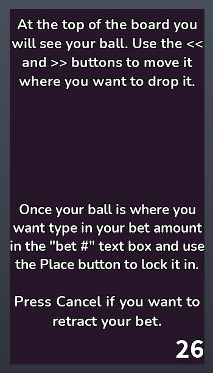</a> <b>Game</b> › GuidePamplet.13</td>
<td width="33%" valign="top"><a href="screenshots/21_Game__13.jpg">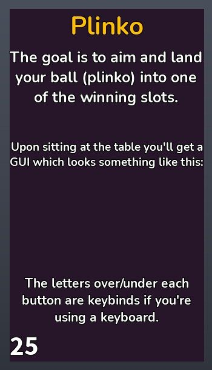</a> <b>Game</b> › GuidePamplet.13</td>
<td width="33%" valign="top"><a href="screenshots/22_Game__11.jpg">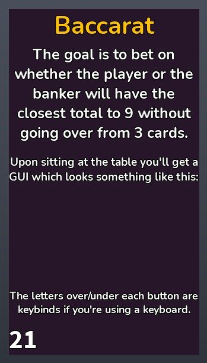</a> <b>Game</b> › GuidePamplet.11</td>
</tr>
<tr>
<td width="33%" valign="top"><a href="screenshots/23_Game__11.jpg">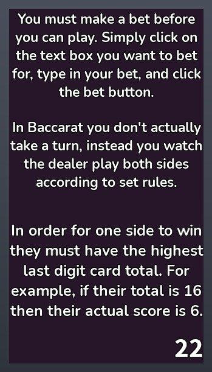</a> <b>Game</b> › GuidePamplet.11</td>
<td width="33%" valign="top"><a href="screenshots/24_Game__12.jpg">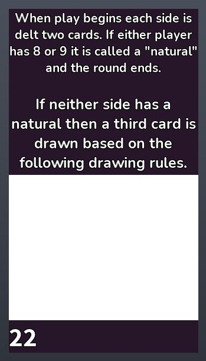</a> <b>Game</b> › GuidePamplet.12</td>
<td width="33%" valign="top"> <b>PlayersList</b></td>
</tr>
<tr>
<td width="33%" valign="top"> <b>PlayersList</b> › Frame.SelectPlayer</td>
<td width="33%" valign="top"><a href="screenshots/29_Roulette.jpg">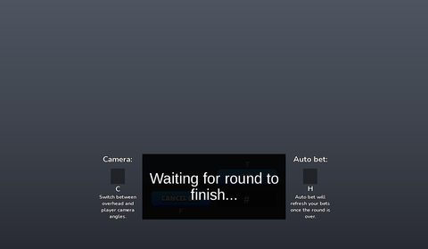</a> <b>Roulette</b></td>
<td width="33%" valign="top"><a href="screenshots/30_HorseRacing.jpg">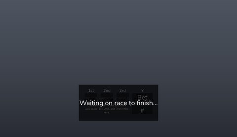</a> <b>HorseRacing</b></td>
</tr>
<tr>
<td width="33%" valign="top"><a href="screenshots/31_Blackjack.jpg">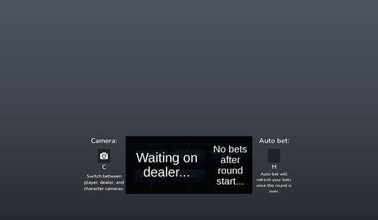</a> <b>Blackjack</b></td>
<td width="33%" valign="top"><a href="screenshots/32_ThreeCardPoker.jpg">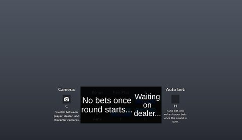</a> <b>ThreeCardPoker</b></td>
<td width="33%" valign="top"><a href="screenshots/34_Baccarat.jpg">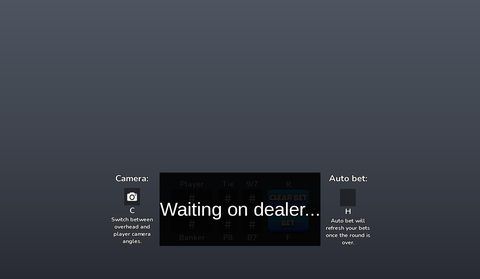</a> <b>Baccarat</b></td>
</tr>
<tr>
<td width="33%" valign="top"><a href="screenshots/35_TexasHoldem.jpg">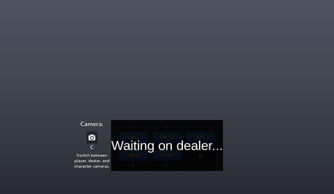</a> <b>TexasHoldem</b></td>
<td width="33%" valign="top"><a href="screenshots/38_Plinko.jpg">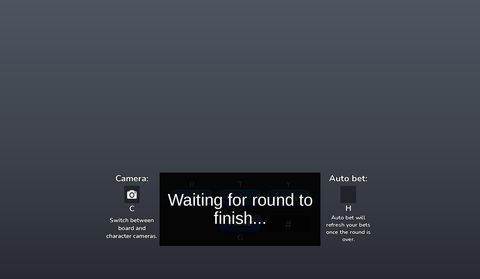</a> <b>Plinko</b></td>
<td width="33%" valign="top"><a href="screenshots/39_Slots.jpg">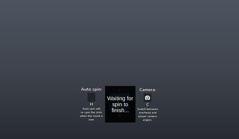</a> <b>Slots</b></td>
</tr>
</table>

## Model previews

<table>
<tr>
<td width="25%" valign="top"><a href="models/Workspace/Games/Slots/GoldenEgg/GoldenEgg__x15.rbxm">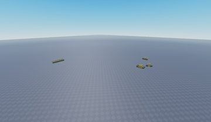</a> <b>GoldenEgg__x15</b> <code>models/Workspace/Games/Slots/GoldenEgg/GoldenEgg__x15.rbxm</code></td>
<td width="25%" valign="top"><a href="models/Workspace/Games/Tables/Baccarat/Baccarat.rbxm">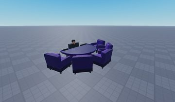</a> <b>Baccarat</b> <code>models/Workspace/Games/Tables/Baccarat/Baccarat.rbxm</code></td>
<td width="25%" valign="top"><a href="models/Workspace/Games/Slots/SevensAndCherries/SevensAndCherries__x19.rbxm">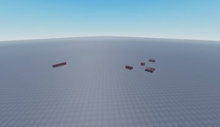</a> <b>SevensAndCherries__x19</b> <code>models/Workspace/Games/Slots/SevensAndCherries/SevensAndCherries__x19.rbxm</code></td>
<td width="25%" valign="top"><a href="models/Workspace/Map/Decoration/Aquarium1/Decoration/Meshes_Grass__x40.rbxm">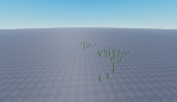</a> <b>Meshes_Grass__x40</b> <code>models/Workspace/Map/Decoration/Aquarium1/Decoration/Meshes_Grass__x40.rbxm</code></td>
</tr>
<tr>
<td width="25%" valign="top"><a href="models/ServerStorage/LongTermStorage/Templates/Furniture/Model.rbxm">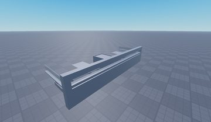</a> <b>Model</b> <code>models/ServerStorage/LongTermStorage/Templates/Furniture/Model.rbxm</code></td>
<td width="25%" valign="top"><a href="models/StarterPack/GuidePamplet.rbxm">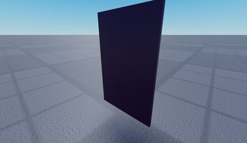</a> <b>GuidePamplet</b> <code>models/StarterPack/GuidePamplet.rbxm</code></td>
<td width="25%" valign="top"><a href="models/Workspace/Map/Leaderboards/Playtime.rbxm">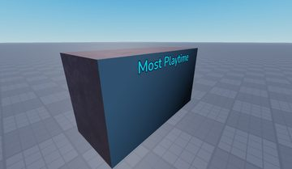</a> <b>Playtime</b> <code>models/Workspace/Map/Leaderboards/Playtime.rbxm</code></td>
<td width="25%" valign="top"><a href="models/Workspace/Map/Casino/Structure/Union.rbxm">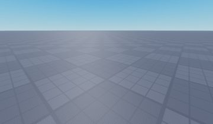</a> <b>Union</b> <code>models/Workspace/Map/Casino/Structure/Union.rbxm</code></td>
</tr>
<tr>
<td width="25%" valign="top"><a href="models/Workspace/Games/Slots/GoldenEgg/GoldenEgg.rbxm">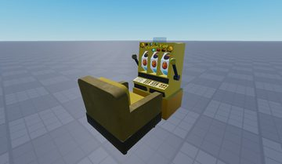</a> <b>GoldenEgg</b> <code>models/Workspace/Games/Slots/GoldenEgg/GoldenEgg.rbxm</code></td>
<td width="25%" valign="top"><a href="models/Workspace/Games/Tables/Blackjack/Blackjack.rbxm">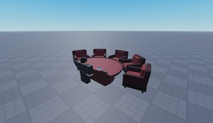</a> <b>Blackjack</b> <code>models/Workspace/Games/Tables/Blackjack/Blackjack.rbxm</code></td>
<td width="25%" valign="top"><a href="models/Workspace/Games/Slots/OkamiSlots/OkamiSlots__x13.rbxm">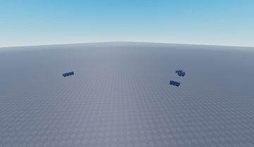</a> <b>OkamiSlots__x13</b> <code>models/Workspace/Games/Slots/OkamiSlots/OkamiSlots__x13.rbxm</code></td>
<td width="25%" valign="top"><a href="models/Workspace/Map/Decoration/Furniture/Bench__x22.rbxm">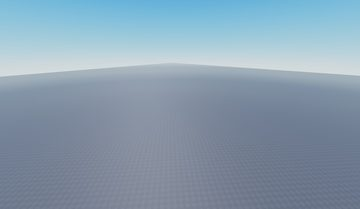</a> <b>Bench__x22</b> <code>models/Workspace/Map/Decoration/Furniture/Bench__x22.rbxm</code></td>
</tr>
<tr>
<td width="25%" valign="top"><a href="models/ServerStorage/LongTermStorage/Templates/Furniture/Bench.rbxm">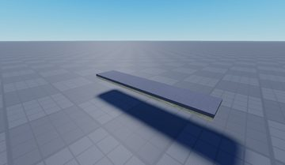</a> <b>Bench</b> <code>models/ServerStorage/LongTermStorage/Templates/Furniture/Bench.rbxm</code></td>
<td width="25%" valign="top"> <b>PayoutPamplet</b> <code>models/StarterPack/PayoutPamplet.rbxm</code></td>
</tr>
</table>

## Notable scripts

Top-scored scripts of this game per topic (full tree in [source/scripts](source/scripts/)).

| Topic | Scripts |
|---|---|
| UI animation (tweens, hover / click, pop-ins, springs) | [`chatWindow`](source/scripts/ServerScriptService/BetterChat%20V3/Config/Loader/oldsrc/client/modules/core/elements/chatWindow.lua) 471 lines [`PlayersListPlus`](source/scripts/ReplicatedStorage/PlayersListPlus.lua) 880 lines [`Widget`](source/scripts/ServerScriptService/BetterChat%20V3/Config/Loader/oldsrc/client/modules/core/topbarPlus/TopbarPlus/Dependencies/Elements/Widget.lua) 411 lines |
| UI controllers / window managers / menus | [`settingsMenu`](source/scripts/ServerScriptService/BetterChat%20V3/Config/Loader/oldsrc/client/modules/core/settingsMenu.lua) 528 lines [`Menu`](source/scripts/ServerScriptService/BetterChat%20V3/Config/Loader/oldsrc/client/modules/core/topbarPlus/TopbarPlus/Dependencies/Elements/Menu.lua) 183 lines [`Overflow`](source/scripts/ServerScriptService/BetterChat%20V3/Config/Loader/oldsrc/client/modules/core/topbarPlus/TopbarPlus/Dependencies/Features/Overflow.lua) 325 lines [`chatWindow`](source/scripts/ServerScriptService/BetterChat%20V3/Config/Loader/oldsrc/client/modules/core/elements/chatWindow.lua) 471 lines [`PlayersListPlus`](source/scripts/ReplicatedStorage/PlayersListPlus.lua) 880 lines |
| Notifications, toasts, popups, prompts | [`prompt`](source/scripts/ServerScriptService/BetterChat%20V3/Config/Loader/oldsrc/client/modules/core/messages/util/prompt.lua) 341 lines [`Announcer`](source/scripts/StarterGui/Game/Announcement/Announcer.client.lua) 31 lines [`reply`](source/scripts/ServerScriptService/BetterChat%20V3/Config/Loader/oldsrc/client/modules/core/messages/reply.lua) 362 lines [`Config`](source/scripts/ServerScriptService/BetterChat%20V3/Config.lua) 358 lines [`load`](source/scripts/ServerScriptService/BetterChat%20V3/Config/Loader/oldsrc/client/load.client.lua) 670 lines |
| Camera, cutscenes, screen shake | [`BlackjackLocalCore`](source/scripts/ServerScriptService/Environment/GameManager/BlackjackCore/Blackjack/BlackjackLocalCore.client.lua) 232 lines [`TexasHoldemLocalCore`](source/scripts/ServerScriptService/Environment/GameManager/TexasHoldemCore/TexasHoldem/TexasHoldemLocalCore.client.lua) 213 lines [`ThreeCardPokerLocalCore`](source/scripts/ServerScriptService/Environment/GameManager/ThreeCardPokerCore/ThreeCardPoker/ThreeCardPokerLocalCore.client.lua) 226 lines |
| DataStore / player data | [`profile`](source/scripts/ServerScriptService/BetterChat%20V3/Config/Loader/oldsrc/core/services/profile.lua) 2565 lines [`ProfileService`](source/scripts/ServerStorage/Modules/ProfileService.lua) 2417 lines |
| Monetization (dev products, game passes, receipts) | [`marketplace`](source/scripts/ServerScriptService/BetterChat%20V3/Config/Loader/oldsrc/core/services/marketplace.lua) 34 lines |
| RNG, eggs, gacha, rarity rolls, pets | [`GoldenEggCore`](source/scripts/ServerScriptService/Environment/GameManager/GoldenEggCore.server.lua) 232 lines [`BigWheelCore`](source/scripts/ServerScriptService/Environment/GameManager/BigWheelCore.server.lua) 478 lines [`GameFunctions`](source/scripts/ServerStorage/Modules/GameFunctions.lua) 454 lines [`CatalogHavenCore`](source/scripts/ServerScriptService/Environment/GameManager/CatalogHavenCore.server.lua) 241 lines [`GreenHotCore`](source/scripts/ServerScriptService/Environment/GameManager/GreenHotCore.server.lua) 312 lines |
| Combat, weapons, hitboxes, abilities | [`AwardBadge`](source/scripts/StarterPlayer/StarterCharacterScripts/AwardBadge.server.lua) 32 lines |
| NPC / AI / monsters | [`NPCs`](source/scripts/ServerScriptService/Environment/NPCs.server.lua) 163 lines [`NPCs`](source/scripts/ServerStorage/Modules/NPCs.lua) 95 lines |
| Character movement (sprint, dash, double jump, slide) | [`Slider`](source/scripts/ReplicatedStorage/Modules/Slider.lua) 329 lines [`slider`](source/scripts/ServerScriptService/BetterChat%20V3/Config/Loader/oldsrc/client/modules/core/constructors/util/slider.lua) 148 lines [`slider`](source/scripts/ServerScriptService/BetterChat%20V3/Config/Loader/oldsrc/client/modules/core/constructors/slider.lua) 86 lines [`colorPicker`](source/scripts/ServerScriptService/BetterChat%20V3/Config/Loader/oldsrc/client/modules/core/constructors/colorPicker.lua) 312 lines [`Sprint`](source/scripts/StarterPlayer/StarterCharacterScripts/Sprint.client.lua) 21 lines |
| Tycoon / plots / bases / building | [`Slider`](source/scripts/ReplicatedStorage/Modules/Slider.lua) 329 lines [`chatbar`](source/scripts/ServerScriptService/BetterChat%20V3/Config/Loader/oldsrc/client/modules/core/elements/chatbar.lua) 486 lines [`chatbar`](source/scripts/ServerScriptService/BetterChat%20V3/Config/Loader/src/client/modules/core/elements/chatbar.lua) 504 lines [`Config`](source/scripts/ServerScriptService/BetterChat%20V3/Config.lua) 358 lines [`chatWindow`](source/scripts/ServerScriptService/BetterChat%20V3/Config/Loader/oldsrc/client/modules/core/elements/chatWindow.lua) 471 lines |
| Leaderboards & stats | [`Leaderboards`](source/scripts/ServerScriptService/Player/Leaderboards.server.lua) 287 lines |
| Admin panels & commands | [`opbanServer`](source/scripts/ServerScriptService/Commands/CommandHandler/CustomCommands/Moderator/opbanServer.lua) 46 lines [`otbanServer`](source/scripts/ServerScriptService/Commands/CommandHandler/CustomCommands/Moderator/otbanServer.lua) 55 lines [`unbanServer`](source/scripts/ServerScriptService/Commands/CommandHandler/CustomCommands/Moderator/unbanServer.lua) 49 lines [`tbanServer`](source/scripts/ServerScriptService/Commands/CommandHandler/CustomCommands/Moderator/tbanServer.lua) 34 lines [`CommandLocalHandler`](source/scripts/StarterPlayer/StarterPlayerScripts/CommandLocalHandler.client.lua) 15 lines |
| Utility modules (number format, signals, tables, timers) | [`Utility`](source/scripts/ServerScriptService/BetterChat%20V3/Config/Loader/oldsrc/client/modules/core/topbarPlus/TopbarPlus/Dependencies/Utility.lua) 447 lines [`PlayersListPlus`](source/scripts/ReplicatedStorage/PlayersListPlus.lua) 880 lines [`Promise`](source/scripts/ServerStorage/Modules/RankGun/include/Promise.lua) 2049 lines [`signal`](source/scripts/ServerScriptService/BetterChat%20V3/Config/Loader/oldsrc/shared/signal.lua) 163 lines [`Signal`](source/scripts/ReplicatedStorage/Modules/Slider/Utils/Signal.lua) 75 lines |

### In the curated script library

- [Moderator announcement banner](../../Scripts/03-Notifications/ModAnnouncement__casino-lvah.lua) — Simple moderator announcement banner: clone template, fade in title/text/name over 2s, hold 6s, fade out.
- [Ambient NPCs that fill seats](../../Scripts/12-NPC-AI/AmbientSeatNPCs__casino-lvah.lua) — Keeps a global NPC count under a limit by picking random free stools at casino games (priority games first), spawning an avatar NPC on the seat with sit animation, nametag and a per-NPC play script.
- [Random-start looping playlist](../../Scripts/17-Sound-Music/CasinoPlaylist__casino-lvah.lua) — Simple looping playlist: starts at a random track, waits for Loaded before playing, advances (wrapping) on Ended; includes a forward/back position helper.

## ⚠️ Safety

HIGH flags (backdoors, `require(id)`, `loadstring`, webhooks). Review or delete before reusing:

- `scripts/ServerScriptService/Player/NexusVRCharacterModelLoader.server.lua`
- `scripts/ServerScriptService/Player/NexusVRCharacterModelLoader/MainModule/NexusVRCharacterModel.lua`

## Folders

| Folder | What |
|---|---|
| `screenshots/` | full frames; `crops/` = the panel only; `models/` = 3D previews; `thumbs/` = gallery thumbnails |
| `ui/` | every screen as a Lua builder (`require(module)()` returns the ScreenGui); `_StarterGui-all.lua` builds every StarterGui screen |
| `models/` | every model as .rbxm (the only .rbxm files), mirroring the place tree, scripts removed |
| `map/` | `workspace.rbxm` (the map as a model), `lighting.lua` (sky + post effects), `materials.lua`, `Environment.lua` |
| `animations/`, `audio/` | KeyframeSequence / Sound builders (.lua), `AnimationIds.lua`, `Sounds.lua` |
| `source/` | all scripts as .luau, `tree.txt`, `ui.txt`, `remotes.txt`, `assets.txt`, `flags.txt` |
