# Catalog Avatar Creator (mtsowiks)

> 💬 **Social** · avatar editor (outfits, poses, Cmdr) · source file `made by mtsowiks for slbr booster.rbxl`

[⬅ Back to the catalog](../../README.md) · [Assets inventory](ASSETS.md) · [Style numbers](reference.md) · [Scripts](source/scripts/) · [Code analysis](source/README.md)

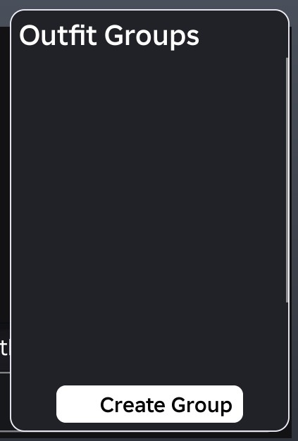

## At a glance

| | |
|---|---|
| Provenance | copy of a live game (saveinstance / decompiled client code) |
| Screens | 36 ScreenGuis, 2451 GUI objects → **93 screenshots** |
| Models (.rbxm) | 40 models, 9 model sets, 1 VFX sets |
| Lua builders (.lua) | 148 UI screens, 0 animation packs, 2 audio packs |
| Code | 347 scripts, 102,434 lines |
| Asset ids | 36 animations, 4 sounds |
| Safety scan | 0 HIGH / 1 MED flags ([flags.txt](source/flags.txt)) |

**Fonts:** `SourceSansPro Regular`×333, `Builder Sans SemiBold`×207, `Builder Sans Regular`×158, `Builder Sans Medium`×127, `Builder Sans Bold`×101

## UI screenshots

Captured in Studio from the place's own ScreenGuis (scripts stripped). Each panel was opened on its own; click a thumbnail for the full 1519×886 frame. Runtime-filled lists (shop items, inventories) show their template state.

### Shop & Robux store

<table>
<tr>
<td width="33%" valign="top"><a href="screenshots/17_wrapper__tags.jpg">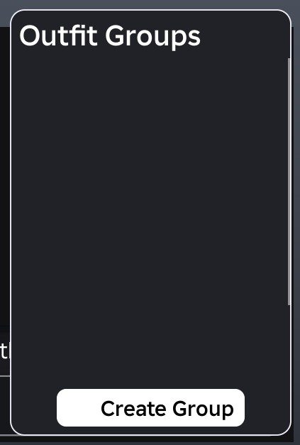</a> <b>wrapper</b> › layoutBypass.tags</td>
<td width="33%" valign="top"><a href="screenshots/57_ShoppingCart.jpg">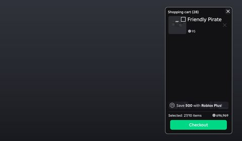</a> <b>ShoppingCart</b></td>
<td width="33%" valign="top"><a href="screenshots/97_ExclusiveShop.jpg">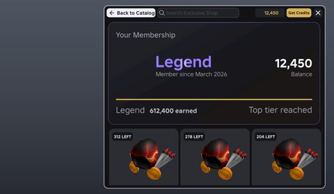</a> <b>ExclusiveShop</b></td>
</tr>
</table>

### Inventory / backpack / pets

<table>
<tr>
<td width="33%" valign="top"><a href="screenshots/02_wrapperBeforeAspectRatio__includedItems.jpg">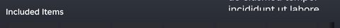</a> <b>wrapperBeforeAspectRatio</b> › includedItems</td>
<td width="33%" valign="top"><a href="screenshots/47_itemOnlyName.jpg">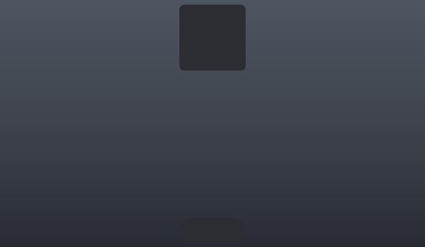</a> <b>itemOnlyName</b></td>
<td width="33%" valign="top"><a href="screenshots/48_item.jpg">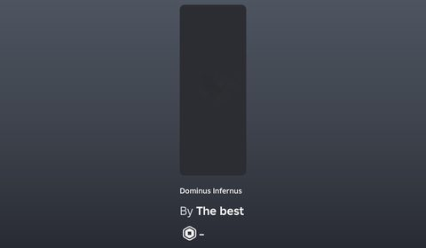</a> <b>item</b></td>
</tr>
<tr>
<td width="33%" valign="top"><a href="screenshots/86_ItemGridPreview.jpg">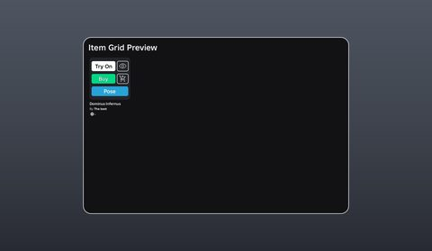</a> <b>ItemGridPreview</b></td>
<td width="33%" valign="top"><a href="screenshots/87_RemoveItems.jpg">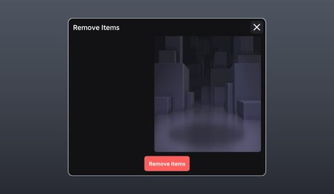</a> <b>RemoveItems</b></td>
<td width="33%" valign="top"><a href="screenshots/98_ExclusiveShop__item.jpg">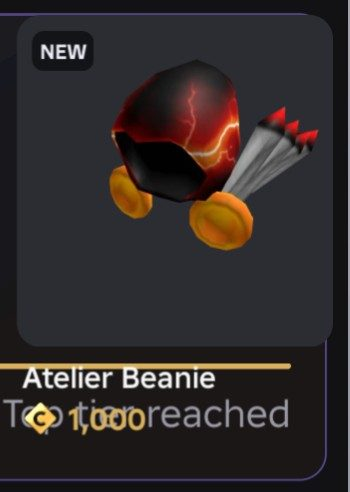</a> <b>ExclusiveShop</b> › container.wrapper.shopView.itemsWrapper.heroRow.item</td>
</tr>
<tr>
<td width="33%" valign="top"> <b>ExclusiveShop</b> › container.wrapper.shopView.itemsWrapper.gridContainer.item</td>
<td width="33%" valign="top"> <b>ExclusiveShop</b> › container.wrapper.shopView.itemsWrapper.gridContainer.item</td>
<td width="33%" valign="top"> <b>ExclusiveShop</b> › container.wrapper.shopView.itemsWrapper.gridContainer.item</td>
</tr>
<tr>
<td width="33%" valign="top"> <b>ExclusiveShop</b> › container.wrapper.shopView.itemsWrapper.gridContainer.item</td>
<td width="33%" valign="top"> <b>ExclusiveShop</b> › container.wrapper.shopView.itemsWrapper.gridContainer.item</td>
<td width="33%" valign="top"> <b>ExclusiveShop</b> › container.wrapper.shopView.itemsWrapper.gridContainer.item</td>
</tr>
<tr>
<td width="33%" valign="top"><a href="screenshots/106_ExclusiveShop__item.jpg">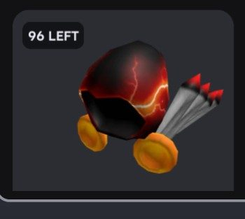</a> <b>ExclusiveShop</b> › container.wrapper.shopView.itemsWrapper.gridContainer.item</td>
<td width="33%" valign="top"><a href="screenshots/107_ExclusiveShop__item.jpg">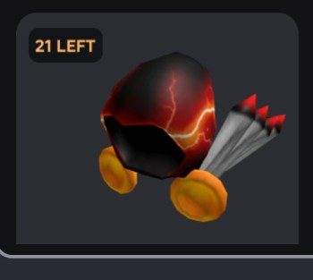</a> <b>ExclusiveShop</b> › container.wrapper.shopView.itemsWrapper.gridContainer.item</td>
<td width="33%" valign="top"><a href="screenshots/108_ExclusiveShop__item.jpg">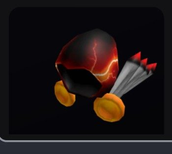</a> <b>ExclusiveShop</b> › container.wrapper.shopView.itemsWrapper.gridContainer.item</td>
</tr>
<tr>
<td width="33%" valign="top"><a href="screenshots/109_ExclusiveShop__item.jpg">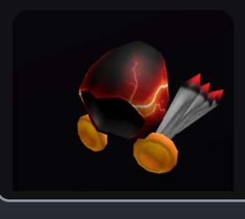</a> <b>ExclusiveShop</b> › container.wrapper.shopView.itemsWrapper.gridContainer.item</td>
<td width="33%" valign="top"> <b>ExclusiveShop</b> › container.wrapper.shopView.itemsWrapper.gridContainer.item</td>
</tr>
</table>

### Index / codex / glossary

<table>
<tr>
<td width="33%" valign="top"><a href="screenshots/79_Catalog.jpg">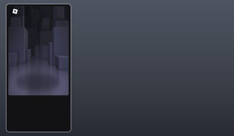</a> <b>Catalog</b></td>
<td width="33%" valign="top"><a href="screenshots/80_Catalog__catalogSection.jpg">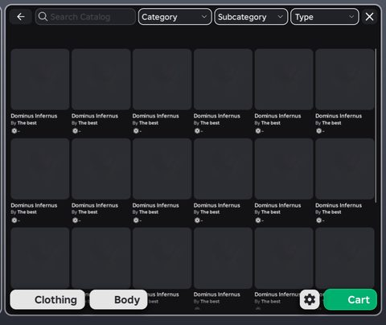</a> <b>Catalog</b> › container.catalogSection</td>
</tr>
</table>

### Settings & menus

<table>
<tr>
<td width="33%" valign="top"><a href="screenshots/25_communityOutfitDisplay.jpg">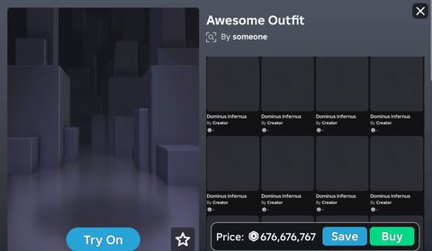</a> <b>communityOutfitDisplay</b></td>
<td width="33%" valign="top"><a href="screenshots/61_Settings.jpg">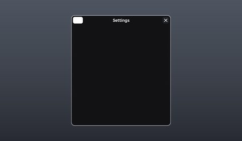</a> <b>Settings</b></td>
<td width="33%" valign="top"><a href="screenshots/70_PlayerContextMenu.jpg">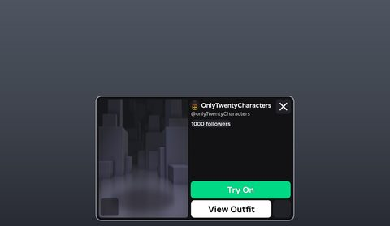</a> <b>PlayerContextMenu</b></td>
</tr>
<tr>
<td width="33%" valign="top"><a href="screenshots/71_PlayerContextMenu__overflowMenu.jpg">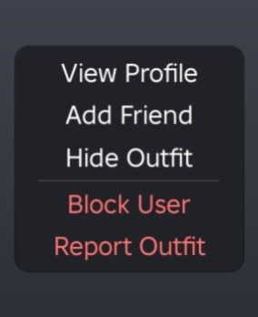</a> <b>PlayerContextMenu</b> › overflowMenu</td>
<td width="33%" valign="top"><a href="screenshots/78_CommunityOutfits__dropdown.jpg">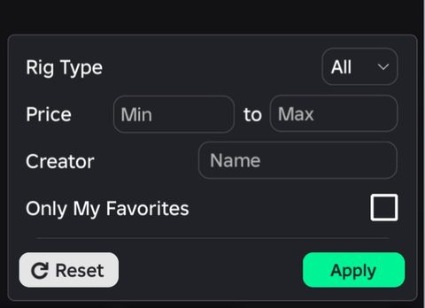</a> <b>CommunityOutfits</b> › container.wrapper.bottomBar.right.optionsContainer.dropdown</td>
</tr>
</table>

### Popups, notifications, prompts

<table>
<tr>
<td width="33%" valign="top"><a href="screenshots/36_choiceDialog.jpg">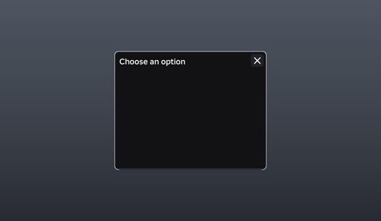</a> <b>choiceDialog</b></td>
<td width="33%" valign="top"><a href="screenshots/37_inputDialog.jpg">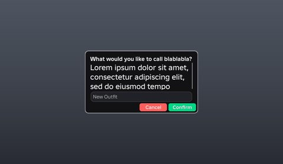</a> <b>inputDialog</b></td>
<td width="33%" valign="top"><a href="screenshots/39_basicDialog.jpg">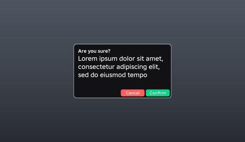</a> <b>basicDialog</b></td>
</tr>
<tr>
<td width="33%" valign="top"><a href="screenshots/66_SavedOutfits__groupsPopup.jpg">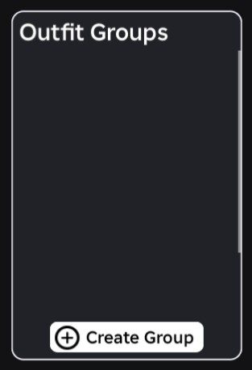</a> <b>SavedOutfits</b> › container.wrapper.groupsPopup</td>
<td width="33%" valign="top"><a href="screenshots/74_Warning.jpg">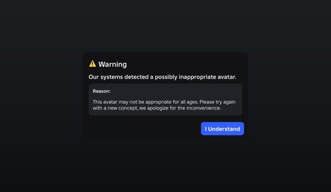</a> <b>Warning</b></td>
</tr>
</table>

### Leaderboards & stats

<table>
<tr>
<td width="33%" valign="top"><a href="screenshots/42_topHalf.jpg">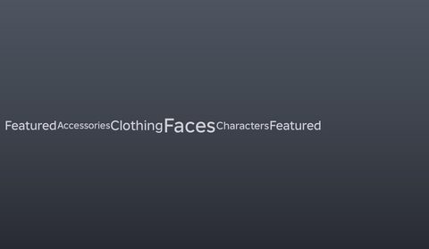</a> <b>topHalf</b></td>
</tr>
</table>

### Admin panels

<table>
<tr>
<td width="33%" valign="top"><a href="screenshots/84_Commands.jpg">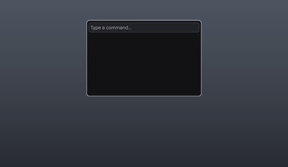</a> <b>Commands</b></td>
<td width="33%" valign="top"> <b>ModeratorPanel</b></td>
</tr>
</table>

### HUD & currency

<table>
<tr>
<td width="33%" valign="top"><a href="screenshots/15_wrapperBeforeAspectRatio__bottomField.jpg">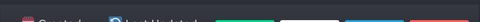</a> <b>wrapperBeforeAspectRatio</b> › bottomField</td>
<td width="33%" valign="top"><a href="screenshots/43_bottomHalf.jpg">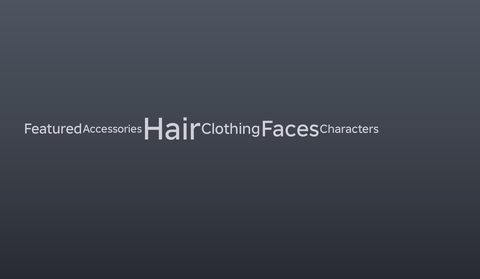</a> <b>bottomHalf</b></td>
<td width="33%" valign="top"><a href="screenshots/63_SavedOutfits__dropdown.jpg">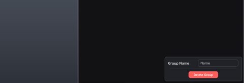</a> <b>SavedOutfits</b> › container.wrapper.bottomBar.right.configureTagContainer.dropdown</td>
</tr>
<tr>
<td width="33%" valign="top"><a href="screenshots/64_SavedOutfits__leftCluster.jpg">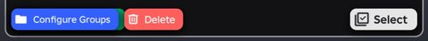</a> <b>SavedOutfits</b> › container.wrapper.bottomBar.selectActionsBar.leftCluster</td>
<td width="33%" valign="top"><a href="screenshots/65_SavedOutfits__rightCluster.jpg">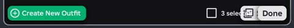</a> <b>SavedOutfits</b> › container.wrapper.bottomBar.selectActionsBar.rightCluster</td>
</tr>
</table>

### Character / avatar / emotes

<table>
<tr>
<td width="33%" valign="top"> <b>avatarPreviewQuickActions</b></td>
<td width="33%" valign="top"><a href="screenshots/32_avatarPreviewQuickActions__animationsDropdown.jpg">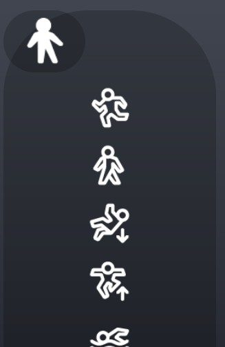</a> <b>avatarPreviewQuickActions</b> › animationsDropdown</td>
<td width="33%" valign="top"><a href="screenshots/34_outfit.jpg">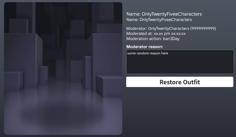</a> <b>outfit</b></td>
</tr>
<tr>
<td width="33%" valign="top"><a href="screenshots/38_resetAvatar.jpg">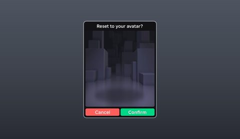</a> <b>resetAvatar</b></td>
<td width="33%" valign="top"><a href="screenshots/40_wearLatestOutfit.jpg">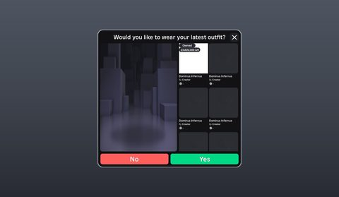</a> <b>wearLatestOutfit</b></td>
<td width="33%" valign="top"><a href="screenshots/49_contextButtonsRobloxOutfitEditable.jpg">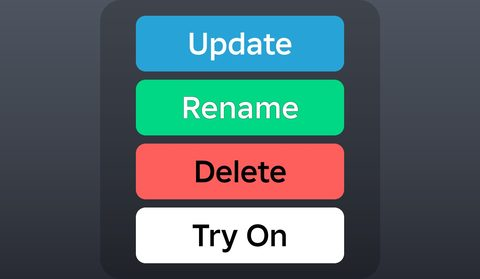</a> <b>contextButtonsRobloxOutfitEditable</b></td>
</tr>
<tr>
<td width="33%" valign="top"><a href="screenshots/52_communityOutfit.jpg">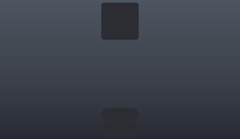</a> <b>communityOutfit</b></td>
<td width="33%" valign="top"><a href="screenshots/53_contextButtonsEmote.jpg">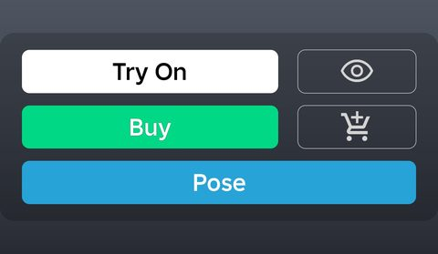</a> <b>contextButtonsEmote</b></td>
<td width="33%" valign="top"><a href="screenshots/62_SavedOutfits.jpg">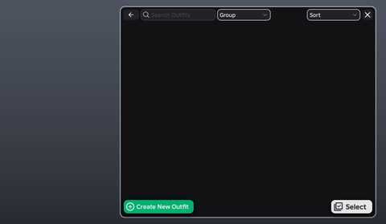</a> <b>SavedOutfits</b></td>
</tr>
<tr>
<td width="33%" valign="top"><a href="screenshots/67_SaveOutfit.jpg">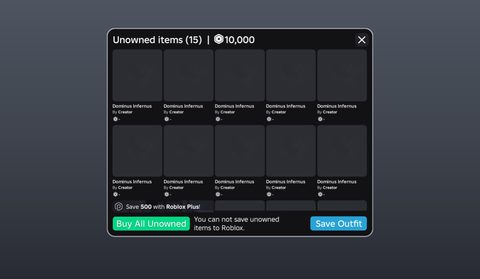</a> <b>SaveOutfit</b></td>
<td width="33%" valign="top"><a href="screenshots/68_SaveOutfit__chooseSaveType.jpg">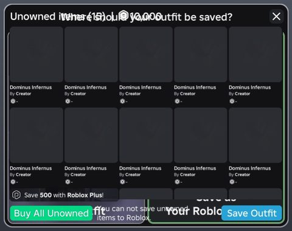</a> <b>SaveOutfit</b> › container.wrapper.chooseSaveType</td>
<td width="33%" valign="top"><a href="screenshots/69_PublishOutfit.jpg">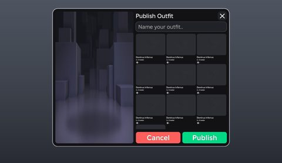</a> <b>PublishOutfit</b></td>
</tr>
<tr>
<td width="33%" valign="top"><a href="screenshots/72_Outfits.jpg">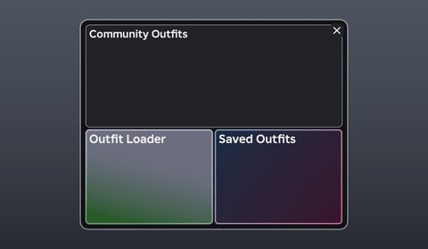</a> <b>Outfits</b></td>
<td width="33%" valign="top"><a href="screenshots/73_OutfitLoader.jpg">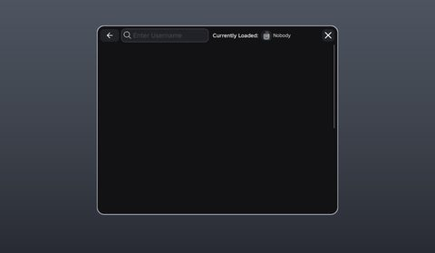</a> <b>OutfitLoader</b></td>
<td width="33%" valign="top"><a href="screenshots/77_CommunityOutfits.jpg">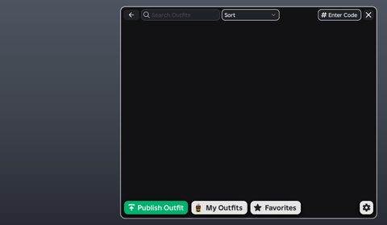</a> <b>CommunityOutfits</b></td>
</tr>
<tr>
<td width="33%" valign="top"><a href="screenshots/82_Emotes.jpg">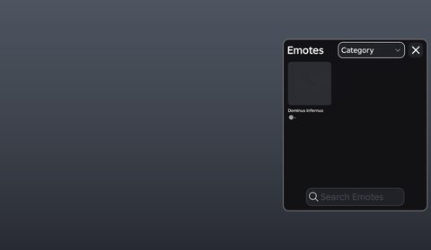</a> <b>Emotes</b></td>
<td width="33%" valign="top"><a href="screenshots/85_OutfitsBackup.jpg">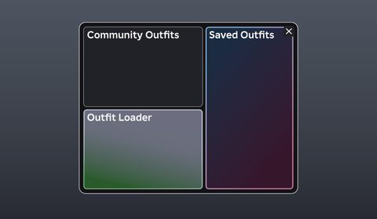</a> <b>OutfitsBackup</b></td>
<td width="33%" valign="top"><a href="screenshots/89_CreateAvatar.jpg">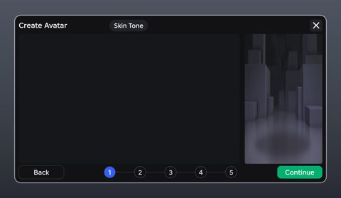</a> <b>CreateAvatar</b></td>
</tr>
</table>

### Other

<table>
<tr>
<td width="33%" valign="top"> <b>wrapperBeforeAspectRatio</b></td>
<td width="33%" valign="top"> <b>wrapperOld</b></td>
<td width="33%" valign="top"> <b>wrapper</b></td>
</tr>
<tr>
<td width="33%" valign="top"> <b>wrapper</b></td>
<td width="33%" valign="top"> <b>wrapperOld</b></td>
<td width="33%" valign="top"> <b>wrapper</b></td>
</tr>
<tr>
<td width="33%" valign="top"> <b>wrapperOld</b></td>
<td width="33%" valign="top"> <b>wrapperBeforeAspectRatio</b></td>
<td width="33%" valign="top"> <b>wrapper</b></td>
</tr>
<tr>
<td width="33%" valign="top"> <b>wrapperOld</b></td>
<td width="33%" valign="top"> <b>wrapper</b></td>
<td width="33%" valign="top"> <b>wrapperLessOld</b></td>
</tr>
<tr>
<td width="33%" valign="top"> <b>wrapperBeforeAspectRatio</b></td>
<td width="33%" valign="top"> <b>gridContainer</b></td>
<td width="33%" valign="top"> <b>customChatTemplate</b></td>
</tr>
<tr>
<td width="33%" valign="top"> <b>Categories</b></td>
<td width="33%" valign="top"> <b>playerReport</b></td>
<td width="33%" valign="top"> <b>report</b></td>
</tr>
<tr>
<td width="33%" valign="top"> <b>getRobloxPlus</b></td>
<td width="33%" valign="top"> <b>colorSliders</b></td>
<td width="33%" valign="top"> <b>sliderTemplate</b></td>
</tr>
<tr>
<td width="33%" valign="top"> <b>dropdownTemplate</b></td>
<td width="33%" valign="top"> <b>contextButtons</b></td>
<td width="33%" valign="top"> <b>ColorPickerSample</b></td>
</tr>
<tr>
<td width="33%" valign="top"> <b>Pose</b></td>
<td width="33%" valign="top"> <b>Pose</b> › bodySelector.r6</td>
<td width="33%" valign="top"> <b>AccessoryAdjustment</b></td>
</tr>
<tr>
<td width="33%" valign="top"> <b>AccessoryAdjustment</b> › container.wrapper.transformSection</td>
<td width="33%" valign="top"> <b>AccessoryAdjustment</b> › transform</td>
<td width="33%" valign="top"> <b>CurrentlyWearing</b></td>
</tr>
<tr>
<td width="33%" valign="top"> <b>RobloxPlusUpsell</b></td>
<td width="33%" valign="top"> <b>Buttons</b></td>
<td width="33%" valign="top"> <b>Photobooth</b></td>
</tr>
<tr>
<td width="33%" valign="top"> <b>Statistics</b></td>
<td width="33%" valign="top"> <b>Builds</b></td>
</tr>
</table>

## Model previews

<table>
<tr>
<td width="25%" valign="top"> <b>R15</b> <code>models/StarterPlayer/StarterPlayerScripts/Controllers/PoseModeController/R15.rbxm</code></td>
<td width="25%" valign="top"> <b>SPTK_PineTree_Var05</b> <code>models/StarterPlayer/StarterPlayerScripts/Controllers/MapController/Maps/snowy_forest/Workspace/SPTK_PineTree_Var05.rbxm</code></td>
<td width="25%" valign="top"> <b>PhotoboothMap</b> <code>models/ReplicatedStorage/Assets/PhotoboothMap.rbxm</code></td>
<td width="25%" valign="top"> <b>PurpleBig</b> <code>models/StarterPlayer/StarterPlayerScripts/Controllers/MapController/Maps/retro/Workspace/PurpleFlowers/PurpleBig.rbxm</code></td>
</tr>
<tr>
<td width="25%" valign="top"> <b>Spawn</b> <code>models/StarterPlayer/StarterPlayerScripts/Controllers/MapController/Maps/retro/Workspace/Spawn.rbxm</code></td>
<td width="25%" valign="top"> <b>Orange</b> <code>models/StarterPlayer/StarterPlayerScripts/Controllers/MapController/Maps/retro/Workspace/Flowers/OrangeFlowers/Orange.rbxm</code></td>
<td width="25%" valign="top"> <b>PurpleFlower</b> <code>models/StarterPlayer/StarterPlayerScripts/Controllers/MapController/Maps/retro/Workspace/Flowers/PurpleFlower.rbxm</code></td>
<td width="25%" valign="top"> <b>WhiteFlower</b> <code>models/StarterPlayer/StarterPlayerScripts/Controllers/MapController/Maps/retro/Workspace/Flowers/WhiteFlower.rbxm</code></td>
</tr>
<tr>
<td width="25%" valign="top"> <b>Pebble</b> <code>models/StarterPlayer/StarterPlayerScripts/Controllers/MapController/Maps/retro/Workspace/Pebbles/Pebble.rbxm</code></td>
<td width="25%" valign="top"> <b>PinkFlower</b> <code>models/StarterPlayer/StarterPlayerScripts/Controllers/MapController/Maps/retro/Workspace/Flowers/PinkFlower.rbxm</code></td>
<td width="25%" valign="top"> <b>GrassPatch</b> <code>models/StarterPlayer/StarterPlayerScripts/Controllers/MapController/Maps/retro/Workspace/Patches/GrassPatch.rbxm</code></td>
<td width="25%" valign="top"> <b>Rock</b> <code>models/StarterPlayer/StarterPlayerScripts/Controllers/MapController/Maps/retro/Workspace/Rocks/Rock.rbxm</code></td>
</tr>
</table>

## Notable scripts

Top-scored scripts of this game per topic (full tree in [source/scripts](source/scripts/)).

| Topic | Scripts |
|---|---|
| UI animation (tweens, hover / click, pop-ins, springs) | [`Fx`](source/scripts/ReplicatedStorage/UIC/Fx.lua) 1740 lines [`ItemButton`](source/scripts/StarterPlayer/StarterPlayerScripts/Elements/ItemButton.lua) 2288 lines [`Buttons`](source/scripts/StarterPlayer/StarterPlayerScripts/Buttons.client.lua) 730 lines [`FavoriteButton`](source/scripts/StarterPlayer/StarterPlayerScripts/Elements/FavoriteButton.lua) 712 lines [`PlayerContextMenuController`](source/scripts/StarterPlayer/StarterPlayerScripts/Controllers/PlayerContextMenuController.lua) 1399 lines |
| UI controllers / window managers / menus | [`PlayerContextMenuController`](source/scripts/StarterPlayer/StarterPlayerScripts/Controllers/PlayerContextMenuController.lua) 1399 lines [`Window`](source/scripts/ReplicatedStorage/CmdrClient/CmdrInterface/Window.lua) 354 lines [`CurrentlyWearingController`](source/scripts/StarterPlayer/StarterPlayerScripts/Controllers/CurrentlyWearingController.lua) 734 lines [`EmotesController`](source/scripts/StarterPlayer/StarterPlayerScripts/Controllers/EmotesController.lua) 520 lines [`PublishOutfitController`](source/scripts/StarterPlayer/StarterPlayerScripts/Controllers/PublishOutfitController.lua) 223 lines |
| Notifications, toasts, popups, prompts | [`NotificationController`](source/scripts/StarterPlayer/StarterPlayerScripts/Controllers/NotificationController.lua) 117 lines [`OutfitLoaderController`](source/scripts/StarterPlayer/StarterPlayerScripts/Controllers/OutfitLoaderController.lua) 418 lines [`ItemButton`](source/scripts/StarterPlayer/StarterPlayerScripts/Elements/ItemButton.lua) 2288 lines [`AvatarAdjustmentController`](source/scripts/StarterPlayer/StarterPlayerScripts/Controllers/AvatarAdjustmentController.lua) 1401 lines [`BuildsController`](source/scripts/StarterPlayer/StarterPlayerScripts/Controllers/BuildsController.lua) 333 lines |
| Loading / intro screens | [`LoadingController`](source/scripts/StarterPlayer/StarterPlayerScripts/Controllers/LoadingController.lua) 211 lines [`OutfitLoaderController`](source/scripts/StarterPlayer/StarterPlayerScripts/Controllers/OutfitLoaderController.lua) 418 lines [`PlayerContextMenuController`](source/scripts/StarterPlayer/StarterPlayerScripts/Controllers/PlayerContextMenuController.lua) 1399 lines [`Icon`](source/scripts/ReplicatedStorage/Icon.lua) 1411 lines |
| Camera, cutscenes, screen shake | [`AvatarPreviewController`](source/scripts/StarterPlayer/StarterPlayerScripts/Controllers/AvatarPreviewController.lua) 1336 lines [`PhotoboothController`](source/scripts/StarterPlayer/StarterPlayerScripts/Controllers/PhotoboothController.lua) 1115 lines [`PoseModeController`](source/scripts/StarterPlayer/StarterPlayerScripts/Controllers/PoseModeController.lua) 1891 lines |
| VFX, particles, beams, hit effects | [`VFXController`](source/scripts/StarterPlayer/StarterPlayerScripts/Controllers/VFXController.lua) 130 lines [`PlayerContextMenuController`](source/scripts/StarterPlayer/StarterPlayerScripts/Controllers/PlayerContextMenuController.lua) 1399 lines |
| DataStore / player data | [`AvatarMakerServer`](source/scripts/ServerScriptService/AvatarMakerServer.server.lua) 1887 lines |
| RNG, eggs, gacha, rarity rolls, pets | [`ModeratorPanelController`](source/scripts/StarterPlayer/StarterPlayerScripts/Controllers/ModeratorPanelController.lua) 9964 lines [`ScrollingFrameCustomScrollSpeed`](source/scripts/StarterPlayer/StarterPlayerScripts/Elements/ScrollingFrameCustomScrollSpeed.lua) 270 lines [`PhotoboothController`](source/scripts/StarterPlayer/StarterPlayerScripts/Controllers/PhotoboothController.lua) 1115 lines [`RemoveItemsController`](source/scripts/StarterPlayer/StarterPlayerScripts/Controllers/RemoveItemsController.lua) 1326 lines [`FavoriteController`](source/scripts/StarterPlayer/StarterPlayerScripts/Controllers/FavoriteController.lua) 942 lines |
| Combat, weapons, hitboxes, abilities | [`PlayerContextMenuController`](source/scripts/StarterPlayer/StarterPlayerScripts/Controllers/PlayerContextMenuController.lua) 1399 lines |
| Character movement (sprint, dash, double jump, slide) | [`SliderController`](source/scripts/StarterPlayer/StarterPlayerScripts/Elements/SliderController.lua) 318 lines [`Slider`](source/scripts/StarterPlayer/StarterPlayerScripts/Elements/ColorPicker/Slider.lua) 123 lines [`CatalogUtilities`](source/scripts/ReplicatedStorage/CatalogUtilities.lua) 831 lines [`Definitions`](source/scripts/StarterPlayer/StarterPlayerScripts/Controllers/SettingsController/Definitions.lua) 1208 lines [`ColorPicker`](source/scripts/StarterPlayer/StarterPlayerScripts/Elements/ColorPicker.lua) 490 lines |
| Tycoon / plots / bases / building | [`ModeratorPanelController`](source/scripts/StarterPlayer/StarterPlayerScripts/Controllers/ModeratorPanelController.lua) 9964 lines [`BuildsController`](source/scripts/StarterPlayer/StarterPlayerScripts/Controllers/BuildsController.lua) 333 lines [`CurrentlyWearingController`](source/scripts/StarterPlayer/StarterPlayerScripts/Controllers/CurrentlyWearingController.lua) 734 lines [`SkinToneStage`](source/scripts/StarterPlayer/StarterPlayerScripts/Controllers/CreateAvatarController/SkinToneStage.lua) 843 lines [`DraggableList`](source/scripts/StarterPlayer/StarterPlayerScripts/Elements/DraggableList.lua) 556 lines |
| Admin panels & commands | [`Commands`](source/scripts/StarterPlayer/StarterPlayerScripts/Controllers/CommandsController/Commands.lua) 1669 lines |
| Sound & music | [`SoundController`](source/scripts/StarterPlayer/StarterPlayerScripts/Controllers/SoundController.lua) 116 lines [`MusicController`](source/scripts/StarterPlayer/StarterPlayerScripts/Controllers/SoundController/MusicController.lua) 172 lines |
| Daily rewards, quests, codes, playtime | [`ModeratorPanelController`](source/scripts/StarterPlayer/StarterPlayerScripts/Controllers/ModeratorPanelController.lua) 9964 lines |

## Folders

| Folder | What |
|---|---|
| `screenshots/` | full frames; `crops/` = the panel only; `models/` = 3D previews; `thumbs/` = gallery thumbnails |
| `ui/` | every screen as a Lua builder (`require(module)()` returns the ScreenGui); `_StarterGui-all.lua` builds every StarterGui screen |
| `models/` | every model as .rbxm (the only .rbxm files), mirroring the place tree, scripts removed |
| `map/` | `workspace.rbxm` (the map as a model), `lighting.lua` (sky + post effects), `materials.lua`, `Environment.lua` |
| `animations/`, `audio/` | KeyframeSequence / Sound builders (.lua), `AnimationIds.lua`, `Sounds.lua` |
| `source/` | all scripts as .luau, `tree.txt`, `ui.txt`, `remotes.txt`, `assets.txt`, `flags.txt` |
