# Click Keyboard Tower

> 🧗 **Obby** · clicker / tower obby · source file `CLICK KEYBOARD TOWER parkyeon-jin.rbxl`

[⬅ Back to the catalog](../../README.md) · [Assets inventory](ASSETS.md) · [Style numbers](reference.md) · [Scripts](source/scripts/) · [Code analysis](source/README.md)

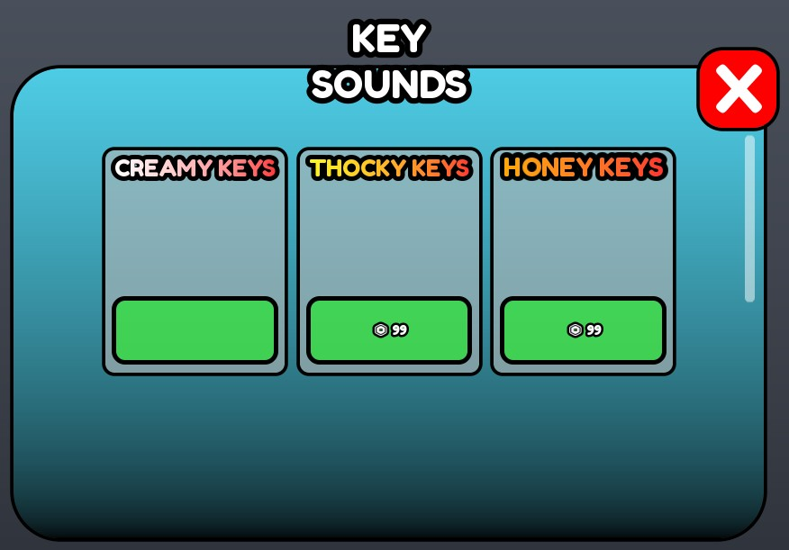

## At a glance

| | |
|---|---|
| Provenance | copy of a live game (saveinstance / decompiled client code) |
| Screens | 4 ScreenGuis, 978 GUI objects → **24 screenshots** |
| Models (.rbxm) | 174 models, 71 model sets, 8 VFX sets |
| Lua builders (.lua) | 6 UI screens, 0 animation packs, 3 audio packs |
| Code | 88 scripts, 2,346 lines |
| Asset ids | 0 animations, 2443 sounds |
| Safety scan | 1 HIGH / 0 MED flags ([flags.txt](source/flags.txt)) |

**Fonts:** `Roboto Regular`×149, `Zekton Regular`×136, `Roboto Light`×59, `SourceSansPro Regular`×47, `Nunito Regular`×38

## UI screenshots

Captured in Studio from the place's own ScreenGuis (scripts stripped). Each panel was opened on its own; click a thumbnail for the full 1519×886 frame. Runtime-filled lists (shop items, inventories) show their template state.

### Shop & Robux store

<table>
<tr>
<td width="33%" valign="top"><a href="screenshots/02_MainUI__ShopFrame.jpg">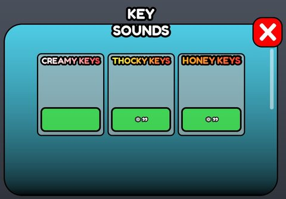</a> <b>MainUI</b> › ShopFrame</td>
</tr>
</table>

### Settings & menus

<table>
<tr>
<td width="33%" valign="top"><a href="screenshots/07_HDAdminInterface__Template4.jpg">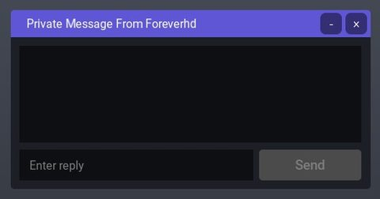</a> <b>HDAdminInterface</b> › MenuTemplates.Template4</td>
<td width="33%" valign="top"><a href="screenshots/08_HDAdminInterface__Template5.jpg">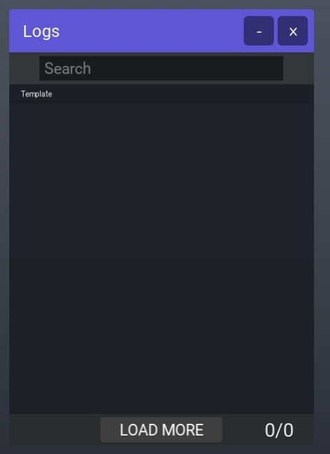</a> <b>HDAdminInterface</b> › MenuTemplates.Template5</td>
<td width="33%" valign="top"><a href="screenshots/09_HDAdminInterface__Template6.jpg">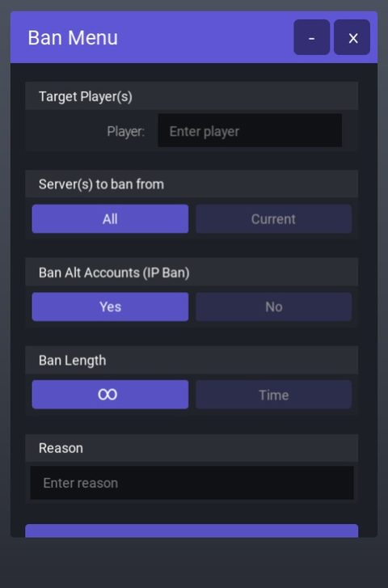</a> <b>HDAdminInterface</b> › MenuTemplates.Template6</td>
</tr>
<tr>
<td width="33%" valign="top"><a href="screenshots/12_HDAdminInterface__Template8.jpg">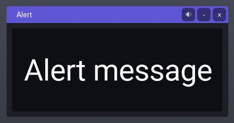</a> <b>HDAdminInterface</b> › MenuTemplates.Template8</td>
<td width="33%" valign="top"><a href="screenshots/15_HDAdminInterface__Template10.jpg">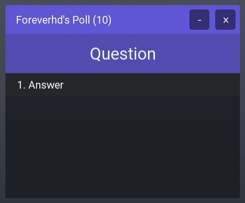</a> <b>HDAdminInterface</b> › MenuTemplates.Template10</td>
<td width="33%" valign="top"><a href="screenshots/16_HDAdminInterface__Template11.jpg">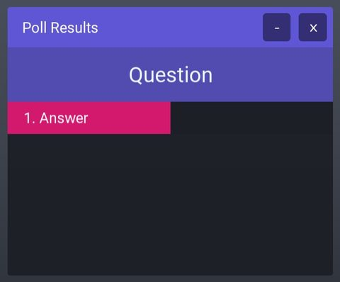</a> <b>HDAdminInterface</b> › MenuTemplates.Template11</td>
</tr>
<tr>
<td width="33%" valign="top"><a href="screenshots/19_HDAdminInterface__Template14.jpg">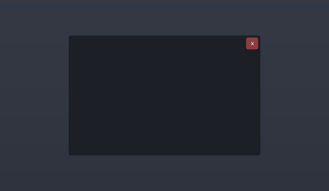</a> <b>HDAdminInterface</b> › MenuTemplates.Template14</td>
<td width="33%" valign="top"><a href="screenshots/20_HDAdminInterface__Template13.jpg">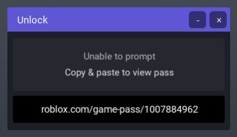</a> <b>HDAdminInterface</b> › MenuTemplates.Template13</td>
<td width="33%" valign="top"><a href="screenshots/22_HDAdminInterface__Template16.jpg">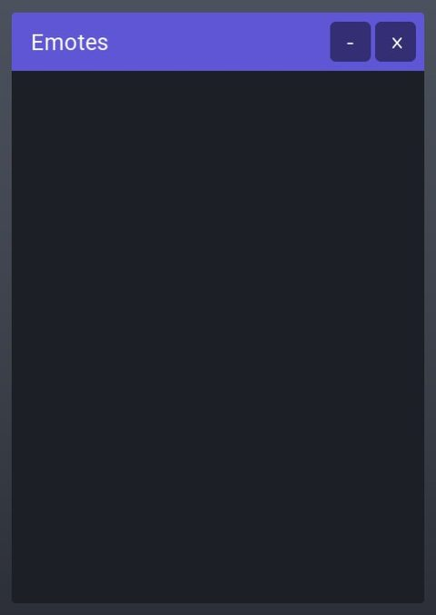</a> <b>HDAdminInterface</b> › MenuTemplates.Template16</td>
</tr>
<tr>
<td width="33%" valign="top"><a href="screenshots/23_HDAdminInterface__Template18.jpg">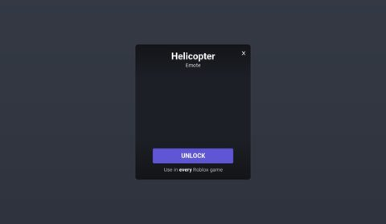</a> <b>HDAdminInterface</b> › MenuTemplates.Template18</td>
</tr>
</table>

### Popups, notifications, prompts

<table>
<tr>
<td width="33%" valign="top"><a href="screenshots/05_HDAdminInterface__Message.jpg">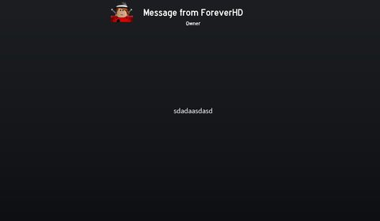</a> <b>HDAdminInterface</b> › Templates.Message</td>
<td width="33%" valign="top"><a href="screenshots/06_HDAdminInterface__GlobalAnnouncement.jpg">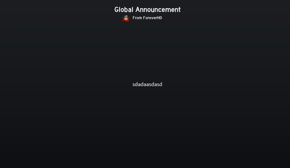</a> <b>HDAdminInterface</b> › Templates.GlobalAnnouncement</td>
<td width="33%" valign="top"><a href="screenshots/25_HDAdminInterface__Warnings.jpg">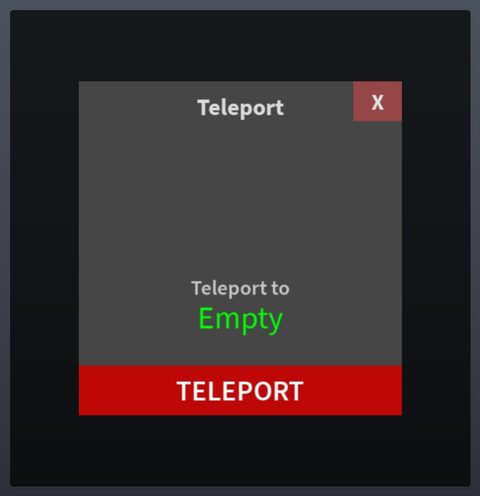</a> <b>HDAdminInterface</b> › MainFrame.Warnings</td>
</tr>
</table>

### End of round, death, results

<table>
<tr>
<td width="33%" valign="top"><a href="screenshots/11_HDAdminInterface__FinalResult.jpg">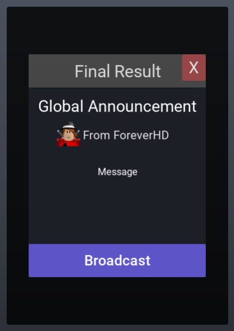</a> <b>HDAdminInterface</b> › MenuTemplates.Template7.FinalResult</td>
<td width="33%" valign="top"><a href="screenshots/14_HDAdminInterface__FinalResult.jpg">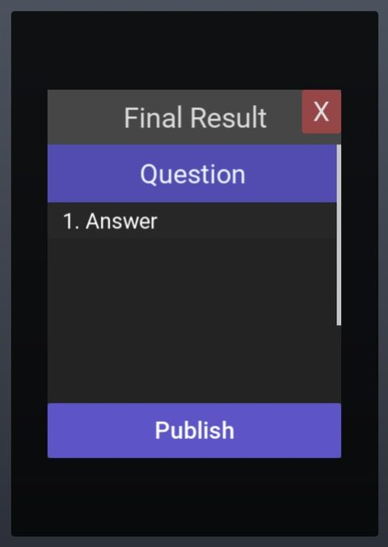</a> <b>HDAdminInterface</b> › MenuTemplates.Template9.FinalResult</td>
<td width="33%" valign="top"><a href="screenshots/18_HDAdminInterface__FinalResult.jpg">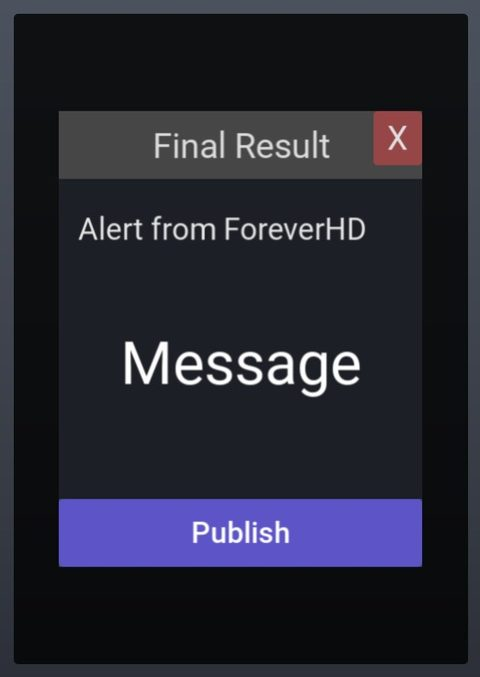</a> <b>HDAdminInterface</b> › MenuTemplates.Template12.FinalResult</td>
</tr>
</table>

### Admin panels

<table>
<tr>
<td width="33%" valign="top"> <b>HDAdminInterface</b> › Notices</td>
<td width="33%" valign="top"><a href="screenshots/04_HDAdminInterface__CmdBar.jpg">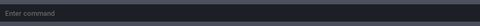</a> <b>HDAdminInterface</b> › CmdBar</td>
<td width="33%" valign="top"><a href="screenshots/24_HDAdminInterface__Pages.jpg">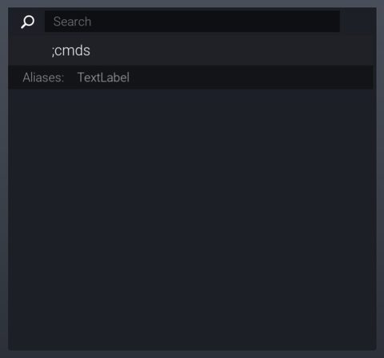</a> <b>HDAdminInterface</b> › MainFrame.Pages</td>
</tr>
</table>

### HUD & currency

<table>
<tr>
<td width="33%" valign="top"><a href="screenshots/01_MainUI.jpg">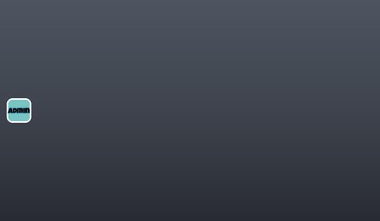</a> <b>MainUI</b></td>
<td width="33%" valign="top"><a href="screenshots/10_HDAdminInterface__MainFrame.jpg">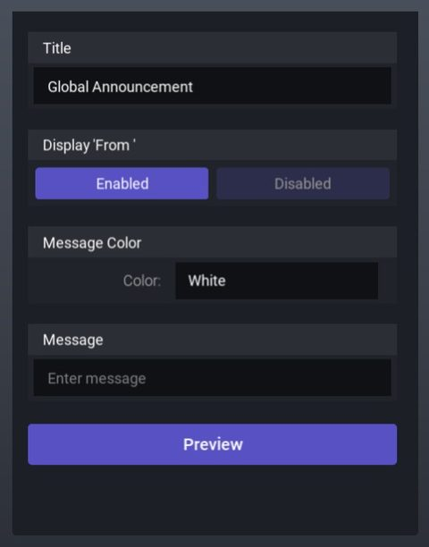</a> <b>HDAdminInterface</b> › MenuTemplates.Template7.MainFrame</td>
<td width="33%" valign="top"><a href="screenshots/13_HDAdminInterface__MainFrame.jpg">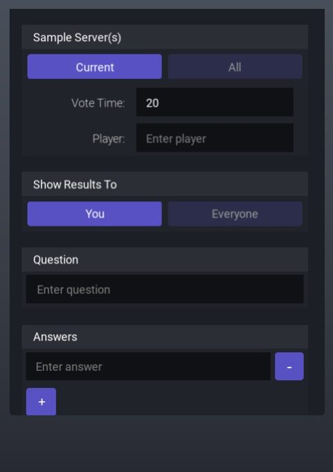</a> <b>HDAdminInterface</b> › MenuTemplates.Template9.MainFrame</td>
</tr>
<tr>
<td width="33%" valign="top"><a href="screenshots/17_HDAdminInterface__MainFrame.jpg">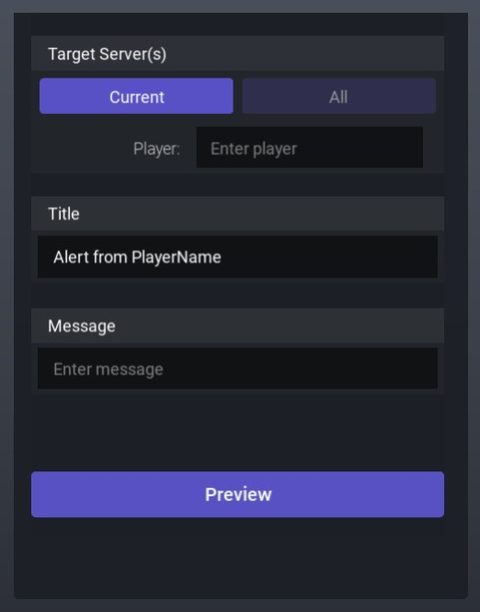</a> <b>HDAdminInterface</b> › MenuTemplates.Template12.MainFrame</td>
</tr>
</table>

## Model previews

<table>
<tr>
<td width="25%" valign="top"><a href="models/Workspace/.%20.%20.rbxm">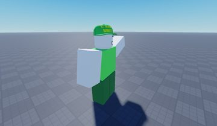</a> <b>. . </b> <code>models/Workspace/. . .rbxm</code></td>
<td width="25%" valign="top"><a href="models/Workspace/Model~77/ModelKey__x120.rbxm">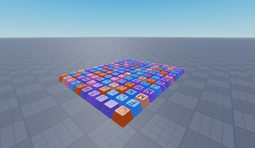</a> <b>ModelKey__x120</b> <code>models/Workspace/Model~77/ModelKey__x120.rbxm</code></td>
<td width="25%" valign="top"><a href="models/Workspace/ThreeDTextObject.rbxm">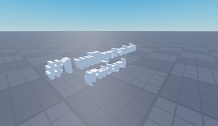</a> <b>ThreeDTextObject</b> <code>models/Workspace/ThreeDTextObject.rbxm</code></td>
<td width="25%" valign="top"><a href="models/Workspace/Arrow%20Sign.rbxm">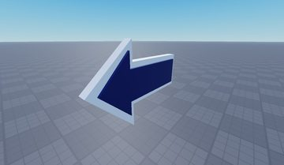</a> <b>Arrow Sign</b> <code>models/Workspace/Arrow Sign.rbxm</code></td>
</tr>
<tr>
<td width="25%" valign="top"><a href="models/Workspace/Boombox_Radio.rbxm">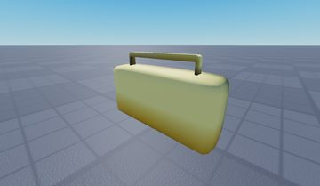</a> <b>Boombox_Radio</b> <code>models/Workspace/Boombox_Radio.rbxm</code></td>
<td width="25%" valign="top"><a href="models/Workspace/ThreeDTextObject~2.rbxm">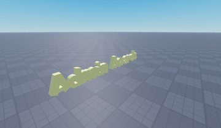</a> <b>ThreeDTextObject~2</b> <code>models/Workspace/ThreeDTextObject~2.rbxm</code></td>
<td width="25%" valign="top"><a href="models/Workspace/AdminBoard.rbxm">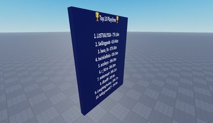</a> <b>AdminBoard</b> <code>models/Workspace/AdminBoard.rbxm</code></td>
<td width="25%" valign="top"><a href="models/Workspace/World%20Extras/Pole.rbxm">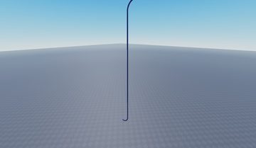</a> <b>Pole</b> <code>models/Workspace/World Extras/Pole.rbxm</code></td>
</tr>
<tr>
<td width="25%" valign="top"><a href="models/Workspace/World%20Extras/Part~92.rbxm">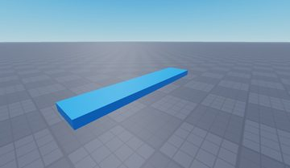</a> <b>Part~92</b> <code>models/Workspace/World Extras/Part~92.rbxm</code></td>
<td width="25%" valign="top"><a href="models/Workspace/Rainbow.rbxm">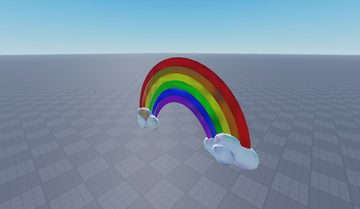</a> <b>Rainbow</b> <code>models/Workspace/Rainbow.rbxm</code></td>
<td width="25%" valign="top"><a href="models/Workspace/Speed%20Coil%20Giver.rbxm">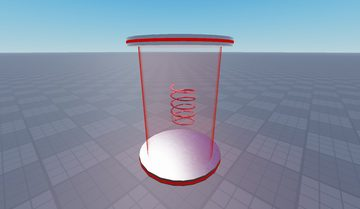</a> <b>Speed Coil Giver</b> <code>models/Workspace/Speed Coil Giver.rbxm</code></td>
<td width="25%" valign="top"><a href="models/Workspace/BoomBox%20Giver.rbxm">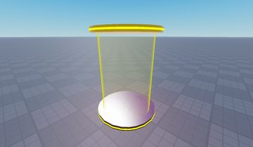</a> <b>BoomBox Giver</b> <code>models/Workspace/BoomBox Giver.rbxm</code></td>
</tr>
</table>

## Notable scripts

Top-scored scripts of this game per topic (full tree in [source/scripts](source/scripts/)).

| Topic | Scripts |
|---|---|
| UI animation (tweens, hover / click, pop-ins, springs) | [`LocalScript`](source/scripts/StarterGui/MainUI/ShopFrame/ShopToggle/LocalScript.client.lua) 23 lines |
| UI controllers / window managers / menus | [`ShiftGUI`](source/scripts/StarterGui/ShiftLockButton%20%28Put%20in%20StarterGui%29/ImageButton/ShiftGUI.client.lua) 72 lines |
| Sound & music | [`KeySoundHandler`](source/scripts/StarterPlayer/StarterPlayerScripts/KeySoundHandler.client.lua) 18 lines |
| Utility modules (number format, signals, tables, timers) | [`WSManager`](source/scripts/Workspace/AllKeys/CanCollide/Model/ModelKey/KeyMesh/Decal/WSManager.server.lua) 1068 lines |

## ⚠️ Safety

HIGH flags (backdoors, `require(id)`, `loadstring`, webhooks). Review or delete before reusing:

- `scripts/Workspace/HD Admin/Core/MainModule.lua`

## Folders

| Folder | What |
|---|---|
| `screenshots/` | full frames; `crops/` = the panel only; `models/` = 3D previews; `thumbs/` = gallery thumbnails |
| `ui/` | every screen as a Lua builder (`require(module)()` returns the ScreenGui); `_StarterGui-all.lua` builds every StarterGui screen |
| `models/` | every model as .rbxm (the only .rbxm files), mirroring the place tree, scripts removed |
| `map/` | `workspace.rbxm` (the map as a model), `lighting.lua` (sky + post effects), `materials.lua`, `Environment.lua` |
| `animations/`, `audio/` | KeyframeSequence / Sound builders (.lua), `AnimationIds.lua`, `Sounds.lua` |
| `source/` | all scripts as .luau, `tree.txt`, `ui.txt`, `remotes.txt`, `assets.txt`, `flags.txt` |
