# Dandy's World

> 👻 **Horror** · horror survival (toons, floors, machines) · source file `Dandy-s-World_.rbxl`

[⬅ Back to the catalog](../../README.md) · [Assets inventory](ASSETS.md) · [Style numbers](reference.md) · [Scripts](source/scripts/) · [Code analysis](source/README.md)

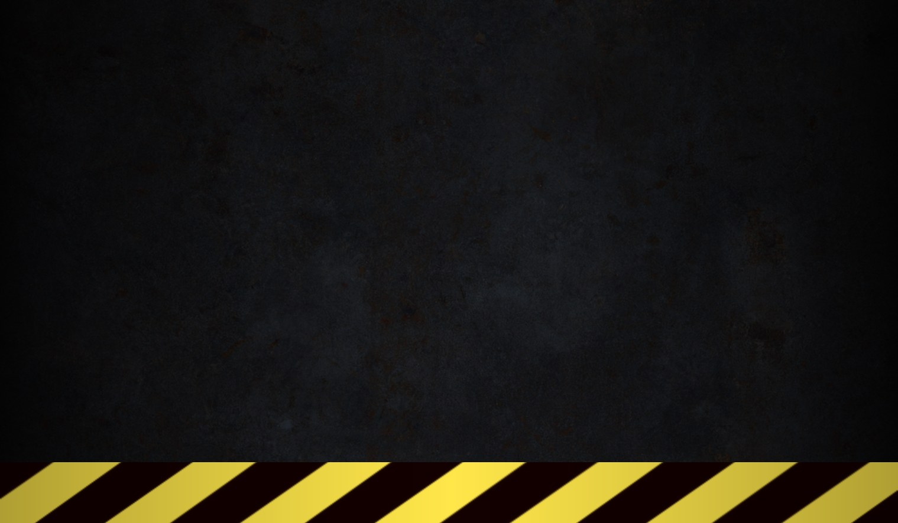

## At a glance

| | |
|---|---|
| Provenance | copy of a live game (saveinstance / decompiled client code) |
| Screens | 8 ScreenGuis, 271 GUI objects → **9 screenshots** |
| Models (.rbxm) | 147 models, 0 model sets, 13 VFX sets |
| Lua builders (.lua) | 32 UI screens, 1 animation packs, 45 audio packs |
| Code | 1388 scripts, 286,222 lines |
| Asset ids | 176 animations, 328 sounds |
| Safety scan | 0 HIGH / 5 MED flags ([flags.txt](source/flags.txt)) |

**Fonts:** `FredokaOne Regular`×56, `GothamSSm Bold`×10, `FredokaOne Bold`×7, `LegacyArial Regular`×4, `FredokaOne Heavy`×3

## UI screenshots

Captured in Studio from the place's own ScreenGuis (scripts stripped). Each panel was opened on its own; click a thumbnail for the full 1519×886 frame. Runtime-filled lists (shop items, inventories) show their template state.

### Popups, notifications, prompts

<table>
<tr>
<td width="33%" valign="top"><a href="screenshots/08_Notif.jpg">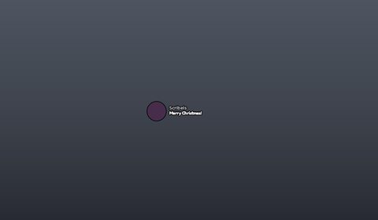</a> <b>Notif</b></td>
</tr>
</table>

### Loading & intro

<table>
<tr>
<td width="33%" valign="top"><a href="screenshots/02_LoadingGui__LoadingScreen.jpg">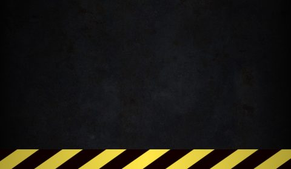</a> <b>LoadingGui</b> › LoadingScreen</td>
</tr>
</table>

### End of round, death, results

<table>
<tr>
<td width="33%" valign="top"><a href="screenshots/01_DeathGui__DeathScreen.jpg">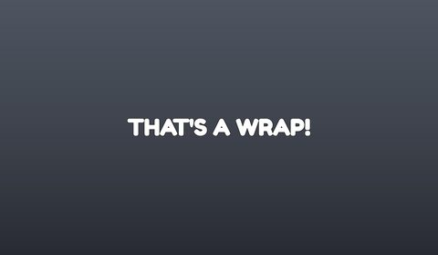</a> <b>DeathGui</b> › DeathScreen</td>
</tr>
</table>

### Admin panels

<table>
<tr>
<td width="33%" valign="top"><a href="screenshots/07_DevFrame__CommandFrame.jpg">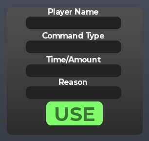</a> <b>DevFrame</b> › CommandFrame</td>
</tr>
</table>

### HUD & currency

<table>
<tr>
<td width="33%" valign="top"><a href="screenshots/09_ClientUI__Bottom.jpg">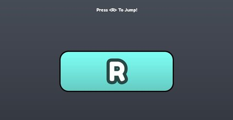</a> <b>ClientUI</b> › Bottom</td>
</tr>
</table>

### Other

<table>
<tr>
<td width="33%" valign="top"><a href="screenshots/03_SpectatorGui.jpg">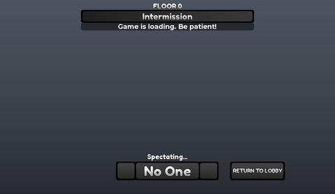</a> <b>SpectatorGui</b></td>
<td width="33%" valign="top"><a href="screenshots/04_TwistedSquirmEscapeUI.jpg">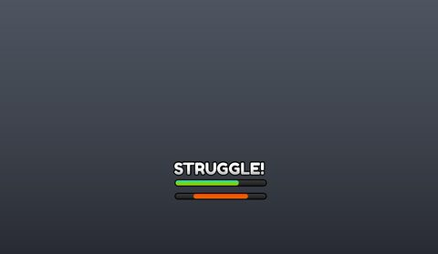</a> <b>TwistedSquirmEscapeUI</b></td>
<td width="33%" valign="top"><a href="screenshots/05_KnightmareAntiCheatClient__KMDebugFrame.jpg">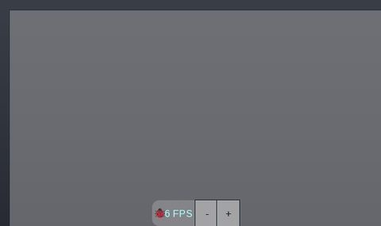</a> <b>KnightmareAntiCheatClient</b> › KMDebugFrame</td>
</tr>
<tr>
<td width="33%" valign="top"><a href="screenshots/06_DevFrame.jpg">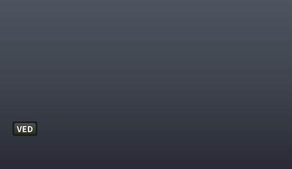</a> <b>DevFrame</b></td>
</tr>
</table>

## Model previews

<table>
<tr>
<td width="25%" valign="top"><a href="models/Workspace/Elevators/Elevator.rbxm">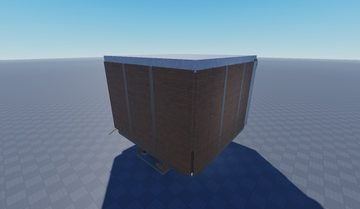</a> <b>Elevator</b> <code>models/Workspace/Elevators/Elevator.rbxm</code></td>
<td width="25%" valign="top"><a href="models/ReplicatedStorage/Items/SkillCheckCandy.rbxm">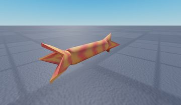</a> <b>SkillCheckCandy</b> <code>models/ReplicatedStorage/Items/SkillCheckCandy.rbxm</code></td>
<td width="25%" valign="top"><a href="models/ReplicatedStorage/Skins/Goob/SpecialSpaghetti/Base.rbxm">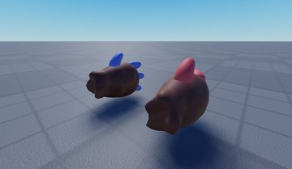</a> <b>Base</b> <code>models/ReplicatedStorage/Skins/Goob/SpecialSpaghetti/Base.rbxm</code></td>
<td width="25%" valign="top"><a href="models/ReplicatedStorage/Items/DandyEasterEggs.rbxm">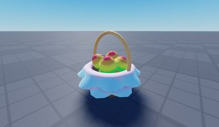</a> <b>DandyEasterEggs</b> <code>models/ReplicatedStorage/Items/DandyEasterEggs.rbxm</code></td>
</tr>
<tr>
<td width="25%" valign="top"><a href="models/ReplicatedStorage/Parts/FlowerField.rbxm">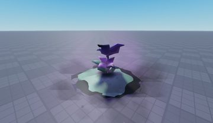</a> <b>FlowerField</b> <code>models/ReplicatedStorage/Parts/FlowerField.rbxm</code></td>
<td width="25%" valign="top"><a href="models/ReplicatedStorage/Items/PopBottle.rbxm">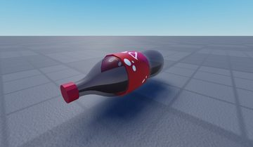</a> <b>PopBottle</b> <code>models/ReplicatedStorage/Items/PopBottle.rbxm</code></td>
<td width="25%" valign="top"><a href="models/ReplicatedStorage/Parts/RenderModules/GlistenPortal/GlistenMirror.rbxm">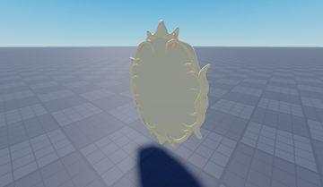</a> <b>GlistenMirror</b> <code>models/ReplicatedStorage/Parts/RenderModules/GlistenPortal/GlistenMirror.rbxm</code></td>
<td width="25%" valign="top"><a href="models/ReplicatedStorage/Parts/ArcadeGames/SwimmyBarnaby/LargeDecor/MoonTerrain2.rbxm">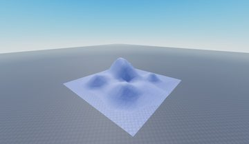</a> <b>MoonTerrain2</b> <code>models/ReplicatedStorage/Parts/ArcadeGames/SwimmyBarnaby/LargeDecor/MoonTerrain2.rbxm</code></td>
</tr>
<tr>
<td width="25%" valign="top"><a href="models/ReplicatedStorage/Parts/GoobGrab.rbxm">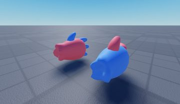</a> <b>GoobGrab</b> <code>models/ReplicatedStorage/Parts/GoobGrab.rbxm</code></td>
<td width="25%" valign="top"><a href="models/ReplicatedStorage/Items/SpeedCandy.rbxm">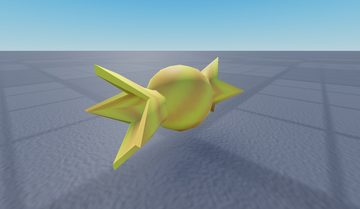</a> <b>SpeedCandy</b> <code>models/ReplicatedStorage/Items/SpeedCandy.rbxm</code></td>
<td width="25%" valign="top"><a href="models/ReplicatedStorage/Items/Instructions.rbxm">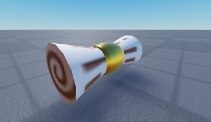</a> <b>Instructions</b> <code>models/ReplicatedStorage/Items/Instructions.rbxm</code></td>
<td width="25%" valign="top"><a href="models/ReplicatedStorage/Parts/RenderModules/GlistenPortal/GlistenPoof.rbxm">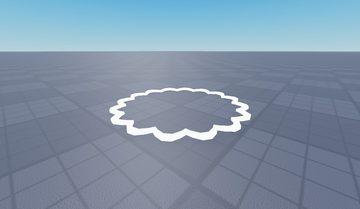</a> <b>GlistenPoof</b> <code>models/ReplicatedStorage/Parts/RenderModules/GlistenPortal/GlistenPoof.rbxm</code></td>
</tr>
</table>

## Notable scripts

Top-scored scripts of this game per topic (full tree in [source/scripts](source/scripts/)).

| Topic | Scripts |
|---|---|
| Camera, cutscenes, screen shake | [`TransformationCameraLock`](source/scripts/StarterPlayer/StarterPlayerScripts/Character/TransformationCameraLock.client.lua) 68 lines |
| Character movement (sprint, dash, double jump, slide) | [`Dandy`](source/scripts/ReplicatedStorage/SharedData/TowerData/Dandy.lua) 52 lines [`Dyle`](source/scripts/ReplicatedStorage/SharedData/TowerData/Dyle.lua) 52 lines |
| Sound & music | [`SoundMute`](source/scripts/ReplicatedStorage/Scripts/SoundMute.client.lua) 28 lines |
| Utility modules (number format, signals, tables, timers) | [`timeFormat`](source/scripts/ReplicatedStorage/SharedUtils/timeFormat.lua) 57 lines [`timerBar`](source/scripts/Players/%5BPlayer%5D%20prorivalsmdrlol/PlayerGui/TwistedSquirmEscapeUI/Stylesheets/timerBar.lua) 57 lines [`SoundUtils`](source/scripts/ReplicatedStorage/Modules/Audio/SoundUtils.lua) 55 lines |

## Folders

| Folder | What |
|---|---|
| `screenshots/` | full frames; `crops/` = the panel only; `models/` = 3D previews; `thumbs/` = gallery thumbnails |
| `ui/` | every screen as a Lua builder (`require(module)()` returns the ScreenGui); `_StarterGui-all.lua` builds every StarterGui screen |
| `models/` | every model as .rbxm (the only .rbxm files), mirroring the place tree, scripts removed |
| `map/` | `workspace.rbxm` (the map as a model), `lighting.lua` (sky + post effects), `materials.lua`, `Environment.lua` |
| `animations/`, `audio/` | KeyframeSequence / Sound builders (.lua), `AnimationIds.lua`, `Sounds.lua` |
| `source/` | all scripts as .luau, `tree.txt`, `ui.txt`, `remotes.txt`, `assets.txt`, `flags.txt` |
