# Doors (fully scripted)

> 👻 **Horror** · horror / room escape · source file `Doors Fully Scripted Game (1).rbxl`

[⬅ Back to the catalog](../../README.md) · [Assets inventory](ASSETS.md) · [Style numbers](reference.md) · [Scripts](source/scripts/) · [Code analysis](source/README.md)

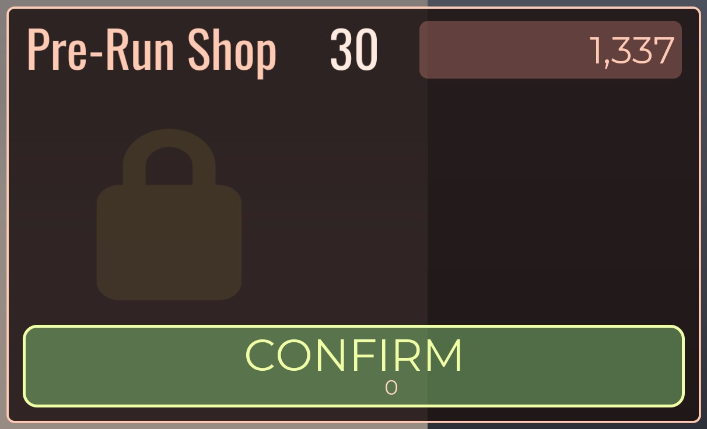

## At a glance

| | |
|---|---|
| Provenance | copy of a live game (saveinstance / decompiled client code) |
| Screens | 6 ScreenGuis, 1628 GUI objects → **21 screenshots** |
| Models (.rbxm) | 336 models, 8 model sets, 2 VFX sets |
| Lua builders (.lua) | 11 UI screens, 58 animation packs, 59 audio packs |
| Code | 1207 scripts, 106,926 lines |
| Asset ids | 2131 animations, 5758 sounds |
| Safety scan | 0 HIGH / 1 MED flags ([flags.txt](source/flags.txt)) |

**Fonts:** `LegacyArial Regular`×268, `Oswald Regular`×242, `GothamSSm Regular`×25, `Oswald Medium`×14, `GothamSSm Heavy`×10

## UI screenshots

Captured in Studio from the place's own ScreenGuis (scripts stripped). Each panel was opened on its own; click a thumbnail for the full 1519×886 frame. Runtime-filled lists (shop items, inventories) show their template state.

### Shop & Robux store

<table>
<tr>
<td width="33%" valign="top"> <b>MainUI</b> › ItemShop</td>
</tr>
</table>

### Settings & menus

<table>
<tr>
<td width="33%" valign="top"><a href="screenshots/24_MainUI__Settings.jpg">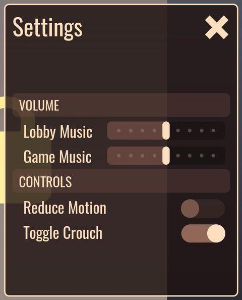</a> <b>MainUI</b> › Settings</td>
</tr>
</table>

### Popups, notifications, prompts

<table>
<tr>
<td width="33%" valign="top"><a href="screenshots/14_MainUI__PromptFrame.jpg">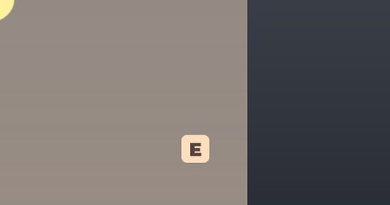</a> <b>MainUI</b> › MainFrame.PromptFrame</td>
<td width="33%" valign="top"><a href="screenshots/18_MainUI__PromptFrameRift.jpg">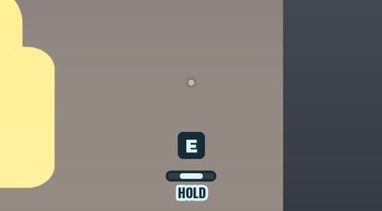</a> <b>MainUI</b> › MainFrame.PromptFrameRift</td>
<td width="33%" valign="top"><a href="screenshots/19_MainUI__PromptFrameYellow.jpg">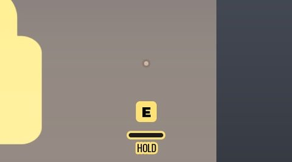</a> <b>MainUI</b> › MainFrame.PromptFrameYellow</td>
</tr>
<tr>
<td width="33%" valign="top"><a href="screenshots/22_MainUI__ConsoleHints.jpg">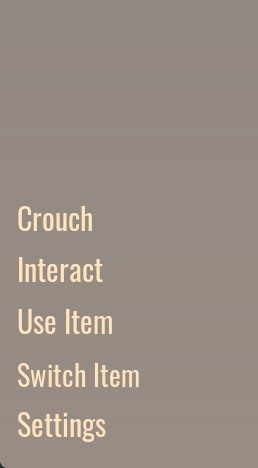</a> <b>MainUI</b> › ConsoleHints</td>
</tr>
</table>

### Leaderboards & stats

<table>
<tr>
<td width="33%" valign="top"><a href="screenshots/25_PermUI__Stats.jpg">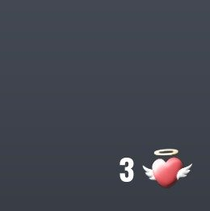</a> <b>PermUI</b> › Stats</td>
</tr>
</table>

### End of round, death, results

<table>
<tr>
<td width="33%" valign="top"> <b>MainUI</b> › Death</td>
<td width="33%" valign="top"> <b>MainUI</b> › DeathPanel</td>
</tr>
</table>

### Admin panels

<table>
<tr>
<td width="33%" valign="top"><a href="screenshots/05_MainUI__PanelAccess.jpg">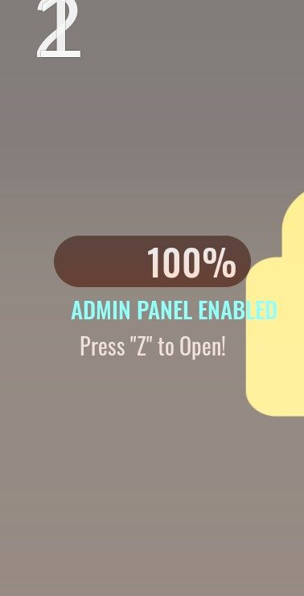</a> <b>MainUI</b> › PanelAccess</td>
</tr>
</table>

### HUD & currency

<table>
<tr>
<td width="33%" valign="top"><a href="screenshots/01_MainUI.jpg">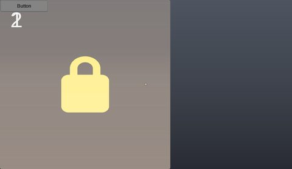</a> <b>MainUI</b></td>
<td width="33%" valign="top"><a href="screenshots/02_MainUI__EnterFloor.jpg">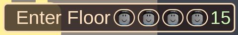</a> <b>MainUI</b> › EnterFloor</td>
<td width="33%" valign="top"> <b>MainUI</b> › LeaveFull</td>
</tr>
<tr>
<td width="33%" valign="top"> <b>MainUI</b> › Unused.SlotOccupied.Spaces</td>
<td width="33%" valign="top"><a href="screenshots/07_MainUI__Attachments.jpg">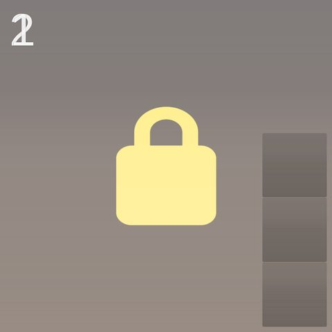</a> <b>MainUI</b> › Unused.SlotOccupied.Attachments</td>
<td width="33%" valign="top"> <b>MainUI</b> › Unused.Slot.Spaces</td>
</tr>
<tr>
<td width="33%" valign="top"><a href="screenshots/09_MainUI__SubliminalText.jpg">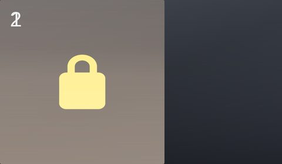</a> <b>MainUI</b> › SubliminalText</td>
<td width="33%" valign="top"><a href="screenshots/10_MainUI__Heart.jpg">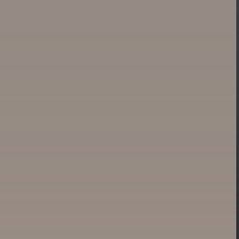</a> <b>MainUI</b> › MainFrame.Heartbeat.Heart</td>
<td width="33%" valign="top"><a href="screenshots/11_MainUI__TapIconMobile.jpg">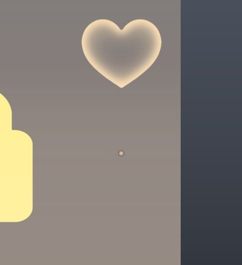</a> <b>MainUI</b> › MainFrame.Heartbeat.TapIconMobile</td>
</tr>
<tr>
<td width="33%" valign="top"><a href="screenshots/16_MainUI__SwapOld.jpg">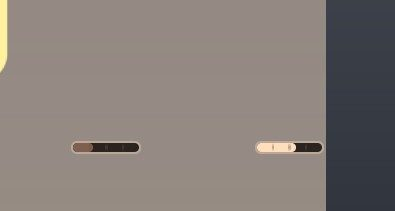</a> <b>MainUI</b> › MainFrame.FlashSpecify.SwapOld</td>
<td width="33%" valign="top"><a href="screenshots/17_MainUI__Destination.jpg">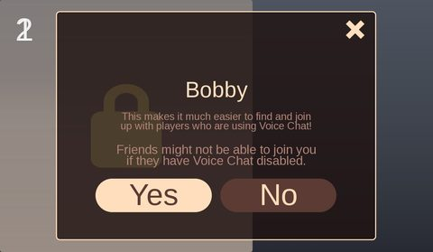</a> <b>MainUI</b> › MainFrame.Destination</td>
</tr>
</table>

## Model previews

<table>
<tr>
<td width="25%" valign="top"><a href="models/ServerScriptService/Server/DifficultyRooms/3/Hotel_CloseRoom/Hotel_CloseRoom2.rbxm">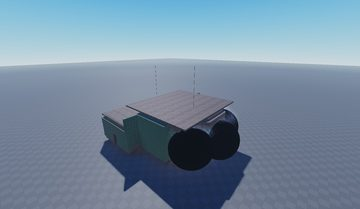</a> <b>Hotel_CloseRoom2</b> <code>models/ServerScriptService/Server/DifficultyRooms/3/Hotel_CloseRoom/Hotel_CloseRoom2.rbxm</code></td>
<td width="25%" valign="top"><a href="models/ServerScriptService/Server/DifficultyRooms/5/Hotel_BrokenRightWay/Hotel_BrokenRightWay1.rbxm">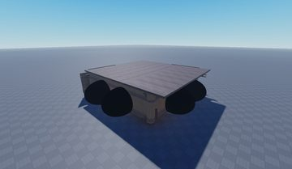</a> <b>Hotel_BrokenRightWay1</b> <code>models/ServerScriptService/Server/DifficultyRooms/5/Hotel_BrokenRightWay/Hotel_BrokenRightWay1.rbxm</code></td>
<td width="25%" valign="top"><a href="models/ServerScriptService/Server/Assets/Cleared_Items/Hotel_Downstairs4_Cleared.rbxm">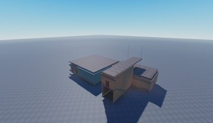</a> <b>Hotel_Downstairs4_Cleared</b> <code>models/ServerScriptService/Server/Assets/Cleared_Items/Hotel_Downstairs4_Cleared.rbxm</code></td>
<td width="25%" valign="top"><a href="models/ServerStorage/Model~2.rbxm">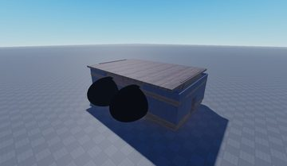</a> <b>Model~2</b> <code>models/ServerStorage/Model~2.rbxm</code></td>
</tr>
<tr>
<td width="25%" valign="top"><a href="models/ReplicatedStorage/ClientBricks/ServerStorage/Lighter.rbxm">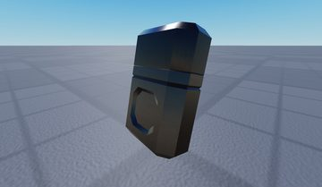</a> <b>Lighter</b> <code>models/ReplicatedStorage/ClientBricks/ServerStorage/Lighter.rbxm</code></td>
<td width="25%" valign="top"><a href="models/ServerScriptService/Server/Assets/Closets/ClosetChest.rbxm">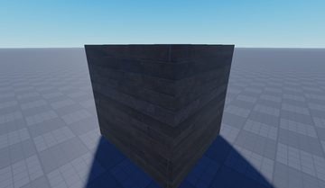</a> <b>ClosetChest</b> <code>models/ServerScriptService/Server/Assets/Closets/ClosetChest.rbxm</code></td>
<td width="25%" valign="top"><a href="models/ServerScriptService/Server/Assets/DoorKey.rbxm">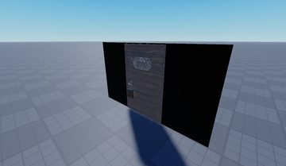</a> <b>DoorKey</b> <code>models/ServerScriptService/Server/Assets/DoorKey.rbxm</code></td>
<td width="25%" valign="top"><a href="models/ServerScriptService/Server/Assets/Debris/Potted_Plant.rbxm">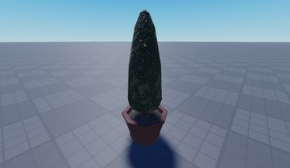</a> <b>Potted_Plant</b> <code>models/ServerScriptService/Server/Assets/Debris/Potted_Plant.rbxm</code></td>
</tr>
<tr>
<td width="25%" valign="top"><a href="models/ServerStorage/PicturePuzzle_Assets/Oval/Prop.rbxm">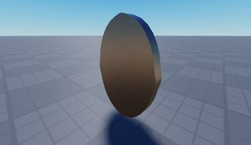</a> <b>Prop</b> <code>models/ServerStorage/PicturePuzzle_Assets/Oval/Prop.rbxm</code></td>
<td width="25%" valign="top"><a href="models/ServerScriptService/Server/DifficultyRooms/2/Hotel_Windelta/Hotel_Windelta5.rbxm">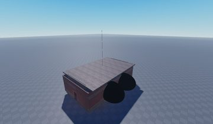</a> <b>Hotel_Windelta5</b> <code>models/ServerScriptService/Server/DifficultyRooms/2/Hotel_Windelta/Hotel_Windelta5.rbxm</code></td>
<td width="25%" valign="top"><a href="models/ReplicatedStorage/ClientBricks/ServerStorage/SkeletonKey.rbxm">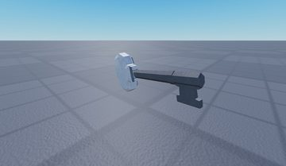</a> <b>SkeletonKey</b> <code>models/ReplicatedStorage/ClientBricks/ServerStorage/SkeletonKey.rbxm</code></td>
<td width="25%" valign="top"><a href="models/ServerScriptService/Server/Special/Hotel_Courtyard.rbxm">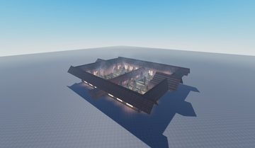</a> <b>Hotel_Courtyard</b> <code>models/ServerScriptService/Server/Special/Hotel_Courtyard.rbxm</code></td>
</tr>
<tr>
<td width="25%" valign="top"><a href="models/ServerScriptService/Server/Assets/Hunt_DoorKey.rbxm">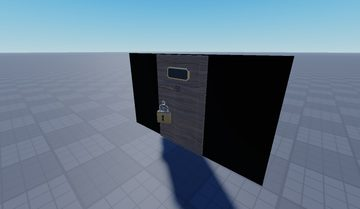</a> <b>Hunt_DoorKey</b> <code>models/ServerScriptService/Server/Assets/Hunt_DoorKey.rbxm</code></td>
<td width="25%" valign="top"><a href="models/ServerScriptService/Server/Assets/Debris/Potted_Plant~2.rbxm">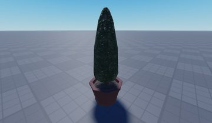</a> <b>Potted_Plant~2</b> <code>models/ServerScriptService/Server/Assets/Debris/Potted_Plant~2.rbxm</code></td>
</tr>
</table>

## Notable scripts

Top-scored scripts of this game per topic (full tree in [source/scripts](source/scripts/)).

| Topic | Scripts |
|---|---|
| UI animation (tweens, hover / click, pop-ins, springs) | [`old health`](source/scripts/StarterGui/MainUI/Initiator/old%20health.client.lua) 940 lines [`ToolAndViewmodelGun`](source/scripts/StarterGui/MainUI/Unused/ToolAndViewmodelGun.client.lua) 725 lines [`Shade`](source/scripts/ReplicatedStorage/ClientModules/EntityModules/Shade.lua) 438 lines [`Main_Game`](source/scripts/StarterGui/MainUI/Initiator/Main_Game.lua) 352 lines [`Movement`](source/scripts/StarterGui/MainUI/Initiator/Main_Game/Movement.client.lua) 373 lines |
| UI controllers / window managers / menus | [`Furnitures`](source/scripts/ServerScriptService/Game/Directory/Furnitures.lua) 553 lines [`Rolltop_Desk`](source/scripts/ServerScriptService/Game/Controls/Rolltop_Desk.lua) 80 lines [`AdminPanelOld`](source/scripts/StarterGui/MainUI/Initiator/AdminPanelOld.client.lua) 581 lines [`AdminPanel`](source/scripts/StarterGui/MainUI/Initiator/Main_Game/AdminPanel.client.lua) 833 lines [`Drawers`](source/scripts/ServerScriptService/Game/Directory/Drawers.lua) 710 lines |
| Notifications, toasts, popups, prompts | [`PromptService`](source/scripts/StarterGui/MainUI/Initiator/Main_Game/PromptService.client.lua) 766 lines [`PromptServiceHint`](source/scripts/StarterGui/MainUI/Initiator/Main_Game/PromptServiceHint.client.lua) 284 lines [`Drawers`](source/scripts/ServerScriptService/Game/Directory/Drawers.lua) 710 lines [`Furnitures`](source/scripts/ServerScriptService/Game/Directory/Furnitures.lua) 553 lines [`Hunt_Drawers`](source/scripts/ServerScriptService/Game/Directory/Hunt_Drawers.lua) 339 lines |
| Loading / intro screens | [`Loading`](source/scripts/StarterPlayer/StarterPlayerScripts/Loading.client.lua) 21 lines [`UIStuff`](source/scripts/StarterGui/MainUI/Initiator/Main_Lobby/UIStuff.client.lua) 692 lines |
| Camera, cutscenes, screen shake | [`__WindShake`](source/scripts/StarterGui/MainUI/Modules/__WindShake.lua) 324 lines [`Camera`](source/scripts/StarterGui/MainUI/Initiator/Main_Game/Camera.client.lua) 192 lines [`CameraShaker`](source/scripts/ReplicatedStorage/CameraShaker.lua) 169 lines [`CameraShakeInstance`](source/scripts/ReplicatedStorage/CameraShaker/CameraShakeInstance.lua) 128 lines [`MinigameHandler`](source/scripts/StarterGui/MainUI/Initiator/Main_Game/MinigameHandler.client.lua) 347 lines |
| VFX, particles, beams, hit effects | [`Drawers`](source/scripts/ServerScriptService/Game/Directory/Drawers.lua) 710 lines [`ToolHandlerServer`](source/scripts/ServerStorage/Lighter/ToolHandlerServer.server.lua) 240 lines [`Hunt_Drawers`](source/scripts/ServerScriptService/Game/Directory/Hunt_Drawers.lua) 339 lines [`ToolHandlerServer`](source/scripts/ReplicatedStorage/ClientBricks/ServerStorage/Lighter/ToolHandlerServer.server.lua) 239 lines [`Furnitures`](source/scripts/ServerScriptService/Game/Directory/Furnitures.lua) 553 lines |
| DataStore / player data | [`ProfileService`](source/scripts/ServerScriptService/ServerScriptModules/ProfileService.lua) 2417 lines [`_GlobalSaving`](source/scripts/ServerScriptService/Game/_GlobalSaving.server.lua) 203 lines |
| RNG, eggs, gacha, rarity rolls, pets | [`Generation`](source/scripts/ServerScriptService/Server/Assets/DebrisOLD/Generation.server.lua) 605 lines [`Generation`](source/scripts/ServerScriptService/Server/Special/SeekRooms/RandomHallway/Hotel_Standart/Door/Hidden/Generation.server.lua) 376 lines [`Generation`](source/scripts/ServerScriptService/Server/Special/SeekRooms/RunningRooms/CoolGroom/Door/Hidden/Generation.server.lua) 378 lines [`Generation`](source/scripts/ServerScriptService/Server/Special/SeekRooms/RunningRooms/LeftWayRoom/Door/Hidden/Generation.server.lua) 381 lines [`Generation`](source/scripts/ServerScriptService/Server/Special/SeekRooms/RunningRooms/LeftWayRoom2/Door/Hidden/Generation.server.lua) 381 lines |
| Combat, weapons, hitboxes, abilities | [`CHandler`](source/scripts/ReplicatedStorage/ClientBricks/ServerStorage/Crucifix/CHandler.server.lua) 1047 lines [`CHandler`](source/scripts/ServerStorage/Crucifix/CHandler.server.lua) 1055 lines [`CHandler`](source/scripts/ServerStorage/CuriousCrucifix/CHandler.server.lua) 1101 lines [`Movement`](source/scripts/StarterGui/MainUI/Initiator/Main_Game/Movement.client.lua) 373 lines [`GameDetails`](source/scripts/ServerScriptService/Game/Directory/GameDetails.lua) 289 lines |
| NPC / AI / monsters | [`AssetControl`](source/scripts/ServerScriptService/Server/Special/Hotel_FigureLibrary/FigureSetup/FigureMovement/AssetControl.server.lua) 350 lines [`MovingUpdated`](source/scripts/Workspace/LoadGame/Rush/MovingUpdated.server.lua) 258 lines [`EntryRoomNodes`](source/scripts/ServerScriptService/Game/Directory/EntryRoomNodes.lua) 104 lines |
| Character movement (sprint, dash, double jump, slide) | [`Movement`](source/scripts/StarterGui/MainUI/Initiator/Main_Game/Movement.client.lua) 373 lines [`Footsteps`](source/scripts/StarterGui/MainUI/Initiator/Main_Game/Footsteps.client.lua) 61 lines [`Drawers`](source/scripts/ServerScriptService/Game/Directory/Drawers.lua) 710 lines [`ToolAndViewmodelGun`](source/scripts/StarterGui/MainUI/Unused/ToolAndViewmodelGun.client.lua) 725 lines [`AssetControl`](source/scripts/ServerScriptService/Server/Special/Hotel_FigureLibrary/FigureSetup/FigureMovement/AssetControl.server.lua) 350 lines |
| Admin panels & commands | [`AdminPanelOld`](source/scripts/StarterGui/MainUI/Initiator/AdminPanelOld.client.lua) 581 lines [`AdminPanel`](source/scripts/StarterGui/MainUI/Initiator/Main_Game/AdminPanel.client.lua) 833 lines [`_AdminPanel`](source/scripts/ServerScriptService/Game/_AdminPanel.server.lua) 243 lines |
| Sound & music | [`AssetControl`](source/scripts/ServerScriptService/Server/Assets/Entities/SeekMoving/AssetControl.server.lua) 197 lines [`MainSound`](source/scripts/ServerScriptService/Game/Directory/MainSound.lua) 29 lines [`HideMonster`](source/scripts/StarterGui/MainUI/Initiator/Main_Game/RemoteListener/Modules/HideMonster.lua) 248 lines [`Haste`](source/scripts/StarterGui/MainUI/Initiator/Main_Game/RemoteListener/Modules/Haste.lua) 139 lines |
| Utility modules (number format, signals, tables, timers) | [`Hunt_RoomGeneration`](source/scripts/ServerScriptService/Game/Directory/Hunt_RoomGeneration.lua) 419 lines [`RoomGeneration`](source/scripts/ServerScriptService/Game/Directory/RoomGeneration.lua) 1765 lines [`ProfileService`](source/scripts/ServerScriptService/ServerScriptModules/ProfileService.lua) 2417 lines [`MadworkMaid`](source/scripts/ReplicatedStorage/MadworkMaid.lua) 150 lines [`MadworkScriptSignal`](source/scripts/ReplicatedStorage/MadworkScriptSignal.lua) 234 lines |

### In the curated script library

- [Blind 'Figure' hunter (hears movement)](../../Scripts/12-NPC-AI/FigureHearingHunter__doors.lua) — DOORS-style Figure: patrols a Nodes folder, but while 'blind' only targets players moving faster than a speed threshold (hearing); uses direct movement when it has line of sight and pathfinding otherwise; grab-and-kill on touch; crucifix check.
- [Rush entity room sweep](../../Scripts/12-NPC-AI/RushRoomRunner__doors.lua) — DOORS-style Rush: flickers lights, spawns a few rooms behind the players, then lerps the entity through each room's RoomStart->RoomEnd pathfinding waypoints at a fixed speed and awards a survival badge; supports crucifix cancel.
- [Room path-node generator](../../Scripts/12-NPC-AI/RoomPathNodes__doors.lua) — Computes a path from a room's RoomStart to RoomEnd once and stores the waypoints as numbered invisible parts (PathNodes) so entities can follow them later.
- [Analytic spring class](../../Scripts/01-UI-Animation/SpringClass_Quenty__doors.lua) — Classic analytic spring class (Quenty style): set .Target, read .Position each frame; works with numbers or Vector3. Good base for springy UI scale/offset.

## Folders

| Folder | What |
|---|---|
| `screenshots/` | full frames; `crops/` = the panel only; `models/` = 3D previews; `thumbs/` = gallery thumbnails |
| `ui/` | every screen as a Lua builder (`require(module)()` returns the ScreenGui); `_StarterGui-all.lua` builds every StarterGui screen |
| `models/` | every model as .rbxm (the only .rbxm files), mirroring the place tree, scripts removed |
| `map/` | `workspace.rbxm` (the map as a model), `lighting.lua` (sky + post effects), `materials.lua`, `Environment.lua` |
| `animations/`, `audio/` | KeyframeSequence / Sound builders (.lua), `AnimationIds.lua`, `Sounds.lua` |
| `source/` | all scripts as .luau, `tree.txt`, `ui.txt`, `remotes.txt`, `assets.txt`, `flags.txt` |
