# Drag A Friend

> 🎉 **Party** · party / physics (tether a friend) · source file `Drag A Friend-1.rbxl`

[⬅ Back to the catalog](../../README.md) · [Assets inventory](ASSETS.md) · [Style numbers](reference.md) · [Scripts](source/scripts/) · [Code analysis](source/README.md)

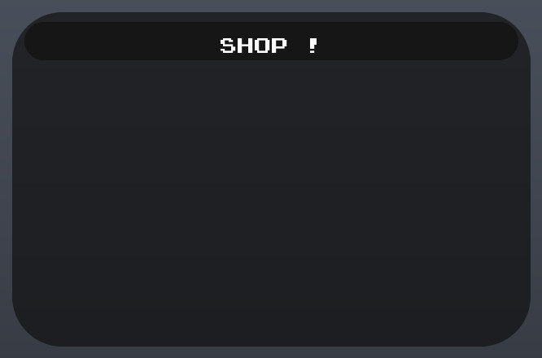

## At a glance

| | |
|---|---|
| Provenance | template with full source |
| Screens | 5 ScreenGuis, 56 GUI objects → **18 screenshots** |
| Models (.rbxm) | 17 models, 0 model sets, 0 VFX sets |
| Lua builders (.lua) | 7 UI screens, 4 animation packs, 1 audio packs |
| Code | 603 scripts, 117,426 lines |
| Asset ids | 2 animations, 3 sounds |
| Safety scan | 9 HIGH / 21 MED flags ([flags.txt](source/flags.txt)) |

**Fonts:** `SourceSansPro Regular`×8, `PressStart2P Regular`×5, `Rubik Bold`×5, `FredokaOne Regular`×2, `Rubik SemiBold`×2

## UI screenshots

Captured in Studio from the place's own ScreenGuis (scripts stripped). Each panel was opened on its own; click a thumbnail for the full 1519×886 frame. Runtime-filled lists (shop items, inventories) show their template state.

### Shop & Robux store

<table>
<tr>
<td width="33%" valign="top"><a href="screenshots/28_GamepassUI.jpg">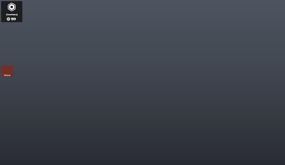</a> <b>GamepassUI</b></td>
<td width="33%" valign="top"><a href="screenshots/29_GamepassUI__Frame.jpg">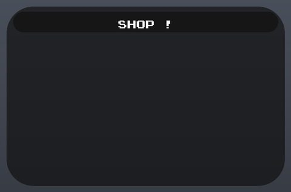</a> <b>GamepassUI</b> › Frame</td>
</tr>
</table>

### HUD & currency

<table>
<tr>
<td width="33%" valign="top"><a href="screenshots/31_Playerlist__Information.jpg">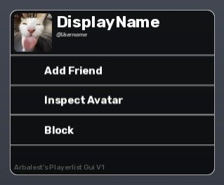</a> <b>Playerlist</b> › MainFrame.Information</td>
</tr>
</table>

### Other

<table>
<tr>
<td width="33%" valign="top"><a href="screenshots/01_BTAnchorToolGUI.jpg">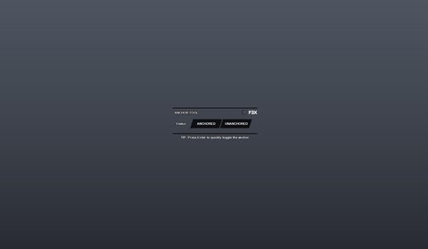</a> <b>BTAnchorToolGUI</b></td>
<td width="33%" valign="top"><a href="screenshots/02_BTCollisionToolGUI.jpg">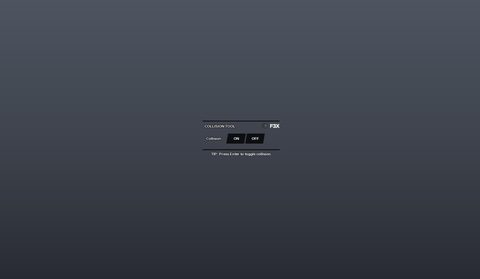</a> <b>BTCollisionToolGUI</b></td>
<td width="33%" valign="top"><a href="screenshots/03_BTDecorateToolGUI.jpg">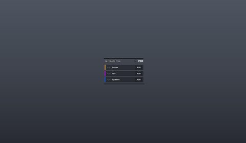</a> <b>BTDecorateToolGUI</b></td>
</tr>
<tr>
<td width="33%" valign="top"><a href="screenshots/04_BTLightingToolGUI.jpg">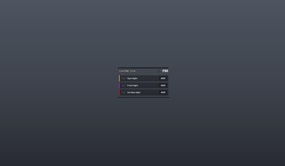</a> <b>BTLightingToolGUI</b></td>
<td width="33%" valign="top"><a href="screenshots/05_BTMaterialToolGUI.jpg">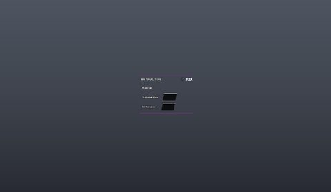</a> <b>BTMaterialToolGUI</b></td>
<td width="33%" valign="top"><a href="screenshots/06_BTMeshToolGUI.jpg">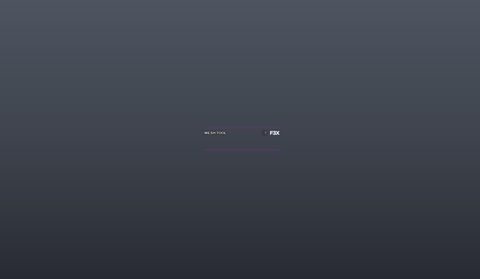</a> <b>BTMeshToolGUI</b></td>
</tr>
<tr>
<td width="33%" valign="top"><a href="screenshots/07_BTMoveToolGUI.jpg">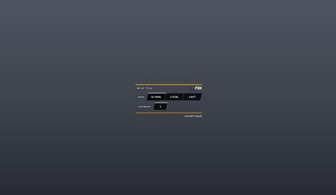</a> <b>BTMoveToolGUI</b></td>
<td width="33%" valign="top"><a href="screenshots/08_BTPaintToolGUI.jpg">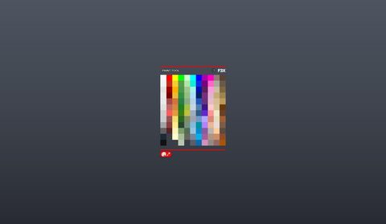</a> <b>BTPaintToolGUI</b></td>
<td width="33%" valign="top"><a href="screenshots/09_BTResizeToolGUI.jpg">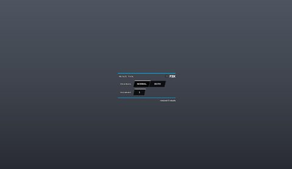</a> <b>BTResizeToolGUI</b></td>
</tr>
<tr>
<td width="33%" valign="top"><a href="screenshots/10_BTRotateToolGUI.jpg">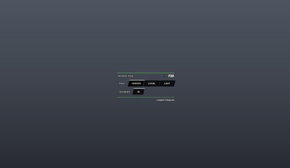</a> <b>BTRotateToolGUI</b></td>
<td width="33%" valign="top"><a href="screenshots/11_BTSurfaceToolGUI.jpg">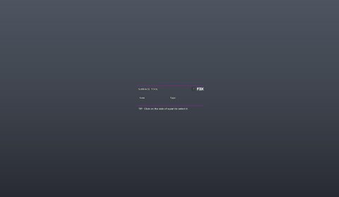</a> <b>BTSurfaceToolGUI</b></td>
<td width="33%" valign="top"><a href="screenshots/12_BTTextureToolGUI.jpg">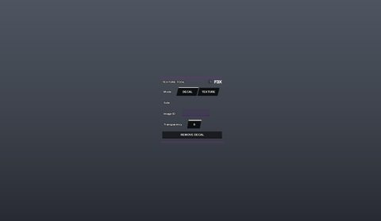</a> <b>BTTextureToolGUI</b></td>
</tr>
<tr>
<td width="33%" valign="top"><a href="screenshots/13_BTWeldToolGUI.jpg">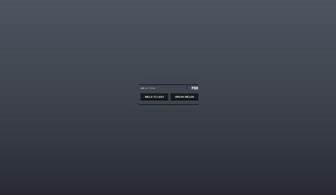</a> <b>BTWeldToolGUI</b></td>
<td width="33%" valign="top"><a href="screenshots/27_ScreenGui.jpg">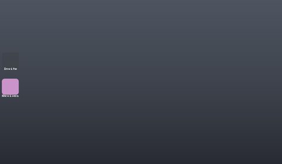</a> <b>ScreenGui</b></td>
<td width="33%" valign="top"><a href="screenshots/30_Playerlist.jpg">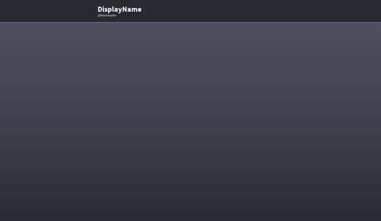</a> <b>Playerlist</b></td>
</tr>
</table>

## Model previews

<table>
<tr>
<td width="25%" valign="top"><a href="models/Workspace/Boards.rbxm">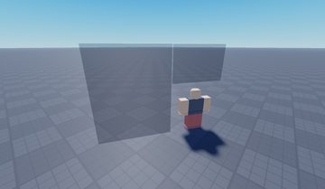</a> <b>Boards</b> <code>models/Workspace/Boards.rbxm</code></td>
<td width="25%" valign="top"><a href="models/Workspace/Settings/Rescue/Dual%20Chain%20Necklace.rbxm">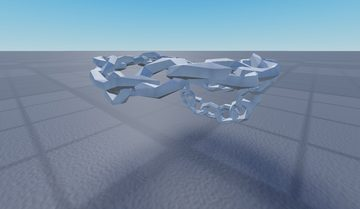</a> <b>Dual Chain Necklace</b> <code>models/Workspace/Settings/Rescue/Dual Chain Necklace.rbxm</code></td>
<td width="25%" valign="top"><a href="models/Workspace/Flower.rbxm">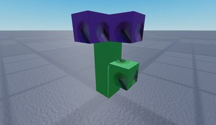</a> <b>Flower</b> <code>models/Workspace/Flower.rbxm</code></td>
<td width="25%" valign="top"><a href="models/Workspace/Duck.rbxm">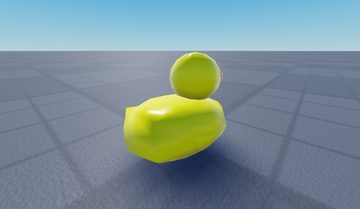</a> <b>Duck</b> <code>models/Workspace/Duck.rbxm</code></td>
</tr>
<tr>
<td width="25%" valign="top"><a href="models/Workspace/R6%20%5BDummy%5D.rbxm">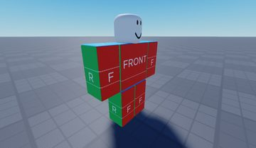</a> <b>R6 [Dummy]</b> <code>models/Workspace/R6 [Dummy].rbxm</code></td>
<td width="25%" valign="top"><a href="models/Workspace/Settings/Rescue/PossesdP9.rbxm">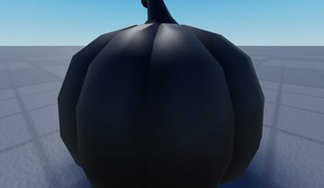</a> <b>PossesdP9</b> <code>models/Workspace/Settings/Rescue/PossesdP9.rbxm</code></td>
<td width="25%" valign="top"> <b>Flower~2</b> <code>models/Workspace/Flower~2.rbxm</code></td>
<td width="25%" valign="top"><a href="models/Workspace/Model.rbxm">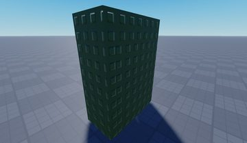</a> <b>Model</b> <code>models/Workspace/Model.rbxm</code></td>
</tr>
<tr>
<td width="25%" valign="top"><a href="models/Workspace/Dummy.rbxm">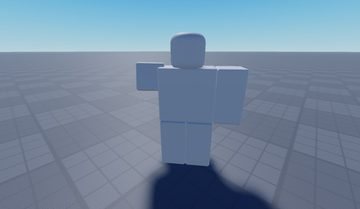</a> <b>Dummy</b> <code>models/Workspace/Dummy.rbxm</code></td>
<td width="25%" valign="top"><a href="models/Workspace/Settings/Rescue/Purple%20Heart%20NecklaceAccessory.rbxm">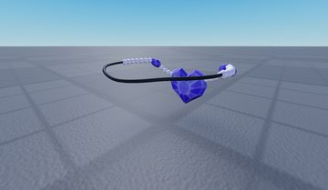</a> <b>Purple Heart NecklaceAccessory</b> <code>models/Workspace/Settings/Rescue/Purple Heart NecklaceAccessory.rbxm</code></td>
<td width="25%" valign="top"><a href="models/Workspace/SpawnLocation.rbxm">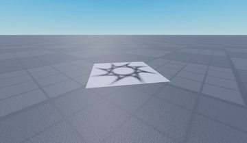</a> <b>SpawnLocation</b> <code>models/Workspace/SpawnLocation.rbxm</code></td>
<td width="25%" valign="top"><a href="models/Workspace/Settings/Rescue/Maelstrom%20Spellbinder.rbxm">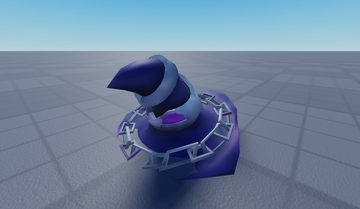</a> <b>Maelstrom Spellbinder</b> <code>models/Workspace/Settings/Rescue/Maelstrom Spellbinder.rbxm</code></td>
</tr>
<tr>
<td width="25%" valign="top"><a href="models/Workspace/Settings/Rescue/PurpleCape.rbxm">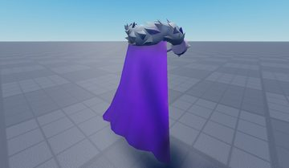</a> <b>PurpleCape</b> <code>models/Workspace/Settings/Rescue/PurpleCape.rbxm</code></td>
<td width="25%" valign="top"><a href="models/Workspace/Settings/Rescue/SpaceHorns.rbxm">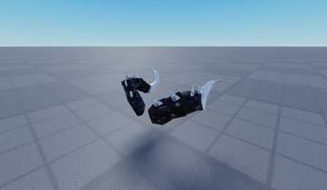</a> <b>SpaceHorns</b> <code>models/Workspace/Settings/Rescue/SpaceHorns.rbxm</code></td>
</tr>
</table>

## Notable scripts

Top-scored scripts of this game per topic (full tree in [source/scripts](source/scripts/)).

| Topic | Scripts |
|---|---|
| UI animation (tweens, hover / click, pop-ins, springs) | [`Manager`](source/scripts/StarterGui/GamepassUI/Manager.client.lua) 88 lines |
| Utility modules (number format, signals, tables, timers) | [`NumberFormatter`](source/scripts/ReplicatedStorage/NumberFormatter.lua) 38 lines |

## ⚠️ Safety

HIGH flags (backdoors, `require(id)`, `loadstring`, webhooks). Review or delete before reusing:

- `scripts/Workspace/Boards/AssetLoader.server.lua`
- `scripts/Workspace/Boards/R15Loader/Loader.server.lua`
- `scripts/Workspace/Kohl's Admin/Legacy_Loader/MainModuleKAI.lua`
- `scripts/Workspace/Kohl's Admin/Legacy_Loader/MainModuleKAI/D/Tools/Building Tools/AutoUpdate/AutomaticUpdating.server.lua`
- `scripts/Workspace/Kohl's Admin/Legacy_Loader/MainModuleKAI/D/Tools/Building Tools/Libraries/Cryo/List.lua`
- `scripts/Workspace/Kohl's Admin/Legacy_Loader/MainModuleKAI/D/Tools/Building Tools/Libraries/Cryo/List/reverse.spec.lua`
- `scripts/Workspace/Kohl's Admin/MainModule/DefaultTools/Building Tools/AutoUpdate/AutomaticUpdating.server.lua`
- `scripts/Workspace/Kohl's Admin/MainModule/DefaultTools/Building Tools/Libraries/Cryo/List.lua`

## Folders

| Folder | What |
|---|---|
| `screenshots/` | full frames; `crops/` = the panel only; `models/` = 3D previews; `thumbs/` = gallery thumbnails |
| `ui/` | every screen as a Lua builder (`require(module)()` returns the ScreenGui); `_StarterGui-all.lua` builds every StarterGui screen |
| `models/` | every model as .rbxm (the only .rbxm files), mirroring the place tree, scripts removed |
| `map/` | `workspace.rbxm` (the map as a model), `lighting.lua` (sky + post effects), `materials.lua`, `Environment.lua` |
| `animations/`, `audio/` | KeyframeSequence / Sound builders (.lua), `AnimationIds.lua`, `Sounds.lua` |
| `source/` | all scripts as .luau, `tree.txt`, `ui.txt`, `remotes.txt`, `assets.txt`, `flags.txt` |
