# +1 Drill & Mine

> ⛏️ **Simulator** · incremental simulator (+1 speed, mining, drills) · source file `+1 Drill & Mine.rbxl`

[⬅ Back to the catalog](../../README.md) · [Assets inventory](ASSETS.md) · [Style numbers](reference.md) · [Scripts](source/scripts/) · [Code analysis](source/README.md)

## At a glance

| | |
|---|---|
| Provenance | template with full source |
| Screens | 4 ScreenGuis, 2177 GUI objects → **41 screenshots** |
| Models (.rbxm) | 636 models, 129 model sets, 2 VFX sets |
| Lua builders (.lua) | 35 UI screens, 145 animation packs, 1 audio packs |
| Code | 204 scripts, 61,039 lines |
| Asset ids | 86 animations, 38 sounds |
| Safety scan | 0 HIGH / 0 MED flags ([flags.txt](source/flags.txt)) |

**Fonts:** `GothamSSm Heavy`×551, `GothamSSm ExtraBold`×494, `LegacyArial Regular`×106, `FredokaOne Regular`×10, `SourceSansPro Bold`×6

## UI screenshots

Captured in Studio from the place's own ScreenGuis (scripts stripped). Each panel was opened on its own; click a thumbnail for the full 1519×886 frame. Runtime-filled lists (shop items, inventories) show their template state.

### Shop & Robux store

<table>
<tr>
<td width="33%" valign="top"><a href="screenshots/05_GUI__BuyTransition.jpg">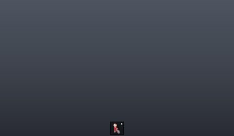</a> <b>GUI</b> › Folder.BuyTransition</td>
<td width="33%" valign="top"><a href="screenshots/06_GUI__TrailShop.jpg">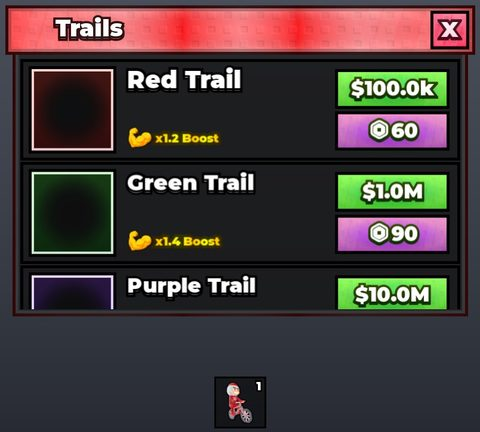</a> <b>GUI</b> › Folder.TrailShop</td>
<td width="33%" valign="top"><a href="screenshots/11_GUI__Shop.jpg">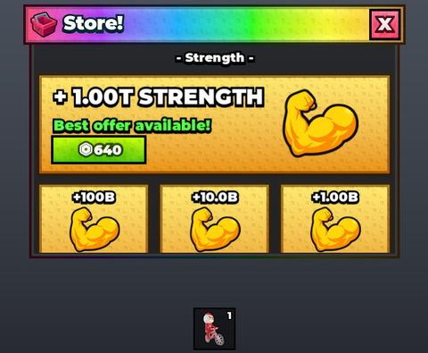</a> <b>GUI</b> › Folder.Shop</td>
</tr>
<tr>
<td width="33%" valign="top"><a href="screenshots/13_GUI__UpgradeShop.jpg">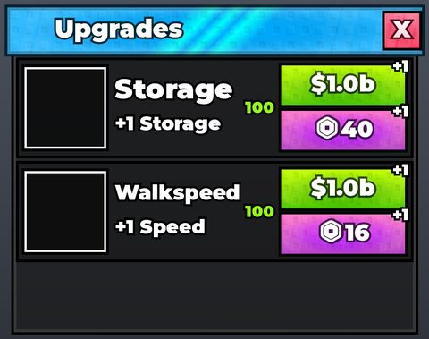</a> <b>GUI</b> › Folder.UpgradeShop</td>
<td width="33%" valign="top"><a href="screenshots/16_GUI__ItemShop.jpg">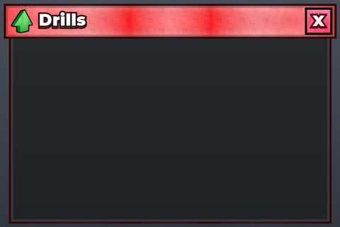</a> <b>GUI</b> › Folder.ItemShop</td>
<td width="33%" valign="top"><a href="screenshots/24_Tabs__SpeedShop.jpg">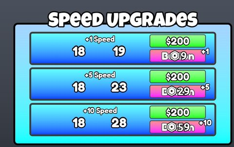</a> <b>Tabs</b> › SpeedShop</td>
</tr>
<tr>
<td width="33%" valign="top"><a href="screenshots/25_Tabs__CarryShop.jpg">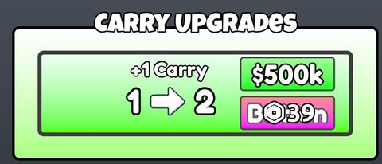</a> <b>Tabs</b> › CarryShop</td>
<td width="33%" valign="top"><a href="screenshots/26_Tabs__Shop.jpg">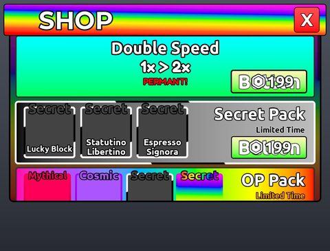</a> <b>Tabs</b> › Shop</td>
<td width="33%" valign="top"><a href="screenshots/32_Tabs__ProductSpin.jpg">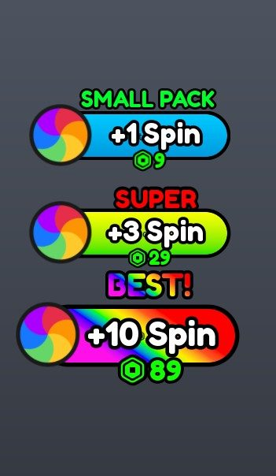</a> <b>Tabs</b> › Spin.ProductSpin</td>
</tr>
<tr>
<td width="33%" valign="top"><a href="screenshots/37_GearShop.jpg">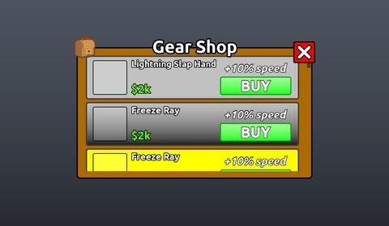</a> <b>GearShop</b></td>
</tr>
</table>

### Inventory / backpack / pets

<table>
<tr>
<td width="33%" valign="top"><a href="screenshots/14_GUI__InventoryFrame.jpg">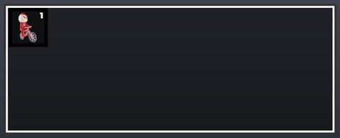</a> <b>GUI</b> › Folder.InventoryFrame</td>
</tr>
</table>

### Index / codex / glossary

<table>
<tr>
<td width="33%" valign="top"><a href="screenshots/08_GUI__Index.jpg">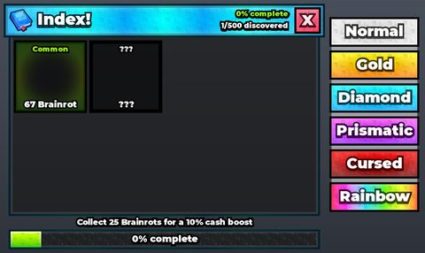</a> <b>GUI</b> › Folder.Index</td>
<td width="33%" valign="top"><a href="screenshots/28_Tabs__Index.jpg">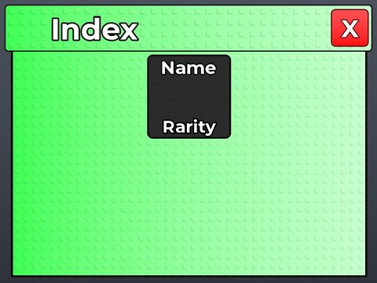</a> <b>Tabs</b> › Index</td>
</tr>
</table>

### Rewards, daily, spin, codes

<table>
<tr>
<td width="33%" valign="top"><a href="screenshots/07_GUI__DailyGifts.jpg">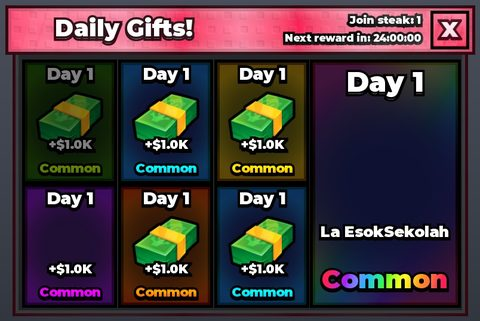</a> <b>GUI</b> › Folder.DailyGifts</td>
<td width="33%" valign="top"><a href="screenshots/09_GUI__OfflineReward.jpg">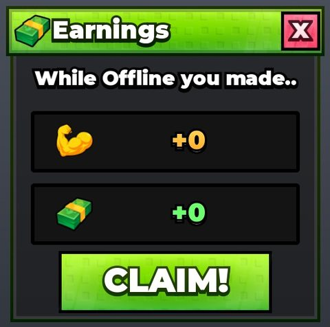</a> <b>GUI</b> › Folder.OfflineReward</td>
<td width="33%" valign="top"><a href="screenshots/17_GUI__FreeGiftFrame.jpg">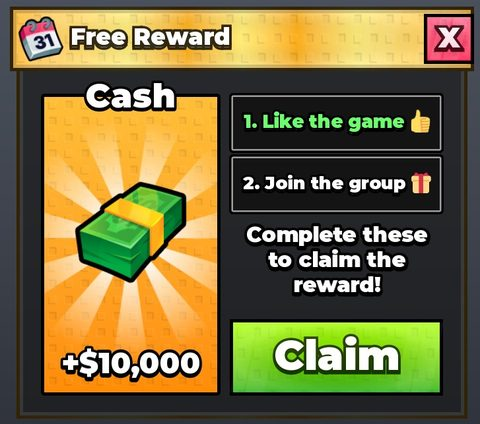</a> <b>GUI</b> › Folder.FreeGiftFrame</td>
</tr>
<tr>
<td width="33%" valign="top"><a href="screenshots/30_Tabs__Gifts.jpg">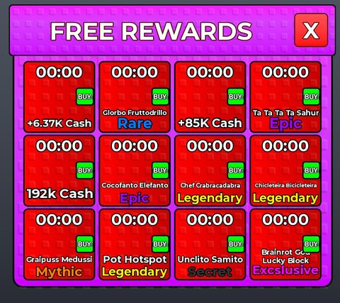</a> <b>Tabs</b> › Gifts</td>
<td width="33%" valign="top"><a href="screenshots/31_Tabs__Spin.jpg">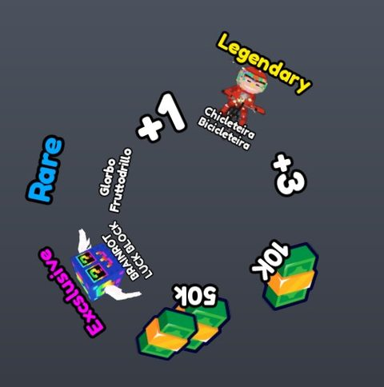</a> <b>Tabs</b> › Spin.Spin</td>
<td width="33%" valign="top"><a href="screenshots/36_GiftRequest.jpg">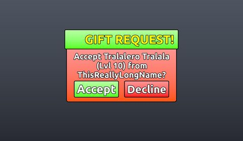</a> <b>GiftRequest</b></td>
</tr>
</table>

### Quests & progression

<table>
<tr>
<td width="33%" valign="top"><a href="screenshots/10_GUI__Rebirth.jpg">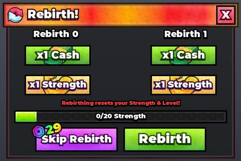</a> <b>GUI</b> › Folder.Rebirth</td>
<td width="33%" valign="top"><a href="screenshots/22_TradeRequest.jpg">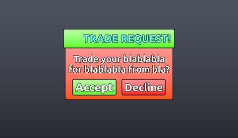</a> <b>TradeRequest</b></td>
<td width="33%" valign="top"><a href="screenshots/27_Tabs__Rebirth.jpg">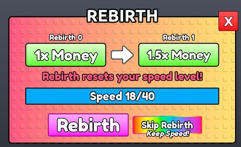</a> <b>Tabs</b> › Rebirth</td>
</tr>
</table>

### Popups, notifications, prompts

<table>
<tr>
<td width="33%" valign="top"><a href="screenshots/21_TutorialMessage.jpg">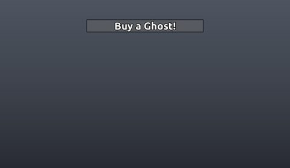</a> <b>TutorialMessage</b></td>
<td width="33%" valign="top"><a href="screenshots/35_Notification.jpg">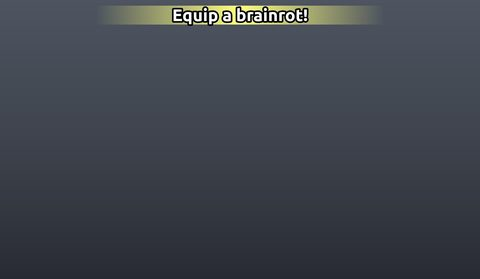</a> <b>Notification</b></td>
</tr>
</table>

### Loading & intro

<table>
<tr>
<td width="33%" valign="top"><a href="screenshots/41_LoadingScreen.jpg">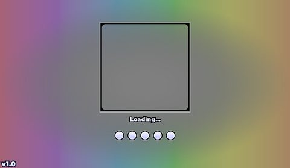</a> <b>LoadingScreen</b></td>
</tr>
</table>

### Leaderboards & stats

<table>
<tr>
<td width="33%" valign="top"><a href="screenshots/18_GUI__TopButtons.jpg">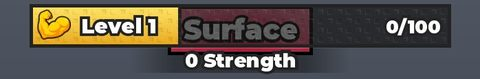</a> <b>GUI</b> › HUD.TopButtons</td>
</tr>
</table>

### HUD & currency

<table>
<tr>
<td width="33%" valign="top"><a href="screenshots/19_GUI__PickUpButtons.jpg">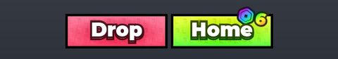</a> <b>GUI</b> › HUD.PickUpButtons</td>
<td width="33%" valign="top"><a href="screenshots/40_BottomRight.jpg">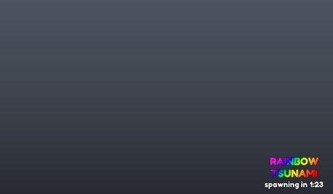</a> <b>BottomRight</b></td>
</tr>
</table>

### Other

<table>
<tr>
<td width="33%" valign="top"><a href="screenshots/01_Removal.jpg">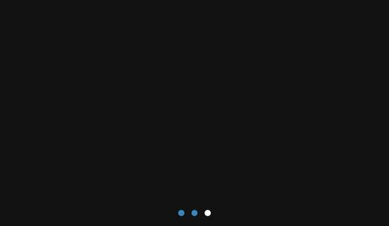</a> <b>Removal</b></td>
<td width="33%" valign="top"><a href="screenshots/02_Addition.jpg">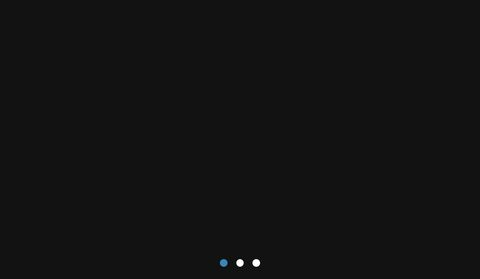</a> <b>Addition</b></td>
<td width="33%" valign="top"> <b>ShutdownUI</b></td>
</tr>
<tr>
<td width="33%" valign="top"><a href="screenshots/04_GUI.jpg">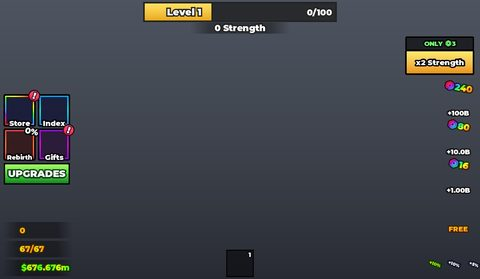</a> <b>GUI</b></td>
<td width="33%" valign="top"><a href="screenshots/12_GUI__SellFrame.jpg">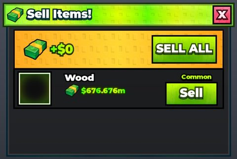</a> <b>GUI</b> › Folder.SellFrame</td>
<td width="33%" valign="top"><a href="screenshots/15_GUI__LostBrainrotsScreen.jpg">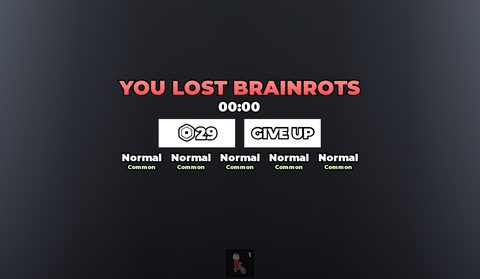</a> <b>GUI</b> › Folder.LostBrainrotsScreen</td>
</tr>
<tr>
<td width="33%" valign="top"><a href="screenshots/20_Axe.jpg">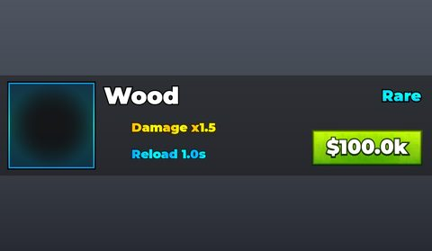</a> <b>Axe</b></td>
<td width="33%" valign="top"><a href="screenshots/23_TeleportButtons.jpg">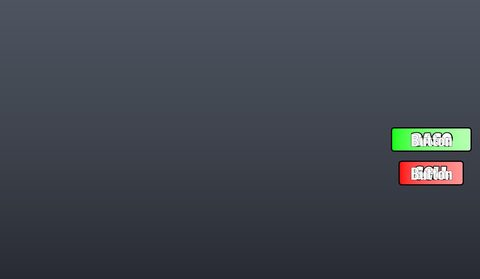</a> <b>TeleportButtons</b></td>
<td width="33%" valign="top"><a href="screenshots/29_Tabs__Carrying.jpg">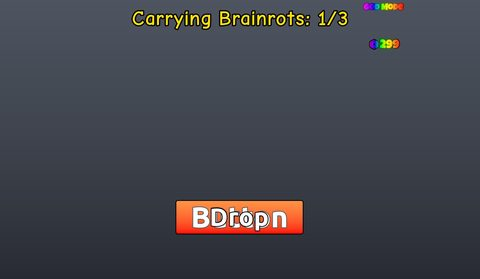</a> <b>Tabs</b> › Carrying</td>
</tr>
<tr>
<td width="33%" valign="top"><a href="screenshots/33_Tabs__Sell.jpg">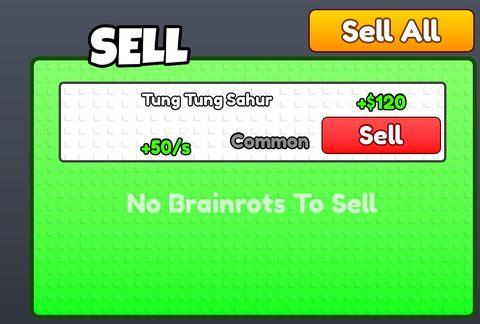</a> <b>Tabs</b> › Sell</td>
<td width="33%" valign="top"><a href="screenshots/34_ScreenGui.jpg">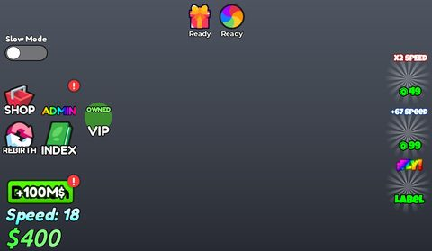</a> <b>ScreenGui</b></td>
<td width="33%" valign="top"><a href="screenshots/38_Error.jpg">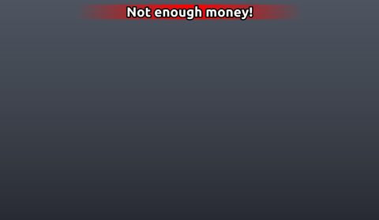</a> <b>Error</b></td>
</tr>
<tr>
<td width="33%" valign="top"><a href="screenshots/39_DropGui.jpg">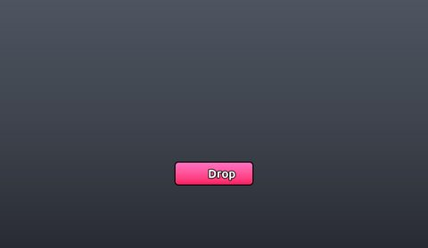</a> <b>DropGui</b></td>
</tr>
</table>

## Model previews

<table>
<tr>
<td width="25%" valign="top"><a href="models/Workspace/Assets/Map/TrailShop.rbxm">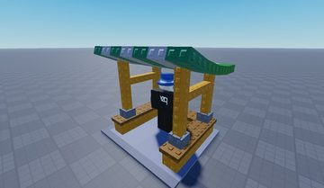</a> <b>TrailShop</b> <code>models/Workspace/Assets/Map/TrailShop.rbxm</code></td>
<td width="25%" valign="top"><a href="models/ReplicatedStorage/Drills/Drill12%20-%20Candy.rbxm">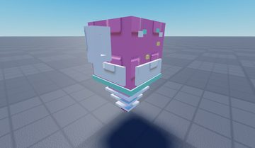</a> <b>Drill12 - Candy</b> <code>models/ReplicatedStorage/Drills/Drill12 - Candy.rbxm</code></td>
<td width="25%" valign="top"><a href="models/Workspace/Assets/Map/portal%20tortal.rbxm">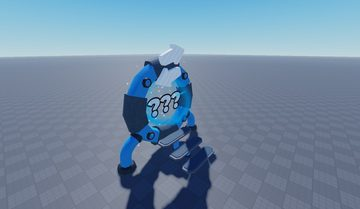</a> <b>portal tortal</b> <code>models/Workspace/Assets/Map/portal tortal.rbxm</code></td>
<td width="25%" valign="top"><a href="models/ReplicatedStorage/RarityItems/Divine/Periastron%20Sword.rbxm">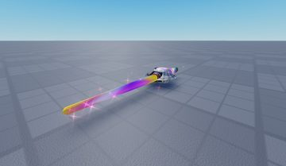</a> <b>Periastron Sword</b> <code>models/ReplicatedStorage/RarityItems/Divine/Periastron Sword.rbxm</code></td>
</tr>
<tr>
<td width="25%" valign="top"><a href="models/ReplicatedStorage/RarityItemsOriginals/RarityShowcase/Dragon%20Egg.rbxm">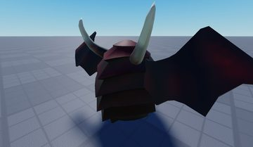</a> <b>Dragon Egg</b> <code>models/ReplicatedStorage/RarityItemsOriginals/RarityShowcase/Dragon Egg.rbxm</code></td>
<td width="25%" valign="top"><a href="models/ReplicatedStorage/RarityItems/Epic/Golden%20Hat.rbxm">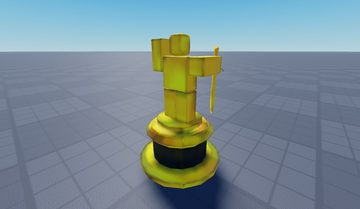</a> <b>Golden Hat</b> <code>models/ReplicatedStorage/RarityItems/Epic/Golden Hat.rbxm</code></td>
<td width="25%" valign="top"><a href="models/ReplicatedStorage/RarityItemsOriginals/RarityShowcase/Sapphire%20Crystal.rbxm">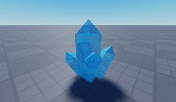</a> <b>Sapphire Crystal</b> <code>models/ReplicatedStorage/RarityItemsOriginals/RarityShowcase/Sapphire Crystal.rbxm</code></td>
<td width="25%" valign="top"><a href="models/Workspace/THUMB.rbxm">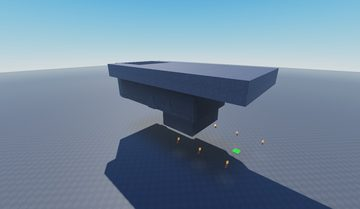</a> <b>THUMB</b> <code>models/Workspace/THUMB.rbxm</code></td>
</tr>
<tr>
<td width="25%" valign="top"><a href="models/Workspace/Lbs/TopCash/Stands/1st.rbxm">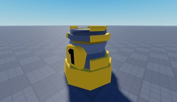</a> <b>1st</b> <code>models/Workspace/Lbs/TopCash/Stands/1st.rbxm</code></td>
<td width="25%" valign="top"><a href="models/Workspace/Assets/Map/GRASS%20Add~4/Part__x53.rbxm">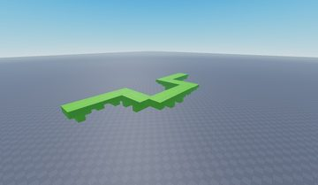</a> <b>Part__x53</b> <code>models/Workspace/Assets/Map/GRASS Add~4/Part__x53.rbxm</code></td>
<td width="25%" valign="top"> <b>BoardPart</b> <code>models/Workspace/SpawnBoard/BoardPart.rbxm</code></td>
<td width="25%" valign="top"> <b>SellShop</b> <code>models/Workspace/Assets/Map/SellShop.rbxm</code></td>
</tr>
<tr>
<td width="25%" valign="top"> <b>void ball</b> <code>models/ReplicatedStorage/RarityItemsOriginals/RarityShowcase/void ball.rbxm</code></td>
<td width="25%" valign="top"> <b>Magic Sword</b> <code>models/ReplicatedStorage/RarityItemsOriginals/RarityShowcase/Magic Sword.rbxm</code></td>
</tr>
</table>

## Notable scripts

Top-scored scripts of this game per topic (full tree in [source/scripts](source/scripts/)).

| Topic | Scripts |
|---|---|
| UI animation (tweens, hover / click, pop-ins, springs) | [`AnimatedText`](source/scripts/ReplicatedStorage/Source/Modules/AnimatedText.lua) 1316 lines [`HoverController`](source/scripts/ReplicatedStorage/Source/Controllers/HoverController.lua) 285 lines [`RarityLootClient`](source/scripts/StarterPlayer/StarterPlayerScripts/RarityLootClient.client.lua) 1053 lines [`IslandBrainrotClient`](source/scripts/StarterPlayer/StarterPlayerScripts/IslandBrainrotClient.client.lua) 2680 lines [`DailyRewardController`](source/scripts/ReplicatedStorage/Source/Controllers/DailyRewardController.lua) 827 lines |
| UI controllers / window managers / menus | [`LootBlockController`](source/scripts/ReplicatedStorage/Source/Controllers/LootBlockController.lua) 830 lines [`DailyRewardController`](source/scripts/ReplicatedStorage/Source/Controllers/DailyRewardController.lua) 827 lines [`LuckyBlockController`](source/scripts/ReplicatedStorage/Source/Controllers/LuckyBlockController.lua) 1153 lines [`FrameAnimator`](source/scripts/ReplicatedStorage/Source/Modules/FrameAnimator.lua) 801 lines [`Satchel`](source/scripts/StarterPlayer/StarterPlayerScripts/Satchel/Satchel.lua) 2178 lines |
| Notifications, toasts, popups, prompts | [`NotificationsController`](source/scripts/ReplicatedStorage/Source/Controllers/NotificationsController.lua) 250 lines [`ProximityPromptScript`](source/scripts/StarterPlayer/StarterPlayerScripts/ProximityPromptScript.client.lua) 664 lines [`LootBlockController`](source/scripts/ReplicatedStorage/Source/Controllers/LootBlockController.lua) 830 lines [`DailyRewardController`](source/scripts/ReplicatedStorage/Source/Controllers/DailyRewardController.lua) 827 lines [`BuyTransitionController`](source/scripts/ReplicatedStorage/Source/Controllers/BuyTransitionController.lua) 377 lines |
| Loading / intro screens | [`LoadingScreenController`](source/scripts/ReplicatedStorage/Source/Controllers/LoadingScreenController.lua) 40 lines [`BrainrotController`](source/scripts/ReplicatedStorage/Source/Controllers/BrainrotController.lua) 1016 lines [`PodiumController`](source/scripts/ReplicatedStorage/Source/Controllers/PodiumController.lua) 2762 lines [`DrillClient`](source/scripts/StarterPlayer/StarterPlayerScripts/DrillClient.client.lua) 1048 lines [`IslandBrainrotClient`](source/scripts/StarterPlayer/StarterPlayerScripts/IslandBrainrotClient.client.lua) 2680 lines |
| Camera, cutscenes, screen shake | [`LootBlockController`](source/scripts/ReplicatedStorage/Source/Controllers/LootBlockController.lua) 830 lines [`LuckyBlockController`](source/scripts/ReplicatedStorage/Source/Controllers/LuckyBlockController.lua) 1153 lines [`DrillClient`](source/scripts/StarterPlayer/StarterPlayerScripts/DrillClient.client.lua) 1048 lines [`PadUnboxing`](source/scripts/ReplicatedStorage/Source/Modules/PadUnboxing.lua) 649 lines [`ItemShopController`](source/scripts/ReplicatedStorage/Source/Controllers/ItemShopController.lua) 641 lines |
| VFX, particles, beams, hit effects | [`PodiumController`](source/scripts/ReplicatedStorage/Source/Controllers/PodiumController.lua) 2762 lines [`PadUnboxing`](source/scripts/ReplicatedStorage/Source/Modules/PadUnboxing.lua) 649 lines [`DrillClient`](source/scripts/StarterPlayer/StarterPlayerScripts/DrillClient.client.lua) 1048 lines [`FireworkModule`](source/scripts/ReplicatedStorage/Source/Modules/FireworkModule.lua) 98 lines [`ConfettiFX`](source/scripts/ReplicatedStorage/Source/Modules/ConfettiFX.lua) 276 lines |
| DataStore / player data | [`PlayerDataService`](source/scripts/ServerScriptService/Source/Services/PlayerDataService.lua) 280 lines |
| Monetization (dev products, game passes, receipts) | [`PurchaseService`](source/scripts/ServerScriptService/Source/Services/PurchaseService.lua) 404 lines [`GamepassService`](source/scripts/ServerScriptService/Source/Services/GamepassService.lua) 116 lines |
| RNG, eggs, gacha, rarity rolls, pets | [`LootBlockController`](source/scripts/ReplicatedStorage/Source/Controllers/LootBlockController.lua) 830 lines [`LuckyBlockController`](source/scripts/ReplicatedStorage/Source/Controllers/LuckyBlockController.lua) 1153 lines [`LuckyBlockService`](source/scripts/ServerScriptService/Source/Services/LuckyBlockService.lua) 499 lines [`EquipVisualController`](source/scripts/ReplicatedStorage/Source/Controllers/EquipVisualController.lua) 726 lines [`RarityItemSpawner`](source/scripts/ServerScriptService/RarityItemSpawner.server.lua) 878 lines |
| Combat, weapons, hitboxes, abilities | [`WaveSystem`](source/scripts/ServerStorage/__LootRejects/LBL_Temp_GemCrystalOreShard/ungroup%20in%20ServerScriptService/WaveSystem.server.lua) 174 lines [`LuckyBlockController`](source/scripts/ReplicatedStorage/Source/Controllers/LuckyBlockController.lua) 1153 lines |
| Character movement (sprint, dash, double jump, slide) | [`HUDSlideController`](source/scripts/ReplicatedStorage/Source/Controllers/HUDSlideController.lua) 225 lines [`TreeAreaController`](source/scripts/ReplicatedStorage/Source/Controllers/TreeAreaController.lua) 1068 lines [`SurfaceModeController`](source/scripts/StarterPlayer/StarterPlayerScripts/SurfaceModeController.client.lua) 213 lines [`SettingsController`](source/scripts/ReplicatedStorage/Source/Controllers/SettingsController.lua) 327 lines |
| Tycoon / plots / bases / building | [`BaseUpgradeController`](source/scripts/ReplicatedStorage/Source/Controllers/BaseUpgradeController.lua) 430 lines [`PodiumController`](source/scripts/ReplicatedStorage/Source/Controllers/PodiumController.lua) 2762 lines [`SellController`](source/scripts/ReplicatedStorage/Source/Controllers/SellController.lua) 635 lines [`BaseUpgradeService`](source/scripts/ServerScriptService/Source/Services/BaseUpgradeService.lua) 452 lines [`DailyRewardController`](source/scripts/ReplicatedStorage/Source/Controllers/DailyRewardController.lua) 827 lines |
| Leaderboards & stats | [`LeaderboardService`](source/scripts/ServerScriptService/Source/Services/LeaderboardService.lua) 400 lines [`LevelBarController`](source/scripts/StarterGui/GUI/HUD/LevelBarController.client.lua) 146 lines |
| Admin panels & commands | [`AdminCommandsService`](source/scripts/ServerScriptService/Source/Services/AdminCommandsService.lua) 491 lines [`AdminConsoleClient`](source/scripts/StarterPlayer/StarterPlayerScripts/AdminConsoleClient.client.lua) 221 lines |
| Sound & music | [`MusicController`](source/scripts/ReplicatedStorage/Source/Controllers/MusicController.lua) 76 lines [`UIClickSound`](source/scripts/StarterPlayer/StarterPlayerScripts/UIClickSound.client.lua) 62 lines [`MusicService`](source/scripts/ServerScriptService/Source/Services/MusicService.lua) 20 lines [`StrengthClickClient`](source/scripts/StarterPlayer/StarterPlayerScripts/StrengthClickClient.client.lua) 255 lines [`DrillClient`](source/scripts/StarterPlayer/StarterPlayerScripts/DrillClient.client.lua) 1048 lines |
| Daily rewards, quests, codes, playtime | [`DailyRewardService`](source/scripts/ServerScriptService/Source/Services/DailyRewardService.lua) 220 lines [`DailyRewardController`](source/scripts/ReplicatedStorage/Source/Controllers/DailyRewardController.lua) 827 lines [`OfflineRewardController`](source/scripts/ReplicatedStorage/Source/Controllers/OfflineRewardController.lua) 218 lines [`IndexRewardService`](source/scripts/ServerScriptService/Source/Services/IndexRewardService.lua) 113 lines |
| Utility modules (number format, signals, tables, timers) | [`LootBlockController`](source/scripts/ReplicatedStorage/Source/Controllers/LootBlockController.lua) 830 lines [`ItemShopController`](source/scripts/ReplicatedStorage/Source/Controllers/ItemShopController.lua) 641 lines [`SellController`](source/scripts/ReplicatedStorage/Source/Controllers/SellController.lua) 635 lines [`TrailShopController`](source/scripts/ReplicatedStorage/Source/Controllers/TrailShopController.lua) 415 lines [`BrainrotController`](source/scripts/ReplicatedStorage/Source/Controllers/BrainrotController.lua) 1016 lines |

### In the curated script library

- [Text console with owner-only wipes](../../Scripts/16-Admin/AdminCommandsService-Console__drill-and-mine.lua) — F2 text console backend: tokenizer, partial-name player lookup, give-anything commands that reuse the real grant paths, aliases, help text, owner-only data wipe, cross-server shutdown via MessagingService.
- [F2 console UI (client)](../../Scripts/16-Admin/AdminConsoleClient-F2Console__drill-and-mine.lua) — Client side of the console: asks the server if you are an admin, builds a small F2 text box UI, sends the raw line with RunCommand and prints the reply.
- [7-day calendar with streak reset](../../Scripts/18-Daily-Rewards-Quests/DailyRewardService-Streak__drill-and-mine.lua) — 7-day login calendar: state resolved lazily on read (claimable / countdown / streak broken after 2 days), config-driven reward types, payload for the UI, and a paid 'skip all days' product.
- [Offline earnings (capped, rate-based)](../../Scripts/18-Daily-Rewards-Quests/OfflineEarnings-Podiums__drill-and-mine.lua) — Offline cash = income per second x offline seconds (capped at 12h) x boosts x a 1/6 offline rate, a gamepass multiplier and auto-collect, a 'measured earning pace' fallback, a claim-all popup endpoint, and LastLogin bookkeeping on join/leave.
- [ProfileService service with migration sweep](../../Scripts/07-Data-Saving/PlayerDataService-ProfileService__drill-and-mine.lua) — ProfileService load/release, leaderstats mirror, migration sweep that drops items no longer in config, debounced ScheduleSave, and an admin data wipe (WipeProfileAsync).
- [Boards + #1 podium + rank tags](../../Scripts/15-Leaderboards/LeaderboardService-PodiumAndTags__drill-and-mine.lua) — Config list of boards (store, value getter, formatter), SurfaceGui rows with headshots, a #1 podium dummy wearing the top player's avatar (rig scale kept), per-board rank attributes and a '[#3 Cash]' chat tag, playtime counter.
- [Loading finished gate controller](../../Scripts/04-Loading-Screens/LoadingGateController__drill-and-mine.lua) — Tiny controller exposing LoadingFinished (BindableEvent) and IsLoadingComplete() so other systems can wait for the loading screen; here it just removes the old screen and marks complete.
- [Soft shutdown teleport screen](../../Scripts/04-Loading-Screens/SoftShutdownTeleportScreen__drill-and-mine.lua) — Soft-shutdown client: reads teleport data, shows an arriving/leaving screen, and uses TeleportService:SetTeleportGui so a custom loading screen shows during the teleport between servers.
- [Gamepass ownership as attributes](../../Scripts/08-Monetization/GamepassService-Attributes__drill-and-mine.lua) — Checks each configured pass on join, mirrors ownership to OwnsGamepass_<key> player attributes, updates on purchase, and registers pass-based boost percents with a boost aggregator.
- [Prompt with context + announcements](../../Scripts/08-Monetization/PurchaseService-PromptContext__drill-and-mine.lua) — Server-side prompt that remembers a pending purchase and context string, routes the grant by context, checks the client context against the configured product id, logs Robux spent and posts a rich-text 'X bought Y' message with verified/premium glyphs.
- [Starter pack with playtime countdown](../../Scripts/08-Monetization/StoreService-StarterPackTimer__drill-and-mine.lua) — One-time packs with reward lists, a starter pack that expires after N seconds of playtime (ticks only while online), pack status query for the UI, and cash packs scaled to the player's income.
- [Premium membership perk](../../Scripts/08-Monetization/RobloxPlusService-Premium__drill-and-mine.lua) — Gives Roblox Premium members a cash boost: checks MembershipType, listens to PlayerMembershipChanged and PromptPremiumPurchaseFinished, lets the client open PromptPremiumPurchase.
- [Boost aggregator (pass/premium/rebirth sources)](../../Scripts/08-Monetization/CashBoostService-Sources__drill-and-mine.lua) — Registry of named boost sources (gamepass, premium, index, rebirths...) summed into one multiplier, with a per-source breakdown pushed to the client HUD.
- [Toast controller with duplicate merge](../../Scripts/03-Notifications/ToastController__drill-and-mine.lua) — Colored toast notifications (Red/Green templates) that merge duplicates into "(xN)", pulse on repeat, pop in/out with UIScale, and preload their sounds.
- [HUD badge pulse](../../Scripts/03-Notifications/NotifyBadgePulse__drill-and-mine.lua) — Attention badge on a HUD button: every few seconds two red rings ripple out while the badge pops and wiggles like a bell.
- [Lucky block opening with luck tier-up](../../Scripts/09-RNG-Gacha-Pets/LuckyBlockService__drill-and-mine.lua) — Lucky block open flow: luck gives a chance per step to climb a rarity tier (capped at +2), skips invalid ids, falls back along the rarity ladder, and holds rewards as 'pending' until the reveal animation confirms (auto-applies on timeout or leave).
- [Client music loop with watchdog](../../Scripts/17-Sound-Music/MusicWatchdog__drill-and-mine.lua) — Client-driven background music with a watchdog: picks the song from SoundService.Music, forces Looped, and restarts it on Ended/Stopped/Paused or if a 2-second check finds it silent. Explains why music should be driven on the client.
- [Global UI click sound](../../Scripts/17-Sound-Music/UIClickSound__drill-and-mine.lua) — Global UI click sound: hooks every GuiButton in PlayerGui (now and later, via DescendantAdded) plus every ProximityPrompt trigger, preloads the sound, and plays a short-lived clone.
- [Volume sliders with debounced save](../../Scripts/17-Sound-Music/SettingsVolumeSliders__drill-and-mine.lua) — Settings controller with Music and Sounds volume sliders (tweened fill bar and knob). Applies volume to every Sound in SoundService.Music and SoundService.Sounds, including ones added later, and debounces saves to the server (0.3 s task.delay cancelled on each new change).
- [Minimal plot assigner](../../Scripts/14-Tycoon-Plots/PlotService__drill-and-mine.lua) — The smallest clean plot assigner in the set (~100 lines): sorts plots by number, gives the first one with OwnerUserId == 0, teleports the player there on every spawn, and runs registered reset...
- [Base floor upgrades from templates](../../Scripts/14-Tycoon-Plots/BaseUpgradeService__drill-and-mine.lua) — Buy-the-next-floor base upgrades: keeps floor/podium templates out of the world, clones the unlocked ones into the player's plot per level, charges a per-level cost, throttles requests with a 1s...
- [Grouped hover controller](../../Scripts/01-UI-Animation/HoverController_GroupedUIScale__drill-and-mine.lua) — Button hover/press/bounce via a per-button UIScale with tween cancelling, hover groups (several buttons react as one), icon tilt, pooled hover sound and a throttled 30 Hz sunburst/gradient spinner.
- [Per-character animated text](../../Scripts/01-UI-Animation/AnimatedText_PerCharBezier__drill-and-mine.lua) — Per-character text animation: only changed characters drop/scale in with CSS cubic-bezier easing, CanvasGroup layers per glyph, value-increase pop via UIScale (AnimatedText.Pop). Advanced.
- [Window open/close manager with blur + FOV](../../Scripts/01-UI-Animation/FrameAnimator_WindowOpenBlurFov__drill-and-mine.lua) — Window manager: Back-eased open / Quad-in close, blur + camera FOV tween, HUD groups slide off-screen while a window is open, cached fade tweens, open-by-button or by standing on a part.
- [Pop-in toast notifications](../../Scripts/01-UI-Animation/NotificationsController_PopToast__drill-and-mine.lua) — Toast notifications that pop in on a UIScale (0 -> 1, Quart out) while fading every descendant, merge duplicates into "(xN)" with an overshoot pulse, and pop out with Back-in.
- [Badge ripple + wiggle](../../Scripts/01-UI-Animation/NotifyBadgePulse_RippleWiggle__drill-and-mine.lua) — Notification badge attention loop: two expanding UIStroke rings that fade out, a small UIScale pop, and a bell-style rotation wiggle every 2.6 s.
- [UIScale breathing pulse](../../Scripts/01-UI-Animation/UIScaleBreathingPulse__drill-and-mine.lua) — Minimal infinite "breathing" pulse: UIScale tween 1 -> 1.10, Sine InOut, repeat -1, reverses. Comment explains why UIScale beats Size tweening.
- [Rainbow ripple rings](../../Scripts/01-UI-Animation/RebirthRingsFX_RainbowRings__drill-and-mine.lua) — Train of expanding rainbow UIStroke rings on a BillboardGui around the player (rotating UIGradient per ring, fade as they grow).
- [Progress bar fill + pop-hold](../../Scripts/01-UI-Animation/LevelBarFill_PopHold__drill-and-mine.lua) — XP progress-bar fill tween (skips tiny changes), level text, and a "pop and hold" UIScale on stat gain that rests inflated while gains keep coming; coalesces refreshes per frame.
- [Click sparkle burst](../../Scripts/01-UI-Animation/ClickSparkleBurst__drill-and-mine.lua) — Pure 2D click/tap feedback: spawns radial dots and streak frames at the cursor that fly outward, shrink and fade.
- [HUD edge slide in/out](../../Scripts/01-UI-Animation/HUDSlideController_EdgeSlide__drill-and-mine.lua) — Slides HUD groups off the top/left/bottom edges (Quart in/out, scale-only offscreen targets) and back in based on player location.
- [2D confetti celebration](../../Scripts/01-UI-Animation/ConfettiFX_ScreenConfetti__drill-and-mine.lua) — Screen-space confetti burst built fully in code (image templates flung and fading) plus an optional world firework emitter burst.
- [Idle icon rock](../../Scripts/01-UI-Animation/IconRockWiggle__drill-and-mine.lua) — Endless Sine InOut rotation rock (+10 / -20 degrees) for an idle shop icon.
- [Cash count-up lerp](../../Scripts/01-UI-Animation/CashCountUpLerp__drill-and-mine.lua) — Count-up currency display: exponential lerp of the displayed value toward the real value each frame (only rewriting Text when it changes) plus a Size pulse on change.
- [FrameAnimator (blur, FOV, HUD slide)](../../Scripts/02-UI-Framework/FrameAnimator__drill-and-mine.lua) — Full frame manager with size/fade tweens, blur, FOV zoom, HUD sliding off-screen and button/part triggers.
- [HUD slide off-screen by area](../../Scripts/02-UI-Framework/HUDSlideController__drill-and-mine.lua) — Slides HUD edge groups off-screen when the player leaves home, using a manual Heartbeat lerp.
- [UIStroke screen scaler](../../Scripts/02-UI-Framework/UiStrokeScaler__drill-and-mine.lua) — Scales every UIStroke thickness by screen width relative to 1920 px.
- [Commas, clock time, abbreviation](../../Scripts/19-Utility/FormatUtils-CommasTimeAbbrev__drill-and-mine.lua) — Three helpers: FormatNumber adds thousands commas, FormatTime gives mm:ss or h:mm:ss, Abbreviate gives 1.5M style text with a long suffix list.
- [UserId -> name cache](../../Scripts/19-Utility/NameCache__drill-and-mine.lua) — Tiny function that caches GetNameFromUserIdAsync results so boards and UIs do not call the web API repeatedly.
- [Firework burst](../../Scripts/06-VFX/FireworkBurst__drill-and-mine.lua) — Ring of firework bursts with staged emits and safe sound cleanup.
- [Confetti FX](../../Scripts/06-VFX/ConfettiFX__drill-and-mine.lua) — Self-contained UI confetti + world burst for rewards / celebrations.

## Folders

| Folder | What |
|---|---|
| `screenshots/` | full frames; `crops/` = the panel only; `models/` = 3D previews; `thumbs/` = gallery thumbnails |
| `ui/` | every screen as a Lua builder (`require(module)()` returns the ScreenGui); `_StarterGui-all.lua` builds every StarterGui screen |
| `models/` | every model as .rbxm (the only .rbxm files), mirroring the place tree, scripts removed |
| `map/` | `workspace.rbxm` (the map as a model), `lighting.lua` (sky + post effects), `materials.lua`, `Environment.lua` |
| `animations/`, `audio/` | KeyframeSequence / Sound builders (.lua), `AnimationIds.lua`, `Sounds.lua` |
| `source/` | all scripts as .luau, `tree.txt`, `ui.txt`, `remotes.txt`, `assets.txt`, `flags.txt` |
