# Drive For Brainrots

> 🧠 **Brainrot** · driving / brainrot collecting simulator · source file `Drive For Brainrots - With AP- SLBR BOOSTER.rbxl`

[⬅ Back to the catalog](../../README.md) · [Assets inventory](ASSETS.md) · [Style numbers](reference.md) · [Scripts](source/scripts/) · [Code analysis](source/README.md)

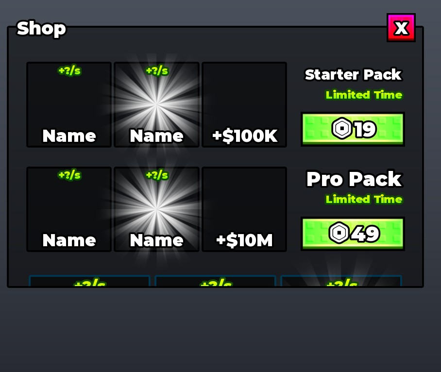

## At a glance

| | |
|---|---|
| Provenance | copy of a live game (saveinstance / decompiled client code) |
| Screens | 2 ScreenGuis, 594 GUI objects → **12 screenshots** |
| Models (.rbxm) | 180 models, 4 model sets, 2 VFX sets |
| Lua builders (.lua) | 18 UI screens, 0 animation packs, 5 audio packs |
| Code | 121 scripts, 22,986 lines |
| Asset ids | 56 animations, 35 sounds |
| Safety scan | 0 HIGH / 0 MED flags ([flags.txt](source/flags.txt)) |

**Fonts:** `GothamSSm Heavy`×108, `GothamSSm ExtraBold`×76, `SourceSansPro Regular`×31, `GothamSSm Bold`×20, `font asset 11702779517 Heavy`×13

## UI screenshots

Captured in Studio from the place's own ScreenGuis (scripts stripped). Each panel was opened on its own; click a thumbnail for the full 1519×886 frame. Runtime-filled lists (shop items, inventories) show their template state.

### Shop & Robux store

<table>
<tr>
<td width="33%" valign="top"> <b>GUI</b> › Frames.Shop</td>
</tr>
</table>

### Index / codex / glossary

<table>
<tr>
<td width="33%" valign="top"><a href="screenshots/05_GUI__Index.jpg">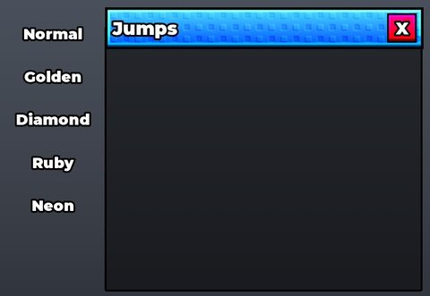</a> <b>GUI</b> › Frames.Index</td>
</tr>
</table>

### Rewards, daily, spin, codes

<table>
<tr>
<td width="33%" valign="top"><a href="screenshots/06_GUI__Wheel.jpg">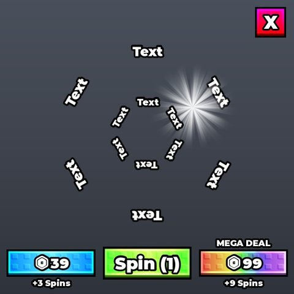</a> <b>GUI</b> › Frames.Wheel</td>
<td width="33%" valign="top"><a href="screenshots/07_GUI__Offline.jpg">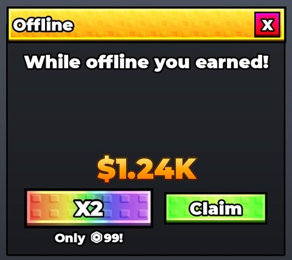</a> <b>GUI</b> › Frames.Offline</td>
<td width="33%" valign="top"><a href="screenshots/08_GUI__GiftrewardFrame.jpg">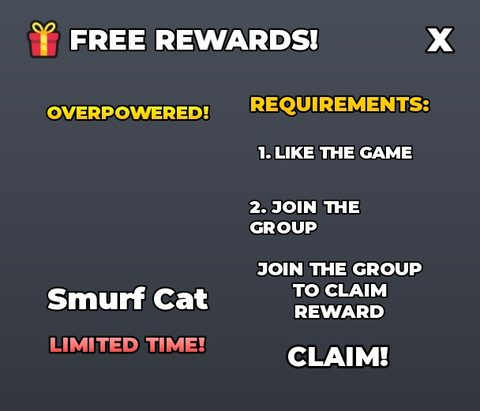</a> <b>GUI</b> › Frames.GiftrewardFrame</td>
</tr>
</table>

### Quests & progression

<table>
<tr>
<td width="33%" valign="top"><a href="screenshots/02_GUI__Upgrades.jpg">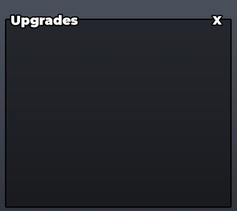</a> <b>GUI</b> › Frames.Upgrades</td>
<td width="33%" valign="top"><a href="screenshots/04_GUI__Rebirth.jpg">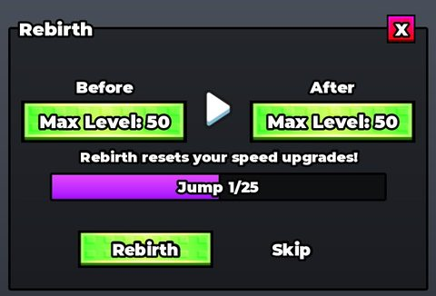</a> <b>GUI</b> › Frames.Rebirth</td>
<td width="33%" valign="top"><a href="screenshots/11_UpgradeTemplate.jpg">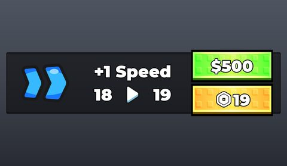</a> <b>UpgradeTemplate</b></td>
</tr>
</table>

### Admin panels

<table>
<tr>
<td width="33%" valign="top"><a href="screenshots/09_GUI__AdminPanelMain.jpg">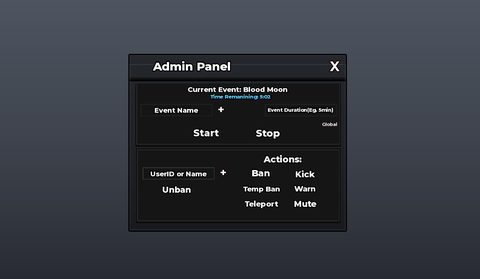</a> <b>GUI</b> › Frames.AdminPanelMain</td>
</tr>
</table>

### Other

<table>
<tr>
<td width="33%" valign="top"><a href="screenshots/01_GUI.jpg">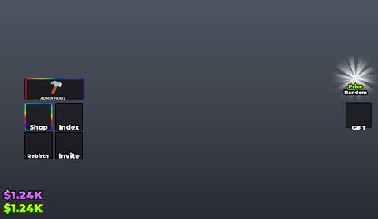</a> <b>GUI</b></td>
<td width="33%" valign="top"> <b>GUI</b> › Effect</td>
<td width="33%" valign="top"> <b>VehicleGui</b></td>
</tr>
</table>

## Model previews

<table>
<tr>
<td width="25%" valign="top"><a href="models/ReplicatedStorage/Templates/Car.rbxm">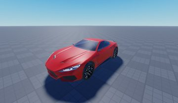</a> <b>Car</b> <code>models/ReplicatedStorage/Templates/Car.rbxm</code></td>
<td width="25%" valign="top"><a href="models/ReplicatedStorage/Items/Diamond/Tictac%20Sahur.rbxm">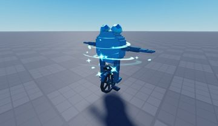</a> <b>Tictac Sahur</b> <code>models/ReplicatedStorage/Items/Diamond/Tictac Sahur.rbxm</code></td>
<td width="25%" valign="top"><a href="models/ReplicatedStorage/Templates/Bullet.rbxm">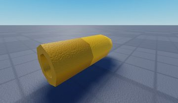</a> <b>Bullet</b> <code>models/ReplicatedStorage/Templates/Bullet.rbxm</code></td>
<td width="25%" valign="top"><a href="models/Workspace/Leaderboards/MoneyLeaderboard.rbxm">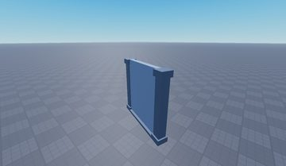</a> <b>MoneyLeaderboard</b> <code>models/Workspace/Leaderboards/MoneyLeaderboard.rbxm</code></td>
</tr>
<tr>
<td width="25%" valign="top"><a href="models/Workspace/Stand.rbxm">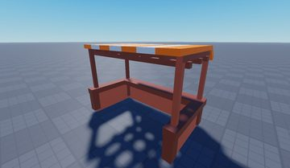</a> <b>Stand</b> <code>models/Workspace/Stand.rbxm</code></td>
<td width="25%" valign="top"><a href="models/Workspace/Map/Grass/Grass.rbxm">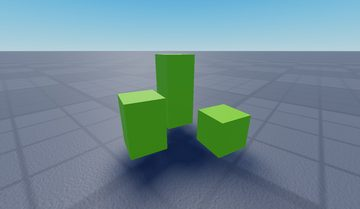</a> <b>Grass</b> <code>models/Workspace/Map/Grass/Grass.rbxm</code></td>
<td width="25%" valign="top"><a href="models/Workspace/Upgrades.rbxm">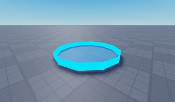</a> <b>Upgrades</b> <code>models/Workspace/Upgrades.rbxm</code></td>
<td width="25%" valign="top"><a href="models/Workspace/Leaderboards/RebirthsLeaderboard.rbxm">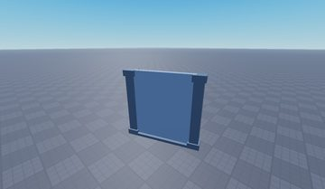</a> <b>RebirthsLeaderboard</b> <code>models/Workspace/Leaderboards/RebirthsLeaderboard.rbxm</code></td>
</tr>
<tr>
<td width="25%" valign="top"><a href="models/Workspace/Stand~2.rbxm">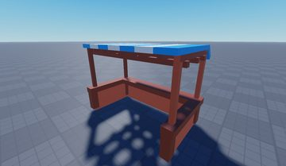</a> <b>Stand~2</b> <code>models/Workspace/Stand~2.rbxm</code></td>
<td width="25%" valign="top"><a href="models/Workspace/Map/Rocks/Rock.rbxm">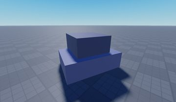</a> <b>Rock</b> <code>models/Workspace/Map/Rocks/Rock.rbxm</code></td>
<td width="25%" valign="top"><a href="models/Workspace/Sell.rbxm">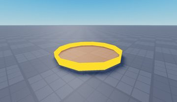</a> <b>Sell</b> <code>models/Workspace/Sell.rbxm</code></td>
<td width="25%" valign="top"><a href="models/ReplicatedStorage/Items/Diamond/Strawberry%20Elephant.rbxm">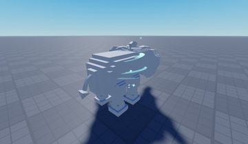</a> <b>Strawberry Elephant</b> <code>models/ReplicatedStorage/Items/Diamond/Strawberry Elephant.rbxm</code></td>
</tr>
<tr>
<td width="25%" valign="top"><a href="models/Workspace/Robux.rbxm">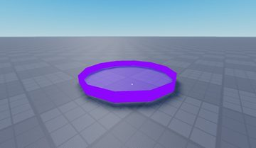</a> <b>Robux</b> <code>models/Workspace/Robux.rbxm</code></td>
<td width="25%" valign="top"><a href="models/Workspace/Map/Stage5.rbxm">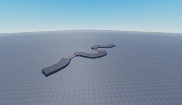</a> <b>Stage5</b> <code>models/Workspace/Map/Stage5.rbxm</code></td>
</tr>
</table>

## Notable scripts

Top-scored scripts of this game per topic (full tree in [source/scripts](source/scripts/)).

| Topic | Scripts |
|---|---|
| Notifications, toasts, popups, prompts | [`AdminHandler`](source/scripts/ServerScriptService/Handlers/AdminHandler.server.lua) 483 lines [`AdminPanelClient`](source/scripts/StarterGui/GUI/Frames/AdminPanelMain/AdminPanelClient.client.lua) 347 lines [`CarrySystem`](source/scripts/ServerScriptService/Modules/CarrySystem.lua) 318 lines [`PlotManager`](source/scripts/ServerScriptService/Handlers/PlotManager.lua) 222 lines [`ItemManager`](source/scripts/ServerScriptService/Modules/ItemManager.lua) 342 lines |
| RNG, eggs, gacha, rarity rolls, pets | [`SpinHandler`](source/scripts/ServerScriptService/Handlers/SpinHandler.lua) 131 lines [`DailySpinConfiguration`](source/scripts/ReplicatedStorage/Modules/DailySpinConfiguration.lua) 54 lines |
| Tycoon / plots / bases / building | [`SlotManager`](source/scripts/ServerScriptService/Handlers/SlotManager.lua) 333 lines [`PlotManager`](source/scripts/ServerScriptService/Handlers/PlotManager.lua) 222 lines |
| Admin panels & commands | [`AdminHandler`](source/scripts/ServerScriptService/Handlers/AdminHandler.server.lua) 483 lines [`AdminPanelClient`](source/scripts/StarterGui/GUI/Frames/AdminPanelMain/AdminPanelClient.client.lua) 347 lines |
| Daily rewards, quests, codes, playtime | [`GiftRewardHandler`](source/scripts/ServerScriptService/Handlers/GiftRewardHandler.server.lua) 78 lines |
| Utility modules (number format, signals, tables, timers) | [`SlotManager`](source/scripts/ServerScriptService/Handlers/SlotManager.lua) 333 lines [`ItemManager`](source/scripts/ServerScriptService/Modules/ItemManager.lua) 342 lines [`UpgradesHandler`](source/scripts/ServerScriptService/Handlers/UpgradesHandler.lua) 60 lines [`SpinHandler`](source/scripts/ServerScriptService/Handlers/SpinHandler.lua) 131 lines [`SellHandler`](source/scripts/ServerScriptService/Handlers/SellHandler.lua) 38 lines |

### In the curated script library

- [Head-stack carry system with collection zone](../../Scripts/14-Tycoon-Plots/CarrySystem__drive-for-brainrots.lua) — Carry stack: picked-up items are kept as data and shown as massless, non-colliding models welded in a stack above the player's head; walking into the CollectionZone (checked every 0.2s with a...

## Folders

| Folder | What |
|---|---|
| `screenshots/` | full frames; `crops/` = the panel only; `models/` = 3D previews; `thumbs/` = gallery thumbnails |
| `ui/` | every screen as a Lua builder (`require(module)()` returns the ScreenGui); `_StarterGui-all.lua` builds every StarterGui screen |
| `models/` | every model as .rbxm (the only .rbxm files), mirroring the place tree, scripts removed |
| `map/` | `workspace.rbxm` (the map as a model), `lighting.lua` (sky + post effects), `materials.lua`, `Environment.lua` |
| `animations/`, `audio/` | KeyframeSequence / Sound builders (.lua), `AnimationIds.lua`, `Sounds.lua` |
| `source/` | all scripts as .luau, `tree.txt`, `ui.txt`, `remotes.txt`, `assets.txt`, `flags.txt` |
