# Driving Empire

> 🚗 **Driving** · open-world driving · source file `Driving_Empire%20(1).rbxl`

[⬅ Back to the catalog](../../README.md) · [Assets inventory](ASSETS.md) · [Style numbers](reference.md) · [Scripts](source/scripts/) · [Code analysis](source/README.md)

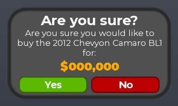

## At a glance

| | |
|---|---|
| Provenance | copy of a live game (structure only, no code) |
| Screens | 7 ScreenGuis, 1347 GUI objects → **20 screenshots** |
| Models (.rbxm) | 976 models, 136 model sets, 0 VFX sets |
| Lua builders (.lua) | 9 UI screens, 4 animation packs, 6 audio packs |
| Code | 321 scripts, 0 lines |
| Asset ids | 561 animations, 495 sounds |
| Safety scan | 0 HIGH / 0 MED flags ([flags.txt](source/flags.txt)) |

**Fonts:** `GothamSSm Bold`×146, `SourceSansPro Regular`×111, `SourceSansPro SemiBold`×75, `GothamSSm Regular`×55, `SourceSansPro Bold`×41

## UI screenshots

Captured in Studio from the place's own ScreenGuis (scripts stripped). Each panel was opened on its own; click a thumbnail for the full 1519×886 frame. Runtime-filled lists (shop items, inventories) show their template state.

### Shop & Robux store

<table>
<tr>
<td width="33%" valign="top"><a href="screenshots/03_Customization__PurchasePrompt.jpg">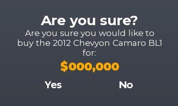</a> <b>Customization</b> › PurchasePrompt</td>
<td width="33%" valign="top"><a href="screenshots/06_MainHUD__StarterCars.jpg">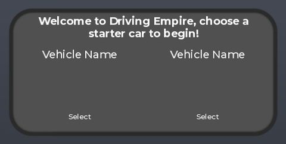</a> <b>MainHUD</b> › StarterCars</td>
<td width="33%" valign="top"><a href="screenshots/09_MainHUD__AreYouSure.jpg">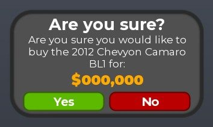</a> <b>MainHUD</b> › Dealership.AreYouSure</td>
</tr>
<tr>
<td width="33%" valign="top"><a href="screenshots/10_MainHUD__Selector.jpg">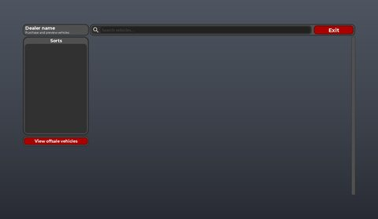</a> <b>MainHUD</b> › Dealership.Selector</td>
<td width="33%" valign="top"><a href="screenshots/12_MainHUD__PromptPurchase.jpg">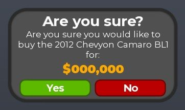</a> <b>MainHUD</b> › PromptPurchase</td>
</tr>
</table>

### Settings & menus

<table>
<tr>
<td width="33%" valign="top"><a href="screenshots/02_Loading__Menu.jpg">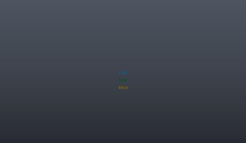</a> <b>Loading</b> › Menu</td>
<td width="33%" valign="top"><a href="screenshots/13_MainHUD__Settings.jpg">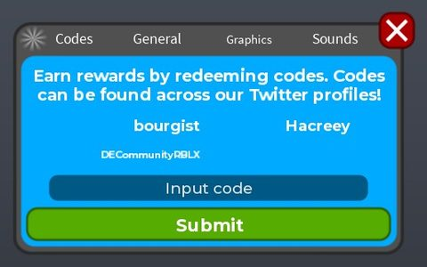</a> <b>MainHUD</b> › Settings</td>
</tr>
</table>

### Popups, notifications, prompts

<table>
<tr>
<td width="33%" valign="top"><a href="screenshots/07_MainHUD__SellPrompt.jpg">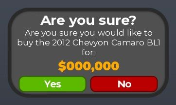</a> <b>MainHUD</b> › SellPrompt</td>
</tr>
</table>

### Loading & intro

<table>
<tr>
<td width="33%" valign="top"> <b>Loading</b></td>
</tr>
</table>

### End of round, death, results

<table>
<tr>
<td width="33%" valign="top"><a href="screenshots/11_MainHUD__RaceEnd.jpg">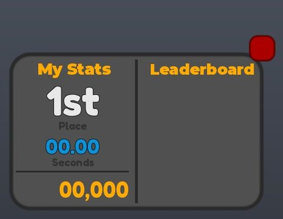</a> <b>MainHUD</b> › RaceEnd</td>
</tr>
</table>

### HUD & currency

<table>
<tr>
<td width="33%" valign="top"><a href="screenshots/04_MainHUD.jpg">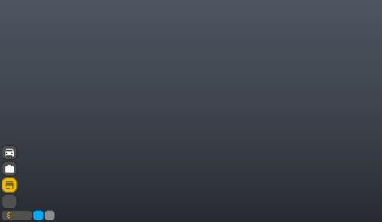</a> <b>MainHUD</b></td>
<td width="33%" valign="top"><a href="screenshots/05_MainHUD__Vehicles.jpg">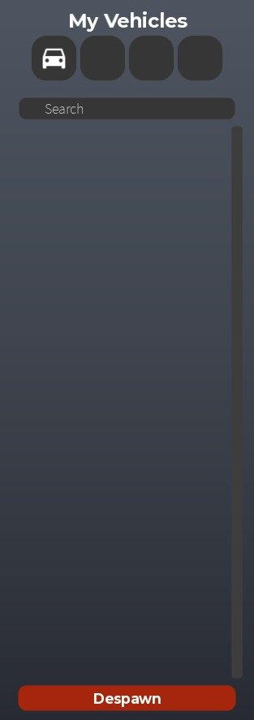</a> <b>MainHUD</b> › Vehicles</td>
<td width="33%" valign="top"><a href="screenshots/08_MainHUD__VehicleRemoved.jpg">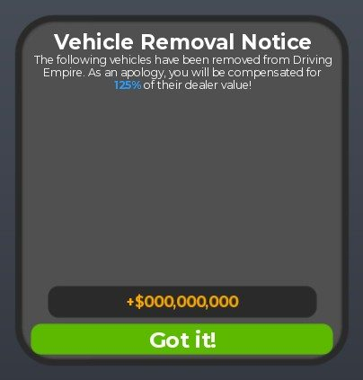</a> <b>MainHUD</b> › VehicleRemoved</td>
</tr>
<tr>
<td width="33%" valign="top"><a href="screenshots/14_MainHUD__Teleport.jpg">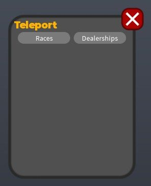</a> <b>MainHUD</b> › Teleport</td>
<td width="33%" valign="top"><a href="screenshots/15_MainHUD__Radio.jpg">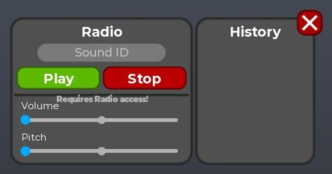</a> <b>MainHUD</b> › Radio</td>
<td width="33%" valign="top"><a href="screenshots/16_MainHUD__Changelog.jpg">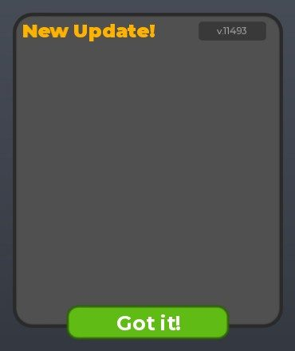</a> <b>MainHUD</b> › Changelog</td>
</tr>
</table>

### Other

<table>
<tr>
<td width="33%" valign="top"><a href="screenshots/17_PhotoMode.jpg">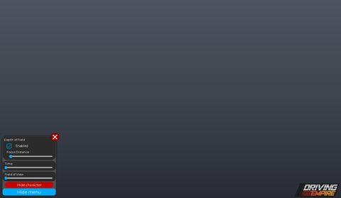</a> <b>PhotoMode</b></td>
<td width="33%" valign="top"><a href="screenshots/18_Special__PayoffBounty.jpg">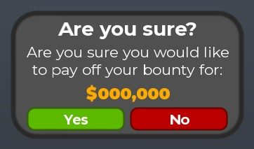</a> <b>Special</b> › PayoffBounty</td>
<td width="33%" valign="top"><a href="screenshots/19_Special__BailPromt.jpg">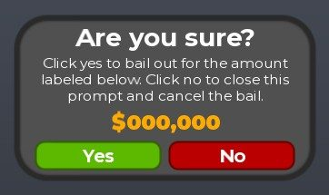</a> <b>Special</b> › BailPromt</td>
</tr>
<tr>
<td width="33%" valign="top"><a href="screenshots/20_Watermark.jpg">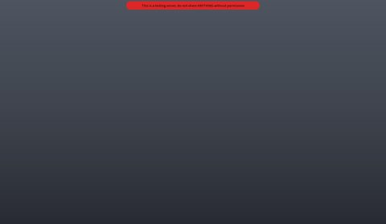</a> <b>Watermark</b></td>
</tr>
</table>

## Model previews

<table>
<tr>
<td width="25%" valign="top"><a href="models/Workspace/Vehicles/BDRoblox6392.rbxm">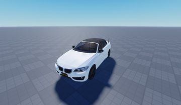</a> <b>BDRoblox6392</b> <code>models/Workspace/Vehicles/BDRoblox6392.rbxm</code></td>
<td width="25%" valign="top"><a href="models/Workspace/Vehicles/Kirilltoy3.rbxm">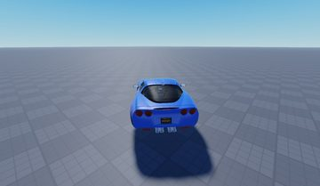</a> <b>Kirilltoy3</b> <code>models/Workspace/Vehicles/Kirilltoy3.rbxm</code></td>
<td width="25%" valign="top"><a href="models/Workspace/Houses/_House_.rbxm">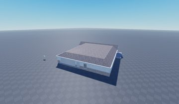</a> <b>_House_</b> <code>models/Workspace/Houses/_House_.rbxm</code></td>
<td width="25%" valign="top"><a href="models/Workspace/Game/TrafficLights/System.rbxm">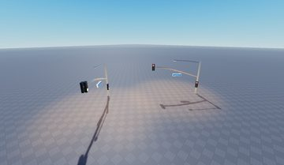</a> <b>System</b> <code>models/Workspace/Game/TrafficLights/System.rbxm</code></td>
</tr>
<tr>
<td width="25%" valign="top"><a href="models/Workspace/Map/Landscaping/Militia%20Rock%206.rbxm">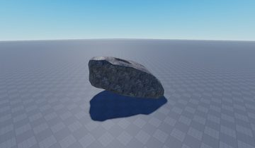</a> <b>Militia Rock 6</b> <code>models/Workspace/Map/Landscaping/Militia Rock 6.rbxm</code></td>
<td width="25%" valign="top"><a href="models/Workspace/drive%20thru%20accessories.rbxm">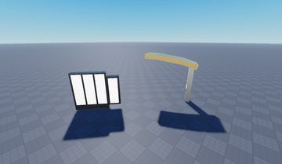</a> <b>drive thru accessories</b> <code>models/Workspace/drive thru accessories.rbxm</code></td>
<td width="25%" valign="top"><a href="models/ReplicatedStorage/Core~13/FL.rbxm">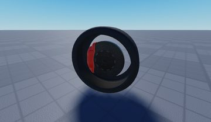</a> <b>FL</b> <code>models/ReplicatedStorage/Core~13/FL.rbxm</code></td>
<td width="25%" valign="top"><a href="models/Workspace/Game/Leaderboards/miles.rbxm">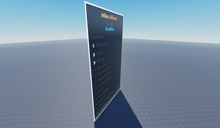</a> <b>miles</b> <code>models/Workspace/Game/Leaderboards/miles.rbxm</code></td>
</tr>
<tr>
<td width="25%" valign="top"><a href="models/Workspace/Cells/Cell5/PrisonCell/Items.rbxm">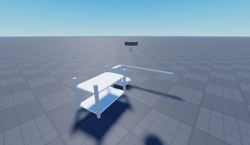</a> <b>Items</b> <code>models/Workspace/Cells/Cell5/PrisonCell/Items.rbxm</code></td>
<td width="25%" valign="top"><a href="models/Workspace/Bush.rbxm">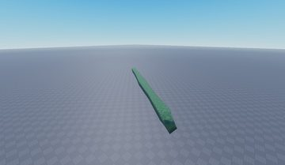</a> <b>Bush</b> <code>models/Workspace/Bush.rbxm</code></td>
<td width="25%" valign="top"><a href="models/Workspace/Vehicles/Ikwilniethoi.rbxm">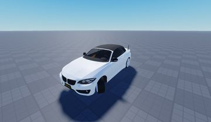</a> <b>Ikwilniethoi</b> <code>models/Workspace/Vehicles/Ikwilniethoi.rbxm</code></td>
<td width="25%" valign="top"><a href="models/Workspace/Vehicles/Klimous_24.rbxm">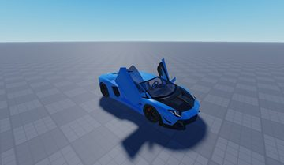</a> <b>Klimous_24</b> <code>models/Workspace/Vehicles/Klimous_24.rbxm</code></td>
</tr>
<tr>
<td width="25%" valign="top"><a href="models/Workspace/Houses/_House_~3.rbxm">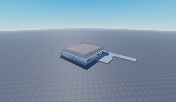</a> <b>_House_~3</b> <code>models/Workspace/Houses/_House_~3.rbxm</code></td>
<td width="25%" valign="top"><a href="models/Workspace/Map/Homes/79.rbxm">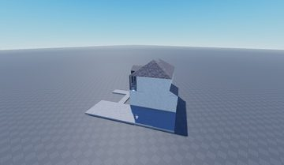</a> <b>79</b> <code>models/Workspace/Map/Homes/79.rbxm</code></td>
</tr>
</table>

## Folders

| Folder | What |
|---|---|
| `screenshots/` | full frames; `crops/` = the panel only; `models/` = 3D previews; `thumbs/` = gallery thumbnails |
| `ui/` | every screen as a Lua builder (`require(module)()` returns the ScreenGui); `_StarterGui-all.lua` builds every StarterGui screen |
| `models/` | every model as .rbxm (the only .rbxm files), mirroring the place tree, scripts removed |
| `map/` | `workspace.rbxm` (the map as a model), `lighting.lua` (sky + post effects), `materials.lua`, `Environment.lua` |
| `animations/`, `audio/` | KeyframeSequence / Sound builders (.lua), `AnimationIds.lua`, `Sounds.lua` |
| `source/` | all scripts as .luau, `tree.txt`, `ui.txt`, `remotes.txt`, `assets.txt`, `flags.txt` |
