# +1 Escape Kitty Keyboard

> 🧗 **Obby** · obby / escape (+1 speed) · source file `+1 escape kitty keyboard (1).rbxl`

[⬅ Back to the catalog](../../README.md) · [Assets inventory](ASSETS.md) · [Style numbers](reference.md) · [Scripts](source/scripts/) · [Code analysis](source/README.md)

## At a glance

| | |
|---|---|
| Provenance | copy of a live game (saveinstance / decompiled client code) |
| Screens | 18 ScreenGuis, 2574 GUI objects → **63 screenshots** |
| Models (.rbxm) | 231 models, 30 model sets, 0 VFX sets |
| Lua builders (.lua) | 55 UI screens, 0 animation packs, 7 audio packs |
| Code | 722 scripts, 70,921 lines |
| Asset ids | 39 animations, 174 sounds |
| Safety scan | 0 HIGH / 4 MED flags ([flags.txt](source/flags.txt)) |

**Fonts:** `Roboto Regular`×299, `Zekton Regular`×272, `GothamSSm Bold`×170, `Roboto Light`×118, `SourceSansPro Regular`×96

## UI screenshots

Captured in Studio from the place's own ScreenGuis (scripts stripped). Each panel was opened on its own; click a thumbnail for the full 1519×886 frame. Runtime-filled lists (shop items, inventories) show their template state.

### Shop & Robux store

<table>
<tr>
<td width="33%" valign="top"><a href="screenshots/05_SpeedGameUI__ShopModal.jpg">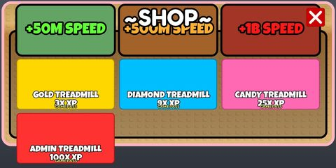</a> <b>SpeedGameUI</b> › ShopModal</td>
<td width="33%" valign="top"><a href="screenshots/36_Store__Store.jpg">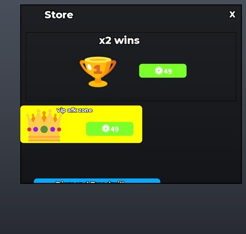</a> <b>Store</b> › Store</td>
<td width="33%" valign="top"><a href="screenshots/67_SpeedGameUI__ShopModal.jpg">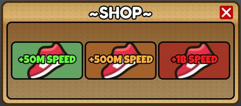</a> <b>SpeedGameUI</b> › ShopModal</td>
</tr>
</table>

### Rewards, daily, spin, codes

<table>
<tr>
<td width="33%" valign="top"><a href="screenshots/64_SpeedGameUI__FreeGiftModal.jpg">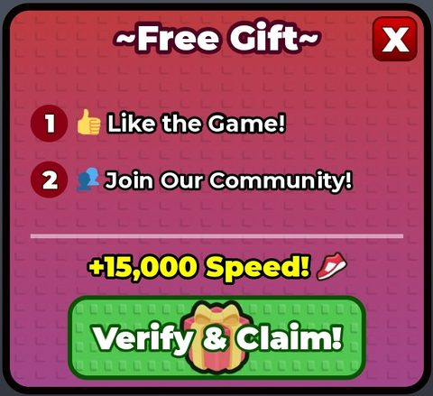</a> <b>SpeedGameUI</b> › FreeGiftModal</td>
</tr>
</table>

### Quests & progression

<table>
<tr>
<td width="33%" valign="top"><a href="screenshots/02_SpeedGameUI__RebirthModal.jpg">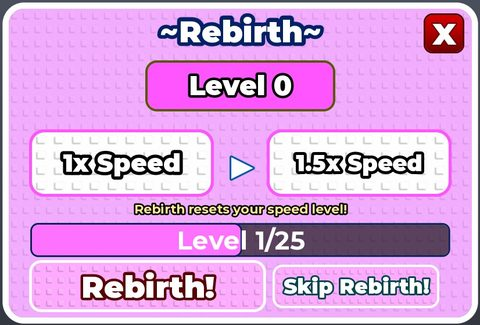</a> <b>SpeedGameUI</b> › RebirthModal</td>
<td width="33%" valign="top"><a href="screenshots/63_SpeedGameUI__RebirthModal.jpg">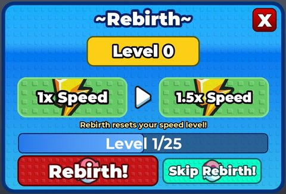</a> <b>SpeedGameUI</b> › RebirthModal</td>
</tr>
</table>

### Settings & menus

<table>
<tr>
<td width="33%" valign="top"><a href="screenshots/17_HDAdminInterface__Template4.jpg">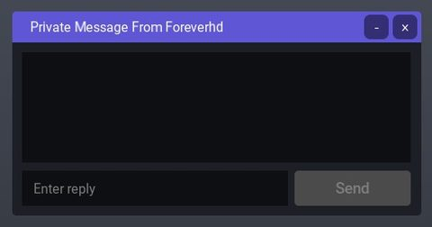</a> <b>HDAdminInterface</b> › MenuTemplates.Template4</td>
<td width="33%" valign="top"><a href="screenshots/18_HDAdminInterface__Template5.jpg">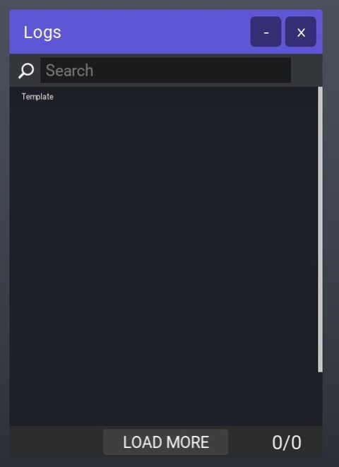</a> <b>HDAdminInterface</b> › MenuTemplates.Template5</td>
<td width="33%" valign="top"><a href="screenshots/19_HDAdminInterface__Template6.jpg">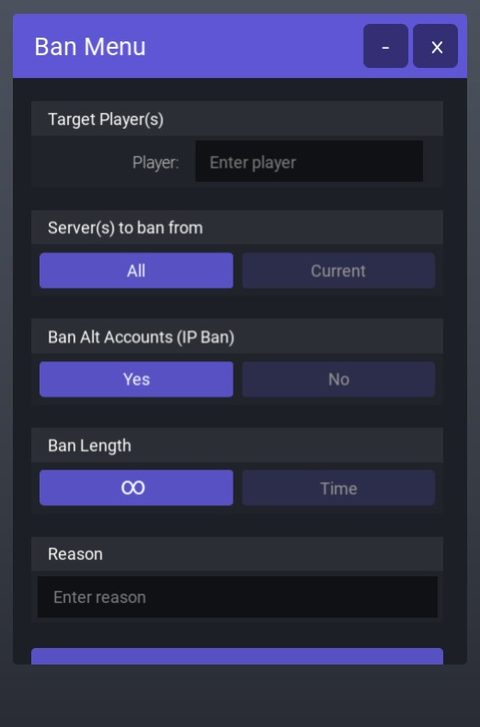</a> <b>HDAdminInterface</b> › MenuTemplates.Template6</td>
</tr>
<tr>
<td width="33%" valign="top"><a href="screenshots/22_HDAdminInterface__Template8.jpg">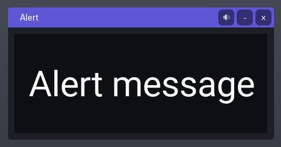</a> <b>HDAdminInterface</b> › MenuTemplates.Template8</td>
<td width="33%" valign="top"><a href="screenshots/25_HDAdminInterface__Template10.jpg">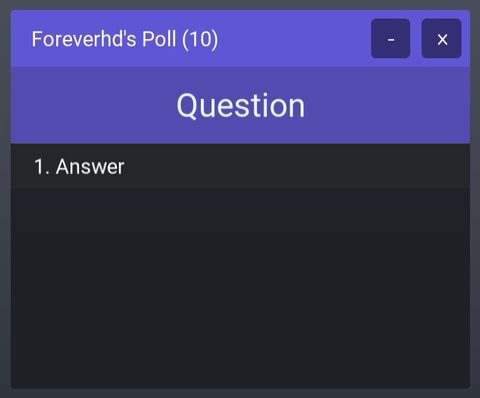</a> <b>HDAdminInterface</b> › MenuTemplates.Template10</td>
<td width="33%" valign="top"><a href="screenshots/26_HDAdminInterface__Template11.jpg">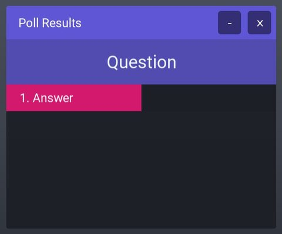</a> <b>HDAdminInterface</b> › MenuTemplates.Template11</td>
</tr>
<tr>
<td width="33%" valign="top"><a href="screenshots/29_HDAdminInterface__Template14.jpg">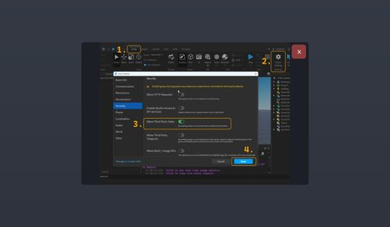</a> <b>HDAdminInterface</b> › MenuTemplates.Template14</td>
<td width="33%" valign="top"><a href="screenshots/30_HDAdminInterface__Template13.jpg">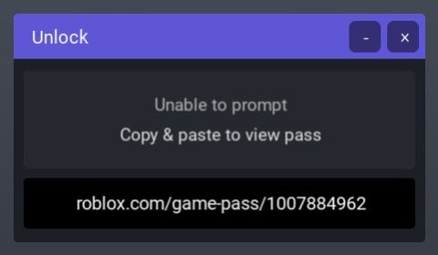</a> <b>HDAdminInterface</b> › MenuTemplates.Template13</td>
<td width="33%" valign="top"><a href="screenshots/31_HDAdminInterface__Template15.jpg">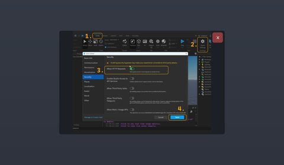</a> <b>HDAdminInterface</b> › MenuTemplates.Template15</td>
</tr>
<tr>
<td width="33%" valign="top"><a href="screenshots/32_HDAdminInterface__Template16.jpg">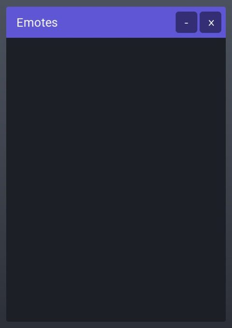</a> <b>HDAdminInterface</b> › MenuTemplates.Template16</td>
<td width="33%" valign="top"><a href="screenshots/33_HDAdminInterface__Template18.jpg">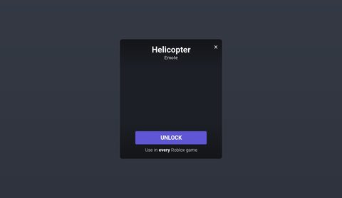</a> <b>HDAdminInterface</b> › MenuTemplates.Template18</td>
<td width="33%" valign="top"><a href="screenshots/79_HDAdminInterface__Template5.jpg">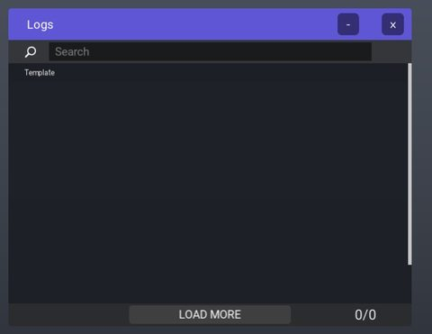</a> <b>HDAdminInterface</b> › MenuTemplates.Template5</td>
</tr>
<tr>
<td width="33%" valign="top"><a href="screenshots/80_HDAdminInterface__Template6.jpg">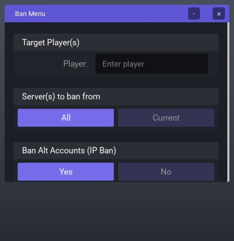</a> <b>HDAdminInterface</b> › MenuTemplates.Template6</td>
<td width="33%" valign="top"><a href="screenshots/86_HDAdminInterface__Template10.jpg">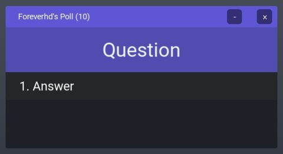</a> <b>HDAdminInterface</b> › MenuTemplates.Template10</td>
<td width="33%" valign="top"><a href="screenshots/87_HDAdminInterface__Template11.jpg">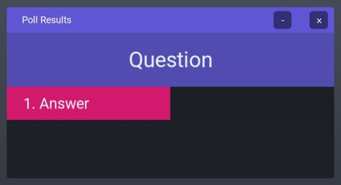</a> <b>HDAdminInterface</b> › MenuTemplates.Template11</td>
</tr>
<tr>
<td width="33%" valign="top"><a href="screenshots/93_HDAdminInterface__Template16.jpg">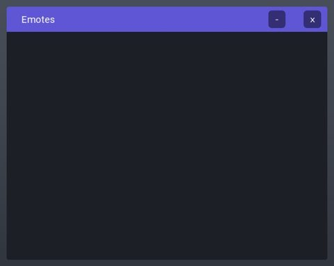</a> <b>HDAdminInterface</b> › MenuTemplates.Template16</td>
<td width="33%" valign="top"><a href="screenshots/94_HDAdminInterface__Template18.jpg">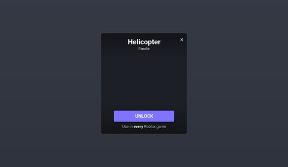</a> <b>HDAdminInterface</b> › MenuTemplates.Template18</td>
</tr>
</table>

### Popups, notifications, prompts

<table>
<tr>
<td width="33%" valign="top"><a href="screenshots/10_CheatWarningGui__Frame.jpg">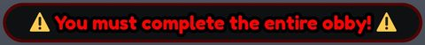</a> <b>CheatWarningGui</b> › Frame</td>
<td width="33%" valign="top"><a href="screenshots/11_MessageToPlayer.jpg">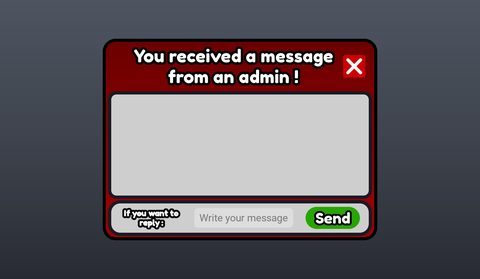</a> <b>MessageToPlayer</b></td>
<td width="33%" valign="top"><a href="screenshots/15_HDAdminInterface__Message.jpg">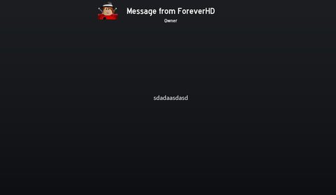</a> <b>HDAdminInterface</b> › Templates.Message</td>
</tr>
<tr>
<td width="33%" valign="top"><a href="screenshots/16_HDAdminInterface__GlobalAnnouncement.jpg">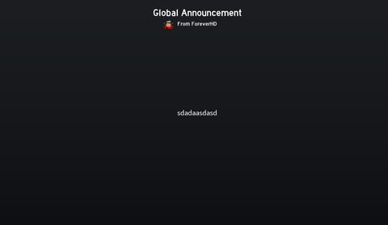</a> <b>HDAdminInterface</b> › Templates.GlobalAnnouncement</td>
<td width="33%" valign="top"><a href="screenshots/35_HDAdminInterface__Warnings.jpg">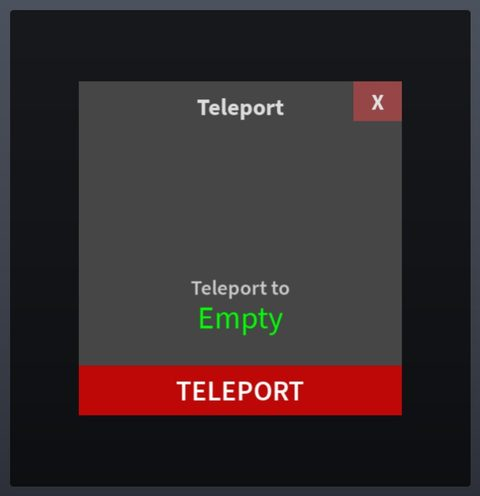</a> <b>HDAdminInterface</b> › MainFrame.Warnings</td>
<td width="33%" valign="top"> <b>CheatWarningGui</b> › Frame</td>
</tr>
<tr>
<td width="33%" valign="top"><a href="screenshots/96_HDAdminInterface__Warnings.jpg">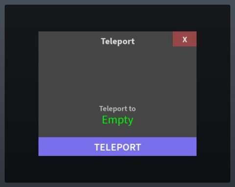</a> <b>HDAdminInterface</b> › MainFrame.Warnings</td>
</tr>
</table>

### Leaderboards & stats

<table>
<tr>
<td width="33%" valign="top"> <b>TopbarStandard</b></td>
</tr>
</table>

### End of round, death, results

<table>
<tr>
<td width="33%" valign="top"><a href="screenshots/21_HDAdminInterface__FinalResult.jpg">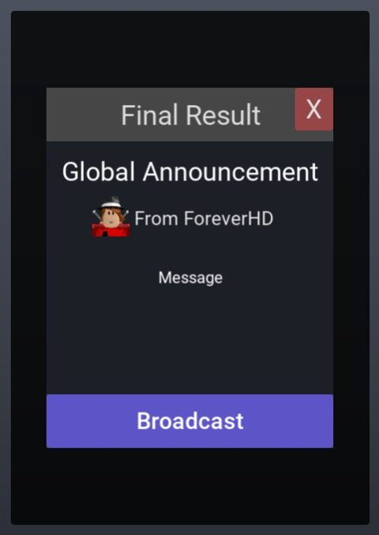</a> <b>HDAdminInterface</b> › MenuTemplates.Template7.FinalResult</td>
<td width="33%" valign="top"><a href="screenshots/24_HDAdminInterface__FinalResult.jpg">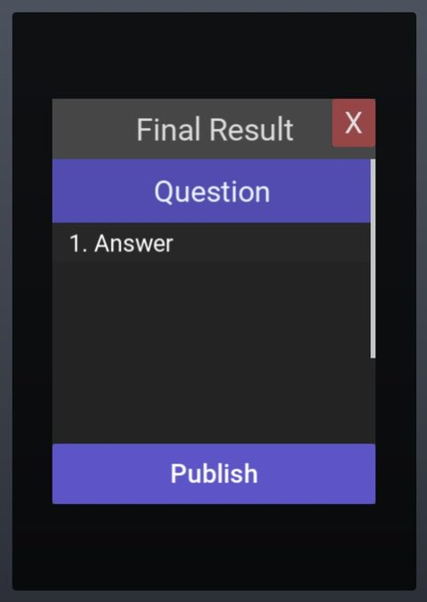</a> <b>HDAdminInterface</b> › MenuTemplates.Template9.FinalResult</td>
<td width="33%" valign="top"><a href="screenshots/28_HDAdminInterface__FinalResult.jpg">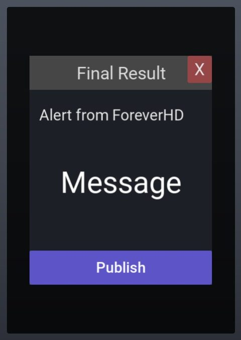</a> <b>HDAdminInterface</b> › MenuTemplates.Template12.FinalResult</td>
</tr>
<tr>
<td width="33%" valign="top"><a href="screenshots/82_HDAdminInterface__FinalResult.jpg">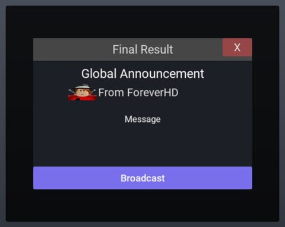</a> <b>HDAdminInterface</b> › MenuTemplates.Template7.FinalResult</td>
<td width="33%" valign="top"><a href="screenshots/85_HDAdminInterface__FinalResult.jpg">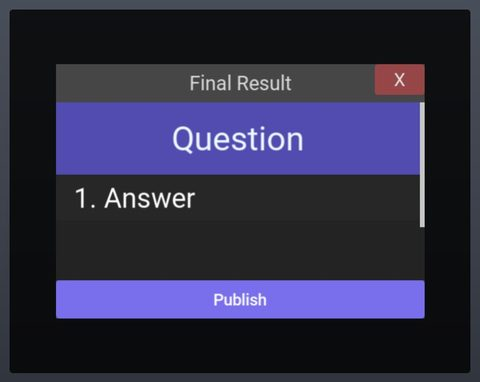</a> <b>HDAdminInterface</b> › MenuTemplates.Template9.FinalResult</td>
<td width="33%" valign="top"><a href="screenshots/89_HDAdminInterface__FinalResult.jpg">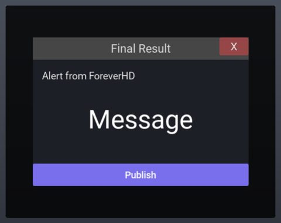</a> <b>HDAdminInterface</b> › MenuTemplates.Template12.FinalResult</td>
</tr>
</table>

### Admin panels

<table>
<tr>
<td width="33%" valign="top"> <b>HDAdminInterface</b> › Notices</td>
<td width="33%" valign="top"><a href="screenshots/14_HDAdminInterface__CmdBar.jpg">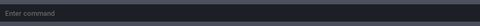</a> <b>HDAdminInterface</b> › CmdBar</td>
<td width="33%" valign="top"><a href="screenshots/34_HDAdminInterface__Pages.jpg">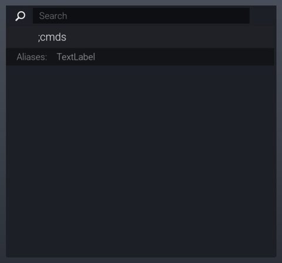</a> <b>HDAdminInterface</b> › MainFrame.Pages</td>
</tr>
<tr>
<td width="33%" valign="top"><a href="screenshots/74_AdminAbuseGui.jpg">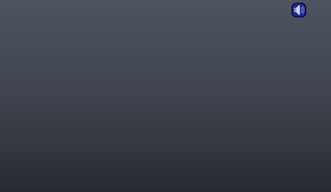</a> <b>AdminAbuseGui</b></td>
<td width="33%" valign="top"><a href="screenshots/95_HDAdminInterface__Pages.jpg">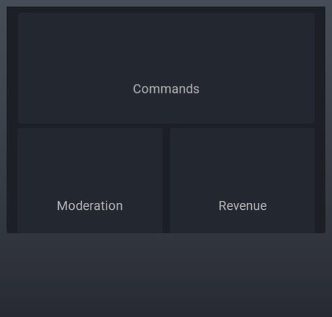</a> <b>HDAdminInterface</b> › MainFrame.Pages</td>
</tr>
</table>

### HUD & currency

<table>
<tr>
<td width="33%" valign="top"><a href="screenshots/06_SpeedGameUI__EventCurrencyModal.jpg">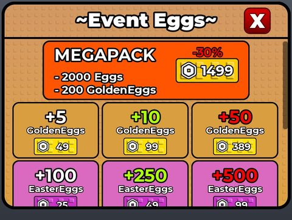</a> <b>SpeedGameUI</b> › EventCurrencyModal</td>
<td width="33%" valign="top"><a href="screenshots/20_HDAdminInterface__MainFrame.jpg">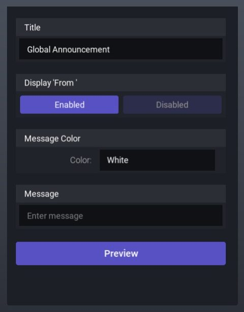</a> <b>HDAdminInterface</b> › MenuTemplates.Template7.MainFrame</td>
<td width="33%" valign="top"><a href="screenshots/23_HDAdminInterface__MainFrame.jpg">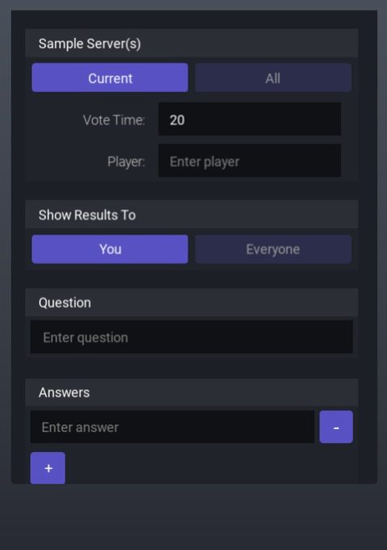</a> <b>HDAdminInterface</b> › MenuTemplates.Template9.MainFrame</td>
</tr>
<tr>
<td width="33%" valign="top"><a href="screenshots/27_HDAdminInterface__MainFrame.jpg">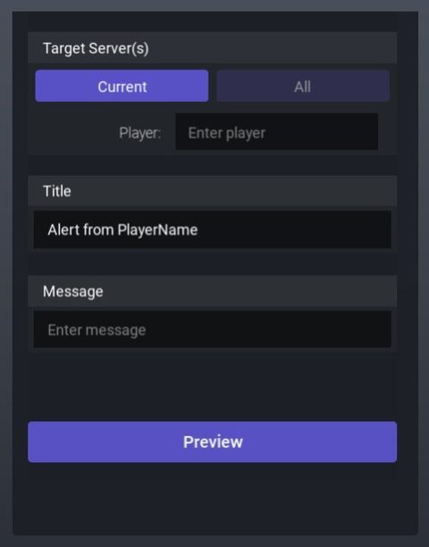</a> <b>HDAdminInterface</b> › MenuTemplates.Template12.MainFrame</td>
<td width="33%" valign="top"><a href="screenshots/68_SpeedGameUI__EventCurrencyModal.jpg">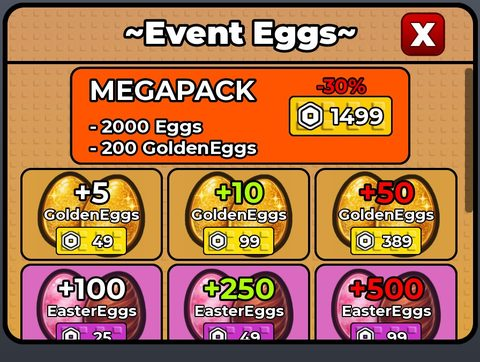</a> <b>SpeedGameUI</b> › EventCurrencyModal</td>
<td width="33%" valign="top"><a href="screenshots/81_HDAdminInterface__MainFrame.jpg">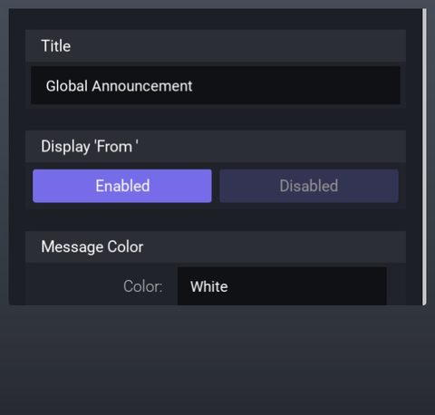</a> <b>HDAdminInterface</b> › MenuTemplates.Template7.MainFrame</td>
</tr>
<tr>
<td width="33%" valign="top"><a href="screenshots/84_HDAdminInterface__MainFrame.jpg">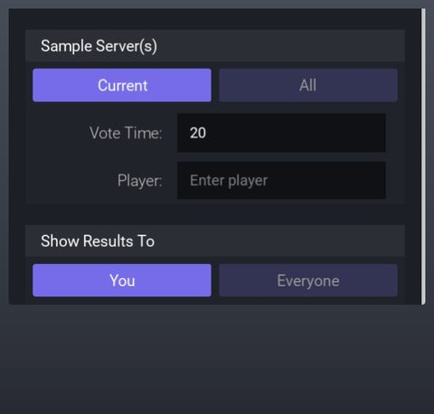</a> <b>HDAdminInterface</b> › MenuTemplates.Template9.MainFrame</td>
<td width="33%" valign="top"><a href="screenshots/88_HDAdminInterface__MainFrame.jpg">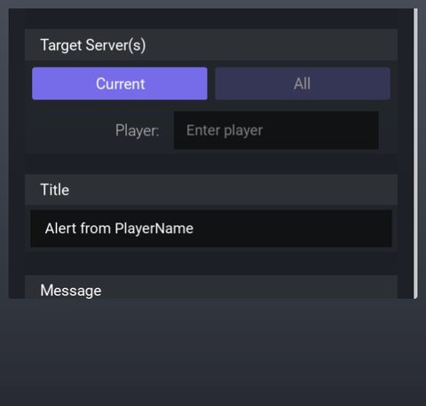</a> <b>HDAdminInterface</b> › MenuTemplates.Template12.MainFrame</td>
</tr>
</table>

### Other

<table>
<tr>
<td width="33%" valign="top"><a href="screenshots/01_SpeedGameUI.jpg">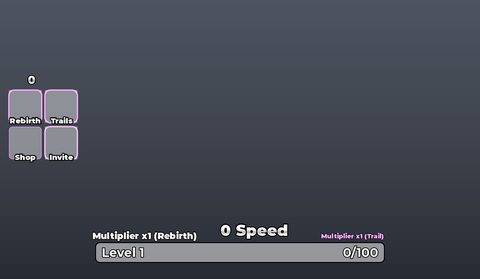</a> <b>SpeedGameUI</b></td>
<td width="33%" valign="top"><a href="screenshots/03_SpeedGameUI__KeySoundModal.jpg">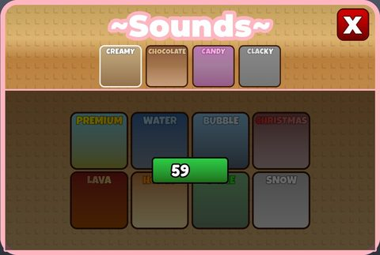</a> <b>SpeedGameUI</b> › KeySoundModal</td>
<td width="33%" valign="top"><a href="screenshots/04_SpeedGameUI__CheckpointModal.jpg">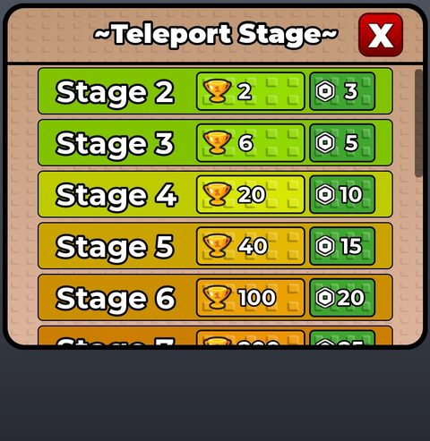</a> <b>SpeedGameUI</b> › CheckpointModal</td>
</tr>
<tr>
<td width="33%" valign="top"> <b>SpeedGameUI</b> › TikfinityModal</td>
<td width="33%" valign="top"> <b>SpeedGameUI</b> › TrailsModal</td>
<td width="33%" valign="top"> <b>SpeedGameUI</b> › InviteModal</td>
</tr>
<tr>
<td width="33%" valign="top"> <b>SocialVerifyGui</b></td>
<td width="33%" valign="top"> <b>SecretGuard</b></td>
<td width="33%" valign="top"> <b>SpeedGameUI</b></td>
</tr>
<tr>
<td width="33%" valign="top"> <b>SpeedGameUI</b> › KeySoundModal</td>
<td width="33%" valign="top"> <b>SpeedGameUI</b> › CheckpointModal</td>
<td width="33%" valign="top"> <b>SpeedGameUI</b> › TrailsModal</td>
</tr>
<tr>
<td width="33%" valign="top"> <b>SocialVerifyGui</b></td>
</tr>
</table>

## Model previews

<table>
<tr>
<td width="25%" valign="top"> <b>NPC12</b> <code>models/ReplicatedStorage/NPC12.rbxm</code></td>
<td width="25%" valign="top"> <b>keycap_K__x96</b> <code>models/Workspace/keycap_K__x96.rbxm</code></td>
<td width="25%" valign="top"> <b>copertura estiva</b> <code>models/ReplicatedStorage/ConcertShakira/copertura estiva.rbxm</code></td>
<td width="25%" valign="top"> <b>GoldenEasterEgg</b> <code>models/ReplicatedStorage/Templates/GoldenEggs/GoldenEasterEgg.rbxm</code></td>
</tr>
<tr>
<td width="25%" valign="top"> <b>WinsLeaderboard</b> <code>models/Workspace/Leaderboards/WinsLeaderboard.rbxm</code></td>
<td width="25%" valign="top"> <b>TreadmillAdmin</b> <code>models/Workspace/Treadmill/TreadmillAdmin.rbxm</code></td>
<td width="25%" valign="top"> <b>Trophyx2</b> <code>models/Workspace/Structure/Stage0_HUB/Trophyx2.rbxm</code></td>
<td width="25%" valign="top"> <b>Model__x23</b> <code>models/ReplicatedStorage/ConcertShakira/Model__x23.rbxm</code></td>
</tr>
<tr>
<td width="25%" valign="top"> <b>keycap_E__x66</b> <code>models/Workspace/keycap_E__x66.rbxm</code></td>
<td width="25%" valign="top"> <b>Bridge1</b> <code>models/Workspace/Bridge1.rbxm</code></td>
<td width="25%" valign="top"> <b>EasterEggChoco</b> <code>models/ReplicatedStorage/Templates/Eggs/EasterEggChoco.rbxm</code></td>
<td width="25%" valign="top"> <b>SpeedLeaderboard</b> <code>models/Workspace/Leaderboards/SpeedLeaderboard.rbxm</code></td>
</tr>
</table>

## Notable scripts

Top-scored scripts of this game per topic (full tree in [source/scripts](source/scripts/)).

| Topic | Scripts |
|---|---|
| UI animation (tweens, hover / click, pop-ins, springs) | [`AdminPanelClient`](source/scripts/StarterPlayer/StarterPlayerScripts/AdminPanelClient.client.lua) 861 lines [`NotificationSystem`](source/scripts/ReplicatedStorage/NotificationSystem.lua) 551 lines [`EggRainClient`](source/scripts/ReplicatedStorage/EggRainClient.lua) 1501 lines [`LokiiBossRoom`](source/scripts/ReplicatedStorage/AdminAbuse/Modules/LokiiBossRoom.lua) 992 lines [`Notices`](source/scripts/ReplicatedStorage/HDAdminHDClient/Modules/Notices.lua) 270 lines |
| UI controllers / window managers / menus | [`AdminPanelClient`](source/scripts/StarterPlayer/StarterPlayerScripts/AdminPanelClient.client.lua) 861 lines [`Leaderboardpanelclient`](source/scripts/StarterPlayer/StarterPlayerScripts/Leaderboardpanelclient.client.lua) 437 lines [`GUIs`](source/scripts/ReplicatedStorage/HDAdminHDClient/Modules/GUIs.lua) 655 lines [`Container`](source/scripts/ReplicatedStorage/HDAdminHDClient/Assets/Icon/Elements/Container.lua) 210 lines [`AdminAbuseGui`](source/scripts/LocalPlayer/PlayerScripts/Client/AdminAbuseGui.lua) 447 lines |
| Notifications, toasts, popups, prompts | [`NotificationSystem`](source/scripts/ReplicatedStorage/NotificationSystem.lua) 551 lines [`AdminAnnounceClient`](source/scripts/StarterPlayer/StarterPlayerScripts/AdminAnnounceClient.client.lua) 145 lines [`Messages`](source/scripts/ReplicatedStorage/HDAdminHDClient/Modules/Messages.lua) 169 lines [`MessageToPlayerScript`](source/scripts/StarterGui/MessageToPlayer/MessageToPlayerScript.client.lua) 62 lines [`AdminPanelClient`](source/scripts/StarterPlayer/StarterPlayerScripts/AdminPanelClient.client.lua) 861 lines |
| Loading / intro screens | [`EggRainClient`](source/scripts/ReplicatedStorage/EggRainClient.lua) 1501 lines |
| Camera, cutscenes, screen shake | [`AdminAbuseTransition`](source/scripts/LocalPlayer/PlayerScripts/Client/AdminAbuseTransition.lua) 370 lines [`AdminAbuseTransition`](source/scripts/StarterPlayer/StarterPlayerScripts/Client/AdminAbuseTransition.lua) 372 lines [`LokiiBossRoom`](source/scripts/ReplicatedStorage/AdminAbuse/Modules/LokiiBossRoom.lua) 992 lines [`AdminAbuseTransition`](source/scripts/Players/LocalPlayer/PlayerScripts/Client/AdminAbuseTransition.lua) 372 lines [`EggRainClient`](source/scripts/ReplicatedStorage/EggRainClient.lua) 1501 lines |
| VFX, particles, beams, hit effects | [`AdminPanelClient`](source/scripts/StarterPlayer/StarterPlayerScripts/AdminPanelClient.client.lua) 861 lines [`LokiiBossRoom`](source/scripts/ReplicatedStorage/AdminAbuse/Modules/LokiiBossRoom.lua) 992 lines |
| DataStore / player data | [`DataHandler`](source/scripts/ServerScriptService/DataService/DataHandler.lua) 218 lines |
| Monetization (dev products, game passes, receipts) | [`TreadmillGamepassHandler`](source/scripts/ServerScriptService/TreadmillGamepassHandler.server.lua) 185 lines [`GamepassHandler`](source/scripts/Workspace/GamepassHandler.server.lua) 59 lines [`RemoteHandler`](source/scripts/ServerScriptService/Game/Core/RemoteHandler.server.lua) 576 lines [`TrophyX2Handler`](source/scripts/ServerScriptService/Game/Core/TrophyX2Handler.server.lua) 107 lines [`ProductHandler`](source/scripts/ServerScriptService/Game/Core/ProductHandler.server.lua) 65 lines |
| RNG, eggs, gacha, rarity rolls, pets | [`EggRainClient`](source/scripts/ReplicatedStorage/EggRainClient.lua) 1501 lines |
| Combat, weapons, hitboxes, abilities | [`KeySystem v6`](source/scripts/StarterPlayer/StarterPlayerScripts/Key/KeySystem%20v6.client.lua) 148 lines [`KeySystem v7 by Sano`](source/scripts/StarterPlayer/StarterPlayerScripts/Key/KeySystem%20v7%20by%20Sano.client.lua) 146 lines [`TreadmillSystem`](source/scripts/StarterPlayer/StarterPlayerScripts/v3/TreadmillSystem.client.lua) 168 lines [`KeySystem v6`](source/scripts/LocalPlayer/PlayerScripts/Key/KeySystem%20v6.client.lua) 148 lines [`KeySystem v7 by Sano`](source/scripts/LocalPlayer/PlayerScripts/Key/KeySystem%20v7%20by%20Sano.client.lua) 146 lines |
| NPC / AI / monsters | [`LocalNPC12_AI`](source/scripts/StarterPlayer/StarterPlayerScripts/Pi%C3%A8ges/LocalNPC12_AI.client.lua) 491 lines [`LocalNPC15_AI`](source/scripts/StarterPlayer/StarterPlayerScripts/Pi%C3%A8ges/LocalNPC15_AI.client.lua) 737 lines [`LocalNPC12_AI`](source/scripts/LocalPlayer/PlayerScripts/Pi%C3%A8ges/LocalNPC12_AI.client.lua) 491 lines [`LocalNPC15_AI`](source/scripts/LocalPlayer/PlayerScripts/Pi%C3%A8ges/LocalNPC15_AI.client.lua) 737 lines [`LocalNPC10_AI`](source/scripts/StarterPlayer/StarterPlayerScripts/Pi%C3%A8ges/LocalNPC10_AI.client.lua) 145 lines |
| Character movement (sprint, dash, double jump, slide) | [`AdminAbuseConfig`](source/scripts/ReplicatedStorage/Shared/AdminAbuseConfig.lua) 59 lines [`LocalNPC10_AI`](source/scripts/StarterPlayer/StarterPlayerScripts/Pi%C3%A8ges/LocalNPC10_AI.client.lua) 145 lines [`Jump`](source/scripts/ReplicatedStorage/TikfinityModules/Jump.lua) 39 lines [`LokiiBossRoom`](source/scripts/ReplicatedStorage/AdminAbuse/Modules/LokiiBossRoom.lua) 992 lines [`NoBugJumpMobile`](source/scripts/StarterPlayer/StarterCharacterScripts/NoBugJumpMobile.client.lua) 22 lines |
| Tycoon / plots / bases / building | [`TreadmillBuyPanel`](source/scripts/StarterPlayer/StarterPlayerScripts/TreadmillBuyPanel.client.lua) 258 lines [`UIHandler`](source/scripts/StarterPlayer/StarterPlayerScripts/v3/UIHandler.client.lua) 615 lines [`EggRainClient`](source/scripts/ReplicatedStorage/EggRainClient.lua) 1501 lines [`UIHandler`](source/scripts/LocalPlayer/PlayerScripts/v3/UIHandler.client.lua) 496 lines |
| Leaderboards & stats | [`LeaderstatsHandler`](source/scripts/ServerScriptService/Game/Core/LeaderstatsHandler.server.lua) 80 lines |
| Admin panels & commands | [`AdminPanelServer`](source/scripts/ServerScriptService/AdminPanelServer.server.lua) 430 lines [`AdminPanelClient`](source/scripts/StarterPlayer/StarterPlayerScripts/AdminPanelClient.client.lua) 861 lines [`CmdBar`](source/scripts/ReplicatedStorage/HDAdminHDClient/Modules/CmdBar.lua) 525 lines [`PageCommands`](source/scripts/ReplicatedStorage/HDAdminHDClient/Modules/GUIs/PageCommands.lua) 794 lines [`AdminPanel`](source/scripts/StarterGui/AdminPanel.client.lua) 416 lines |
| Sound & music | [`KeycapSoundManager`](source/scripts/StarterPlayer/StarterPlayerScripts/KeycapSoundManager.client.lua) 69 lines [`SoundManager`](source/scripts/ReplicatedStorage/SoundManager.lua) 47 lines [`KeycapSoundScript`](source/scripts/ServerScriptService/KeycapSoundScript.server.lua) 59 lines [`KeycapAnimation`](source/scripts/StarterPlayer/StarterPlayerScripts/KeycapAnimation.client.lua) 145 lines |
| Daily rewards, quests, codes, playtime | [`SocialCodeClient`](source/scripts/StarterPlayer/StarterPlayerScripts/SocialCode/SocialCodeClient.client.lua) 184 lines |
| Utility modules (number format, signals, tables, timers) | [`Utility`](source/scripts/ReplicatedStorage/HDAdminHDClient/Assets/Icon/Utility.lua) 590 lines [`PageCommands`](source/scripts/ReplicatedStorage/HDAdminHDClient/Modules/GUIs/PageCommands.lua) 794 lines [`MainFramework`](source/scripts/ReplicatedStorage/HDAdminHDClient/SharedModules/MainFramework.lua) 415 lines [`BundleUtility`](source/scripts/ReplicatedStorage/HDAdminHDClient/SharedModules/BundleUtility.lua) 286 lines [`NextEventTimerSystem`](source/scripts/ReplicatedStorage/NextEventTimerSystem.lua) 192 lines |

### In the curated script library

- [Panel server: kick/ban/freeze/troll](../../Scripts/16-Admin/AdminPanelServer-Moderation__escape-kitty-keyboard.lua) — Remote functions for an admin panel: player list, kick, DataStore ban/unban checked on join, freeze that survives respawn, fun actions (ragdoll, spin, invisible, spectate), per-admin cooldown.
- [Ordered stores fed from the save + backfill](../../Scripts/15-Leaderboards/DataHandler-OrderedStoreBackfill__escape-kitty-keyboard.lua) — Writes Wins/XP/Rebirths to ordered stores on every save (math.floor to avoid ValueNotNumeric), a faster ordered-store-only update, and a one-time backfill of known players' saved data.
- [Touch-triggered click sounds](../../Scripts/17-Sound-Music/KeycapTouchSound__escape-kitty-keyboard.lua) — Plays a click when any character part touches a keycap part, with a per-part debounce and random pitch so repeated clicks sound natural. Uses one shared Sound in SoundService.

## Folders

| Folder | What |
|---|---|
| `screenshots/` | full frames; `crops/` = the panel only; `models/` = 3D previews; `thumbs/` = gallery thumbnails |
| `ui/` | every screen as a Lua builder (`require(module)()` returns the ScreenGui); `_StarterGui-all.lua` builds every StarterGui screen |
| `models/` | every model as .rbxm (the only .rbxm files), mirroring the place tree, scripts removed |
| `map/` | `workspace.rbxm` (the map as a model), `lighting.lua` (sky + post effects), `materials.lua`, `Environment.lua` |
| `animations/`, `audio/` | KeyframeSequence / Sound builders (.lua), `AnimationIds.lua`, `Sounds.lua` |
| `source/` | all scripts as .luau, `tree.txt`, `ui.txt`, `remotes.txt`, `assets.txt`, `flags.txt` |
