# "Evade" (brainrot game)

> 🧠 **Brainrot** · steal / tycoon (brainrots, lucky blocks; file named Evade) · source file `Evade_New-UPD.rbxl`

[⬅ Back to the catalog](../../README.md) · [Assets inventory](ASSETS.md) · [Style numbers](reference.md) · [Scripts](source/scripts/) · [Code analysis](source/README.md)

## At a glance

| | |
|---|---|
| Provenance | copy of a live game (saveinstance / decompiled client code) |
| Screens | 40 ScreenGuis, 2138 GUI objects → **76 screenshots** |
| Models (.rbxm) | 5340 models, 167 model sets, 13 VFX sets |
| Lua builders (.lua) | 103 UI screens, 355 animation packs, 45 audio packs |
| Code | 1551 scripts, 171,423 lines |
| Asset ids | 877 animations, 780 sounds |
| Safety scan | 272 HIGH / 45 MED flags ([flags.txt](source/flags.txt)) |

**Fonts:** `GothamSSm ExtraBold`×391, `SourceSansPro Bold`×192, `GothamSSm Bold`×131, `FredokaOne Regular`×97, `GothamSSm Heavy`×73

## UI screenshots

Captured in Studio from the place's own ScreenGuis (scripts stripped). Each panel was opened on its own; click a thumbnail for the full 1519×886 frame. Runtime-filled lists (shop items, inventories) show their template state.

### Shop & Robux store

<table>
<tr>
<td width="33%" valign="top"><a href="screenshots/04_Shop__Shop.jpg">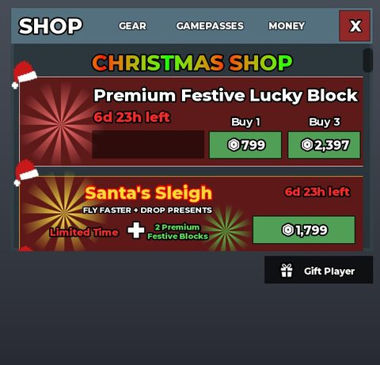</a> <b>Shop</b> › Shop</td>
<td width="33%" valign="top"><a href="screenshots/07_CoinsShop__CoinsShop.jpg">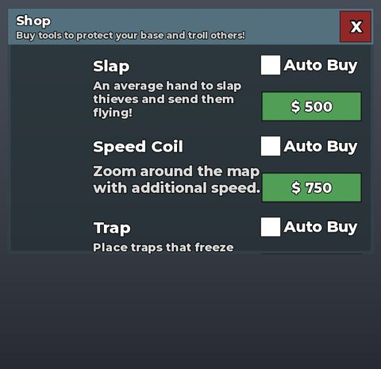</a> <b>CoinsShop</b> › CoinsShop</td>
<td width="33%" valign="top"><a href="screenshots/19_RodsShop__RodsShop.jpg">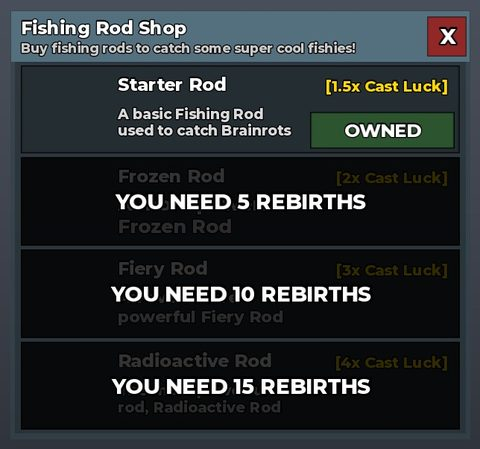</a> <b>RodsShop</b> › RodsShop</td>
</tr>
<tr>
<td width="33%" valign="top"><a href="screenshots/25_SantaMerchant__SantaMerchant.jpg">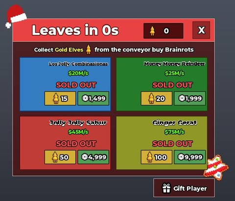</a> <b>SantaMerchant</b> › SantaMerchant</td>
<td width="33%" valign="top"><a href="screenshots/26_Merchant__Merchant.jpg">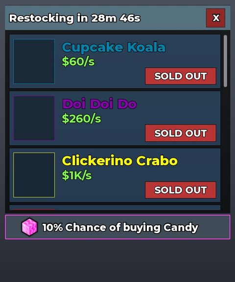</a> <b>Merchant</b> › Merchant</td>
<td width="33%" valign="top"><a href="screenshots/34_CoinsShop__CoinsShop.jpg">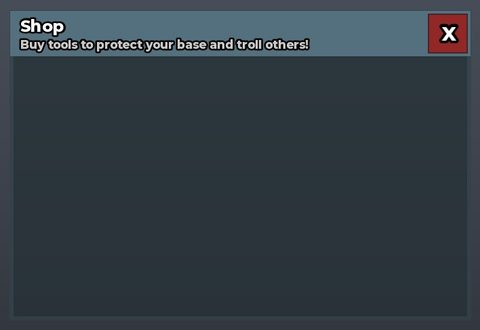</a> <b>CoinsShop</b> › CoinsShop</td>
</tr>
<tr>
<td width="33%" valign="top"><a href="screenshots/36_SantaMerchant__SantaMerchant.jpg">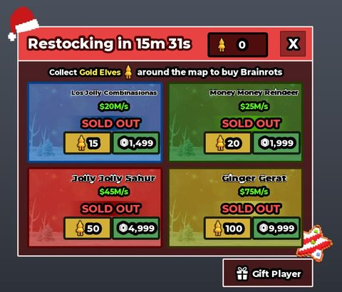</a> <b>SantaMerchant</b> › SantaMerchant</td>
<td width="33%" valign="top"><a href="screenshots/52_RodsShop__RodsShop.jpg">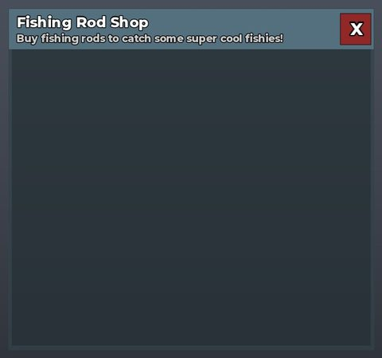</a> <b>RodsShop</b> › RodsShop</td>
<td width="33%" valign="top"><a href="screenshots/58_Shop__Shop.jpg">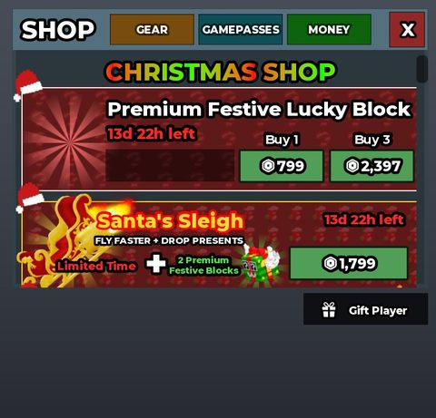</a> <b>Shop</b> › Shop</td>
</tr>
<tr>
<td width="33%" valign="top"><a href="screenshots/62_FakePurchases__Shop.jpg">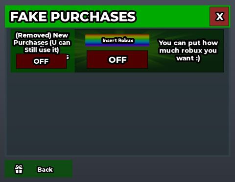</a> <b>FakePurchases</b> › Shop</td>
<td width="33%" valign="top"><a href="screenshots/66_FakePurchases__RobuxButton.jpg">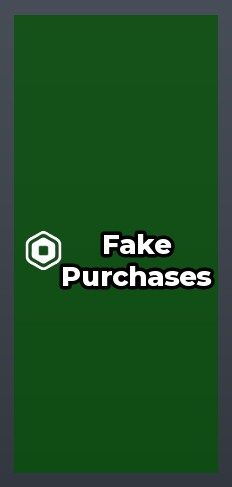</a> <b>FakePurchases</b> › Shop.RobuxButton</td>
<td width="33%" valign="top"><a href="screenshots/67_FakePurchases__Content.jpg">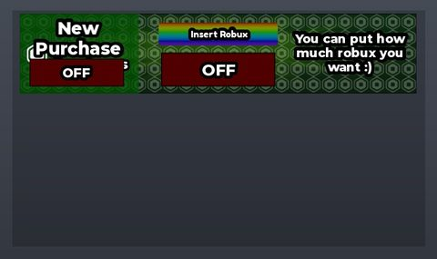</a> <b>FakePurchases</b> › Shop.Content</td>
</tr>
</table>

### Inventory / backpack / pets

<table>
<tr>
<td width="33%" valign="top"><a href="screenshots/13_BackpackGui.jpg">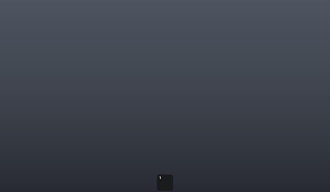</a> <b>BackpackGui</b></td>
<td width="33%" valign="top"><a href="screenshots/14_BackpackGui__Inventory.jpg">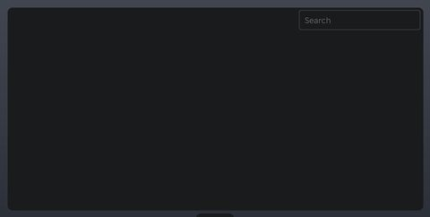</a> <b>BackpackGui</b> › Backpack.Inventory</td>
</tr>
</table>

### Rewards, daily, spin, codes

<table>
<tr>
<td width="33%" valign="top"><a href="screenshots/09_GiftPlayer__GiftPlayer_.jpg">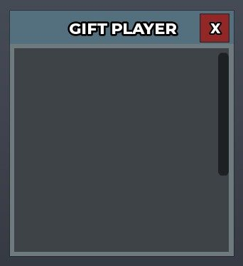</a> <b>GiftPlayer</b> › GiftPlayer_</td>
<td width="33%" valign="top"><a href="screenshots/10_GiftPlayer__GiftPlayer.jpg">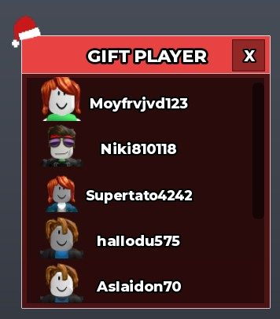</a> <b>GiftPlayer</b> › GiftPlayer</td>
<td width="33%" valign="top"><a href="screenshots/21_AdventCalendar__Frame.jpg">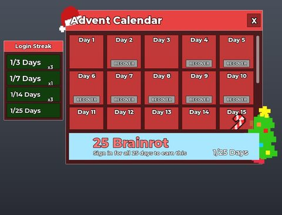</a> <b>AdventCalendar</b> › Frame</td>
</tr>
<tr>
<td width="33%" valign="top"><a href="screenshots/32_AdventCalendar__Frame.jpg">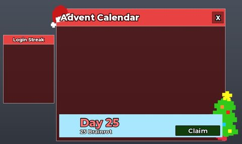</a> <b>AdventCalendar</b> › Frame</td>
<td width="33%" valign="top"><a href="screenshots/35_GiftPlayer__GiftPlayer.jpg">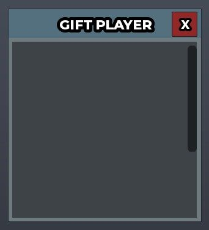</a> <b>GiftPlayer</b> › GiftPlayer</td>
<td width="33%" valign="top"><a href="screenshots/38_GalaxyWheel__Wheel.jpg">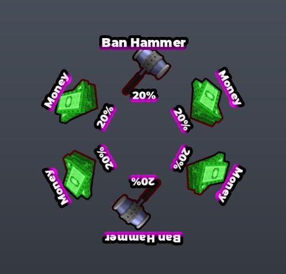</a> <b>GalaxyWheel</b> › Wheel</td>
</tr>
<tr>
<td width="33%" valign="top"><a href="screenshots/39_GalaxyWheel__Buttons.jpg">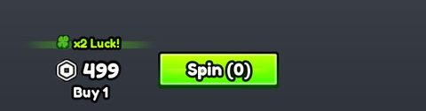</a> <b>GalaxyWheel</b> › Buttons</td>
<td width="33%" valign="top"><a href="screenshots/47_YinYangWheel__Wheel.jpg">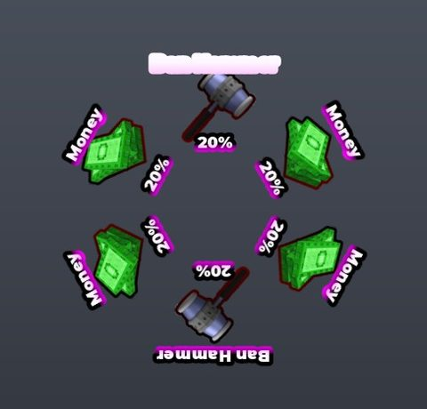</a> <b>YinYangWheel</b> › Wheel</td>
<td width="33%" valign="top"><a href="screenshots/48_YinYangWheel__Buttons.jpg">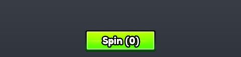</a> <b>YinYangWheel</b> › Buttons</td>
</tr>
<tr>
<td width="33%" valign="top"><a href="screenshots/50_RadioactiveWheel__Buttons.jpg">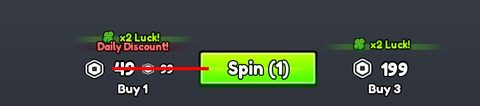</a> <b>RadioactiveWheel</b> › Buttons</td>
<td width="33%" valign="top"><a href="screenshots/51_RadioactiveWheel__Wheel.jpg">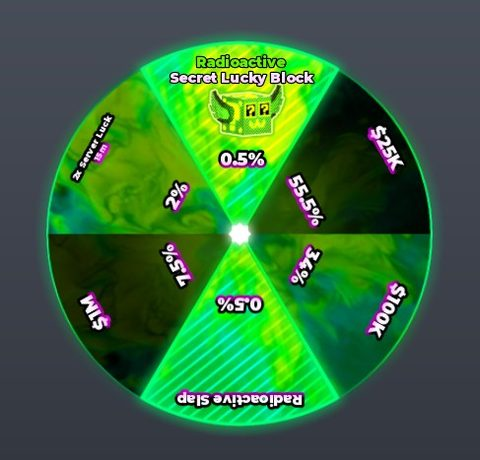</a> <b>RadioactiveWheel</b> › Wheel</td>
<td width="33%" valign="top"><a href="screenshots/55_ChristmasWheel__Buttons.jpg">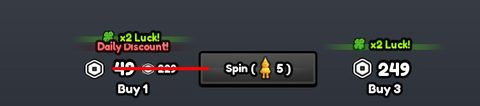</a> <b>ChristmasWheel</b> › Buttons</td>
</tr>
<tr>
<td width="33%" valign="top"><a href="screenshots/56_ChristmasWheel__Wheel.jpg">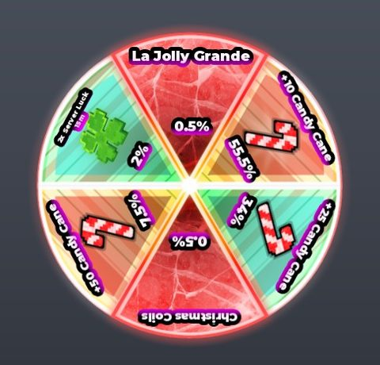</a> <b>ChristmasWheel</b> › Wheel</td>
<td width="33%" valign="top"><a href="screenshots/59_CursedWheel__Wheel.jpg">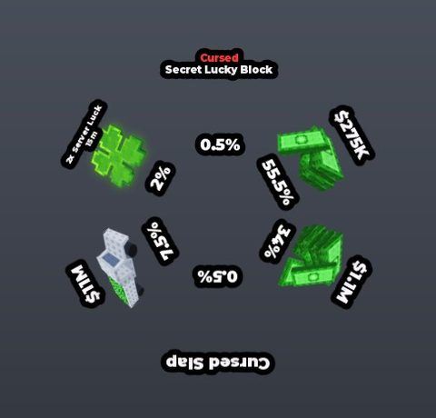</a> <b>CursedWheel</b> › Wheel</td>
<td width="33%" valign="top"><a href="screenshots/60_CursedWheel__Buttons.jpg">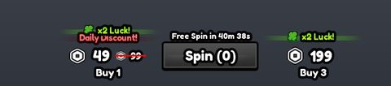</a> <b>CursedWheel</b> › Buttons</td>
</tr>
</table>

### Quests & progression

<table>
<tr>
<td width="33%" valign="top"><a href="screenshots/02_Rebirth__Rebirth.jpg">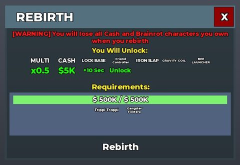</a> <b>Rebirth</b> › Rebirth</td>
<td width="33%" valign="top"><a href="screenshots/29_Rebirth__Rebirth.jpg">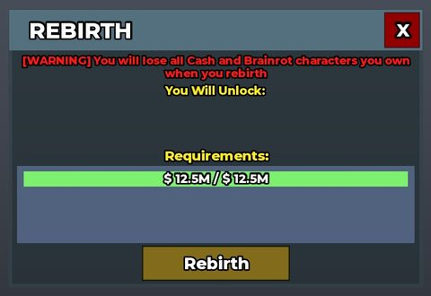</a> <b>Rebirth</b> › Rebirth</td>
<td width="33%" valign="top"><a href="screenshots/30_Index__Progress.jpg">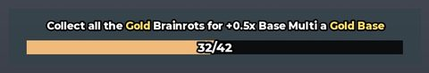</a> <b>Index</b> › Progress</td>
</tr>
</table>

### Trading

<table>
<tr>
<td width="33%" valign="top"><a href="screenshots/33_BrainrotTrader.jpg">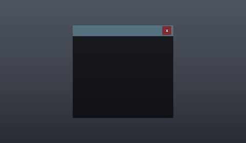</a> <b>BrainrotTrader</b></td>
</tr>
</table>

### Settings & menus

<table>
<tr>
<td width="33%" valign="top"><a href="screenshots/03_Settings__Settings.jpg">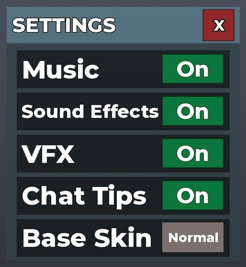</a> <b>Settings</b> › Settings</td>
<td width="33%" valign="top"><a href="screenshots/49_Settings__Settings.jpg">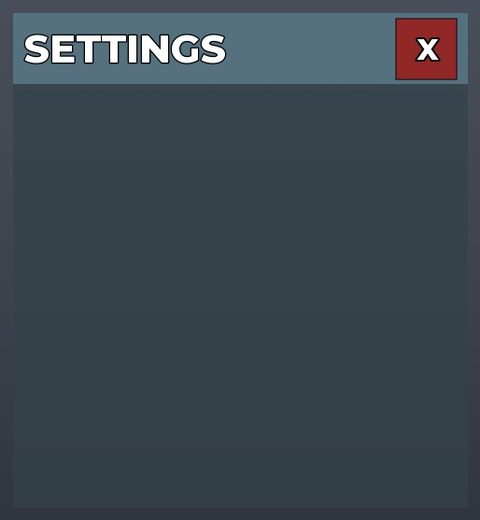</a> <b>Settings</b> › Settings</td>
</tr>
</table>

### Popups, notifications, prompts

<table>
<tr>
<td width="33%" valign="top"> <b>BackpackGui</b> › Backpack.GamepadHintsFrame</td>
<td width="33%" valign="top"> <b>Confirmation</b> › Template</td>
<td width="33%" valign="top"><a href="screenshots/41_Confirmation__Template.jpg">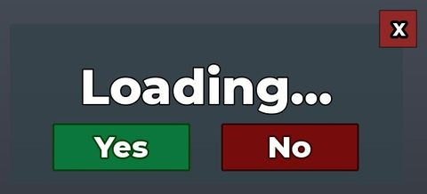</a> <b>Confirmation</b> › Template</td>
</tr>
</table>

### Leaderboards & stats

<table>
<tr>
<td width="33%" valign="top"> <b>TopbarStandard</b></td>
<td width="33%" valign="top"> <b>TopbarStandardClipped</b></td>
</tr>
</table>

### Crafting, fusing, machines

<table>
<tr>
<td width="33%" valign="top"><a href="screenshots/05_StockMachine__StockMachine.jpg">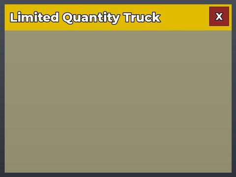</a> <b>StockMachine</b> › StockMachine</td>
<td width="33%" valign="top"><a href="screenshots/06_FuseMachine__FuseMachine.jpg">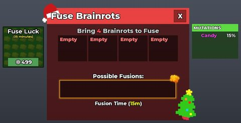</a> <b>FuseMachine</b> › FuseMachine</td>
<td width="33%" valign="top"><a href="screenshots/17_CraftingMachine__CraftingMachine.jpg">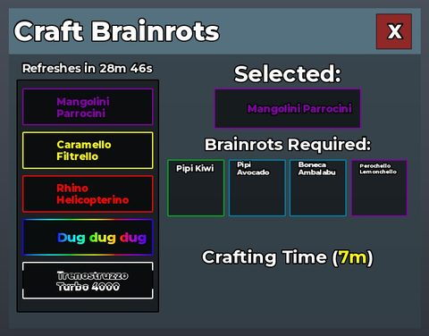</a> <b>CraftingMachine</b> › CraftingMachine</td>
</tr>
<tr>
<td width="33%" valign="top"><a href="screenshots/20_SingleStockMachine__SingleStockMachine.jpg">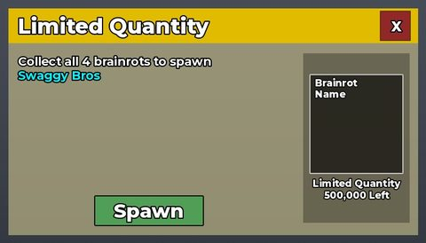</a> <b>SingleStockMachine</b> › SingleStockMachine</td>
<td width="33%" valign="top"><a href="screenshots/42_CraftingMachine__CraftingMachine.jpg">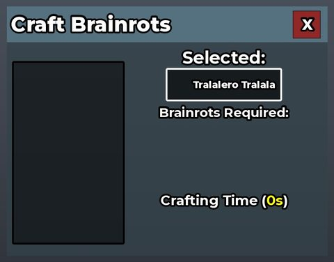</a> <b>CraftingMachine</b> › CraftingMachine</td>
<td width="33%" valign="top"><a href="screenshots/43_SingleStockMachine__SingleStockMachine.jpg">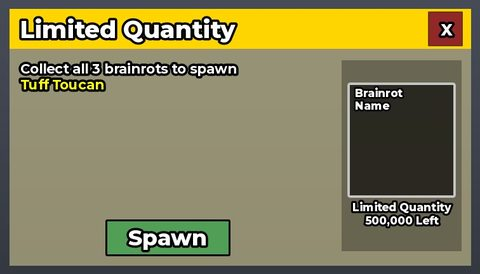</a> <b>SingleStockMachine</b> › SingleStockMachine</td>
</tr>
<tr>
<td width="33%" valign="top"><a href="screenshots/45_WitchingHourMachine__WitchingHourMachine.jpg">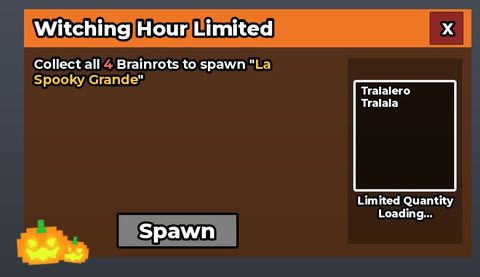</a> <b>WitchingHourMachine</b> › WitchingHourMachine</td>
<td width="33%" valign="top"><a href="screenshots/53_FuseMachine__FuseMachine.jpg">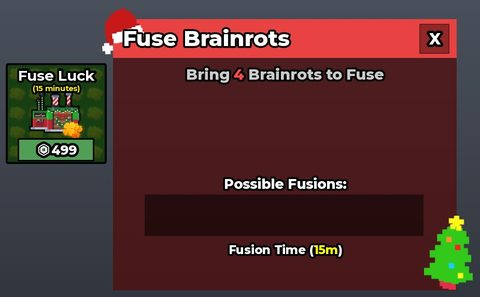</a> <b>FuseMachine</b> › FuseMachine</td>
<td width="33%" valign="top"><a href="screenshots/54_StockMachine__StockMachine.jpg">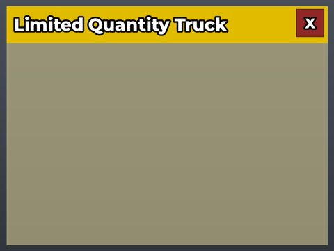</a> <b>StockMachine</b> › StockMachine</td>
</tr>
</table>

### Admin panels

<table>
<tr>
<td width="33%" valign="top"><a href="screenshots/46_AdminPanel__AdminPanel.jpg">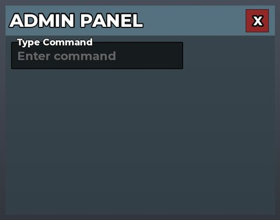</a> <b>AdminPanel</b> › AdminPanel</td>
<td width="33%" valign="top"><a href="screenshots/61_AdminSelection.jpg">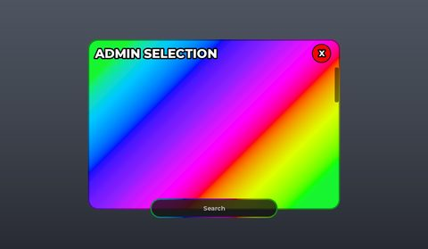</a> <b>AdminSelection</b></td>
<td width="33%" valign="top"> <b>AdminSelection</b> › Header</td>
</tr>
<tr>
<td width="33%" valign="top"><a href="screenshots/74_AdminSelection__Content.jpg">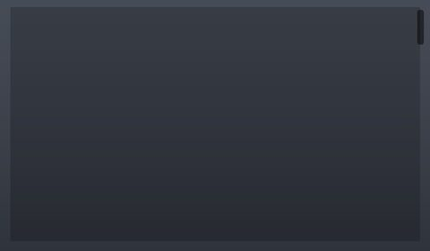</a> <b>AdminSelection</b> › Content</td>
<td width="33%" valign="top"> <b>Admin</b> › Header</td>
<td width="33%" valign="top"><a href="screenshots/76_Admin__Content.jpg">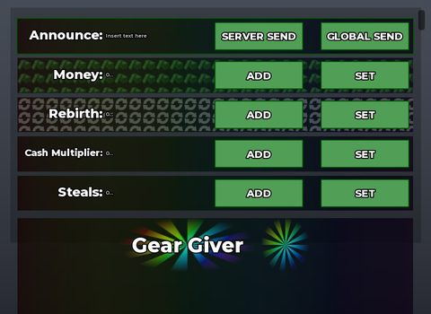</a> <b>Admin</b> › Content</td>
</tr>
</table>

### HUD & currency

<table>
<tr>
<td width="33%" valign="top"> <b>LeftBottom</b></td>
<td width="33%" valign="top"><a href="screenshots/12_LeftCenter.jpg">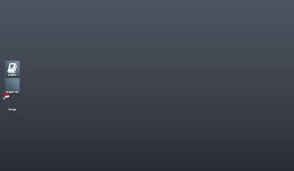</a> <b>LeftCenter</b></td>
<td width="33%" valign="top"> <b>LeftBottom</b></td>
</tr>
<tr>
<td width="33%" valign="top"> <b>Index</b> › Main</td>
<td width="33%" valign="top"> <b>LeftCenter</b></td>
</tr>
</table>

### Other

<table>
<tr>
<td width="33%" valign="top"> <b>VoiceChat</b> › VoiceChat</td>
<td width="33%" valign="top"> <b>ActiveEvents</b></td>
<td width="33%" valign="top"> <b>SpookyLuckyBlock</b> › Frame</td>
</tr>
<tr>
<td width="33%" valign="top"> <b>FestiveLuckyBlock</b> › Frame</td>
<td width="33%" valign="top"> <b>VoiceChat</b> › VoiceChat</td>
<td width="33%" valign="top"> <b>ActiveEvents</b></td>
</tr>
<tr>
<td width="33%" valign="top"> <b>Color</b> › Template</td>
<td width="33%" valign="top"> <b>FestiveLuckyBlock</b> › Frame</td>
<td width="33%" valign="top"> <b>StartNew</b></td>
</tr>
<tr>
<td width="33%" valign="top"> <b>Finish</b></td>
<td width="33%" valign="top"> <b>Start</b></td>
<td width="33%" valign="top"> <b>BaseManager</b> › Header</td>
</tr>
<tr>
<td width="33%" valign="top"> <b>BaseManager</b> › Content</td>
<td width="33%" valign="top"> <b>Saving</b> › Saving</td>
<td width="33%" valign="top"> <b>Teleport</b> › Header</td>
</tr>
<tr>
<td width="33%" valign="top"> <b>Teleport</b> › Content</td>
</tr>
</table>

## Model previews

<table>
<tr>
<td width="25%" valign="top"> <b>BrainrotGrave9__x10</b> <code>models/ServerScriptService/Services/EventService/Events/Graveyard/BrainrotGravestones/BrainrotGrave9__x10.rbxm</code></td>
<td width="25%" valign="top"> <b>Model</b> <code>models/Workspace/Events/Winter Hour/Model.rbxm</code></td>
<td width="25%" valign="top"> <b>ThirdFloor</b> <code>models/ServerStorage/Skins/Candy/ThirdFloor.rbxm</code></td>
<td width="25%" valign="top"> <b>VFXDisco</b> <code>models/ReplicatedStorage/Controllers/EventController/Events/Rap Concert/VFX/VFXDisco.rbxm</code></td>
</tr>
<tr>
<td width="25%" valign="top"> <b>SammyBase</b> <code>models/ServerScriptService/Services/EventService/Events/Phase 3_ Sammy's Base/SammyBase.rbxm</code></td>
<td width="25%" valign="top"> <b>Rainbowrath Sword</b> <code>models/ReplicatedStorage/Items/Rainbowrath Sword.rbxm</code></td>
<td width="25%" valign="top"> <b>NewYearsMachine</b> <code>models/Workspace/NewYearsMachine.rbxm</code></td>
<td width="25%" valign="top"> <b>F22 Bombing Jet</b> <code>models/ReplicatedStorage/Controllers/ItemController/RadioactiveAirstrikeController/F22 Bombing Jet.rbxm</code></td>
</tr>
<tr>
<td width="25%" valign="top"> <b>Tree3</b> <code>models/ReplicatedStorage/Models/Events/Matteo/RainbowTrees/Tree3.rbxm</code></td>
<td width="25%" valign="top"> <b>EntranceSign</b> <code>models/ReplicatedStorage/Controllers/EventController/Events/North Pole/EntranceSign.rbxm</code></td>
<td width="25%" valign="top"> <b>Huge Tree</b> <code>models/ReplicatedStorage/Items/Huge Tree.rbxm</code></td>
<td width="25%" valign="top"> <b>Casinha3__x6</b> <code>models/ReplicatedStorage/Controllers/EventController/Events/Brazil/Stage/FavelaDecoration/BackGroundFavela~4/Casinha3__x6.rbxm</code></td>
</tr>
<tr>
<td width="25%" valign="top"> <b>Overhead</b> <code>models/ServerStorage/Developmental Assets/Modded/Resources/Models/Overhead.rbxm</code></td>
<td width="25%" valign="top"> <b>Noo My Candy</b> <code>models/ReplicatedStorage/Models/TraitsPerAnimal/Reindeer Pet/Noo My Candy.rbxm</code></td>
</tr>
</table>

## Notable scripts

Top-scored scripts of this game per topic (full tree in [source/scripts](source/scripts/)).

| Topic | Scripts |
|---|---|
| UI animation (tweens, hover / click, pop-ins, springs) | [`AnimatedButton`](source/scripts/ReplicatedStorage/Classes/AnimatedButton.lua) 118 lines [`SkullEmojiEffectController`](source/scripts/ReplicatedStorage/Controllers/SkullEmojiEffectController.lua) 164 lines [`FishingRodClient`](source/scripts/ReplicatedStorage/ClientToolScripts/FishingRodClient.server.lua) 410 lines [`Controller`](source/scripts/ReplicatedStorage/Items/Ban%20Hammer/Controller.server.lua) 471 lines [`FakePurchase (SOURCE)`](source/scripts/ServerScriptService/Fake%20Purchases/FakePurchase%20%28SOURCE%29.server.lua) 625 lines |
| UI controllers / window managers / menus | [`Window`](source/scripts/ServerScriptService/Cmdr/CmdrClient/CmdrInterface/Window.lua) 337 lines [`SpectateController`](source/scripts/ServerScriptService/Controllers/SpectateController.lua) 239 lines [`ShopController`](source/scripts/ReplicatedStorage/Controllers/ShopController.lua) 1027 lines [`FakePurchase (SOURCE)`](source/scripts/ServerScriptService/Fake%20Purchases/FakePurchase%20%28SOURCE%29.server.lua) 625 lines [`FakePurchase`](source/scripts/ServerScriptService/Fake%20Purchases/FakePurchase.lua) 625 lines |
| Notifications, toasts, popups, prompts | [`servermessage`](source/scripts/ServerScriptService/Services/CommandsService/Commands/servermessage.lua) 37 lines [`Announcement`](source/scripts/ServerStorage/Developmental%20Assets/Modded/Resources/Guis/Admin/Admin/Content/CanvasGroup/List/Announcement.client.lua) 25 lines [`AuraBoat`](source/scripts/ServerScriptService/Services/EventService/Events/AuraBoat.lua) 388 lines [`Karkerkar Kurkur`](source/scripts/ServerScriptService/Services/EventService/Events/Karkerkar%20Kurkur.lua) 470 lines [`e`](source/scripts/Workspace/e.lua) 1275 lines |
| Loading / intro screens | [`FakePurchase (SOURCE)`](source/scripts/ServerScriptService/Fake%20Purchases/FakePurchase%20%28SOURCE%29.server.lua) 625 lines [`FakePurchase`](source/scripts/ServerScriptService/Fake%20Purchases/FakePurchase.lua) 625 lines [`Graveyard`](source/scripts/ReplicatedStorage/Controllers/EventController/Events/Graveyard.lua) 305 lines [`PoleGameController`](source/scripts/ReplicatedStorage/Controllers/PoleGameController.lua) 134 lines [`Dul Dul Dul`](source/scripts/ReplicatedStorage/Controllers/EventController/Events/Dul%20Dul%20Dul.lua) 395 lines |
| Camera, cutscenes, screen shake | [`ShakePresets`](source/scripts/ReplicatedStorage/Shared/ShakePresets.lua) 115 lines [`FishingRodClient`](source/scripts/ReplicatedStorage/ClientToolScripts/FishingRodClient.server.lua) 410 lines [`Controller`](source/scripts/ReplicatedStorage/Items/Ban%20Hammer/Controller.server.lua) 471 lines [`CameraShake`](source/scripts/ReplicatedStorage/Client/CameraShake.server.lua) 22 lines [`CameraController`](source/scripts/ReplicatedStorage/Controllers/CameraController.lua) 52 lines |
| VFX, particles, beams, hit effects | [`Controller`](source/scripts/ReplicatedStorage/Items/Ban%20Hammer/Controller.server.lua) 471 lines [`Items`](source/scripts/ReplicatedStorage/Datas/Items.lua) 881 lines [`PoleGameController`](source/scripts/ReplicatedStorage/Controllers/PoleGameController.lua) 134 lines [`GraveyardTomb`](source/scripts/ServerScriptService/GraveyardTomb.server.lua) 177 lines [`SkullEmojiEffectController`](source/scripts/ReplicatedStorage/Controllers/SkullEmojiEffectController.lua) 164 lines |
| DataStore / player data | [`ProfileStore`](source/scripts/ServerScriptService/Controllers/ProfileStore.lua) 2243 lines [`DataService`](source/scripts/ServerScriptService/Services/DataService.lua) 160 lines [`AdminPanel`](source/scripts/ServerScriptService/Modded/AdminPanel.lua) 1316 lines [`DataManagment`](source/scripts/ServerScriptService/Services/DataManagment.lua) 1080 lines [`AdminPanel`](source/scripts/ServerStorage/Developmental%20Assets/Modded/AdminPanel.lua) 974 lines |
| Monetization (dev products, game passes, receipts) | [`ShopService`](source/scripts/ServerScriptService/Services/ShopService.lua) 414 lines [`MerchShopService`](source/scripts/ServerScriptService/Services/MerchShopService.lua) 232 lines [`ShopController`](source/scripts/ReplicatedStorage/Controllers/ShopController.lua) 1027 lines |
| RNG, eggs, gacha, rarity rolls, pets | [`RadioactiveSpinwheelService`](source/scripts/ServerScriptService/Services/RadioactiveSpinwheelService.server.lua) 241 lines [`RadioactiveSpinwheelService`](source/scripts/Workspace/RadioactiveSpinwheelService.server.lua) 241 lines [`CursedSpinWheelService`](source/scripts/ServerScriptService/Services/CursedSpinWheelService.lua) 163 lines [`ChristmasSpinwheelService`](source/scripts/ServerScriptService/Services/ChristmasSpinwheelService.server.lua) 159 lines [`RadioactiveEventService`](source/scripts/ServerScriptService/Services/RadioactiveEventService.lua) 124 lines |
| Combat, weapons, hitboxes, abilities | [`Controller`](source/scripts/ReplicatedStorage/Items/Rainbowrath%20Sword/Controller.server.lua) 198 lines [`PlotService`](source/scripts/ServerScriptService/Services/PlotService.lua) 1229 lines [`Solar Flare`](source/scripts/ServerScriptService/Services/EventService/Events/Solar%20Flare.lua) 227 lines [`PlotClient`](source/scripts/ReplicatedStorage/Classes/PlotClient.lua) 820 lines [`Controller~2`](source/scripts/ReplicatedStorage/Items/Rainbowrath%20Sword/Controller~2.server.lua) 140 lines |
| NPC / AI / monsters | [`AnimalService`](source/scripts/ServerScriptService/Services/AnimalService.lua) 1342 lines [`AnimalService olf`](source/scripts/Workspace/AnimalService%20olf.lua) 1342 lines [`3 Roads`](source/scripts/ServerScriptService/Services/EventService/Events/3%20Roads.lua) 805 lines [`e`](source/scripts/Workspace/e.lua) 1275 lines [`Dul Dul Dul`](source/scripts/ServerScriptService/Services/EventService/Events/Dul%20Dul%20Dul.lua) 368 lines |
| Character movement (sprint, dash, double jump, slide) | [`TemuSword`](source/scripts/ReplicatedStorage/Items/Rainbowrath%20Sword/TemuSword.client.lua) 58 lines [`Controller`](source/scripts/ReplicatedStorage/Items/Ban%20Hammer/Controller.server.lua) 471 lines |
| Tycoon / plots / bases / building | [`PlotClient`](source/scripts/ReplicatedStorage/Classes/PlotClient.lua) 820 lines [`Hide Base Manager Button`](source/scripts/ServerStorage/Developmental%20Assets/Modded/Resources/Guis/BaseManager/BaseManager/Content/CanvasGroup/List/Hide%20Base%20Manager%20Button.client.lua) 39 lines [`PlotService`](source/scripts/ServerScriptService/Services/PlotService.lua) 1229 lines [`Phase 3_ Sammy's Base`](source/scripts/ServerScriptService/Services/EventService/Events/Phase%203_%20Sammy%27s%20Base.lua) 302 lines [`Unstealable Pets`](source/scripts/ServerStorage/Developmental%20Assets/Modded/Resources/Guis/BaseManager/BaseManager/Content/CanvasGroup/List/Unstealable%20Pets.client.lua) 155 lines |
| Leaderboards & stats | [`LeaderboardService`](source/scripts/ServerScriptService/Services/LeaderboardService.lua) 185 lines |
| Admin panels & commands | [`CommandsService`](source/scripts/ServerScriptService/Services/CommandsService.lua) 156 lines [`AdminPanel`](source/scripts/ServerScriptService/Modded/AdminPanel.lua) 1316 lines [`AdminPanel`](source/scripts/ServerStorage/Developmental%20Assets/Modded/AdminPanel.lua) 974 lines |
| Sound & music | [`SoundController`](source/scripts/ReplicatedStorage/Controllers/SoundController.lua) 317 lines [`DualAudio`](source/scripts/ReplicatedStorage/Components/DualAudio.lua) 49 lines [`Karkerkar Kurkur`](source/scripts/ReplicatedStorage/Controllers/EventController/Events/Karkerkar%20Kurkur.lua) 321 lines |
| Daily rewards, quests, codes, playtime | [`DataManagment`](source/scripts/ServerScriptService/Services/DataManagment.lua) 1080 lines [`PlotService`](source/scripts/ServerScriptService/Services/PlotService.lua) 1229 lines [`MerchShopService`](source/scripts/ServerScriptService/Services/MerchShopService.lua) 232 lines [`YinYangEventController`](source/scripts/ReplicatedStorage/Controllers/YinYangEventController.lua) 321 lines |
| Utility modules (number format, signals, tables, timers) | [`Graveyard`](source/scripts/ReplicatedStorage/Controllers/EventController/Events/Graveyard.lua) 305 lines [`AdminPanel`](source/scripts/ServerScriptService/Modded/AdminPanel.lua) 1316 lines [`StealService`](source/scripts/ServerScriptService/Services/StealService.lua) 724 lines [`StealService`](source/scripts/Workspace/StealService.lua) 724 lines [`TimeUtils`](source/scripts/ReplicatedStorage/Utils/TimeUtils.lua) 109 lines |

### In the curated script library

- [Conch console: one module per command](../../Scripts/16-Admin/CommandsService-ConchLoader__evade.lua) — Loads every ModuleScript in a Commands folder into the Conch console, gives the super-user role to permitted players and sends them the command list.
- [Permission check: user ids or group rank](../../Scripts/16-Admin/ConsolePermissions__evade.lua) — hasPermission(player): true if the UserId is in Config.AllowedUserIds or the player's rank in Config.GroupId is at least MinGroupRank.
- [Spectate next/previous](../../Scripts/05-Camera-Cutscene/SpectateCycle__evade.lua) — The simplest spectate: cycle Camera.CameraSubject through a player list.
- [Wandering swarm event](../../Scripts/12-NPC-AI/WanderSwarmEvent__evade.lua) — Timed event that spawns 20-30 small NPCs at wander points, moves each with SimplePath (path Costs avoid water/lava), picks a new random point after Reached, swaps idle/walk animations from Humanoid.Running, and scans a box around each NPC to apply a trait to nearby targets.
- [Event spin wheel (server)](../../Scripts/09-RNG-Gacha-Pets/SpinWheelService__evade.lua) — Server spin wheel: weighted reward with alternate reward if already owned, per-player cooldown, spin tokens given out by a UTC-scheduled event, reward applied after the client animation delay.
- [Steal start / cancel / complete service](../../Scripts/14-Tycoon-Plots/StealService__evade.lua) — Server side of a Steal-a-Brainrot style steal: StartSteal marks the victim's podium as being stolen, welds the animal model in front of the thief, slows them to 75% speed and plays a carry...
- [Steal-game plot service (assign, lock, steal remote, income)](../../Scripts/14-Tycoon-Plots/PlotService__evade.lua) — Full plot/base service for a steal game: hands out free plots, syncs the podium list to a per-plot replicated channel, 30s spawn grace lock, LockBase (timed laser lock that grows with rebirths and...

## ⚠️ Safety

HIGH flags (backdoors, `require(id)`, `loadstring`, webhooks). Review or delete before reusing:

- `scripts/ReplicatedStorage/Controllers/NewYearsMachineController.lua`
- `scripts/ReplicatedStorage/Controllers/NewYearsMachineController.lua`
- `scripts/ReplicatedStorage/Controllers/NewYearsMachineController.lua`
- `scripts/ReplicatedStorage/Controllers/NewYearsMachineController.lua`
- `scripts/ReplicatedStorage/Controllers/NewYearsMachineController.lua`
- `scripts/ReplicatedStorage/Controllers/NewYearsMachineController.lua`
- `scripts/ReplicatedStorage/Controllers/NewYearsMachineController.lua`
- `scripts/ReplicatedStorage/Controllers/NewYearsMachineController.lua`

## Folders

| Folder | What |
|---|---|
| `screenshots/` | full frames; `crops/` = the panel only; `models/` = 3D previews; `thumbs/` = gallery thumbnails |
| `ui/` | every screen as a Lua builder (`require(module)()` returns the ScreenGui); `_StarterGui-all.lua` builds every StarterGui screen |
| `models/` | every model as .rbxm (the only .rbxm files), mirroring the place tree, scripts removed |
| `map/` | `workspace.rbxm` (the map as a model), `lighting.lua` (sky + post effects), `materials.lua`, `Environment.lua` |
| `animations/`, `audio/` | KeyframeSequence / Sound builders (.lua), `AnimationIds.lua`, `Sounds.lua` |
| `source/` | all scripts as .luau, `tree.txt`, `ui.txt`, `remotes.txt`, `assets.txt`, `flags.txt` |
