# Flood Escape 2

> 🧗 **Obby** · obby / survival (rising water maps) · source file `Flood Escape 2 🌊.rbxl`

[⬅ Back to the catalog](../../README.md) · [Assets inventory](ASSETS.md) · [Style numbers](reference.md) · [Scripts](source/scripts/) · [Code analysis](source/README.md)

## At a glance

| | |
|---|---|
| Provenance | copy of a live game (saveinstance / decompiled client code) |
| Screens | 14 ScreenGuis, 964 GUI objects → **29 screenshots** |
| Models (.rbxm) | 921 models, 0 model sets, 155 VFX sets |
| Lua builders (.lua) | 25 UI screens, 0 animation packs, 3 audio packs |
| Code | 262 scripts, 32,037 lines |
| Asset ids | 9 animations, 64 sounds |
| Safety scan | 2 HIGH / 0 MED flags ([flags.txt](source/flags.txt)) |

**Fonts:** `Ubuntu Regular`×120, `LegacyArial Regular`×100, `Roboto Regular`×17, `Ubuntu Bold`×10, `RobotoMono Regular`×2

## UI screenshots

Captured in Studio from the place's own ScreenGuis (scripts stripped). Each panel was opened on its own; click a thumbnail for the full 1519×886 frame. Runtime-filled lists (shop items, inventories) show their template state.

### Settings & menus

<table>
<tr>
<td width="33%" valign="top"><a href="screenshots/34_MapTest__Settings.jpg">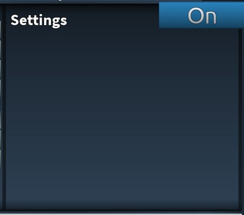</a> <b>MapTest</b> › Window.Content.Pages.Settings</td>
</tr>
</table>

### Popups, notifications, prompts

<table>
<tr>
<td width="33%" valign="top"><a href="screenshots/14_NotifGui__Notification.jpg">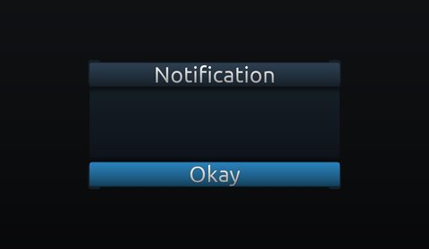</a> <b>NotifGui</b> › Notification</td>
</tr>
</table>

### Loading & intro

<table>
<tr>
<td width="33%" valign="top"> <b>GameGui</b> › Loading</td>
<td width="33%" valign="top"> <b>GameGui</b> › Loading</td>
</tr>
</table>

### End of round, death, results

<table>
<tr>
<td width="33%" valign="top"><a href="screenshots/03_EntryGui__Window1.jpg">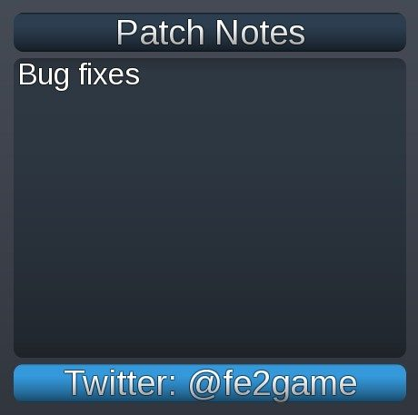</a> <b>EntryGui</b> › EntryFrame.WindowDisplays.Window1</td>
<td width="33%" valign="top"><a href="screenshots/11_GameGui__Window.jpg">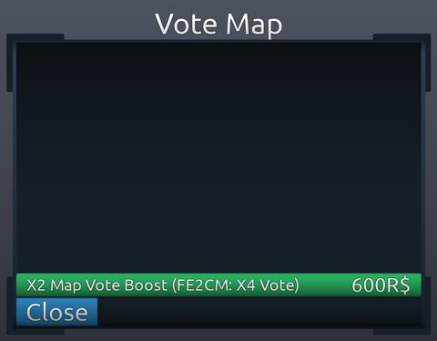</a> <b>GameGui</b> › VoteMap.Window</td>
<td width="33%" valign="top"><a href="screenshots/25_GameGui__Window.jpg">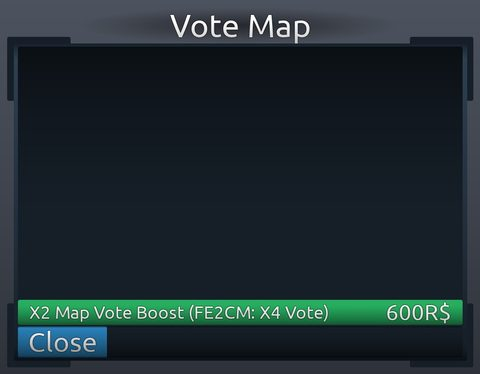</a> <b>GameGui</b> › VoteMap.Window</td>
</tr>
<tr>
<td width="33%" valign="top"><a href="screenshots/32_MapTest__MapList.jpg">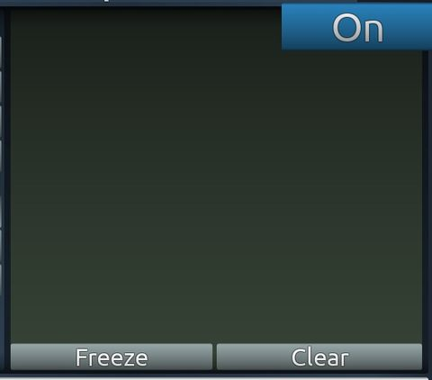</a> <b>MapTest</b> › Window.Content.Pages.MapList</td>
<td width="33%" valign="top"><a href="screenshots/33_MapTest__Servers.jpg">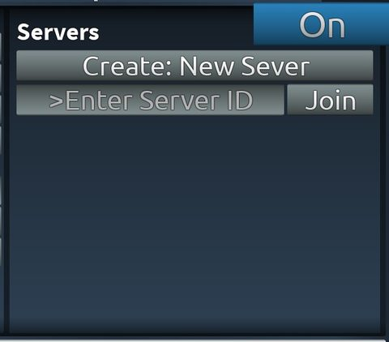</a> <b>MapTest</b> › Window.Content.Pages.Servers</td>
</tr>
</table>

### HUD & currency

<table>
<tr>
<td width="33%" valign="top"><a href="screenshots/13_GameGui__HUD.jpg">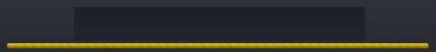</a> <b>GameGui</b> › HUD</td>
<td width="33%" valign="top"><a href="screenshots/28_GameGui__HUD.jpg">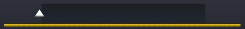</a> <b>GameGui</b> › HUD</td>
</tr>
</table>

### Map vote / teams / matchmaking

<table>
<tr>
<td width="33%" valign="top"> <b>GameGui</b> › VoteMap.OlderVoteBtn</td>
<td width="33%" valign="top"> <b>GameGui</b> › VoteMap.OldVoteBtn</td>
<td width="33%" valign="top"> <b>GameGui</b> › VoteMap.VoteBtn</td>
</tr>
<tr>
<td width="33%" valign="top"><a href="screenshots/22_GameGui__OlderVoteBtn.jpg">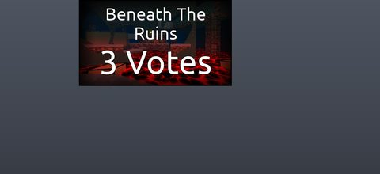</a> <b>GameGui</b> › VoteMap.OlderVoteBtn</td>
<td width="33%" valign="top"><a href="screenshots/23_GameGui__OldVoteBtn.jpg">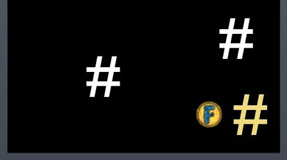</a> <b>GameGui</b> › VoteMap.OldVoteBtn</td>
</tr>
</table>

### Other

<table>
<tr>
<td width="33%" valign="top"><a href="screenshots/01_EntryGui.jpg">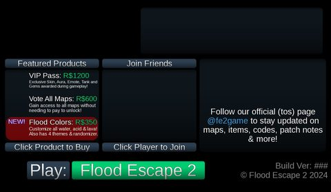</a> <b>EntryGui</b></td>
<td width="33%" valign="top"><a href="screenshots/02_EntryGui__ExtraModes.jpg">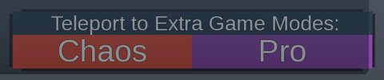</a> <b>EntryGui</b> › EntryFrame.ExtraModes</td>
<td width="33%" valign="top"> <b>GameGui</b> › Waiting.NewUI.Border</td>
</tr>
<tr>
<td width="33%" valign="top"><a href="screenshots/06_GameGui__Content.jpg">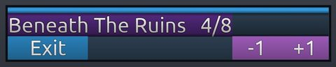</a> <b>GameGui</b> › Waiting.NewUI.Content</td>
<td width="33%" valign="top"><a href="screenshots/07_GameGui__Intensity.jpg">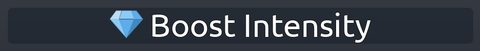</a> <b>GameGui</b> › Waiting.UI.Content.Buttons.Intensity</td>
<td width="33%" valign="top"><a href="screenshots/12_GameGui__LvlUp.jpg">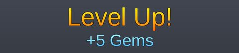</a> <b>GameGui</b> › LvlUp</td>
</tr>
<tr>
<td width="33%" valign="top"> <b>LiftWaitVisual</b></td>
<td width="33%" valign="top"> <b>FormGui</b></td>
<td width="33%" valign="top"> <b>FormGui</b> › FormFrame</td>
</tr>
<tr>
<td width="33%" valign="top"><a href="screenshots/20_GameGui__Content.jpg">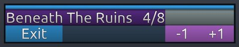</a> <b>GameGui</b> › Waiting.NewUI.Content</td>
<td width="33%" valign="top"> <b>GameGui</b> › Challenges</td>
<td width="33%" valign="top"> <b>GameGui</b> › LvlUp</td>
</tr>
<tr>
<td width="33%" valign="top"><a href="screenshots/31_MapTest.jpg">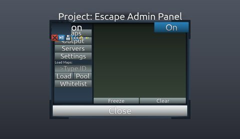</a> <b>MapTest</b></td>
</tr>
</table>

## Model previews

<table>
<tr>
<td width="25%" valign="top"><a href="models/Workspace/Lobby.rbxm">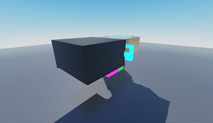</a> <b>Lobby</b> <code>models/Workspace/Lobby.rbxm</code></td>
<td width="25%" valign="top"><a href="models/ReplicatedStorage/Items/Skins/248/TugBoatCap%27nHat.rbxm">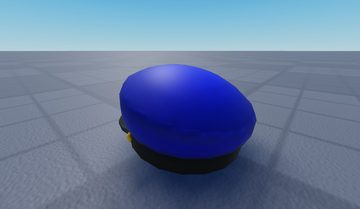</a> <b>TugBoatCap'nHat</b> <code>models/ReplicatedStorage/Items/Skins/248/TugBoatCap'nHat.rbxm</code></td>
<td width="25%" valign="top"><a href="models/ReplicatedStorage/Items/Skins/716/FlowerWreathAccessory.rbxm">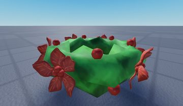</a> <b>FlowerWreathAccessory</b> <code>models/ReplicatedStorage/Items/Skins/716/FlowerWreathAccessory.rbxm</code></td>
<td width="25%" valign="top"><a href="models/ReplicatedStorage/Items/Tanks/539.rbxm">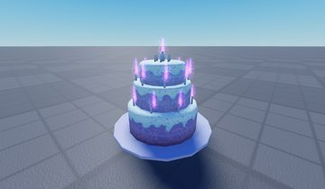</a> <b>539</b> <code>models/ReplicatedStorage/Items/Tanks/539.rbxm</code></td>
</tr>
<tr>
<td width="25%" valign="top"><a href="models/ReplicatedStorage/TitleScreenResources/TitleBackgrounds/2_BG_BeneathTheRuins.rbxm">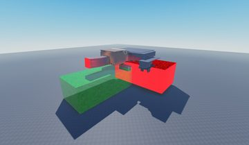</a> <b>2_BG_BeneathTheRuins</b> <code>models/ReplicatedStorage/TitleScreenResources/TitleBackgrounds/2_BG_BeneathTheRuins.rbxm</code></td>
<td width="25%" valign="top"><a href="models/ServerStorage/Maps/4FamiliarRuins.rbxm">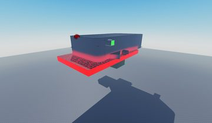</a> <b>4FamiliarRuins</b> <code>models/ServerStorage/Maps/4FamiliarRuins.rbxm</code></td>
<td width="25%" valign="top"><a href="models/ReplicatedStorage/TitleScreenResources/TitleBackgrounds/DefaultTitle.rbxm">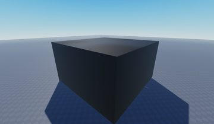</a> <b>DefaultTitle</b> <code>models/ReplicatedStorage/TitleScreenResources/TitleBackgrounds/DefaultTitle.rbxm</code></td>
<td width="25%" valign="top"><a href="models/ReplicatedStorage/Items/Skins/78/CrystalCrown.rbxm">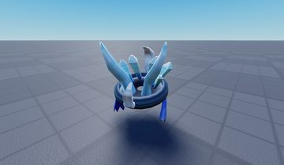</a> <b>CrystalCrown</b> <code>models/ReplicatedStorage/Items/Skins/78/CrystalCrown.rbxm</code></td>
</tr>
<tr>
<td width="25%" valign="top"><a href="models/ReplicatedStorage/TitleScreenResources/TitleBackgrounds/4_BG_DarkSciFacility.rbxm">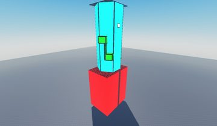</a> <b>4_BG_DarkSciFacility</b> <code>models/ReplicatedStorage/TitleScreenResources/TitleBackgrounds/4_BG_DarkSciFacility.rbxm</code></td>
<td width="25%" valign="top"><a href="models/ServerScriptService/SV_MAIN_GameScript/Exploading.rbxm">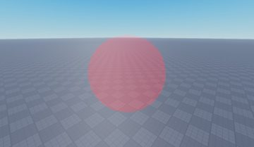</a> <b>Exploading</b> <code>models/ServerScriptService/SV_MAIN_GameScript/Exploading.rbxm</code></td>
<td width="25%" valign="top"><a href="models/ReplicatedStorage/Items/Skins/242/flower_power_shades.rbxm">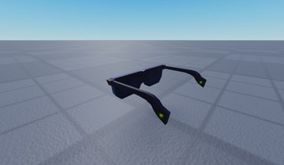</a> <b>flower_power_shades</b> <code>models/ReplicatedStorage/Items/Skins/242/flower_power_shades.rbxm</code></td>
<td width="25%" valign="top"><a href="models/ReplicatedStorage/Items/Skins/211/FlowerWitch.rbxm">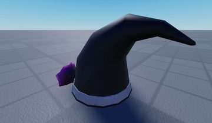</a> <b>FlowerWitch</b> <code>models/ReplicatedStorage/Items/Skins/211/FlowerWitch.rbxm</code></td>
</tr>
</table>

## Notable scripts

Top-scored scripts of this game per topic (full tree in [source/scripts](source/scripts/)).

| Topic | Scripts |
|---|---|
| UI animation (tweens, hover / click, pop-ins, springs) | [`CL_MAIN_GameScript`](source/scripts/StarterPlayer/StarterPlayerScripts/CL_MAIN_GameScript.client.lua) 2614 lines [`FeedbackButtonScript`](source/scripts/ReplicatedStorage/GuiBackup/FormGui/FeedbackButton/FeedbackButtonScript.client.lua) 27 lines [`DropdownScript`](source/scripts/ReplicatedStorage/GuiBackup/FormGui/FormScript/Dropdown/DropdownScript.client.lua) 140 lines [`TimelinePlayer`](source/scripts/ReplicatedStorage/SharedModules/TimelinePlayer.lua) 599 lines [`FormScript`](source/scripts/ReplicatedStorage/GuiBackup/FormGui/FormScript.client.lua) 463 lines |
| UI controllers / window managers / menus | [`DropdownScript`](source/scripts/ReplicatedStorage/GuiBackup/FormGui/FormScript/Dropdown/DropdownScript.client.lua) 140 lines [`CL_MAIN_GameScript`](source/scripts/StarterPlayer/StarterPlayerScripts/CL_MAIN_GameScript.client.lua) 2614 lines [`ProductWindows_Script`](source/scripts/ReplicatedStorage/GuiBackup/ProductWindows_Script.client.lua) 43 lines [`CL_SocialScript`](source/scripts/ServerScriptService/SV_MAIN_GameScript/MenuGui/Social/CL_SocialScript.client.lua) 53 lines [`FormScript`](source/scripts/ReplicatedStorage/GuiBackup/FormGui/FormScript.client.lua) 463 lines |
| Notifications, toasts, popups, prompts | [`TimelinePlayer`](source/scripts/ReplicatedStorage/SharedModules/TimelinePlayer.lua) 599 lines [`TimelinePlayerClient`](source/scripts/ReplicatedStorage/SharedModules/TimelinePlayerClient.lua) 288 lines [`CL_MAIN_GameScript`](source/scripts/StarterPlayer/StarterPlayerScripts/CL_MAIN_GameScript.client.lua) 2614 lines [`FormScript`](source/scripts/ReplicatedStorage/GuiBackup/FormGui/FormScript.client.lua) 463 lines |
| Loading / intro screens | [`CL_MAIN_GameScript`](source/scripts/StarterPlayer/StarterPlayerScripts/CL_MAIN_GameScript.client.lua) 2614 lines [`DropdownScript`](source/scripts/ReplicatedStorage/GuiBackup/FormGui/FormScript/Dropdown/DropdownScript.client.lua) 140 lines [`CL_EntryScript`](source/scripts/StarterPlayer/StarterPlayerScripts/CL_EntryScript.client.lua) 396 lines [`LocalScript`](source/scripts/ReplicatedFirst/LocalScript.client.lua) 16 lines |
| Camera, cutscenes, screen shake | [`CL_TimelineWrapper`](source/scripts/StarterPlayer/StarterPlayerScripts/CL_TimelineWrapper.client.lua) 257 lines [`TimelinePlayer`](source/scripts/ReplicatedStorage/SharedModules/TimelinePlayer.lua) 599 lines [`TimelinePlayerClient`](source/scripts/ReplicatedStorage/SharedModules/TimelinePlayerClient.lua) 288 lines [`CL_MAIN_GameScript`](source/scripts/StarterPlayer/StarterPlayerScripts/CL_MAIN_GameScript.client.lua) 2614 lines [`CL_EntryScript`](source/scripts/StarterPlayer/StarterPlayerScripts/CL_EntryScript.client.lua) 396 lines |
| VFX, particles, beams, hit effects | [`CL_MAIN_GameScript`](source/scripts/StarterPlayer/StarterPlayerScripts/CL_MAIN_GameScript.client.lua) 2614 lines |
| Monetization (dev products, game passes, receipts) | [`ProductWindows_Script`](source/scripts/ReplicatedStorage/GuiBackup/ProductWindows_Script.client.lua) 43 lines [`ProductWindows_Script`](source/scripts/StarterPlayer/StarterPlayerScripts/CL_EntryScript/EntryGui/EntryFrame/WindowDisplays/Window3/ProductWindows_Script.client.lua) 31 lines |
| RNG, eggs, gacha, rarity rolls, pets | [`CL_MAIN_GameScript`](source/scripts/StarterPlayer/StarterPlayerScripts/CL_MAIN_GameScript.client.lua) 2614 lines |
| Combat, weapons, hitboxes, abilities | [`CL_MAIN_GameScript`](source/scripts/StarterPlayer/StarterPlayerScripts/CL_MAIN_GameScript.client.lua) 2614 lines [`CL_CornerClip`](source/scripts/StarterPlayer/StarterCharacterScripts/CL_CornerClip.client.lua) 113 lines |
| Character movement (sprint, dash, double jump, slide) | [`CL_MAIN_GameScript`](source/scripts/StarterPlayer/StarterPlayerScripts/CL_MAIN_GameScript.client.lua) 2614 lines [`CharSpecs`](source/scripts/StarterPlayer/StarterCharacterScripts/CharSpecs.client.lua) 243 lines |
| Tycoon / plots / bases / building | [`CL_OptionsScript`](source/scripts/ServerScriptService/SV_MAIN_GameScript/MenuGui/Options/CL_OptionsScript.client.lua) 250 lines [`CL_EntryScript`](source/scripts/StarterPlayer/StarterPlayerScripts/CL_EntryScript.client.lua) 396 lines [`CL_MAIN_GameScript`](source/scripts/StarterPlayer/StarterPlayerScripts/CL_MAIN_GameScript.client.lua) 2614 lines [`FE2Library`](source/scripts/ReplicatedStorage/SharedModules/FE2Library.lua) 371 lines |
| Admin panels & commands | [`AdminModule`](source/scripts/ServerScriptService/SV_MAIN_GameScript/AdminModule.lua) 134 lines |
| Sound & music | [`CL_MAIN_GameScript`](source/scripts/StarterPlayer/StarterPlayerScripts/CL_MAIN_GameScript.client.lua) 2614 lines |
| Utility modules (number format, signals, tables, timers) | [`AdminModule`](source/scripts/ServerScriptService/SV_MAIN_GameScript/AdminModule.lua) 134 lines |

### In the curated script library

- [Smallest custom loading screen](../../Scripts/04-Loading-Screens/MinimalLoadingLabel__flood-escape-2.lua) — Smallest possible custom loading screen: a full-screen TextLabel created in code, default screen removed, destroyed once game.Loaded fires.
- [Companion follower](../../Scripts/12-NPC-AI/BuddyFollower__flood-escape-2.lua) — Buddy NPC that MoveTo's just behind its owner when further than 3.4 studs, teleports behind them past 21.5 studs, jumps when the owner jumps (remote) and cleans itself up when the owner dies or leaves.

## ⚠️ Safety

HIGH flags (backdoors, `require(id)`, `loadstring`, webhooks). Review or delete before reusing:

- `scripts/ServerScriptService/SV_MAIN_GameScript.server.lua`
- `scripts/Workspace/HD Admin/Core/MainModule.lua`

## Folders

| Folder | What |
|---|---|
| `screenshots/` | full frames; `crops/` = the panel only; `models/` = 3D previews; `thumbs/` = gallery thumbnails |
| `ui/` | every screen as a Lua builder (`require(module)()` returns the ScreenGui); `_StarterGui-all.lua` builds every StarterGui screen |
| `models/` | every model as .rbxm (the only .rbxm files), mirroring the place tree, scripts removed |
| `map/` | `workspace.rbxm` (the map as a model), `lighting.lua` (sky + post effects), `materials.lua`, `Environment.lua` |
| `animations/`, `audio/` | KeyframeSequence / Sound builders (.lua), `AnimationIds.lua`, `Sounds.lua` |
| `source/` | all scripts as .luau, `tree.txt`, `ui.txt`, `remotes.txt`, `assets.txt`, `flags.txt` |
