# Forest Pack (slbr)

> 📦 **Model Pack** · model pack (nature / forest) · source file `Forest Pack Made By slbr - Booster.rbxm`

[⬅ Back to the catalog](../../README.md) · [Assets inventory](ASSETS.md) · [Style numbers](reference.md) · [Scripts](source/scripts/) · [Code analysis](source/README.md)

## At a glance

| | |
|---|---|
| Provenance | template with full source |
| Screens | 0 ScreenGuis, 0 GUI objects → **0 screenshots** |
| Models (.rbxm) | 56 models, 0 model sets, 0 VFX sets |
| Lua builders (.lua) | 0 UI screens, 0 animation packs, 0 audio packs |
| Code | 14 scripts, 99 lines |
| Asset ids | 0 animations, 0 sounds |
| Safety scan | 0 HIGH / 0 MED flags ([flags.txt](source/flags.txt)) |

## Model previews

<table>
<tr>
<td width="25%" valign="top"><a href="models/Forest%20Pack/Hawk_FlightPath01.rbxm">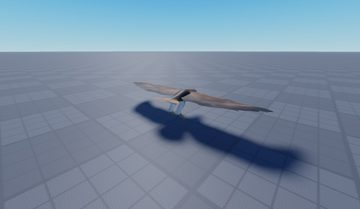</a> <b>Hawk_FlightPath01</b> <code>models/Forest Pack/Hawk_FlightPath01.rbxm</code></td>
<td width="25%" valign="top"><a href="models/Forest%20Pack/RedwoodTreeLarge-Var01.rbxm">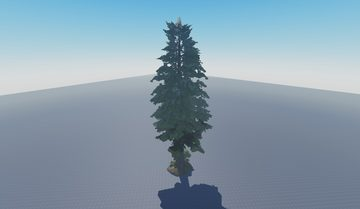</a> <b>RedwoodTreeLarge-Var01</b> <code>models/Forest Pack/RedwoodTreeLarge-Var01.rbxm</code></td>
<td width="25%" valign="top"><a href="models/Forest%20Pack/Redwoodtree-LowLOD-Var01.rbxm">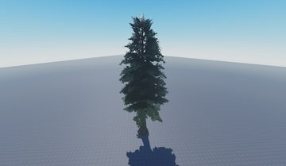</a> <b>Redwoodtree-LowLOD-Var01</b> <code>models/Forest Pack/Redwoodtree-LowLOD-Var01.rbxm</code></td>
<td width="25%" valign="top"><a href="models/Forest%20Pack/BeechwoodTreeLarge_Var01.rbxm">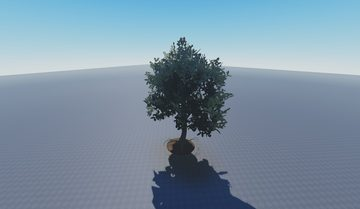</a> <b>BeechwoodTreeLarge_Var01</b> <code>models/Forest Pack/BeechwoodTreeLarge_Var01.rbxm</code></td>
</tr>
<tr>
<td width="25%" valign="top"><a href="models/Forest%20Pack/Redwood_Snowy01.rbxm">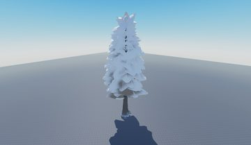</a> <b>Redwood_Snowy01</b> <code>models/Forest Pack/Redwood_Snowy01.rbxm</code></td>
<td width="25%" valign="top"><a href="models/Forest%20Pack/Dragonfly_Flight01.rbxm">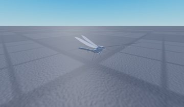</a> <b>Dragonfly_Flight01</b> <code>models/Forest Pack/Dragonfly_Flight01.rbxm</code></td>
<td width="25%" valign="top"><a href="models/Forest%20Pack/BeechwoodTree_Var01.rbxm">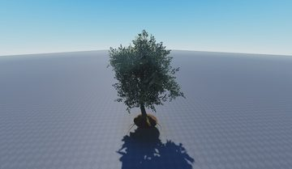</a> <b>BeechwoodTree_Var01</b> <code>models/Forest Pack/BeechwoodTree_Var01.rbxm</code></td>
<td width="25%" valign="top"><a href="models/Forest%20Pack/BeechwoodSapling_Var01.rbxm">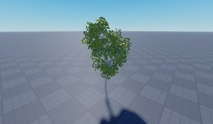</a> <b>BeechwoodSapling_Var01</b> <code>models/Forest Pack/BeechwoodSapling_Var01.rbxm</code></td>
</tr>
<tr>
<td width="25%" valign="top"><a href="models/Forest%20Pack/Dragonfly_IdleFlight01.rbxm">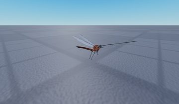</a> <b>Dragonfly_IdleFlight01</b> <code>models/Forest Pack/Dragonfly_IdleFlight01.rbxm</code></td>
<td width="25%" valign="top"><a href="models/Forest%20Pack/RhododendronVar01.rbxm">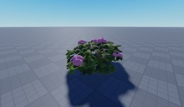</a> <b>RhododendronVar01</b> <code>models/Forest Pack/RhododendronVar01.rbxm</code></td>
<td width="25%" valign="top"><a href="models/Forest%20Pack/RedwoodTree-Var01.rbxm">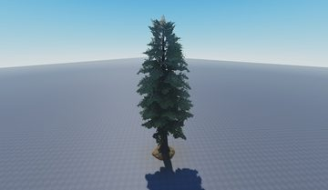</a> <b>RedwoodTree-Var01</b> <code>models/Forest Pack/RedwoodTree-Var01.rbxm</code></td>
<td width="25%" valign="top"><a href="models/Forest%20Pack/Fish_IdleSwim01.rbxm">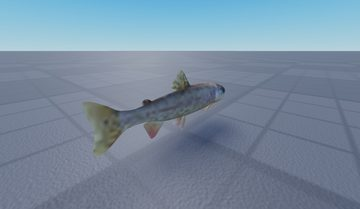</a> <b>Fish_IdleSwim01</b> <code>models/Forest Pack/Fish_IdleSwim01.rbxm</code></td>
</tr>
<tr>
<td width="25%" valign="top"><a href="models/Forest%20Pack/BranchVar01.rbxm">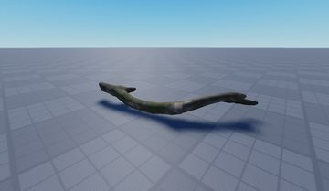</a> <b>BranchVar01</b> <code>models/Forest Pack/BranchVar01.rbxm</code></td>
</tr>
</table>

## Folders

| Folder | What |
|---|---|
| `screenshots/` | full frames; `crops/` = the panel only; `models/` = 3D previews; `thumbs/` = gallery thumbnails |
| `ui/` | every screen as a Lua builder (`require(module)()` returns the ScreenGui); `_StarterGui-all.lua` builds every StarterGui screen |
| `models/` | every model as .rbxm (the only .rbxm files), mirroring the place tree, scripts removed |
| `map/` | `workspace.rbxm` (the map as a model), `lighting.lua` (sky + post effects), `materials.lua`, `Environment.lua` |
| `animations/`, `audio/` | KeyframeSequence / Sound builders (.lua), `AnimationIds.lua`, `Sounds.lua` |
| `source/` | all scripts as .luau, `tree.txt`, `ui.txt`, `remotes.txt`, `assets.txt`, `flags.txt` |
