# Forsaken (alt copy)

> 👻 **Horror** · asymmetric horror (killer vs survivors) · source file `Forsaken.rbxl`

[⬅ Back to the catalog](../../README.md) · [Assets inventory](ASSETS.md) · [Style numbers](reference.md) · [Scripts](source/scripts/) · [Code analysis](source/README.md)

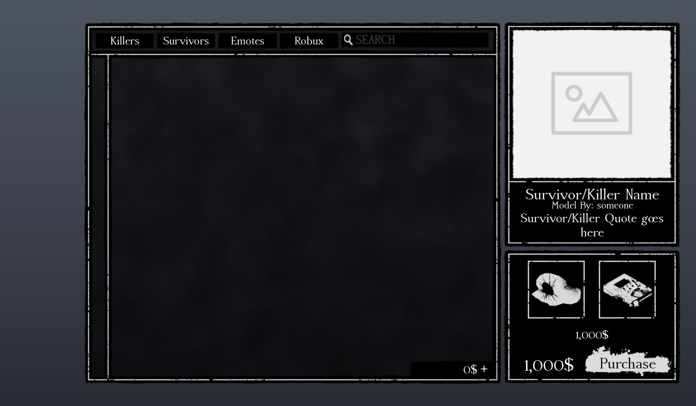

## At a glance

| | |
|---|---|
| Provenance | copy of a live game (saveinstance / decompiled client code) |
| Screens | 12 ScreenGuis, 132 GUI objects → **18 screenshots** |
| Models (.rbxm) | 611 models, 17 model sets, 9 VFX sets |
| Lua builders (.lua) | 187 UI screens, 1 animation packs, 16 audio packs |
| Code | 954 scripts, 72,882 lines |
| Asset ids | 74 animations, 740 sounds |
| Safety scan | 2 HIGH / 14 MED flags ([flags.txt](source/flags.txt)) |

**Fonts:** `AccanthisADFStd Regular`×18, `Guru Light`×7, `AccanthisADFStd Bold`×4, `Creepster Regular`×4, `LegacyArial Regular`×4

## UI screenshots

Captured in Studio from the place's own ScreenGuis (scripts stripped). Each panel was opened on its own; click a thumbnail for the full 1519×886 frame. Runtime-filled lists (shop items, inventories) show their template state.

### Shop & Robux store

<table>
<tr>
<td width="33%" valign="top"><a href="screenshots/14_ShopScreen.jpg">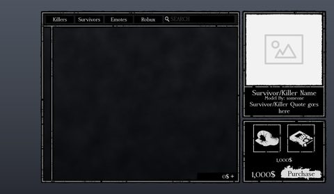</a> <b>ShopScreen</b></td>
</tr>
</table>

### Inventory / backpack / pets

<table>
<tr>
<td width="33%" valign="top"><a href="screenshots/15_InventoryScreen.jpg">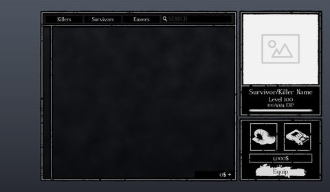</a> <b>InventoryScreen</b></td>
</tr>
</table>

### Quests & progression

<table>
<tr>
<td width="33%" valign="top"><a href="screenshots/17_Achievement.jpg">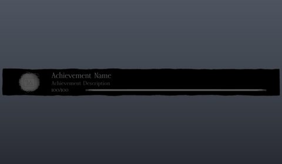</a> <b>Achievement</b></td>
</tr>
</table>

### Settings & menus

<table>
<tr>
<td width="33%" valign="top"><a href="screenshots/16_EmoteMenuHolder.jpg">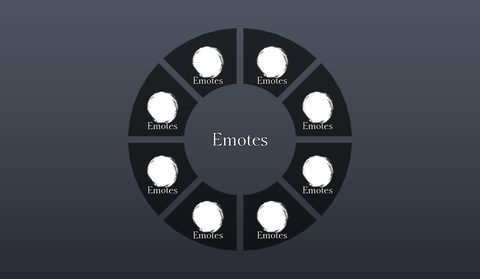</a> <b>EmoteMenuHolder</b></td>
</tr>
</table>

### Popups, notifications, prompts

<table>
<tr>
<td width="33%" valign="top"><a href="screenshots/13_DialogMain.jpg">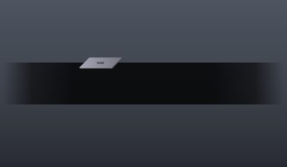</a> <b>DialogMain</b></td>
</tr>
</table>

### Loading & intro

<table>
<tr>
<td width="33%" valign="top"> <b>LoadingGui</b></td>
<td width="33%" valign="top"><a href="screenshots/02_Intro2011X.jpg">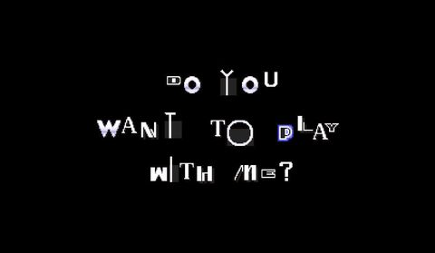</a> <b>Intro2011X</b></td>
</tr>
</table>

### Leaderboards & stats

<table>
<tr>
<td width="33%" valign="top"><a href="screenshots/09_PlayerStats.jpg">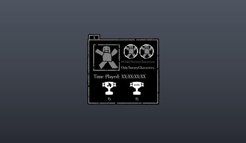</a> <b>PlayerStats</b></td>
</tr>
</table>

### End of round, death, results

<table>
<tr>
<td width="33%" valign="top"><a href="screenshots/21_EndScreen.jpg">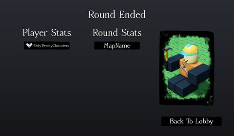</a> <b>EndScreen</b></td>
</tr>
</table>

### HUD & currency

<table>
<tr>
<td width="33%" valign="top"><a href="screenshots/03_Sidebar.jpg">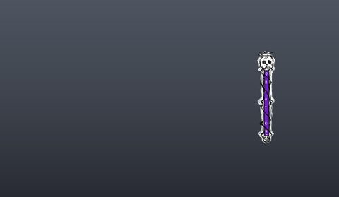</a> <b>Sidebar</b></td>
<td width="33%" valign="top"><a href="screenshots/04_Sidebar__Full.jpg">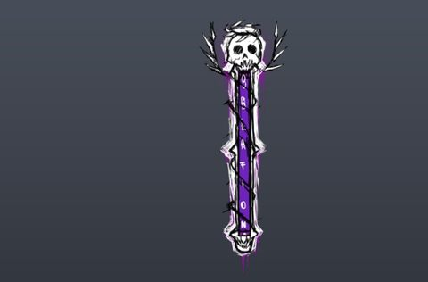</a> <b>Sidebar</b> › Full</td>
<td width="33%" valign="top"><a href="screenshots/05_Sidebarbackupbackup__Full.jpg">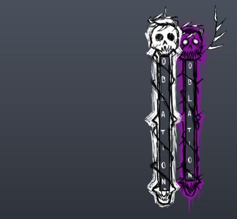</a> <b>Sidebarbackupbackup</b> › Full</td>
</tr>
<tr>
<td width="33%" valign="top"><a href="screenshots/12_Sidebar.jpg">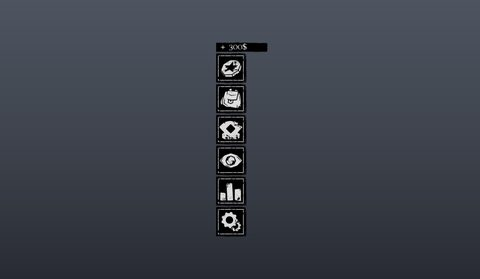</a> <b>Sidebar</b></td>
</tr>
</table>

### Map vote / teams / matchmaking

<table>
<tr>
<td width="33%" valign="top"><a href="screenshots/10_BackgroundUI.jpg">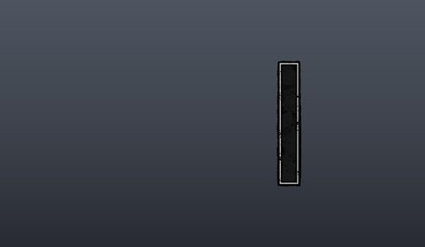</a> <b>BackgroundUI</b></td>
<td width="33%" valign="top"><a href="screenshots/18_RoundTimer.jpg">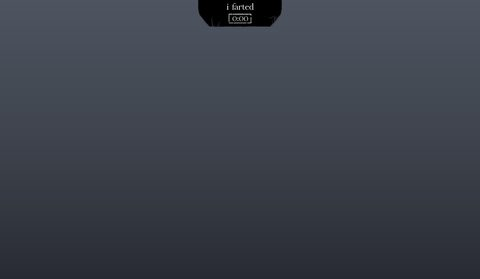</a> <b>RoundTimer</b></td>
<td width="33%" valign="top"><a href="screenshots/19_RoundTimerOLd.jpg">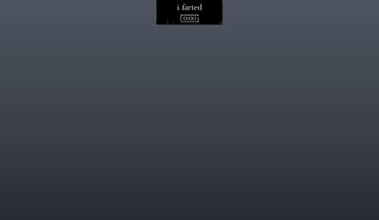</a> <b>RoundTimerOLd</b></td>
</tr>
<tr>
<td width="33%" valign="top"> <b>RoundTimer</b></td>
</tr>
</table>

### Other

<table>
<tr>
<td width="33%" valign="top"><a href="screenshots/22_PlayerInfo.jpg">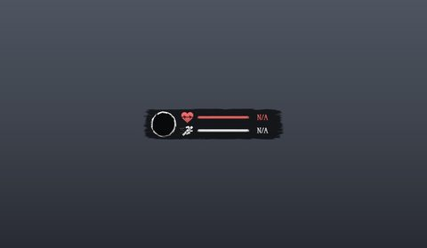</a> <b>PlayerInfo</b></td>
</tr>
</table>

## Model previews

<table>
<tr>
<td width="25%" valign="top"><a href="models/ReplicatedStorage/Assets/Skins/Killers/1x1x1x1/Red1x1x1x1/Config/Swords.rbxm">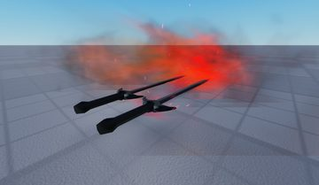</a> <b>Swords</b> <code>models/ReplicatedStorage/Assets/Skins/Killers/1x1x1x1/Red1x1x1x1/Config/Swords.rbxm</code></td>
<td width="25%" valign="top"><a href="models/ReplicatedStorage/Assets/Items/GravityGun/Item.rbxm">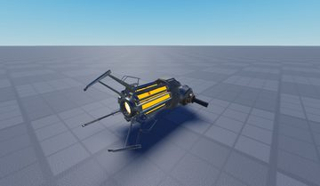</a> <b>Item</b> <code>models/ReplicatedStorage/Assets/Items/GravityGun/Item.rbxm</code></td>
<td width="25%" valign="top"><a href="models/Workspace/Map/Lobby/Interior/Televisor.rbxm">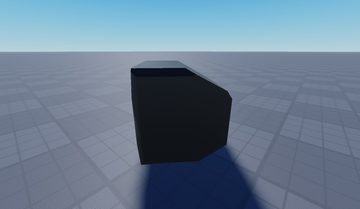</a> <b>Televisor</b> <code>models/Workspace/Map/Lobby/Interior/Televisor.rbxm</code></td>
<td width="25%" valign="top"><a href="models/Workspace/Map/Lobby/Interior/Chest.rbxm">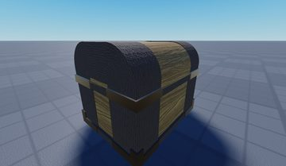</a> <b>Chest</b> <code>models/Workspace/Map/Lobby/Interior/Chest.rbxm</code></td>
</tr>
<tr>
<td width="25%" valign="top"><a href="models/ReplicatedStorage/Assets/Emotes/_MissTheQuiet/EmoteHatAsset.rbxm">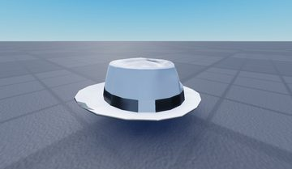</a> <b>EmoteHatAsset</b> <code>models/ReplicatedStorage/Assets/Emotes/_MissTheQuiet/EmoteHatAsset.rbxm</code></td>
<td width="25%" valign="top"><a href="models/ServerStorage/Assets/Maps/HorrorHotel/Map/IDK.rbxm">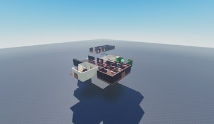</a> <b>IDK</b> <code>models/ServerStorage/Assets/Maps/HorrorHotel/Map/IDK.rbxm</code></td>
<td width="25%" valign="top"><a href="models/ServerStorage/Assets/Maps/UltimateAssassinGrounds/Map/Structures/Jungle%20Gyms/Rock%20Formation~2.rbxm">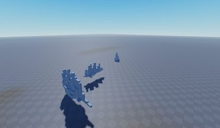</a> <b>Rock Formation~2</b> <code>models/ServerStorage/Assets/Maps/UltimateAssassinGrounds/Map/Structures/Jungle Gyms/Rock Formation~2.rbxm</code></td>
<td width="25%" valign="top"><a href="models/ServerStorage/Assets/Maps/UltimateAssassinGrounds/Map/Map/Tree.rbxm">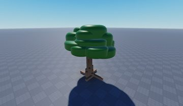</a> <b>Tree</b> <code>models/ServerStorage/Assets/Maps/UltimateAssassinGrounds/Map/Map/Tree.rbxm</code></td>
</tr>
<tr>
<td width="25%" valign="top"><a href="models/ReplicatedStorage/Assets/Emotes/_MissTheQuiet/Hand/RightHandle.rbxm">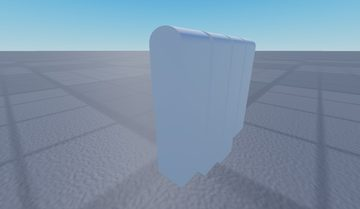</a> <b>RightHandle</b> <code>models/ReplicatedStorage/Assets/Emotes/_MissTheQuiet/Hand/RightHandle.rbxm</code></td>
<td width="25%" valign="top"><a href="models/Workspace/Map/Lobby/Interior/Model__x20.rbxm">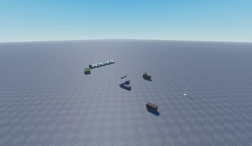</a> <b>Model__x20</b> <code>models/Workspace/Map/Lobby/Interior/Model__x20.rbxm</code></td>
<td width="25%" valign="top"><a href="models/ServerStorage/Assets/Maps/HorrorHotel/Map/Slender.rbxm">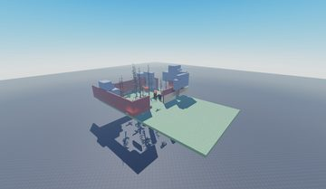</a> <b>Slender</b> <code>models/ServerStorage/Assets/Maps/HorrorHotel/Map/Slender.rbxm</code></td>
<td width="25%" valign="top"><a href="models/Workspace/Map/Lobby/Interior/Host%20Stand.rbxm">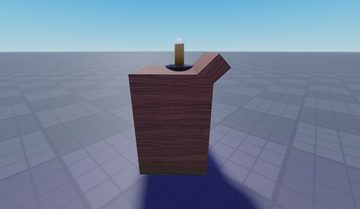</a> <b>Host Stand</b> <code>models/Workspace/Map/Lobby/Interior/Host Stand.rbxm</code></td>
</tr>
<tr>
<td width="25%" valign="top"><a href="models/ServerStorage/Assets/Maps/UltimateAssassinGrounds/Map/Map/Flower%20Bed.rbxm">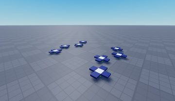</a> <b>Flower Bed</b> <code>models/ServerStorage/Assets/Maps/UltimateAssassinGrounds/Map/Map/Flower Bed.rbxm</code></td>
</tr>
</table>

## Notable scripts

Top-scored scripts of this game per topic (full tree in [source/scripts](source/scripts/)).

| Topic | Scripts |
|---|---|
| UI animation (tweens, hover / click, pop-ins, springs) | [`Inventory`](source/scripts/ReplicatedStorage/Systems/Player/UI/Menus/Inventory.lua) 665 lines [`Shop`](source/scripts/ReplicatedStorage/Systems/Player/UI/Menus/Shop.lua) 748 lines [`Util`](source/scripts/ReplicatedStorage/Modules/Util.lua) 1284 lines [`Behavior`](source/scripts/ReplicatedStorage/Assets/Skins/Survivors/Dusekkar/_GhosdeeriIfTheyLockedIn/Behavior.lua) 538 lines [`Behavior`](source/scripts/ReplicatedStorage/Assets/Survivors/Dusekkar/Behavior.lua) 539 lines |
| UI controllers / window managers / menus | [`Container`](source/scripts/ReplicatedStorage/Modules/Icon/Elements/Container.lua) 135 lines [`Menu`](source/scripts/ReplicatedStorage/Modules/Icon/Elements/Menu.lua) 211 lines [`Overflow`](source/scripts/ReplicatedStorage/Modules/Icon/Features/Overflow.lua) 254 lines [`RadialMenu`](source/scripts/ReplicatedStorage/Systems/Character/Game/Emotes/RadialMenu.lua) 198 lines [`Behavior`](source/scripts/ReplicatedStorage/Assets/Killers/1x1x1x1/Behavior.lua) 816 lines |
| Notifications, toasts, popups, prompts | [`Behavior`](source/scripts/ReplicatedStorage/Assets/Killers/1x1x1x1/Behavior.lua) 816 lines [`DialogHandler`](source/scripts/ReplicatedStorage/Systems/Player/UI/DialogHandler.lua) 515 lines [`DisplayProductPurchase`](source/scripts/ReplicatedStorage/Systems/Player/Miscellaneous/DisplayProductPurchase.lua) 95 lines [`Items`](source/scripts/ReplicatedStorage/Modules/Items.lua) 249 lines |
| Loading / intro screens | [`Loading`](source/scripts/ReplicatedFirst/Loading.client.lua) 104 lines [`Util`](source/scripts/ReplicatedStorage/Modules/Util.lua) 1284 lines |
| Camera, cutscenes, screen shake | [`ShakeyCamWhenLow`](source/scripts/ReplicatedStorage/Systems/Character/QualityOfLife/ShakeyCamWhenLow.lua) 57 lines [`RoundNetwork`](source/scripts/ReplicatedStorage/Systems/Player/Networks/RoundNetwork.lua) 352 lines [`Behavior`](source/scripts/ReplicatedStorage/Assets/Skins/Survivors/Chance/_CassidyChance/Behavior.lua) 398 lines [`Behavior`](source/scripts/ReplicatedStorage/Assets/Survivors/Chance/Behavior.lua) 396 lines [`Actors`](source/scripts/ReplicatedStorage/Modules/Actors.lua) 651 lines |
| VFX, particles, beams, hit effects | [`Behavior`](source/scripts/ReplicatedStorage/Assets/Skins/Survivors/Dusekkar/_GhosdeeriIfTheyLockedIn/Behavior.lua) 538 lines [`Behavior`](source/scripts/ReplicatedStorage/Assets/Survivors/Dusekkar/Behavior.lua) 539 lines [`Behavior`](source/scripts/ReplicatedStorage/Assets/Survivors/TwoTime/Behavior.lua) 977 lines [`Behavior`](source/scripts/ReplicatedStorage/Assets/Survivors/TwoTimeButOp/Behavior.lua) 1020 lines [`Behavior`](source/scripts/ReplicatedStorage/Assets/Skins/Survivors/Guest1337/SorcererGuest/Behavior.lua) 91 lines |
| Monetization (dev products, game passes, receipts) | [`Robux`](source/scripts/ReplicatedStorage/Systems/Player/UI/Menus/Shop/Tabs/Robux.lua) 91 lines |
| RNG, eggs, gacha, rarity rolls, pets | [`Behavior`](source/scripts/ReplicatedStorage/Assets/Skins/Survivors/Chance/_CassidyChance/Behavior.lua) 398 lines [`Behavior`](source/scripts/ReplicatedStorage/Assets/Survivors/Chance/Behavior.lua) 396 lines [`Eggrolled`](source/scripts/ReplicatedStorage/Assets/Emotes/Eggrolled.lua) 14 lines |
| Combat, weapons, hitboxes, abilities | [`Hitboxes`](source/scripts/ReplicatedStorage/Modules/Hitboxes.lua) 267 lines [`Behavior`](source/scripts/ReplicatedStorage/Assets/Survivors/OldTwoTIme/Behavior.lua) 716 lines [`Behavior`](source/scripts/ReplicatedStorage/Assets/Survivors/Taph/Behavior.lua) 617 lines [`Behavior`](source/scripts/ReplicatedStorage/Assets/Killers/Jason/Behavior.lua) 580 lines [`Behavior`](source/scripts/ReplicatedStorage/Assets/Survivors/TwoTime/Behavior.lua) 977 lines |
| NPC / AI / monsters | [`ChaseThemesKiller`](source/scripts/ReplicatedStorage/Systems/Character/Game/ChaseThemesKiller.lua) 93 lines [`KillerScreenFXOnSurvivorKill`](source/scripts/ReplicatedStorage/Systems/Character/QualityOfLife/KillerScreenFXOnSurvivorKill.lua) 96 lines |
| Character movement (sprint, dash, double jump, slide) | [`Sprinting`](source/scripts/ReplicatedStorage/Systems/Character/Game/Sprinting.lua) 211 lines [`Behavior`](source/scripts/ReplicatedStorage/Assets/Killers/__KillerNoli/Behavior.lua) 621 lines [`Behavior`](source/scripts/ReplicatedStorage/Assets/Killers/__KillerNoliRework/Behavior.lua) 602 lines [`Behavior`](source/scripts/ReplicatedStorage/Assets/Survivors/Taph/Behavior.lua) 617 lines [`Util`](source/scripts/ReplicatedStorage/Modules/Util.lua) 1284 lines |
| Tycoon / plots / bases / building | [`Behavior`](source/scripts/ReplicatedStorage/Assets/Survivors/Builderman/Behavior.lua) 684 lines |
| Sound & music | [`Sounds`](source/scripts/ReplicatedStorage/Modules/Sounds.lua) 275 lines [`Behavior`](source/scripts/ReplicatedStorage/Assets/Killers/1x1x1x1/Behavior.lua) 816 lines [`Behavior`](source/scripts/ReplicatedStorage/Assets/Killers/Jason/Behavior.lua) 580 lines [`Behavior`](source/scripts/ReplicatedStorage/Assets/Killers/JohnDoe/Behavior.lua) 578 lines [`Behavior`](source/scripts/ReplicatedStorage/Assets/Skins/Killers/JohnDoe/SK/Behavior.lua) 464 lines |
| Utility modules (number format, signals, tables, timers) | [`AdminManager`](source/scripts/ServerStorage/ServerSystems/AdminManager.lua) 92 lines |

## ⚠️ Safety

HIGH flags (backdoors, `require(id)`, `loadstring`, webhooks). Review or delete before reusing:

- `scripts/ReplicatedStorage/Systems/Player/UI/Menus/Inventory/Tabs/Emotes.lua`
- `scripts/ServerScriptService/Core/Join_Leave.server.lua`

## Folders

| Folder | What |
|---|---|
| `screenshots/` | full frames; `crops/` = the panel only; `models/` = 3D previews; `thumbs/` = gallery thumbnails |
| `ui/` | every screen as a Lua builder (`require(module)()` returns the ScreenGui); `_StarterGui-all.lua` builds every StarterGui screen |
| `models/` | every model as .rbxm (the only .rbxm files), mirroring the place tree, scripts removed |
| `map/` | `workspace.rbxm` (the map as a model), `lighting.lua` (sky + post effects), `materials.lua`, `Environment.lua` |
| `animations/`, `audio/` | KeyframeSequence / Sound builders (.lua), `AnimationIds.lua`, `Sounds.lua` |
| `source/` | all scripts as .luau, `tree.txt`, `ui.txt`, `remotes.txt`, `assets.txt`, `flags.txt` |
