# Forsaken (mtsowiks remake)

> 👻 **Horror** · asymmetric horror (killer vs survivors) · source file `my best forsaken made by mtsowiks the goat xD!.rbxl`

[⬅ Back to the catalog](../../README.md) · [Assets inventory](ASSETS.md) · [Style numbers](reference.md) · [Scripts](source/scripts/) · [Code analysis](source/README.md)

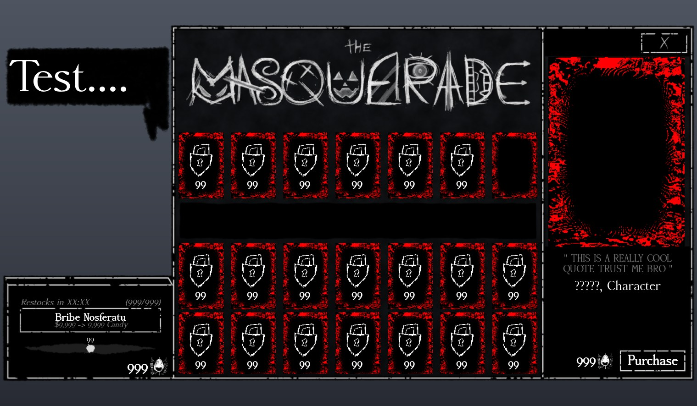

## At a glance

| | |
|---|---|
| Provenance | copy of a live game (saveinstance / decompiled client code) |
| Screens | 26 ScreenGuis, 491 GUI objects → **23 screenshots** |
| Models (.rbxm) | 2191 models, 52 model sets, 35 VFX sets |
| Lua builders (.lua) | 315 UI screens, 529 animation packs, 16 audio packs |
| Code | 2007 scripts, 157,311 lines |
| Asset ids | 444 animations, 556 sounds |
| Safety scan | 2 HIGH / 16 MED flags ([flags.txt](source/flags.txt)) |

**Fonts:** `AccanthisADFStd Bold`×30, `AccanthisADFStd Regular`×28, `SourceSansPro Regular`×23, `Arial Regular`×14, `SourceSansPro Bold`×11

## UI screenshots

Captured in Studio from the place's own ScreenGuis (scripts stripped). Each panel was opened on its own; click a thumbnail for the full 1519×886 frame. Runtime-filled lists (shop items, inventories) show their template state.

### Shop & Robux store

<table>
<tr>
<td width="33%" valign="top"><a href="screenshots/10_ShopScreen.jpg">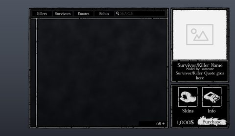</a> <b>ShopScreen</b></td>
</tr>
</table>

### Inventory / backpack / pets

<table>
<tr>
<td width="33%" valign="top"><a href="screenshots/09_InventoryScreen.jpg">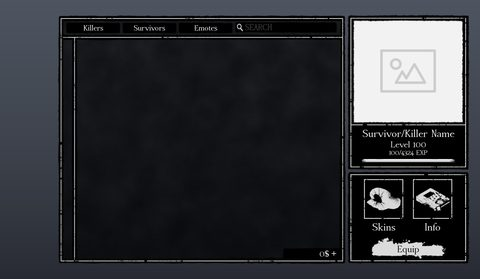</a> <b>InventoryScreen</b></td>
</tr>
</table>

### Quests & progression

<table>
<tr>
<td width="33%" valign="top"><a href="screenshots/05_Achievement.jpg">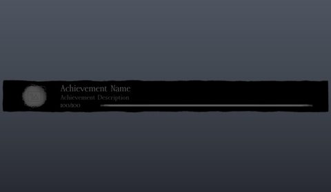</a> <b>Achievement</b></td>
</tr>
</table>

### Settings & menus

<table>
<tr>
<td width="33%" valign="top"><a href="screenshots/07_EmoteMenuHolder.jpg">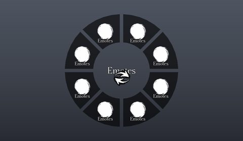</a> <b>EmoteMenuHolder</b></td>
</tr>
</table>

### Popups, notifications, prompts

<table>
<tr>
<td width="33%" valign="top"><a href="screenshots/02_DialogMain.jpg">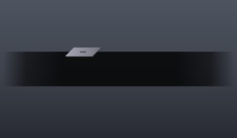</a> <b>DialogMain</b></td>
</tr>
</table>

### Loading & intro

<table>
<tr>
<td width="33%" valign="top"><a href="screenshots/01_LoadingGui.jpg">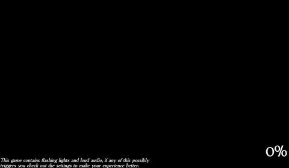</a> <b>LoadingGui</b></td>
</tr>
</table>

### Leaderboards & stats

<table>
<tr>
<td width="33%" valign="top"><a href="screenshots/16_PlayerStats.jpg">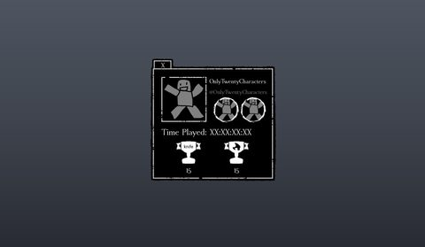</a> <b>PlayerStats</b></td>
</tr>
</table>

### End of round, death, results

<table>
<tr>
<td width="33%" valign="top"><a href="screenshots/14_EndScreen.jpg">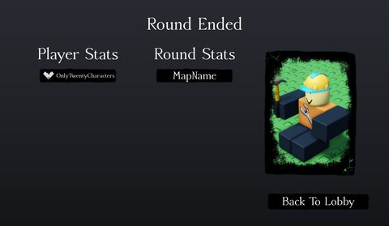</a> <b>EndScreen</b></td>
</tr>
</table>

### HUD & currency

<table>
<tr>
<td width="33%" valign="top"><a href="screenshots/03_Bottombar.jpg">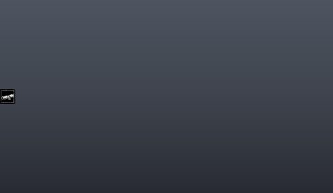</a> <b>Bottombar</b></td>
<td width="33%" valign="top"><a href="screenshots/04_Sidebar.jpg">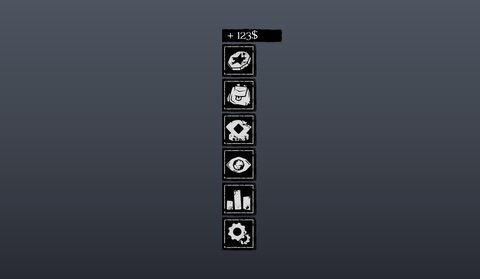</a> <b>Sidebar</b></td>
<td width="33%" valign="top"><a href="screenshots/19_Sidebarbackupbackup__Full.jpg">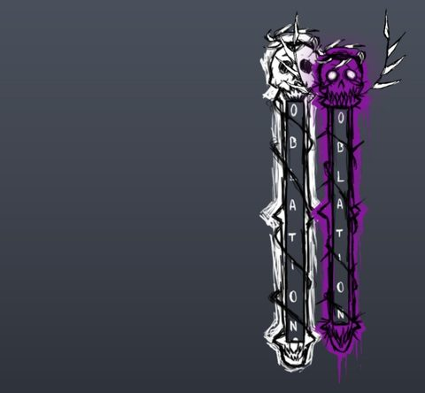</a> <b>Sidebarbackupbackup</b> › Full</td>
</tr>
<tr>
<td width="33%" valign="top"><a href="screenshots/20_Sidebar.jpg">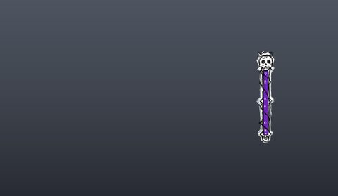</a> <b>Sidebar</b></td>
<td width="33%" valign="top"><a href="screenshots/21_Sidebar__Full.jpg">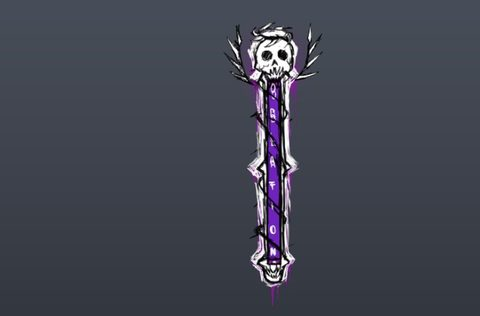</a> <b>Sidebar</b> › Full</td>
</tr>
</table>

### Character / avatar / emotes

<table>
<tr>
<td width="33%" valign="top"><a href="screenshots/08_EmoteMenuHolder__ExtraEmotes.jpg">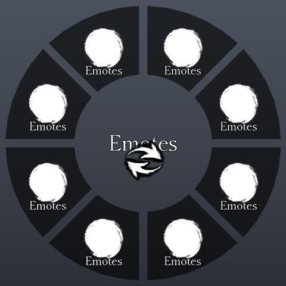</a> <b>EmoteMenuHolder</b> › ExtraEmotes</td>
</tr>
</table>

### Map vote / teams / matchmaking

<table>
<tr>
<td width="33%" valign="top"><a href="screenshots/11_RoundTimer.jpg">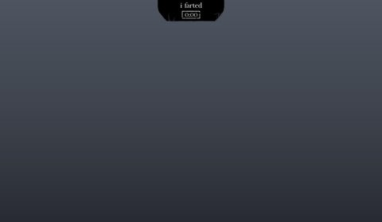</a> <b>RoundTimer</b></td>
<td width="33%" valign="top"><a href="screenshots/12_RoundTimerOLd.jpg">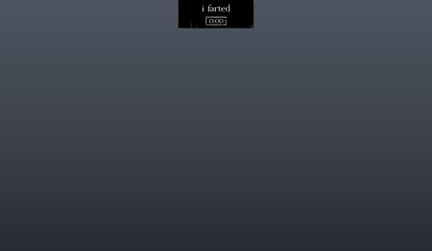</a> <b>RoundTimerOLd</b></td>
<td width="33%" valign="top"> <b>RoundTimer</b></td>
</tr>
<tr>
<td width="33%" valign="top"><a href="screenshots/17_BackgroundUI.jpg">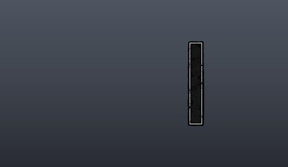</a> <b>BackgroundUI</b></td>
</tr>
</table>

### Other

<table>
<tr>
<td width="33%" valign="top"><a href="screenshots/06_PranksterComet.jpg">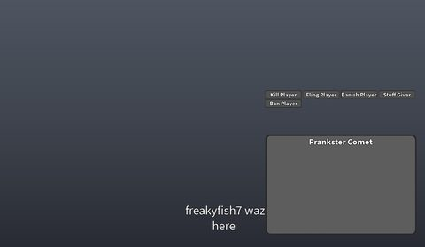</a> <b>PranksterComet</b></td>
<td width="33%" valign="top"><a href="screenshots/15_PlayerInfo.jpg">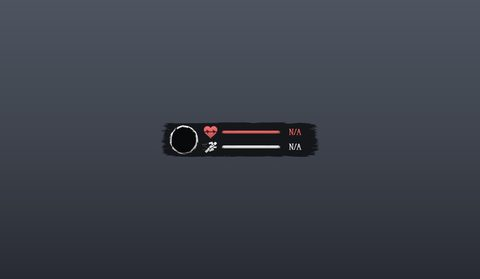</a> <b>PlayerInfo</b></td>
<td width="33%" valign="top"><a href="screenshots/22_EventUI.jpg">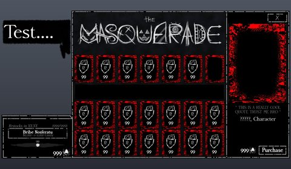</a> <b>EventUI</b></td>
</tr>
<tr>
<td width="33%" valign="top"><a href="screenshots/23_c00lgui__Frame.jpg">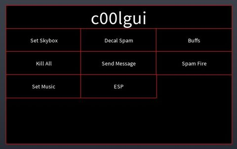</a> <b>c00lgui</b> › Frame</td>
<td width="33%" valign="top"><a href="screenshots/31_TestingGUI.jpg">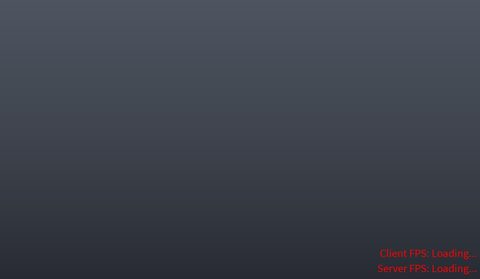</a> <b>TestingGUI</b></td>
</tr>
</table>

## Model previews

<table>
<tr>
<td width="25%" valign="top"><a href="models/ReplicatedStorage/Assets/Skins/Killers/1x1x1x1/Toon1x1x1x1/Config/Swords.rbxm">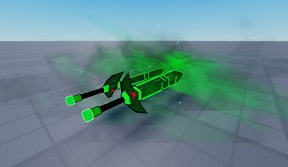</a> <b>Swords</b> <code>models/ReplicatedStorage/Assets/Skins/Killers/1x1x1x1/Toon1x1x1x1/Config/Swords.rbxm</code></td>
<td width="25%" valign="top"><a href="models/ReplicatedStorage/Assets/Items/GravityGun/Item.rbxm">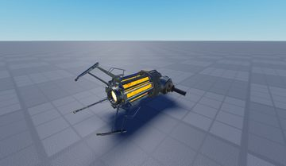</a> <b>Item</b> <code>models/ReplicatedStorage/Assets/Items/GravityGun/Item.rbxm</code></td>
<td width="25%" valign="top"><a href="models/Workspace/Map/Lobby/Interior/Model__x69.rbxm">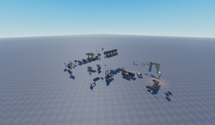</a> <b>Model__x69</b> <code>models/Workspace/Map/Lobby/Interior/Model__x69.rbxm</code></td>
<td width="25%" valign="top"><a href="models/ServerStorage/Assets/Maps/BloodfellManor/Map/Map/WallLanterns/WallLantern__x120.rbxm">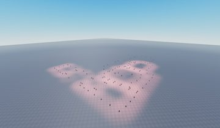</a> <b>WallLantern__x120</b> <code>models/ServerStorage/Assets/Maps/BloodfellManor/Map/Map/WallLanterns/WallLantern__x120.rbxm</code></td>
</tr>
<tr>
<td width="25%" valign="top"><a href="models/ServerStorage/Assets/Maps/BloodfellManor/Map/Map/OuterBuilding.rbxm">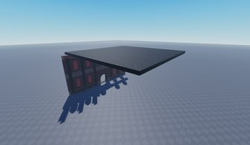</a> <b>OuterBuilding</b> <code>models/ServerStorage/Assets/Maps/BloodfellManor/Map/Map/OuterBuilding.rbxm</code></td>
<td width="25%" valign="top"><a href="models/ReplicatedStorage/Assets/Emotes/Rodrick/Camcorder.rbxm">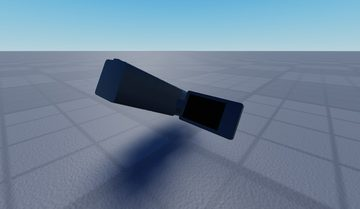</a> <b>Camcorder</b> <code>models/ReplicatedStorage/Assets/Emotes/Rodrick/Camcorder.rbxm</code></td>
<td width="25%" valign="top"><a href="models/Workspace/Map/Lobby/Environment/Board.rbxm">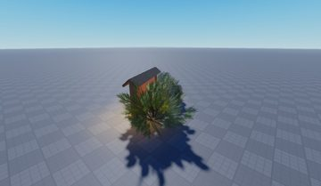</a> <b>Board</b> <code>models/Workspace/Map/Lobby/Environment/Board.rbxm</code></td>
<td width="25%" valign="top"><a href="models/Workspace/Map/Lobby/Interior/Televisor.rbxm">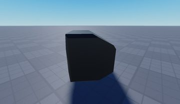</a> <b>Televisor</b> <code>models/Workspace/Map/Lobby/Interior/Televisor.rbxm</code></td>
</tr>
<tr>
<td width="25%" valign="top"><a href="models/ServerStorage/Assets/Maps/BloodfellManor/Map/Map/Chandelier.rbxm">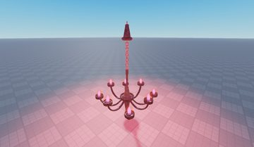</a> <b>Chandelier</b> <code>models/ServerStorage/Assets/Maps/BloodfellManor/Map/Map/Chandelier.rbxm</code></td>
<td width="25%" valign="top"><a href="models/Workspace/Map/Lobby/Interior/Host%20Stand.rbxm">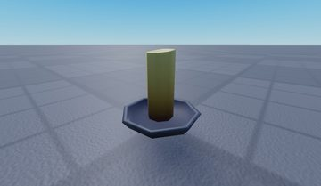</a> <b>Host Stand</b> <code>models/Workspace/Map/Lobby/Interior/Host Stand.rbxm</code></td>
<td width="25%" valign="top"><a href="models/ReplicatedStorage/Assets/Emotes/Sukuna/LeftHandle.rbxm">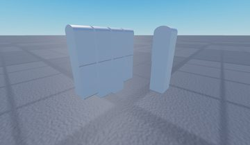</a> <b>LeftHandle</b> <code>models/ReplicatedStorage/Assets/Emotes/Sukuna/LeftHandle.rbxm</code></td>
<td width="25%" valign="top"><a href="models/Workspace/Map/Lobby/Environment/Folder/Sign.rbxm">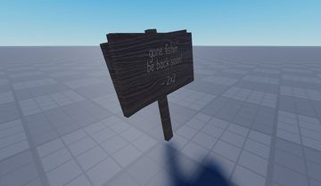</a> <b>Sign</b> <code>models/Workspace/Map/Lobby/Environment/Folder/Sign.rbxm</code></td>
</tr>
<tr>
<td width="25%" valign="top"><a href="models/Workspace/Map/Lobby/Interior/Table%20Mid%20Century.rbxm">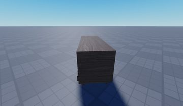</a> <b>Table Mid Century</b> <code>models/Workspace/Map/Lobby/Interior/Table Mid Century.rbxm</code></td>
</tr>
</table>

## Notable scripts

Top-scored scripts of this game per topic (full tree in [source/scripts](source/scripts/)).

| Topic | Scripts |
|---|---|
| UI animation (tweens, hover / click, pop-ins, springs) | [`EventShopClient`](source/scripts/ReplicatedStorage/Assets/EventStorage/2025_MASQUERADE/UI/EventShopClient.lua) 725 lines [`Behavior`](source/scripts/ReplicatedStorage/Assets/Killers/Noli/Behavior.lua) 1864 lines [`Util`](source/scripts/ReplicatedStorage/Modules/Util.lua) 2099 lines [`Behavior`](source/scripts/ReplicatedStorage/Assets/Killers/1x1x1x1/Behavior.lua) 1360 lines [`DebugUi`](source/scripts/ReplicatedStorage/Modules/Misc/SmartBone/Dependencies/Debug/DebugUi.lua) 511 lines |
| UI controllers / window managers / menus | [`Menu`](source/scripts/ReplicatedStorage/Modules/Misc/SmartBone/Dependencies/Iris/widgets/Menu.lua) 558 lines [`Window`](source/scripts/ReplicatedStorage/Modules/Misc/SmartBone/Dependencies/Iris/widgets/Window.lua) 751 lines [`demoWindow`](source/scripts/ReplicatedStorage/Modules/Misc/SmartBone/Dependencies/Iris/demoWindow.lua) 1881 lines [`DebugUi`](source/scripts/ReplicatedStorage/Modules/Misc/SmartBone/Dependencies/Debug/DebugUi.lua) 511 lines [`Combo`](source/scripts/ReplicatedStorage/Modules/Misc/SmartBone/Dependencies/Iris/widgets/Combo.lua) 436 lines |
| Notifications, toasts, popups, prompts | [`NotificationDisplay`](source/scripts/ReplicatedStorage/Systems/Player/Miscellaneous/NotificationDisplay.lua) 112 lines [`Server`](source/scripts/ReplicatedStorage/Modules/CommonObjectives/SetupGenerators/Generator/Scripts/Server.server.lua) 145 lines [`Behavior`](source/scripts/ReplicatedStorage/Assets/Killers/1x1x1x1/Behavior.lua) 1360 lines [`EventShopClient`](source/scripts/ReplicatedStorage/Assets/EventStorage/2025_MASQUERADE/UI/EventShopClient.lua) 725 lines [`Client`](source/scripts/ServerStorage/Assets/Maps/BloodfellManor/Map/GeneratorPositions/Generator/Scripts/Client.server.lua) 433 lines |
| Loading / intro screens | [`Loading`](source/scripts/ReplicatedFirst/Loading.client.lua) 159 lines [`2025_MASQUERADE_Client`](source/scripts/ReplicatedStorage/Events/2025_MASQUERADE_Client.lua) 160 lines [`Chamber`](source/scripts/ReplicatedStorage/Assets/EventStorage/2025_MASQUERADE/POIs/Chamber.lua) 240 lines [`Util`](source/scripts/ReplicatedStorage/Modules/Util.lua) 2099 lines [`Behavior`](source/scripts/ReplicatedStorage/Assets/Skins/Survivors/Chance/KingOfPranksChance/Behavior.lua) 45 lines |
| Camera, cutscenes, screen shake | [`Behavior`](source/scripts/ReplicatedStorage/Assets/Killers/1x1x1x1/Behavior.lua) 1360 lines [`Behavior`](source/scripts/ReplicatedStorage/Assets/Killers/Slasher/Behavior.lua) 777 lines [`NewBehavior`](source/scripts/ReplicatedStorage/Assets/Killers/Slasher/NewBehavior.lua) 749 lines [`OldBehavior`](source/scripts/ReplicatedStorage/Assets/Killers/Slasher/OldBehavior.lua) 679 lines [`Behavior`](source/scripts/ReplicatedStorage/Assets/Skins/Killers/Noli/%21AsgoreNoli/Behavior.lua) 521 lines |
| VFX, particles, beams, hit effects | [`Behavior`](source/scripts/ReplicatedStorage/Assets/Skins/Killers/Noli/AdminNoli/Behavior.lua) 274 lines [`Behavior`](source/scripts/ReplicatedStorage/Assets/Survivors/Dusekkar/Behavior.lua) 578 lines [`Behavior`](source/scripts/ReplicatedStorage/Assets/Skins/Survivors/Guest1337/%23DamienGuest/Behavior.lua) 117 lines [`Behavior`](source/scripts/ReplicatedStorage/Assets/Killers/1x1x1x1/Behavior.lua) 1360 lines [`Behavior`](source/scripts/ReplicatedStorage/Assets/Skins/Killers/Slasher/WhitePumpkinSlasher/Behavior.lua) 199 lines |
| RNG, eggs, gacha, rarity rolls, pets | [`Config`](source/scripts/ReplicatedStorage/Assets/Skins/Survivors/Chance/LuckRollChance/Config.lua) 67 lines [`Util`](source/scripts/ReplicatedStorage/Modules/Util.lua) 2099 lines [`Dialog`](source/scripts/ReplicatedStorage/Assets/EventStorage/2025_MASQUERADE/UI/EventShopClient/Dialog.lua) 72 lines [`Eggrolled`](source/scripts/ReplicatedStorage/Assets/Emotes/Eggrolled.lua) 16 lines |
| Combat, weapons, hitboxes, abilities | [`Behavior`](source/scripts/ReplicatedStorage/Assets/Killers/JohnDoe/Behavior.lua) 811 lines [`Behavior`](source/scripts/ReplicatedStorage/Assets/Killers/Noli/Behavior.lua) 1864 lines [`Behavior`](source/scripts/ReplicatedStorage/Assets/Killers/Nosferatu/Behavior.lua) 2205 lines [`Behavior`](source/scripts/ReplicatedStorage/Assets/Skins/Survivors/Guest1337/%23KJGuest/Behavior.lua) 240 lines [`Behavior`](source/scripts/ReplicatedStorage/Assets/Survivors/Veeronica/Behavior.lua) 1866 lines |
| Character movement (sprint, dash, double jump, slide) | [`Behavior`](source/scripts/ReplicatedStorage/Assets/Killers/1x1x1x1/Behavior.lua) 1360 lines [`FakeNoli`](source/scripts/ReplicatedStorage/Modules/StatusEffects/KillerExclusive/Hallucination/HallucinationClass/FakeNoli.lua) 576 lines [`Behavior`](source/scripts/ReplicatedStorage/Assets/Killers/Nosferatu/Behavior.lua) 2205 lines [`Behavior`](source/scripts/ReplicatedStorage/Assets/Survivors/Veeronica/Behavior.lua) 1866 lines [`Behavior`](source/scripts/ReplicatedStorage/Assets/Killers/Noli/Behavior.lua) 1864 lines |
| Tycoon / plots / bases / building | [`Behavior`](source/scripts/ReplicatedStorage/Assets/Survivors/Builderman/Behavior.lua) 747 lines [`Behavior`](source/scripts/ReplicatedStorage/Assets/Killers/Nosferatu/Behavior.lua) 2205 lines [`Behavior`](source/scripts/ReplicatedStorage/Assets/Killers/Noli/Behavior.lua) 1864 lines [`Util`](source/scripts/ReplicatedStorage/Modules/Util.lua) 2099 lines [`Behavior`](source/scripts/ReplicatedStorage/Assets/Survivors/Veeronica/Behavior.lua) 1866 lines |
| Sound & music | [`Behavior`](source/scripts/ReplicatedStorage/Assets/Killers/1x1x1x1/Behavior.lua) 1360 lines [`Behavior`](source/scripts/ReplicatedStorage/Assets/Killers/%21SukunaKiller/Behavior.lua) 464 lines [`Behavior`](source/scripts/ReplicatedStorage/Assets/Killers/JohnDoe/Behavior.lua) 811 lines [`OldBehavior`](source/scripts/ReplicatedStorage/Assets/Killers/Slasher/OldBehavior.lua) 679 lines [`Behavior`](source/scripts/ReplicatedStorage/Assets/Skins/Killers/1x1x1x1/%23BoomerFormula1x1x1x1/Behavior.lua) 695 lines |
| Utility modules (number format, signals, tables, timers) | [`Behavior`](source/scripts/ReplicatedStorage/Assets/Killers/%21c00lerkiddEno%20%28Fixed%20by%20BloxerTrue%29/Behavior.lua) 308 lines [`Behavior`](source/scripts/ReplicatedStorage/Assets/Killers/1x1x1x1/Behavior.lua) 1360 lines [`PlayerManager`](source/scripts/ServerScriptService/Server/Systems/Core/PlayerManager.lua) 153 lines [`Behavior`](source/scripts/ReplicatedStorage/Assets/Killers/Noli/Behavior.lua) 1864 lines [`Config`](source/scripts/ReplicatedStorage/Assets/Survivors/Veeronica/Config.lua) 296 lines |

## ⚠️ Safety

HIGH flags (backdoors, `require(id)`, `loadstring`, webhooks). Review or delete before reusing:

- `scripts/ReplicatedStorage/Assets/Skins/Killers/c00lkidd/#LoreAccurateC00l/Config/c00lgui/Frame/Frame/HighlightAll/LocalScript.server.lua`
- `scripts/ReplicatedStorage/Systems/Player/UI/Menus/Inventory/Tabs/Emotes.lua`

## Folders

| Folder | What |
|---|---|
| `screenshots/` | full frames; `crops/` = the panel only; `models/` = 3D previews; `thumbs/` = gallery thumbnails |
| `ui/` | every screen as a Lua builder (`require(module)()` returns the ScreenGui); `_StarterGui-all.lua` builds every StarterGui screen |
| `models/` | every model as .rbxm (the only .rbxm files), mirroring the place tree, scripts removed |
| `map/` | `workspace.rbxm` (the map as a model), `lighting.lua` (sky + post effects), `materials.lua`, `Environment.lua` |
| `animations/`, `audio/` | KeyframeSequence / Sound builders (.lua), `AnimationIds.lua`, `Sounds.lua` |
| `source/` | all scripts as .luau, `tree.txt`, `ui.txt`, `remotes.txt`, `assets.txt`, `flags.txt` |
