# Forsaken (uncopylocked)

> 👻 **Horror** · asymmetric horror (killer vs survivors) · source file `Forsaken Uncopylocked.rbxl`

[⬅ Back to the catalog](../../README.md) · [Assets inventory](ASSETS.md) · [Style numbers](reference.md) · [Scripts](source/scripts/) · [Code analysis](source/README.md)

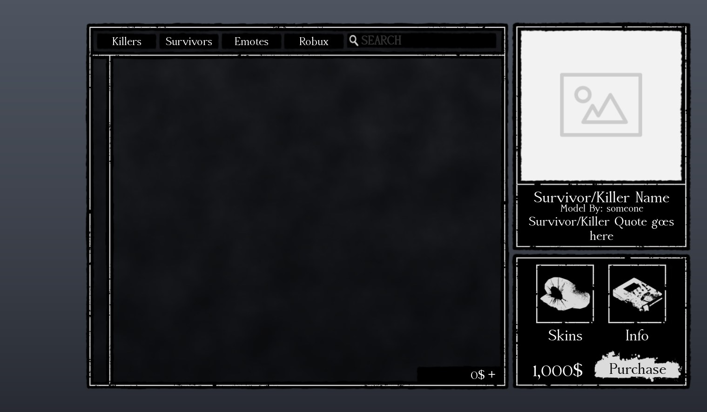

## At a glance

| | |
|---|---|
| Provenance | copy of a live game (saveinstance / decompiled client code) |
| Screens | 22 ScreenGuis, 886 GUI objects → **27 screenshots** |
| Models (.rbxm) | 1833 models, 55 model sets, 33 VFX sets |
| Lua builders (.lua) | 270 UI screens, 215 animation packs, 22 audio packs |
| Code | 1507 scripts, 127,868 lines |
| Asset ids | 888 animations, 593 sounds |
| Safety scan | 2 HIGH / 16 MED flags ([flags.txt](source/flags.txt)) |

**Fonts:** `AccanthisADFStd Bold`×30, `AccanthisADFStd Regular`×27, `SourceSansPro Regular`×23, `SourceSansPro Bold`×11, `Arial Regular`×9

## UI screenshots

Captured in Studio from the place's own ScreenGuis (scripts stripped). Each panel was opened on its own; click a thumbnail for the full 1519×886 frame. Runtime-filled lists (shop items, inventories) show their template state.

### Shop & Robux store

<table>
<tr>
<td width="33%" valign="top"><a href="screenshots/13_ShopScreen.jpg">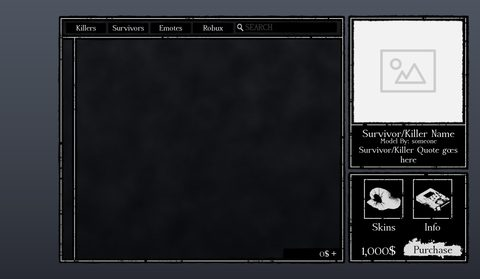</a> <b>ShopScreen</b></td>
</tr>
</table>

### Inventory / backpack / pets

<table>
<tr>
<td width="33%" valign="top"><a href="screenshots/12_InventoryScreen.jpg">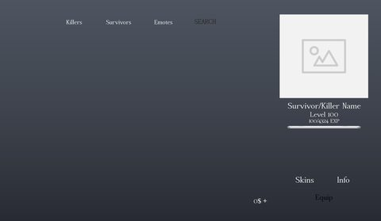</a> <b>InventoryScreen</b></td>
</tr>
</table>

### Quests & progression

<table>
<tr>
<td width="33%" valign="top"><a href="screenshots/08_Achievement.jpg">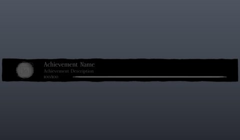</a> <b>Achievement</b></td>
</tr>
</table>

### Settings & menus

<table>
<tr>
<td width="33%" valign="top"><a href="screenshots/10_EmoteMenuHolder.jpg">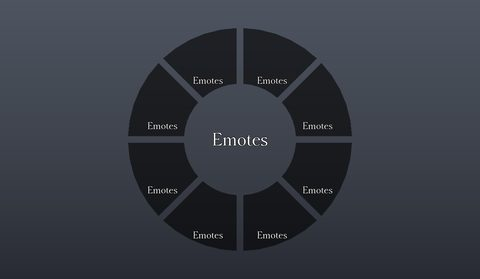</a> <b>EmoteMenuHolder</b></td>
</tr>
</table>

### Popups, notifications, prompts

<table>
<tr>
<td width="33%" valign="top"><a href="screenshots/05_DialogMain.jpg">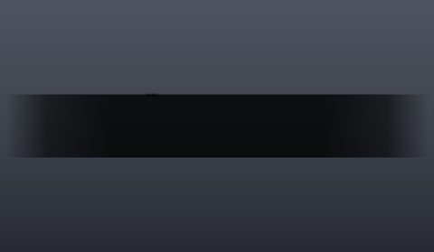</a> <b>DialogMain</b></td>
</tr>
</table>

### Loading & intro

<table>
<tr>
<td width="33%" valign="top"><a href="screenshots/01_LoadingGui.jpg">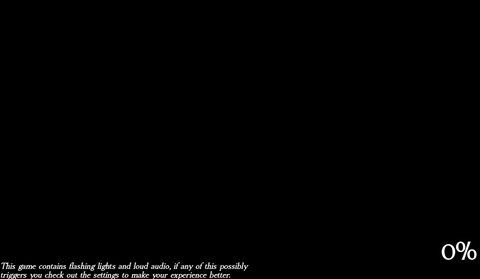</a> <b>LoadingGui</b></td>
<td width="33%" valign="top"> <b>Intro2011X</b></td>
<td width="33%" valign="top"><a href="screenshots/34_Intro2011X.jpg">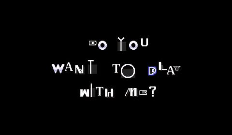</a> <b>Intro2011X</b></td>
</tr>
</table>

### Leaderboards & stats

<table>
<tr>
<td width="33%" valign="top"><a href="screenshots/02_PlayerStats.jpg">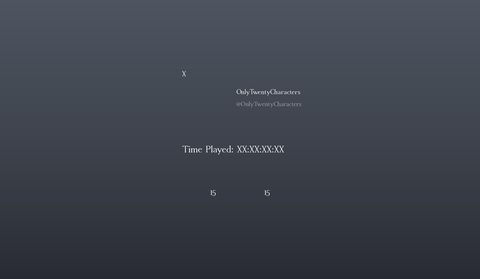</a> <b>PlayerStats</b></td>
</tr>
</table>

### End of round, death, results

<table>
<tr>
<td width="33%" valign="top"><a href="screenshots/17_EndScreen.jpg">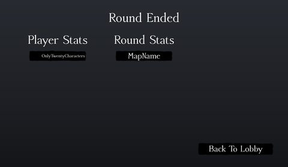</a> <b>EndScreen</b></td>
</tr>
</table>

### HUD & currency

<table>
<tr>
<td width="33%" valign="top"><a href="screenshots/06_Bottombar.jpg">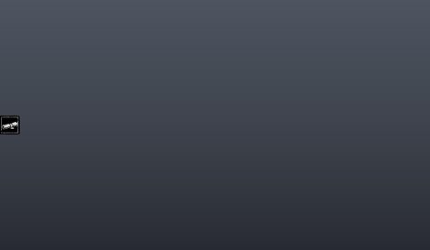</a> <b>Bottombar</b></td>
<td width="33%" valign="top"><a href="screenshots/07_Sidebar.jpg">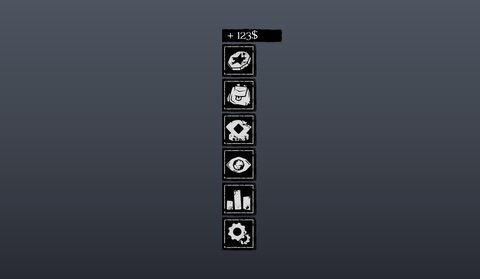</a> <b>Sidebar</b></td>
<td width="33%" valign="top"> <b>Sidebar</b></td>
</tr>
<tr>
<td width="33%" valign="top"><a href="screenshots/28_Sidebar__Full.jpg">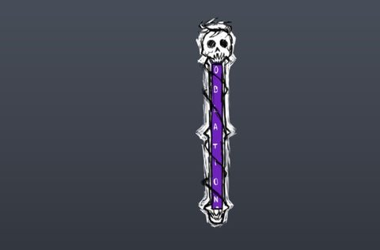</a> <b>Sidebar</b> › Full</td>
<td width="33%" valign="top"><a href="screenshots/29_Sidebarbackupbackup__Full.jpg">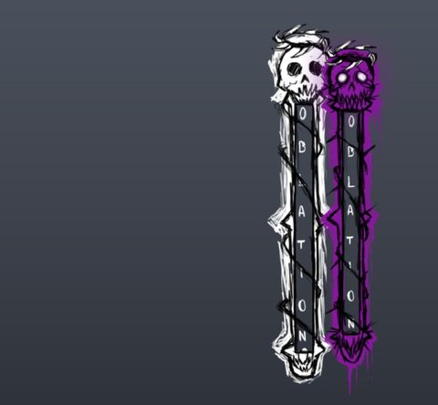</a> <b>Sidebarbackupbackup</b> › Full</td>
<td width="33%" valign="top"><a href="screenshots/31_Sidebar__Full.jpg">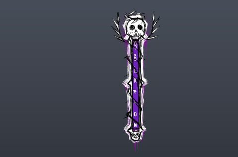</a> <b>Sidebar</b> › Full</td>
</tr>
<tr>
<td width="33%" valign="top"><a href="screenshots/32_Sidebarbackupbackup__Full.jpg">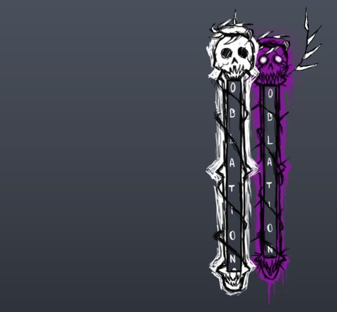</a> <b>Sidebarbackupbackup</b> › Full</td>
</tr>
</table>

### Character / avatar / emotes

<table>
<tr>
<td width="33%" valign="top"><a href="screenshots/11_EmoteMenuHolder__ExtraEmotes.jpg">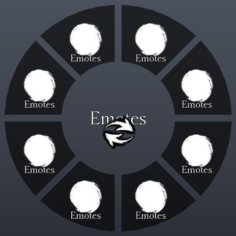</a> <b>EmoteMenuHolder</b> › ExtraEmotes</td>
</tr>
</table>

### Map vote / teams / matchmaking

<table>
<tr>
<td width="33%" valign="top"><a href="screenshots/03_BackgroundUI.jpg">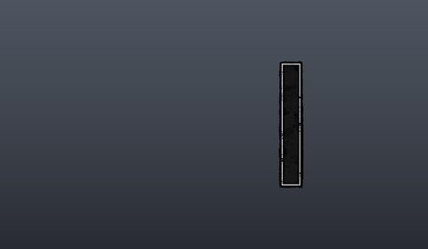</a> <b>BackgroundUI</b></td>
<td width="33%" valign="top"><a href="screenshots/14_RoundTimer.jpg">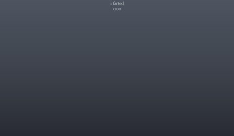</a> <b>RoundTimer</b></td>
<td width="33%" valign="top"><a href="screenshots/15_RoundTimerOLd.jpg">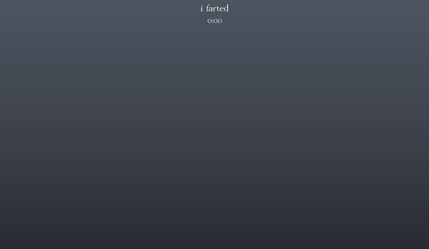</a> <b>RoundTimerOLd</b></td>
</tr>
<tr>
<td width="33%" valign="top"><a href="screenshots/16_RoundTimer.jpg">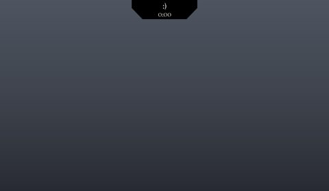</a> <b>RoundTimer</b></td>
</tr>
</table>

### Other

<table>
<tr>
<td width="33%" valign="top"><a href="screenshots/09_PranksterComet.jpg">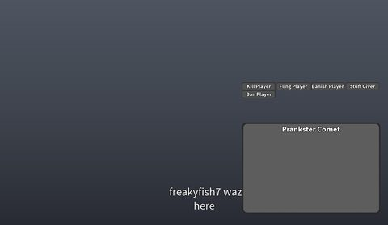</a> <b>PranksterComet</b></td>
<td width="33%" valign="top"><a href="screenshots/18_PlayerInfo.jpg">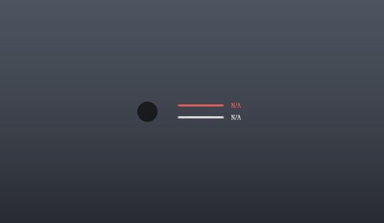</a> <b>PlayerInfo</b></td>
<td width="33%" valign="top"><a href="screenshots/26_c00lgui__Frame.jpg">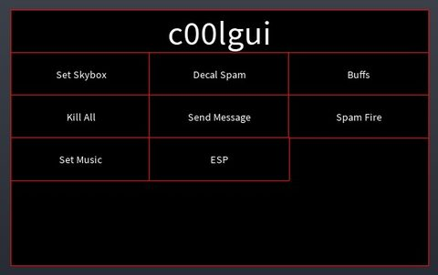</a> <b>c00lgui</b> › Frame</td>
</tr>
<tr>
<td width="33%" valign="top"><a href="screenshots/33_EventUI.jpg">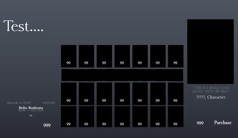</a> <b>EventUI</b></td>
<td width="33%" valign="top"><a href="screenshots/45_TestingGUI.jpg">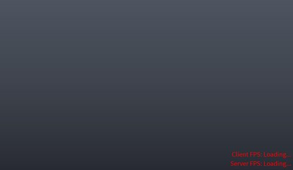</a> <b>TestingGUI</b></td>
</tr>
</table>

## Model previews

<table>
<tr>
<td width="25%" valign="top"><a href="models/ReplicatedStorage/Assets/Skins/Killers/1x1x1x1/Toon1x1x1x1/Config/Swords.rbxm">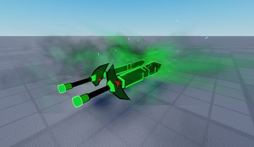</a> <b>Swords</b> <code>models/ReplicatedStorage/Assets/Skins/Killers/1x1x1x1/Toon1x1x1x1/Config/Swords.rbxm</code></td>
<td width="25%" valign="top"><a href="models/ReplicatedStorage/Assets/Items/GravityGun/Item.rbxm">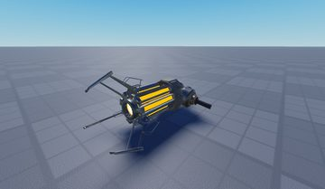</a> <b>Item</b> <code>models/ReplicatedStorage/Assets/Items/GravityGun/Item.rbxm</code></td>
<td width="25%" valign="top"><a href="models/ServerStorage/Assets/Rigs/Survivors/Elliot/BumbleBeeElliot.rbxm">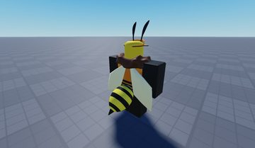</a> <b>BumbleBeeElliot</b> <code>models/ServerStorage/Assets/Rigs/Survivors/Elliot/BumbleBeeElliot.rbxm</code></td>
<td width="25%" valign="top"><a href="models/Workspace/Map/Lobby/Interior/Model__x66.rbxm">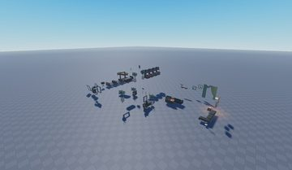</a> <b>Model__x66</b> <code>models/Workspace/Map/Lobby/Interior/Model__x66.rbxm</code></td>
</tr>
<tr>
<td width="25%" valign="top"><a href="models/ServerStorage/Assets/Maps/BloodfellManor/Map/Map/WallLanterns/WallLantern__x120.rbxm">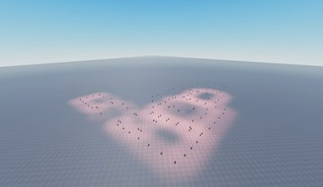</a> <b>WallLantern__x120</b> <code>models/ServerStorage/Assets/Maps/BloodfellManor/Map/Map/WallLanterns/WallLantern__x120.rbxm</code></td>
<td width="25%" valign="top"><a href="models/ServerStorage/Assets/Maps/BloodfellManor/Map/Map/OuterBuilding.rbxm">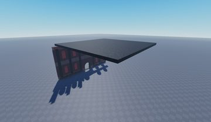</a> <b>OuterBuilding</b> <code>models/ServerStorage/Assets/Maps/BloodfellManor/Map/Map/OuterBuilding.rbxm</code></td>
<td width="25%" valign="top"><a href="models/Workspace/Map/Lobby/Christmas%20Addons/Hat.rbxm">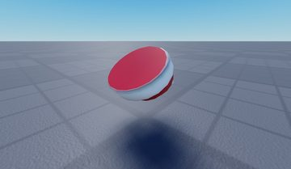</a> <b>Hat</b> <code>models/Workspace/Map/Lobby/Christmas Addons/Hat.rbxm</code></td>
<td width="25%" valign="top"><a href="models/Workspace/Map/Lobby/Christmas%20Addons/Environment/Meshes_Candy%20Cane.rbxm">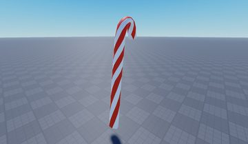</a> <b>Meshes_Candy Cane</b> <code>models/Workspace/Map/Lobby/Christmas Addons/Environment/Meshes_Candy Cane.rbxm</code></td>
</tr>
<tr>
<td width="25%" valign="top"><a href="models/Workspace/Map/Lobby/Environment/Board.rbxm">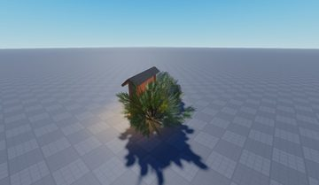</a> <b>Board</b> <code>models/Workspace/Map/Lobby/Environment/Board.rbxm</code></td>
<td width="25%" valign="top"><a href="models/ReplicatedStorage/Assets/Emotes/Sukuna/RightHandle.rbxm">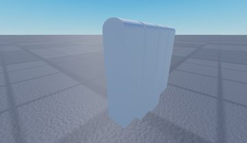</a> <b>RightHandle</b> <code>models/ReplicatedStorage/Assets/Emotes/Sukuna/RightHandle.rbxm</code></td>
<td width="25%" valign="top"><a href="models/Workspace/Map/Lobby/Interior/Televisor.rbxm">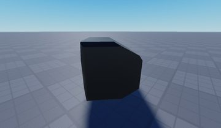</a> <b>Televisor</b> <code>models/Workspace/Map/Lobby/Interior/Televisor.rbxm</code></td>
<td width="25%" valign="top"><a href="models/ServerStorage/Assets/Maps/BloodfellManor/Map/Map/Chandelier.rbxm">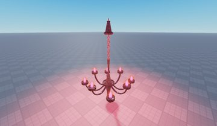</a> <b>Chandelier</b> <code>models/ServerStorage/Assets/Maps/BloodfellManor/Map/Map/Chandelier.rbxm</code></td>
</tr>
<tr>
<td width="25%" valign="top"><a href="models/Workspace/Map/Lobby/Interior/Host%20Stand.rbxm">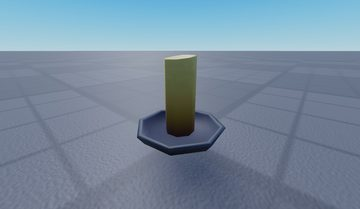</a> <b>Host Stand</b> <code>models/Workspace/Map/Lobby/Interior/Host Stand.rbxm</code></td>
</tr>
</table>

## Notable scripts

Top-scored scripts of this game per topic (full tree in [source/scripts](source/scripts/)).

| Topic | Scripts |
|---|---|
| UI animation (tweens, hover / click, pop-ins, springs) | [`Behavior`](source/scripts/ReplicatedStorage/Assets/Killers/Doombringer/Behavior.lua) 780 lines [`Inventory`](source/scripts/ReplicatedStorage/Systems/Player/UI/Menus/Inventory.lua) 720 lines [`Shop`](source/scripts/ReplicatedStorage/Systems/Player/UI/Menus/Shop.lua) 825 lines [`Behavior`](source/scripts/ReplicatedStorage/Assets/Killers/Noli/Behavior.lua) 1902 lines [`EventShopClient`](source/scripts/ReplicatedStorage/Assets/EventStorage/2025_MASQUERADE/UI/EventShopClient.lua) 666 lines |
| UI controllers / window managers / menus | [`ServerAbilities`](source/scripts/ReplicatedStorage/Assets/Survivors/JaneDoe/Behavior/ServerAbilities.lua) 507 lines [`EventShopClient`](source/scripts/ReplicatedStorage/Assets/EventStorage/2025_MASQUERADE/UI/EventShopClient.lua) 666 lines [`Behavior`](source/scripts/ReplicatedStorage/Assets/Survivors/AnnoyingBox/Behavior.lua) 554 lines [`Container`](source/scripts/ReplicatedStorage/Modules/Icon/Elements/Container.lua) 133 lines [`Behavior`](source/scripts/ReplicatedStorage/Assets/Survivors/2x2/Behavior.lua) 237 lines |
| Notifications, toasts, popups, prompts | [`Notifications`](source/scripts/ReplicatedStorage/Modules/Notifications.lua) 173 lines [`Server`](source/scripts/ReplicatedStorage/Assets/Killers/Noli/Behavior/FakeGenerator/Scripts/Server.server.lua) 175 lines [`CustomProximityPrompts`](source/scripts/ReplicatedStorage/Systems/Player/UI/Misc/CustomProximityPrompts.lua) 548 lines [`Server`](source/scripts/ReplicatedStorage/Modules/CommonObjectives/SetupGenerators/Generator/Scripts/Server.server.lua) 145 lines [`DialogHandler`](source/scripts/ReplicatedStorage/Systems/Player/UI/DialogHandler.lua) 515 lines |
| Loading / intro screens | [`Loading`](source/scripts/ReplicatedFirst/Loading.client.lua) 220 lines [`Behavior`](source/scripts/ReplicatedStorage/Assets/Skins/Killers/Slasher/VanitySlasher/Behavior.lua) 146 lines [`Util`](source/scripts/ReplicatedStorage/Modules/Util.lua) 1976 lines [`Chamber`](source/scripts/ReplicatedStorage/Assets/EventStorage/2025_MASQUERADE/POIs/Chamber.lua) 210 lines |
| Camera, cutscenes, screen shake | [`ShakeyCamWhenLow`](source/scripts/ReplicatedStorage/Systems/Character/QualityOfLife/ShakeyCamWhenLow.lua) 58 lines [`RoundNetwork`](source/scripts/ReplicatedStorage/Systems/Player/Networks/RoundNetwork.lua) 464 lines [`Behavior`](source/scripts/ReplicatedStorage/Assets/Killers/Doombringer/Behavior.lua) 780 lines [`DynamicCamera`](source/scripts/ReplicatedStorage/Systems/Character/QualityOfLife/DynamicCamera.lua) 46 lines [`Behavior`](source/scripts/ReplicatedStorage/Assets/Killers/Slasher/Behavior.lua) 719 lines |
| VFX, particles, beams, hit effects | [`Behavior`](source/scripts/ReplicatedStorage/Assets/Killers/Doombringer/Behavior.lua) 780 lines [`Effects`](source/scripts/ReplicatedStorage/Assets/Items/GravityGun/Item/Effects.server.lua) 415 lines [`Behavior`](source/scripts/ReplicatedStorage/Assets/Survivors/Dusekkar/Behavior.lua) 571 lines [`ServerAbilities`](source/scripts/ReplicatedStorage/Assets/Survivors/JaneDoe/Behavior/ServerAbilities.lua) 507 lines [`Behavior`](source/scripts/ReplicatedStorage/Assets/Skins/Survivors/Guest1337/%23KJGuest/Behavior.lua) 239 lines |
| DataStore / player data | [`PlayerData`](source/scripts/ServerScriptService/Server/Systems/Data/PlayerData.lua) 155 lines |
| Monetization (dev products, game passes, receipts) | [`ProductHandler`](source/scripts/ServerScriptService/Server/Systems/Shopping/ProductHandler.lua) 70 lines [`Robux`](source/scripts/ReplicatedStorage/Systems/Player/UI/Menus/Shop/Tabs/Robux.lua) 253 lines |
| RNG, eggs, gacha, rarity rolls, pets | [`Behavior`](source/scripts/ReplicatedStorage/Assets/Killers/Doombringer/Behavior.lua) 780 lines [`Effects`](source/scripts/ReplicatedStorage/Assets/Items/GravityGun/Item/Effects.server.lua) 415 lines [`Behavior`](source/scripts/ReplicatedStorage/Assets/Skins/Survivors/Chance/SniperChance/Behavior.lua) 396 lines [`Behavior`](source/scripts/ReplicatedStorage/Assets/Survivors/Chance/Behavior.lua) 464 lines [`Dialog`](source/scripts/ReplicatedStorage/Assets/EventStorage/2025_MASQUERADE/UI/EventShopClient/Dialog.lua) 71 lines |
| Combat, weapons, hitboxes, abilities | [`ServerAbilities`](source/scripts/ReplicatedStorage/Assets/Survivors/JaneDoe/Behavior/ServerAbilities.lua) 507 lines [`Behavior`](source/scripts/ReplicatedStorage/Assets/Killers/Doombringer/Behavior.lua) 780 lines [`Behavior`](source/scripts/ReplicatedStorage/Assets/Survivors/Civilian/Behavior.lua) 440 lines [`Behavior`](source/scripts/ReplicatedStorage/Assets/Survivors/AnnoyingBox/Behavior.lua) 554 lines [`Hitboxes`](source/scripts/ReplicatedStorage/Modules/Hitboxes.lua) 345 lines |
| NPC / AI / monsters | [`SimplePath`](source/scripts/ReplicatedStorage/Modules/SimplePath.lua) 413 lines [`ChaseThemesKiller`](source/scripts/ReplicatedStorage/Systems/Character/Game/ChaseThemesKiller.lua) 105 lines [`KillerScreenFXOnSurvivorKill`](source/scripts/ReplicatedStorage/Systems/Character/QualityOfLife/KillerScreenFXOnSurvivorKill.lua) 118 lines |
| Character movement (sprint, dash, double jump, slide) | [`Behavior`](source/scripts/ReplicatedStorage/Assets/Killers/Doombringer/Behavior.lua) 780 lines [`Behavior`](source/scripts/ReplicatedStorage/Assets/Survivors/AnnoyingBox/Behavior.lua) 554 lines [`FakeNoli`](source/scripts/ReplicatedStorage/Modules/StatusEffects/KillerExclusive/Hallucination/HallucinationClass/FakeNoli.lua) 568 lines [`Behavior`](source/scripts/ReplicatedStorage/Assets/Killers/Nosferatu/Behavior.lua) 2205 lines [`Sprinting`](source/scripts/ReplicatedStorage/Systems/Character/Game/Sprinting.lua) 215 lines |
| Tycoon / plots / bases / building | [`LocalScript`](source/scripts/ReplicatedStorage/Assets/Skins/Killers/c00lkidd/%23LoreAccurateC00l/Config/c00lgui/Frame/Frame/Decals/LocalScript.server.lua) 37 lines [`Robux`](source/scripts/ReplicatedStorage/Systems/Player/UI/Menus/Shop/Tabs/Robux.lua) 253 lines [`Behavior`](source/scripts/ReplicatedStorage/Assets/Survivors/Builderman/Behavior.lua) 713 lines [`Behavior`](source/scripts/ReplicatedStorage/Assets/Killers/Nosferatu/Behavior.lua) 2205 lines [`Behavior`](source/scripts/ReplicatedStorage/Assets/Killers/Noli/Behavior.lua) 1902 lines |
| Leaderboards & stats | [`LeaderStats`](source/scripts/ServerScriptService/Server/Systems/Data/LeaderStats.lua) 28 lines |
| Admin panels & commands | [`CommandManager`](source/scripts/ServerScriptService/Server/Systems/Core/CommandManager.lua) 71 lines [`PranksterCommands`](source/scripts/ServerScriptService/Server/Modules/PranksterCommands.lua) 49 lines |
| Sound & music | [`Sounds`](source/scripts/ReplicatedStorage/Modules/Sounds.lua) 274 lines [`Behavior`](source/scripts/ReplicatedStorage/Assets/Survivors/Civilian/Behavior.lua) 440 lines [`Behavior`](source/scripts/ReplicatedStorage/Assets/Survivors/Jim/Behavior.lua) 284 lines [`Behavior`](source/scripts/ReplicatedStorage/Assets/Killers/%21Herobrine/Behavior.lua) 412 lines [`Behavior`](source/scripts/ServerStorage/Assets/Unused/Killers/%23Herobrine/Behavior.lua) 393 lines |
| Utility modules (number format, signals, tables, timers) | [`Behavior`](source/scripts/ReplicatedStorage/Assets/Killers/Doombringer/Behavior.lua) 780 lines [`Behavior`](source/scripts/ReplicatedStorage/Assets/Killers/%23SonicExe/Behavior.lua) 432 lines [`Utility`](source/scripts/ReplicatedStorage/Modules/Icon/Utility.lua) 572 lines [`CommandManager`](source/scripts/ServerScriptService/Server/Systems/Core/CommandManager.lua) 71 lines [`AchievementUtil`](source/scripts/ReplicatedStorage/Modules/AchievementUtil.lua) 372 lines |

### In the curated script library

- [Commands as ModuleScripts with required ranks](../../Scripts/16-Admin/CommandManager-RankedModules__forsaken.lua) — Each command is a ModuleScript (title, parameters, RequiredRank, AllowedInVIP, Executed); the server sends only the commands your rank allows and re-checks the rank on execute; private-server owners get VIP-safe commands.
- [Leaderstats mirrored from data values](../../Scripts/15-Leaderboards/LeaderStats-Mirror__forsaken.lua) — Clones a leaderstats template and mirrors Money/KillerChance from the player's data folder with GetPropertyChangedSignal.

## ⚠️ Safety

HIGH flags (backdoors, `require(id)`, `loadstring`, webhooks). Review or delete before reusing:

- `scripts/ReplicatedStorage/Assets/Skins/Killers/c00lkidd/#LoreAccurateC00l/Config/c00lgui/Frame/Frame/HighlightAll/LocalScript.server.lua`
- `scripts/ReplicatedStorage/Systems/Player/UI/Menus/Inventory/Tabs/Emotes.lua`

## Folders

| Folder | What |
|---|---|
| `screenshots/` | full frames; `crops/` = the panel only; `models/` = 3D previews; `thumbs/` = gallery thumbnails |
| `ui/` | every screen as a Lua builder (`require(module)()` returns the ScreenGui); `_StarterGui-all.lua` builds every StarterGui screen |
| `models/` | every model as .rbxm (the only .rbxm files), mirroring the place tree, scripts removed |
| `map/` | `workspace.rbxm` (the map as a model), `lighting.lua` (sky + post effects), `materials.lua`, `Environment.lua` |
| `animations/`, `audio/` | KeyframeSequence / Sound builders (.lua), `AnimationIds.lua`, `Sounds.lua` |
| `source/` | all scripts as .luau, `tree.txt`, `ui.txt`, `remotes.txt`, `assets.txt`, `flags.txt` |
