# Gore game (leak)

> 🥊 **Fighting** · combat / gore physics · source file `paid_gore_game_leaked.rbxl`

[⬅ Back to the catalog](../../README.md) · [Assets inventory](ASSETS.md) · [Style numbers](reference.md) · [Scripts](source/scripts/) · [Code analysis](source/README.md)

## At a glance

| | |
|---|---|
| Provenance | template with full source |
| Screens | 0 ScreenGuis, 0 GUI objects → **0 screenshots** |
| Models (.rbxm) | 87 models, 4 model sets, 0 VFX sets |
| Lua builders (.lua) | 0 UI screens, 97 animation packs, 7 audio packs |
| Code | 257 scripts, 52,539 lines |
| Asset ids | 719 animations, 71 sounds |
| Safety scan | 0 HIGH / 73 MED flags ([flags.txt](source/flags.txt)) |

## Model previews

<table>
<tr>
<td width="25%" valign="top"><a href="models/Workspace/Peds/Ukraine%20Supporter__x6.rbxm">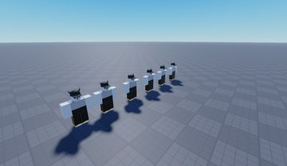</a> <b>Ukraine Supporter__x6</b> <code>models/Workspace/Peds/Ukraine Supporter__x6.rbxm</code></td>
<td width="25%" valign="top"><a href="models/StarterPack/Sawned-Off.rbxm">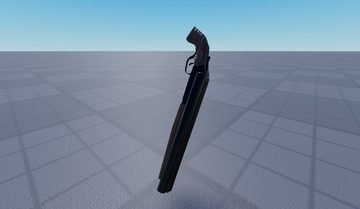</a> <b>Sawned-Off</b> <code>models/StarterPack/Sawned-Off.rbxm</code></td>
<td width="25%" valign="top"><a href="models/StarterPack/Tommy.rbxm">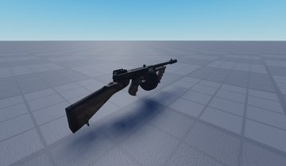</a> <b>Tommy</b> <code>models/StarterPack/Tommy.rbxm</code></td>
<td width="25%" valign="top"><a href="models/Workspace/Buildings/Part.rbxm">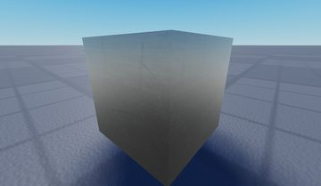</a> <b>Part</b> <code>models/Workspace/Buildings/Part.rbxm</code></td>
</tr>
<tr>
<td width="25%" valign="top"><a href="models/ReplicatedStorage/Assets/Gibs/Head/Right/Right.rbxm">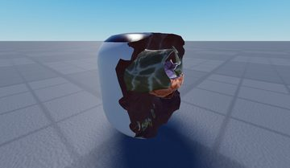</a> <b>Right</b> <code>models/ReplicatedStorage/Assets/Gibs/Head/Right/Right.rbxm</code></td>
<td width="25%" valign="top"><a href="models/Workspace/Peds/Dummy__x73.rbxm">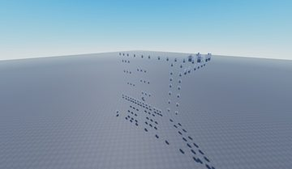</a> <b>Dummy__x73</b> <code>models/Workspace/Peds/Dummy__x73.rbxm</code></td>
<td width="25%" valign="top"><a href="models/StarterPack/Deagle.rbxm">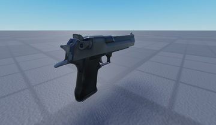</a> <b>Deagle</b> <code>models/StarterPack/Deagle.rbxm</code></td>
<td width="25%" valign="top"><a href="models/Workspace/Buildings/Float~5.rbxm">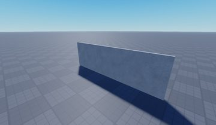</a> <b>Float~5</b> <code>models/Workspace/Buildings/Float~5.rbxm</code></td>
</tr>
<tr>
<td width="25%" valign="top"><a href="models/ReplicatedStorage/Assets/Gibs/Head/TopLeft/TopLeft.rbxm">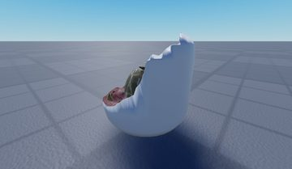</a> <b>TopLeft</b> <code>models/ReplicatedStorage/Assets/Gibs/Head/TopLeft/TopLeft.rbxm</code></td>
<td width="25%" valign="top"><a href="models/StarterPack/Glock%2017.rbxm">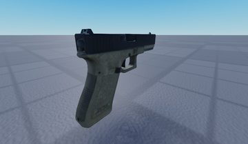</a> <b>Glock 17</b> <code>models/StarterPack/Glock 17.rbxm</code></td>
<td width="25%" valign="top"><a href="models/ReplicatedStorage/Assets/Gibs/Head/Left/Left~2.rbxm">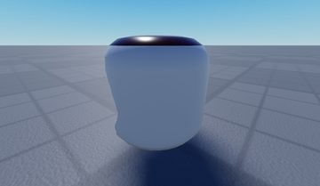</a> <b>Left~2</b> <code>models/ReplicatedStorage/Assets/Gibs/Head/Left/Left~2.rbxm</code></td>
<td width="25%" valign="top"><a href="models/ReplicatedStorage/Assets/Gibs/Limbs/Top/Top~2.rbxm">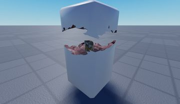</a> <b>Top~2</b> <code>models/ReplicatedStorage/Assets/Gibs/Limbs/Top/Top~2.rbxm</code></td>
</tr>
</table>

## Notable scripts

Top-scored scripts of this game per topic (full tree in [source/scripts](source/scripts/)).

| Topic | Scripts |
|---|---|
| UI animation (tweens, hover / click, pop-ins, springs) | [`LocalScript`](source/scripts/StarterPlayer/StarterCharacterScripts/LocalScript.client.lua) 1346 lines |
| Camera, cutscenes, screen shake | [`LocalScript`](source/scripts/StarterPlayer/StarterCharacterScripts/LocalScript.client.lua) 1346 lines |
| VFX, particles, beams, hit effects | [`LocalScript`](source/scripts/StarterPlayer/StarterCharacterScripts/LocalScript.client.lua) 1346 lines |
| RNG, eggs, gacha, rarity rolls, pets | [`Ragdoll`](source/scripts/ReplicatedStorage/Assets/Modules/Ragdoll.lua) 395 lines |
| NPC / AI / monsters | [`SimplePath`](source/scripts/ReplicatedStorage/Assets/Modules/SimplePath.lua) 350 lines |
| Tycoon / plots / bases / building | [`LocalScript`](source/scripts/StarterPlayer/StarterCharacterScripts/LocalScript.client.lua) 1346 lines |
| Utility modules (number format, signals, tables, timers) | [`Network`](source/scripts/ReplicatedStorage/Assets/Modules/Network.lua) 1085 lines |

### In the curated script library

- [Euphoria-style active ragdoll](../../Scripts/13-Movement/EuphoriaRagdoll__gore-game.lua) — Active ragdoll: hidden animated rig + springs drive the ragdoll limbs (euphoria look).

## Folders

| Folder | What |
|---|---|
| `screenshots/` | full frames; `crops/` = the panel only; `models/` = 3D previews; `thumbs/` = gallery thumbnails |
| `ui/` | every screen as a Lua builder (`require(module)()` returns the ScreenGui); `_StarterGui-all.lua` builds every StarterGui screen |
| `models/` | every model as .rbxm (the only .rbxm files), mirroring the place tree, scripts removed |
| `map/` | `workspace.rbxm` (the map as a model), `lighting.lua` (sky + post effects), `materials.lua`, `Environment.lua` |
| `animations/`, `audio/` | KeyframeSequence / Sound builders (.lua), `AnimationIds.lua`, `Sounds.lua` |
| `source/` | all scripts as .luau, `tree.txt`, `ui.txt`, `remotes.txt`, `assets.txt`, `flags.txt` |
