# Grow a Garden 2 (GAG2)

> ⛏️ **Simulator** · farming / garden simulator · source file `Grow A Garden 2 -.rbxl`

[⬅ Back to the catalog](../../README.md) · [Assets inventory](ASSETS.md) · [Style numbers](reference.md) · [Scripts](source/scripts/) · [Code analysis](source/README.md)

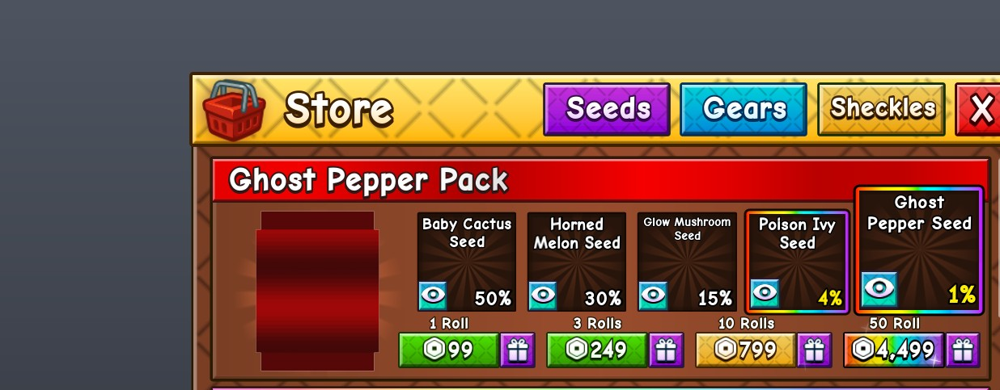

## At a glance

| | |
|---|---|
| Provenance | copy of a live game (saveinstance / decompiled client code) |
| Screens | 76 ScreenGuis, 4009 GUI objects → **82 screenshots** |
| Models (.rbxm) | 469 models, 1 model sets, 30 VFX sets |
| Lua builders (.lua) | 110 UI screens, 56 animation packs, 1 audio packs |
| Code | 1122 scripts, 245,773 lines |
| Asset ids | 165 animations, 189 sounds |
| Safety scan | 0 HIGH / 4 MED flags ([flags.txt](source/flags.txt)) |

**Fonts:** `ComicNeueAngular Bold`×938, `SourceSansPro Bold`×320, `SourceSansPro Regular`×259, `ComicNeueAngular Regular`×94, `ComicNeueAngular SemiBold`×21

## UI screenshots

Captured in Studio from the place's own ScreenGuis (scripts stripped). Each panel was opened on its own; click a thumbnail for the full 1519×886 frame. Runtime-filled lists (shop items, inventories) show their template state.

### Shop & Robux store

<table>
<tr>
<td width="33%" valign="top"><a href="screenshots/02_RobuxShop.jpg">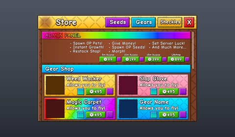</a> <b>RobuxShop</b></td>
<td width="33%" valign="top"><a href="screenshots/03_RobuxShop__StarterPack.jpg">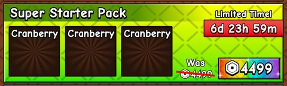</a> <b>RobuxShop</b> › Frame.ScrollingFrame.StarterPack</td>
<td width="33%" valign="top"><a href="screenshots/04_RobuxShop__Gacha.jpg">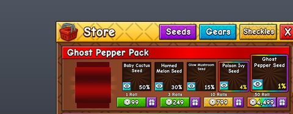</a> <b>RobuxShop</b> › Frame.ScrollingFrame.Gacha</td>
</tr>
<tr>
<td width="33%" valign="top"><a href="screenshots/08_GuildShop.jpg">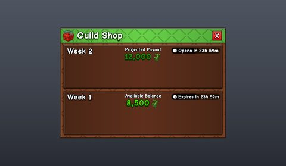</a> <b>GuildShop</b></td>
<td width="33%" valign="top"><a href="screenshots/19_CrateShop.jpg">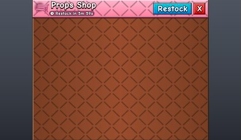</a> <b>CrateShop</b></td>
<td width="33%" valign="top"><a href="screenshots/21_CrateShop__Robux_Shelf.jpg">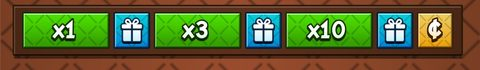</a> <b>CrateShop</b> › Frame.ScrollingFrame.Robux_Shelf</td>
</tr>
<tr>
<td width="33%" valign="top"> <b>CrateShop</b> › Frame.ScrollingFrame.Sheckles_Shelf</td>
<td width="33%" valign="top"><a href="screenshots/23_GearShop.jpg">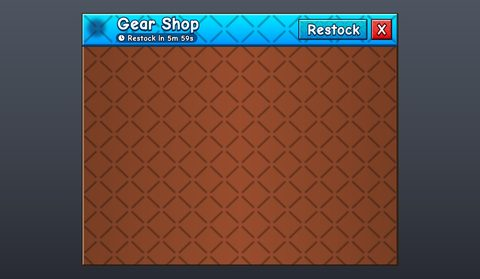</a> <b>GearShop</b></td>
<td width="33%" valign="top"><a href="screenshots/25_GearShop__Robux_Shelf.jpg">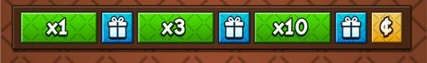</a> <b>GearShop</b> › Frame.ScrollingFrame.Robux_Shelf</td>
</tr>
<tr>
<td width="33%" valign="top"> <b>GearShop</b> › Frame.ScrollingFrame.Sheckles_Shelf</td>
<td width="33%" valign="top"> <b>PreRobuxPrompt</b></td>
<td width="33%" valign="top"><a href="screenshots/33_PremiumSeedShop.jpg">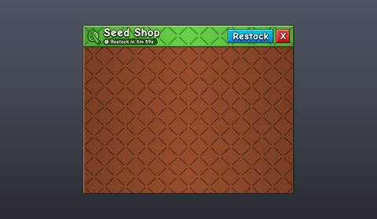</a> <b>PremiumSeedShop</b></td>
</tr>
<tr>
<td width="33%" valign="top"><a href="screenshots/35_PremiumSeedShop__Shelf.jpg">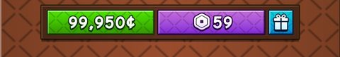</a> <b>PremiumSeedShop</b> › Frame.ScrollingFrame.Shelf</td>
<td width="33%" valign="top"><a href="screenshots/42_SeedShop.jpg">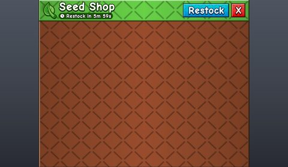</a> <b>SeedShop</b></td>
<td width="33%" valign="top"> <b>SeedShop</b> › Frame.NormalShop.Sheckles_Shelf</td>
</tr>
<tr>
<td width="33%" valign="top"> <b>SeedShop</b> › Frame.NormalShop.Robux_Shelf</td>
</tr>
</table>

### Inventory / backpack / pets

<table>
<tr>
<td width="33%" valign="top"><a href="screenshots/05_RobuxShop__Pets.jpg">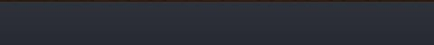</a> <b>RobuxShop</b> › Frame.ScrollingFrame.Pets</td>
<td width="33%" valign="top"><a href="screenshots/20_CrateShop__ItemTemplate.jpg">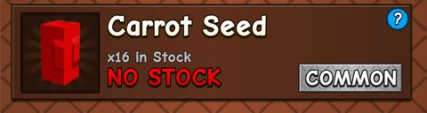</a> <b>CrateShop</b> › Frame.ScrollingFrame.ItemTemplate</td>
<td width="33%" valign="top"> <b>GearShop</b> › Frame.ScrollingFrame.ItemTemplate</td>
</tr>
<tr>
<td width="33%" valign="top"><a href="screenshots/34_PremiumSeedShop__ItemTemplate.jpg">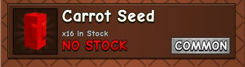</a> <b>PremiumSeedShop</b> › Frame.ScrollingFrame.ItemTemplate</td>
<td width="33%" valign="top"><a href="screenshots/43_SeedShop__ItemTemplate.jpg">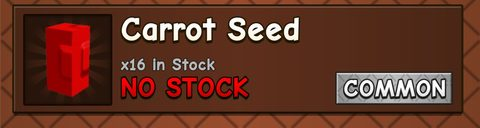</a> <b>SeedShop</b> › Frame.NormalShop.ItemTemplate</td>
<td width="33%" valign="top"><a href="screenshots/46_SeedShop__ItemFrame_Secret.jpg">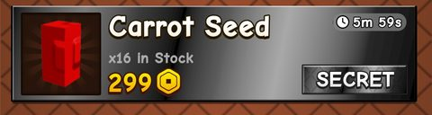</a> <b>SeedShop</b> › Frame.ExclusiveShop.ItemFrame_Secret</td>
</tr>
<tr>
<td width="33%" valign="top"><a href="screenshots/47_SeedShop__ItemFrame_Super.jpg">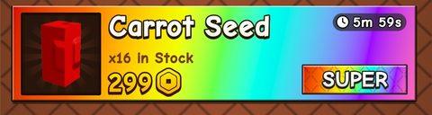</a> <b>SeedShop</b> › Frame.ExclusiveShop.ItemFrame_Super</td>
<td width="33%" valign="top"><a href="screenshots/48_SeedShop__ItemFrame_Exotic.jpg">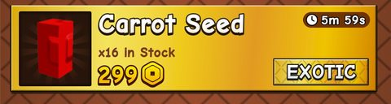</a> <b>SeedShop</b> › Frame.ExclusiveShop.ItemFrame_Exotic</td>
<td width="33%" valign="top"><a href="screenshots/52_PlayerGardenMarket__Inventory.jpg">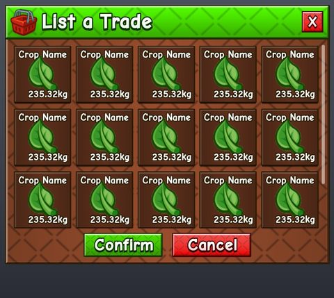</a> <b>PlayerGardenMarket</b> › Inventory</td>
</tr>
<tr>
<td width="33%" valign="top"><a href="screenshots/59_MailboxUI__ItemSendFrame.jpg">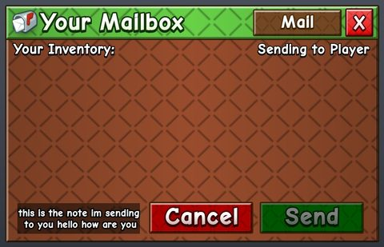</a> <b>MailboxUI</b> › Frame.SendingFrame.ItemSendFrame</td>
<td width="33%" valign="top"><a href="screenshots/71_PetList.jpg">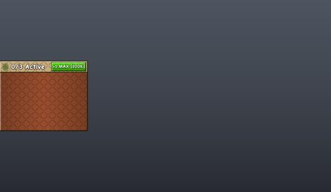</a> <b>PetList</b></td>
<td width="33%" valign="top"><a href="screenshots/72_EquipPet.jpg">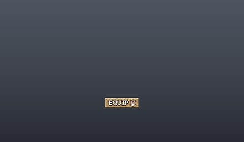</a> <b>EquipPet</b></td>
</tr>
<tr>
<td width="33%" valign="top"><a href="screenshots/75_PetInfo.jpg">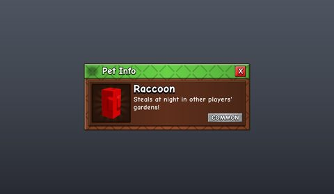</a> <b>PetInfo</b></td>
</tr>
</table>

### Rewards, daily, spin, codes

<table>
<tr>
<td width="33%" valign="top"> <b>Gifting</b></td>
<td width="33%" valign="top"><a href="screenshots/54_MailboxUI__GiftTemplate.jpg">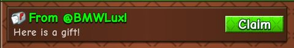</a> <b>MailboxUI</b> › Frame.RecieveFrame.GiftTemplate</td>
<td width="33%" valign="top"><a href="screenshots/56_MailboxUI__GuildRewardTemplate.jpg">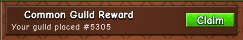</a> <b>MailboxUI</b> › Frame.RecieveFrame.GuildRewardTemplate</td>
</tr>
<tr>
<td width="33%" valign="top"><a href="screenshots/57_MailboxUI__GuildRewardTemplate_Owner.jpg">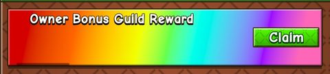</a> <b>MailboxUI</b> › Frame.RecieveFrame.GuildRewardTemplate_Owner</td>
<td width="33%" valign="top"><a href="screenshots/58_MailboxUI__GuildRewardTemplate_Elder.jpg">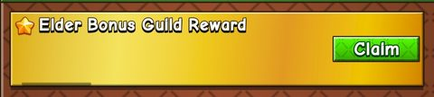</a> <b>MailboxUI</b> › Frame.RecieveFrame.GuildRewardTemplate_Elder</td>
</tr>
</table>

### Quests & progression

<table>
<tr>
<td width="33%" valign="top"><a href="screenshots/15_GardenLevel.jpg">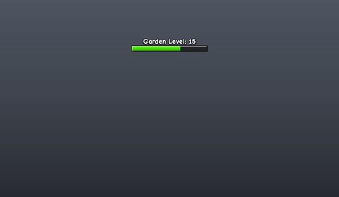</a> <b>GardenLevel</b></td>
<td width="33%" valign="top"><a href="screenshots/69_ViewGuildProgress.jpg">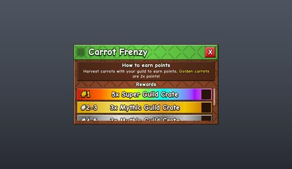</a> <b>ViewGuildProgress</b></td>
<td width="33%" valign="top"><a href="screenshots/70_ViewGuildProgress__GuildProgressOLD.jpg">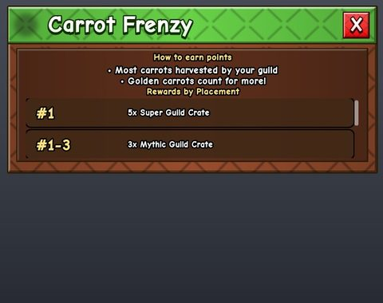</a> <b>ViewGuildProgress</b> › GuildProgressOLD</td>
</tr>
</table>

### Settings & menus

<table>
<tr>
<td width="33%" valign="top"><a href="screenshots/09_SignToolChangeTextMenu.jpg">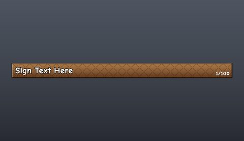</a> <b>SignToolChangeTextMenu</b></td>
<td width="33%" valign="top"><a href="screenshots/61_Settings.jpg">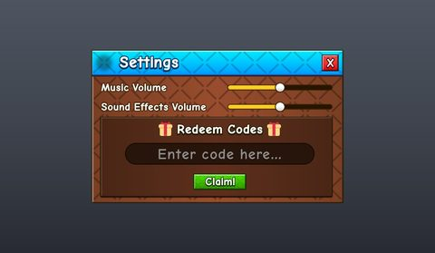</a> <b>Settings</b></td>
</tr>
</table>

### Popups, notifications, prompts

<table>
<tr>
<td width="33%" valign="top"><a href="screenshots/06_Message.jpg">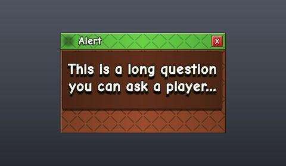</a> <b>Message</b></td>
<td width="33%" valign="top"> <b>Notification_UI</b> › Notification_UI</td>
<td width="33%" valign="top"> <b>Notification_UI_Mobile</b> › Notification_UI_Mobile</td>
</tr>
</table>

### Loading & intro

<table>
<tr>
<td width="33%" valign="top"> <b>LoadingGui</b> › Variant1Frame</td>
</tr>
</table>

### Leaderboards & stats

<table>
<tr>
<td width="33%" valign="top"><a href="screenshots/29_CustomiseFenceTheme__GardenStatsHeader.jpg">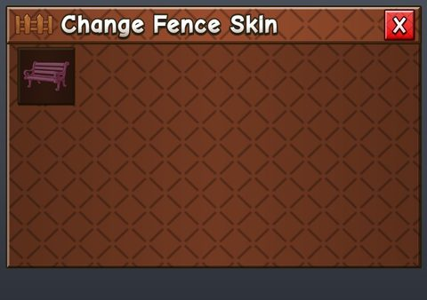</a> <b>CustomiseFenceTheme</b> › Frame.GardenStatsHeader</td>
<td width="33%" valign="top"><a href="screenshots/30_CustomiseFenceTheme__GardenStatsContent.jpg">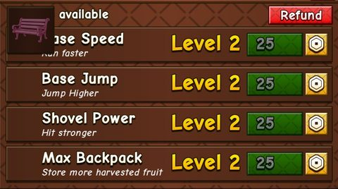</a> <b>CustomiseFenceTheme</b> › Frame.GardenStatsContent</td>
<td width="33%" valign="top"><a href="screenshots/40_CinematicBars__TopBar.jpg">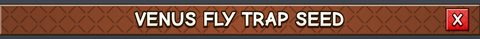</a> <b>CinematicBars</b> › TopBar</td>
</tr>
<tr>
<td width="33%" valign="top"><a href="screenshots/65_ViewGuildLeaderboard.jpg">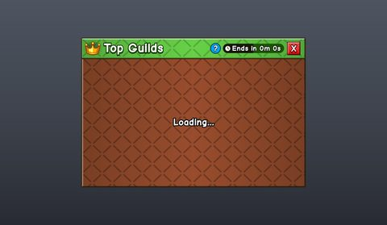</a> <b>ViewGuildLeaderboard</b></td>
<td width="33%" valign="top"><a href="screenshots/66_ViewGuildLeaderboard__PlayerCard_Template_Rank1.jpg">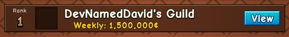</a> <b>ViewGuildLeaderboard</b> › ContributionLeaderboard.Content.ScrollingFrame.PlayerCard_Template_Rank1</td>
</tr>
</table>

### End of round, death, results

<table>
<tr>
<td width="33%" valign="top"> <b>GrowingList</b></td>
<td width="33%" valign="top"><a href="screenshots/18_GrowingList__Frame.jpg">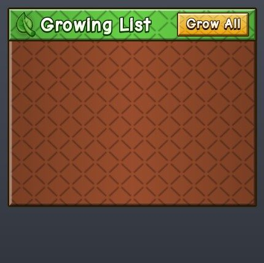</a> <b>GrowingList</b> › Frame</td>
<td width="33%" valign="top"><a href="screenshots/60_MailboxUI__SelectPlayerFrame.jpg">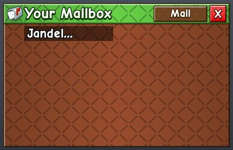</a> <b>MailboxUI</b> › Frame.SendingFrame.SelectPlayerFrame</td>
</tr>
</table>

### Admin panels

<table>
<tr>
<td width="33%" valign="top"><a href="screenshots/77_Cmdr__Autocomplete.jpg">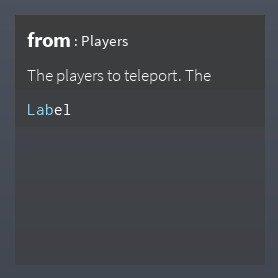</a> <b>Cmdr</b> › Autocomplete</td>
<td width="33%" valign="top"><a href="screenshots/81_AdminPanel.jpg">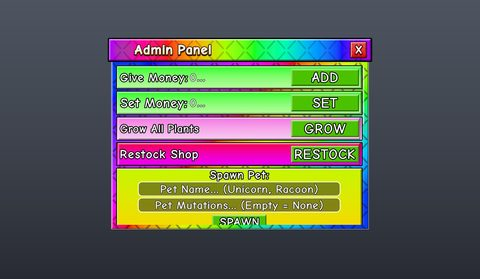</a> <b>AdminPanel</b></td>
<td width="33%" valign="top"><a href="screenshots/82_AdminPanel__SetLuck.jpg">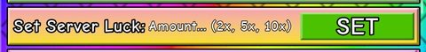</a> <b>AdminPanel</b> › Main.Contents.SetLuck</td>
</tr>
</table>

### HUD & currency

<table>
<tr>
<td width="33%" valign="top"><a href="screenshots/01_SideBar.jpg">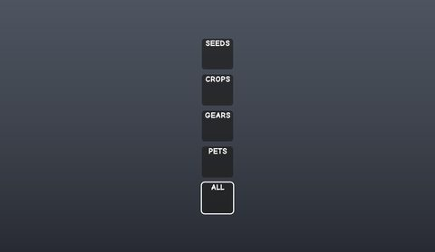</a> <b>SideBar</b></td>
<td width="33%" valign="top"> <b>HUD</b></td>
<td width="33%" valign="top"><a href="screenshots/39_CinematicBars__BottomBar.jpg">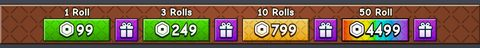</a> <b>CinematicBars</b> › BottomBar</td>
</tr>
<tr>
<td width="33%" valign="top"><a href="screenshots/73_GearCinematicBars__BottomBar.jpg">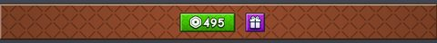</a> <b>GearCinematicBars</b> › BottomBar</td>
</tr>
</table>

### Character / avatar / emotes

<table>
<tr>
<td width="33%" valign="top"><a href="screenshots/28_CustomiseFenceTheme.jpg">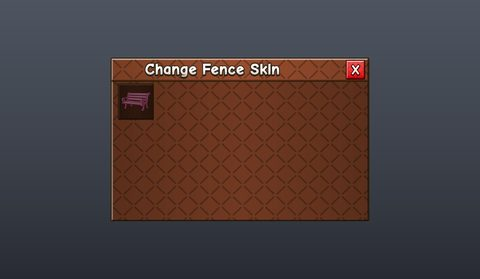</a> <b>CustomiseFenceTheme</b></td>
</tr>
</table>

### Other

<table>
<tr>
<td width="33%" valign="top"><a href="screenshots/07_GuildWeekComplete.jpg">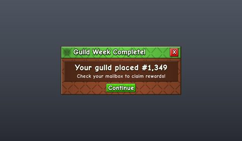</a> <b>GuildWeekComplete</b></td>
<td width="33%" valign="top"><a href="screenshots/10_Odds.jpg">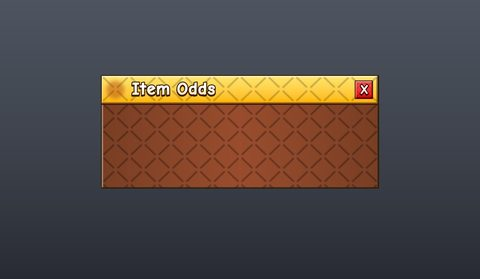</a> <b>Odds</b></td>
<td width="33%" valign="top"> <b>Odds</b> › Frame.ScrollingFrame.GrandTemplate</td>
</tr>
<tr>
<td width="33%" valign="top"> <b>TeleportButtons</b></td>
<td width="33%" valign="top"> <b>RollFrame</b></td>
<td width="33%" valign="top"> <b>PropsFrame</b></td>
</tr>
<tr>
<td width="33%" valign="top"> <b>Watermark</b></td>
<td width="33%" valign="top"> <b>PlayerSelector</b></td>
<td width="33%" valign="top"> <b>RainbowShovel</b></td>
</tr>
<tr>
<td width="33%" valign="top"> <b>RollFrame_New</b></td>
<td width="33%" valign="top"> <b>ButtonMash</b></td>
<td width="33%" valign="top"> <b>PlayerGardenMarket</b></td>
</tr>
<tr>
<td width="33%" valign="top"> <b>MailboxUI</b></td>
<td width="33%" valign="top"> <b>MailboxUI</b> › Frame.RecieveFrame.GuildInviteTemplate</td>
<td width="33%" valign="top"> <b>ColorPickerGuild</b></td>
</tr>
<tr>
<td width="33%" valign="top"> <b>ViewGuildPage</b></td>
<td width="33%" valign="top"> <b>CreateGuild</b></td>
<td width="33%" valign="top"> <b>LeaveGuild</b></td>
</tr>
<tr>
<td width="33%" valign="top"> <b>EditGuild</b></td>
<td width="33%" valign="top"> <b>GuildInvite</b></td>
<td width="33%" valign="top"> <b>BanHammer</b></td>
</tr>
<tr>
<td width="33%" valign="top"> <b>BanGui</b></td>
<td width="33%" valign="top"> <b>BanGui</b> › BlackFrame</td>
</tr>
</table>

## Model previews

<table>
<tr>
<td width="25%" valign="top"> <b>IceSerpent</b> <code>models/ReplicatedStorage/Assets/Pets/IceSerpent.rbxm</code></td>
<td width="25%" valign="top"> <b>Steven</b> <code>models/Workspace/NPCS/Steven.rbxm</code></td>
<td width="25%" valign="top"> <b>Rainbow Beanstalk</b> <code>models/ReplicatedStorage/Assets/BeanstalkSkins/Rainbow Beanstalk.rbxm</code></td>
<td width="25%" valign="top"> <b>Super Guild Crate</b> <code>models/ReplicatedStorage/Assets/GuildCrates/Super Guild Crate.rbxm</code></td>
</tr>
<tr>
<td width="25%" valign="top"> <b>Head</b> <code>models/ReplicatedStorage/PlantGenerationModules/Plants/Venus Fly Trap/Head.rbxm</code></td>
<td width="25%" valign="top"> <b>Rainbow Sign</b> <code>models/ReplicatedStorage/Assets/Props/Rainbow Sign.rbxm</code></td>
<td width="25%" valign="top"> <b>Flower Bench</b> <code>models/ReplicatedStorage/Assets/Props/Flower Bench.rbxm</code></td>
<td width="25%" valign="top"> <b>FakePlot</b> <code>models/StarterPlayer/StarterPlayerScripts/Controllers/SeedInspectController/FakePlot.rbxm</code></td>
</tr>
<tr>
<td width="25%" valign="top"> <b>Moon Bloom</b> <code>models/ReplicatedStorage/Assets/Fruits/Moon Bloom.rbxm</code></td>
<td width="25%" valign="top"> <b>Unicorn</b> <code>models/ReplicatedStorage/Assets/Pets/Unicorn.rbxm</code></td>
<td width="25%" valign="top"> <b>Dragon</b> <code>models/ReplicatedStorage/PlantGenerationModules/Plants/Dragon's Breath/Dragon.rbxm</code></td>
<td width="25%" valign="top"> <b>Galaxy Beanstalk</b> <code>models/ReplicatedStorage/Assets/BeanstalkSkins/Galaxy Beanstalk.rbxm</code></td>
</tr>
<tr>
<td width="25%" valign="top"> <b>GrowEffects</b> <code>models/ReplicatedStorage/Assets/EggEffects/GrowEffects.rbxm</code></td>
</tr>
</table>

## Notable scripts

Top-scored scripts of this game per topic (full tree in [source/scripts](source/scripts/)).

| Topic | Scripts |
|---|---|
| UI animation (tweens, hover / click, pop-ins, springs) | [`SeedPackEffect`](source/scripts/StarterPlayer/StarterPlayerScripts/Controllers/SeedPackOpenController/SeedPackEffect.lua) 451 lines [`EggEffect`](source/scripts/StarterPlayer/StarterPlayerScripts/Controllers/EggOpenController/EggEffect.lua) 1361 lines [`RakeVisualizerController`](source/scripts/StarterPlayer/StarterPlayerScripts/Controllers/RakeVisualizerController.lua) 487 lines [`CurrenciesScript`](source/scripts/StarterGui/HUD/CurrenciesScript.client.lua) 380 lines [`Mythic Spring`](source/scripts/StarterPlayer/StarterPlayerScripts/Controllers/PropVisualizerController/Mythic%20Spring.lua) 70 lines |
| UI controllers / window managers / menus | [`Menu`](source/scripts/ReplicatedStorage/ClientModules/Iris/widgets/Menu.lua) 588 lines [`Tab`](source/scripts/ReplicatedStorage/ClientModules/Iris/widgets/Tab.lua) 332 lines [`demoWindow`](source/scripts/ReplicatedStorage/ClientModules/Iris/demoWindow.lua) 2358 lines [`Window`](source/scripts/ReplicatedStorage/ClientModules/Iris/widgets/Window.lua) 1079 lines [`Window`](source/scripts/ReplicatedStorage/CmdrClient/CmdrInterface/Window.lua) 318 lines |
| Notifications, toasts, popups, prompts | [`HarvestPromptController`](source/scripts/StarterPlayer/StarterPlayerScripts/Controllers/HarvestPromptController.lua) 879 lines [`MessagePrompt`](source/scripts/ReplicatedStorage/ClientModules/MessagePrompt.lua) 501 lines [`SocialPopupClient`](source/scripts/StarterPlayer/StarterPlayerScripts/SocialPopupClient.client.lua) 258 lines [`HarvestPromptLabelController`](source/scripts/StarterPlayer/StarterPlayerScripts/Controllers/HarvestPromptLabelController.lua) 375 lines [`ProximityPromptController`](source/scripts/StarterPlayer/StarterPlayerScripts/Controllers/ProximityPromptController.lua) 572 lines |
| Loading / intro screens | [`LoadingScreenController`](source/scripts/ReplicatedFirst/LoadingScreenController.client.lua) 1084 lines [`CutsceneController`](source/scripts/StarterPlayer/StarterPlayerScripts/Controllers/CutsceneController.lua) 277 lines [`topbarplus`](source/scripts/ReplicatedStorage/ClientModules/topbarplus.lua) 2505 lines [`Scene`](source/scripts/StarterPlayer/StarterPlayerScripts/Controllers/GearInspectController/GearScenes/Freeze%20Ray/Scene.lua) 336 lines [`Scene`](source/scripts/StarterPlayer/StarterPlayerScripts/Controllers/GearInspectController/GearScenes/Power%20Hose/Scene.lua) 319 lines |
| Camera, cutscenes, screen shake | [`CutsceneController`](source/scripts/StarterPlayer/StarterPlayerScripts/Controllers/CutsceneController.lua) 277 lines [`SceneApi`](source/scripts/StarterPlayer/StarterPlayerScripts/Controllers/GearInspectController/SceneApi.lua) 337 lines [`DisplayPlantGrowthController`](source/scripts/StarterPlayer/StarterPlayerScripts/Controllers/DisplayPlantGrowthController.lua) 675 lines [`CameraShaker`](source/scripts/ReplicatedStorage/ClientModules/CamShake/CameraShaker.lua) 125 lines [`OfflineGrowthAnimationController`](source/scripts/StarterPlayer/StarterPlayerScripts/Controllers/OfflineGrowthAnimationController.lua) 1579 lines |
| VFX, particles, beams, hit effects | [`SeedPackEffect`](source/scripts/StarterPlayer/StarterPlayerScripts/Controllers/SeedPackOpenController/SeedPackEffect.lua) 451 lines [`EggEffect`](source/scripts/StarterPlayer/StarterPlayerScripts/Controllers/EggOpenController/EggEffect.lua) 1361 lines [`Chained Moon`](source/scripts/StarterPlayer/StarterPlayerScripts/Controllers/TimeCycleController/Phases/Chained%20Moon.lua) 850 lines [`Markers`](source/scripts/ReplicatedStorage/Assets/Cutscenes/GAGTrailer/Markers.lua) 577 lines [`Markers`](source/scripts/ReplicatedStorage/Assets/Cutscenes/GAGTrailerNoWalls/Markers.lua) 566 lines |
| DataStore / player data | [`GameServer`](source/scripts/ServerScriptService/GameServer.server.lua) 1131 lines [`MailboxService`](source/scripts/ServerScriptService/MailboxService.server.lua) 342 lines |
| Monetization (dev products, game passes, receipts) | [`DevProductService`](source/scripts/ServerScriptService/DevProductService.server.lua) 889 lines [`DevProductController`](source/scripts/StarterPlayer/StarterPlayerScripts/Controllers/DevProductController.lua) 739 lines [`RainbowShovelClient`](source/scripts/StarterPack/Shovel%20Rainbow/RainbowShovelClient.client.lua) 204 lines [`RobuxShopClient`](source/scripts/StarterGui/RobuxShop/RobuxShopClient.client.lua) 925 lines |
| RNG, eggs, gacha, rarity rolls, pets | [`HugePetsService`](source/scripts/ServerScriptService/HugePetsService.server.lua) 221 lines [`EggData`](source/scripts/ReplicatedStorage/SharedModules/EggData.lua) 274 lines [`WildPetService`](source/scripts/ServerScriptService/WildPetService.server.lua) 439 lines [`PlantSizeMultipliers`](source/scripts/ReplicatedStorage/SharedModules/PlantSizeMultipliers.lua) 296 lines [`ExtraEggHatchController`](source/scripts/StarterPlayer/StarterPlayerScripts/Controllers/ExtraEggHatchController.lua) 348 lines |
| Combat, weapons, hitboxes, abilities | [`Zone`](source/scripts/ReplicatedStorage/SharedModules/Zone.lua) 1906 lines [`BanHammerToolServer`](source/scripts/ReplicatedStorage/Assets/BanHammer/BanHammerTool/BanHammerToolServer.server.lua) 116 lines [`RakeVisualizerController`](source/scripts/StarterPlayer/StarterPlayerScripts/Controllers/RakeVisualizerController.lua) 487 lines [`WateringcanController`](source/scripts/StarterPlayer/StarterPlayerScripts/Controllers/WateringcanController.lua) 776 lines [`FreezeRayController`](source/scripts/StarterPlayer/StarterPlayerScripts/Controllers/FreezeRayController.lua) 169 lines |
| NPC / AI / monsters | [`NPCDialogueController`](source/scripts/StarterPlayer/StarterPlayerScripts/Controllers/NPCDialogueController.lua) 389 lines |
| Character movement (sprint, dash, double jump, slide) | [`SliderMusic`](source/scripts/StarterGui/Settings/Frame/Content/BGM/Slider/SliderMusic.client.lua) 101 lines [`SliderSFX`](source/scripts/StarterGui/Settings/Frame/Content/SFX/Slider/SliderSFX.client.lua) 101 lines [`SelectionScript`](source/scripts/StarterGui/ColorPickerGuild/Backdrop/ColorPicker/SelectionScript.client.lua) 130 lines [`demoWindow`](source/scripts/ReplicatedStorage/ClientModules/Iris/demoWindow.lua) 2358 lines [`Input`](source/scripts/ReplicatedStorage/ClientModules/Iris/widgets/Input.lua) 1312 lines |
| Tycoon / plots / bases / building | [`PotPlacementController`](source/scripts/StarterPlayer/StarterPlayerScripts/Controllers/PotPlacementController.lua) 900 lines [`PlotsController`](source/scripts/StarterPlayer/StarterPlayerScripts/Controllers/PlotsController.lua) 457 lines [`GearInspectController`](source/scripts/StarterPlayer/StarterPlayerScripts/Controllers/GearInspectController.lua) 709 lines [`ButtonHandler`](source/scripts/StarterGui/TeleportButtons/TeleportButtons/ButtonHandler.client.lua) 213 lines [`RakeController`](source/scripts/StarterPlayer/StarterPlayerScripts/Controllers/RakeController.lua) 825 lines |
| Admin panels & commands | [`CmdrPetCommands`](source/scripts/ServerScriptService/CmdrPetCommands.server.lua) 82 lines [`OpSeedAdminCommand`](source/scripts/ServerScriptService/OpSeedAdminCommand.server.lua) 134 lines [`AdminCommandBridge`](source/scripts/ServerScriptService/AdminCommandBridge.server.lua) 779 lines |
| Sound & music | [`SliderMusic`](source/scripts/StarterGui/Settings/Frame/Content/BGM/Slider/SliderMusic.client.lua) 101 lines [`SfxController`](source/scripts/StarterPlayer/StarterPlayerScripts/Controllers/SfxController.lua) 123 lines [`SliderSFX`](source/scripts/StarterGui/Settings/Frame/Content/SFX/Slider/SliderSFX.client.lua) 101 lines [`MusicController`](source/scripts/StarterPlayer/StarterPlayerScripts/Controllers/MusicController.lua) 503 lines [`SeedPackEffect`](source/scripts/StarterPlayer/StarterPlayerScripts/Controllers/SeedPackOpenController/SeedPackEffect.lua) 451 lines |
| Daily rewards, quests, codes, playtime | [`Codes`](source/scripts/StarterGui/Settings/Frame/Content/CodesFrame/Codes.client.lua) 57 lines [`MailboxController`](source/scripts/StarterPlayer/StarterPlayerScripts/Controllers/MailboxController.lua) 2310 lines |
| Utility modules (number format, signals, tables, timers) | [`FruitProxyUtil`](source/scripts/ReplicatedStorage/SharedModules/FruitProxyUtil.lua) 75 lines [`Utility`](source/scripts/ReplicatedStorage/ClientModules/topbarplus/Utility.lua) 724 lines [`Utility`](source/scripts/StarterPlayer/StarterPlayerScripts/Controllers/InventoryController/Main/Icon/Utility.lua) 699 lines [`PetListController`](source/scripts/StarterPlayer/StarterPlayerScripts/Controllers/PetListController.lua) 837 lines [`Maid`](source/scripts/ReplicatedStorage/ReplicaShared/Maid.lua) 149 lines |

### In the curated script library

- [Favorite / join-group nudge](../../Scripts/03-Notifications/SocialPopup__grow-a-garden-2.lua) — Favorite / join-group nudge shown when using a shop prompt: native favorite dialog (AvatarEditorService) first, then a small group card; 5-minute cooldown if ignored.

## Folders

| Folder | What |
|---|---|
| `screenshots/` | full frames; `crops/` = the panel only; `models/` = 3D previews; `thumbs/` = gallery thumbnails |
| `ui/` | every screen as a Lua builder (`require(module)()` returns the ScreenGui); `_StarterGui-all.lua` builds every StarterGui screen |
| `models/` | every model as .rbxm (the only .rbxm files), mirroring the place tree, scripts removed |
| `map/` | `workspace.rbxm` (the map as a model), `lighting.lua` (sky + post effects), `materials.lua`, `Environment.lua` |
| `animations/`, `audio/` | KeyframeSequence / Sound builders (.lua), `AnimationIds.lua`, `Sounds.lua` |
| `source/` | all scripts as .luau, `tree.txt`, `ui.txt`, `remotes.txt`, `assets.txt`, `flags.txt` |
