# Hiroshima Expressway

> 🚗 **Driving** · map / driving (Japanese expressway) · source file `Hiroshima-Expressway.rbxl`

[⬅ Back to the catalog](../../README.md) · [Assets inventory](ASSETS.md) · [Style numbers](reference.md) · [Scripts](source/scripts/) · [Code analysis](source/README.md)

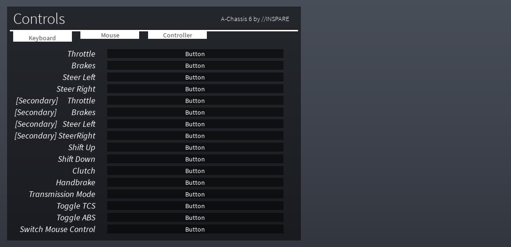

## At a glance

| | |
|---|---|
| Provenance | template with full source |
| Screens | 3 ScreenGuis, 42 GUI objects → **6 screenshots** |
| Models (.rbxm) | 133 models, 6 model sets, 0 VFX sets |
| Lua builders (.lua) | 5 UI screens, 0 animation packs, 3 audio packs |
| Code | 2042 scripts, 489,347 lines |
| Asset ids | 4 animations, 1303 sounds |
| Safety scan | 0 HIGH / 0 MED flags ([flags.txt](source/flags.txt)) |

**Fonts:** `SourceSansPro Regular`×7, `GothamSSm Bold`×7

## UI screenshots

Captured in Studio from the place's own ScreenGuis (scripts stripped). Each panel was opened on its own; click a thumbnail for the full 1519×886 frame. Runtime-filled lists (shop items, inventories) show their template state.

### End of round, death, results

<table>
<tr>
<td width="33%" valign="top"><a href="screenshots/01_SpawnerGui__Window.jpg">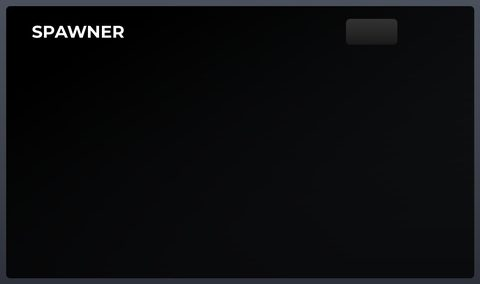</a> <b>SpawnerGui</b> › Window</td>
<td width="33%" valign="top"><a href="screenshots/02_AC6_Controls_Module__Window.jpg">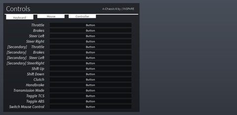</a> <b>AC6_Controls_Module</b> › Window</td>
</tr>
</table>

### Other

<table>
<tr>
<td width="33%" valign="top"><a href="screenshots/03_Corsa_Gauges.jpg">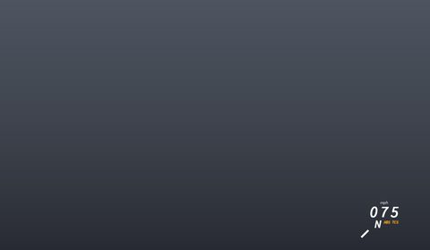</a> <b>Corsa Gauges</b></td>
<td width="33%" valign="top"><a href="screenshots/04_CORSA_Tire_System.jpg">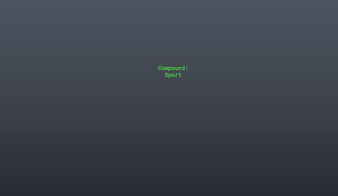</a> <b>CORSA Tire System</b></td>
<td width="33%" valign="top"><a href="screenshots/06_Corsa_Gauges.jpg">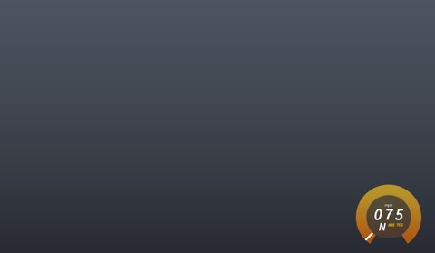</a> <b>Corsa Gauges</b></td>
</tr>
<tr>
<td width="33%" valign="top"><a href="screenshots/07_CORSA_Tire_System.jpg">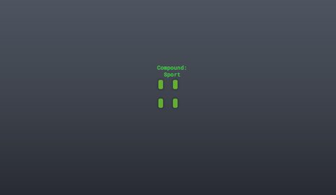</a> <b>CORSA Tire System</b></td>
</tr>
</table>

## Model previews

<table>
<tr>
<td width="25%" valign="top"><a href="models/ServerStorage/Vehicles/AE86%20%28Takumi%29%20%28Spec%20I%29.rbxm">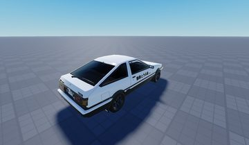</a> <b>AE86 (Takumi) (Spec I)</b> <code>models/ServerStorage/Vehicles/AE86 (Takumi) (Spec I).rbxm</code></td>
<td width="25%" valign="top"> <b>AE86 (Takumi) (Spec II)</b> <code>models/ServerStorage/Vehicles/AE86 (Takumi) (Spec II).rbxm</code></td>
<td width="25%" valign="top"><a href="models/ServerStorage/Vehicles/AE86%20%28Wataru%29%20%28Spec%20I%29.rbxm">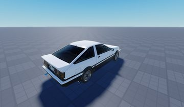</a> <b>AE86 (Wataru) (Spec I)</b> <code>models/ServerStorage/Vehicles/AE86 (Wataru) (Spec I).rbxm</code></td>
<td width="25%" valign="top"><a href="models/ServerStorage/Vehicles/AE86%20%28Wataru%29%20%28Spec%20II%29.rbxm">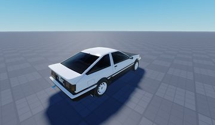</a> <b>AE86 (Wataru) (Spec II)</b> <code>models/ServerStorage/Vehicles/AE86 (Wataru) (Spec II).rbxm</code></td>
</tr>
<tr>
<td width="25%" valign="top"><a href="models/ServerStorage/Vehicles/AE86%20%28Rally%29.rbxm">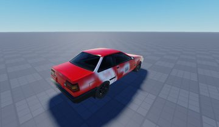</a> <b>AE86 (Rally)</b> <code>models/ServerStorage/Vehicles/AE86 (Rally).rbxm</code></td>
<td width="25%" valign="top"><a href="models/ServerStorage/Vehicles/AE86%20%28Shinji%29.rbxm">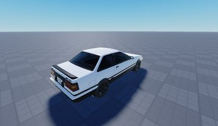</a> <b>AE86 (Shinji)</b> <code>models/ServerStorage/Vehicles/AE86 (Shinji).rbxm</code></td>
</tr>
</table>

## Notable scripts

Top-scored scripts of this game per topic (full tree in [source/scripts](source/scripts/)).

| Topic | Scripts |
|---|---|
| UI animation (tweens, hover / click, pop-ins, springs) | [`SpawnerClient`](source/scripts/StarterGui/SpawnerGui/SpawnerClient.client.lua) 490 lines [`EpicLights`](source/scripts/ServerStorage/Vehicles/25GT%20Turbo%20%28Atsuro%29/A-Chassis%20Tune/Plugins/EpicLights_V3BETA/EpicLights.client.lua) 507 lines [`EpicLights`](source/scripts/ServerStorage/Vehicles/Amemiya%20%C2%B5%20Boost%20up%207/A-Chassis%20Tune/Plugins/EpicLights_V3BETA/EpicLights.client.lua) 507 lines |
| UI controllers / window managers / menus | [`SpawnerClient`](source/scripts/StarterGui/SpawnerGui/SpawnerClient.client.lua) 490 lines [`Controls_AC6`](source/scripts/ServerStorage/Vehicles/25GT%20Turbo%20%28Atsuro%29/A-Chassis%20Tune/Plugins/AC6_Controls_Module/Controls_AC6.client.lua) 159 lines [`Icon`](source/scripts/ReplicatedStorage/Icon.lua) 1092 lines [`Drive`](source/scripts/ServerStorage/Vehicles/25GT%20Turbo%20%28Atsuro%29/A-Chassis%20Tune/A-Chassis%20Interface/Drive.client.lua) 1179 lines |
| Notifications, toasts, popups, prompts | [`EpicLights`](source/scripts/ServerStorage/Vehicles/25GT%20Turbo%20%28Atsuro%29/A-Chassis%20Tune/Plugins/EpicLights_V3BETA/EpicLights.client.lua) 507 lines [`EpicLights`](source/scripts/ServerStorage/Vehicles/Amemiya%20%C2%B5%20Boost%20up%207/A-Chassis%20Tune/Plugins/EpicLights_V3BETA/EpicLights.client.lua) 507 lines |
| Camera, cutscenes, screen shake | [`SpawnerClient`](source/scripts/StarterGui/SpawnerGui/SpawnerClient.client.lua) 490 lines |
| VFX, particles, beams, hit effects | [`EpicLights`](source/scripts/ServerStorage/Vehicles/25GT%20Turbo%20%28Atsuro%29/A-Chassis%20Tune/Plugins/EpicLights_V3BETA/EpicLights.client.lua) 507 lines [`EpicLights`](source/scripts/ServerStorage/Vehicles/Amemiya%20%C2%B5%20Boost%20up%207/A-Chassis%20Tune/Plugins/EpicLights_V3BETA/EpicLights.client.lua) 507 lines [`Handler`](source/scripts/ServerStorage/Vehicles/25GT%20Turbo%20%28Atsuro%29/A-Chassis%20Tune/Plugins/EpicLights_V3BETA/LightEvent/Handler.server.lua) 1920 lines [`Handler`](source/scripts/ServerStorage/Vehicles/AE86%20%28Takumi%29%20%28Spec%20I%29/A-Chassis%20Tune/Plugins/EpicLights_V3BETA/LightEvent/Handler.server.lua) 1920 lines [`Handler`](source/scripts/ServerStorage/Vehicles/Amemiya%20%C2%B5%20Boost%20up%207/A-Chassis%20Tune/Plugins/EpicLights_V3BETA/LightEvent/Handler.server.lua) 1920 lines |
| RNG, eggs, gacha, rarity rolls, pets | [`SoftWheels`](source/scripts/ServerStorage/Vehicles/25GT%20Turbo%20%28Atsuro%29/A-Chassis%20Tune/Plugins/SoftWheels.client.lua) 128 lines [`Initialize`](source/scripts/ServerStorage/Vehicles/25GT%20Turbo%20%28Atsuro%29/A-Chassis%20Tune/Initialize.server.lua) 695 lines [`Simulated`](source/scripts/ServerStorage/Vehicles/25GT%20Turbo%20%28Atsuro%29/A-Chassis%20Tune/Plugins/CORSA%20Tire%20System/Simulated.client.lua) 750 lines [`statreaderscript`](source/scripts/ServerStorage/Vehicles/25GT%20Turbo%20%28Atsuro%29/A-Chassis%20Tune/Plugins/CORSA%20Tire%20System/STATREMOTE/STATREADER/statreaderscript.client.lua) 154 lines [`A-Chassis Tune`](source/scripts/ServerStorage/Vehicles/25GT%20Turbo%20%28Atsuro%29/A-Chassis%20Tune.lua) 402 lines |
| Character movement (sprint, dash, double jump, slide) | [`Controls_AC6`](source/scripts/ServerStorage/Vehicles/25GT%20Turbo%20%28Atsuro%29/A-Chassis%20Tune/Plugins/AC6_Controls_Module/Controls_AC6.client.lua) 159 lines |
| Tycoon / plots / bases / building | [`Drive`](source/scripts/ServerStorage/Vehicles/25GT%20Turbo%20%28Atsuro%29/A-Chassis%20Tune/A-Chassis%20Interface/Drive.client.lua) 1179 lines |
| Sound & music | [`TurboSounds_Simple`](source/scripts/ServerStorage/Vehicles/25GT%20Turbo%20%28Atsuro%29/A-Chassis%20Tune/Plugins/TurboSounds_Simple.client.lua) 67 lines [`Engine_Sounds`](source/scripts/ServerStorage/Vehicles/Saleen%20S7%20%28xxxakioxxx%29/A-Chassis%20Tune/Plugins/Engine_Sounds.client.lua) 229 lines [`AC6_Sounds`](source/scripts/ServerStorage/Vehicles/25GT%20Turbo%20%28Atsuro%29/A-Chassis%20Tune/Plugins/AC6_Sounds.client.lua) 137 lines [`Shift_Sound`](source/scripts/ServerStorage/Vehicles/25GT%20Turbo%20%28Atsuro%29/A-Chassis%20Tune/Plugins/Shift_Sound.client.lua) 17 lines |
| Utility modules (number format, signals, tables, timers) | [`Themes`](source/scripts/ReplicatedStorage/Icon/Features/Themes.lua) 352 lines [`Icon`](source/scripts/ReplicatedStorage/Icon.lua) 1092 lines |

### In the curated script library

- [Reverb zones (AmbientReverb)](../../Scripts/17-Sound-Music/ReverbZones__hiroshima-expressway.lua) — Turns on SoundService.AmbientReverb (ConcertHall) while the player is inside any invisible TunnelArea part, using a cheap box check on Heartbeat and only changing the property when the state flips.
- [RPM-driven engine sound layers](../../Scripts/17-Sound-Music/EngineSoundsRPM__hiroshima-expressway.lua) — A-Chassis engine sound plugin: four looping layers (exhaust, engine, idle, redline) whose volume, pitch, distortion and EQ are computed from RPM and throttle each time RPM changes.

## Folders

| Folder | What |
|---|---|
| `screenshots/` | full frames; `crops/` = the panel only; `models/` = 3D previews; `thumbs/` = gallery thumbnails |
| `ui/` | every screen as a Lua builder (`require(module)()` returns the ScreenGui); `_StarterGui-all.lua` builds every StarterGui screen |
| `models/` | every model as .rbxm (the only .rbxm files), mirroring the place tree, scripts removed |
| `map/` | `workspace.rbxm` (the map as a model), `lighting.lua` (sky + post effects), `materials.lua`, `Environment.lua` |
| `animations/`, `audio/` | KeyframeSequence / Sound builders (.lua), `AnimationIds.lua`, `Sounds.lua` |
| `source/` | all scripts as .luau, `tree.txt`, `ui.txt`, `remotes.txt`, `assets.txt`, `flags.txt` |
