# Jujutsu Shenanigans

> 🥊 **Fighting** · anime battlegrounds (fighting) · source file `JJS paid 10k, by slbr devloppement team.rbxl`

[⬅ Back to the catalog](../../README.md) · [Assets inventory](ASSETS.md) · [Style numbers](reference.md) · [Scripts](source/scripts/) · [Code analysis](source/README.md)

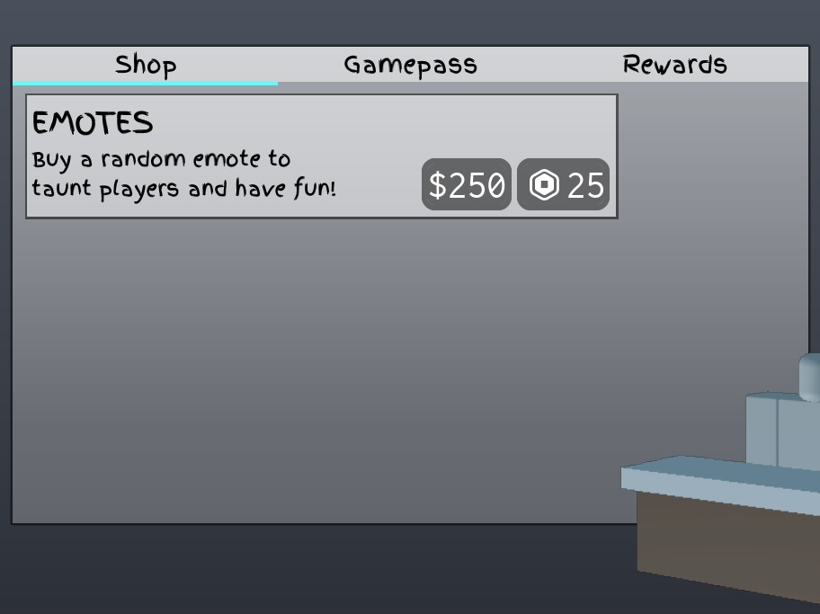

## At a glance

| | |
|---|---|
| Provenance | copy of a live game (saveinstance / decompiled client code) |
| Screens | 57 ScreenGuis, 1366 GUI objects → **34 screenshots** |
| Models (.rbxm) | 2105 models, 11 model sets, 53 VFX sets |
| Lua builders (.lua) | 114 UI screens, 142 animation packs, 108 audio packs |
| Code | 299 scripts, 131,776 lines |
| Asset ids | 914 animations, 427 sounds |
| Safety scan | 3 HIGH / 5 MED flags ([flags.txt](source/flags.txt)) |

**Fonts:** `Finger Paint Regular`×212, `SourceSansPro Bold`×93, `SourceSansPro Regular`×71, `Finger Paint Bold`×33, `Arial Regular`×10

## UI screenshots

Captured in Studio from the place's own ScreenGuis (scripts stripped). Each panel was opened on its own; click a thumbnail for the full 1519×886 frame. Runtime-filled lists (shop items, inventories) show their template state.

### Shop & Robux store

<table>
<tr>
<td width="33%" valign="top"><a href="screenshots/15_Menus__Shop.jpg">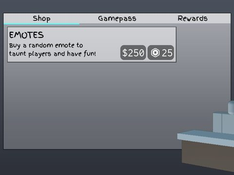</a> <b>Menus</b> › Shop</td>
</tr>
</table>

### Inventory / backpack / pets

<table>
<tr>
<td width="33%" valign="top"><a href="screenshots/18_Menus2__Inventory.jpg">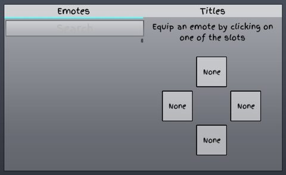</a> <b>Menus2</b> › Group.Inventory</td>
</tr>
</table>

### Rewards, daily, spin, codes

<table>
<tr>
<td width="33%" valign="top"><a href="screenshots/24_Gifting.jpg">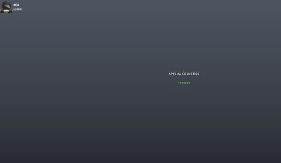</a> <b>Gifting</b></td>
<td width="33%" valign="top"><a href="screenshots/25_Gifting__Frame.jpg">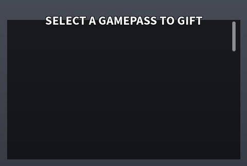</a> <b>Gifting</b> › Frame</td>
</tr>
</table>

### Settings & menus

<table>
<tr>
<td width="33%" valign="top"><a href="screenshots/14_Menus__Private.jpg">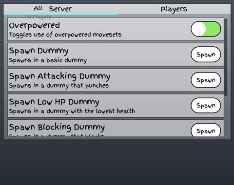</a> <b>Menus</b> › Private</td>
<td width="33%" valign="top"><a href="screenshots/16_Menus__Settings.jpg">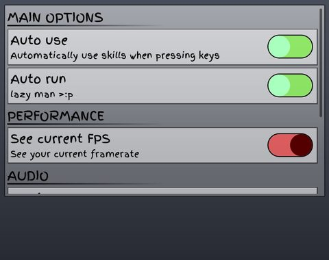</a> <b>Menus</b> › Settings</td>
<td width="33%" valign="top"><a href="screenshots/19_Menus2__Logs.jpg">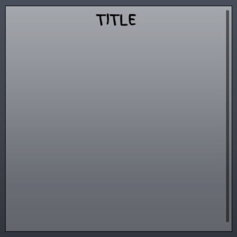</a> <b>Menus2</b> › Group.Logs</td>
</tr>
<tr>
<td width="33%" valign="top"><a href="screenshots/20_Menus2__Ranked.jpg">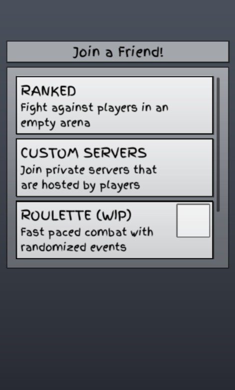</a> <b>Menus2</b> › Group.Ranked</td>
<td width="33%" valign="top"><a href="screenshots/21_Menus2__Tutorial_Info.jpg">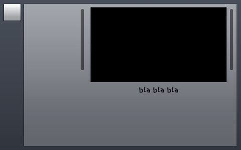</a> <b>Menus2</b> › Group.Tutorial_Info</td>
<td width="33%" valign="top"><a href="screenshots/22_Menus2__Settings.jpg">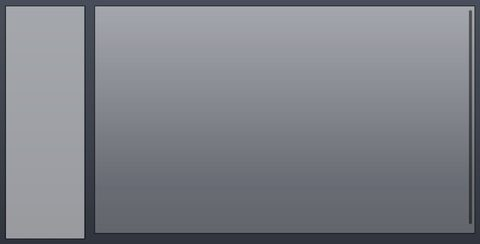</a> <b>Menus2</b> › Group.Settings</td>
</tr>
<tr>
<td width="33%" valign="top"><a href="screenshots/29_Death__TitlesSF.jpg">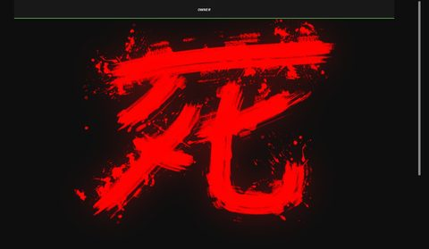</a> <b>Death</b> › Image.TitlesSF</td>
<td width="33%" valign="top"><a href="screenshots/32_Black__TitlesSF.jpg">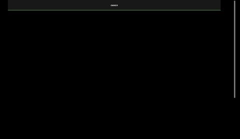</a> <b>Black</b> › Image.TitlesSF</td>
</tr>
</table>

### Popups, notifications, prompts

<table>
<tr>
<td width="33%" valign="top"><a href="screenshots/23_Menus2__Warning.jpg">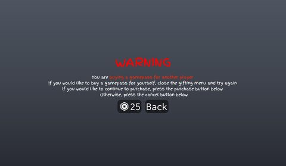</a> <b>Menus2</b> › Warning</td>
<td width="33%" valign="top"><a href="screenshots/33_KJDialogue.jpg">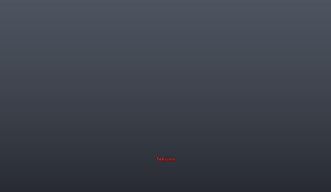</a> <b>KJDialogue</b></td>
</tr>
</table>

### Loading & intro

<table>
<tr>
<td width="33%" valign="top"> <b>DomainFade</b></td>
</tr>
</table>

### HUD & currency

<table>
<tr>
<td width="33%" valign="top"><a href="screenshots/01_SukunaDomain_Template.jpg">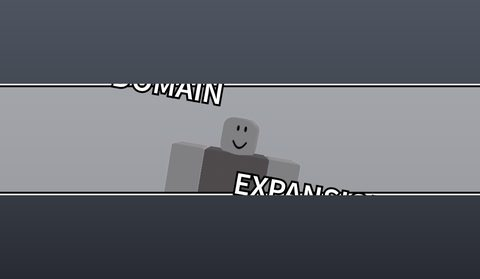</a> <b>SukunaDomain_Template</b></td>
<td width="33%" valign="top"><a href="screenshots/02_GojoDomain_Template.jpg">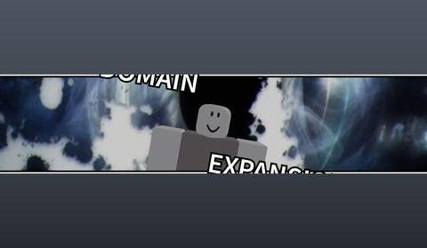</a> <b>GojoDomain_Template</b></td>
<td width="33%" valign="top"><a href="screenshots/03_YutaDomain_Template.jpg">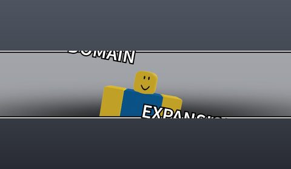</a> <b>YutaDomain_Template</b></td>
</tr>
<tr>
<td width="33%" valign="top"><a href="screenshots/05_DomainWarn.jpg">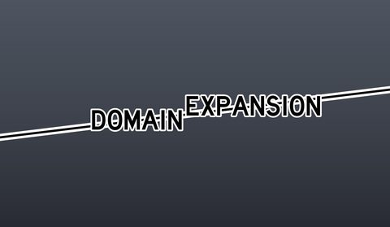</a> <b>DomainWarn</b></td>
<td width="33%" valign="top"><a href="screenshots/06_DomainInfo.jpg">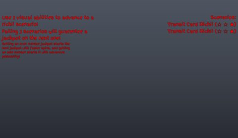</a> <b>DomainInfo</b></td>
<td width="33%" valign="top"><a href="screenshots/26_AwakeningBar.jpg">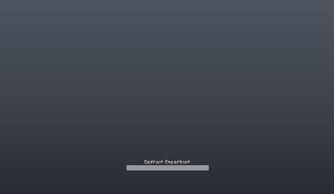</a> <b>AwakeningBar</b></td>
</tr>
</table>

### Character / avatar / emotes

<table>
<tr>
<td width="33%" valign="top"><a href="screenshots/08_Emotes__ImageLabel.jpg">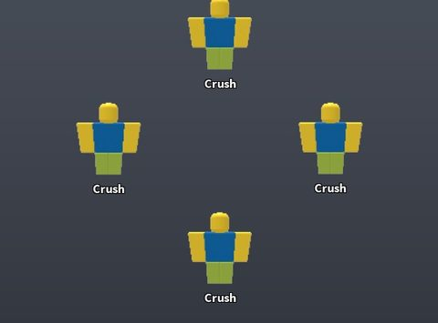</a> <b>Emotes</b> › ImageLabel</td>
<td width="33%" valign="top"> <b>Emotes</b> › ScrollingFrame</td>
<td width="33%" valign="top"><a href="screenshots/13_Awakening_Outfit.jpg">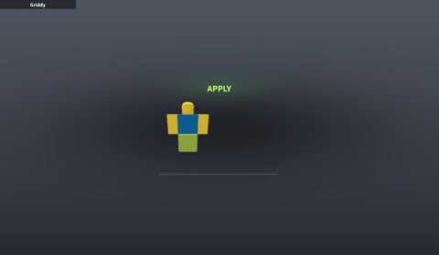</a> <b>Awakening Outfit</b></td>
</tr>
</table>

### Map vote / teams / matchmaking

<table>
<tr>
<td width="33%" valign="top"><a href="screenshots/31_Vote.jpg">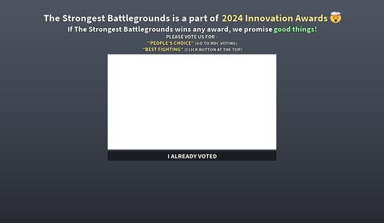</a> <b>Vote</b></td>
</tr>
</table>

### Other

<table>
<tr>
<td width="33%" valign="top"><a href="screenshots/04_Adapt.jpg">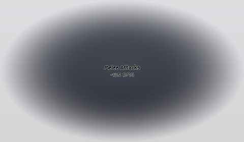</a> <b>Adapt</b></td>
<td width="33%" valign="top"><a href="screenshots/10_Cosmetics.jpg">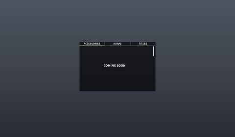</a> <b>Cosmetics</b></td>
<td width="33%" valign="top"><a href="screenshots/11_Cosmetics__AurasSF.jpg">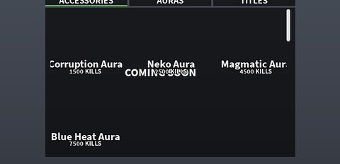</a> <b>Cosmetics</b> › Frame.AurasSF</td>
</tr>
<tr>
<td width="33%" valign="top"><a href="screenshots/12_ShiftLock.jpg">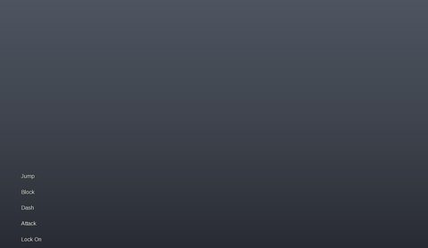</a> <b>ShiftLock</b></td>
<td width="33%" valign="top"><a href="screenshots/28_BossHP.jpg">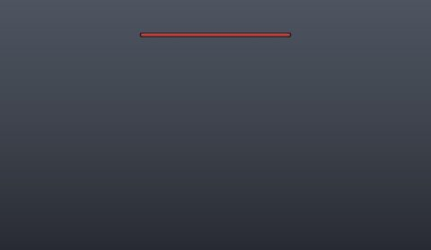</a> <b>BossHP</b></td>
<td width="33%" valign="top"> <b>HeavyVi</b></td>
</tr>
<tr>
<td width="33%" valign="top"> <b>Impact3</b></td>
<td width="33%" valign="top"><a href="screenshots/36_Adapt.jpg">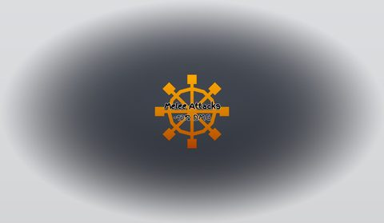</a> <b>Adapt</b></td>
<td width="33%" valign="top"><a href="screenshots/39_RotatingToolUIOLD.jpg">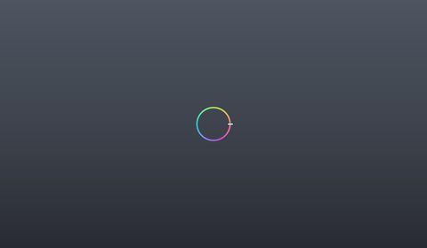</a> <b>RotatingToolUIOLD</b></td>
</tr>
</table>

## Model previews

<table>
<tr>
<td width="25%" valign="top"><a href="models/ServerStorage/Modules/Emotes/chaosemralds.rbxm">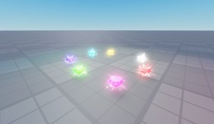</a> <b>chaosemralds</b> <code>models/ServerStorage/Modules/Emotes/chaosemralds.rbxm</code></td>
<td width="25%" valign="top"><a href="models/ServerStorage/Modules/Emotes/Sword.rbxm">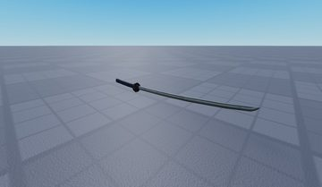</a> <b>Sword</b> <code>models/ServerStorage/Modules/Emotes/Sword.rbxm</code></td>
<td width="25%" valign="top"><a href="models/ReplicatedStorage/Utils/Mahito/Whip.rbxm">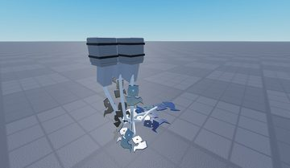</a> <b>Whip</b> <code>models/ReplicatedStorage/Utils/Mahito/Whip.rbxm</code></td>
<td width="25%" valign="top"><a href="models/ReplicatedStorage/Resources/StoneGrave/Beamed.rbxm">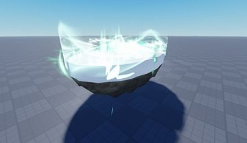</a> <b>Beamed</b> <code>models/ReplicatedStorage/Resources/StoneGrave/Beamed.rbxm</code></td>
</tr>
<tr>
<td width="25%" valign="top"><a href="models/ReplicatedStorage/Resources/TerribleTornado/JetBack.rbxm">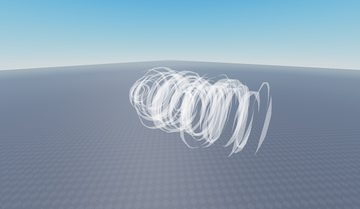</a> <b>JetBack</b> <code>models/ReplicatedStorage/Resources/TerribleTornado/JetBack.rbxm</code></td>
<td width="25%" valign="top"><a href="models/ReplicatedStorage/Resources/Rocks.rbxm">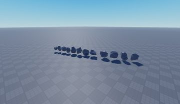</a> <b>Rocks</b> <code>models/ReplicatedStorage/Resources/Rocks.rbxm</code></td>
<td width="25%" valign="top"><a href="models/ServerStorage/Modules/Emotes/sign.rbxm">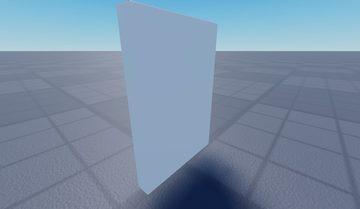</a> <b>sign</b> <code>models/ServerStorage/Modules/Emotes/sign.rbxm</code></td>
<td width="25%" valign="top"><a href="models/ServerStorage/Modules/Emotes/Prop.rbxm">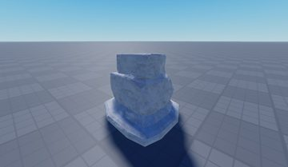</a> <b>Prop</b> <code>models/ServerStorage/Modules/Emotes/Prop.rbxm</code></td>
</tr>
<tr>
<td width="25%" valign="top"><a href="models/ReplicatedStorage/Resources/Bossfight/RocketLauncher.rbxm">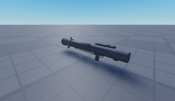</a> <b>RocketLauncher</b> <code>models/ReplicatedStorage/Resources/Bossfight/RocketLauncher.rbxm</code></td>
<td width="25%" valign="top"><a href="models/ReplicatedStorage/Resources/UFW/RB.rbxm">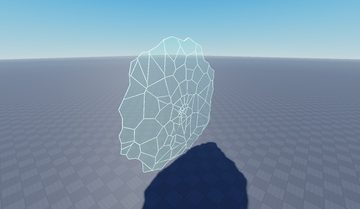</a> <b>RB</b> <code>models/ReplicatedStorage/Resources/UFW/RB.rbxm</code></td>
</tr>
</table>

## Notable scripts

Top-scored scripts of this game per topic (full tree in [source/scripts](source/scripts/)).

| Topic | Scripts |
|---|---|
| UI animation (tweens, hover / click, pop-ins, springs) | [`LocalScript`](source/scripts/StarterGui/DomainGUI/LocalScript.client.lua) 256 lines [`Icon228`](source/scripts/ReplicatedStorage/Modules/Icon228.lua) 2173 lines [`NewIcon`](source/scripts/ReplicatedStorage/Modules/NewIcon.lua) 2162 lines [`idk`](source/scripts/ReplicatedStorage/Modules/idk.lua) 20951 lines [`BlueGradient`](source/scripts/ReplicatedStorage/Modules/Icon228/Themes/BlueGradient.lua) 42 lines |
| UI controllers / window managers / menus | [`Icon228`](source/scripts/ReplicatedStorage/Modules/Icon228.lua) 2173 lines [`NewIcon`](source/scripts/ReplicatedStorage/Modules/NewIcon.lua) 2162 lines [`IconController`](source/scripts/ReplicatedStorage/Modules/Icon228/IconController.lua) 1188 lines [`LocalScript`](source/scripts/StarterGui/Cosmetics/Frame/LocalScript.client.lua) 54 lines [`CameraTableAnims`](source/scripts/ReplicatedStorage/Modules/CameraTableAnims.lua) 342 lines |
| Notifications, toasts, popups, prompts | [`Init`](source/scripts/ServerScriptService/Main/Init.server.lua) 1503 lines [`Main`](source/scripts/StarterPlayer/StarterPlayerScripts/Main.client.lua) 1189 lines [`Handler`](source/scripts/StarterGui/Emotes/Handler.client.lua) 346 lines [`Icon228`](source/scripts/ReplicatedStorage/Modules/Icon228.lua) 2173 lines [`NewIcon`](source/scripts/ReplicatedStorage/Modules/NewIcon.lua) 2162 lines |
| Loading / intro screens | [`Preload`](source/scripts/ReplicatedFirst/Preload.client.lua) 943 lines |
| Camera, cutscenes, screen shake | [`CameraTableAnims`](source/scripts/ReplicatedStorage/Modules/CameraTableAnims.lua) 342 lines [`WindShake`](source/scripts/ReplicatedStorage/Modules/WindShake.lua) 407 lines [`CameraShaker`](source/scripts/ReplicatedStorage/Modules/CameraShaker.lua) 193 lines [`CameraHandler`](source/scripts/ReplicatedStorage/Modules/CameraHandler.lua) 147 lines [`ShakeCamera`](source/scripts/ReplicatedFirst/ShakeCamera.lua) 44 lines |
| VFX, particles, beams, hit effects | [`FXController`](source/scripts/ReplicatedStorage/Modules/FXController.lua) 248 lines [`Rapid Punch`](source/scripts/ServerScriptService/Main/Abilities/Rapid%20Punch.lua) 229 lines [`Hollow Purple`](source/scripts/ServerScriptService/Main/Abilities/Hollow%20Purple.lua) 224 lines [`Reversal Red`](source/scripts/ServerScriptService/Main/Abilities/Reversal%20Red.lua) 230 lines [`TwofoldKick`](source/scripts/ServerScriptService/Main/Abilities/TwofoldKick.lua) 252 lines |
| DataStore / player data | [`Init`](source/scripts/ServerScriptService/Main/Init.server.lua) 1503 lines |
| Monetization (dev products, game passes, receipts) | [`Init`](source/scripts/ServerScriptService/Main/Init.server.lua) 1503 lines [`Handler`](source/scripts/StarterGui/Emotes/Handler.client.lua) 346 lines [`ShopClient`](source/scripts/StarterGui/Menus/Shop/ShopClient.client.lua) 206 lines [`Main`](source/scripts/StarterPlayer/StarterPlayerScripts/Main.client.lua) 1189 lines |
| RNG, eggs, gacha, rarity rolls, pets | [`Emotes`](source/scripts/ServerStorage/Modules/Emotes.lua) 2352 lines [`SmartBone`](source/scripts/ReplicatedStorage/Modules/SmartBone.lua) 671 lines [`Info`](source/scripts/ReplicatedStorage/Info.lua) 1420 lines |
| Combat, weapons, hitboxes, abilities | [`Combat`](source/scripts/ServerScriptService/Main/Combat.server.lua) 1503 lines [`Rapid Punch`](source/scripts/ServerScriptService/Main/Abilities/Rapid%20Punch.lua) 229 lines [`AttackScript`](source/scripts/ServerScriptService/QOL/Dummy/Scripts/AttackScript.server.lua) 85 lines [`Rapid PunchDef`](source/scripts/ServerScriptService/Main/Abilities/Rapid%20PunchDef.lua) 200 lines [`Idk`](source/scripts/ServerScriptService/Main/Abilities/Idk.lua) 140 lines |
| NPC / AI / monsters | [`SUKARABOTAI`](source/scripts/StarterPlayer/StarterCharacterScripts/SUKARABOTAI.client.lua) 63 lines |
| Character movement (sprint, dash, double jump, slide) | [`ParkourV2`](source/scripts/StarterPlayer/StarterCharacterScripts/ParkourV2.client.lua) 246 lines [`Combat`](source/scripts/ServerScriptService/Main/Combat.server.lua) 1503 lines [`MovementController`](source/scripts/StarterPlayer/StarterCharacterScripts/MovementController.lua) 215 lines [`Main`](source/scripts/StarterPlayer/StarterPlayerScripts/Main.client.lua) 1189 lines [`ParkourV2.0`](source/scripts/StarterPlayer/StarterCharacterScripts/ParkourV2.0.client.lua) 217 lines |
| Tycoon / plots / bases / building | [`Init`](source/scripts/ServerScriptService/Main/Init.server.lua) 1503 lines [`PrivateClient`](source/scripts/StarterGui/Menus/Private/PrivateClient.client.lua) 184 lines [`idk`](source/scripts/ReplicatedStorage/Modules/idk.lua) 20951 lines [`BuildScript`](source/scripts/StarterPlayer/StarterPlayerScripts/BuildScript.client.lua) 112 lines [`Main`](source/scripts/StarterPlayer/StarterPlayerScripts/Main.client.lua) 1189 lines |
| Leaderboards & stats | [`Init`](source/scripts/ServerScriptService/Main/Init.server.lua) 1503 lines |
| Admin panels & commands | [`Commands`](source/scripts/ServerScriptService/QOL/Commands.server.lua) 493 lines [`Init`](source/scripts/ServerScriptService/Main/Init.server.lua) 1503 lines |
| Sound & music | [`TriggerAwkMusic`](source/scripts/ReplicatedStorage/Modules/Utility/TriggerAwkMusic.lua) 26 lines [`SoundsModule`](source/scripts/ServerStorage/Modules/SoundsModule.lua) 51 lines [`Footsteps`](source/scripts/StarterPlayer/StarterPlayerScripts/Footsteps.client.lua) 182 lines [`NewIcon`](source/scripts/ReplicatedStorage/Modules/NewIcon.lua) 2162 lines [`Icon228`](source/scripts/ReplicatedStorage/Modules/Icon228.lua) 2173 lines |
| Utility modules (number format, signals, tables, timers) | [`MovesetHandler`](source/scripts/ServerStorage/Modules/MovesetHandler.lua) 127 lines [`Maid`](source/scripts/ReplicatedStorage/Modules/Icon228/Maid.lua) 154 lines [`PartCache`](source/scripts/ReplicatedStorage/Modules/VoxBreaker/PartCache.lua) 192 lines [`Icon228`](source/scripts/ReplicatedStorage/Modules/Icon228.lua) 2173 lines [`NewIcon`](source/scripts/ReplicatedStorage/Modules/NewIcon.lua) 2162 lines |

### In the curated script library

- [CameraShaker (RbxCameraShaker)](../../Scripts/05-Camera-Cutscene/CameraShaker__jujutsu-shenanigans.lua) — Open-source camera shake engine: ShakeOnce, sustained shakes, presets, fade in/out.
- [CameraShakeInstance](../../Scripts/05-Camera-Cutscene/CameraShakeInstance__jujutsu-shenanigans.lua) — Single shake instance used by CameraShaker (Perlin noise, fade states).
- [CameraShakePresets](../../Scripts/05-Camera-Cutscene/CameraShakePresets__jujutsu-shenanigans.lua) — Ready-made shake presets (Explosion, Earthquake, Bump, Handheld...).
- [ShakeCamera wrapper](../../Scripts/05-Camera-Cutscene/ShakeCameraWrapper__jujutsu-shenanigans.lua) — How a game wraps CameraShaker into one shared module (one instance, simple API).
- [Combat client camera](../../Scripts/05-Camera-Cutscene/CombatCameraClient__jujutsu-shenanigans.lua) — Additive decaying shake + head-follow CameraOffset + 'dead cam' offset in one LocalScript.
- [Frame-table camera cutscenes](../../Scripts/05-Camera-Cutscene/FrameTableCameraCutscene__jujutsu-shenanigans.lua) — Data-driven cutscenes: per-frame CFrame + FOV tables played at 60 fps relative to a part.
- [Animated camera rig cutscenes](../../Scripts/05-Camera-Cutscene/CameraRigCutscene__jujutsu-shenanigans.lua) — Animate a camera rig with normal animations; camera follows the rig's Cam part; smooth hand-back.
- [Lock-on camera](../../Scripts/05-Camera-Cutscene/LockOnCamera__jujutsu-shenanigans.lua) — Target lock-on with crosshair picking, left/right switching, line-of-sight break, shoulder offset.
- [Head-follow camera offset](../../Scripts/05-Camera-Cutscene/HeadFollowCameraOffset__jujutsu-shenanigans.lua) — Camera follows the head during animations (CameraOffset = head relative to root).
- [Hitbox class (spatial query)](../../Scripts/11-Combat/HitboxHandler__jujutsu-shenanigans.lua) — Reusable hitbox class: box/radius query, per-frame or once, hit-once list, closest-only mode.
- [Damage pipeline](../../Scripts/11-Combat/DamageHandler__jujutsu-shenanigans.lua) — Central damage function: block from the front only, counters, finishers, stun + hit animation.
- [Stun handler](../../Scripts/11-Combat/StunHandler__jujutsu-shenanigans.lua) — Tag-based stun: one call blocks every action via CollectionService tags, restored when stuns expire.
- [M1 combo + perfect block](../../Scripts/11-Combat/M1ComboAndBlock__jujutsu-shenanigans.lua) — Combo counter with timeout + block with a perfect-block window.
- [Dash, vault and footsteps](../../Scripts/13-Movement/DashVaultFootsteps__jujutsu-shenanigans.lua) — Small all-in-one: camera-direction dash, auto vault over low walls, sprint, footsteps by material.
- [Side / back dash rules (server)](../../Scripts/13-Movement/SideBackDashGating__jujutsu-shenanigans.lua) — How a fighting game gates dashes on the server with tags, separate cooldowns and ragdoll-cancel.
- [Ledge vault](../../Scripts/13-Movement/LedgeVault__jujutsu-shenanigans.lua) — Name-tagged vault parts: ray check + short velocity burst + random animation.
- [Combat ragdoll handler](../../Scripts/13-Movement/CombatRagdoll__jujutsu-shenanigans.lua) — Ragdoll for combat: timed knockdowns, collider parts, air detection, cancel, stacked-timer handling.
- [Positional one-shot sound helper](../../Scripts/17-Sound-Music/SoundsModule__jujutsu-shenanigans.lua) — Tiny helper: clone a Sound, put it on a part or at a world position (via a Terrain attachment), route it to a SoundGroup, set speed and start time, optionally fade it out after a delay, and auto-clean with Debris.
- [Material-based footsteps](../../Scripts/17-Sound-Music/MaterialFootsteps__jujutsu-shenanigans.lua) — Footstep sounds chosen by Humanoid.FloorMaterial (3 random variations per material, with aliases), fired from an animation marker (runfootstep) with a rate limit; also jump and land sounds from StateChanged.
- [Fade sound group in/out](../../Scripts/17-Sound-Music/AwakeningMusicToggle__jujutsu-shenanigans.lua) — Fades a group of sounds under an attachment in or out (1 s linear tween), remembering each original volume in an attribute; honors a per-player Awakening Music setting.
- [Particle helpers](../../Scripts/06-VFX/ParticleHelpers__jujutsu-shenanigans.lua) — Highest-lifetime lookup, emit all, toggle, scale lifetime, tween model scale.
- [Limb trails](../../Scripts/06-VFX/LimbTrails__jujutsu-shenanigans.lua) — Attach a trail or particle part to a limb for N seconds, then let it fade in place.
- [Ability: charge, projectile, explosion](../../Scripts/06-VFX/ReversalRedAbility__jujutsu-shenanigans.lua) — Reference ability timeline: charge-up tweens -> projectile -> multi-emitter explosion -> knockback.
- [Barrage arms + shockwaves](../../Scripts/06-VFX/BarrageArmsBezier__jujutsu-shenanigans.lua) — Bezier-curve ghost arms + tiny shockwave rings for a barrage / rapid punch.

## ⚠️ Safety

HIGH flags (backdoors, `require(id)`, `loadstring`, webhooks). Review or delete before reusing:

- `scripts/ServerScriptService/QOL/Cosmetics.server.lua`
- `scripts/ServerScriptService/QOL/Cosmetics.server.lua`
- `scripts/Workspace/Map/Map/Destructible/Model/StationControl/Handle.server.lua`

## Folders

| Folder | What |
|---|---|
| `screenshots/` | full frames; `crops/` = the panel only; `models/` = 3D previews; `thumbs/` = gallery thumbnails |
| `ui/` | every screen as a Lua builder (`require(module)()` returns the ScreenGui); `_StarterGui-all.lua` builds every StarterGui screen |
| `models/` | every model as .rbxm (the only .rbxm files), mirroring the place tree, scripts removed |
| `map/` | `workspace.rbxm` (the map as a model), `lighting.lua` (sky + post effects), `materials.lua`, `Environment.lua` |
| `animations/`, `audio/` | KeyframeSequence / Sound builders (.lua), `AnimationIds.lua`, `Sounds.lua` |
| `source/` | all scripts as .luau, `tree.txt`, `ui.txt`, `remotes.txt`, `assets.txt`, `flags.txt` |
