# Kick A ... (template)

> 🧠 **Brainrot** · kick / launch simulator (fireworks, camera shake) · source file `Kick A Template For Slbr Booster do not leak or ban perm.rbxl`

[⬅ Back to the catalog](../../README.md) · [Assets inventory](ASSETS.md) · [Style numbers](reference.md) · [Scripts](source/scripts/) · [Code analysis](source/README.md)

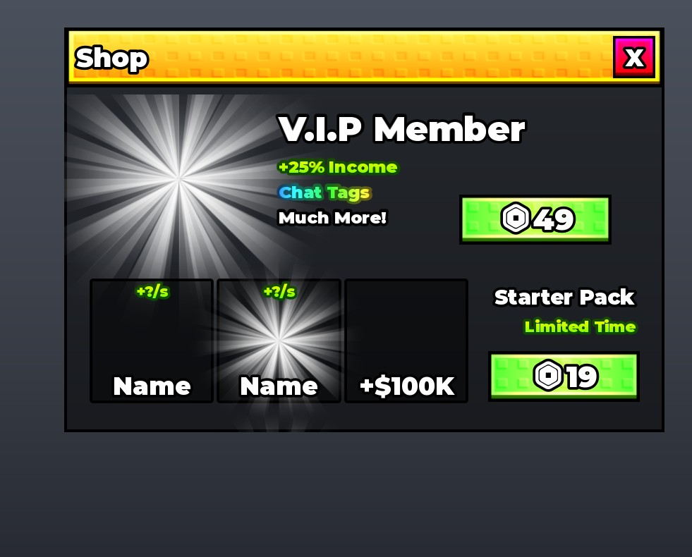

## At a glance

| | |
|---|---|
| Provenance | template with full source |
| Screens | 1 ScreenGuis, 300 GUI objects → **11 screenshots** |
| Models (.rbxm) | 262 models, 13 model sets, 3 VFX sets |
| Lua builders (.lua) | 19 UI screens, 145 animation packs, 2 audio packs |
| Code | 121 scripts, 26,859 lines |
| Asset ids | 207 animations, 16 sounds |
| Safety scan | 0 HIGH / 1 MED flags ([flags.txt](source/flags.txt)) |

**Fonts:** `GothamSSm Heavy`×87, `SourceSansPro Regular`×28, `font asset 11702779517 Heavy`×15

## UI screenshots

Captured in Studio from the place's own ScreenGuis (scripts stripped). Each panel was opened on its own; click a thumbnail for the full 1519×886 frame. Runtime-filled lists (shop items, inventories) show their template state.

### Shop & Robux store

<table>
<tr>
<td width="33%" valign="top"><a href="screenshots/08_GUI__Shop.jpg">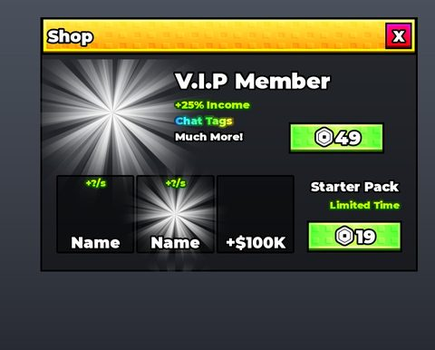</a> <b>GUI</b> › Frames.Shop</td>
</tr>
</table>

### Index / codex / glossary

<table>
<tr>
<td width="33%" valign="top"><a href="screenshots/05_GUI__Index.jpg">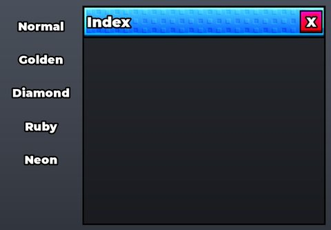</a> <b>GUI</b> › Frames.Index</td>
</tr>
</table>

### Rewards, daily, spin, codes

<table>
<tr>
<td width="33%" valign="top"><a href="screenshots/06_GUI__Wheel.jpg">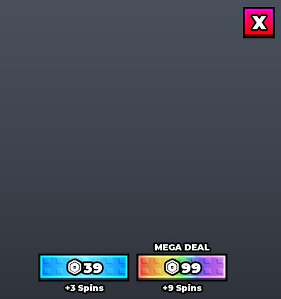</a> <b>GUI</b> › Frames.Wheel</td>
<td width="33%" valign="top"><a href="screenshots/07_GUI__Offline.jpg">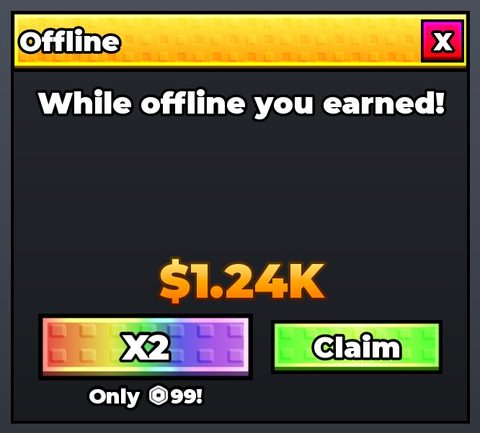</a> <b>GUI</b> › Frames.Offline</td>
</tr>
</table>

### Quests & progression

<table>
<tr>
<td width="33%" valign="top"><a href="screenshots/02_GUI__Upgrades.jpg">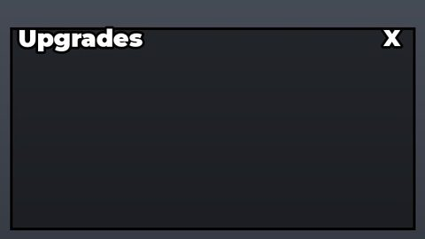</a> <b>GUI</b> › Frames.Upgrades</td>
<td width="33%" valign="top"><a href="screenshots/04_GUI__Rebirth.jpg">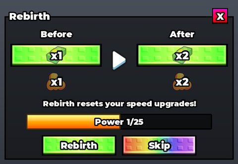</a> <b>GUI</b> › Frames.Rebirth</td>
<td width="33%" valign="top"><a href="screenshots/10_UpgradeTemplate.jpg">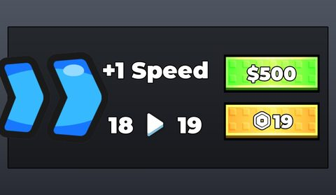</a> <b>UpgradeTemplate</b></td>
</tr>
</table>

### Other

<table>
<tr>
<td width="33%" valign="top"><a href="screenshots/01_GUI.jpg">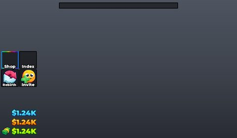</a> <b>GUI</b></td>
<td width="33%" valign="top"><a href="screenshots/03_GUI__Weights.jpg">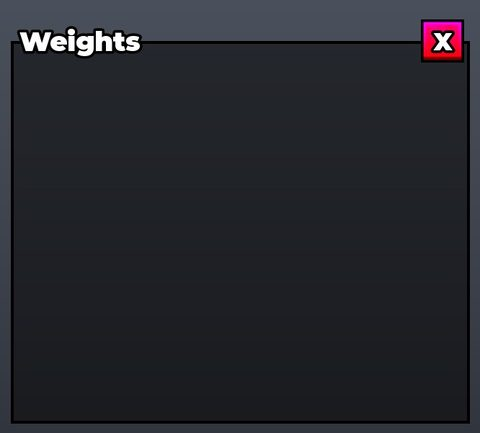</a> <b>GUI</b> › Frames.Weights</td>
<td width="33%" valign="top"> <b>GUI</b> › Effect</td>
</tr>
<tr>
<td width="33%" valign="top"><a href="screenshots/11_WeightTemplate.jpg">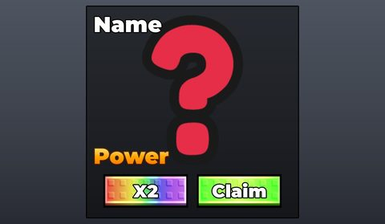</a> <b>WeightTemplate</b></td>
</tr>
</table>

## Model previews

<table>
<tr>
<td width="25%" valign="top"><a href="models/Workspace/BIG%20LUCKY%20BLOCK%20FILE/Models/Animals/AURA%20Lucky%20Block.rbxm">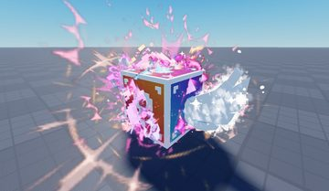</a> <b>AURA Lucky Block</b> <code>models/Workspace/BIG LUCKY BLOCK FILE/Models/Animals/AURA Lucky Block.rbxm</code></td>
<td width="25%" valign="top"><a href="models/ReplicatedStorage/Items/Diamond/Yeti%20Fruit.rbxm">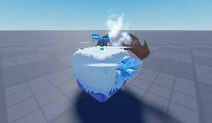</a> <b>Yeti Fruit</b> <code>models/ReplicatedStorage/Items/Diamond/Yeti Fruit.rbxm</code></td>
<td width="25%" valign="top"><a href="models/ReplicatedStorage/LuckyBlocks/Food%20Lucky%20Block.rbxm">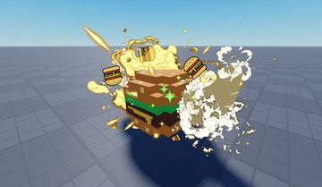</a> <b>Food Lucky Block</b> <code>models/ReplicatedStorage/LuckyBlocks/Food Lucky Block.rbxm</code></td>
<td width="25%" valign="top"><a href="models/Workspace/Map/Trees/Tree3~6/TrunkBase.rbxm">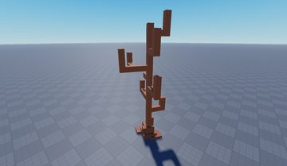</a> <b>TrunkBase</b> <code>models/Workspace/Map/Trees/Tree3~6/TrunkBase.rbxm</code></td>
</tr>
<tr>
<td width="25%" valign="top"><a href="models/ReplicatedStorage/Items/Diamond/Kitsune.rbxm">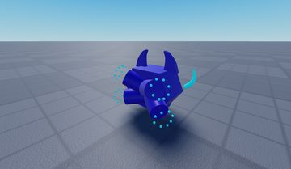</a> <b>Kitsune</b> <code>models/ReplicatedStorage/Items/Diamond/Kitsune.rbxm</code></td>
<td width="25%" valign="top"><a href="models/ServerStorage/Brushtool2_Plugin_Storage/7559537296_BrushtoolBrushObjects/%7BB0440F6C-5A88-42AE-8B4F-28006D6AE04D%7D/Tree.rbxm">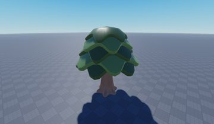</a> <b>Tree</b> <code>models/ServerStorage/Brushtool2_Plugin_Storage/7559537296_BrushtoolBrushObjects/{B0440F6C-5A88-42AE-8B4F-28006D6AE04D}/Tree.rbxm</code></td>
<td width="25%" valign="top"><a href="models/Workspace/Leaderboards/RebirthsLeaderboard.rbxm">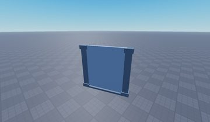</a> <b>RebirthsLeaderboard</b> <code>models/Workspace/Leaderboards/RebirthsLeaderboard.rbxm</code></td>
<td width="25%" valign="top"><a href="models/Workspace/BIG%20LUCKY%20BLOCK%20FILE/Models/Animals/Strawberry%20Lucky%20Block.rbxm">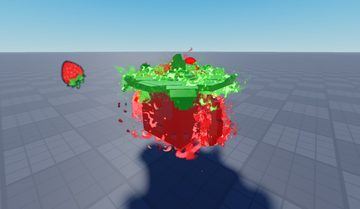</a> <b>Strawberry Lucky Block</b> <code>models/Workspace/BIG LUCKY BLOCK FILE/Models/Animals/Strawberry Lucky Block.rbxm</code></td>
</tr>
<tr>
<td width="25%" valign="top"><a href="models/Workspace/BIG%20LUCKY%20BLOCK%20FILE/LuckyBoxes/SecretBlock.rbxm">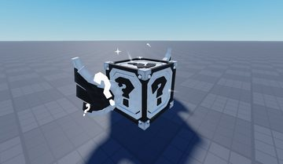</a> <b>SecretBlock</b> <code>models/Workspace/BIG LUCKY BLOCK FILE/LuckyBoxes/SecretBlock.rbxm</code></td>
<td width="25%" valign="top"><a href="models/ReplicatedStorage/Items/Diamond/Goro.rbxm">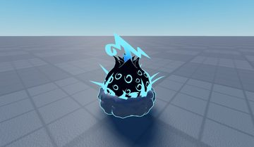</a> <b>Goro</b> <code>models/ReplicatedStorage/Items/Diamond/Goro.rbxm</code></td>
<td width="25%" valign="top"><a href="models/Workspace/Leaderboards/MoneyLeaderboard.rbxm">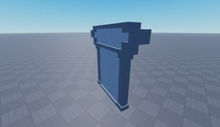</a> <b>MoneyLeaderboard</b> <code>models/Workspace/Leaderboards/MoneyLeaderboard.rbxm</code></td>
<td width="25%" valign="top"><a href="models/Workspace/BIG%20LUCKY%20BLOCK%20FILE/Models/Animals/Niz%20Lucky%20Block.rbxm">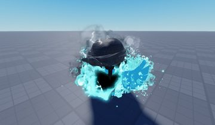</a> <b>Niz Lucky Block</b> <code>models/Workspace/BIG LUCKY BLOCK FILE/Models/Animals/Niz Lucky Block.rbxm</code></td>
</tr>
<tr>
<td width="25%" valign="top"><a href="models/Workspace/BIG%20LUCKY%20BLOCK%20FILE/LuckyBoxes/BabyBlock.rbxm">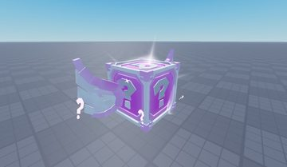</a> <b>BabyBlock</b> <code>models/Workspace/BIG LUCKY BLOCK FILE/LuckyBoxes/BabyBlock.rbxm</code></td>
<td width="25%" valign="top"><a href="models/Workspace/BIG%20LUCKY%20BLOCK%20FILE/Models/Animals/TRILLIONAIRE%20Lucky%20Block.rbxm">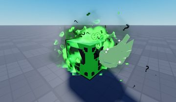</a> <b>TRILLIONAIRE Lucky Block</b> <code>models/Workspace/BIG LUCKY BLOCK FILE/Models/Animals/TRILLIONAIRE Lucky Block.rbxm</code></td>
</tr>
</table>

## Notable scripts

Top-scored scripts of this game per topic (full tree in [source/scripts](source/scripts/)).

| Topic | Scripts |
|---|---|
| UI animation (tweens, hover / click, pop-ins, springs) | [`KickController`](source/scripts/StarterPlayer/StarterPlayerScripts/KickController.client.lua) 982 lines [`ShopController`](source/scripts/StarterPlayer/StarterPlayerScripts/ShopController.client.lua) 257 lines [`UIInitializer`](source/scripts/StarterPlayer/StarterPlayerScripts/UIInitializer.client.lua) 151 lines |
| UI controllers / window managers / menus | [`UIInitializer`](source/scripts/StarterPlayer/StarterPlayerScripts/UIInitializer.client.lua) 151 lines [`LimitedItemUIController`](source/scripts/StarterPlayer/StarterPlayerScripts/LimitedItemUIController.client.lua) 161 lines [`RebirthUIController`](source/scripts/StarterPlayer/StarterPlayerScripts/RebirthUIController.client.lua) 155 lines [`SpeedUIController`](source/scripts/StarterPlayer/StarterPlayerScripts/SpeedUIController.client.lua) 41 lines [`KickController`](source/scripts/StarterPlayer/StarterPlayerScripts/KickController.client.lua) 982 lines |
| Notifications, toasts, popups, prompts | [`PromptController`](source/scripts/StarterPlayer/StarterPlayerScripts/PromptController.client.lua) 132 lines [`PlotManager`](source/scripts/ServerScriptService/PlotManager.server.lua) 209 lines [`SlotManager`](source/scripts/ServerScriptService/Modules/SlotManager.lua) 489 lines [`LimitedItemUIController`](source/scripts/StarterPlayer/StarterPlayerScripts/LimitedItemUIController.client.lua) 161 lines [`RebirthUIController`](source/scripts/StarterPlayer/StarterPlayerScripts/RebirthUIController.client.lua) 155 lines |
| Camera, cutscenes, screen shake | [`KickController`](source/scripts/StarterPlayer/StarterPlayerScripts/KickController.client.lua) 982 lines |
| VFX, particles, beams, hit effects | [`KickController`](source/scripts/StarterPlayer/StarterPlayerScripts/KickController.client.lua) 982 lines [`MonetizationController`](source/scripts/ServerScriptService/Controllers/MonetizationController.lua) 240 lines [`PlayerController`](source/scripts/ServerScriptService/Controllers/PlayerController.lua) 587 lines [`SlotManager`](source/scripts/ServerScriptService/Modules/SlotManager.lua) 489 lines |
| DataStore / player data | [`PlayerController`](source/scripts/ServerScriptService/Controllers/PlayerController.lua) 587 lines |
| Monetization (dev products, game passes, receipts) | [`MonetizationController`](source/scripts/ServerScriptService/Controllers/MonetizationController.lua) 240 lines [`ShopController`](source/scripts/StarterPlayer/StarterPlayerScripts/ShopController.client.lua) 257 lines [`PlayerController`](source/scripts/ServerScriptService/Controllers/PlayerController.lua) 587 lines |
| RNG, eggs, gacha, rarity rolls, pets | [`MonetizationController`](source/scripts/ServerScriptService/Controllers/MonetizationController.lua) 240 lines [`KickController`](source/scripts/StarterPlayer/StarterPlayerScripts/KickController.client.lua) 982 lines [`PlayerController`](source/scripts/ServerScriptService/Controllers/PlayerController.lua) 587 lines [`LuckyBlockConfigurations`](source/scripts/ReplicatedStorage/Modules/LuckyBlockConfigurations.lua) 86 lines [`CollisionController`](source/scripts/ServerScriptService/CollisionController.server.lua) 89 lines |
| Combat, weapons, hitboxes, abilities | [`KickController`](source/scripts/StarterPlayer/StarterPlayerScripts/KickController.client.lua) 982 lines |
| Tycoon / plots / bases / building | [`PlotController`](source/scripts/StarterPlayer/StarterPlayerScripts/PlotController.client.lua) 177 lines [`SlotManager`](source/scripts/ServerScriptService/Modules/SlotManager.lua) 489 lines [`PlotManager`](source/scripts/ServerScriptService/PlotManager.server.lua) 209 lines [`ShopController`](source/scripts/StarterPlayer/StarterPlayerScripts/ShopController.client.lua) 257 lines [`LimitedItemUIController`](source/scripts/StarterPlayer/StarterPlayerScripts/LimitedItemUIController.client.lua) 161 lines |
| Leaderboards & stats | [`LeaderboardController`](source/scripts/ServerScriptService/Controllers/LeaderboardController.lua) 184 lines |
| Daily rewards, quests, codes, playtime | [`PlayerController`](source/scripts/ServerScriptService/Controllers/PlayerController.lua) 587 lines |
| Utility modules (number format, signals, tables, timers) | [`SlotManager`](source/scripts/ServerScriptService/Modules/SlotManager.lua) 489 lines [`SellManager`](source/scripts/ServerScriptService/Modules/SellManager.lua) 137 lines [`RebirthSystem`](source/scripts/ServerScriptService/Modules/RebirthSystem.lua) 147 lines [`PlotManager`](source/scripts/ServerScriptService/PlotManager.server.lua) 209 lines [`MonetizationController`](source/scripts/ServerScriptService/Controllers/MonetizationController.lua) 240 lines |

### In the curated script library

- [Offline earnings (simple)](../../Scripts/18-Daily-Rewards-Quests/OfflineEarnings-Simple__kick-a-brainrot.lua) — Minimal offline earnings: time since last save (capped at 8h) x each placed item's income x mutation/level/rebirth/VIP multipliers, shown in a popup and paid on a Claim remote.

## Folders

| Folder | What |
|---|---|
| `screenshots/` | full frames; `crops/` = the panel only; `models/` = 3D previews; `thumbs/` = gallery thumbnails |
| `ui/` | every screen as a Lua builder (`require(module)()` returns the ScreenGui); `_StarterGui-all.lua` builds every StarterGui screen |
| `models/` | every model as .rbxm (the only .rbxm files), mirroring the place tree, scripts removed |
| `map/` | `workspace.rbxm` (the map as a model), `lighting.lua` (sky + post effects), `materials.lua`, `Environment.lua` |
| `animations/`, `audio/` | KeyframeSequence / Sound builders (.lua), `AnimationIds.lua`, `Sounds.lua` |
| `source/` | all scripts as .luau, `tree.txt`, `ui.txt`, `remotes.txt`, `assets.txt`, `flags.txt` |
