# Miami Shootout

> 🔫 **Shooter** · open-world shooter / hood roleplay · source file `Miami Shootout NEWEST GAME (1).rbxl`

[⬅ Back to the catalog](../../README.md) · [Assets inventory](ASSETS.md) · [Style numbers](reference.md) · [Scripts](source/scripts/) · [Code analysis](source/README.md)

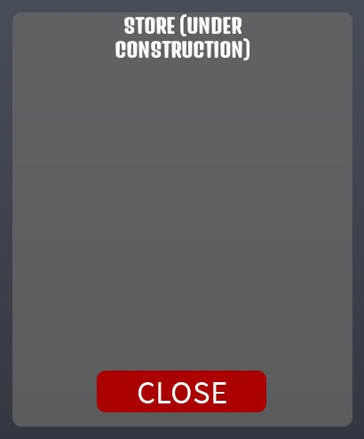

## At a glance

| | |
|---|---|
| Provenance | copy of a live game (saveinstance / decompiled client code) |
| Screens | 70 ScreenGuis, 2138 GUI objects → **49 screenshots** |
| Models (.rbxm) | 1057 models, 76 model sets, 6 VFX sets |
| Lua builders (.lua) | 63 UI screens, 32 animation packs, 78 audio packs |
| Code | 4008 scripts, 483,487 lines |
| Asset ids | 437 animations, 2773 sounds |
| Safety scan | 2 HIGH / 46 MED flags ([flags.txt](source/flags.txt)) |

**Fonts:** `GrenzeGotisch Regular`×372, `SourceSansPro Bold`×165, `Arial Bold`×157, `SourceSansPro Regular`×59, `Bangers Regular`×16

## UI screenshots

Captured in Studio from the place's own ScreenGuis (scripts stripped). Each panel was opened on its own; click a thumbnail for the full 1519×886 frame. Runtime-filled lists (shop items, inventories) show their template state.

### Shop & Robux store

<table>
<tr>
<td width="33%" valign="top"><a href="screenshots/24_BronxLoadscreen__Store.jpg">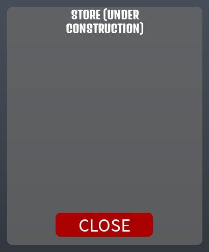</a> <b>BronxLoadscreen</b> › Store</td>
</tr>
</table>

### Settings & menus

<table>
<tr>
<td width="33%" valign="top"><a href="screenshots/03_eximity__Settings.jpg">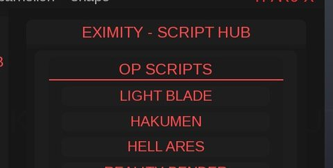</a> <b>eximity</b> › ImageLabel.inner.Settings</td>
<td width="33%" valign="top"><a href="screenshots/32_CellPhone__settings.jpg">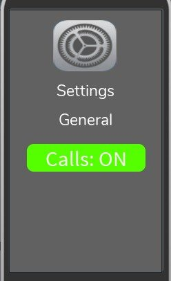</a> <b>CellPhone</b> › Frame.running.settings</td>
<td width="33%" valign="top"><a href="screenshots/35_Settings.jpg">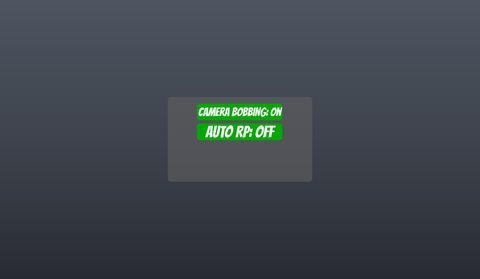</a> <b>Settings</b></td>
</tr>
</table>

### Popups, notifications, prompts

<table>
<tr>
<td width="33%" valign="top"> <b>Notification System</b></td>
</tr>
</table>

### End of round, death, results

<table>
<tr>
<td width="33%" valign="top"><a href="screenshots/34_Dead.jpg">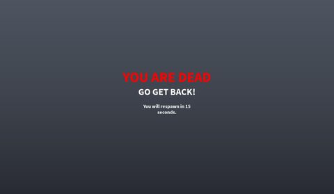</a> <b>Dead</b></td>
<td width="33%" valign="top"><a href="screenshots/77_AC6_Controls_Module__Window.jpg">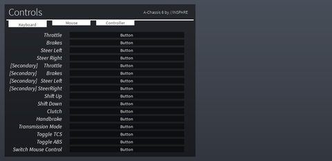</a> <b>AC6_Controls_Module</b> › Window</td>
</tr>
</table>

### HUD & currency

<table>
<tr>
<td width="33%" valign="top"> <b>HealthGui</b></td>
<td width="33%" valign="top"> <b>Stamina</b></td>
<td width="33%" valign="top"> <b>MoneyGui</b></td>
</tr>
<tr>
<td width="33%" valign="top"><a href="screenshots/67_GiveCash__MoneyFrame.jpg">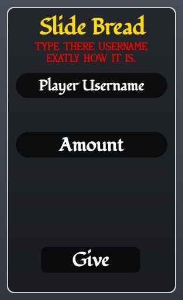</a> <b>GiveCash</b> › MoneyFrame</td>
</tr>
</table>

### Map vote / teams / matchmaking

<table>
<tr>
<td width="33%" valign="top"><a href="screenshots/27_Inventory__Background.jpg">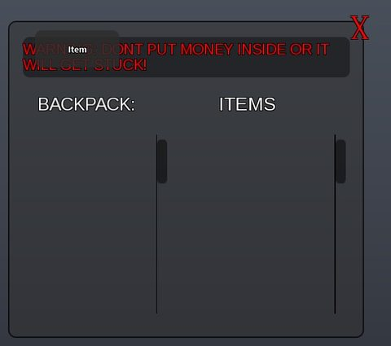</a> <b>Inventory</b> › Background</td>
</tr>
</table>

### Other

<table>
<tr>
<td width="33%" valign="top"><a href="screenshots/01_eximity.jpg">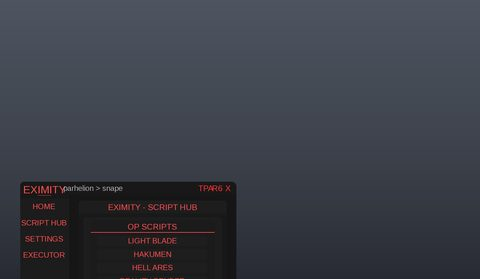</a> <b>eximity</b></td>
<td width="33%" valign="top"><a href="screenshots/04_eximity__Executor.jpg">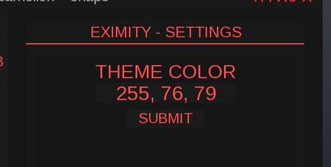</a> <b>eximity</b> › ImageLabel.inner.Executor</td>
<td width="33%" valign="top"><a href="screenshots/05_GunGui.jpg">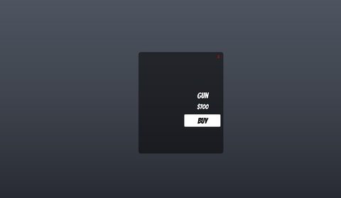</a> <b>GunGui</b></td>
</tr>
<tr>
<td width="33%" valign="top"><a href="screenshots/06_GunGUI.jpg">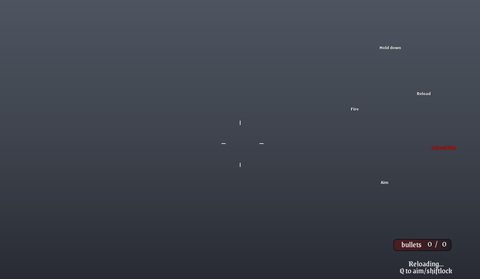</a> <b>GunGUI</b></td>
<td width="33%" valign="top"> <b>GunGUI</b> › Scope</td>
<td width="33%" valign="top"><a href="screenshots/08_GunGUI__Scope_OLD_.jpg">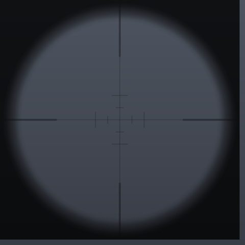</a> <b>GunGUI</b> › Scope(OLD)</td>
</tr>
<tr>
<td width="33%" valign="top"> <b>GunGUI</b></td>
<td width="33%" valign="top"><a href="screenshots/12_GunGUI__Scope.jpg">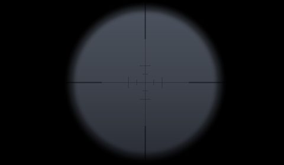</a> <b>GunGUI</b> › Scope</td>
<td width="33%" valign="top"><a href="screenshots/13_DoorAction.jpg">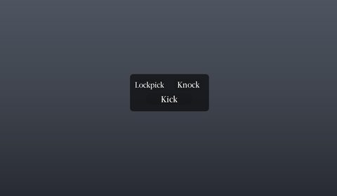</a> <b>DoorAction</b></td>
</tr>
<tr>
<td width="33%" valign="top"> <b>BronxLoadscreen</b></td>
<td width="33%" valign="top"><a href="screenshots/23_BronxLoadscreen__Rules.jpg">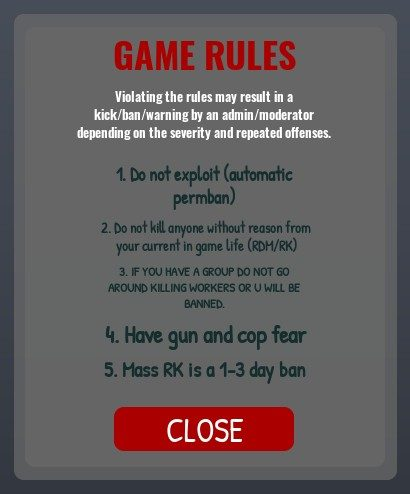</a> <b>BronxLoadscreen</b> › Rules</td>
<td width="33%" valign="top"> <b>MobilePunchGui</b></td>
</tr>
<tr>
<td width="33%" valign="top"> <b>KeyboardButtons</b></td>
<td width="33%" valign="top"> <b>CellPhone</b></td>
<td width="33%" valign="top"><a href="screenshots/29_CellPhone__cam.jpg">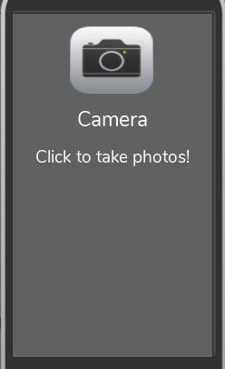</a> <b>CellPhone</b> › Frame.running.cam</td>
</tr>
<tr>
<td width="33%" valign="top"><a href="screenshots/30_CellPhone__phone.jpg">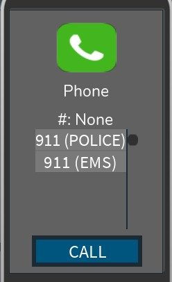</a> <b>CellPhone</b> › Frame.running.phone</td>
<td width="33%" valign="top"><a href="screenshots/31_CellPhone__phoneCall.jpg">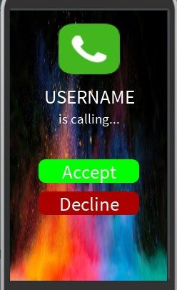</a> <b>CellPhone</b> › Frame.running.phoneCall</td>
<td width="33%" valign="top"><a href="screenshots/33_CellPhone__slidebread.jpg">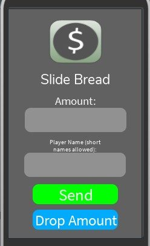</a> <b>CellPhone</b> › Frame.running.slidebread</td>
</tr>
<tr>
<td width="33%" valign="top"> <b>Hunger</b></td>
<td width="33%" valign="top"> <b>Run</b></td>
<td width="33%" valign="top"><a href="screenshots/43_ScreenGui__Frame.jpg">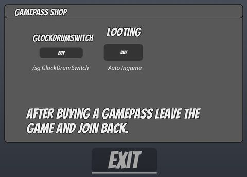</a> <b>ScreenGui</b> › Frame</td>
</tr>
<tr>
<td width="33%" valign="top"><a href="screenshots/44_ScreenGui__Frame.jpg">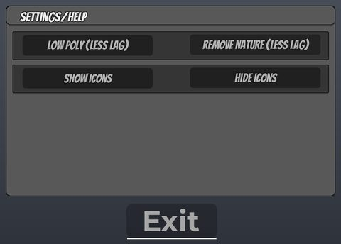</a> <b>ScreenGui</b> › Frame</td>
<td width="33%" valign="top"><a href="screenshots/45_SoftShutdown.jpg">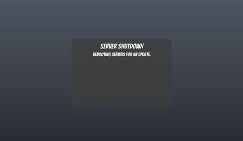</a> <b>SoftShutdown</b></td>
<td width="33%" valign="top"><a href="screenshots/46_NYPDBC.jpg">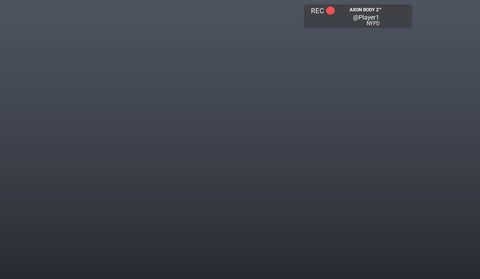</a> <b>NYPDBC</b></td>
</tr>
<tr>
<td width="33%" valign="top"><a href="screenshots/59_Spawner.jpg">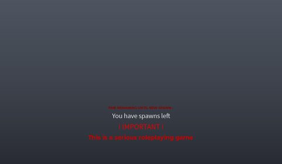</a> <b>Spawner</b></td>
<td width="33%" valign="top"> <b>Out</b></td>
<td width="33%" valign="top"> <b>Aux</b></td>
</tr>
<tr>
<td width="33%" valign="top"> <b>Aux</b> › AudioPlayerGui.List</td>
<td width="33%" valign="top"> <b>KeyboardButtons</b></td>
<td width="33%" valign="top"><a href="screenshots/68_SirenControl.jpg">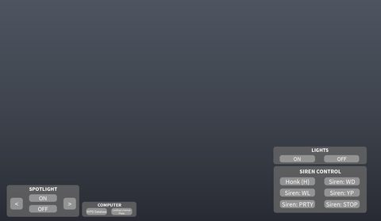</a> <b>SirenControl</b></td>
</tr>
<tr>
<td width="33%" valign="top"><a href="screenshots/69_GunGUI.jpg">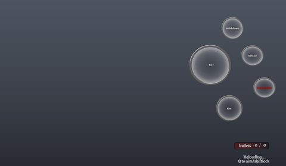</a> <b>GunGUI</b></td>
<td width="33%" valign="top"><a href="screenshots/72_GunGUI.jpg">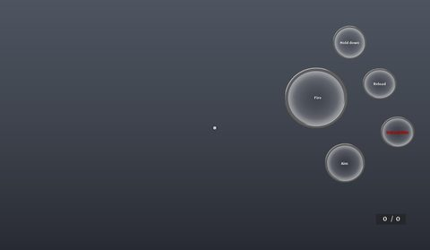</a> <b>GunGUI</b></td>
<td width="33%" valign="top"><a href="screenshots/78_CarGui.jpg">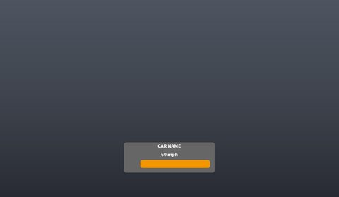</a> <b>CarGui</b></td>
</tr>
<tr>
<td width="33%" valign="top"><a href="screenshots/79_EMSCar.jpg">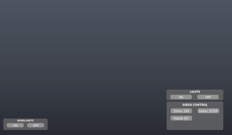</a> <b>EMSCar</b></td>
<td width="33%" valign="top"> <b>Mask</b></td>
<td width="33%" valign="top"> <b>GunGUI</b></td>
</tr>
<tr>
<td width="33%" valign="top"><a href="screenshots/93_GunGUI.jpg">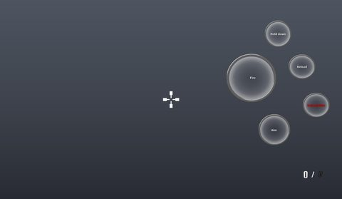</a> <b>GunGUI</b></td>
</tr>
</table>

## Model previews

<table>
<tr>
<td width="25%" valign="top"><a href="models/ServerStorage/Gamepass%20Guns/HallowARP.rbxm">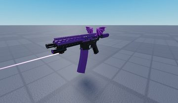</a> <b>HallowARP</b> <code>models/ServerStorage/Gamepass Guns/HallowARP.rbxm</code></td>
<td width="25%" valign="top"><a href="models/ServerStorage/Cars/Durango.rbxm">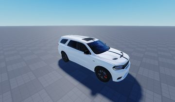</a> <b>Durango</b> <code>models/ServerStorage/Cars/Durango.rbxm</code></td>
<td width="25%" valign="top"><a href="models/ReplicatedStorage/Items/AK-47.rbxm">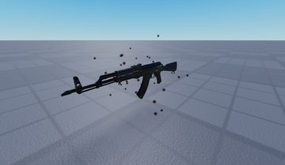</a> <b>AK-47</b> <code>models/ReplicatedStorage/Items/AK-47.rbxm</code></td>
<td width="25%" valign="top"><a href="models/ServerStorage/Cars/Police%20Explorer.rbxm">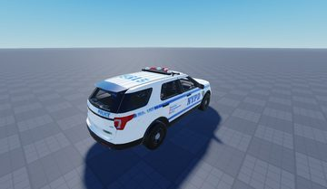</a> <b>Police Explorer</b> <code>models/ServerStorage/Cars/Police Explorer.rbxm</code></td>
</tr>
<tr>
<td width="25%" valign="top"><a href="models/ReplicatedStorage/Items/RugerP345.rbxm">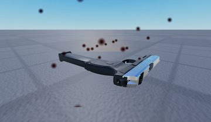</a> <b>RugerP345</b> <code>models/ReplicatedStorage/Items/RugerP345.rbxm</code></td>
<td width="25%" valign="top"><a href="models/ServerScriptService/DirtbikeGamepass/Honda%2085.rbxm">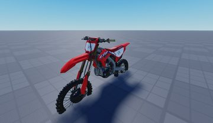</a> <b>Honda 85</b> <code>models/ServerScriptService/DirtbikeGamepass/Honda 85.rbxm</code></td>
<td width="25%" valign="top"><a href="models/Workspace/Meshes_SM_Prop_ShopInterior_Chair_01.rbxm">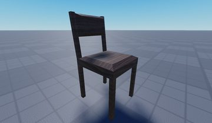</a> <b>Meshes_SM_Prop_ShopInterior_Chair_01</b> <code>models/Workspace/Meshes_SM_Prop_ShopInterior_Chair_01.rbxm</code></td>
<td width="25%" valign="top"><a href="models/Workspace/Folder~2/Open%20Sign%20Decoration.rbxm">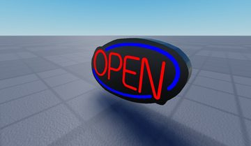</a> <b>Open Sign Decoration</b> <code>models/Workspace/Folder~2/Open Sign Decoration.rbxm</code></td>
</tr>
<tr>
<td width="25%" valign="top"><a href="models/Workspace/Crate__x8.rbxm">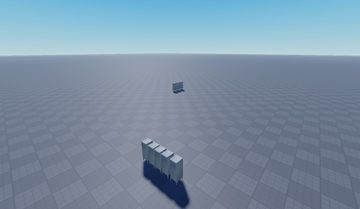</a> <b>Crate__x8</b> <code>models/Workspace/Crate__x8.rbxm</code></td>
<td width="25%" valign="top"><a href="models/Workspace/Model~330/Plant_1__x6.rbxm">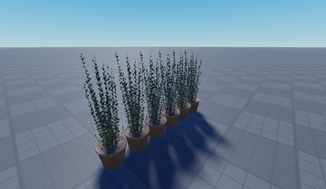</a> <b>Plant_1__x6</b> <code>models/Workspace/Model~330/Plant_1__x6.rbxm</code></td>
<td width="25%" valign="top"><a href="models/Workspace/Folder~2/Sign~3.rbxm">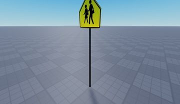</a> <b>Sign~3</b> <code>models/Workspace/Folder~2/Sign~3.rbxm</code></td>
<td width="25%" valign="top"><a href="models/ServerStorage/Gamepass%20Guns/GlockDrumSwitch.rbxm">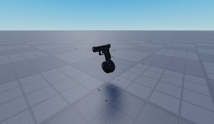</a> <b>GlockDrumSwitch</b> <code>models/ServerStorage/Gamepass Guns/GlockDrumSwitch.rbxm</code></td>
</tr>
<tr>
<td width="25%" valign="top"><a href="models/ServerStorage/Cars/TrackHawk.rbxm">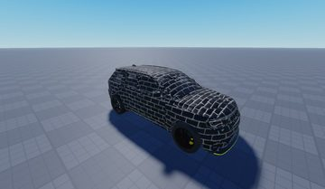</a> <b>TrackHawk</b> <code>models/ServerStorage/Cars/TrackHawk.rbxm</code></td>
<td width="25%" valign="top"><a href="models/ReplicatedStorage/Chains/Belt.rbxm">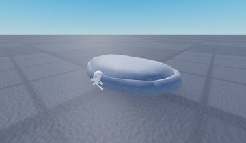</a> <b>Belt</b> <code>models/ReplicatedStorage/Chains/Belt.rbxm</code></td>
</tr>
</table>

## Notable scripts

Top-scored scripts of this game per topic (full tree in [source/scripts](source/scripts/)).

| Topic | Scripts |
|---|---|
| UI animation (tweens, hover / click, pop-ins, springs) | [`GunScript_Local`](source/scripts/Lighting/Taser/GunScript_Local.client.lua) 799 lines [`Icon`](source/scripts/ReplicatedStorage/Icon.lua) 2480 lines [`GunScript_Local`](source/scripts/Lighting/.357/GunScript_Local.client.lua) 1040 lines [`GunScript_Local`](source/scripts/Lighting/Colt/GunScript_Local.client.lua) 1036 lines [`GunScript_Local`](source/scripts/ServerStorage/.357/GunScript_Local.client.lua) 1060 lines |
| UI controllers / window managers / menus | [`Icon`](source/scripts/ReplicatedStorage/Icon.lua) 2480 lines [`Script`](source/scripts/Workspace/Door~4/Open/Script.server.lua) 28 lines [`Script`](source/scripts/Workspace/fence_door/extGui/SurfaceGui/SCREEN/Script.server.lua) 76 lines [`Script`](source/scripts/Workspace/fence_door/insideGui/SurfaceGui/SCREEN/Script.server.lua) 33 lines [`Bank`](source/scripts/ServerScriptService/Bank%20Stuff/Bank.server.lua) 291 lines |
| Notifications, toasts, popups, prompts | [`BankActions`](source/scripts/ServerScriptService/Bank%20Stuff/BankActions.server.lua) 220 lines [`Carrying`](source/scripts/ServerScriptService/CarrySystem/Carrying.server.lua) 209 lines [`DetainClient`](source/scripts/Lighting/Handcuffs/DetainClient.client.lua) 258 lines [`service`](source/scripts/ReplicatedFirst/service.client.lua) 272 lines [`Bank`](source/scripts/ServerScriptService/Bank%20Stuff/Bank.server.lua) 291 lines |
| Loading / intro screens | [`Intro`](source/scripts/StarterPlayer/StarterCharacterScripts/Intro.client.lua) 220 lines |
| Camera, cutscenes, screen shake | [`GunScript_Local`](source/scripts/Lighting/Taser/GunScript_Local.client.lua) 799 lines [`camShakes`](source/scripts/StarterPlayer/StarterCharacterScripts/camShakes.client.lua) 22 lines [`EasyFirstPerson`](source/scripts/StarterPlayer/StarterCharacterScripts/EasyFirstPerson.client.lua) 509 lines [`Intro`](source/scripts/StarterPlayer/StarterCharacterScripts/Intro.client.lua) 220 lines [`Camera12`](source/scripts/Lighting/.357/Camera12.client.lua) 41 lines |
| VFX, particles, beams, hit effects | [`BulletVisualizerServerScript`](source/scripts/StarterPlayer/StarterPlayerScripts/BulletVisualizerServerScript.client.lua) 522 lines [`BulletVisualizerClientScript`](source/scripts/StarterPlayer/StarterPlayerScripts/BulletVisualizerClientScript.client.lua) 453 lines [`VisualizeBulletScript`](source/scripts/ServerScriptService/VisualizeBulletScript.server.lua) 554 lines [`GunScript_Local`](source/scripts/Lighting/Taser/GunScript_Local.client.lua) 799 lines [`Damage`](source/scripts/Lighting/Flash/Server/Damage.server.lua) 199 lines |
| DataStore / player data | [`ProfileService`](source/scripts/ServerScriptService/ProfileCache/ProfileService.lua) 2417 lines [`Save Money`](source/scripts/ServerScriptService/Save%20Money.server.lua) 33 lines [`ProfileCache`](source/scripts/ServerScriptService/ProfileCache.lua) 144 lines [`ArrestNEW`](source/scripts/ServerScriptService/ArrestNEW.server.lua) 223 lines [`ArrestOLD`](source/scripts/ServerScriptService/ArrestOLD.server.lua) 174 lines |
| Monetization (dev products, game passes, receipts) | [`DirtbikeGamepass`](source/scripts/ServerScriptService/DirtbikeGamepass.server.lua) 27 lines |
| RNG, eggs, gacha, rarity rolls, pets | [`Wheelie`](source/scripts/ServerScriptService/DirtbikeGamepass/Honda%2085/Tuner/Plugins/Wheelie.client.lua) 83 lines [`Initialize`](source/scripts/ServerScriptService/DirtbikeGamepass/Honda%2085/Tuner/Initialize.server.lua) 513 lines [`Initialize`](source/scripts/ServerStorage/Cars/AmbulanceVan/A-Chassis%20Tune/Initialize.server.lua) 735 lines [`Initialize`](source/scripts/ServerStorage/Cars/ATV/A-Chassis%20Tune/Initialize.server.lua) 589 lines [`Simulated`](source/scripts/ServerStorage/Cars/ATV/A-Chassis%20Tune/Plugins/%5BSS6%5D%20Dynamic%20Friction/Simulated.client.lua) 197 lines |
| Combat, weapons, hitboxes, abilities | [`Damage`](source/scripts/Lighting/Flash/Server/Damage.server.lua) 199 lines [`VisualizeBulletScript`](source/scripts/ServerScriptService/VisualizeBulletScript.server.lua) 554 lines [`DamageHandler`](source/scripts/Lighting/Tools/Pistol/DealDamage/DamageHandler.server.lua) 10 lines |
| Character movement (sprint, dash, double jump, slide) | [`StaminaBarScript`](source/scripts/StarterGui/Stamina/Background/HealthDisplay/StaminaBarScript.client.lua) 46 lines [`Crouch script`](source/scripts/StarterGui/CrouchSystem/Crouch/Crouch%20script.client.lua) 51 lines [`Crawl`](source/scripts/StarterGui/Crawl.client.lua) 114 lines [`GunScript_Local`](source/scripts/Lighting/.357/GunScript_Local.client.lua) 1040 lines [`GunScript_Local`](source/scripts/Lighting/Colt/GunScript_Local.client.lua) 1036 lines |
| Tycoon / plots / bases / building | [`Drive`](source/scripts/ServerStorage/Cars/Redacted/Blazerr/A-Chassis%20Tune/A-Chassis%20Interface/Drive.client.lua) 700 lines [`Drive`](source/scripts/ServerScriptService/DirtbikeGamepass/Honda%2085/Tuner/Interface/Drive.client.lua) 960 lines [`Bank`](source/scripts/ServerScriptService/Bank%20Stuff/Bank.server.lua) 291 lines [`Script`](source/scripts/Workspace/MafiaMember/ClickDetector/Script.server.lua) 123 lines |
| Leaderboards & stats | [`Leaderstats`](source/scripts/ServerScriptService/Leaderstats.server.lua) 17 lines |
| Sound & music | [`BulletVisualizerServerScript`](source/scripts/StarterPlayer/StarterPlayerScripts/BulletVisualizerServerScript.client.lua) 522 lines [`GunScript_Local`](source/scripts/Lighting/Taser/GunScript_Local.client.lua) 799 lines [`GunScript_Local`](source/scripts/Lighting/.357/GunScript_Local.client.lua) 1040 lines [`GunScript_Local`](source/scripts/Lighting/Colt/GunScript_Local.client.lua) 1036 lines [`AC6_Stock_Sound`](source/scripts/ServerScriptService/AC/AC6_Stock_Sound.client.lua) 50 lines |
| Utility modules (number format, signals, tables, timers) | [`ProfileService`](source/scripts/ServerScriptService/ProfileCache/ProfileService.lua) 2417 lines [`Signal`](source/scripts/ReplicatedStorage/Icon/Signal.lua) 109 lines [`Icon`](source/scripts/ReplicatedStorage/Icon.lua) 2480 lines [`Signal`](source/scripts/StarterPlayer/StarterPlayerScripts/BulletVisualizerClientScript/FastCast/Signal.lua) 80 lines |

### In the curated script library

- [FastCast bullet tracers](../../Scripts/11-Combat/FastCastBulletTracer__miami-shootout.lua) — Using FastCast for cosmetic bullets: fire, update the bullet on LengthChanged, handle hits.
- [Crouch toggle](../../Scripts/13-Movement/CrouchToggle__miami-shootout.lua) — Crouch: animation speed follows movement, slower walk, no jump.
- [buildRagdoll (Roblox R15 ragdoll)](../../Scripts/13-Movement/buildRagdoll__miami-shootout.lua) — Roblox's R15 ragdoll builder (entry point).
- [Ragdoll constraint presets](../../Scripts/13-Movement/buildRagdollConstraints__miami-shootout.lua) — Why each joint uses BallSocket vs Hinge and which limits (great comments).
- [Ragdoll collision filters](../../Scripts/13-Movement/buildRagdollCollisionFilters__miami-shootout.lua) — Which limb pairs need NoCollisionConstraints in a ragdoll.
- [Notification with timer bar](../../Scripts/03-Notifications/TimedNotification__miami-shootout.lua) — Notification with a filler wipe-in and a shrinking timer bar showing time left; templates per "Mode", callable from server via RemoteEvent.
- [Flashbang screen](../../Scripts/06-VFX/FlashbangScreen__miami-shootout.lua) — Flashbang: white frame in 0.15 s, hold, fade out 3 s, ear ringing.
- [Bullet impact & blood FX](../../Scripts/06-VFX/BulletImpactAndBloodFX__miami-shootout.lua) — Per-material bullet impacts oriented to the surface normal, tinted to the hit part, plus blood.

## ⚠️ Safety

HIGH flags (backdoors, `require(id)`, `loadstring`, webhooks). Review or delete before reusing:

- `scripts/ServerScriptService/DiscordEvent.server.lua`
- `scripts/Workspace/Terrain/Converter.server.lua`

## Folders

| Folder | What |
|---|---|
| `screenshots/` | full frames; `crops/` = the panel only; `models/` = 3D previews; `thumbs/` = gallery thumbnails |
| `ui/` | every screen as a Lua builder (`require(module)()` returns the ScreenGui); `_StarterGui-all.lua` builds every StarterGui screen |
| `models/` | every model as .rbxm (the only .rbxm files), mirroring the place tree, scripts removed |
| `map/` | `workspace.rbxm` (the map as a model), `lighting.lua` (sky + post effects), `materials.lua`, `Environment.lua` |
| `animations/`, `audio/` | KeyframeSequence / Sound builders (.lua), `AnimationIds.lua`, `Sounds.lua` |
| `source/` | all scripts as .luau, `tree.txt`, `ui.txt`, `remotes.txt`, `assets.txt`, `flags.txt` |
