# Murder Mystery 2

> 🎉 **Party** · social deduction (murderer vs sheriff) · source file `New MM2 Leak.rbxl`

[⬅ Back to the catalog](../../README.md) · [Assets inventory](ASSETS.md) · [Style numbers](reference.md) · [Scripts](source/scripts/) · [Code analysis](source/README.md)

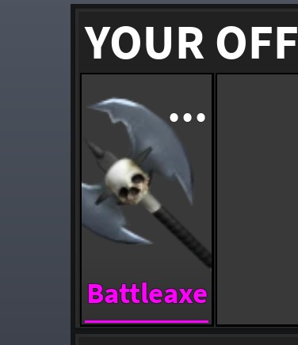

## At a glance

| | |
|---|---|
| Provenance | copy of a live game (saveinstance / decompiled client code) |
| Screens | 35 ScreenGuis, 18024 GUI objects → **91 screenshots** |
| Models (.rbxm) | 793 models, 41 model sets, 77 VFX sets |
| Lua builders (.lua) | 131 UI screens, 3 animation packs, 5 audio packs |
| Code | 1256 scripts, 151,206 lines |
| Asset ids | 143 animations, 293 sounds |
| Safety scan | 5 HIGH / 23 MED flags ([flags.txt](source/flags.txt)) |

**Fonts:** `SourceSansPro Bold`×4912, `SourceSansPro Regular`×1778, `SourceSansPro SemiBold`×80, `Kalam Regular`×36, `RomanAntique Regular`×12

## UI screenshots

Captured in Studio from the place's own ScreenGuis (scripts stripped). Each panel was opened on its own; click a thumbnail for the full 1519×886 frame. Runtime-filled lists (shop items, inventories) show their template state.

### Shop & Robux store

<table>
<tr>
<td width="33%" valign="top"><a href="screenshots/03_ScreenGui__BattlePass.jpg">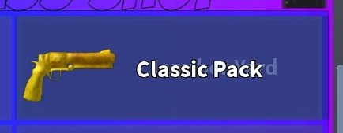</a> <b>ScreenGui</b> › Seasonal.Old.MenuItems._oldmenu.BattlePass</td>
<td width="33%" valign="top"><a href="screenshots/07_ScreenGui__Workshop.jpg">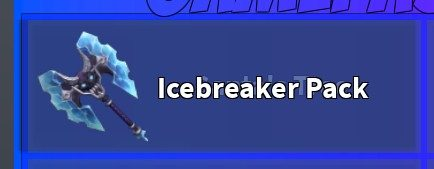</a> <b>ScreenGui</b> › Seasonal.Old.MenuItems._oldmenu.Workshop</td>
<td width="33%" valign="top"><a href="screenshots/08_ScreenGui___returnToShop.jpg">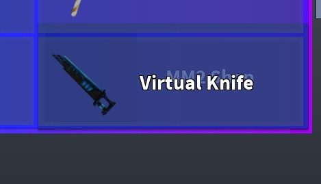</a> <b>ScreenGui</b> › Seasonal.Old.MenuItems._returnToShop</td>
</tr>
<tr>
<td width="33%" valign="top"><a href="screenshots/28_ScreenGui__BattlePass.jpg">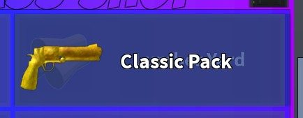</a> <b>ScreenGui</b> › Seasonal.Old.MenuItems._oldmenu.BattlePass</td>
<td width="33%" valign="top"><a href="screenshots/32_ScreenGui__Workshop.jpg">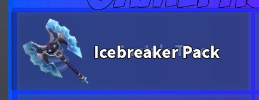</a> <b>ScreenGui</b> › Seasonal.Old.MenuItems._oldmenu.Workshop</td>
<td width="33%" valign="top"><a href="screenshots/33_ScreenGui___returnToShop.jpg">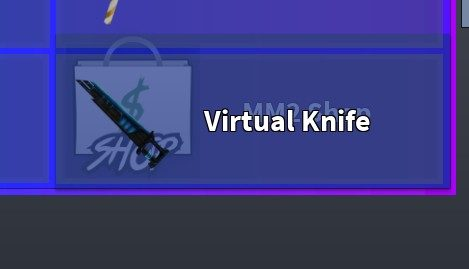</a> <b>ScreenGui</b> › Seasonal.Old.MenuItems._returnToShop</td>
</tr>
<tr>
<td width="33%" valign="top"><a href="screenshots/53_ScreenGui__BattlePass.jpg">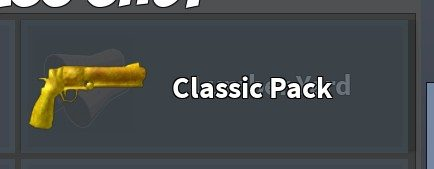</a> <b>ScreenGui</b> › Seasonal.Old.MenuItems._oldmenu.BattlePass</td>
<td width="33%" valign="top"><a href="screenshots/57_ScreenGui__Workshop.jpg">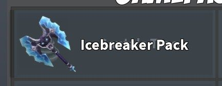</a> <b>ScreenGui</b> › Seasonal.Old.MenuItems._oldmenu.Workshop</td>
<td width="33%" valign="top"><a href="screenshots/58_ScreenGui___returnToShop.jpg">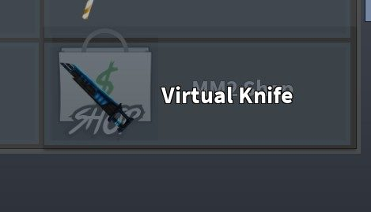</a> <b>ScreenGui</b> › Seasonal.Old.MenuItems._returnToShop</td>
</tr>
<tr>
<td width="33%" valign="top"> <b>TradeGUI_Phone</b> › Container.Trade.Offer1.Container.NewItem1</td>
<td width="33%" valign="top"><a href="screenshots/102_TradeGUI_Phone__NewItem1.jpg">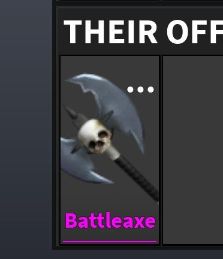</a> <b>TradeGUI_Phone</b> › Container.Trade.Offer2.Container.NewItem1</td>
<td width="33%" valign="top"><a href="screenshots/109_Shop.jpg">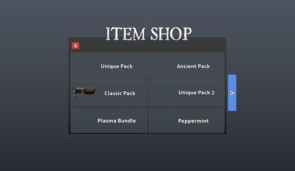</a> <b>Shop</b></td>
</tr>
</table>

### Inventory / backpack / pets

<table>
<tr>
<td width="33%" valign="top"><a href="screenshots/02_ScreenGui___ItemPack.jpg">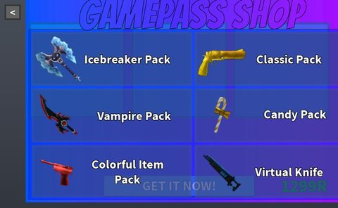</a> <b>ScreenGui</b> › Seasonal.Old.MenuItems._ItemPack</td>
<td width="33%" valign="top"><a href="screenshots/04_ScreenGui__Box.jpg">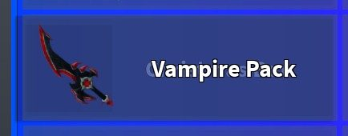</a> <b>ScreenGui</b> › Seasonal.Old.MenuItems._oldmenu.Box</td>
<td width="33%" valign="top"><a href="screenshots/05_ScreenGui__ItemPack.jpg">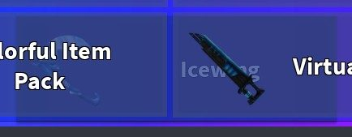</a> <b>ScreenGui</b> › Seasonal.Old.MenuItems._oldmenu.ItemPack</td>
</tr>
<tr>
<td width="33%" valign="top"><a href="screenshots/09_ScreenGui__ItemPack2.jpg">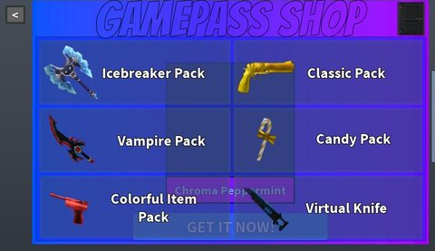</a> <b>ScreenGui</b> › Seasonal.Main.ItemPack2</td>
<td width="33%" valign="top"><a href="screenshots/10_ScreenGui__Effect.jpg">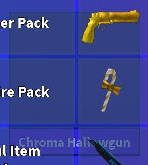</a> <b>ScreenGui</b> › Seasonal.Main.ItemPack3.Effect</td>
<td width="33%" valign="top"><a href="screenshots/11_ScreenGui__Pet.jpg">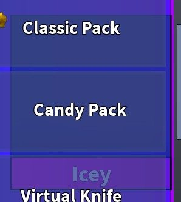</a> <b>ScreenGui</b> › Seasonal.Main.ItemPack3.Pet</td>
</tr>
<tr>
<td width="33%" valign="top"> <b>ScreenGui</b> › Seasonal.Main.ItemPack3.Knife</td>
<td width="33%" valign="top"><a href="screenshots/13_ScreenGui__ItemPack4.jpg">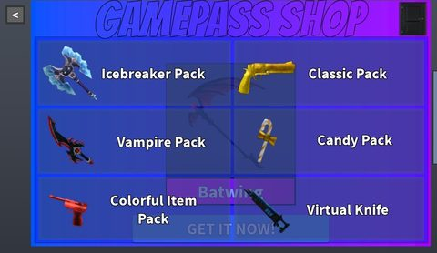</a> <b>ScreenGui</b> › Seasonal.Main.ItemPack4</td>
<td width="33%" valign="top"><a href="screenshots/14_ScreenGui__ItemPack5.jpg">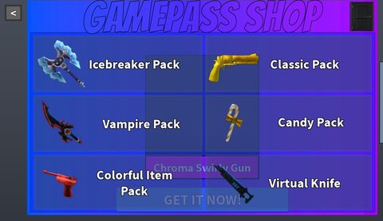</a> <b>ScreenGui</b> › Seasonal.Main.ItemPack5</td>
</tr>
<tr>
<td width="33%" valign="top"><a href="screenshots/15_ScreenGui__Knife.jpg">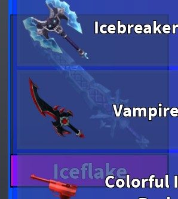</a> <b>ScreenGui</b> › Seasonal.Main.ItemPack6.Knife</td>
<td width="33%" valign="top"><a href="screenshots/16_ScreenGui__Effect.jpg">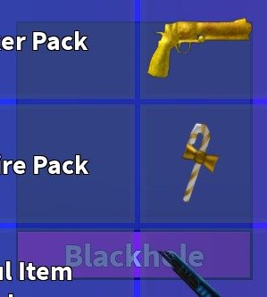</a> <b>ScreenGui</b> › Seasonal.Main.ItemPack6.Effect</td>
<td width="33%" valign="top"><a href="screenshots/17_ScreenGui__Gun.jpg">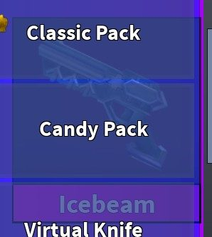</a> <b>ScreenGui</b> › Seasonal.Main.ItemPack6.Gun</td>
</tr>
<tr>
<td width="33%" valign="top"><a href="screenshots/18_ScreenGui__Effect.jpg">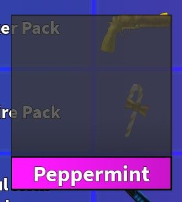</a> <b>ScreenGui</b> › Seasonal.Main.ItemPack1.Effect</td>
<td width="33%" valign="top"><a href="screenshots/19_ScreenGui__Pet.jpg">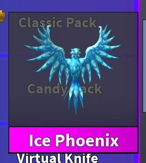</a> <b>ScreenGui</b> › Seasonal.Main.ItemPack1.Pet</td>
<td width="33%" valign="top"><a href="screenshots/20_ScreenGui__Knife.jpg">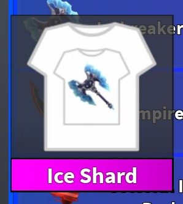</a> <b>ScreenGui</b> › Seasonal.Main.ItemPack1.Knife</td>
</tr>
<tr>
<td width="33%" valign="top"><a href="screenshots/22_ScreenGui__ItemPack1.jpg">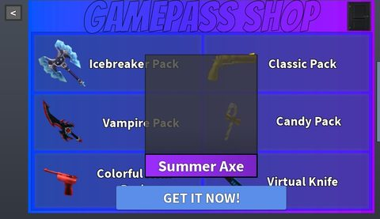</a> <b>ScreenGui</b> › Seasonal.Main4.ItemPack1</td>
<td width="33%" valign="top"><a href="screenshots/23_ScreenGui__ItemPack6.jpg">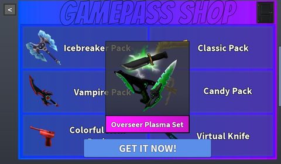</a> <b>ScreenGui</b> › Seasonal.Main4.ItemPack6</td>
<td width="33%" valign="top"><a href="screenshots/24_ScreenGui__ItemPack5.jpg">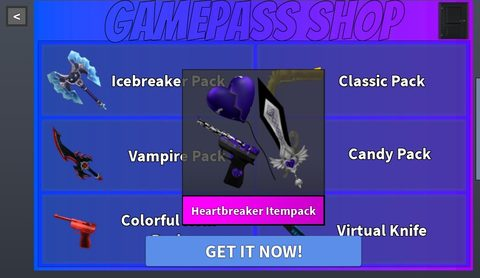</a> <b>ScreenGui</b> › Seasonal.Main4.ItemPack5</td>
</tr>
<tr>
<td width="33%" valign="top"><a href="screenshots/27_ScreenGui___ItemPack.jpg">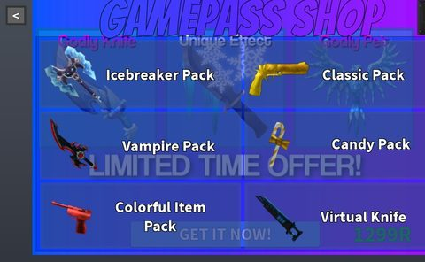</a> <b>ScreenGui</b> › Seasonal.Old.MenuItems._ItemPack</td>
<td width="33%" valign="top"><a href="screenshots/34_ScreenGui__ItemPack2.jpg">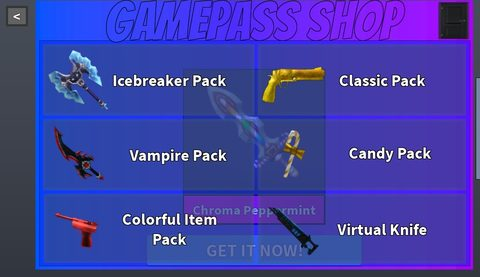</a> <b>ScreenGui</b> › Seasonal.Main.ItemPack2</td>
<td width="33%" valign="top"><a href="screenshots/35_ScreenGui__Effect.jpg">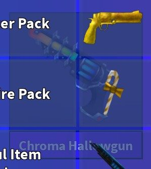</a> <b>ScreenGui</b> › Seasonal.Main.ItemPack3.Effect</td>
</tr>
<tr>
<td width="33%" valign="top"><a href="screenshots/36_ScreenGui__Pet.jpg">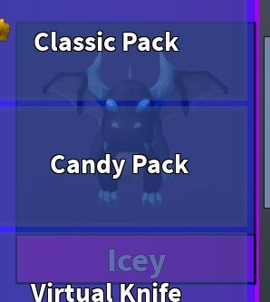</a> <b>ScreenGui</b> › Seasonal.Main.ItemPack3.Pet</td>
<td width="33%" valign="top"><a href="screenshots/37_ScreenGui__Knife.jpg">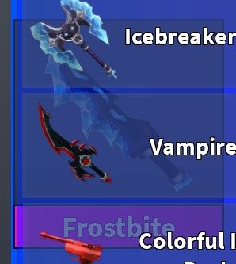</a> <b>ScreenGui</b> › Seasonal.Main.ItemPack3.Knife</td>
<td width="33%" valign="top"> <b>ScreenGui</b> › Seasonal.Main.ItemPack5</td>
</tr>
<tr>
<td width="33%" valign="top"><a href="screenshots/41_ScreenGui__Effect.jpg">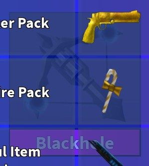</a> <b>ScreenGui</b> › Seasonal.Main.ItemPack6.Effect</td>
<td width="33%" valign="top"><a href="screenshots/43_ScreenGui__Effect.jpg">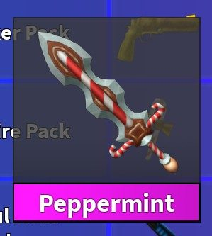</a> <b>ScreenGui</b> › Seasonal.Main.ItemPack1.Effect</td>
<td width="33%" valign="top"><a href="screenshots/47_ScreenGui__ItemPack1.jpg">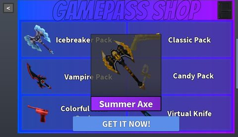</a> <b>ScreenGui</b> › Seasonal.Main4.ItemPack1</td>
</tr>
<tr>
<td width="33%" valign="top"><a href="screenshots/52_ScreenGui___ItemPack.jpg">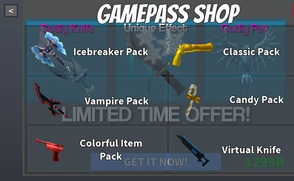</a> <b>ScreenGui</b> › Seasonal.Old.MenuItems._ItemPack</td>
<td width="33%" valign="top"><a href="screenshots/54_ScreenGui__Box.jpg">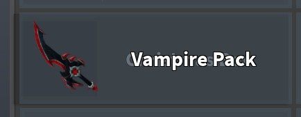</a> <b>ScreenGui</b> › Seasonal.Old.MenuItems._oldmenu.Box</td>
<td width="33%" valign="top"><a href="screenshots/55_ScreenGui__ItemPack.jpg">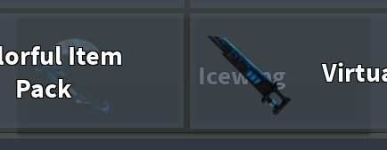</a> <b>ScreenGui</b> › Seasonal.Old.MenuItems._oldmenu.ItemPack</td>
</tr>
<tr>
<td width="33%" valign="top"><a href="screenshots/59_ScreenGui__ItemPack2.jpg">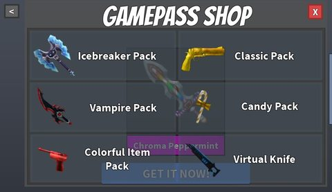</a> <b>ScreenGui</b> › Seasonal.Main.ItemPack2</td>
<td width="33%" valign="top"><a href="screenshots/60_ScreenGui__Effect.jpg">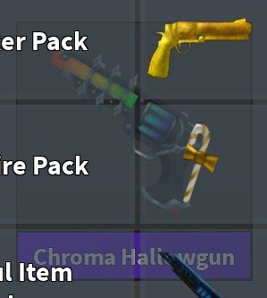</a> <b>ScreenGui</b> › Seasonal.Main.ItemPack3.Effect</td>
<td width="33%" valign="top"><a href="screenshots/61_ScreenGui__Pet.jpg">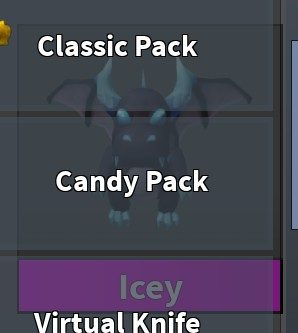</a> <b>ScreenGui</b> › Seasonal.Main.ItemPack3.Pet</td>
</tr>
<tr>
<td width="33%" valign="top"><a href="screenshots/62_ScreenGui__Knife.jpg">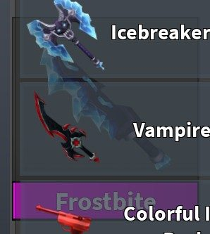</a> <b>ScreenGui</b> › Seasonal.Main.ItemPack3.Knife</td>
<td width="33%" valign="top"><a href="screenshots/63_ScreenGui__ItemPack4.jpg">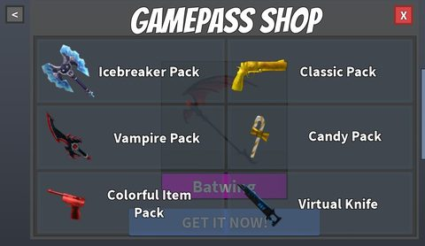</a> <b>ScreenGui</b> › Seasonal.Main.ItemPack4</td>
<td width="33%" valign="top"> <b>ScreenGui</b> › Seasonal.Main.ItemPack5</td>
</tr>
<tr>
<td width="33%" valign="top"><a href="screenshots/65_ScreenGui__Knife.jpg">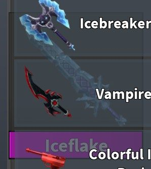</a> <b>ScreenGui</b> › Seasonal.Main.ItemPack6.Knife</td>
<td width="33%" valign="top"><a href="screenshots/66_ScreenGui__Effect.jpg">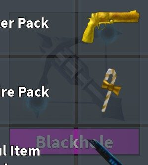</a> <b>ScreenGui</b> › Seasonal.Main.ItemPack6.Effect</td>
<td width="33%" valign="top"><a href="screenshots/67_ScreenGui__Gun.jpg">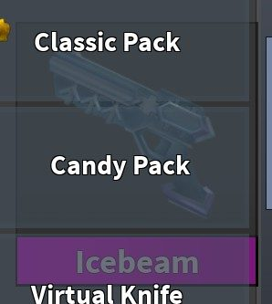</a> <b>ScreenGui</b> › Seasonal.Main.ItemPack6.Gun</td>
</tr>
<tr>
<td width="33%" valign="top"><a href="screenshots/68_ScreenGui__Effect.jpg">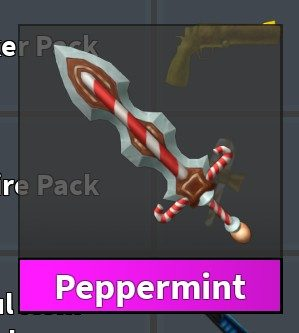</a> <b>ScreenGui</b> › Seasonal.Main.ItemPack1.Effect</td>
<td width="33%" valign="top"><a href="screenshots/69_ScreenGui__Pet.jpg">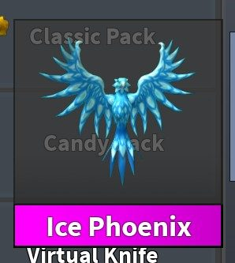</a> <b>ScreenGui</b> › Seasonal.Main.ItemPack1.Pet</td>
<td width="33%" valign="top"> <b>ScreenGui</b> › Seasonal.Main.ItemPack1.Knife</td>
</tr>
<tr>
<td width="33%" valign="top"> <b>ScreenGui</b> › Seasonal.Main4.ItemPack1</td>
<td width="33%" valign="top"> <b>ScreenGui</b> › Seasonal.Main4.ItemPack6</td>
<td width="33%" valign="top"> <b>ScreenGui</b> › Seasonal.Main4.ItemPack5</td>
</tr>
<tr>
<td width="33%" valign="top"> <b>Trade</b> › Container.Items._mO.Weapons</td>
<td width="33%" valign="top"> <b>TradeGUI_Phone</b> › Container.Items</td>
<td width="33%" valign="top"> <b>Shop</b> › Old.MenuItems._ItemPack</td>
</tr>
</table>

### Rewards, daily, spin, codes

<table>
<tr>
<td width="33%" valign="top"> <b>SpawnFade</b> › CodeFrame</td>
<td width="33%" valign="top"> <b>Gifter</b></td>
</tr>
</table>

### Trading

<table>
<tr>
<td width="33%" valign="top"> <b>Trade</b></td>
<td width="33%" valign="top"> <b>TradeGUI_Phone</b></td>
</tr>
</table>

### Settings & menus

<table>
<tr>
<td width="33%" valign="top"> <b>ScreenGui</b> › Seasonal.Main4.Menu</td>
<td width="33%" valign="top"> <b>ScreenGui</b> › Seasonal.Main4.Menu</td>
<td width="33%" valign="top"> <b>ScreenGui</b> › Seasonal.Main4.Menu</td>
</tr>
</table>

### Loading & intro

<table>
<tr>
<td width="33%" valign="top"> <b>Loading</b></td>
</tr>
</table>

### Leaderboards & stats

<table>
<tr>
<td width="33%" valign="top"> <b>ScreenGui</b> › Seasonal.Old.MenuItems._oldmenu.Leaderboard</td>
<td width="33%" valign="top"> <b>ScreenGui</b> › Seasonal.Old.MenuItems._oldmenu.Leaderboard</td>
<td width="33%" valign="top"> <b>ScreenGui</b> › Seasonal.Old.MenuItems._oldmenu.Leaderboard</td>
</tr>
<tr>
<td width="33%" valign="top"> <b>Scoreboard_Phone</b> › ScaryMode</td>
<td width="33%" valign="top"> <b>Scoreboard_Phone</b> › Classic</td>
<td width="33%" valign="top"> <b>Scoreboard</b> › ScaryMode</td>
</tr>
<tr>
<td width="33%" valign="top"> <b>Scoreboard</b> › Assassin</td>
<td width="33%" valign="top"> <b>Scoreboard</b> › Classic</td>
</tr>
</table>

### End of round, death, results

<table>
<tr>
<td width="33%" valign="top"> <b>Victory</b></td>
</tr>
</table>

### Other

<table>
<tr>
<td width="33%" valign="top"> <b>ScreenGui</b></td>
<td width="33%" valign="top"> <b>ScreenGui</b></td>
<td width="33%" valign="top"> <b>ScreenGui</b></td>
</tr>
<tr>
<td width="33%" valign="top"> <b>ScreenGui</b></td>
<td width="33%" valign="top"> <b>Join</b></td>
<td width="33%" valign="top"> <b>Join</b> › Retry</td>
</tr>
<tr>
<td width="33%" valign="top"> <b>DeviceSelect</b></td>
<td width="33%" valign="top"> <b>JoinPhone</b> › Retry</td>
<td width="33%" valign="top"> <b>GamemodeBonus</b></td>
</tr>
<tr>
<td width="33%" valign="top"> <b>GamemodePhone</b></td>
<td width="33%" valign="top"> <b>Gamemode</b></td>
<td width="33%" valign="top"> <b>LowGraphics</b></td>
</tr>
<tr>
<td width="33%" valign="top"> <b>HighGraphics</b></td>
<td width="33%" valign="top"> <b>Inviter</b></td>
</tr>
</table>

## Model previews

<table>
<tr>
<td width="25%" valign="top"> <b>Workshop</b> <code>models/ServerStorage/Maps/Workshop.rbxm</code></td>
<td width="25%" valign="top"> <b>Handle__x14</b> <code>models/Workspace/Weapon Models/Handle__x14.rbxm</code></td>
<td width="25%" valign="top"> <b>Autumn Tree</b> <code>models/Workspace/Autumn Tree.rbxm</code></td>
<td width="25%" valign="top"> <b>Model~2</b> <code>models/Workspace/Robux/Model~2.rbxm</code></td>
</tr>
<tr>
<td width="25%" valign="top"> <b>HeartBalloon</b> <code>models/ServerStorage/Items/Pets/HeartBalloon.rbxm</code></td>
<td width="25%" valign="top"> <b>Model__x112</b> <code>models/ServerStorage/Lobby/MainLobby/Model__x112.rbxm</code></td>
<td width="25%" valign="top"> <b>Car</b> <code>models/ServerStorage/Maps/Karachi/Map/Car.rbxm</code></td>
<td width="25%" valign="top"> <b>Keyboard</b> <code>models/ServerStorage/Maps/Hospital3/Map/Parts/Floor1/XrayRoom/Keyboard.rbxm</code></td>
</tr>
<tr>
<td width="25%" valign="top"> <b>Meshes_Eugene Wings of Devour Final_Meshpart2</b> <code>models/Workspace/Meshes_Eugene Wings of Devour Final_Meshpart2.rbxm</code></td>
<td width="25%" valign="top"> <b>StaffOnlySign</b> <code>models/ServerStorage/Maps/Hospital3/Map/Parts/Floor1/XrayRoom/StaffOnlySign.rbxm</code></td>
<td width="25%" valign="top"> <b>Handle~2</b> <code>models/Workspace/Handle~2.rbxm</code></td>
<td width="25%" valign="top"> <b>Buildings</b> <code>models/ServerStorage/Maps/Karachi/Map/Bl0x/Buildings.rbxm</code></td>
</tr>
<tr>
<td width="25%" valign="top"> <b>Parts</b> <code>models/ServerStorage/Maps/ResearchFacility/Parts.rbxm</code></td>
</tr>
</table>

## Notable scripts

Top-scored scripts of this game per topic (full tree in [source/scripts](source/scripts/)).

| Topic | Scripts |
|---|---|
| UI animation (tweens, hover / click, pop-ins, springs) | [`DataModule`](source/scripts/ServerScriptService/GameScript/DataModule.lua) 4524 lines [`KnifeLocal`](source/scripts/ServerStorage/GunScripts/KnifeLocal.client.lua) 534 lines [`InteractiveScript`](source/scripts/ServerStorage/Maps/ResearchFacility/Interactive/GarageSystem/InteractiveBox/InteractiveScript.server.lua) 39 lines [`InteractiveScript`](source/scripts/ServerStorage/Maps/ResearchFacility/Interactive/GarageSystem/InteractiveBox~2/InteractiveScript.server.lua) 42 lines [`FloatAnimation`](source/scripts/Workspace/Handle~3/Eye/FloatAnimation.server.lua) 85 lines |
| UI controllers / window managers / menus | [`RbxGui`](source/scripts/ReplicatedStorage/LoadLibrary/RbxGui.lua) 4207 lines [`EventScript_Christmas2022`](source/scripts/ReplicatedStorage/GUI/MainPC/Misc/EventScript_Christmas2022.client.lua) 383 lines [`EventScript_Halloween2021`](source/scripts/ServerStorage/EventScript_Halloween2021.client.lua) 389 lines [`EventScript_Halloween2021`](source/scripts/ReplicatedStorage/GUI/MainMobile/Menu/EventScript_Halloween2021.client.lua) 424 lines [`EventScript_Halloween2021`](source/scripts/ReplicatedStorage/GUI/MainPC/Misc/EventScript_Halloween2021.client.lua) 429 lines |
| Notifications, toasts, popups, prompts | [`Chat`](source/scripts/ReplicatedStorage/GUI/MainMobile/Menu/Chat.client.lua) 79 lines [`Game_Chat`](source/scripts/ReplicatedStorage/GUI/MainPC/Game_Chat.client.lua) 247 lines [`InventoryOld`](source/scripts/ReplicatedStorage/GUI/MainPC/InventoryOld.client.lua) 896 lines [`AdminCommands`](source/scripts/ServerScriptService/AdminCommands.server.lua) 178 lines [`Client`](source/scripts/ReplicatedStorage/GUI/MainMobile/Lobby/Screens/Shop/Main/Packs/Client.client.lua) 61 lines |
| Loading / intro screens | [`Loading`](source/scripts/ReplicatedFirst/Loading.client.lua) 515 lines [`RbxGui`](source/scripts/ReplicatedStorage/LoadLibrary/RbxGui.lua) 4207 lines [`RoleSelect`](source/scripts/ReplicatedStorage/GUI/MainMobile/GameFolder/RoleSelect.client.lua) 237 lines [`Game_RoleSelector`](source/scripts/ReplicatedStorage/GUI/MainPC/Game_RoleSelector.client.lua) 252 lines [`RoleSelector`](source/scripts/ReplicatedStorage/GUI/MainXbox/Game/RoleSelector.client.lua) 189 lines |
| Camera, cutscenes, screen shake | [`Camera Blocker`](source/scripts/VoiceChatService/WhiteListService/Manager/Camera%20Blocker.client.lua) 16 lines [`Module3D`](source/scripts/ReplicatedStorage/Module3D.lua) 448 lines |
| VFX, particles, beams, hit effects | [`KnifeServer`](source/scripts/ServerStorage/GunScripts/KnifeServer.server.lua) 534 lines |
| DataStore / player data | [`DataModule`](source/scripts/ServerScriptService/GameScript/DataModule.lua) 4524 lines [`GameScript`](source/scripts/ServerScriptService/GameScript.server.lua) 623 lines [`WheelScript`](source/scripts/ServerScriptService/WheelScript.server.lua) 179 lines |
| Monetization (dev products, game passes, receipts) | [`DataModule`](source/scripts/ServerScriptService/GameScript/DataModule.lua) 4524 lines [`GameScript`](source/scripts/ServerScriptService/GameScript.server.lua) 623 lines [`GamepassController`](source/scripts/ServerScriptService/GamepassController.server.lua) 43 lines [`Shop_Data`](source/scripts/ReplicatedStorage/GUI/MainPC/Shop/Shop_Data.client.lua) 1111 lines [`WheelScript`](source/scripts/ServerScriptService/WheelScript.server.lua) 179 lines |
| RNG, eggs, gacha, rarity rolls, pets | [`OpenCrate`](source/scripts/ReplicatedStorage/GUI/MainMobile/Menu/EventScript_Christmas2021/OpenCrate.lua) 212 lines [`OpenCrate`](source/scripts/ReplicatedStorage/GUI/MainMobile/Menu/EventScript_Halloween2021/OpenCrate.lua) 222 lines [`OpenCrate`](source/scripts/ReplicatedStorage/GUI/MainMobile/Shop/Shop_Data/OpenCrate.lua) 212 lines [`OpenCrate`](source/scripts/ReplicatedStorage/GUI/MainPC/Misc/EventScript_Halloween2021/OpenCrate.lua) 212 lines [`OpenCrate`](source/scripts/ReplicatedStorage/GUI/MainPC/Shop/Shop_Data/OpenCrate.lua) 212 lines |
| Trading systems | [`TradePhone`](source/scripts/ReplicatedStorage/GUI/MainMobile/Menu/TradePhone.client.lua) 599 lines [`Trade`](source/scripts/ReplicatedStorage/GUI/MainXbox/Menu/Trade.client.lua) 558 lines [`Menu_Trade`](source/scripts/ReplicatedStorage/GUI/MainPC/Menu_Trade.client.lua) 604 lines |
| Combat, weapons, hitboxes, abilities | [`NPC Targeting Attack Script`](source/scripts/ServerStorage/Jadens%20map/Jadens%20Map/Model/Map/Background%20Stuff/Pond%20Turtle/E/RunAwayScript/NPC%20Targeting%20Attack%20Script.server.lua) 52 lines [`FallDamage`](source/scripts/ServerStorage/Jadens%20map/Jadens%20Map/Model/Map/Background%20Stuff/Pond%20Turtle/E/FallDamage.server.lua) 17 lines |
| NPC / AI / monsters | [`NPC Targeting Attack Script`](source/scripts/ServerStorage/Jadens%20map/Jadens%20Map/Model/Map/Background%20Stuff/Pond%20Turtle/E/RunAwayScript/NPC%20Targeting%20Attack%20Script.server.lua) 52 lines |
| Character movement (sprint, dash, double jump, slide) | [`Animation`](source/scripts/ServerStorage/Jadens%20map/Jadens%20Map/Model/Map/Background%20Stuff/Pond%20Turtle/E/Animation.server.lua) 561 lines [`LocalSound`](source/scripts/StarterPlayer/StarterCharacterScripts/Sound/LocalSound.client.lua) 143 lines [`LocalSound`](source/scripts/Workspace/Premium/_/Sound/LocalSound.client.lua) 399 lines [`SpeedTrail`](source/scripts/StarterPlayer/StarterCharacterScripts/SpeedTrail.server.lua) 14 lines [`Sprint`](source/scripts/ReplicatedStorage/GUI/MainMobile/Inventory/PerkSystem/Sprint.lua) 37 lines |
| Tycoon / plots / bases / building | [`Crafting_Data`](source/scripts/ReplicatedStorage/GUI/MainMobile/Inventory/Crafting_Data.client.lua) 823 lines [`Christmas2022`](source/scripts/ReplicatedStorage/Modules/Christmas2022.lua) 357 lines [`Crafting_Data`](source/scripts/ServerStorage/OldInventory/Crafting_Data.client.lua) 841 lines [`EventScript_Summer2023`](source/scripts/ReplicatedStorage/GUI/MainMobile/Menu/EventScript_Summer2023.client.lua) 486 lines [`Inventory_Data`](source/scripts/ReplicatedStorage/GUI/MainPC/Inventory/Inventory_Data.client.lua) 807 lines |
| Leaderboards & stats | [`ChristmasLeaderboard`](source/scripts/ServerScriptService/Leaderboards/ChristmasLeaderboard.server.lua) 19 lines [`GiftsLeaderboard`](source/scripts/ServerScriptService/Leaderboards/Christmas2021/GiftsLeaderboard.server.lua) 12 lines [`TokensLeaderboard`](source/scripts/ServerScriptService/Leaderboards/Christmas2021/TokensLeaderboard.server.lua) 12 lines [`TokensLeaderboard`](source/scripts/ServerScriptService/Summer2023Leaderboard/TokensLeaderboard.server.lua) 12 lines [`GiftsLeaderboard`](source/scripts/ServerScriptService/Xmas2021Leaderboard/GiftsLeaderboard.server.lua) 13 lines |
| Admin panels & commands | [`AdminCommands`](source/scripts/ServerScriptService/AdminCommands.server.lua) 178 lines |
| Sound & music | [`LocalSound`](source/scripts/StarterPlayer/StarterCharacterScripts/Sound/LocalSound.client.lua) 143 lines [`LocalSound`](source/scripts/Workspace/Premium/_/Sound/LocalSound.client.lua) 399 lines [`MusicController`](source/scripts/ReplicatedStorage/GUI/MainMobile/GameFolder/MusicController.client.lua) 71 lines [`Game_Music`](source/scripts/ReplicatedStorage/GUI/MainPC/Game_Music.client.lua) 21 lines |
| Daily rewards, quests, codes, playtime | [`DataModule`](source/scripts/ServerScriptService/GameScript/DataModule.lua) 4524 lines [`Inventory_Data`](source/scripts/ReplicatedStorage/GUI/MainPC/Inventory/Inventory_Data.client.lua) 807 lines [`Inventory_Data`](source/scripts/ReplicatedStorage/GUI/MainMobile/Inventory/Inventory_Data.client.lua) 1054 lines [`CodeGenerator`](source/scripts/ServerScriptService/CodeGenerator.server.lua) 113 lines [`Inventory_Data`](source/scripts/ServerStorage/OldInventory/Inventory_Data.client.lua) 562 lines |
| Utility modules (number format, signals, tables, timers) | [`RbxUtility`](source/scripts/ReplicatedStorage/LoadLibrary/RbxUtility.lua) 1109 lines [`Janitor`](source/scripts/Workspace/Handle~3/Eye/FloatAnimation/Janitor.lua) 637 lines [`Christmas2022`](source/scripts/ReplicatedStorage/Modules/Christmas2022.lua) 357 lines [`GridCreator`](source/scripts/ReplicatedStorage/Modules/GridCreator.lua) 192 lines [`Christmas2021`](source/scripts/ReplicatedStorage/Modules/Christmas2021.lua) 511 lines |

### In the curated script library

- [RequestQueueSize loading + join menu](../../Scripts/04-Loading-Screens/QueueLoadingAndJoinMenu__murder-mystery-2.lua) — Classic MM2 loading flow: waits on ContentProvider.RequestQueueSize ('N objects left'), shows Skip after 7 s, waits for character and server data, picks PC/Mobile/Xbox main GUI, fades out, then shows a join-a-friend menu.
- [Death effect module](../../Scripts/06-VFX/LightningDeathEffect__murder-mystery-2.lua) — Cosmetic death effect as a function(char) module (how MM2 stores death effects).

## ⚠️ Safety

HIGH flags (backdoors, `require(id)`, `loadstring`, webhooks). Review or delete before reusing:

- `scripts/ServerScriptService/Adonis_Loader/Config/Plugins/Server_ Adonis Discord Logging.lua`
- `scripts/ServerScriptService/Giver.server.lua`
- `scripts/ServerScriptService/GiverServer.server.lua`
- `scripts/ServerScriptService/Leaderboards/ReaverLeaderboard.server.lua`
- `scripts/ServerScriptService/ReaverLeaderboard.server.lua`

## Folders

| Folder | What |
|---|---|
| `screenshots/` | full frames; `crops/` = the panel only; `models/` = 3D previews; `thumbs/` = gallery thumbnails |
| `ui/` | every screen as a Lua builder (`require(module)()` returns the ScreenGui); `_StarterGui-all.lua` builds every StarterGui screen |
| `models/` | every model as .rbxm (the only .rbxm files), mirroring the place tree, scripts removed |
| `map/` | `workspace.rbxm` (the map as a model), `lighting.lua` (sky + post effects), `materials.lua`, `Environment.lua` |
| `animations/`, `audio/` | KeyframeSequence / Sound builders (.lua), `AnimationIds.lua`, `Sounds.lua` |
| `source/` | all scripts as .luau, `tree.txt`, `ui.txt`, `remotes.txt`, `assets.txt`, `flags.txt` |
