# Murderers vs Sheriffs (summer update)

> 🔫 **Shooter** · duels (murderers vs sheriffs, trading, crafting) · source file `vv mmv summer upd 26 f2+ap + new upd.rbxl`

[⬅ Back to the catalog](../../README.md) · [Assets inventory](ASSETS.md) · [Style numbers](reference.md) · [Scripts](source/scripts/) · [Code analysis](source/README.md)

## At a glance

| | |
|---|---|
| Provenance | copy of a live game (saveinstance / decompiled client code) |
| Screens | 35 ScreenGuis, 18006 GUI objects → **91 screenshots** |
| Models (.rbxm) | 1426 models, 4 model sets, 216 VFX sets |
| Lua builders (.lua) | 89 UI screens, 1 animation packs, 9 audio packs |
| Code | 1266 scripts, 137,480 lines |
| Asset ids | 187 animations, 210 sounds |
| Safety scan | 0 HIGH / 9 MED flags ([flags.txt](source/flags.txt)) |

**Fonts:** `SourceSansPro Bold`×3973, `SourceSansPro Regular`×2000, `Builder Sans Bold`×118, `GothamSSm Medium`×109, `FredokaOne Regular`×36

## UI screenshots

Captured in Studio from the place's own ScreenGuis (scripts stripped). Each panel was opened on its own; click a thumbnail for the full 1519×886 frame. Runtime-filled lists (shop items, inventories) show their template state.

### Shop & Robux store

<table>
<tr>
<td width="33%" valign="top"><a href="screenshots/37_TradeGUI_Phone__Container.jpg">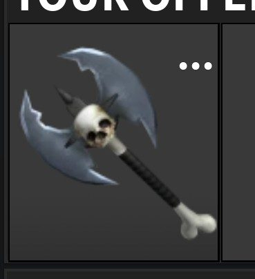</a> <b>TradeGUI_Phone</b> › Container.Trade.YourOffer.Container.NewItem1.Container</td>
<td width="33%" valign="top"><a href="screenshots/40_TradeGUI_Phone__Tags.jpg">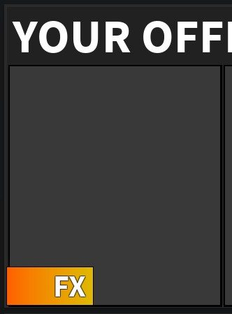</a> <b>TradeGUI_Phone</b> › Container.Trade.YourOffer.Container.NewItem3.Tags</td>
<td width="33%" valign="top"><a href="screenshots/45_TradeGUI_Phone__Container.jpg">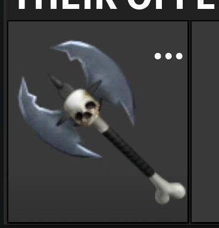</a> <b>TradeGUI_Phone</b> › Container.Trade.TheirOffer.Container.NewItem1.Container</td>
</tr>
<tr>
<td width="33%" valign="top"><a href="screenshots/70_CrossPlatform__Small.jpg">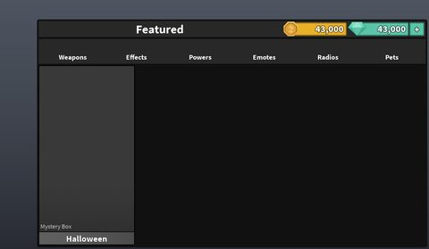</a> <b>CrossPlatform</b> › Shop.Small</td>
<td width="33%" valign="top"><a href="screenshots/72_CrossPlatform__Container.jpg">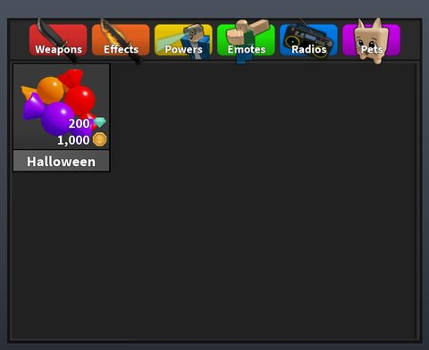</a> <b>CrossPlatform</b> › Shop.Medium.Container</td>
<td width="33%" valign="top"><a href="screenshots/73_CrossPlatform__Large.jpg">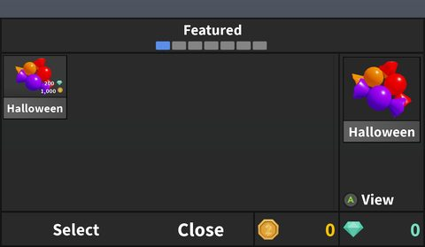</a> <b>CrossPlatform</b> › Shop.Large</td>
</tr>
<tr>
<td width="33%" valign="top"><a href="screenshots/106_NewOffer.jpg">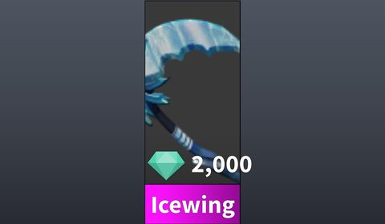</a> <b>NewOffer</b></td>
</tr>
</table>

### Inventory / backpack / pets

<table>
<tr>
<td width="33%" valign="top"><a href="screenshots/29_TradeGUI__Pets.jpg">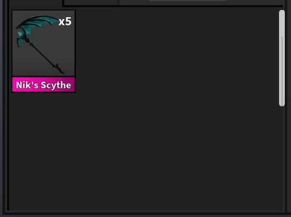</a> <b>TradeGUI</b> › Container.Items.Main.Pets</td>
<td width="33%" valign="top"><a href="screenshots/30_TradeGUI__Weapons.jpg">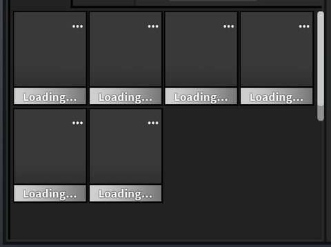</a> <b>TradeGUI</b> › Container.Items._mO.Weapons</td>
<td width="33%" valign="top"><a href="screenshots/52_TradeGUI_Phone__Items.jpg">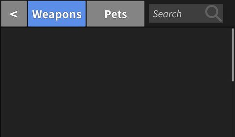</a> <b>TradeGUI_Phone</b> › Container.Items</td>
</tr>
<tr>
<td width="33%" valign="top"><a href="screenshots/61_CrossPlatform__Medium.jpg">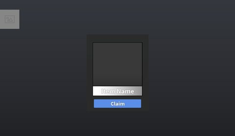</a> <b>CrossPlatform</b> › NewItem.Medium</td>
<td width="33%" valign="top"><a href="screenshots/65_CrossPlatform__Inventory.jpg">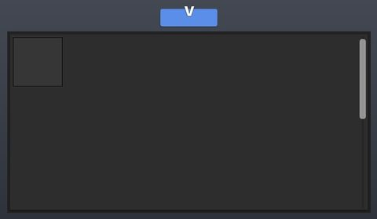</a> <b>CrossPlatform</b> › Emotes._.Inventory</td>
<td width="33%" valign="top"><a href="screenshots/68_CrossPlatform__ItemPackFrame.jpg">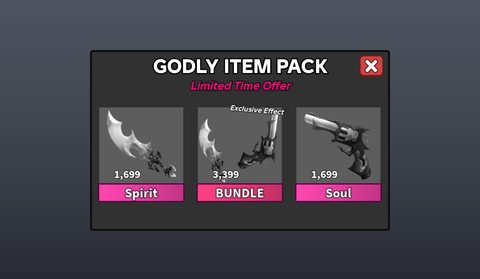</a> <b>CrossPlatform</b> › ItemPackFrame</td>
</tr>
<tr>
<td width="33%" valign="top"> <b>BackpackUI</b></td>
<td width="33%" valign="top"><a href="screenshots/82_ItemFrame.jpg">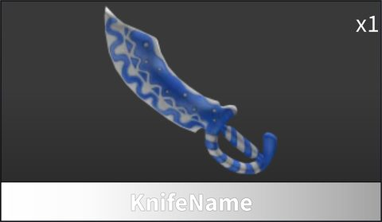</a> <b>ItemFrame</b></td>
<td width="33%" valign="top"><a href="screenshots/83_ItemFrame__FX.jpg">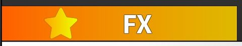</a> <b>ItemFrame</b> › Tags.FX</td>
</tr>
<tr>
<td width="33%" valign="top"> <b>ItemFrame3</b></td>
<td width="33%" valign="top"><a href="screenshots/85_ItemFrame3__FX.jpg">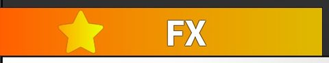</a> <b>ItemFrame3</b> › Tags.FX</td>
<td width="33%" valign="top"><a href="screenshots/86_EquipContainer.jpg">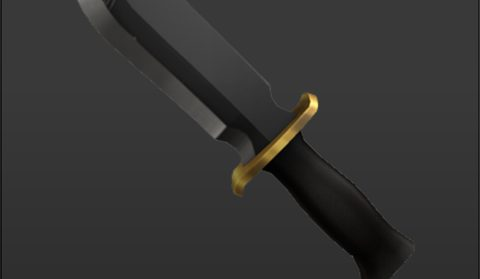</a> <b>EquipContainer</b></td>
</tr>
<tr>
<td width="33%" valign="top"> <b>EquipContainer</b> › ItemFrame.Tags.FX</td>
<td width="33%" valign="top"><a href="screenshots/88_NewItem.jpg">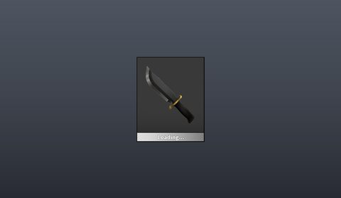</a> <b>NewItem</b></td>
<td width="33%" valign="top"><a href="screenshots/97_NewItem.jpg">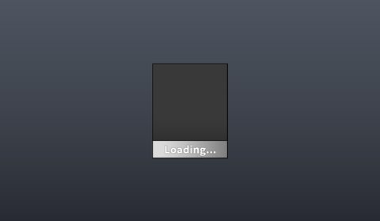</a> <b>NewItem</b></td>
</tr>
<tr>
<td width="33%" valign="top"><a href="screenshots/101_NewItem.jpg">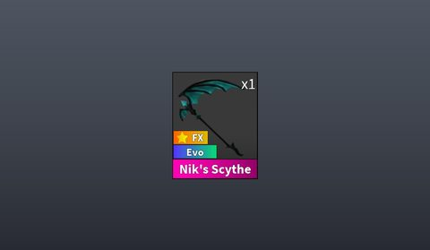</a> <b>NewItem</b></td>
<td width="33%" valign="top"><a href="screenshots/102_NewItem.jpg">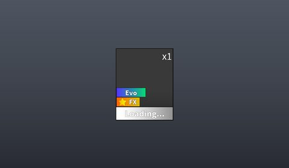</a> <b>NewItem</b></td>
<td width="33%" valign="top"><a href="screenshots/103_ShowcaseItem.jpg">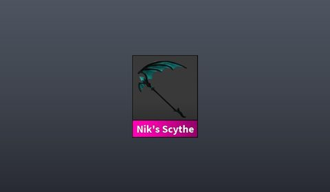</a> <b>ShowcaseItem</b></td>
</tr>
<tr>
<td width="33%" valign="top"><a href="screenshots/104_TrophyItem.jpg">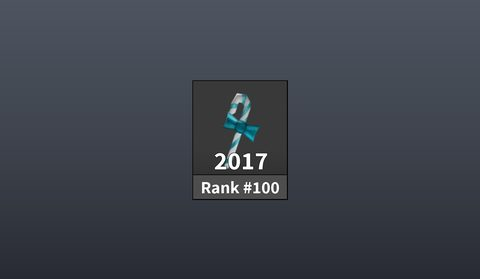</a> <b>TrophyItem</b></td>
<td width="33%" valign="top"><a href="screenshots/105_TrophyItem__Tags.jpg">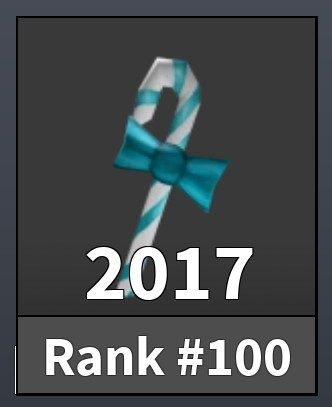</a> <b>TrophyItem</b> › Tags</td>
<td width="33%" valign="top"><a href="screenshots/107_NewItem.jpg">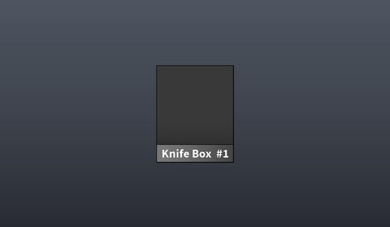</a> <b>NewItem</b></td>
</tr>
<tr>
<td width="33%" valign="top"><a href="screenshots/109_NewItem.jpg">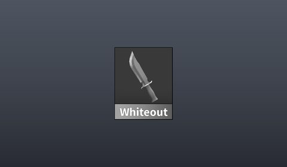</a> <b>NewItem</b></td>
<td width="33%" valign="top"><a href="screenshots/110_NewHotItem.jpg">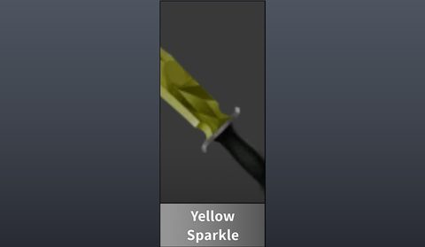</a> <b>NewHotItem</b></td>
</tr>
</table>

### Rewards, daily, spin, codes

<table>
<tr>
<td width="33%" valign="top"><a href="screenshots/74_CrossPlatform__RewardFrame.jpg">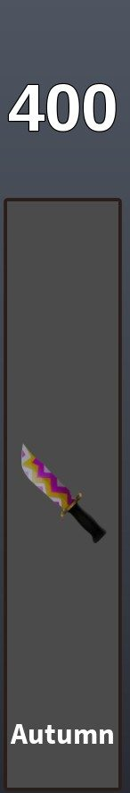</a> <b>CrossPlatform</b> › Summer2024.RewardFrame</td>
</tr>
</table>

### Trading

<table>
<tr>
<td width="33%" valign="top"><a href="screenshots/28_TradeGUI.jpg">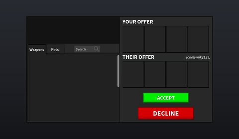</a> <b>TradeGUI</b></td>
<td width="33%" valign="top"><a href="screenshots/32_TradeGUI_Phone.jpg">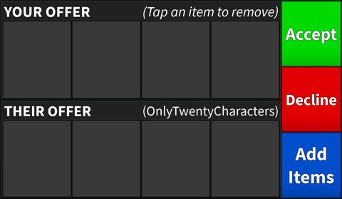</a> <b>TradeGUI_Phone</b></td>
<td width="33%" valign="top"> <b>TradeGUI_Phone</b> › Inactive.Frame</td>
</tr>
<tr>
<td width="33%" valign="top"><a href="screenshots/34_TradeGUI_Phone__Weapons.jpg">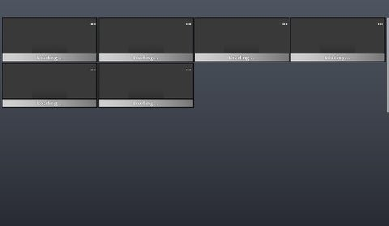</a> <b>TradeGUI_Phone</b> › Inactive.TradeMainOld.Weapons</td>
</tr>
</table>

### Settings & menus

<table>
<tr>
<td width="33%" valign="top"><a href="screenshots/59_CrossPlatform__ServerSettings.jpg">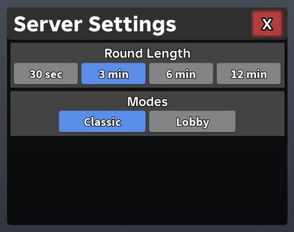</a> <b>CrossPlatform</b> › ServerSettings</td>
<td width="33%" valign="top"><a href="screenshots/71_CrossPlatform__Title.jpg">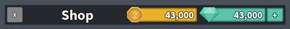</a> <b>CrossPlatform</b> › Shop.Medium.Title</td>
<td width="33%" valign="top"> <b>GameplayControlsUI</b></td>
</tr>
<tr>
<td width="33%" valign="top"><a href="screenshots/79_GameplayControlsUI__TabletOld.jpg">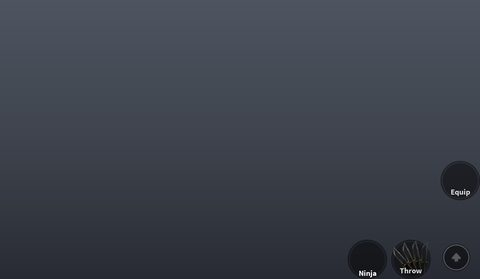</a> <b>GameplayControlsUI</b> › _.TabletOld</td>
<td width="33%" valign="top"> <b>GameplayControlsUI</b> › _.TabletRobloxControls</td>
</tr>
</table>

### Popups, notifications, prompts

<table>
<tr>
<td width="33%" valign="top"><a href="screenshots/92_CraftFrame__Material1.jpg">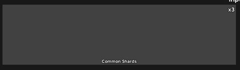</a> <b>CraftFrame</b> › MultipleContainer.Material1</td>
<td width="33%" valign="top"><a href="screenshots/93_CraftFrame__Material2.jpg">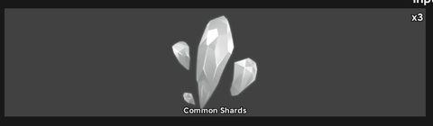</a> <b>CraftFrame</b> › MultipleContainer.Material2</td>
</tr>
</table>

### Loading & intro

<table>
<tr>
<td width="33%" valign="top"> <b>Loading</b></td>
<td width="33%" valign="top"> <b>Loading_Clean</b></td>
</tr>
</table>

### Leaderboards & stats

<table>
<tr>
<td width="33%" valign="top"><a href="screenshots/20_Scoreboard__Classic.jpg">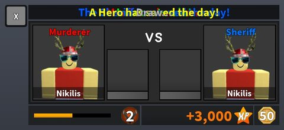</a> <b>Scoreboard</b> › Classic</td>
<td width="33%" valign="top"><a href="screenshots/21_Scoreboard__ScaryMode.jpg">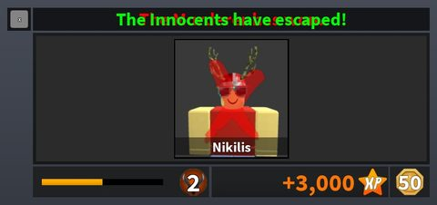</a> <b>Scoreboard</b> › ScaryMode</td>
<td width="33%" valign="top"><a href="screenshots/22_Scoreboard__Assassin.jpg">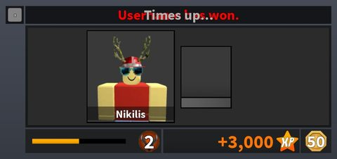</a> <b>Scoreboard</b> › Assassin</td>
</tr>
<tr>
<td width="33%" valign="top"><a href="screenshots/23_Scoreboard__BonusModes.jpg">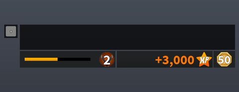</a> <b>Scoreboard</b> › BonusModes</td>
<td width="33%" valign="top"><a href="screenshots/24_Scoreboard_Phone__ScaryMode.jpg">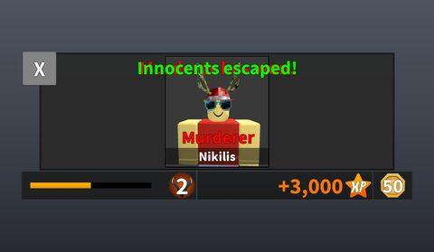</a> <b>Scoreboard_Phone</b> › ScaryMode</td>
<td width="33%" valign="top"><a href="screenshots/25_Scoreboard_Phone__Classic.jpg">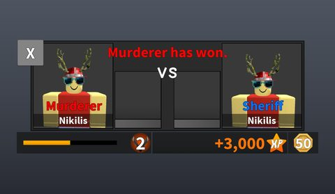</a> <b>Scoreboard_Phone</b> › Classic</td>
</tr>
<tr>
<td width="33%" valign="top"><a href="screenshots/26_Scoreboard_Phone__Assassin.jpg">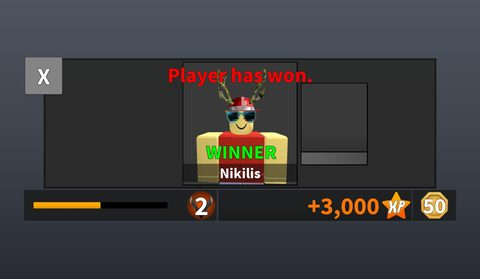</a> <b>Scoreboard_Phone</b> › Assassin</td>
<td width="33%" valign="top"><a href="screenshots/27_Scoreboard_Phone__BonusModes.jpg">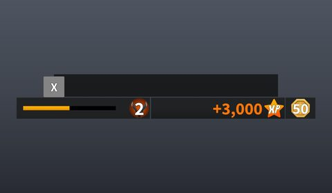</a> <b>Scoreboard_Phone</b> › BonusModes</td>
<td width="33%" valign="top"> <b>GameTopbar</b></td>
</tr>
</table>

### End of round, death, results

<table>
<tr>
<td width="33%" valign="top"><a href="screenshots/13_VictorySlideConcept.jpg">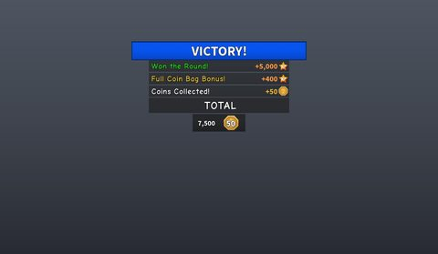</a> <b>VictorySlideConcept</b></td>
<td width="33%" valign="top"> <b>Victory</b></td>
<td width="33%" valign="top"><a href="screenshots/53_CrossPlatform__FriendsOnline.jpg">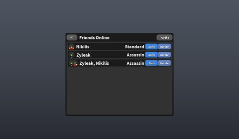</a> <b>CrossPlatform</b> › FriendsOnline</td>
</tr>
<tr>
<td width="33%" valign="top"><a href="screenshots/66_CrossPlatform__EmoteWindow.jpg">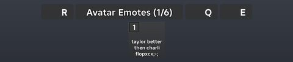</a> <b>CrossPlatform</b> › Emotes.EmoteWindow</td>
</tr>
</table>

### Crafting, fusing, machines

<table>
<tr>
<td width="33%" valign="top"><a href="screenshots/91_CraftFrame.jpg">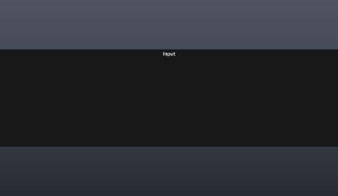</a> <b>CraftFrame</b></td>
<td width="33%" valign="top"><a href="screenshots/96_CraftFrame__SingleContainer.jpg">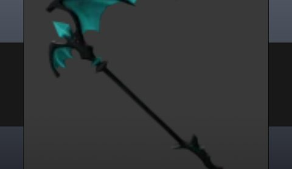</a> <b>CraftFrame</b> › SingleContainer</td>
</tr>
</table>

### Admin panels

<table>
<tr>
<td width="33%" valign="top"><a href="screenshots/60_CrossPlatform__Console.jpg">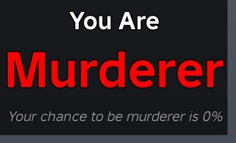</a> <b>CrossPlatform</b> › RoleSelection.Console</td>
</tr>
</table>

### HUD & currency

<table>
<tr>
<td width="33%" valign="top"> <b>CrossPlatform</b> › Shop.OwnedCurrencyFrame</td>
<td width="33%" valign="top"> <b>Main</b></td>
</tr>
</table>

### Character / avatar / emotes

<table>
<tr>
<td width="33%" valign="top"> <b>CrossPlatform</b> › Emotes.EmoteContainer.Avater Emotes</td>
<td width="33%" valign="top"> <b>CrossPlatform</b> › Emotes.EmoteContainer.Default Emotes</td>
<td width="33%" valign="top"> <b>CrossPlatform</b> › Emotes._.EmotePages</td>
</tr>
</table>

### Map vote / teams / matchmaking

<table>
<tr>
<td width="33%" valign="top"> <b>CrossPlatform</b> › Duels.Container</td>
<td width="33%" valign="top"> <b>CrossPlatform</b> › Duels.DuelRound</td>
</tr>
</table>

### Other

<table>
<tr>
<td width="33%" valign="top"> <b>GamemodePhone</b></td>
<td width="33%" valign="top"> <b>GamemodeBonus</b></td>
<td width="33%" valign="top"> <b>Join_Old</b></td>
</tr>
<tr>
<td width="33%" valign="top"> <b>Join_Old</b> › Retry</td>
<td width="33%" valign="top"> <b>JoinPhone</b></td>
<td width="33%" valign="top"> <b>JoinPhone</b> › Retry</td>
</tr>
<tr>
<td width="33%" valign="top"> <b>DeviceSelect</b></td>
<td width="33%" valign="top"> <b>Gamemode</b></td>
<td width="33%" valign="top"> <b>Join</b></td>
</tr>
<tr>
<td width="33%" valign="top"> <b>TrapGUI</b></td>
<td width="33%" valign="top"> <b>StatusEffectGui</b></td>
<td width="33%" valign="top"> <b>CustomGames</b></td>
</tr>
<tr>
<td width="33%" valign="top"> <b>CustomGames</b> › Mode1v1</td>
<td width="33%" valign="top"> <b>CustomGames</b> › Mode1v1-Auto</td>
<td width="33%" valign="top"> <b>CrossPlatform</b> › GameModes.ModeOverlay</td>
</tr>
<tr>
<td width="33%" valign="top"> <b>CrossPlatform</b> › GameModes.Overlay</td>
<td width="33%" valign="top"> <b>CrossPlatform</b> › GameModes.Container</td>
<td width="33%" valign="top"> <b>CrossPlatform</b> › Summer2026</td>
</tr>
<tr>
<td width="33%" valign="top"> <b>CrossPlatform</b> › Summer2024.Rare</td>
<td width="33%" valign="top"> <b>CrossPlatform</b> › Summer2024.Container</td>
<td width="33%" valign="top"> <b>MysteryBoxOpen</b></td>
</tr>
<tr>
<td width="33%" valign="top"> <b>Unboxing</b></td>
<td width="33%" valign="top"> <b>Hatching</b> › Cracked</td>
<td width="33%" valign="top"> <b>NewBoxContents</b></td>
</tr>
</table>

## Model previews

<table>
<tr>
<td width="25%" valign="top"> <b>Parts</b> <code>models/ServerStorage/Database/Maps/ResearchFacility/Parts.rbxm</code></td>
<td width="25%" valign="top"> <b>EggAxe</b> <code>models/ServerStorage/Database/Item/EggAxe.rbxm</code></td>
<td width="25%" valign="top"> <b>CandyBucket2025</b> <code>models/ServerStorage/Database/Toys/CandyBucket2025.rbxm</code></td>
<td width="25%" valign="top"> <b>TreeKnife2023</b> <code>models/ServerStorage/Database/Item/TreeKnife2023.rbxm</code></td>
</tr>
<tr>
<td width="25%" valign="top"> <b>Tree__x8</b> <code>models/ServerStorage/Database/Maps/Hospital3/Decoration_Regular/Trees/Tree__x8.rbxm</code></td>
<td width="25%" valign="top"> <b>BatFire</b> <code>models/ServerStorage/Database/Pets/BatFire.rbxm</code></td>
<td width="25%" valign="top"> <b>Base</b> <code>models/ServerStorage/Database/Maps/Hotel2/Base.rbxm</code></td>
<td width="25%" valign="top"> <b>MagicBook2024</b> <code>models/ServerStorage/Database/Toys/MagicBook2024.rbxm</code></td>
</tr>
<tr>
<td width="25%" valign="top"> <b>EggToy2023</b> <code>models/ServerStorage/Database/Toys/EggToy2023.rbxm</code></td>
<td width="25%" valign="top"> <b>BlackCharmerHair</b> <code>models/ServerStorage/Gameplay/Hair/BlackCharmerHair.rbxm</code></td>
<td width="25%" valign="top"> <b>MainTeleporters</b> <code>models/ServerStorage/Database/Maps/ResearchFacility/Interactive/MainTeleporters.rbxm</code></td>
<td width="25%" valign="top"> <b>LiveBoard</b> <code>models/Workspace/LiveBoard.rbxm</code></td>
</tr>
<tr>
<td width="25%" valign="top"> <b>Tree</b> <code>models/ServerStorage/Database/Radios/Tree.rbxm</code></td>
<td width="25%" valign="top"> <b>Decoration_Regular</b> <code>models/ServerStorage/Database/Maps/Mansion2/Decoration_Regular.rbxm</code></td>
</tr>
</table>

## Notable scripts

Top-scored scripts of this game per topic (full tree in [source/scripts](source/scripts/)).

| Topic | Scripts |
|---|---|
| UI animation (tweens, hover / click, pop-ins, springs) | [`AdminBoardPurchaseClient`](source/scripts/StarterPlayer/StarterPlayerScripts/AdminBoardPurchaseClient.client.lua) 171 lines [`ItemPopupScript`](source/scripts/StarterGui/CrossPlatform/NewItem/ItemPopupScript.client.lua) 113 lines [`LiveBoardClient`](source/scripts/StarterPlayer/StarterPlayerScripts/LiveBoardClient.client.lua) 208 lines [`SpringUtils`](source/scripts/ServerScriptService/GameScript/Classes/SoftShutdown/src/node_modules/%40quenty/blend/node_modules/%40quenty/spring/Shared/SpringUtils.lua) 99 lines [`Button`](source/scripts/ReplicatedStorage/ClientServices/Button.lua) 87 lines |
| UI controllers / window managers / menus | [`EventScript`](source/scripts/StarterGui/CrossPlatform/Summer2024/EventScript.client.lua) 192 lines [`Menu_GUI`](source/scripts/ReplicatedStorage/GUI/MainPC/Menu_GUI.client.lua) 255 lines [`InteractiveScript`](source/scripts/ServerStorage/Database/Maps/ResearchFacility/Interactive/GarageSystem/GarageOpenerInside/InteractiveBox/InteractiveScript.server.lua) 49 lines [`WindowService01`](source/scripts/ReplicatedStorage/Modules/WindowService01.lua) 104 lines [`SoftShutdownUI`](source/scripts/ServerScriptService/GameScript/Classes/SoftShutdown/src/Client/SoftShutdownUI.lua) 247 lines |
| Notifications, toasts, popups, prompts | [`Script`](source/scripts/ServerStorage/AdminPanelImportBackup/AdminPanelFromCoolGame/Script.client.lua) 187 lines [`ItemPopupScript`](source/scripts/StarterGui/CrossPlatform/NewItem/ItemPopupScript.client.lua) 113 lines [`DataModule`](source/scripts/ServerScriptService/GameScript/DataModule.lua) 3595 lines [`ShopDesktop`](source/scripts/StarterGui/CrossPlatform/Shop/ShopScript/ShopDesktop.client.lua) 355 lines [`AdminSettings`](source/scripts/ServerStorage/AdminPanelImportBackup/AdminPanelFromCoolGame/OwnerPanel/AdminSettings.client.lua) 341 lines |
| Loading / intro screens | [`Loading`](source/scripts/ReplicatedFirst/UISelector/Loading.client.lua) 467 lines [`LoadingScript`](source/scripts/ReplicatedFirst/UISelector/LoadingS2/Loading/LoadingScript.client.lua) 51 lines [`ShopModule`](source/scripts/ReplicatedStorage/Modules/ShopModule.lua) 869 lines [`RoleSelect`](source/scripts/ReplicatedStorage/GUI/MainMobile/Gameplay/RoleSelect.client.lua) 284 lines [`Game_RoleSelector`](source/scripts/ReplicatedStorage/GUI/MainPC/Game_RoleSelector.client.lua) 251 lines |
| VFX, particles, beams, hit effects | [`GunServer`](source/scripts/ServerStorage/Gameplay/GunScripts/GunServer.server.lua) 163 lines [`Script`](source/scripts/ServerStorage/Database/Toys/MagicBook2024/Script.server.lua) 45 lines [`MakeBalloon`](source/scripts/ServerStorage/Database/Toys/SnowballToy2020/MakeBalloon.lua) 45 lines [`Teleporter`](source/scripts/ServerStorage/Database/Maps/ResearchFacility/Interactive/MainTeleporters/TP1/Teleporter.server.lua) 146 lines [`Teleporter`](source/scripts/ServerStorage/Database/Maps/ResearchFacility/Interactive/MainTeleporters/TP2/Teleporter.server.lua) 148 lines |
| DataStore / player data | [`DataModule`](source/scripts/ServerScriptService/GameScript/DataModule.lua) 3595 lines [`DataModule`](source/scripts/ServerStorage/AdminPanelImportBackup/AdminPanelFromCoolGame/DataModule.lua) 3010 lines [`DataStore`](source/scripts/ServerScriptService/GameScript/Classes/SoftShutdown/src/node_modules/%40quenty/datastore/Server/DataStore.lua) 223 lines [`DataStorePromises`](source/scripts/ServerScriptService/GameScript/Classes/SoftShutdown/src/node_modules/%40quenty/datastore/Server/Utility/DataStorePromises.lua) 154 lines [`PlayerDataStoreManager`](source/scripts/ServerScriptService/GameScript/Classes/SoftShutdown/src/node_modules/%40quenty/datastore/Server/PlayerDataStoreManager.lua) 172 lines |
| Monetization (dev products, game passes, receipts) | [`DataModule`](source/scripts/ServerScriptService/GameScript/DataModule.lua) 3595 lines [`DataModule`](source/scripts/ServerStorage/AdminPanelImportBackup/AdminPanelFromCoolGame/DataModule.lua) 3010 lines [`AdminBoardPurchaseClient`](source/scripts/StarterPlayer/StarterPlayerScripts/AdminBoardPurchaseClient.client.lua) 171 lines |
| RNG, eggs, gacha, rarity rolls, pets | [`DataModule`](source/scripts/ServerScriptService/GameScript/DataModule.lua) 3595 lines [`DataModule`](source/scripts/ServerStorage/AdminPanelImportBackup/AdminPanelFromCoolGame/DataModule.lua) 3010 lines [`CoinsController`](source/scripts/ServerScriptService/GameScript/Modules/CoinsController.lua) 215 lines [`OpenCrate`](source/scripts/ReplicatedStorage/GUI/MainXbox/Menu/Shop_Data_Xbox/OpenCrate.lua) 207 lines [`Classic`](source/scripts/ServerScriptService/GameScript/GameModes/Classic.lua) 1092 lines |
| Trading systems | [`TradeModule`](source/scripts/ReplicatedStorage/Modules/TradeModule.lua) 357 lines [`Trading`](source/scripts/ReplicatedStorage/GUI/MainPC/Inventory/Trading.client.lua) 65 lines [`Trading_Phone`](source/scripts/ReplicatedStorage/GUI/MainMobile/Inventory/Trading_Phone.client.lua) 34 lines [`Trade`](source/scripts/ReplicatedStorage/GUI/MainXbox/Menu/Trade.client.lua) 505 lines |
| Combat, weapons, hitboxes, abilities | [`KnifeServer`](source/scripts/ServerStorage/Gameplay/KnifeScripts/KnifeServer.server.lua) 549 lines [`Assassin`](source/scripts/ServerScriptService/GameScript/GameModes/Assassin.lua) 269 lines [`GunServer`](source/scripts/ServerStorage/Gameplay/GunScripts/GunServer.server.lua) 163 lines [`Server`](source/scripts/ServerStorage/Database/Toys/Candle2025/Server.server.lua) 72 lines [`Server`](source/scripts/ServerStorage/Database/Toys/TreeToy2024/Server.server.lua) 72 lines |
| NPC / AI / monsters | [`NPCPhysics`](source/scripts/Workspace/Lobby/ToolNPCS/NPCPhysics.server.lua) 91 lines |
| Character movement (sprint, dash, double jump, slide) | [`SprintClient`](source/scripts/ServerScriptService/GameScript/Modules/PerksController/Sprint/SprintClient.client.lua) 18 lines [`Sprint`](source/scripts/ServerStorage/Database/Perks/Sprint.lua) 29 lines [`Classic`](source/scripts/ServerScriptService/GameScript/GameModes/Classic.lua) 1092 lines |
| Tycoon / plots / bases / building | [`DataModule`](source/scripts/ServerScriptService/GameScript/DataModule.lua) 3595 lines [`AdminSettings`](source/scripts/ServerStorage/AdminPanelImportBackup/AdminPanelFromCoolGame/OwnerPanel/AdminSettings.client.lua) 341 lines [`AdminSettings`](source/scripts/StarterGui/CrossPlatform/OwnerPanel/AdminSettings.client.lua) 342 lines [`EventScript`](source/scripts/StarterGui/CrossPlatform/Summer2024/EventScript.client.lua) 192 lines [`DataModule`](source/scripts/ServerStorage/AdminPanelImportBackup/AdminPanelFromCoolGame/DataModule.lua) 3010 lines |
| Admin panels & commands | [`AdminSettings`](source/scripts/ServerStorage/AdminPanelImportBackup/AdminPanelFromCoolGame/OwnerPanel/AdminSettings.client.lua) 341 lines [`AdminSettings`](source/scripts/ServerStorage/DisabledOldAdminSystem/StarterGui/AdminSettings/AdminSettings.client.lua) 151 lines [`AdminSettings`](source/scripts/StarterGui/CrossPlatform/OwnerPanel/AdminSettings.client.lua) 342 lines [`DataModule`](source/scripts/ServerScriptService/GameScript/DataModule.lua) 3595 lines [`AdminController`](source/scripts/ServerStorage/DisabledOldAdminSystem/ServerScriptService/AdminController.lua) 303 lines |
| Sound & music | [`InteractSound`](source/scripts/ReplicatedStorage/ClientServices/FX/FX_Modules/InteractSound.lua) 53 lines [`AudioSearcher`](source/scripts/ReplicatedStorage/Modules/AudioSearcher.lua) 45 lines [`MusicScript`](source/scripts/ReplicatedStorage/GUI/MainPC/Game/Settings/MusicScript.client.lua) 27 lines [`MusicScript`](source/scripts/StarterGui/GameTopbar/MusicScript.client.lua) 56 lines [`GameplayAnimations`](source/scripts/StarterPlayer/StarterPlayerScripts/GameplayAnimations.client.lua) 263 lines |
| Daily rewards, quests, codes, playtime | [`DataModule`](source/scripts/ServerScriptService/GameScript/DataModule.lua) 3595 lines [`DataModule`](source/scripts/ServerStorage/AdminPanelImportBackup/AdminPanelFromCoolGame/DataModule.lua) 3010 lines [`QuestService`](source/scripts/StarterGui/CrossPlatform/Summer2026/EventScript/QuestService.lua) 327 lines |
| Utility modules (number format, signals, tables, timers) | [`RxBrioUtils`](source/scripts/ServerScriptService/GameScript/Classes/SoftShutdown/src/node_modules/%40quenty/blend/node_modules/%40quenty/brio/Shared/RxBrioUtils.lua) 715 lines [`Table`](source/scripts/ServerScriptService/GameScript/Classes/SoftShutdown/src/node_modules/%40quenty/attributeutils/node_modules/%40quenty/rx/node_modules/%40quenty/table/Shared/Table.lua) 323 lines [`Promise`](source/scripts/ServerScriptService/GameScript/Classes/SoftShutdown/src/node_modules/%40quenty/attributeutils/node_modules/%40quenty/rx/node_modules/%40quenty/canceltoken/node_modules/%40quenty/promise/Shared/Promise.lua) 554 lines [`DataStoreStage`](source/scripts/ServerScriptService/GameScript/Classes/SoftShutdown/src/node_modules/%40quenty/datastore/Server/Modules/DataStoreStage.lua) 334 lines [`Signal`](source/scripts/ServerScriptService/GameScript/Classes/SoftShutdown/src/node_modules/%40quenty/attributeutils/node_modules/%40quenty/rx/node_modules/%40quenty/canceltoken/node_modules/%40quenty/signal/Shared/Signal.lua) 155 lines |

### In the curated script library

- [Hitscan gun (server)](../../Scripts/11-Combat/HitscanGunServer__murderers-vs-sheriffs.lua) — Server hitscan with fire-rate lock and pass-through for invisible parts.
- [Gamepass buy button](../../Scripts/03-Notifications/GamepassBuyButton__murderers-vs-sheriffs.lua) — World SurfaceGui gamepass buy button: hover/press tweens, anti double-prompt, listens to PromptGamePassPurchaseFinished and flips to "Purchased".
- [Lightweight wander runtime](../../Scripts/12-NPC-AI/RandomWanderRuntime__murderers-vs-sheriffs.lua) — Tiny module that registers rigs and, every 5 seconds per rig, MoveTo's a random point 10-20 studs away; one Heartbeat connection per rig with Disconnect / DisconnectAll.

## Folders

| Folder | What |
|---|---|
| `screenshots/` | full frames; `crops/` = the panel only; `models/` = 3D previews; `thumbs/` = gallery thumbnails |
| `ui/` | every screen as a Lua builder (`require(module)()` returns the ScreenGui); `_StarterGui-all.lua` builds every StarterGui screen |
| `models/` | every model as .rbxm (the only .rbxm files), mirroring the place tree, scripts removed |
| `map/` | `workspace.rbxm` (the map as a model), `lighting.lua` (sky + post effects), `materials.lua`, `Environment.lua` |
| `animations/`, `audio/` | KeyframeSequence / Sound builders (.lua), `AnimationIds.lua`, `Sounds.lua` |
| `source/` | all scripts as .luau, `tree.txt`, `ui.txt`, `remotes.txt`, `assets.txt`, `flags.txt` |
