# Natural Disaster Survival (Sowiks)

> 🎉 **Party** · survival (random disasters) · source file `[ CATALOG ] Natural Disaster Made By Sowiks Fully Scripted !.rbxl`

[⬅ Back to the catalog](../../README.md) · [Assets inventory](ASSETS.md) · [Style numbers](reference.md) · [Scripts](source/scripts/) · [Code analysis](source/README.md)

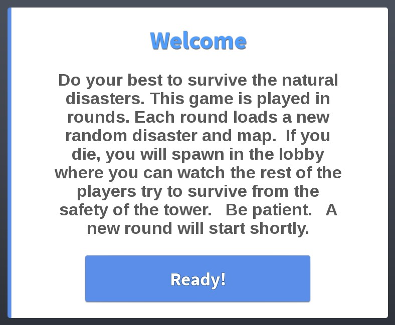

## At a glance

| | |
|---|---|
| Provenance | template with full source |
| Screens | 7 ScreenGuis, 94 GUI objects → **70 screenshots** |
| Models (.rbxm) | 113 models, 0 model sets, 1 VFX sets |
| Lua builders (.lua) | 14 UI screens, 6 animation packs, 1 audio packs |
| Code | 982 scripts, 186,540 lines |
| Asset ids | 104 animations, 165 sounds |
| Safety scan | 3 HIGH / 31 MED flags ([flags.txt](source/flags.txt)) |

**Fonts:** `ComicNeueAngular Bold`×33, `Arial Bold`×16, `SourceSansPro Regular`×15, `SourceSansPro Bold`×9

## UI screenshots

Captured in Studio from the place's own ScreenGuis (scripts stripped). Each panel was opened on its own; click a thumbnail for the full 1519×886 frame. Runtime-filled lists (shop items, inventories) show their template state.

### Settings & menus

<table>
<tr>
<td width="33%" valign="top"><a href="screenshots/13_HDAdminGUIs__Template4.jpg">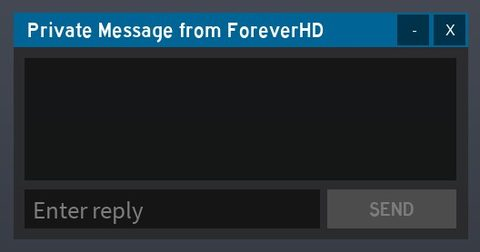</a> <b>HDAdminGUIs</b> › MenuTemplates.Template4</td>
<td width="33%" valign="top"><a href="screenshots/14_HDAdminGUIs__Template5.jpg">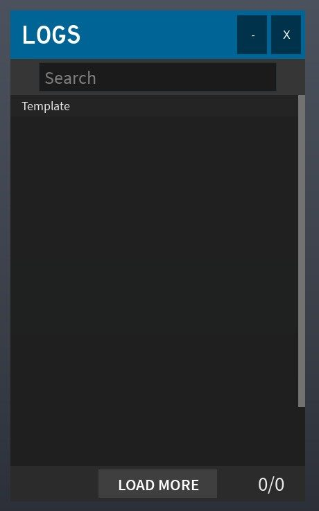</a> <b>HDAdminGUIs</b> › MenuTemplates.Template5</td>
<td width="33%" valign="top"><a href="screenshots/15_HDAdminGUIs__Template6.jpg">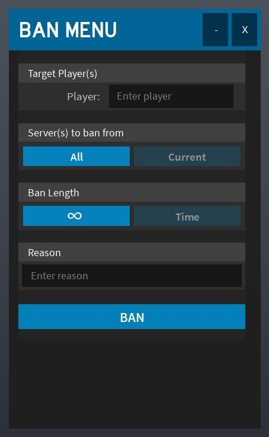</a> <b>HDAdminGUIs</b> › MenuTemplates.Template6</td>
</tr>
<tr>
<td width="33%" valign="top"><a href="screenshots/18_HDAdminGUIs__Template8.jpg">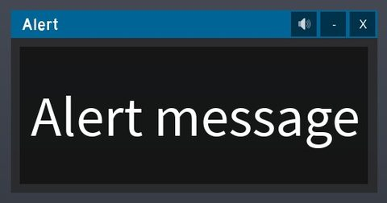</a> <b>HDAdminGUIs</b> › MenuTemplates.Template8</td>
<td width="33%" valign="top"><a href="screenshots/21_HDAdminGUIs__Template10.jpg">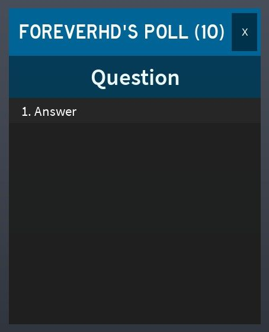</a> <b>HDAdminGUIs</b> › MenuTemplates.Template10</td>
<td width="33%" valign="top"><a href="screenshots/22_HDAdminGUIs__Template11.jpg">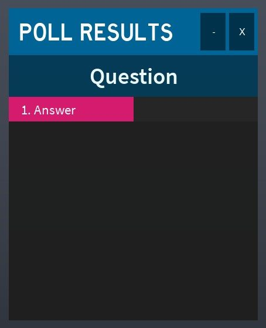</a> <b>HDAdminGUIs</b> › MenuTemplates.Template11</td>
</tr>
</table>

### Popups, notifications, prompts

<table>
<tr>
<td width="33%" valign="top"><a href="screenshots/10_HDAdminGUIs__Warnings.jpg">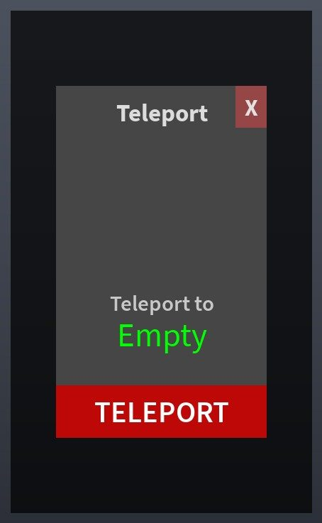</a> <b>HDAdminGUIs</b> › MainFrame.Warnings</td>
<td width="33%" valign="top"><a href="screenshots/25_HDAdminGUIs__Message.jpg">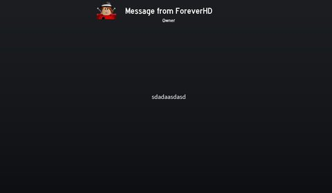</a> <b>HDAdminGUIs</b> › Templates.Message</td>
<td width="33%" valign="top"> <b>HDAdminGUIs</b> › Templates.GlobalAnnouncement</td>
</tr>
<tr>
<td width="33%" valign="top"><a href="screenshots/27_ExportDialog.jpg">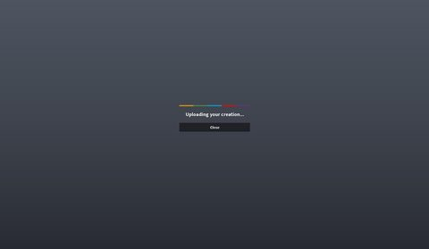</a> <b>ExportDialog</b></td>
</tr>
</table>

### Loading & intro

<table>
<tr>
<td width="33%" valign="top"><a href="screenshots/02_MainGui__IntroPage.jpg">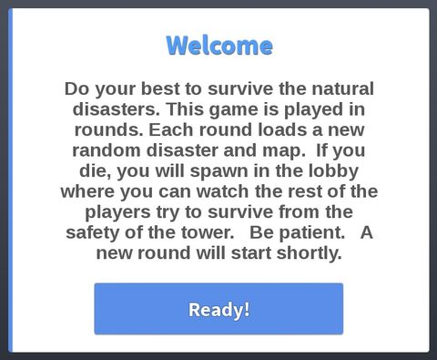</a> <b>MainGui</b> › IntroPage</td>
<td width="33%" valign="top"><a href="screenshots/05_MainGui__MultiDisasterSplash.jpg">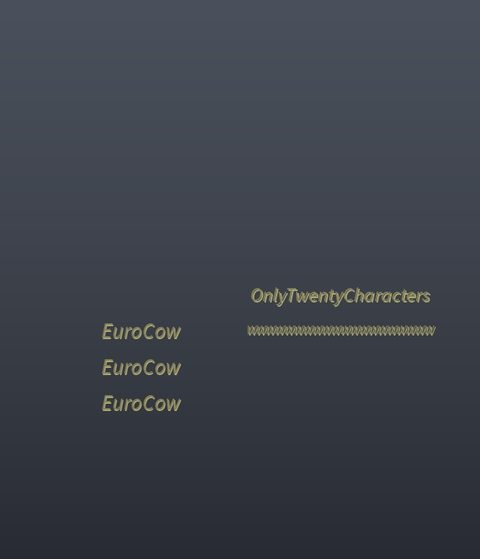</a> <b>MainGui</b> › MultiDisasterSplash</td>
</tr>
</table>

### End of round, death, results

<table>
<tr>
<td width="33%" valign="top"><a href="screenshots/17_HDAdminGUIs__FinalResult.jpg">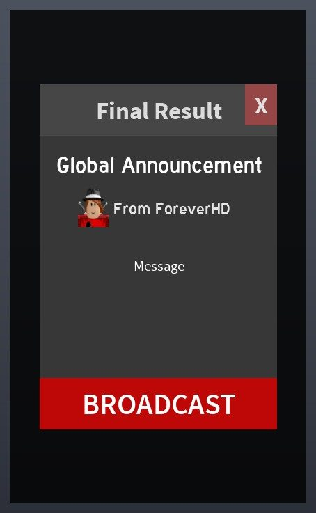</a> <b>HDAdminGUIs</b> › MenuTemplates.Template7.FinalResult</td>
<td width="33%" valign="top"><a href="screenshots/20_HDAdminGUIs__FinalResult.jpg">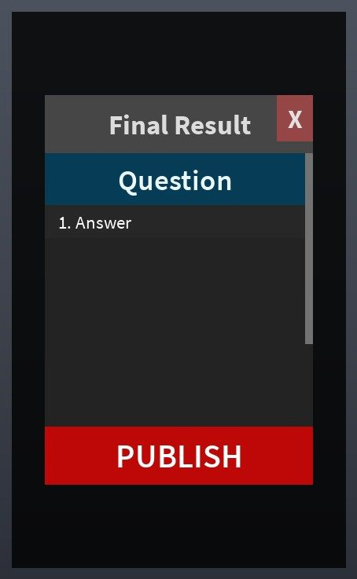</a> <b>HDAdminGUIs</b> › MenuTemplates.Template9.FinalResult</td>
<td width="33%" valign="top"><a href="screenshots/24_HDAdminGUIs__FinalResult.jpg">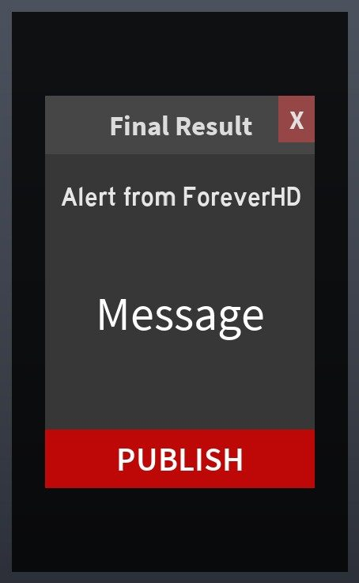</a> <b>HDAdminGUIs</b> › MenuTemplates.Template12.FinalResult</td>
</tr>
</table>

### Crafting, fusing, machines

<table>
<tr>
<td width="33%" valign="top"> <b>MainGui</b> › WeatherMachinePage</td>
</tr>
</table>

### Admin panels

<table>
<tr>
<td width="33%" valign="top"><a href="screenshots/09_HDAdminGUIs__Pages.jpg">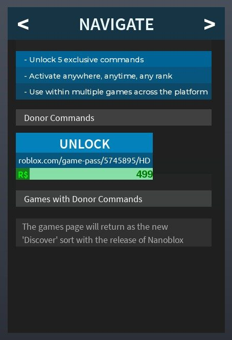</a> <b>HDAdminGUIs</b> › MainFrame.Pages</td>
<td width="33%" valign="top"><a href="screenshots/12_HDAdminGUIs__CmdBar.jpg">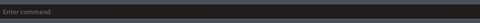</a> <b>HDAdminGUIs</b> › CmdBar</td>
</tr>
</table>

### HUD & currency

<table>
<tr>
<td width="33%" valign="top"><a href="screenshots/01_MainGui__SurviversPage.jpg">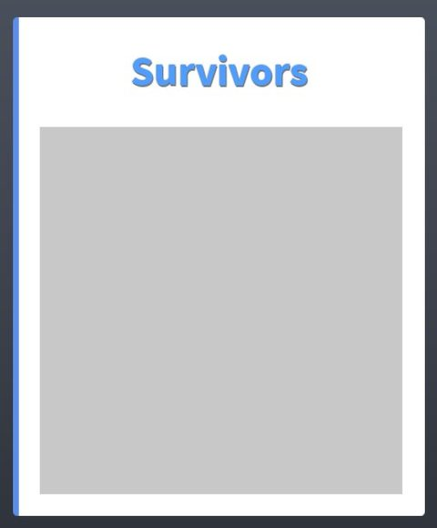</a> <b>MainGui</b> › SurviversPage</td>
<td width="33%" valign="top"> <b>MainGui</b> › NextMapPage</td>
<td width="33%" valign="top"><a href="screenshots/16_HDAdminGUIs__MainFrame.jpg">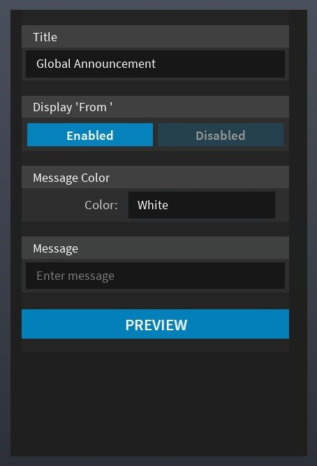</a> <b>HDAdminGUIs</b> › MenuTemplates.Template7.MainFrame</td>
</tr>
<tr>
<td width="33%" valign="top"><a href="screenshots/19_HDAdminGUIs__MainFrame.jpg">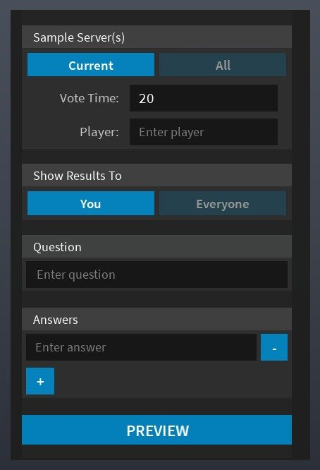</a> <b>HDAdminGUIs</b> › MenuTemplates.Template9.MainFrame</td>
<td width="33%" valign="top"><a href="screenshots/23_HDAdminGUIs__MainFrame.jpg">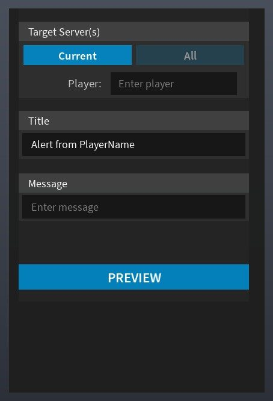</a> <b>HDAdminGUIs</b> › MenuTemplates.Template12.MainFrame</td>
</tr>
</table>

### Character / avatar / emotes

<table>
<tr>
<td width="33%" valign="top"><a href="screenshots/07_EmoteGui_R15___ScrollingFrame.jpg">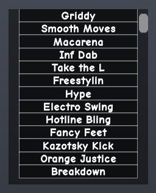</a> <b>EmoteGui(R15)</b> › ScrollingFrame</td>
<td width="33%" valign="top"><a href="screenshots/08_EmoteGui_R6___ScrollingFrame2.jpg">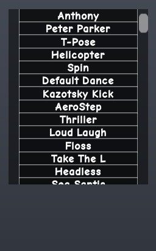</a> <b>EmoteGui(R6)</b> › ScrollingFrame2</td>
</tr>
</table>

### Map vote / teams / matchmaking

<table>
<tr>
<td width="33%" valign="top"><a href="screenshots/06_MainGui__MapVotePage.jpg">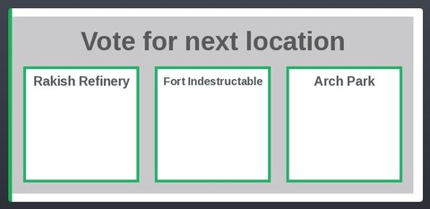</a> <b>MainGui</b> › MapVotePage</td>
</tr>
</table>

### Other

<table>
<tr>
<td width="33%" valign="top"><a href="screenshots/28_BTAnchorToolGUI.jpg">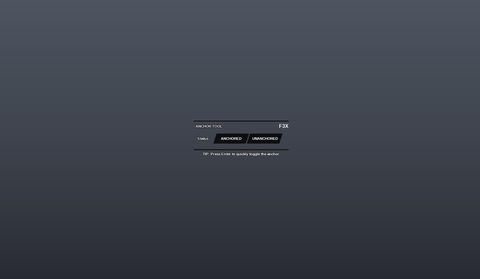</a> <b>BTAnchorToolGUI</b></td>
<td width="33%" valign="top"><a href="screenshots/29_BTCollisionToolGUI.jpg">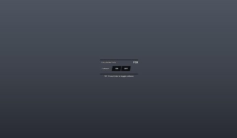</a> <b>BTCollisionToolGUI</b></td>
<td width="33%" valign="top"><a href="screenshots/30_BTGroupsGUI.jpg">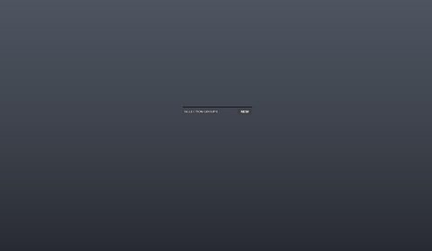</a> <b>BTGroupsGUI</b></td>
</tr>
<tr>
<td width="33%" valign="top"> <b>BTDecorateToolGUI</b></td>
<td width="33%" valign="top"><a href="screenshots/32_Dock.jpg">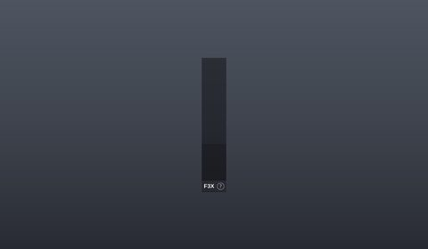</a> <b>Dock</b></td>
<td width="33%" valign="top"><a href="screenshots/33_Dock__HelpInfo.jpg">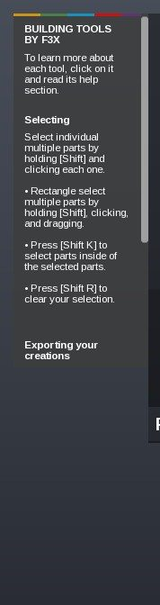</a> <b>Dock</b> › HelpInfo</td>
</tr>
<tr>
<td width="33%" valign="top"><a href="screenshots/34_Dock__PaintInfo.jpg">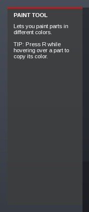</a> <b>Dock</b> › ToolInformation.PaintInfo</td>
<td width="33%" valign="top"><a href="screenshots/35_Dock__SurfaceInfo.jpg">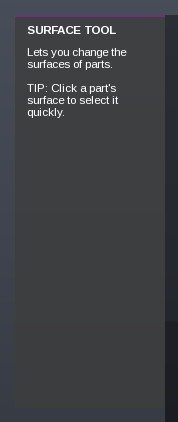</a> <b>Dock</b> › ToolInformation.SurfaceInfo</td>
<td width="33%" valign="top"><a href="screenshots/36_Dock__MaterialInfo.jpg">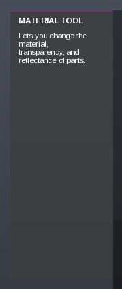</a> <b>Dock</b> › ToolInformation.MaterialInfo</td>
</tr>
<tr>
<td width="33%" valign="top"><a href="screenshots/37_Dock__AnchorInfo.jpg">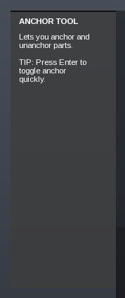</a> <b>Dock</b> › ToolInformation.AnchorInfo</td>
<td width="33%" valign="top"><a href="screenshots/38_Dock__NewPartInfo.jpg">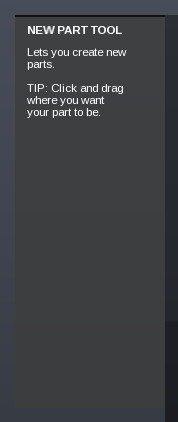</a> <b>Dock</b> › ToolInformation.NewPartInfo</td>
<td width="33%" valign="top"><a href="screenshots/39_Dock__MeshInfo.jpg">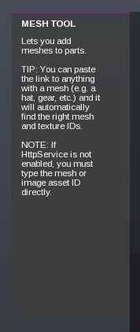</a> <b>Dock</b> › ToolInformation.MeshInfo</td>
</tr>
<tr>
<td width="33%" valign="top"><a href="screenshots/40_Dock__TextureInfo.jpg">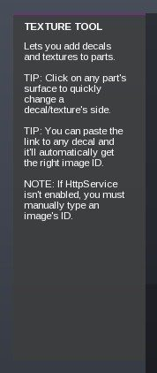</a> <b>Dock</b> › ToolInformation.TextureInfo</td>
<td width="33%" valign="top"><a href="screenshots/41_Dock__LightingInfo.jpg">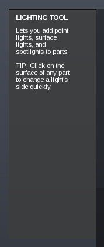</a> <b>Dock</b> › ToolInformation.LightingInfo</td>
<td width="33%" valign="top"><a href="screenshots/42_Dock__DecorateInfo.jpg">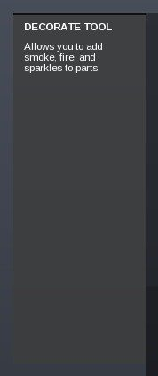</a> <b>Dock</b> › ToolInformation.DecorateInfo</td>
</tr>
<tr>
<td width="33%" valign="top"><a href="screenshots/43_Dock__WeldInfo.jpg">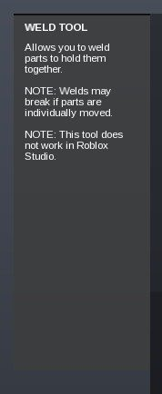</a> <b>Dock</b> › ToolInformation.WeldInfo</td>
<td width="33%" valign="top"><a href="screenshots/44_Dock__CollisionInfo.jpg">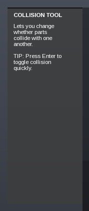</a> <b>Dock</b> › ToolInformation.CollisionInfo</td>
<td width="33%" valign="top"><a href="screenshots/45_Dock__MoveInfo.jpg">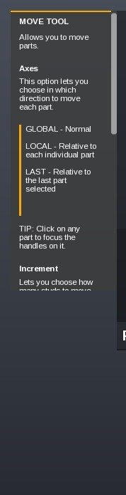</a> <b>Dock</b> › ToolInformation.MoveInfo</td>
</tr>
<tr>
<td width="33%" valign="top"><a href="screenshots/46_Dock__RotateInfo.jpg">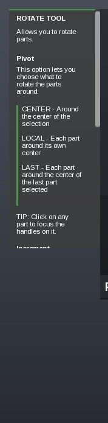</a> <b>Dock</b> › ToolInformation.RotateInfo</td>
<td width="33%" valign="top"><a href="screenshots/47_Dock__ResizeInfo.jpg">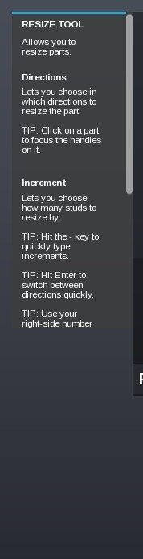</a> <b>Dock</b> › ToolInformation.ResizeInfo</td>
<td width="33%" valign="top"> <b>BTLightingToolGUI</b></td>
</tr>
<tr>
<td width="33%" valign="top"><a href="screenshots/49_BTMaterialToolGUI.jpg">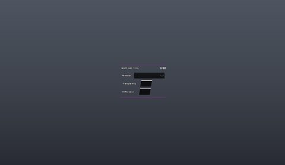</a> <b>BTMaterialToolGUI</b></td>
<td width="33%" valign="top"><a href="screenshots/50_BTMeshToolGUI.jpg">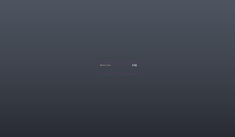</a> <b>BTMeshToolGUI</b></td>
<td width="33%" valign="top"><a href="screenshots/51_BTMoveToolGUI.jpg">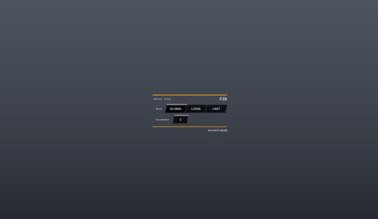</a> <b>BTMoveToolGUI</b></td>
</tr>
<tr>
<td width="33%" valign="top"><a href="screenshots/52_BTNewPartToolGUI.jpg">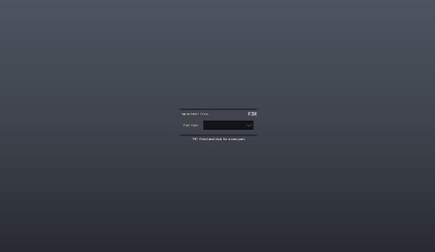</a> <b>BTNewPartToolGUI</b></td>
<td width="33%" valign="top"> <b>BTPaintToolGUI</b></td>
<td width="33%" valign="top"><a href="screenshots/54_BTResizeToolGUI.jpg">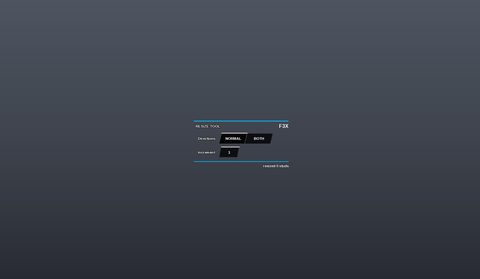</a> <b>BTResizeToolGUI</b></td>
</tr>
<tr>
<td width="33%" valign="top"><a href="screenshots/55_BTRotateToolGUI.jpg">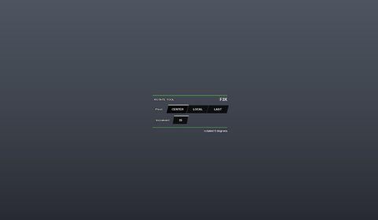</a> <b>BTRotateToolGUI</b></td>
<td width="33%" valign="top"><a href="screenshots/56_BTSurfaceToolGUI.jpg">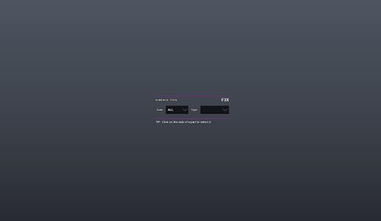</a> <b>BTSurfaceToolGUI</b></td>
<td width="33%" valign="top"> <b>BTTextureToolGUI</b></td>
</tr>
<tr>
<td width="33%" valign="top"> <b>BTHSVColorPicker</b></td>
<td width="33%" valign="top"> <b>BTAnchorToolGUI</b></td>
<td width="33%" valign="top"> <b>BTCollisionToolGUI</b></td>
</tr>
<tr>
<td width="33%" valign="top"> <b>BTDecorateToolGUI</b></td>
<td width="33%" valign="top"> <b>BTLightingToolGUI</b></td>
<td width="33%" valign="top"> <b>BTMaterialToolGUI</b></td>
</tr>
<tr>
<td width="33%" valign="top"> <b>BTMeshToolGUI</b></td>
<td width="33%" valign="top"> <b>BTMoveToolGUI</b></td>
<td width="33%" valign="top"> <b>BTPaintToolGUI</b></td>
</tr>
<tr>
<td width="33%" valign="top"> <b>BTResizeToolGUI</b></td>
<td width="33%" valign="top"> <b>BTRotateToolGUI</b></td>
<td width="33%" valign="top"> <b>BTSurfaceToolGUI</b></td>
</tr>
<tr>
<td width="33%" valign="top"> <b>BTTextureToolGUI</b></td>
<td width="33%" valign="top"> <b>BTWeldToolGUI</b></td>
</tr>
</table>

## Model previews

<table>
<tr>
<td width="25%" valign="top"> <b>Ben</b> <code>models/ServerScriptService/HD Admin Classic/CustomFeatures/Server/Morphs/Ben.rbxm</code></td>
<td width="25%" valign="top"> <b>Sword</b> <code>models/ServerScriptService/HD Admin Classic/Settings/Loader/MainModule/Server/Tools/Sword.rbxm</code></td>
<td width="25%" valign="top"> <b>Building Tools</b> <code>models/ServerScriptService/HD Admin Classic/Settings/Loader/MainModule/Server/Assets/BuildingTools/Building Tools.rbxm</code></td>
<td width="25%" valign="top"> <b>Happy Home</b> <code>models/ServerStorage/Structures/Happy Home.rbxm</code></td>
</tr>
<tr>
<td width="25%" valign="top"> <b>BillboardTop10</b> <code>models/Workspace/BillboardTop10.rbxm</code></td>
<td width="25%" valign="top"> <b>Cloud</b> <code>models/ServerStorage/Cloud.rbxm</code></td>
<td width="25%" valign="top"> <b>WeatherMachine</b> <code>models/Workspace/WeatherMachine.rbxm</code></td>
<td width="25%" valign="top"> <b>BaconMother</b> <code>models/ServerScriptService/HD Admin Classic/Settings/Loader/MainModule/Server/Morphs/BaconMother.rbxm</code></td>
</tr>
<tr>
<td width="25%" valign="top"> <b>Cookie</b> <code>models/StarterPack/Cookie.rbxm</code></td>
<td width="25%" valign="top"> <b>Sky Tower</b> <code>models/ServerStorage/Structures/Sky Tower.rbxm</code></td>
<td width="25%" valign="top"> <b>BillboardBalloon</b> <code>models/Workspace/BillboardBalloon.rbxm</code></td>
<td width="25%" valign="top"> <b>Island</b> <code>models/Workspace/Island.rbxm</code></td>
</tr>
<tr>
<td width="25%" valign="top"> <b>BaconSmith</b> <code>models/ServerScriptService/HD Admin Classic/Settings/Loader/MainModule/Server/Morphs/BaconSmith.rbxm</code></td>
</tr>
</table>

## Notable scripts

Top-scored scripts of this game per topic (full tree in [source/scripts](source/scripts/)).

| Topic | Scripts |
|---|---|
| UI animation (tweens, hover / click, pop-ins, springs) | [`Button`](source/scripts/ServerScriptService/BloxbizSDK/CatalogClient/Components/CatalogItem/InteractionFrame/Button.lua) 207 lines [`ShopsButton`](source/scripts/ServerScriptService/BloxbizSDK/CatalogClient/Controllers/FeaturedController/BuildHomepage/ShopsButton.lua) 147 lines [`ActionButton`](source/scripts/ServerScriptService/BloxbizSDK/CatalogClient/Components/ActionButton.lua) 237 lines [`IconButton`](source/scripts/ServerScriptService/BloxbizSDK/CatalogClient/Components/IconButton.lua) 233 lines [`Button`](source/scripts/ServerScriptService/BloxbizSDK/CatalogClient/Components/ContentFrame/Button.lua) 226 lines |
| UI controllers / window managers / menus | [`CatalogClient`](source/scripts/ServerScriptService/BloxbizSDK/CatalogClient.lua) 457 lines [`Satchel`](source/scripts/StarterPlayer/StarterPlayerScripts/Satchel/Satchel.lua) 2182 lines [`CategoryController`](source/scripts/ServerScriptService/BloxbizSDK/CatalogClient/Controllers/CategoryController.lua) 861 lines [`OutfitFeedController`](source/scripts/ServerScriptService/BloxbizSDK/CatalogClient/Controllers/OutfitFeedController.lua) 1440 lines [`PopfeedClient`](source/scripts/ServerScriptService/BloxbizSDK/PopfeedClient.lua) 1495 lines |
| Notifications, toasts, popups, prompts | [`NotificationBox`](source/scripts/ServerScriptService/BloxbizSDK/Styngr/StarterPlayer/StarterPlayerScripts/Components/NotificationBox.lua) 128 lines [`PopupNotification`](source/scripts/ServerScriptService/BloxbizSDK/PopfeedClient/Gui/Components/PopupNotification.lua) 68 lines [`Notification`](source/scripts/ServerScriptService/BloxbizSDK/PopfeedClient/Gui/Components/Notification.lua) 301 lines [`BuyOutfitController`](source/scripts/ServerScriptService/BloxbizSDK/CatalogClient/Controllers/BuyOutfitController.lua) 300 lines [`OutfitsController`](source/scripts/ServerScriptService/BloxbizSDK/CatalogClient/Controllers/OutfitsController.lua) 557 lines |
| Loading / intro screens | [`GIF`](source/scripts/ServerScriptService/BloxbizSDK/GIF.lua) 350 lines [`AvatarPreviewController`](source/scripts/ServerScriptService/BloxbizSDK/CatalogClient/Controllers/AvatarPreviewController.lua) 1222 lines [`FeaturedController`](source/scripts/ServerScriptService/BloxbizSDK/CatalogClient/Controllers/FeaturedController.lua) 95 lines [`LoadingState`](source/scripts/ServerScriptService/BloxbizSDK/PopfeedClient/Gui/Components/LoadingState.lua) 121 lines [`BillboardClient`](source/scripts/ServerScriptService/BloxbizSDK/BillboardClient.lua) 806 lines |
| Camera, cutscenes, screen shake | [`SetCamera`](source/scripts/ServerScriptService/BloxbizSDK/Ad3DClient/CharacterAd/SetCamera.lua) 192 lines [`VideoPlayer`](source/scripts/ServerScriptService/BloxbizSDK/BillboardClient/VideoPlayer.lua) 404 lines [`CameraView`](source/scripts/ServerScriptService/BloxbizSDK/PopfeedClient/Gui/Windows/CameraView.lua) 496 lines |
| VFX, particles, beams, hit effects | [`EffectBuilder`](source/scripts/StarterGui/SpectateUI/Bar/Title/EffectBuilder.server.lua) 158 lines [`MainScript`](source/scripts/ServerScriptService/MainScript.server.lua) 2157 lines |
| DataStore / player data | [`DataManager`](source/scripts/ServerScriptService/BloxbizSDK/CatalogServer/DataManager.lua) 166 lines [`AnalyticsDataStoreQueue`](source/scripts/ServerScriptService/BloxbizSDK/AnalyticsDataStoreQueue.lua) 240 lines [`OutfitFeed`](source/scripts/ServerScriptService/BloxbizSDK/CatalogServer/OutfitFeed.lua) 809 lines [`leaderstats`](source/scripts/ServerScriptService/leaderstats.server.lua) 41 lines [`PlayerAnalyticsHistory`](source/scripts/ServerScriptService/BloxbizSDK/AnalyticsDataStoreQueue/PlayerAnalyticsHistory.lua) 112 lines |
| Monetization (dev products, game passes, receipts) | [`MarketplaceServiceWrapper`](source/scripts/ServerScriptService/BloxbizSDK/MarketplaceServiceWrapper.lua) 320 lines [`TrackMonetization`](source/scripts/ServerScriptService/BloxbizSDK/TrackMonetization.lua) 483 lines [`Purchase`](source/scripts/ServerScriptService/BloxbizSDK/Styngr/StarterPlayer/StarterPlayerScripts/Components/Purchase.lua) 128 lines [`ShopFeed`](source/scripts/ServerScriptService/BloxbizSDK/CatalogServer/ShopFeed.lua) 557 lines [`PurchaseService`](source/scripts/ServerScriptService/BloxbizSDK/Styngr/ServerScriptService/Modules/PurchaseService.lua) 348 lines |
| RNG, eggs, gacha, rarity rolls, pets | [`FilterUtils`](source/scripts/ServerScriptService/BloxbizSDK/AdFilter/FilterUtils.lua) 230 lines [`Satchel`](source/scripts/StarterPlayer/StarterPlayerScripts/Satchel/Satchel.lua) 2182 lines [`MainScript`](source/scripts/ServerScriptService/MainScript.server.lua) 2157 lines [`DataIndex`](source/scripts/ServerScriptService/BloxbizSDK/Utils/RBLXSerialize/Binary/DataIndex.lua) 1116 lines |
| Combat, weapons, hitboxes, abilities | [`MainScript`](source/scripts/ServerScriptService/MainScript.server.lua) 2157 lines [`Raycast`](source/scripts/ServerScriptService/BloxbizSDK/BillboardClient/Raycast.lua) 79 lines |
| Character movement (sprint, dash, double jump, slide) | [`Slider`](source/scripts/ServerScriptService/BloxbizSDK/CatalogClient/Classes/Slider.lua) 368 lines [`LocalGuiScript`](source/scripts/StarterGui/MainGui/LocalGuiScript.client.lua) 420 lines |
| Tycoon / plots / bases / building | [`RadioService`](source/scripts/ServerScriptService/BloxbizSDK/Styngr/ServerScriptService/Modules/RadioService.lua) 564 lines [`Slider`](source/scripts/ServerScriptService/BloxbizSDK/CatalogClient/Classes/Slider.lua) 368 lines [`DataIndex`](source/scripts/ServerScriptService/BloxbizSDK/Utils/RBLXSerialize/Binary/DataIndex.lua) 1116 lines [`OutfitFeedController`](source/scripts/ServerScriptService/BloxbizSDK/CatalogClient/Controllers/OutfitFeedController.lua) 1440 lines [`PostView`](source/scripts/ServerScriptService/BloxbizSDK/PopfeedClient/Gui/Components/PostView.lua) 825 lines |
| Leaderboards & stats | [`leaderstats`](source/scripts/ServerScriptService/leaderstats.server.lua) 41 lines |
| Admin panels & commands | [`Settings`](source/scripts/ServerScriptService/HD%20Admin%20Classic/Settings.lua) 212 lines |
| Sound & music | [`AudioService`](source/scripts/ServerScriptService/BloxbizSDK/Styngr/StarterPlayer/StarterPlayerScripts/AudioService.lua) 281 lines [`DataIndex`](source/scripts/ServerScriptService/BloxbizSDK/Utils/RBLXSerialize/Binary/DataIndex.lua) 1116 lines |
| Daily rewards, quests, codes, playtime | [`BillboardClient`](source/scripts/ServerScriptService/BloxbizSDK/BillboardClient.lua) 806 lines [`BillboardServer`](source/scripts/ServerScriptService/BloxbizSDK/BillboardServer.lua) 551 lines [`AdFilter`](source/scripts/ServerScriptService/BloxbizSDK/AdFilter.lua) 464 lines |
| Utility modules (number format, signals, tables, timers) | [`ChatUtil`](source/scripts/ServerScriptService/LegacyChatLoader/Shared/ChatUtil.lua) 195 lines [`Utils`](source/scripts/ServerScriptService/BloxbizSDK/Utils.lua) 513 lines [`OutfitFeed`](source/scripts/ServerScriptService/BloxbizSDK/CatalogServer/OutfitFeed.lua) 809 lines [`Promise`](source/scripts/ServerScriptService/BloxbizSDK/Utils/Promise.lua) 2069 lines [`BillboardServer`](source/scripts/ServerScriptService/BloxbizSDK/BillboardServer.lua) 551 lines |

### In the curated script library

- [Simplest saved playtime stat](../../Scripts/15-Leaderboards/leaderstats-Playtime__natural-disaster.lua) — Tutorial-style leaderstats Time counter that saves on leave and BindToClose.
- [Fusion loading spinner](../../Scripts/04-Loading-Screens/LoadingSpinnerComponent__natural-disaster.lua) — Fusion UI component: an inline loading spinner shown while a state IsLoading is true (rotates on RenderStepped only while visible). Good for panels that fetch data.
- [Lightning fade](../../Scripts/06-VFX/LightningFade__natural-disaster.lua) — Tiny classic: fade a bolt model out frame by frame.

## ⚠️ Safety

HIGH flags (backdoors, `require(id)`, `loadstring`, webhooks). Review or delete before reusing:

- `scripts/ServerScriptService/HD Admin Classic/Settings/Loader/MainModule/Server/Assets/BuildingTools/Building Tools/AutomaticUpdating/MainModule/Building Tools/AutoUpdate/AutomaticUpdating.server.lua`
- `scripts/ServerScriptService/HD Admin Classic/Settings/Loader/MainModule/Server/Assets/BuildingTools/Building Tools/AutomaticUpdating/MainModule/Building Tools/Libraries/Cryo/List.lua`
- `scripts/ServerScriptService/HD Admin Classic/Settings/Loader/MainModule/Server/Assets/BuildingTools/Building Tools/AutomaticUpdating/MainModule/Building Tools/Libraries/Cryo/List/reverse.spec.lua`

## Folders

| Folder | What |
|---|---|
| `screenshots/` | full frames; `crops/` = the panel only; `models/` = 3D previews; `thumbs/` = gallery thumbnails |
| `ui/` | every screen as a Lua builder (`require(module)()` returns the ScreenGui); `_StarterGui-all.lua` builds every StarterGui screen |
| `models/` | every model as .rbxm (the only .rbxm files), mirroring the place tree, scripts removed |
| `map/` | `workspace.rbxm` (the map as a model), `lighting.lua` (sky + post effects), `materials.lua`, `Environment.lua` |
| `animations/`, `audio/` | KeyframeSequence / Sound builders (.lua), `AnimationIds.lua`, `Sounds.lua` |
| `source/` | all scripts as .luau, `tree.txt`, `ui.txt`, `remotes.txt`, `assets.txt`, `flags.txt` |
