# +1 NeeDoh Escape

> 🧗 **Obby** · obby / escape (+1 speed) · source file `VIP +1 NEEDOH ESCAPE BY RBU.rbxl`

[⬅ Back to the catalog](../../README.md) · [Assets inventory](ASSETS.md) · [Style numbers](reference.md) · [Scripts](source/scripts/) · [Code analysis](source/README.md)

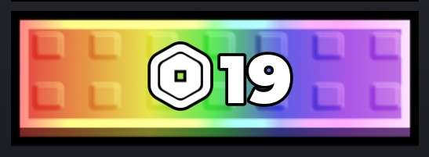

## At a glance

| | |
|---|---|
| Provenance | template with full source |
| Screens | 1 ScreenGuis, 241 GUI objects → **14 screenshots** |
| Models (.rbxm) | 10201 models, 0 model sets, 1 VFX sets |
| Lua builders (.lua) | 12 UI screens, 0 animation packs, 3 audio packs |
| Code | 88 scripts, 14,049 lines |
| Asset ids | 0 animations, 289 sounds |
| Safety scan | 0 HIGH / 1 MED flags ([flags.txt](source/flags.txt)) |

**Fonts:** `GothamSSm Heavy`×54, `SourceSansPro Regular`×30, `GothamSSm ExtraBold`×12, `font asset 11702779517 Heavy`×8, `FredokaOne Regular`×3

## UI screenshots

Captured in Studio from the place's own ScreenGuis (scripts stripped). Each panel was opened on its own; click a thumbnail for the full 1519×886 frame. Runtime-filled lists (shop items, inventories) show their template state.

### Shop & Robux store

<table>
<tr>
<td width="33%" valign="top"><a href="screenshots/03_TrailTemplate__Robux.jpg">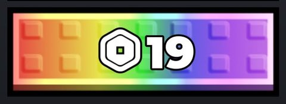</a> <b>TrailTemplate</b> › Buttons.Robux</td>
</tr>
</table>

### Inventory / backpack / pets

<table>
<tr>
<td width="33%" valign="top"><a href="screenshots/04_TrailTemplate__Equip.jpg">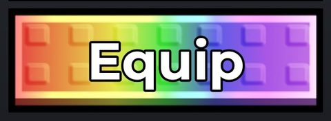</a> <b>TrailTemplate</b> › Buttons.Equip</td>
<td width="33%" valign="top"> <b>CarTemplate</b> › Buttons.EquipButton</td>
</tr>
</table>

### Quests & progression

<table>
<tr>
<td width="33%" valign="top"><a href="screenshots/10_GUI__Rebirth.jpg">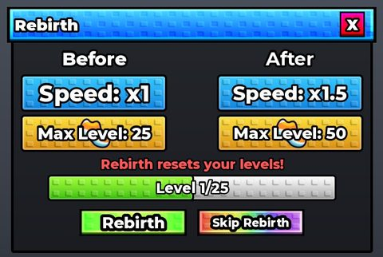</a> <b>GUI</b> › Frames.Rebirth</td>
</tr>
</table>

### Settings & menus

<table>
<tr>
<td width="33%" valign="top"><a href="screenshots/13_GUI__Settings.jpg">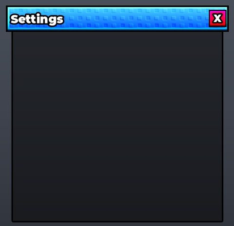</a> <b>GUI</b> › Frames.Settings</td>
</tr>
</table>

### Leaderboards & stats

<table>
<tr>
<td width="33%" valign="top"><a href="screenshots/01_LeaderboardEntry.jpg">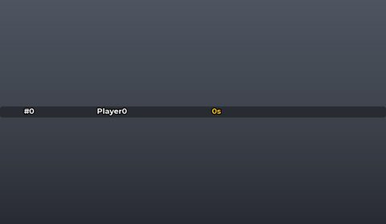</a> <b>LeaderboardEntry</b></td>
</tr>
</table>

### Admin panels

<table>
<tr>
<td width="33%" valign="top"><a href="screenshots/14_GUI__Admin.jpg">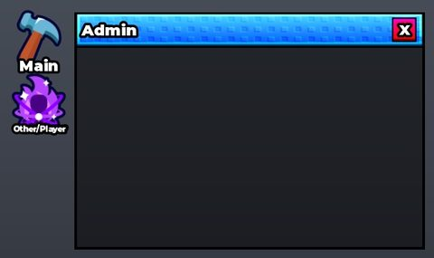</a> <b>GUI</b> › Frames.Admin</td>
</tr>
</table>

### Other

<table>
<tr>
<td width="33%" valign="top"><a href="screenshots/02_TrailTemplate.jpg">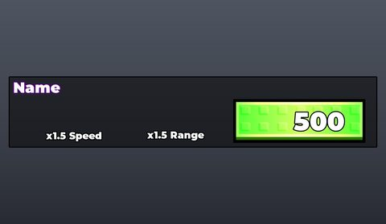</a> <b>TrailTemplate</b></td>
<td width="33%" valign="top"><a href="screenshots/05_CarTemplate.jpg">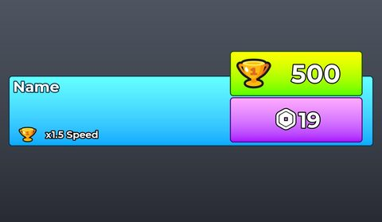</a> <b>CarTemplate</b></td>
<td width="33%" valign="top"><a href="screenshots/07_OnAndOffTemplate.jpg">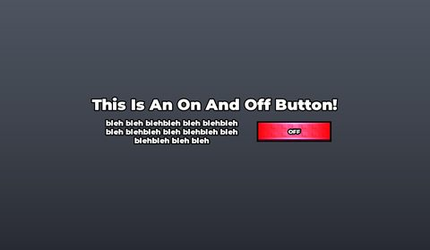</a> <b>OnAndOffTemplate</b></td>
</tr>
<tr>
<td width="33%" valign="top"><a href="screenshots/08_TextBoxTemplate.jpg">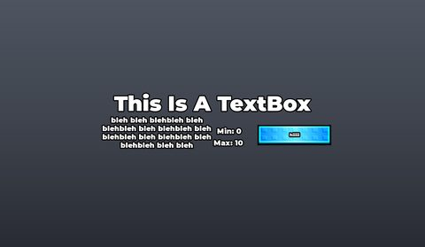</a> <b>TextBoxTemplate</b></td>
<td width="33%" valign="top"><a href="screenshots/09_GUI.jpg">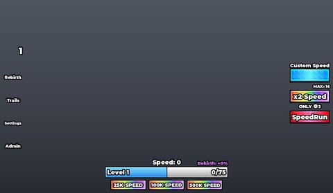</a> <b>GUI</b></td>
<td width="33%" valign="top"><a href="screenshots/11_GUI__Trails.jpg">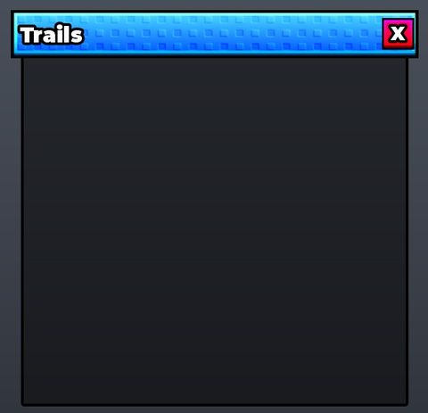</a> <b>GUI</b> › Frames.Trails</td>
</tr>
<tr>
<td width="33%" valign="top"><a href="screenshots/12_GUI__Cars.jpg">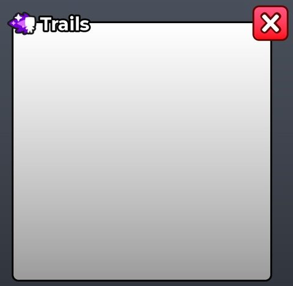</a> <b>GUI</b> › Frames.Cars</td>
</tr>
</table>

## Model previews

<table>
<tr>
<td width="25%" valign="top"><a href="models/Workspace/Treadmills/Admin.rbxm">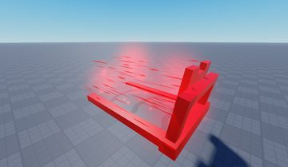</a> <b>Admin</b> <code>models/Workspace/Treadmills/Admin.rbxm</code></td>
<td width="25%" valign="top"> <b>WinsLeaderboard</b> <code>models/Workspace/Leaderboards/WinsLeaderboard.rbxm</code></td>
<td width="25%" valign="top"><a href="models/Workspace/Treadmills/Gold.rbxm">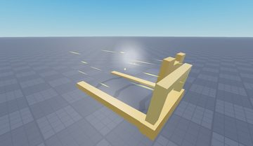</a> <b>Gold</b> <code>models/Workspace/Treadmills/Gold.rbxm</code></td>
<td width="25%" valign="top"><a href="models/Workspace/Map/TPStuff/ToRift.rbxm">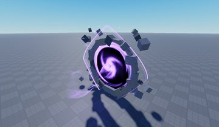</a> <b>ToRift</b> <code>models/Workspace/Map/TPStuff/ToRift.rbxm</code></td>
</tr>
<tr>
<td width="25%" valign="top"><a href="models/Workspace/Leaderboards/SpeedLeaderboard.rbxm">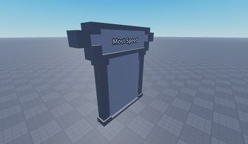</a> <b>SpeedLeaderboard</b> <code>models/Workspace/Leaderboards/SpeedLeaderboard.rbxm</code></td>
<td width="25%" valign="top"><a href="models/Workspace/Treadmills/Amethyst.rbxm">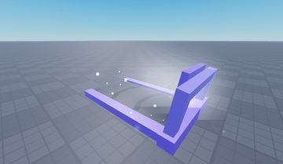</a> <b>Amethyst</b> <code>models/Workspace/Treadmills/Amethyst.rbxm</code></td>
<td width="25%" valign="top"><a href="models/Workspace/Map/TPStuff/ToMain.rbxm">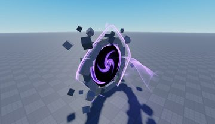</a> <b>ToMain</b> <code>models/Workspace/Map/TPStuff/ToMain.rbxm</code></td>
<td width="25%" valign="top"> <b>TimeLeaderboard</b> <code>models/Workspace/Leaderboards/TimeLeaderboard.rbxm</code></td>
</tr>
<tr>
<td width="25%" valign="top"><a href="models/Workspace/Treadmills/Diamond.rbxm">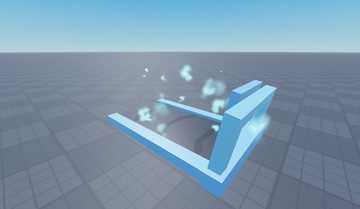</a> <b>Diamond</b> <code>models/Workspace/Treadmills/Diamond.rbxm</code></td>
<td width="25%" valign="top"> <b>bigcubey</b> <code>models/Workspace/Map/ASMR/Cubes/bigcubey.rbxm</code></td>
<td width="25%" valign="top"> <b>TimePlayedLeaderboard</b> <code>models/Workspace/Leaderboards/TimePlayedLeaderboard.rbxm</code></td>
<td width="25%" valign="top"><a href="models/Workspace/Treadmills/Basic.rbxm">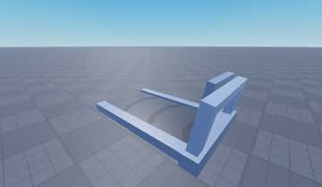</a> <b>Basic</b> <code>models/Workspace/Treadmills/Basic.rbxm</code></td>
</tr>
<tr>
<td width="25%" valign="top"><a href="models/Workspace/Map/ASMR/Cubes/bigcubey~2.rbxm">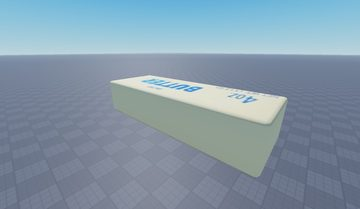</a> <b>bigcubey~2</b> <code>models/Workspace/Map/ASMR/Cubes/bigcubey~2.rbxm</code></td>
</tr>
</table>

## Notable scripts

Top-scored scripts of this game per topic (full tree in [source/scripts](source/scripts/)).

| Topic | Scripts |
|---|---|
| UI animation (tweens, hover / click, pop-ins, springs) | [`UIEffects`](source/scripts/%2B1%20Speed%20V1%20Kit/StarterCharacterScripts/UIEffects.client.lua) 359 lines [`EffectsSystem`](source/scripts/%2B1%20Speed%20V1%20Kit/ReplicatedStorage/Modules/EffectsSystem.lua) 103 lines [`HUDButtonController`](source/scripts/%2B1%20Speed%20V1%20Kit/StarterPlayerScripts/HUDButtonController.client.lua) 126 lines [`Cubes`](source/scripts/%2B1%20Speed%20V1%20Kit/StarterPlayerScripts/ASMR/Cubes.client.lua) 1830 lines [`SpeedSystem`](source/scripts/%2B1%20Speed%20V1%20Kit/StarterPlayerScripts/SpeedSystem.client.lua) 209 lines |
| UI controllers / window managers / menus | [`HUDButtonController`](source/scripts/%2B1%20Speed%20V1%20Kit/StarterPlayerScripts/HUDButtonController.client.lua) 126 lines [`FrameManager`](source/scripts/%2B1%20Speed%20V1%20Kit/ReplicatedStorage/Modules/FrameManager.lua) 90 lines [`HUDSystem`](source/scripts/%2B1%20Speed%20V1%20Kit/StarterPlayerScripts/HUDSystem.client.lua) 206 lines [`RebirthSystem`](source/scripts/%2B1%20Speed%20V1%20Kit/StarterPlayerScripts/RebirthSystem.client.lua) 182 lines [`TrailShopSystem`](source/scripts/%2B1%20Speed%20V1%20Kit/StarterPlayerScripts/TrailShopSystem.client.lua) 197 lines |
| Notifications, toasts, popups, prompts | [`NotificationManager`](source/scripts/%2B1%20Speed%20V1%20Kit/ReplicatedStorage/Modules/NotificationManager.lua) 98 lines [`PromptController`](source/scripts/%2B1%20Speed%20V1%20Kit/StarterPlayerScripts/PromptController.client.lua) 129 lines [`RebirthSystem`](source/scripts/%2B1%20Speed%20V1%20Kit/StarterPlayerScripts/RebirthSystem.client.lua) 182 lines [`EffectsSystem`](source/scripts/%2B1%20Speed%20V1%20Kit/ReplicatedStorage/Modules/EffectsSystem.lua) 103 lines [`PlayerController`](source/scripts/%2B1%20Speed%20V1%20Kit/ServerScriptService/Controllers/PlayerController.lua) 893 lines |
| Camera, cutscenes, screen shake | [`WindController`](source/scripts/%2B1%20Speed%20V1%20Kit/StarterPlayerScripts/WindController.client.lua) 139 lines |
| DataStore / player data | [`ProfileStore`](source/scripts/%2B1%20Speed%20V1%20Kit/ServerScriptService/Modules/ProfileStore.lua) 2241 lines [`LeaderboardController`](source/scripts/%2B1%20Speed%20V1%20Kit/ServerScriptService/Controllers/LeaderboardController.lua) 288 lines [`PlayerController`](source/scripts/%2B1%20Speed%20V1%20Kit/ServerScriptService/Controllers/PlayerController.lua) 893 lines |
| Monetization (dev products, game passes, receipts) | [`PlayerController`](source/scripts/%2B1%20Speed%20V1%20Kit/ServerScriptService/Controllers/PlayerController.lua) 893 lines [`MonetizationSystem`](source/scripts/%2B1%20Speed%20V1%20Kit/ReplicatedStorage/Modules/MonetizationSystem.lua) 34 lines [`TreadmillController`](source/scripts/%2B1%20Speed%20V1%20Kit/ServerScriptService/Controllers/TreadmillController.lua) 311 lines |
| RNG, eggs, gacha, rarity rolls, pets | [`Cubes`](source/scripts/%2B1%20Speed%20V1%20Kit/StarterPlayerScripts/ASMR/Cubes.client.lua) 1830 lines |
| Combat, weapons, hitboxes, abilities | [`HitboxClass`](source/scripts/%2B1%20Speed%20V1%20Kit/ReplicatedStorage/Modules/HitboxClass.lua) 893 lines [`PlayerController`](source/scripts/%2B1%20Speed%20V1%20Kit/ServerScriptService/Controllers/PlayerController.lua) 893 lines |
| Character movement (sprint, dash, double jump, slide) | [`Cubes`](source/scripts/%2B1%20Speed%20V1%20Kit/StarterPlayerScripts/ASMR/Cubes.client.lua) 1830 lines |
| Tycoon / plots / bases / building | [`TreadmillController`](source/scripts/%2B1%20Speed%20V1%20Kit/ServerScriptService/Controllers/TreadmillController.lua) 311 lines [`HUDSystem`](source/scripts/%2B1%20Speed%20V1%20Kit/StarterPlayerScripts/HUDSystem.client.lua) 206 lines [`WinButtonController`](source/scripts/%2B1%20Speed%20V1%20Kit/ServerScriptService/Controllers/WinButtonController.lua) 94 lines [`PlayerController`](source/scripts/%2B1%20Speed%20V1%20Kit/ServerScriptService/Controllers/PlayerController.lua) 893 lines |
| Leaderboards & stats | [`LeaderboardController`](source/scripts/%2B1%20Speed%20V1%20Kit/ServerScriptService/Controllers/LeaderboardController.lua) 288 lines |
| Sound & music | [`Cubes`](source/scripts/%2B1%20Speed%20V1%20Kit/StarterPlayerScripts/ASMR/Cubes.client.lua) 1830 lines [`KeySoundHandler`](source/scripts/%2B1%20Speed%20V1%20Kit/StarterPlayerScripts/ASMR/KeySoundHandler.client.lua) 24 lines |
| Utility modules (number format, signals, tables, timers) | [`NumberFormatter`](source/scripts/%2B1%20Speed%20V1%20Kit/ReplicatedStorage/Modules/NumberFormatter.lua) 55 lines [`EffectsSystem`](source/scripts/%2B1%20Speed%20V1%20Kit/ReplicatedStorage/Modules/EffectsSystem.lua) 103 lines [`LeaderboardController`](source/scripts/%2B1%20Speed%20V1%20Kit/ServerScriptService/Controllers/LeaderboardController.lua) 288 lines [`SpeedRunController`](source/scripts/%2B1%20Speed%20V1%20Kit/ServerScriptService/Controllers/SpeedRunController.lua) 283 lines |

### In the curated script library

- [Spectate client (follow cam)](../../Scripts/05-Camera-Cutscene/SpectateFollowCam__needoh-escape.lua) — Clean spectate: freeze input, lerp-follow target, survive respawns, full restore.
- [Fastest-time board (inverted ms)](../../Scripts/15-Leaderboards/LeaderboardController-FastestTime__needoh-escape.lua) — Several boards from one config, including a best-time board that stores MAX_MS - timeMs so a descending sort shows the fastest run first, plus mm:ss.mmm and 1h 2m 3s formatters.
- [Success/Error toast manager](../../Scripts/03-Notifications/NotificationManager__needoh-escape.lua) — Tiny Success/Error toast module: clones a template, recolors stroke + gradient by type, fades in, plays a sound, fades out after 2s; never yields the caller.
- [Custom ProximityPrompt UI](../../Scripts/03-Notifications/CustomProximityPrompt__needoh-escape.lua) — Custom-style ProximityPrompt UI: billboard per prompt, shows key name on PC or tap icon on mobile, tap/click/hold all forward to InputHoldBegin/End.
- [HUD panel pop (UIScale)](../../Scripts/02-UI-Framework/HUDButtonController__needoh-escape.lua) — HUD buttons pop panels open/closed by tweening a UIScale, one panel at a time, reset on respawn.
- [Number abbreviation (adaptive decimals)](../../Scripts/19-Utility/NumberFormatter-Adaptive__needoh-escape.lua) — Abbreviates numbers with a 100+ entry suffix list (k, M, B ... Ce), 2/1/0 decimals depending on size, trailing zeros stripped, %.2e fallback past the list.

## Folders

| Folder | What |
|---|---|
| `screenshots/` | full frames; `crops/` = the panel only; `models/` = 3D previews; `thumbs/` = gallery thumbnails |
| `ui/` | every screen as a Lua builder (`require(module)()` returns the ScreenGui); `_StarterGui-all.lua` builds every StarterGui screen |
| `models/` | every model as .rbxm (the only .rbxm files), mirroring the place tree, scripts removed |
| `map/` | `workspace.rbxm` (the map as a model), `lighting.lua` (sky + post effects), `materials.lua`, `Environment.lua` |
| `animations/`, `audio/` | KeyframeSequence / Sound builders (.lua), `AnimationIds.lua`, `Sounds.lua` |
| `source/` | all scripts as .luau, `tree.txt`, `ui.txt`, `remotes.txt`, `assets.txt`, `flags.txt` |
