# One Piece: The Age Of Pirates

> 🥊 **Fighting** · anime RPG · source file `One Piece - The Age Of Pirates.rbxl`

[⬅ Back to the catalog](../../README.md) · [Assets inventory](ASSETS.md) · [Style numbers](reference.md) · [Scripts](source/scripts/) · [Code analysis](source/README.md)

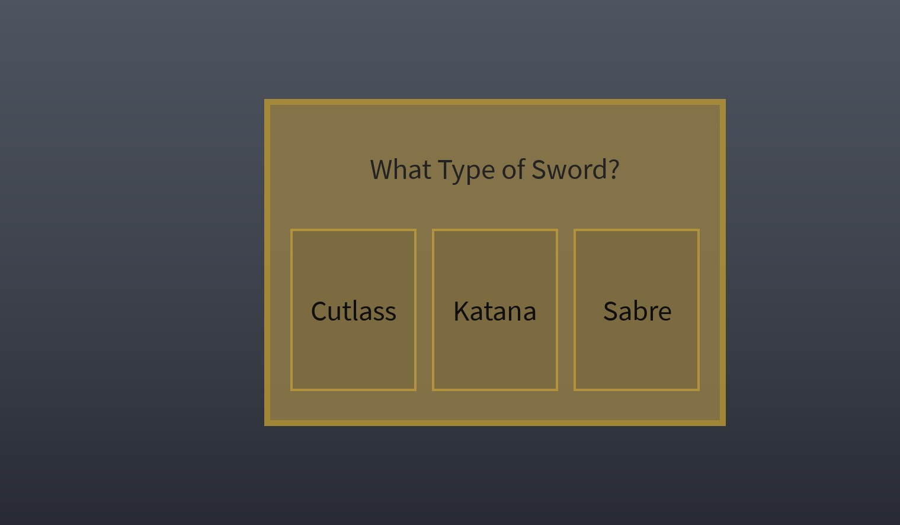

## At a glance

| | |
|---|---|
| Provenance | template with full source |
| Screens | 2 ScreenGuis, 10 GUI objects → **12 screenshots** |
| Models (.rbxm) | 116 models, 1 model sets, 0 VFX sets |
| Lua builders (.lua) | 11 UI screens, 0 animation packs, 2 audio packs |
| Code | 545 scripts, 25,770 lines |
| Asset ids | 0 animations, 24 sounds |
| Safety scan | 3 HIGH / 1 MED flags ([flags.txt](source/flags.txt)) |

## UI screenshots

Captured in Studio from the place's own ScreenGuis (scripts stripped). Each panel was opened on its own; click a thumbnail for the full 1519×886 frame. Runtime-filled lists (shop items, inventories) show their template state.

### HUD & currency

<table>
<tr>
<td width="33%" valign="top"><a href="screenshots/03_MainGui.jpg">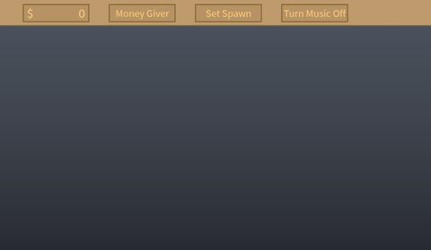</a> <b>MainGui</b></td>
<td width="33%" valign="top"><a href="screenshots/04_Stamina.jpg">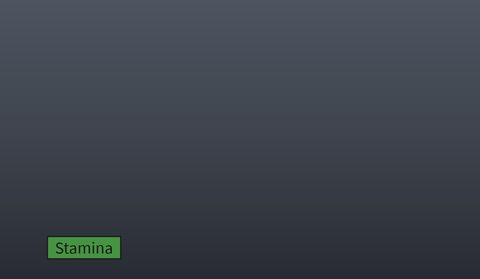</a> <b>Stamina</b></td>
<td width="33%" valign="top"><a href="screenshots/08_MoneyGiver.jpg">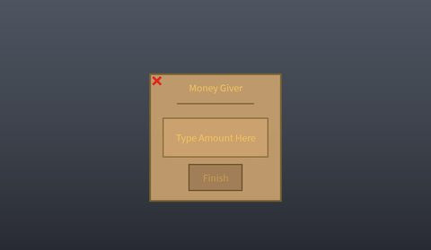</a> <b>MoneyGiver</b></td>
</tr>
<tr>
<td width="33%" valign="top"> <b>NotEnoughMoney</b></td>
</tr>
</table>

### Other

<table>
<tr>
<td width="33%" valign="top"><a href="screenshots/01_WeaponGui.jpg">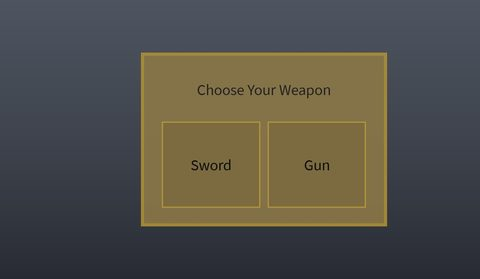</a> <b>WeaponGui</b></td>
<td width="33%" valign="top"><a href="screenshots/02_JailTime.jpg">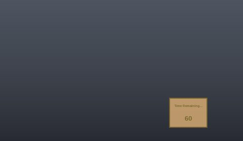</a> <b>JailTime</b></td>
<td width="33%" valign="top"><a href="screenshots/05_AlreadyMastered.jpg">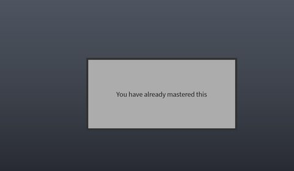</a> <b>AlreadyMastered</b></td>
</tr>
<tr>
<td width="33%" valign="top"><a href="screenshots/06_HakiGui.jpg">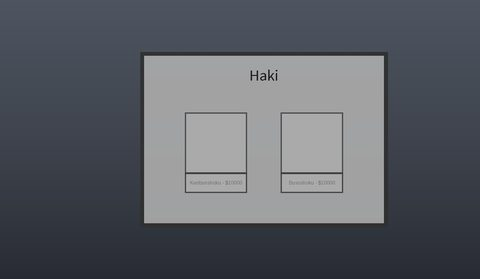</a> <b>HakiGui</b></td>
<td width="33%" valign="top"> <b>HaoGui</b></td>
<td width="33%" valign="top"><a href="screenshots/10_RokushikiGui.jpg">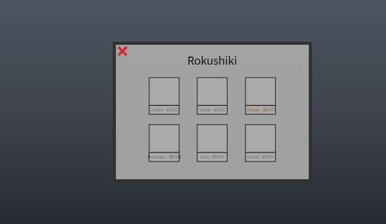</a> <b>RokushikiGui</b></td>
</tr>
<tr>
<td width="33%" valign="top"><a href="screenshots/11_SavingLocation.jpg">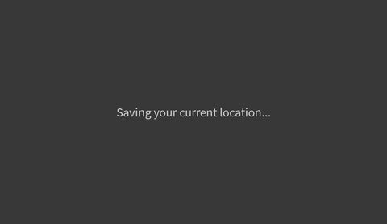</a> <b>SavingLocation</b></td>
<td width="33%" valign="top"><a href="screenshots/12_SwordGui.jpg">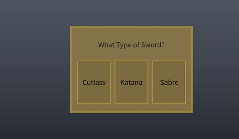</a> <b>SwordGui</b></td>
</tr>
</table>

## Model previews

<table>
<tr>
<td width="25%" valign="top"><a href="models/Lighting/LightSword.rbxm">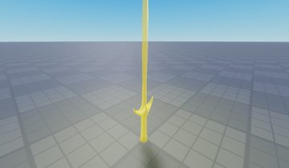</a> <b>LightSword</b> <code>models/Lighting/LightSword.rbxm</code></td>
<td width="25%" valign="top"><a href="models/Lighting/Boats1/Caravel.rbxm">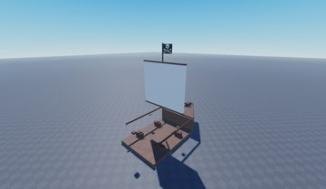</a> <b>Caravel</b> <code>models/Lighting/Boats1/Caravel.rbxm</code></td>
<td width="25%" valign="top"><a href="models/Lighting/FlameFruit.rbxm">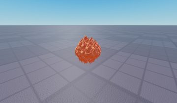</a> <b>FlameFruit</b> <code>models/Lighting/FlameFruit.rbxm</code></td>
<td width="25%" valign="top"><a href="models/Lighting/Weapons/Cutlass.rbxm">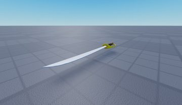</a> <b>Cutlass</b> <code>models/Lighting/Weapons/Cutlass.rbxm</code></td>
</tr>
<tr>
<td width="25%" valign="top"><a href="models/Lighting/Boats1/Sloop.rbxm">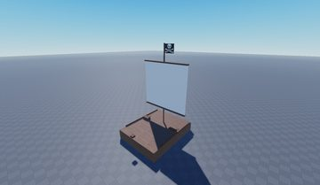</a> <b>Sloop</b> <code>models/Lighting/Boats1/Sloop.rbxm</code></td>
<td width="25%" valign="top"><a href="models/Lighting/LeopardFruit.rbxm">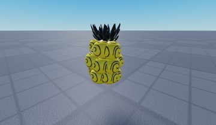</a> <b>LeopardFruit</b> <code>models/Lighting/LeopardFruit.rbxm</code></td>
<td width="25%" valign="top"><a href="models/Lighting/GasGas.rbxm">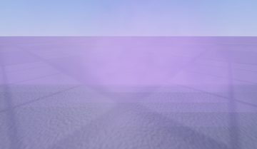</a> <b>GasGas</b> <code>models/Lighting/GasGas.rbxm</code></td>
<td width="25%" valign="top"><a href="models/Lighting/Weapons/Katana.rbxm">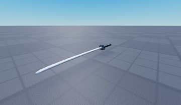</a> <b>Katana</b> <code>models/Lighting/Weapons/Katana.rbxm</code></td>
</tr>
<tr>
<td width="25%" valign="top"><a href="models/Lighting/Boats1/Dinghy.rbxm">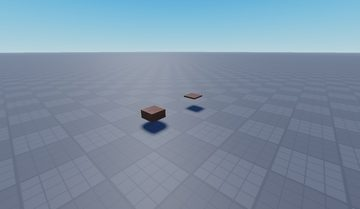</a> <b>Dinghy</b> <code>models/Lighting/Boats1/Dinghy.rbxm</code></td>
<td width="25%" valign="top"><a href="models/Lighting/ChillyFruit.rbxm">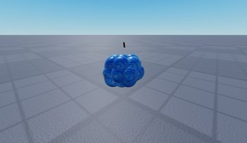</a> <b>ChillyFruit</b> <code>models/Lighting/ChillyFruit.rbxm</code></td>
<td width="25%" valign="top"><a href="models/Lighting/VenomVenom.rbxm">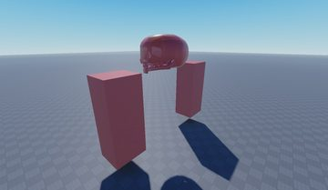</a> <b>VenomVenom</b> <code>models/Lighting/VenomVenom.rbxm</code></td>
<td width="25%" valign="top"><a href="models/Lighting/Weapons/Sabre.rbxm">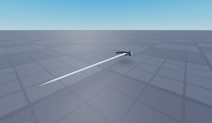</a> <b>Sabre</b> <code>models/Lighting/Weapons/Sabre.rbxm</code></td>
</tr>
<tr>
<td width="25%" valign="top"><a href="models/Lighting/BarrierFruit.rbxm">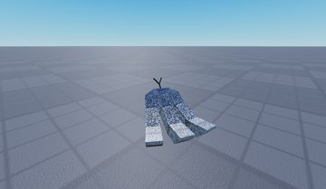</a> <b>BarrierFruit</b> <code>models/Lighting/BarrierFruit.rbxm</code></td>
</tr>
</table>

## Notable scripts

Top-scored scripts of this game per topic (full tree in [source/scripts](source/scripts/)).

| Topic | Scripts |
|---|---|
| Combat, weapons, hitboxes, abilities | [`Firedamage`](source/scripts/Lighting/BubbleBubble/BubbleBlast/Firedamage.server.lua) 41 lines [`Firedamage`](source/scripts/Lighting/BubbleBubble/BubbleWave/Firedamage.server.lua) 41 lines [`Firedamage`](source/scripts/Lighting/CageCage/CageArm/Firedamage.server.lua) 41 lines [`Firedamage`](source/scripts/Lighting/CageCage/CageTrap/Union/Firedamage.server.lua) 41 lines [`Firedamage`](source/scripts/Lighting/ChillyChilly/IceAge/Firedamage.server.lua) 43 lines |
| Character movement (sprint, dash, double jump, slide) | [`Run`](source/scripts/StarterPack/Run.client.lua) 45 lines |
| Leaderboards & stats | [`Leaderboard`](source/scripts/Workspace/PlayerAddedStuff/Leaderboard.server.lua) 23 lines |
| Sound & music | [`MusicScript`](source/scripts/StarterGui/MainGui/Music/MusicScript.client.lua) 125 lines |

## ⚠️ Safety

HIGH flags (backdoors, `require(id)`, `loadstring`, webhooks). Review or delete before reusing:

- `scripts/Workspace/Kohl's Admin Commands V2.server.lua`
- `scripts/Workspace/Kohl's Admin Commands V2/LocalScriptBase.client.lua`
- `scripts/Workspace/Kohl's Admin Commands V2/ScriptBase.server.lua`

## Folders

| Folder | What |
|---|---|
| `screenshots/` | full frames; `crops/` = the panel only; `models/` = 3D previews; `thumbs/` = gallery thumbnails |
| `ui/` | every screen as a Lua builder (`require(module)()` returns the ScreenGui); `_StarterGui-all.lua` builds every StarterGui screen |
| `models/` | every model as .rbxm (the only .rbxm files), mirroring the place tree, scripts removed |
| `map/` | `workspace.rbxm` (the map as a model), `lighting.lua` (sky + post effects), `materials.lua`, `Environment.lua` |
| `animations/`, `audio/` | KeyframeSequence / Sound builders (.lua), `AnimationIds.lua`, `Sounds.lua` |
| `source/` | all scripts as .luau, `tree.txt`, `ui.txt`, `remotes.txt`, `assets.txt`, `flags.txt` |
