# Pass The Bomb (Tower)

> 🎉 **Party** · party elimination · source file `🔥 Pyxx Pass The Bomb (Tower).rbxl`

[⬅ Back to the catalog](../../README.md) · [Assets inventory](ASSETS.md) · [Style numbers](reference.md) · [Scripts](source/scripts/) · [Code analysis](source/README.md)

## At a glance

| | |
|---|---|
| Provenance | template with full source |
| Screens | 3 ScreenGuis, 57 GUI objects → **10 screenshots** |
| Models (.rbxm) | 15 models, 4 model sets, 0 VFX sets |
| Lua builders (.lua) | 8 UI screens, 0 animation packs, 1 audio packs |
| Code | 77 scripts, 5,265 lines |
| Asset ids | 0 animations, 3 sounds |
| Safety scan | 1 HIGH / 1 MED flags ([flags.txt](source/flags.txt)) |

**Fonts:** `Balthazar Regular`×11, `GothamSSm Bold`×7, `FredokaOne Regular`×7, `GothamSSm Regular`×2, `SourceSansPro Light`×2

## UI screenshots

Captured in Studio from the place's own ScreenGuis (scripts stripped). Each panel was opened on its own; click a thumbnail for the full 1519×886 frame. Runtime-filled lists (shop items, inventories) show their template state.

### Shop & Robux store

<table>
<tr>
<td width="33%" valign="top"> <b>DonationGui</b> › PremiumFeatures</td>
</tr>
</table>

### Quests & progression

<table>
<tr>
<td width="33%" valign="top"><a href="screenshots/09_RequestsFrame.jpg">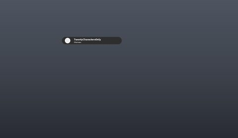</a> <b>RequestsFrame</b></td>
<td width="33%" valign="top"><a href="screenshots/10_HelpRequests.jpg">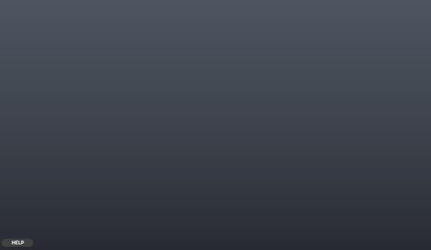</a> <b>HelpRequests</b></td>
</tr>
</table>

### Settings & menus

<table>
<tr>
<td width="33%" valign="top"><a href="screenshots/06_SettingsBar.jpg">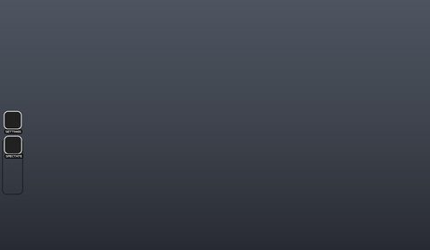</a> <b>SettingsBar</b></td>
</tr>
</table>

### Popups, notifications, prompts

<table>
<tr>
<td width="33%" valign="top"><a href="screenshots/04_DonationGui__CustomMessage.jpg">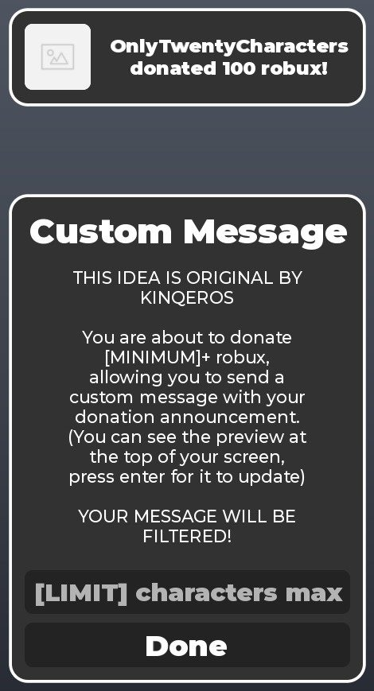</a> <b>DonationGui</b> › CustomMessage</td>
</tr>
</table>

### End of round, death, results

<table>
<tr>
<td width="33%" valign="top"><a href="screenshots/08_Death.jpg">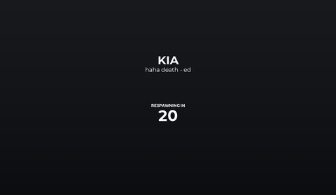</a> <b>Death</b></td>
</tr>
</table>

### HUD & currency

<table>
<tr>
<td width="33%" valign="top"><a href="screenshots/05_Main.jpg">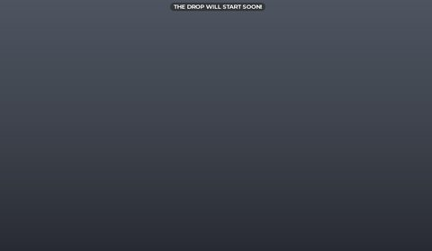</a> <b>Main</b></td>
<td width="33%" valign="top"><a href="screenshots/07_SettingsBar__MainFrame.jpg">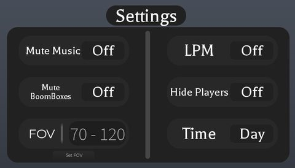</a> <b>SettingsBar</b> › MainFrame</td>
</tr>
</table>

### Other

<table>
<tr>
<td width="33%" valign="top"><a href="screenshots/01_DonationGui__Blacklisted.jpg">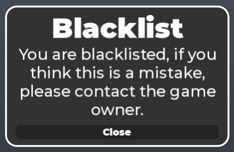</a> <b>DonationGui</b> › Blacklisted</td>
<td width="33%" valign="top"><a href="screenshots/02_DonationGui__GetBoard.jpg">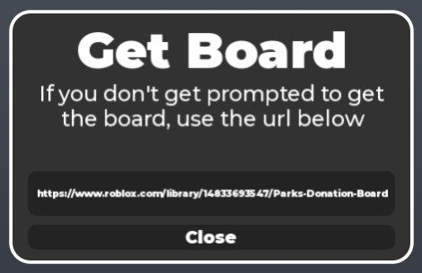</a> <b>DonationGui</b> › GetBoard</td>
</tr>
</table>

## Model previews

<table>
<tr>
<td width="25%" valign="top"><a href="models/Workspace/Park%27s%20Donation%20Board/Boards.rbxm">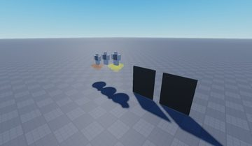</a> <b>Boards</b> <code>models/Workspace/Park's Donation Board/Boards.rbxm</code></td>
<td width="25%" valign="top"><a href="models/Workspace/ThreeDTextObject.rbxm">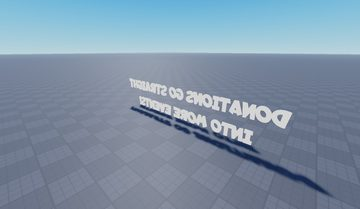</a> <b>ThreeDTextObject</b> <code>models/Workspace/ThreeDTextObject.rbxm</code></td>
<td width="25%" valign="top"><a href="models/Workspace/Nihal%27s%20Credits%20Board.rbxm">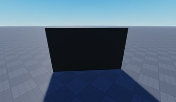</a> <b>Nihal's Credits Board</b> <code>models/Workspace/Nihal's Credits Board.rbxm</code></td>
<td width="25%" valign="top"><a href="models/Workspace/ThreeDTextObject~2.rbxm">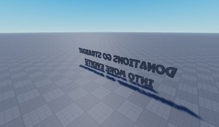</a> <b>ThreeDTextObject~2</b> <code>models/Workspace/ThreeDTextObject~2.rbxm</code></td>
</tr>
<tr>
<td width="25%" valign="top"><a href="models/ServerStorage/lolplatform/Platform__x200.rbxm">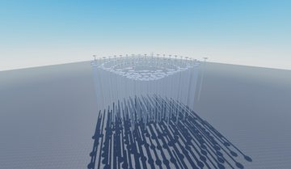</a> <b>Platform__x200</b> <code>models/ServerStorage/lolplatform/Platform__x200.rbxm</code></td>
<td width="25%" valign="top"><a href="models/ServerStorage/lolplatform/Platform.rbxm">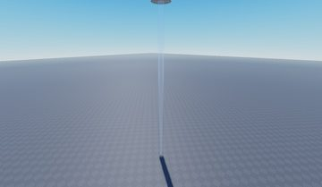</a> <b>Platform</b> <code>models/ServerStorage/lolplatform/Platform.rbxm</code></td>
<td width="25%" valign="top"><a href="models/Workspace/Host.rbxm">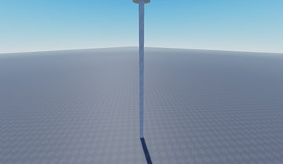</a> <b>Host</b> <code>models/Workspace/Host.rbxm</code></td>
<td width="25%" valign="top"><a href="models/Workspace/Part~2.rbxm">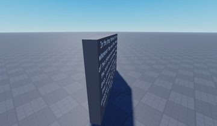</a> <b>Part~2</b> <code>models/Workspace/Part~2.rbxm</code></td>
</tr>
<tr>
<td width="25%" valign="top"><a href="models/Workspace/roof.rbxm">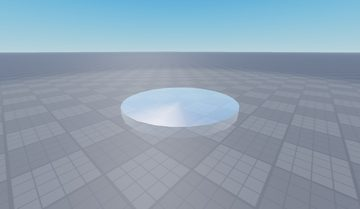</a> <b>roof</b> <code>models/Workspace/roof.rbxm</code></td>
<td width="25%" valign="top"><a href="models/Workspace/SpawnLocation.rbxm">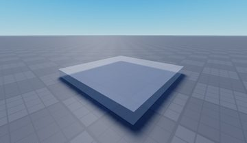</a> <b>SpawnLocation</b> <code>models/Workspace/SpawnLocation.rbxm</code></td>
</tr>
</table>

## Notable scripts

Top-scored scripts of this game per topic (full tree in [source/scripts](source/scripts/)).

| Topic | Scripts |
|---|---|
| UI animation (tweens, hover / click, pop-ins, springs) | [`Core`](source/scripts/ServerScriptService/HelpSystem/HelpRequests/Core.client.lua) 227 lines [`TweenThings`](source/scripts/StarterGui/SettingsBar/Bar/SpectateButton/TweenThings.client.lua) 28 lines [`TweenThings`](source/scripts/StarterGui/SettingsBar/Bar/SettingsButton/TweenThings.client.lua) 14 lines |
| UI controllers / window managers / menus | [`Core`](source/scripts/ServerScriptService/HelpSystem/HelpRequests/Core.client.lua) 227 lines |
| Notifications, toasts, popups, prompts | [`HelpSystem`](source/scripts/ServerScriptService/HelpSystem.server.lua) 152 lines |
| Loading / intro screens | [`LocalScript`](source/scripts/ReplicatedFirst/LocalScript.client.lua) 10 lines |
| Camera, cutscenes, screen shake | [`LocalScript`](source/scripts/StarterGui/SettingsBar/MainFrame/FOV/FOVConfig/SetFOV/Button/LocalScript.client.lua) 461 lines |
| RNG, eggs, gacha, rarity rolls, pets | [`Main`](source/scripts/ServerScriptService/Main.server.lua) 91 lines |
| Leaderboards & stats | [`Leaderstats`](source/scripts/Workspace/Leaderstats.server.lua) 32 lines |
| Admin panels & commands | [`CustomCommands`](source/scripts/ServerScriptService/CustomCommands.server.lua) 69 lines |

## ⚠️ Safety

HIGH flags (backdoors, `require(id)`, `loadstring`, webhooks). Review or delete before reusing:

- `scripts/Workspace/Park's Donation Board/Loader.server.lua`

## Folders

| Folder | What |
|---|---|
| `screenshots/` | full frames; `crops/` = the panel only; `models/` = 3D previews; `thumbs/` = gallery thumbnails |
| `ui/` | every screen as a Lua builder (`require(module)()` returns the ScreenGui); `_StarterGui-all.lua` builds every StarterGui screen |
| `models/` | every model as .rbxm (the only .rbxm files), mirroring the place tree, scripts removed |
| `map/` | `workspace.rbxm` (the map as a model), `lighting.lua` (sky + post effects), `materials.lua`, `Environment.lua` |
| `animations/`, `audio/` | KeyframeSequence / Sound builders (.lua), `AnimationIds.lua`, `Sounds.lua` |
| `source/` | all scripts as .luau, `tree.txt`, `ui.txt`, `remotes.txt`, `assets.txt`, `flags.txt` |
