# Pet RNG

> 🎲 **RNG** · RNG / pet rolling · source file `Pet_RNG_Uncopylocked (2).rbxl`

[⬅ Back to the catalog](../../README.md) · [Assets inventory](ASSETS.md) · [Style numbers](reference.md) · [Scripts](source/scripts/) · [Code analysis](source/README.md)

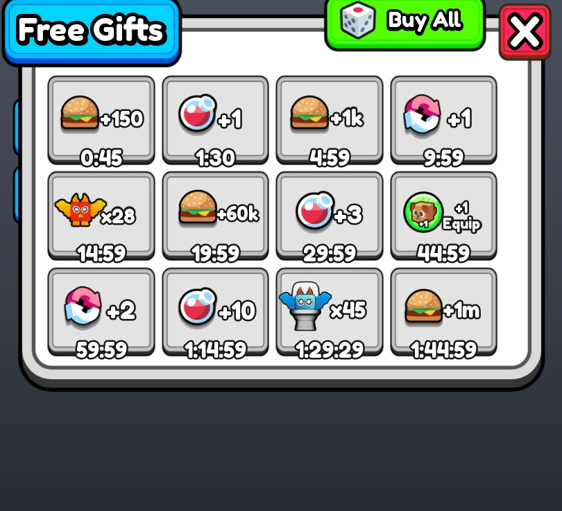

## At a glance

| | |
|---|---|
| Provenance | template with full source |
| Screens | 4 ScreenGuis, 430 GUI objects → **10 screenshots** |
| Models (.rbxm) | 491 models, 60 model sets, 0 VFX sets |
| Lua builders (.lua) | 9 UI screens, 0 animation packs, 1 audio packs |
| Code | 199 scripts, 23,133 lines |
| Asset ids | 29 animations, 7 sounds |
| Safety scan | 4 HIGH / 1 MED flags ([flags.txt](source/flags.txt)) |

**Fonts:** `FredokaOne Regular`×183

## UI screenshots

Captured in Studio from the place's own ScreenGuis (scripts stripped). Each panel was opened on its own; click a thumbnail for the full 1519×886 frame. Runtime-filled lists (shop items, inventories) show their template state.

### Shop & Robux store

<table>
<tr>
<td width="33%" valign="top"><a href="screenshots/05_GUI__Shop.jpg">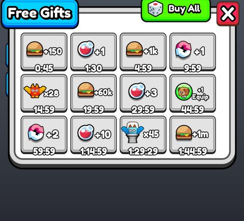</a> <b>GUI</b> › Frames.Shop</td>
</tr>
</table>

### Inventory / backpack / pets

<table>
<tr>
<td width="33%" valign="top"><a href="screenshots/04_GUI__Inventory.jpg">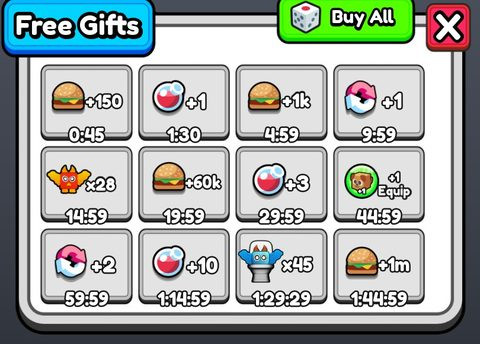</a> <b>GUI</b> › Frames.Inventory</td>
</tr>
</table>

### Rewards, daily, spin, codes

<table>
<tr>
<td width="33%" valign="top"><a href="screenshots/10_GUI__SpinFrame.jpg">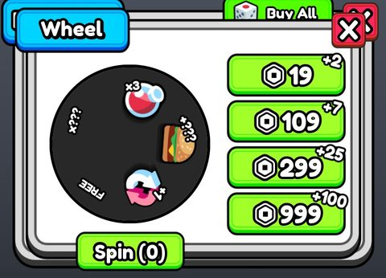</a> <b>GUI</b> › Frames.SpinFrame</td>
<td width="33%" valign="top"><a href="screenshots/11_GUI__Codes.jpg">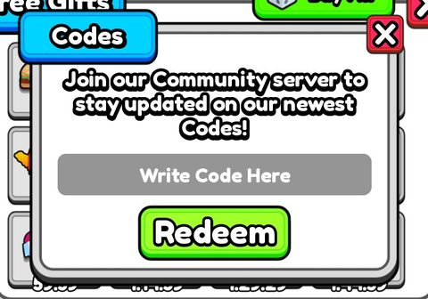</a> <b>GUI</b> › Frames.Codes</td>
</tr>
</table>

### Settings & menus

<table>
<tr>
<td width="33%" valign="top"><a href="screenshots/12_GUI__Settings.jpg">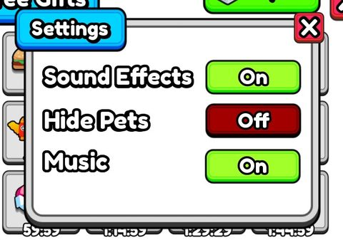</a> <b>GUI</b> › Frames.Settings</td>
</tr>
</table>

### Loading & intro

<table>
<tr>
<td width="33%" valign="top"><a href="screenshots/01_Loading.jpg">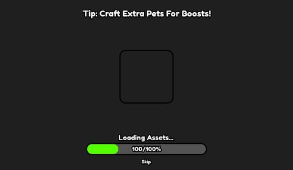</a> <b>Loading</b></td>
</tr>
</table>

### Crafting, fusing, machines

<table>
<tr>
<td width="33%" valign="top"><a href="screenshots/06_GUI__Craft.jpg">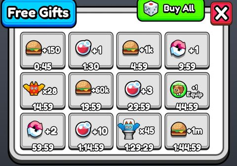</a> <b>GUI</b> › Frames.Craft</td>
</tr>
</table>

### Other

<table>
<tr>
<td width="33%" valign="top"><a href="screenshots/02_GUI.jpg">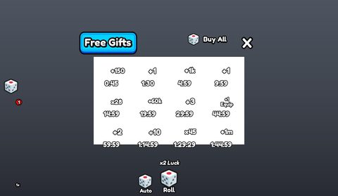</a> <b>GUI</b></td>
<td width="33%" valign="top"><a href="screenshots/03_GUI__RollFrame.jpg">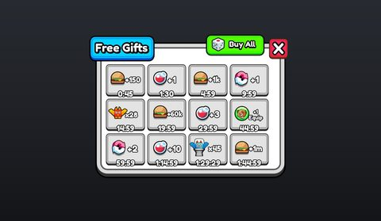</a> <b>GUI</b> › RollFrame</td>
<td width="33%" valign="top"><a href="screenshots/13_GUI__RaceNoti.jpg">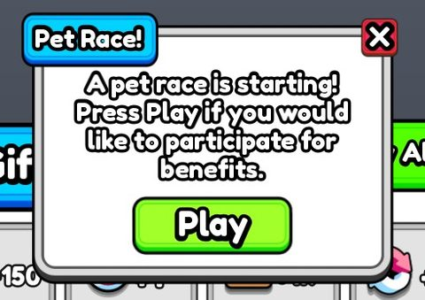</a> <b>GUI</b> › Race UI.RaceNoti</td>
</tr>
</table>

## Model previews

<table>
<tr>
<td width="25%" valign="top"><a href="models/ReplicatedStorage/Pets/Cloud%20King.rbxm">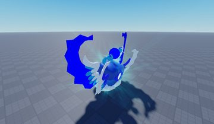</a> <b>Cloud King</b> <code>models/ReplicatedStorage/Pets/Cloud King.rbxm</code></td>
<td width="25%" valign="top"><a href="models/Workspace/Boards.rbxm">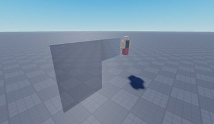</a> <b>Boards</b> <code>models/Workspace/Boards.rbxm</code></td>
<td width="25%" valign="top"><a href="models/Workspace/Main%20Map/Interactions/Epic%20Chest.rbxm">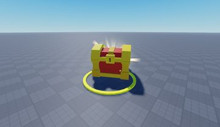</a> <b>Epic Chest</b> <code>models/Workspace/Main Map/Interactions/Epic Chest.rbxm</code></td>
<td width="25%" valign="top"><a href="models/Workspace/Cave%20Map/Crystal%20Pack__x23.rbxm">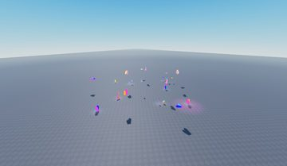</a> <b>Crystal Pack__x23</b> <code>models/Workspace/Cave Map/Crystal Pack__x23.rbxm</code></td>
</tr>
<tr>
<td width="25%" valign="top"><a href="models/Workspace/ChristmasLights.rbxm">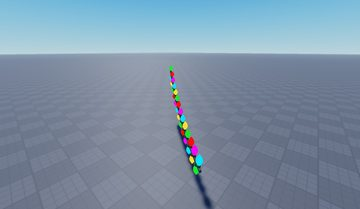</a> <b>ChristmasLights</b> <code>models/Workspace/ChristmasLights.rbxm</code></td>
<td width="25%" valign="top"><a href="models/Workspace/Meshes_portallbs123_Plane.005.rbxm">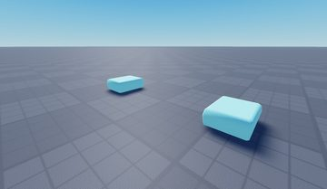</a> <b>Meshes_portallbs123_Plane.005</b> <code>models/Workspace/Meshes_portallbs123_Plane.005.rbxm</code></td>
<td width="25%" valign="top"><a href="models/Workspace/CavePortal.rbxm">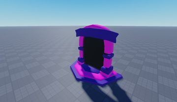</a> <b>CavePortal</b> <code>models/Workspace/CavePortal.rbxm</code></td>
<td width="25%" valign="top"><a href="models/ReplicatedStorage/Pets/Watermelon%20Demon.rbxm">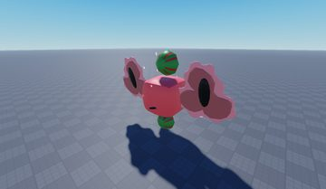</a> <b>Watermelon Demon</b> <code>models/ReplicatedStorage/Pets/Watermelon Demon.rbxm</code></td>
</tr>
<tr>
<td width="25%" valign="top"><a href="models/Workspace/Boards~2.rbxm">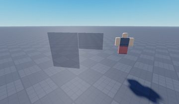</a> <b>Boards~2</b> <code>models/Workspace/Boards~2.rbxm</code></td>
<td width="25%" valign="top"><a href="models/Workspace/Main%20Map/Trees/Model.rbxm">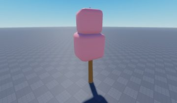</a> <b>Model</b> <code>models/Workspace/Main Map/Trees/Model.rbxm</code></td>
<td width="25%" valign="top"><a href="models/Workspace/Meshes_portallbs123_Plane.005~2.rbxm">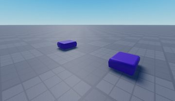</a> <b>Meshes_portallbs123_Plane.005~2</b> <code>models/Workspace/Meshes_portallbs123_Plane.005~2.rbxm</code></td>
</tr>
</table>

## Notable scripts

Top-scored scripts of this game per topic (full tree in [source/scripts](source/scripts/)).

| Topic | Scripts |
|---|---|
| UI animation (tweens, hover / click, pop-ins, springs) | [`ButtonAnimations`](source/scripts/StarterPlayer/StarterPlayerScripts/Engine/UI/ButtonAnimations.client.lua) 102 lines [`UiModule`](source/scripts/ReplicatedStorage/Engine/Modules/UiModule.lua) 101 lines [`Transition`](source/scripts/ReplicatedStorage/Engine/Modules/Transition.lua) 36 lines [`RollHandler`](source/scripts/StarterPlayer/StarterPlayerScripts/Engine/UI/RollHandler.client.lua) 275 lines [`NotificationModule`](source/scripts/ReplicatedStorage/Engine/Modules/NotificationModule.lua) 45 lines |
| UI controllers / window managers / menus | [`SoftShutdownUI`](source/scripts/ServerScriptService/QuentySoftShutdown/src/Client/SoftShutdownUI.lua) 247 lines [`RollHandler`](source/scripts/StarterPlayer/StarterPlayerScripts/Engine/UI/RollHandler.client.lua) 275 lines [`ToggleUI`](source/scripts/ReplicatedStorage/Engine/Modules/ToggleUI.lua) 30 lines [`ButtonAnimations`](source/scripts/StarterPlayer/StarterPlayerScripts/Engine/UI/ButtonAnimations.client.lua) 102 lines |
| Notifications, toasts, popups, prompts | [`NotificationModule`](source/scripts/ReplicatedStorage/Engine/Modules/NotificationModule.lua) 45 lines [`Luck`](source/scripts/ReplicatedStorage/Engine/Modules/Luck.lua) 365 lines [`Gift`](source/scripts/StarterPlayer/StarterPlayerScripts/Engine/UI/Gift.client.lua) 126 lines [`CraftSystem`](source/scripts/ReplicatedStorage/Engine/Modules/CraftSystem.lua) 363 lines [`TeleportHandler`](source/scripts/ServerScriptService/Engine/Scripts/TeleportHandler.server.lua) 106 lines |
| Loading / intro screens | [`LoadingClient`](source/scripts/ReplicatedFirst/LoadingClient.client.lua) 60 lines |
| DataStore / player data | [`DataManager`](source/scripts/ServerScriptService/Engine/Scripts/Data/DataManager.lua) 61 lines |
| Monetization (dev products, game passes, receipts) | [`Shop`](source/scripts/StarterPlayer/StarterPlayerScripts/Engine/UI/Shop.client.lua) 43 lines [`RollHandler`](source/scripts/StarterPlayer/StarterPlayerScripts/Engine/UI/RollHandler.client.lua) 275 lines [`Gift`](source/scripts/StarterPlayer/StarterPlayerScripts/Engine/UI/Gift.client.lua) 126 lines |
| RNG, eggs, gacha, rarity rolls, pets | [`RollHandler`](source/scripts/StarterPlayer/StarterPlayerScripts/Engine/UI/RollHandler.client.lua) 275 lines [`RollHandler`](source/scripts/ServerScriptService/Engine/Scripts/RollHandler.server.lua) 75 lines [`Roll`](source/scripts/ReplicatedStorage/Engine/Modules/Roll.lua) 24 lines [`Pets`](source/scripts/ReplicatedStorage/DataModules/Pets.lua) 60 lines [`PetSystem`](source/scripts/ReplicatedStorage/Engine/Modules/PetSystem.lua) 169 lines |
| Leaderboards & stats | [`Leaderstats`](source/scripts/ServerScriptService/Engine/Scripts/Data/DataManager/Leaderstats.lua) 20 lines |
| Daily rewards, quests, codes, playtime | [`Codes`](source/scripts/StarterPlayer/StarterPlayerScripts/Engine/UI/Codes.client.lua) 61 lines |
| Utility modules (number format, signals, tables, timers) | [`AbbreviateModule`](source/scripts/ReplicatedStorage/Engine/Modules/AbbreviateModule.lua) 68 lines [`PetSystem`](source/scripts/ReplicatedStorage/Engine/Modules/PetSystem.lua) 169 lines [`Abbreviate2`](source/scripts/ReplicatedStorage/Engine/Modules/Abbreviate2.lua) 95 lines [`Handler`](source/scripts/ServerScriptService/Engine/Scripts/LeaderboardHandler/Handler.lua) 47 lines |

### In the curated script library

- [Minimal ProfileService setup](../../Scripts/07-Data-Saving/DataManager-ProfileService-Minimal__pet-rng.lua) — The shortest correct ProfileService setup: LoadProfileAsync, AddUserId, Reconcile, ListenToRelease kick, release on leave, handle players already in game.
- [Preload progress bar with Skip](../../Scripts/04-Loading-Screens/PreloadProgressWithSkip__pet-rng.lua) — Clones a prepared Loading ScreenGui, preloads every descendant of game one by one, updates a % label and tweened bar, offers a Skip button, plays a sound when finished.
- [Minimal weighted roll](../../Scripts/09-RNG-Gacha-Pets/WeightedRoll__pet-rng.lua) — Smallest possible weighted pick: sum the weights, draw math.random()*total, walk the list until the running sum passes the draw.
- [Pet weight table (1-in-N odds)](../../Scripts/09-RNG-Gacha-Pets/PetRarityTable__pet-rng.lua) — Pet data table where each pet has a raw weight; the game shows odds as 1/(total/weight). Shows how RNG games go from 1/2 to 1/10,000,000+ by dividing tiny weights.
- [Roll reveal UI + auto-roll (client)](../../Scripts/09-RNG-Gacha-Pets/RollAnimationAutoRoll__pet-rng.lua) — Client roll button: flashes 4 fake results then the real one in a viewport, auto-roll gamepass toggle, luck applied by multiplying rare weights. WARNING: the roll happens on the client and the server trusts the pet name.
- [Rare-roll global announcement + badges](../../Scripts/09-RNG-Gacha-Pets/RollServerAnnounceBadges__pet-rng.lua) — Server side of the roll: converts weight to '1/N', awards badges at 1/100, 1/1000 ... and broadcasts very rare rolls to every server through MessagingService.
- [Pet follow with AlignPosition](../../Scripts/09-RNG-Gacha-Pets/PetFollowAlignPosition__pet-rng.lua) — Equips a pet model that follows the player using Attachment + AlignPosition/AlignOrientation, with a bobbing tween that changes speed while the player walks.
- [Simple hover/press module](../../Scripts/01-UI-Animation/ButtonHoverPressSize__pet-rng.lua) — Simple Size-based hover (1.1x) / press (0.8x) module with hover+click sounds, random icon tilt on hover, and keyboard-key press animation.
- [Screen transition + typewriter title](../../Scripts/01-UI-Animation/TransitionTypewriterFade__pet-rng.lua) — Teleport transition: fades a full-screen frame in, tweens MaxVisibleGraphemes for a typewriter title, moves the character, then fades everything out.
- [RNG roll reveal](../../Scripts/01-UI-Animation/RollHandler_RNGReveal__pet-rng.lua) — RNG roll display: flashes 4 random results with a tiny shake, then the real one with rarity colour, "1/N" chance and an expanding ring; auto-roll loop.
- [Hide/show HUD groups](../../Scripts/02-UI-Framework/HudHideShow__pet-rng.lua) — Slides the left, right and bottom HUD groups off-screen and back.
- [Side buttons toggle frames](../../Scripts/02-UI-Framework/SideButtonsAndFrames__pet-rng.lua) — Side buttons slide on hover and toggle the same-named frame; close buttons wired on every frame.

## ⚠️ Safety

HIGH flags (backdoors, `require(id)`, `loadstring`, webhooks). Review or delete before reusing:

- `scripts/Workspace/Boards/AssetLoader.server.lua`
- `scripts/Workspace/Boards/R15Loader/Loader.server.lua`
- `scripts/Workspace/Boards~2/AssetLoader.server.lua`
- `scripts/Workspace/Boards~2/R15Loader/Loader.server.lua`

## Folders

| Folder | What |
|---|---|
| `screenshots/` | full frames; `crops/` = the panel only; `models/` = 3D previews; `thumbs/` = gallery thumbnails |
| `ui/` | every screen as a Lua builder (`require(module)()` returns the ScreenGui); `_StarterGui-all.lua` builds every StarterGui screen |
| `models/` | every model as .rbxm (the only .rbxm files), mirroring the place tree, scripts removed |
| `map/` | `workspace.rbxm` (the map as a model), `lighting.lua` (sky + post effects), `materials.lua`, `Environment.lua` |
| `animations/`, `audio/` | KeyframeSequence / Sound builders (.lua), `AnimationIds.lua`, `Sounds.lua` |
| `source/` | all scripts as .luau, `tree.txt`, `ui.txt`, `remotes.txt`, `assets.txt`, `flags.txt` |
