# Pick a Side

> 🎉 **Party** · party / team minigames · source file `Pick20Side.rbxl`

[⬅ Back to the catalog](../../README.md) · [Assets inventory](ASSETS.md) · [Style numbers](reference.md) · [Scripts](source/scripts/) · [Code analysis](source/README.md)

## At a glance

| | |
|---|---|
| Provenance | copy of a live game (saveinstance / decompiled client code) |
| Screens | 34 ScreenGuis, 581 GUI objects → **21 screenshots** |
| Models (.rbxm) | 155 models, 0 model sets, 1 VFX sets |
| Lua builders (.lua) | 7 UI screens, 5 animation packs, 2 audio packs |
| Code | 440 scripts, 23,548 lines |
| Asset ids | 217 animations, 230 sounds |
| Safety scan | 1 HIGH / 3 MED flags ([flags.txt](source/flags.txt)) |

**Fonts:** `Arial Bold`×148, `SourceSansPro Regular`×74, `GothamSSm Heavy`×47, `GothamSSm Bold`×39, `Arial Regular`×26

## UI screenshots

Captured in Studio from the place's own ScreenGuis (scripts stripped). Each panel was opened on its own; click a thumbnail for the full 1519×886 frame. Runtime-filled lists (shop items, inventories) show their template state.

### Quests & progression

<table>
<tr>
<td width="33%" valign="top"><a href="screenshots/13_Gui__Orig.jpg">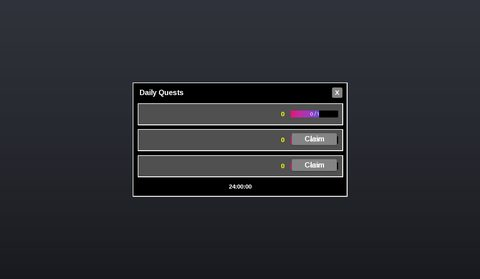</a> <b>Gui</b> › Quests.Windows.Orig</td>
</tr>
</table>

### Settings & menus

<table>
<tr>
<td width="33%" valign="top"><a href="screenshots/22_AmmoDisplay.jpg">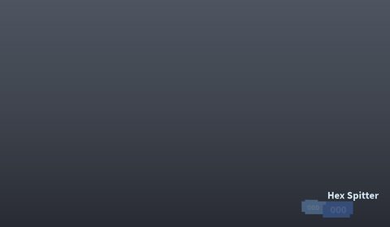</a> <b>AmmoDisplay</b></td>
</tr>
</table>

### Popups, notifications, prompts

<table>
<tr>
<td width="33%" valign="top"><a href="screenshots/04_Gui__Confirm.jpg">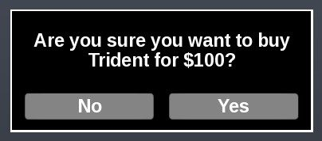</a> <b>Gui</b> › Weapons.Windows.Confirm</td>
<td width="33%" valign="top"> <b>Popups</b> › Rolling.Preview</td>
</tr>
</table>

### Leaderboards & stats

<table>
<tr>
<td width="33%" valign="top"> <b>Topbar</b></td>
</tr>
</table>

### End of round, death, results

<table>
<tr>
<td width="33%" valign="top"><a href="screenshots/03_Gui__Orig.jpg">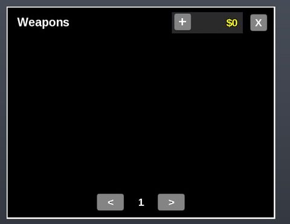</a> <b>Gui</b> › Weapons.Windows.Orig</td>
<td width="33%" valign="top"><a href="screenshots/05_Gui__Custom1.jpg">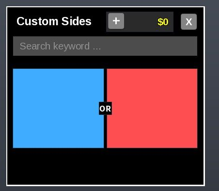</a> <b>Gui</b> › Custom.Windows.Custom1</td>
<td width="33%" valign="top"><a href="screenshots/07_Gui__Custom2.jpg">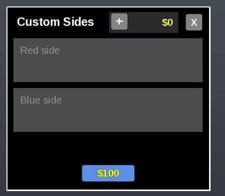</a> <b>Gui</b> › Custom.Windows.Custom2</td>
</tr>
<tr>
<td width="33%" valign="top"> <b>Gui</b> › Friends.Windows.Orig</td>
<td width="33%" valign="top"><a href="screenshots/09_Gui__Orig.jpg">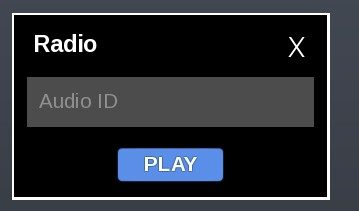</a> <b>Gui</b> › Radio.Windows.Orig</td>
<td width="33%" valign="top"><a href="screenshots/10_Gui__Orig.jpg">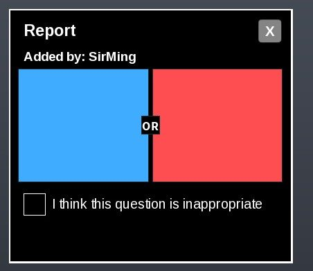</a> <b>Gui</b> › Report.Windows.Orig</td>
</tr>
<tr>
<td width="33%" valign="top"><a href="screenshots/11_Gui__Msg.jpg">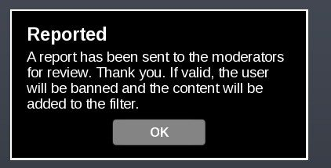</a> <b>Gui</b> › Report.Windows.Msg</td>
<td width="33%" valign="top"><a href="screenshots/12_Gui__Orig.jpg">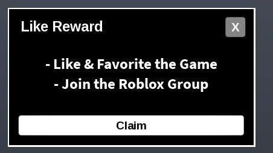</a> <b>Gui</b> › Like.Windows.Orig</td>
<td width="33%" valign="top"><a href="screenshots/14_Gui__Orig.jpg">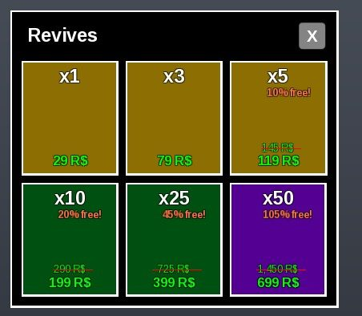</a> <b>Gui</b> › Revives.Windows.Orig</td>
</tr>
<tr>
<td width="33%" valign="top"><a href="screenshots/15_Gui__Orig.jpg">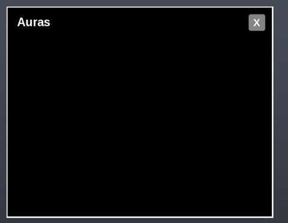</a> <b>Gui</b> › Auras.Windows.Orig</td>
</tr>
</table>

### HUD & currency

<table>
<tr>
<td width="33%" valign="top"><a href="screenshots/02_Gui__Money.jpg">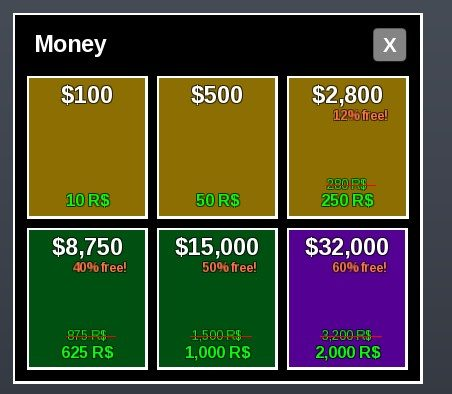</a> <b>Gui</b> › Weapons.Windows.Money</td>
<td width="33%" valign="top"> <b>Gui</b> › Custom.Windows.Money</td>
<td width="33%" valign="top"><a href="screenshots/18_ScopeGui__MainFrame.jpg">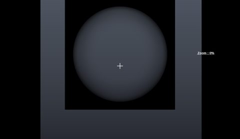</a> <b>ScopeGui</b> › MainFrame</td>
</tr>
</table>

### Other

<table>
<tr>
<td width="33%" valign="top"><a href="screenshots/01_Gui.jpg">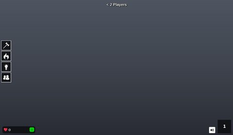</a> <b>Gui</b></td>
<td width="33%" valign="top"><a href="screenshots/19_HelpGui.jpg">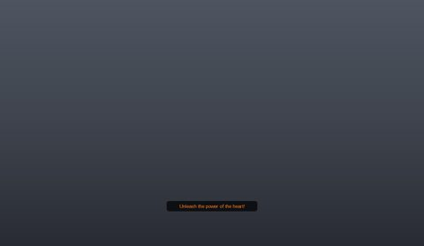</a> <b>HelpGui</b></td>
<td width="33%" valign="top"><a href="screenshots/20_SoSGui.jpg">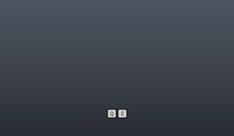</a> <b>SoSGui</b></td>
</tr>
</table>

## Model previews

<table>
<tr>
<td width="25%" valign="top"><a href="models/ReplicatedStorage/Weapons/221173389.rbxm">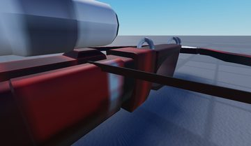</a> <b>221173389</b> <code>models/ReplicatedStorage/Weapons/221173389.rbxm</code></td>
<td width="25%" valign="top"><a href="models/ReplicatedStorage/Auras/Heavenbound.rbxm">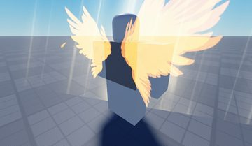</a> <b>Heavenbound</b> <code>models/ReplicatedStorage/Auras/Heavenbound.rbxm</code></td>
<td width="25%" valign="top"> <b>Dummy</b> <code>models/Lighting/Dummies/Dummy.rbxm</code></td>
<td width="25%" valign="top"> <b>Kills</b> <code>models/Workspace/Leaderboard/Kills.rbxm</code></td>
</tr>
<tr>
<td width="25%" valign="top"><a href="models/Workspace/Portals/Portal.rbxm">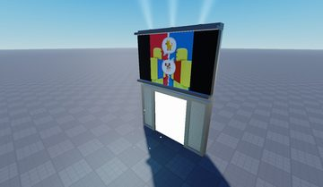</a> <b>Portal</b> <code>models/Workspace/Portals/Portal.rbxm</code></td>
<td width="25%" valign="top"> <b>Plant 1</b> <code>models/Workspace/Lobby/Plant 1.rbxm</code></td>
<td width="25%" valign="top"><a href="models/Workspace/Pedastal.rbxm">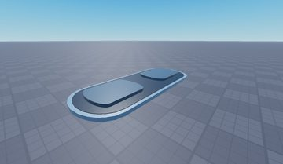</a> <b>Pedastal</b> <code>models/Workspace/Pedastal.rbxm</code></td>
<td width="25%" valign="top"><a href="models/ReplicatedStorage/Auras/Evil.rbxm">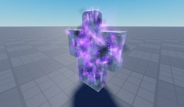</a> <b>Evil</b> <code>models/ReplicatedStorage/Auras/Evil.rbxm</code></td>
</tr>
<tr>
<td width="25%" valign="top"><a href="models/Lighting/Dummies/Dummy~2.rbxm">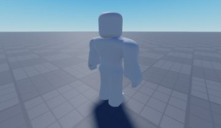</a> <b>Dummy~2</b> <code>models/Lighting/Dummies/Dummy~2.rbxm</code></td>
<td width="25%" valign="top"><a href="models/Workspace/Leaderboard/Level.rbxm">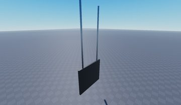</a> <b>Level</b> <code>models/Workspace/Leaderboard/Level.rbxm</code></td>
<td width="25%" valign="top"><a href="models/Workspace/Portals/Portal~2.rbxm">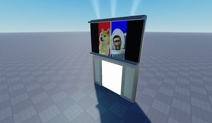</a> <b>Portal~2</b> <code>models/Workspace/Portals/Portal~2.rbxm</code></td>
<td width="25%" valign="top"><a href="models/Workspace/Lobby/Plant%201~2.rbxm">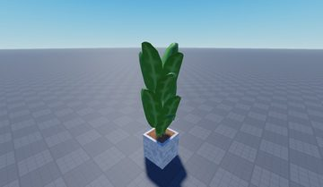</a> <b>Plant 1~2</b> <code>models/Workspace/Lobby/Plant 1~2.rbxm</code></td>
</tr>
<tr>
<td width="25%" valign="top"><a href="models/Workspace/Scoreboard.rbxm">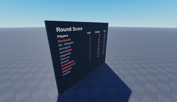</a> <b>Scoreboard</b> <code>models/Workspace/Scoreboard.rbxm</code></td>
<td width="25%" valign="top"><a href="models/ReplicatedStorage/Auras/Eldritch.rbxm">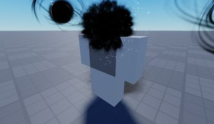</a> <b>Eldritch</b> <code>models/ReplicatedStorage/Auras/Eldritch.rbxm</code></td>
</tr>
</table>

## Notable scripts

Top-scored scripts of this game per topic (full tree in [source/scripts](source/scripts/)).

| Topic | Scripts |
|---|---|
| UI animation (tweens, hover / click, pop-ins, springs) | [`Rolling`](source/scripts/StarterGui/Popups/Rolling/Rolling.client.lua) 195 lines |
| Notifications, toasts, popups, prompts | [`L_Messages`](source/scripts/StarterGui/Gui/Messages/L_Messages.client.lua) 100 lines [`Rolling`](source/scripts/StarterGui/Popups/Rolling/Rolling.client.lua) 195 lines [`Auras`](source/scripts/StarterGui/Gui/Auras/Windows/Orig/Auras.client.lua) 173 lines [`M_Chat`](source/scripts/StarterGui/Gui/Chat/M_Chat.client.lua) 80 lines [`Like`](source/scripts/StarterGui/Gui/Like/Like.client.lua) 44 lines |
| Loading / intro screens | [`LocalScript`](source/scripts/ReplicatedStorage/Weapons/283756680/LocalScript.client.lua) 581 lines [`LocalScript`](source/scripts/ReplicatedStorage/Weapons/287425246/LocalScript.client.lua) 277 lines [`LocalScript`](source/scripts/ReplicatedStorage/Weapons/295460073/LocalScript.client.lua) 281 lines [`LocalScript`](source/scripts/ReplicatedStorage/Weapons/304720496/LocalScript.client.lua) 234 lines |
| Camera, cutscenes, screen shake | [`CameraShaker`](source/scripts/ReplicatedStorage/Modules/CameraShaker.lua) 178 lines [`CameraShakeInstance`](source/scripts/ReplicatedStorage/Modules/CameraShaker/CameraShakeInstance.lua) 174 lines [`CameraShakePresets`](source/scripts/ReplicatedStorage/Modules/CameraShaker/CameraShakePresets.lua) 85 lines [`L_Camera`](source/scripts/StarterPlayer/StarterPlayerScripts/L_Camera.client.lua) 23 lines [`LocalScript`](source/scripts/ReplicatedStorage/Weapons/283756680/LocalScript.client.lua) 581 lines |
| RNG, eggs, gacha, rarity rolls, pets | [`Rolling`](source/scripts/StarterGui/Popups/Rolling/Rolling.client.lua) 195 lines [`LocalScript`](source/scripts/ReplicatedStorage/Weapons/283756680/LocalScript.client.lua) 581 lines |
| Combat, weapons, hitboxes, abilities | [`Sword`](source/scripts/ReplicatedStorage/Weapons/68603324/Sword.lua) 362 lines [`Sword`](source/scripts/ReplicatedStorage/Weapons/77443704/Sword.lua) 213 lines |
| Character movement (sprint, dash, double jump, slide) | [`LocalKatanaScript`](source/scripts/ReplicatedStorage/Weapons/46846024/LocalKatanaScript.client.lua) 222 lines |
| Daily rewards, quests, codes, playtime | [`Quests`](source/scripts/StarterGui/Gui/Quests/Windows/Orig/Quests.client.lua) 135 lines |
| Utility modules (number format, signals, tables, timers) | [`GoodSignal`](source/scripts/ReplicatedStorage/Modules/GoodSignal.lua) 143 lines |

## ⚠️ Safety

HIGH flags (backdoors, `require(id)`, `loadstring`, webhooks). Review or delete before reusing:

- `scripts/ReplicatedStorage/Weapons/304720496/Script/ZombieScript.lua`

## Folders

| Folder | What |
|---|---|
| `screenshots/` | full frames; `crops/` = the panel only; `models/` = 3D previews; `thumbs/` = gallery thumbnails |
| `ui/` | every screen as a Lua builder (`require(module)()` returns the ScreenGui); `_StarterGui-all.lua` builds every StarterGui screen |
| `models/` | every model as .rbxm (the only .rbxm files), mirroring the place tree, scripts removed |
| `map/` | `workspace.rbxm` (the map as a model), `lighting.lua` (sky + post effects), `materials.lua`, `Environment.lua` |
| `animations/`, `audio/` | KeyframeSequence / Sound builders (.lua), `AnimationIds.lua`, `Sounds.lua` |
| `source/` | all scripts as .luau, `tree.txt`, `ui.txt`, `remotes.txt`, `assets.txt`, `flags.txt` |
