# PLS DONATE (fully scripted)

> 💬 **Social** · social / donation booths · source file `Please Donate Fully Scripted.rbxl`

[⬅ Back to the catalog](../../README.md) · [Assets inventory](ASSETS.md) · [Style numbers](reference.md) · [Scripts](source/scripts/) · [Code analysis](source/README.md)

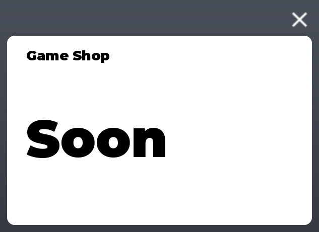

## At a glance

| | |
|---|---|
| Provenance | template with full source |
| Screens | 4 ScreenGuis, 409 GUI objects → **27 screenshots** |
| Models (.rbxm) | 285 models, 29 model sets, 15 VFX sets |
| Lua builders (.lua) | 49 UI screens, 10 animation packs, 2 audio packs |
| Code | 452 scripts, 53,843 lines |
| Asset ids | 29 animations, 287 sounds |
| Safety scan | 2 HIGH / 77 MED flags ([flags.txt](source/flags.txt)) |

**Fonts:** `GothamSSm Heavy`×75, `GothamSSm Bold`×40, `LegacyArial Regular`×23, `SourceSansPro Regular`×9, `GothamSSm Medium`×9

## UI screenshots

Captured in Studio from the place's own ScreenGuis (scripts stripped). Each panel was opened on its own; click a thumbnail for the full 1519×886 frame. Runtime-filled lists (shop items, inventories) show their template state.

### Shop & Robux store

<table>
<tr>
<td width="33%" valign="top"><a href="screenshots/10_ScreenGui__GameShop.jpg">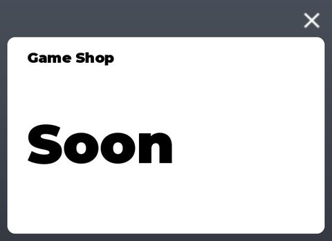</a> <b>ScreenGui</b> › GameShop</td>
</tr>
</table>

### Inventory / backpack / pets

<table>
<tr>
<td width="33%" valign="top"><a href="screenshots/14_ScreenGui__ItemsInbox.jpg">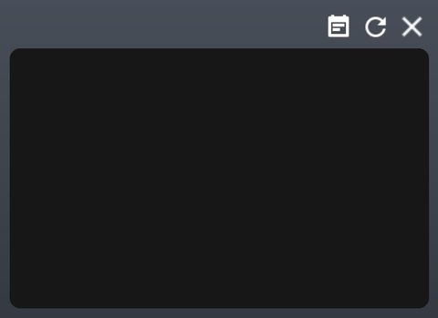</a> <b>ScreenGui</b> › ItemsInbox</td>
<td width="33%" valign="top"><a href="screenshots/28_ItemTemplate.jpg">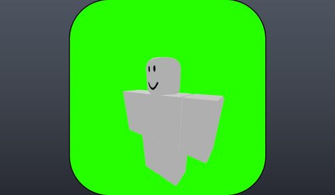</a> <b>ItemTemplate</b></td>
</tr>
</table>

### Rewards, daily, spin, codes

<table>
<tr>
<td width="33%" valign="top"><a href="screenshots/03_ScreenGui__GiftInbox.jpg">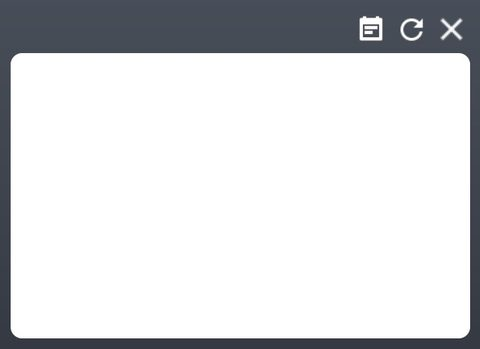</a> <b>ScreenGui</b> › GiftInbox</td>
<td width="33%" valign="top"><a href="screenshots/04_ScreenGui__EditWheel.jpg">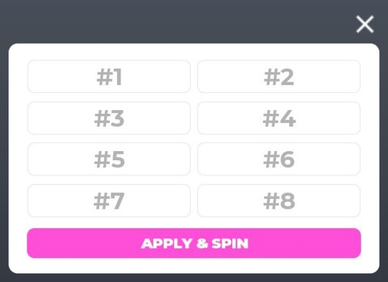</a> <b>ScreenGui</b> › EditWheel</td>
<td width="33%" valign="top"><a href="screenshots/06_ScreenGui__Gift.jpg">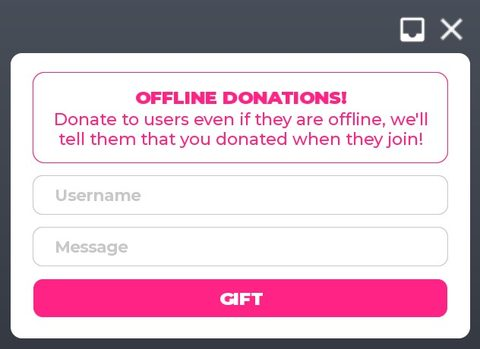</a> <b>ScreenGui</b> › Gift</td>
</tr>
<tr>
<td width="33%" valign="top"><a href="screenshots/08_ScreenGui__Streaks.jpg">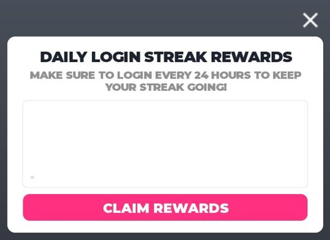</a> <b>ScreenGui</b> › Streaks</td>
<td width="33%" valign="top"><a href="screenshots/17_ScreenGui__GiftAlert.jpg">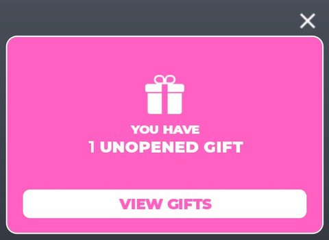</a> <b>ScreenGui</b> › GiftAlert</td>
<td width="33%" valign="top"><a href="screenshots/18_ScreenGui__RedeemCode.jpg">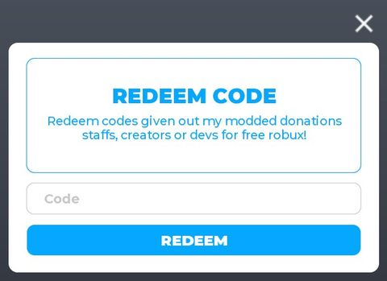</a> <b>ScreenGui</b> › RedeemCode</td>
</tr>
</table>

### Settings & menus

<table>
<tr>
<td width="33%" valign="top"><a href="screenshots/11_ScreenGui__Settings.jpg">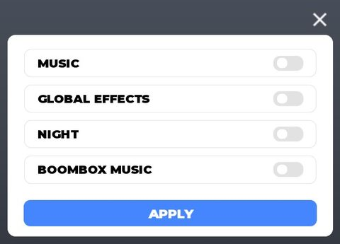</a> <b>ScreenGui</b> › Settings</td>
<td width="33%" valign="top"><a href="screenshots/16_ScreenGui__BoothSettings.jpg">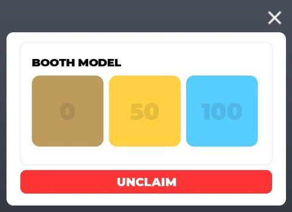</a> <b>ScreenGui</b> › BoothSettings</td>
</tr>
</table>

### Popups, notifications, prompts

<table>
<tr>
<td width="33%" valign="top"><a href="screenshots/07_ScreenGui__PopupAlert.jpg">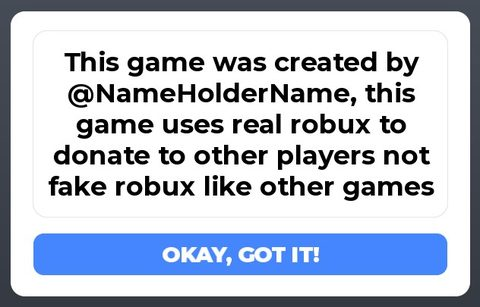</a> <b>ScreenGui</b> › PopupAlert</td>
</tr>
</table>

### Loading & intro

<table>
<tr>
<td width="33%" valign="top"> <b>TeleportLoadingScreen</b></td>
</tr>
</table>

### Admin panels

<table>
<tr>
<td width="33%" valign="top"><a href="screenshots/05_ScreenGui__PanelPicker.jpg">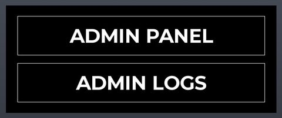</a> <b>ScreenGui</b> › PanelPicker</td>
</tr>
</table>

### Other

<table>
<tr>
<td width="33%" valign="top"><a href="screenshots/01_ScreenGui.jpg">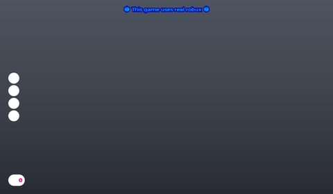</a> <b>ScreenGui</b></td>
<td width="33%" valign="top"><a href="screenshots/02_ScreenGui__EditBooth.jpg">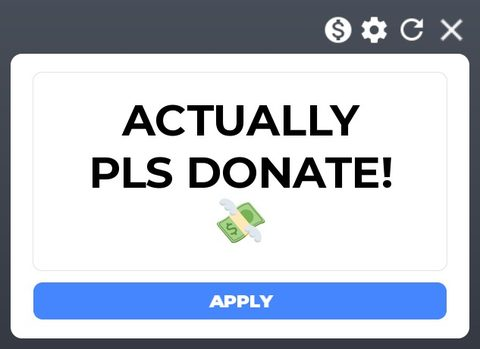</a> <b>ScreenGui</b> › EditBooth</td>
<td width="33%" valign="top"> <b>ScreenGui</b> › Tutorial</td>
</tr>
<tr>
<td width="33%" valign="top"><a href="screenshots/12_ScreenGui__EditSign.jpg">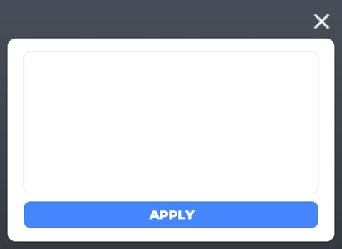</a> <b>ScreenGui</b> › EditSign</td>
<td width="33%" valign="top"><a href="screenshots/13_ScreenGui__BoothStatistics.jpg">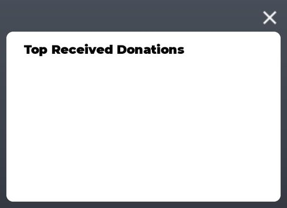</a> <b>ScreenGui</b> › BoothStatistics</td>
<td width="33%" valign="top"><a href="screenshots/15_ScreenGui__ChangeMusic.jpg">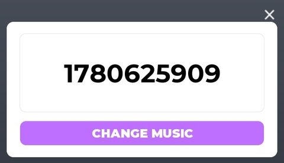</a> <b>ScreenGui</b> › ChangeMusic</td>
</tr>
<tr>
<td width="33%" valign="top"><a href="screenshots/19_10k.jpg">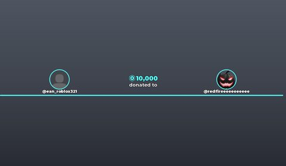</a> <b>10k</b></td>
<td width="33%" valign="top"><a href="screenshots/20_1k.jpg">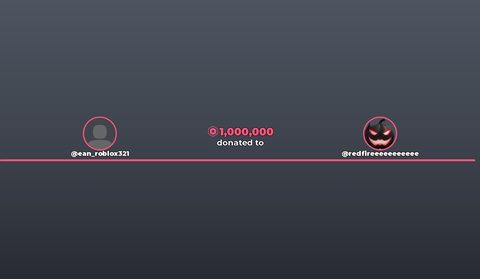</a> <b>1k</b></td>
<td width="33%" valign="top"><a href="screenshots/21_100.jpg">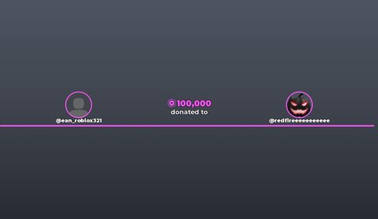</a> <b>100</b></td>
</tr>
<tr>
<td width="33%" valign="top"><a href="screenshots/22_NormalDonation.jpg">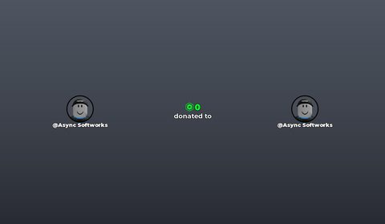</a> <b>NormalDonation</b></td>
<td width="33%" valign="top"><a href="screenshots/23_Template.jpg">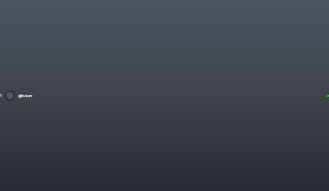</a> <b>Template</b></td>
<td width="33%" valign="top"><a href="screenshots/25_lol.jpg">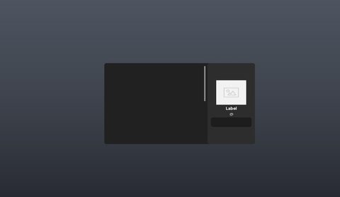</a> <b>lol</b></td>
</tr>
<tr>
<td width="33%" valign="top"><a href="screenshots/26_New.jpg">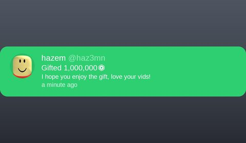</a> <b>New</b></td>
</tr>
</table>

## Model previews

<table>
<tr>
<td width="25%" valign="top"><a href="models/ServerStorage/BoothModels/starclonebooth.rbxm">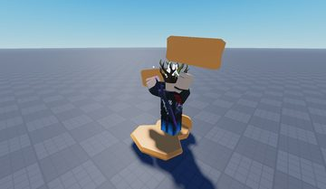</a> <b>starclonebooth</b> <code>models/ServerStorage/BoothModels/starclonebooth.rbxm</code></td>
<td width="25%" valign="top"><a href="models/ServerStorage/BoothModels/RacingCarBooth.rbxm">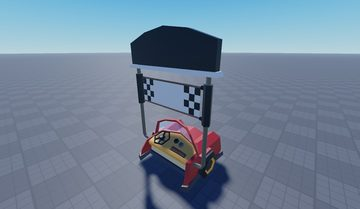</a> <b>RacingCarBooth</b> <code>models/ServerStorage/BoothModels/RacingCarBooth.rbxm</code></td>
<td width="25%" valign="top"><a href="models/ServerStorage/BoothModels/HalloweenCandyBooth.rbxm">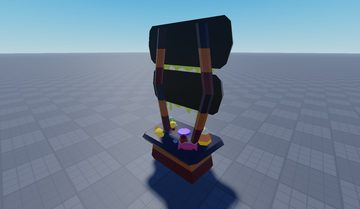</a> <b>HalloweenCandyBooth</b> <code>models/ServerStorage/BoothModels/HalloweenCandyBooth.rbxm</code></td>
<td width="25%" valign="top"><a href="models/ServerStorage/BoothModels/CatalogAvatarCreatorBooth.rbxm">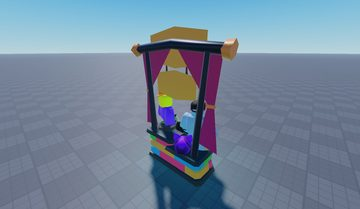</a> <b>CatalogAvatarCreatorBooth</b> <code>models/ServerStorage/BoothModels/CatalogAvatarCreatorBooth.rbxm</code></td>
</tr>
<tr>
<td width="25%" valign="top"><a href="models/Workspace/NukePlatform.rbxm">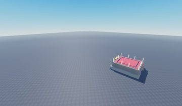</a> <b>NukePlatform</b> <code>models/Workspace/NukePlatform.rbxm</code></td>
<td width="25%" valign="top"><a href="models/ServerStorage/BoothModels/FlowerBooth.rbxm">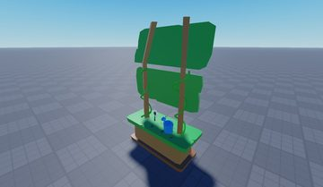</a> <b>FlowerBooth</b> <code>models/ServerStorage/BoothModels/FlowerBooth.rbxm</code></td>
<td width="25%" valign="top"><a href="models/Workspace/Club/Decoration/Plant/Plant__x22.rbxm">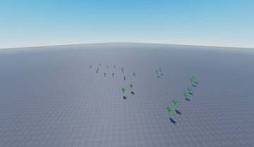</a> <b>Plant__x22</b> <code>models/Workspace/Club/Decoration/Plant/Plant__x22.rbxm</code></td>
<td width="25%" valign="top"><a href="models/ServerStorage/Tools/BoosterHammer.rbxm">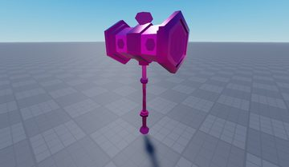</a> <b>BoosterHammer</b> <code>models/ServerStorage/Tools/BoosterHammer.rbxm</code></td>
</tr>
<tr>
<td width="25%" valign="top"><a href="models/ServerStorage/BoothModels/PetSimXBooth.rbxm">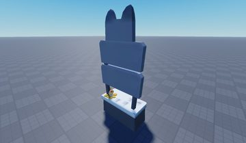</a> <b>PetSimXBooth</b> <code>models/ServerStorage/BoothModels/PetSimXBooth.rbxm</code></td>
<td width="25%" valign="top"><a href="models/ReplicatedStorage/OfflineMap/Tree__x13.rbxm">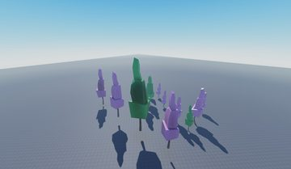</a> <b>Tree__x13</b> <code>models/ReplicatedStorage/OfflineMap/Tree__x13.rbxm</code></td>
<td width="25%" valign="top"><a href="models/ServerStorage/Tools/DonateSign.rbxm">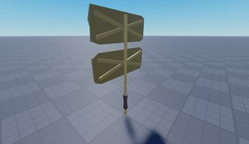</a> <b>DonateSign</b> <code>models/ServerStorage/Tools/DonateSign.rbxm</code></td>
<td width="25%" valign="top"><a href="models/Workspace/ForwardPortal.rbxm">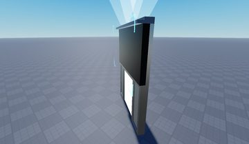</a> <b>ForwardPortal</b> <code>models/Workspace/ForwardPortal.rbxm</code></td>
</tr>
<tr>
<td width="25%" valign="top"><a href="models/Workspace/Map/Billboards/Billboard.rbxm">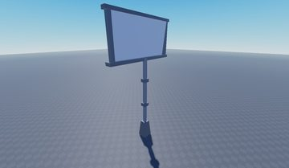</a> <b>Billboard</b> <code>models/Workspace/Map/Billboards/Billboard.rbxm</code></td>
<td width="25%" valign="top"><a href="models/ServerStorage/BoothModels/haz3mnsbooth.rbxm">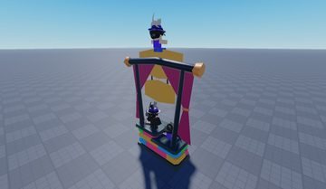</a> <b>haz3mnsbooth</b> <code>models/ServerStorage/BoothModels/haz3mnsbooth.rbxm</code></td>
</tr>
</table>

## Notable scripts

Top-scored scripts of this game per topic (full tree in [source/scripts](source/scripts/)).

| Topic | Scripts |
|---|---|
| UI animation (tweens, hover / click, pop-ins, springs) | [`Client`](source/scripts/StarterPlayer/StarterPlayerScripts/Client.client.lua) 89 lines [`main`](source/scripts/StarterGui/ScreenGui/main.client.lua) 480 lines [`Animation`](source/scripts/ReplicatedStorage/Templates/UnclaimedTemplateNew/Animation.client.lua) 45 lines [`Animation`](source/scripts/ServerStorage/ExampleGifts/New/Animation.client.lua) 45 lines [`nuke`](source/scripts/StarterGui/ScreenGui/nuke.client.lua) 304 lines |
| UI controllers / window managers / menus | [`main`](source/scripts/StarterGui/ScreenGui/main.client.lua) 480 lines [`Guis`](source/scripts/ReplicatedStorage/Modules/Guis.lua) 93 lines |
| Notifications, toasts, popups, prompts | [`ProximityPromptScript`](source/scripts/StarterPlayer/StarterPlayerScripts/ProximityPromptScript.client.lua) 499 lines [`Guis`](source/scripts/ReplicatedStorage/Modules/Guis.lua) 93 lines [`Purchases`](source/scripts/ServerScriptService/Donation/Purchases.server.lua) 226 lines [`main`](source/scripts/StarterGui/ScreenGui/main.client.lua) 480 lines [`Client`](source/scripts/StarterPlayer/StarterPlayerScripts/Client.client.lua) 89 lines |
| Camera, cutscenes, screen shake | [`CameraShaker`](source/scripts/StarterGui/ScreenGui/nuke/CameraShaker.lua) 208 lines [`CameraShakeInstance`](source/scripts/StarterGui/ScreenGui/nuke/CameraShaker/CameraShakeInstance.lua) 168 lines [`CameraShakePresets`](source/scripts/StarterGui/ScreenGui/nuke/CameraShaker/CameraShakePresets.lua) 105 lines [`main`](source/scripts/StarterGui/ScreenGui/main.client.lua) 480 lines [`nuke`](source/scripts/StarterGui/ScreenGui/nuke.client.lua) 304 lines |
| VFX, particles, beams, hit effects | [`smiteasf`](source/scripts/StarterGui/ScreenGui/smiteasf.client.lua) 627 lines [`Effects`](source/scripts/ServerScriptService/Donation/Effects.server.lua) 104 lines [`nuke`](source/scripts/StarterGui/ScreenGui/nuke.client.lua) 304 lines [`MainToolFunction`](source/scripts/ServerStorage/Tools/BoosterHammer/MainToolFunction.server.lua) 185 lines [`MainToolFunction`](source/scripts/ServerStorage/Tools/BugHammer/MainToolFunction.server.lua) 162 lines |
| DataStore / player data | [`PlayerEvents`](source/scripts/ServerScriptService/Players/PlayerEvents.server.lua) 67 lines |
| Monetization (dev products, game passes, receipts) | [`Purchases`](source/scripts/ServerScriptService/Donation/Purchases.server.lua) 226 lines |
| Character movement (sprint, dash, double jump, slide) | [`SpeedScriptRunner`](source/scripts/StarterPlayer/StarterPlayerScripts/SpeedScriptRunner.client.lua) 59 lines |
| Tycoon / plots / bases / building | [`BoothEvents`](source/scripts/ServerScriptService/Booths/BoothEvents.server.lua) 254 lines [`Purchases`](source/scripts/ServerScriptService/Donation/Purchases.server.lua) 226 lines |
| Admin panels & commands | [`Commands`](source/scripts/Workspace/HD%20Admin~2/CustomFeatures/Server/Modules/Commands.lua) 72 lines [`Settings`](source/scripts/Workspace/HD%20Admin~2/Settings.lua) 226 lines |
| Sound & music | [`smiteasf`](source/scripts/StarterGui/ScreenGui/smiteasf.client.lua) 627 lines |
| Daily rewards, quests, codes, playtime | [`Codes`](source/scripts/ServerScriptService/Players/Codes.server.lua) 52 lines |
| Utility modules (number format, signals, tables, timers) | [`Abbreviate`](source/scripts/ReplicatedStorage/Modules/Abbreviate.lua) 106 lines [`createSignal`](source/scripts/ReplicatedStorage/Common/Roact/createSignal.lua) 69 lines [`createSignal.spec`](source/scripts/ReplicatedStorage/Common/Roact/createSignal.spec.lua) 155 lines [`RobloxRenderer`](source/scripts/ReplicatedStorage/Common/Roact/RobloxRenderer.lua) 283 lines |

### In the curated script library

- [GUI helpers (open frame + FOV)](../../Scripts/02-UI-Framework/GuiHelpers__please-donate.lua) — Open a frame with slide and FOV tween while closing others, loading overlay, text popups, alert.

## ⚠️ Safety

HIGH flags (backdoors, `require(id)`, `loadstring`, webhooks). Review or delete before reusing:

- `scripts/Workspace/HD Admin/Settings/Loader.server.lua`
- `scripts/Workspace/HD Admin~2/Settings/Loader.server.lua`

## Folders

| Folder | What |
|---|---|
| `screenshots/` | full frames; `crops/` = the panel only; `models/` = 3D previews; `thumbs/` = gallery thumbnails |
| `ui/` | every screen as a Lua builder (`require(module)()` returns the ScreenGui); `_StarterGui-all.lua` builds every StarterGui screen |
| `models/` | every model as .rbxm (the only .rbxm files), mirroring the place tree, scripts removed |
| `map/` | `workspace.rbxm` (the map as a model), `lighting.lua` (sky + post effects), `materials.lua`, `Environment.lua` |
| `animations/`, `audio/` | KeyframeSequence / Sound builders (.lua), `AnimationIds.lua`, `Sounds.lua` |
| `source/` | all scripts as .luau, `tree.txt`, `ui.txt`, `remotes.txt`, `assets.txt`, `flags.txt` |
