# Prison Life

> 🏙️ **Roleplay** · roleplay (cops vs prisoners) · source file `prisonlife.rbxl`

[⬅ Back to the catalog](../../README.md) · [Assets inventory](ASSETS.md) · [Style numbers](reference.md) · [Scripts](source/scripts/) · [Code analysis](source/README.md)

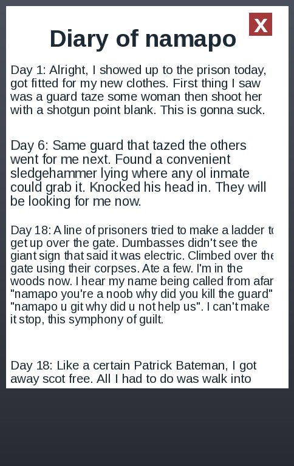

## At a glance

| | |
|---|---|
| Provenance | template with full source |
| Screens | 15 ScreenGuis, 242 GUI objects → **34 screenshots** |
| Models (.rbxm) | 445 models, 23 model sets, 0 VFX sets |
| Lua builders (.lua) | 16 UI screens, 5 animation packs, 3 audio packs |
| Code | 1345 scripts, 47,873 lines |
| Asset ids | 58 animations, 193 sounds |
| Safety scan | 3 HIGH / 17 MED flags ([flags.txt](source/flags.txt)) |

**Fonts:** `SourceSansPro Regular`×59, `SourceSansPro Bold`×44, `Arial Bold`×14, `Arial Regular`×8

## UI screenshots

Captured in Studio from the place's own ScreenGuis (scripts stripped). Each panel was opened on its own; click a thumbnail for the full 1519×886 frame. Runtime-filled lists (shop items, inventories) show their template state.

### Settings & menus

<table>
<tr>
<td width="33%" valign="top"><a href="screenshots/21_WatchGui__Settings.jpg">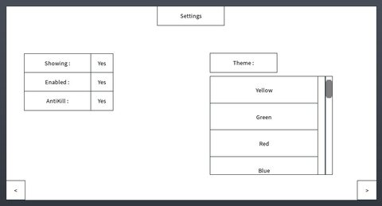</a> <b>WatchGui</b> › Settings</td>
<td width="33%" valign="top"> <b>AmmoDisplay</b></td>
</tr>
</table>

### Popups, notifications, prompts

<table>
<tr>
<td width="33%" valign="top"><a href="screenshots/11_promptGui__Frame.jpg">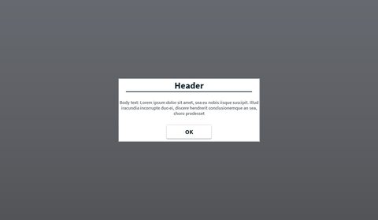</a> <b>promptGui</b> › Frame</td>
</tr>
</table>

### Loading & intro

<table>
<tr>
<td width="33%" valign="top"><a href="screenshots/04_Home__intro.jpg">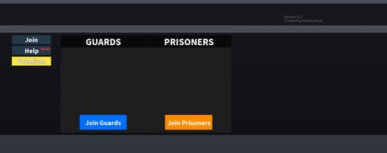</a> <b>Home</b> › intro</td>
</tr>
</table>

### Leaderboards & stats

<table>
<tr>
<td width="33%" valign="top"><a href="screenshots/23_WatchGui__Stats.jpg">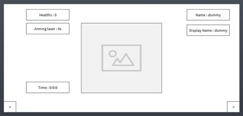</a> <b>WatchGui</b> › Stats</td>
</tr>
</table>

### Crafting, fusing, machines

<table>
<tr>
<td width="33%" valign="top"><a href="screenshots/05_Home__CraftingFrame.jpg">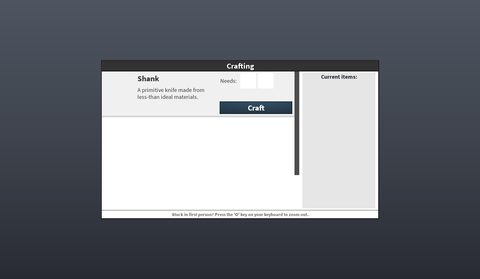</a> <b>Home</b> › hud.CraftingFrame</td>
</tr>
</table>

### Admin panels

<table>
<tr>
<td width="33%" valign="top"><a href="screenshots/19_TadashyPanel__Frame.jpg">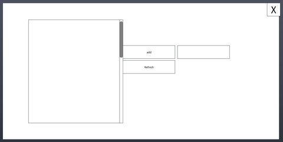</a> <b>TadashyPanel</b> › Frame</td>
</tr>
</table>

### HUD & currency

<table>
<tr>
<td width="33%" valign="top"> <b>Home</b> › hud.AddedGui</td>
<td width="33%" valign="top"><a href="screenshots/08_Home__diaryOfNamapo.jpg">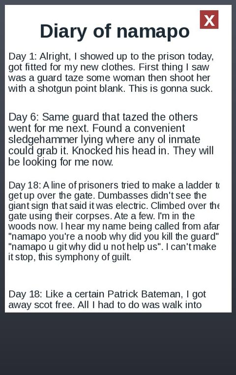</a> <b>Home</b> › hud.diaryOfNamapo</td>
<td width="33%" valign="top"><a href="screenshots/09_USM_Exchange__Mainframe.jpg">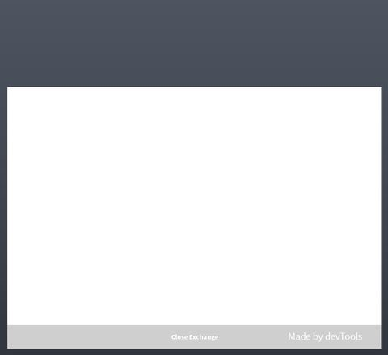</a> <b>USM Exchange</b> › Mainframe</td>
</tr>
</table>

### Map vote / teams / matchmaking

<table>
<tr>
<td width="33%" valign="top"><a href="screenshots/06_Home__votekickFrame.jpg">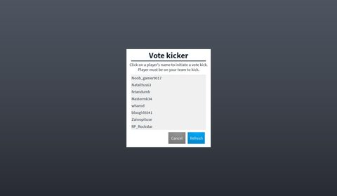</a> <b>Home</b> › hud.votekickFrame</td>
</tr>
</table>

### Other

<table>
<tr>
<td width="33%" valign="top"><a href="screenshots/01_ScreenGui.jpg">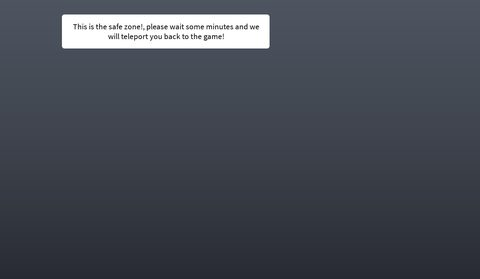</a> <b>ScreenGui</b></td>
<td width="33%" valign="top"> <b>Screen</b></td>
<td width="33%" valign="top"><a href="screenshots/03_TestGui__Frame.jpg">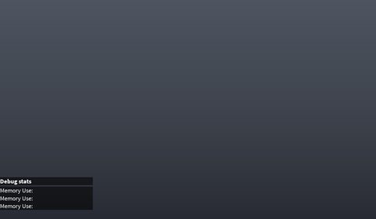</a> <b>TestGui</b> › Frame</td>
</tr>
<tr>
<td width="33%" valign="top"><a href="screenshots/10_camGui.jpg">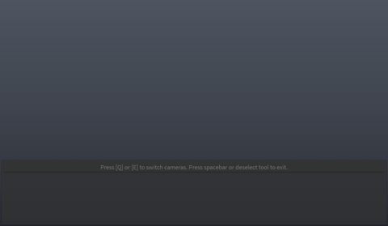</a> <b>camGui</b></td>
<td width="33%" valign="top"> <b>Screen</b></td>
<td width="33%" valign="top"><a href="screenshots/20_WatchGui__Spawner.jpg">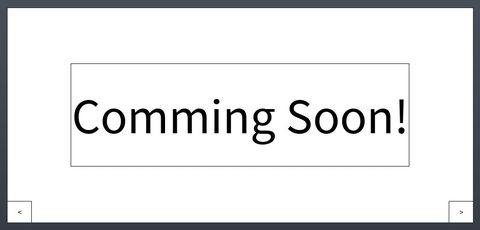</a> <b>WatchGui</b> › Spawner</td>
</tr>
<tr>
<td width="33%" valign="top"><a href="screenshots/22_WatchGui__AntiKill.jpg">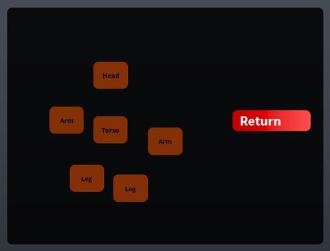</a> <b>WatchGui</b> › AntiKill</td>
<td width="33%" valign="top"><a href="screenshots/24_WatchGui__Warn.jpg">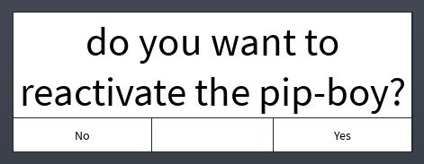</a> <b>WatchGui</b> › Warn</td>
<td width="33%" valign="top"><a href="screenshots/25_WarnGui.jpg">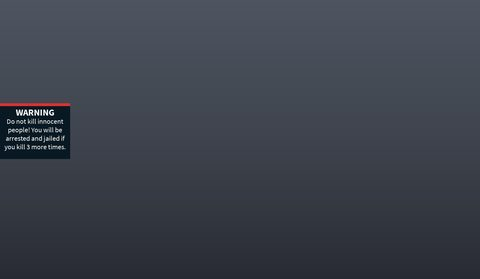</a> <b>WarnGui</b></td>
</tr>
<tr>
<td width="33%" valign="top"><a href="screenshots/26_UpdateUI.jpg">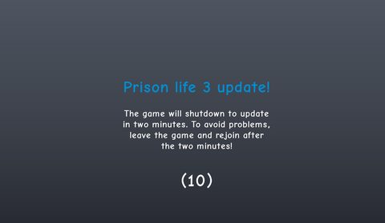</a> <b>UpdateUI</b></td>
<td width="33%" valign="top"> <b>AmmoGui</b></td>
<td width="33%" valign="top"><a href="screenshots/28_AmmoGui.jpg">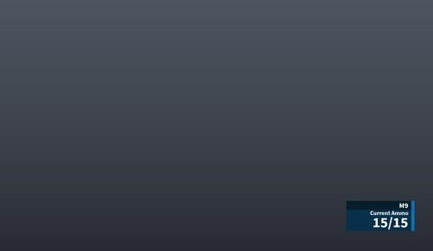</a> <b>AmmoGui</b></td>
</tr>
<tr>
<td width="33%" valign="top"><a href="screenshots/29_AmmoGui.jpg">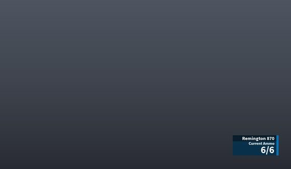</a> <b>AmmoGui</b></td>
<td width="33%" valign="top"><a href="screenshots/30_AmmoGui.jpg">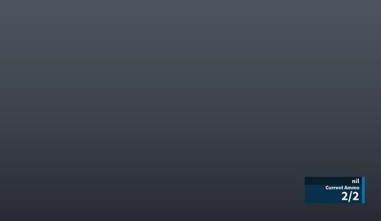</a> <b>AmmoGui</b></td>
<td width="33%" valign="top"><a href="screenshots/31_AmmoGui.jpg">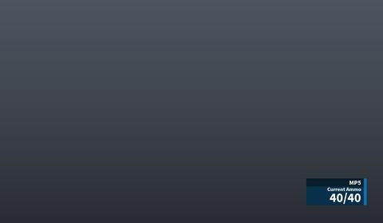</a> <b>AmmoGui</b></td>
</tr>
<tr>
<td width="33%" valign="top"> <b>AmmoGui</b></td>
<td width="33%" valign="top"> <b>AmmoGui</b></td>
<td width="33%" valign="top"> <b>AmmoGui</b></td>
</tr>
<tr>
<td width="33%" valign="top"> <b>AmmoGui</b></td>
<td width="33%" valign="top"><a href="screenshots/36_AmmoGui.jpg">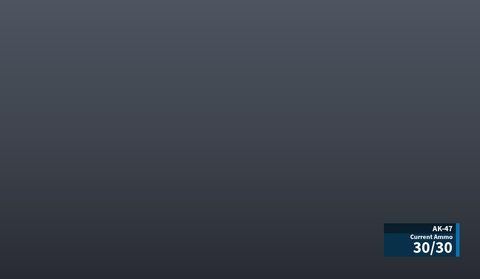</a> <b>AmmoGui</b></td>
<td width="33%" valign="top"> <b>AmmoGui</b></td>
</tr>
<tr>
<td width="33%" valign="top"> <b>ArrestGui</b></td>
<td width="33%" valign="top"><a href="screenshots/41_AmmoGui.jpg">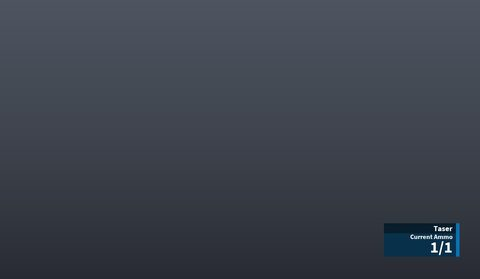</a> <b>AmmoGui</b></td>
</tr>
</table>

## Model previews

<table>
<tr>
<td width="25%" valign="top"><a href="models/ServerStorage/builderman.rbxm">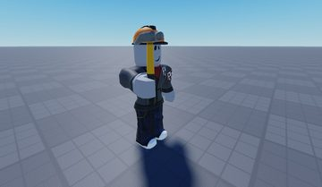</a> <b>builderman</b> <code>models/ServerStorage/builderman.rbxm</code></td>
<td width="25%" valign="top"><a href="models/ServerStorage/Baller%20Gun.rbxm">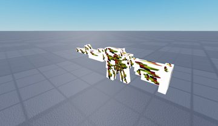</a> <b>Baller Gun</b> <code>models/ServerStorage/Baller Gun.rbxm</code></td>
<td width="25%" valign="top"><a href="models/Workspace/Prison_ITEMS/buttons/Car%20Spawner.rbxm">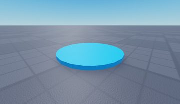</a> <b>Car Spawner</b> <code>models/Workspace/Prison_ITEMS/buttons/Car Spawner.rbxm</code></td>
<td width="25%" valign="top"><a href="models/Workspace/Prison_ITEMS/hats/Police%20hat.rbxm">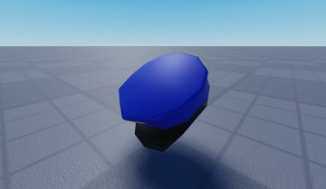</a> <b>Police hat</b> <code>models/Workspace/Prison_ITEMS/hats/Police hat.rbxm</code></td>
</tr>
<tr>
<td width="25%" valign="top"><a href="models/Workspace/Prison_Cellblock.rbxm">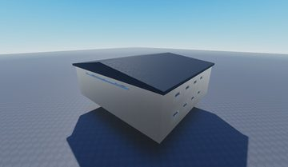</a> <b>Prison_Cellblock</b> <code>models/Workspace/Prison_Cellblock.rbxm</code></td>
<td width="25%" valign="top"><a href="models/ServerStorage/Key%20Card.rbxm">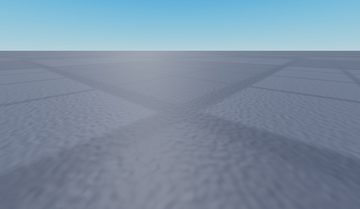</a> <b>Key Card</b> <code>models/ServerStorage/Key Card.rbxm</code></td>
<td width="25%" valign="top"><a href="models/Workspace/City_buildings/Storefront.rbxm">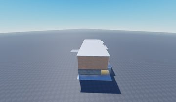</a> <b>Storefront</b> <code>models/Workspace/City_buildings/Storefront.rbxm</code></td>
<td width="25%" valign="top"><a href="models/Workspace/Trees/tree_med.rbxm">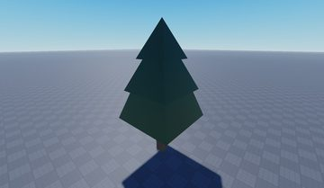</a> <b>tree_med</b> <code>models/Workspace/Trees/tree_med.rbxm</code></td>
</tr>
<tr>
<td width="25%" valign="top"><a href="models/ReplicatedStorage/NukeConfig/explosion/Ring.rbxm">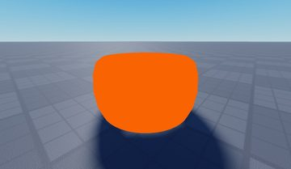</a> <b>Ring</b> <code>models/ReplicatedStorage/NukeConfig/explosion/Ring.rbxm</code></td>
<td width="25%" valign="top"><a href="models/Workspace/sign~5.rbxm">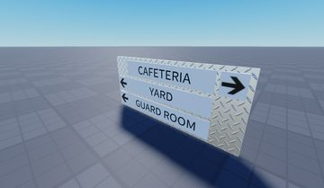</a> <b>sign~5</b> <code>models/Workspace/sign~5.rbxm</code></td>
<td width="25%" valign="top"><a href="models/ReplicatedStorage/Hats/CoastGuard/DressBlues/Enlisted.rbxm">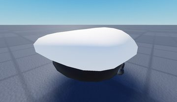</a> <b>Enlisted</b> <code>models/ReplicatedStorage/Hats/CoastGuard/DressBlues/Enlisted.rbxm</code></td>
<td width="25%" valign="top"><a href="models/ServerStorage/admin%20gun%202.rbxm">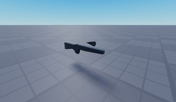</a> <b>admin gun 2</b> <code>models/ServerStorage/admin gun 2.rbxm</code></td>
</tr>
<tr>
<td width="25%" valign="top"> <b>Car Spawner~2</b> <code>models/Workspace/Prison_ITEMS/buttons/Car Spawner~2.rbxm</code></td>
<td width="25%" valign="top"><a href="models/Workspace/Prison_ITEMS/hats/Ski%20mask.rbxm">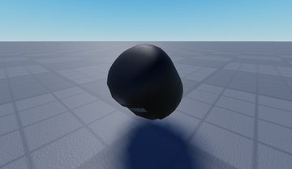</a> <b>Ski mask</b> <code>models/Workspace/Prison_ITEMS/hats/Ski mask.rbxm</code></td>
</tr>
</table>

## Notable scripts

Top-scored scripts of this game per topic (full tree in [source/scripts](source/scripts/)).

| Topic | Scripts |
|---|---|
| UI animation (tweens, hover / click, pop-ins, springs) | [`EmojiChatClientController`](source/scripts/StarterPlayer/StarterPlayerScripts/EmojiChatClientController.client.lua) 418 lines [`Tween`](source/scripts/ServerScriptService/ForPlayers/TypingBubble/TypingBubble/TypingBubble/Tween.server.lua) 10 lines |
| UI controllers / window managers / menus | [`Open_Close`](source/scripts/ServerScriptService/PipBoySystem/WatchGui/Open_Close.client.lua) 97 lines [`UniformScript`](source/scripts/ReplicatedStorage/ExchangeServerScript/UniformGui/Frame/UniformScript.client.lua) 60 lines [`LocalScript`](source/scripts/StarterGui/Home/hud/Topbar/Pulldownmenu/LocalScript.client.lua) 13 lines [`LocalScript`](source/scripts/ServerStorage/ADMIN%20FUG/LocalScript.client.lua) 427 lines |
| Notifications, toasts, popups, prompts | [`PipBoySystem`](source/scripts/ServerScriptService/PipBoySystem.server.lua) 314 lines [`GuiScript`](source/scripts/StarterGui/Home/hud/Topbar/GuiScript.client.lua) 26 lines [`TadashyScript`](source/scripts/ServerScriptService/Tadashy/TadashyScript.server.lua) 79 lines |
| Loading / intro screens | [`systemintro`](source/scripts/ServerScriptService/systemintro.server.lua) 105 lines |
| Camera, cutscenes, screen shake | [`cameraintro`](source/scripts/ServerStorage/cameraintro.client.lua) 10 lines [`cameraintro`](source/scripts/StarterGui/Home/intro/cameraintro.client.lua) 24 lines [`Recoil`](source/scripts/ServerStorage/ADMIN%20FUG/Script/Recoil.client.lua) 18 lines |
| VFX, particles, beams, hit effects | [`Script`](source/scripts/ServerStorage/ADMIN%20FUG/Script.server.lua) 202 lines [`Rocket`](source/scripts/ServerStorage/RocketLauncher/Server/Rocket.server.lua) 155 lines |
| DataStore / player data | [`TadashyAntiCheat`](source/scripts/ServerScriptService/Tadashy/TadashyAntiCheat.server.lua) 268 lines |
| RNG, eggs, gacha, rarity rolls, pets | [`LocalScript`](source/scripts/ServerStorage/ADMIN%20FUG/LocalScript.client.lua) 427 lines |
| Combat, weapons, hitboxes, abilities | [`GunServer`](source/scripts/ServerScriptService/GunServer.server.lua) 281 lines |
| Character movement (sprint, dash, double jump, slide) | [`TadashyAntiCheat`](source/scripts/ServerScriptService/Tadashy/TadashyAntiCheat.server.lua) 268 lines [`TadashyScript`](source/scripts/ServerScriptService/Tadashy/TadashyScript.server.lua) 79 lines [`SprintScript`](source/scripts/ServerScriptService/SprintScriptImporter/SprintScript.client.lua) 29 lines [`arrest`](source/scripts/ServerScriptService/arrest.server.lua) 73 lines [`Teleport`](source/scripts/Teams/Guards/Handcuffs/Handle/Teleport.server.lua) 55 lines |
| Tycoon / plots / bases / building | [`Play`](source/scripts/ServerScriptService/Nuke/Play.server.lua) 289 lines [`EmojiChatClientController`](source/scripts/StarterPlayer/StarterPlayerScripts/EmojiChatClientController.client.lua) 418 lines |

### In the curated script library

- [Intro team select (server)](../../Scripts/04-Loading-Screens/IntroTeamSelectServer__prison-life.lua) — Server side of a menu intro: flags new players as 'in intro', tells the client to use the intro camera, then on team pick enforces team caps, respawns the player and switches the camera back.

## ⚠️ Safety

HIGH flags (backdoors, `require(id)`, `loadstring`, webhooks). Review or delete before reusing:

- `scripts/ServerStorage/builderman/Script.server.lua`
- `scripts/Workspace/HD Admin/About/Settings/Loader.server.lua`
- `scripts/Workspace/Script.server.lua`

## Folders

| Folder | What |
|---|---|
| `screenshots/` | full frames; `crops/` = the panel only; `models/` = 3D previews; `thumbs/` = gallery thumbnails |
| `ui/` | every screen as a Lua builder (`require(module)()` returns the ScreenGui); `_StarterGui-all.lua` builds every StarterGui screen |
| `models/` | every model as .rbxm (the only .rbxm files), mirroring the place tree, scripts removed |
| `map/` | `workspace.rbxm` (the map as a model), `lighting.lua` (sky + post effects), `materials.lua`, `Environment.lua` |
| `animations/`, `audio/` | KeyframeSequence / Sound builders (.lua), `AnimationIds.lua`, `Sounds.lua` |
| `source/` | all scripts as .luau, `tree.txt`, `ui.txt`, `remotes.txt`, `assets.txt`, `flags.txt` |
