# Punching Simulator

> ⛏️ **Simulator** · training simulator · source file `Punching Simulator Fully scripted.rbxl`

[⬅ Back to the catalog](../../README.md) · [Assets inventory](ASSETS.md) · [Style numbers](reference.md) · [Scripts](source/scripts/) · [Code analysis](source/README.md)

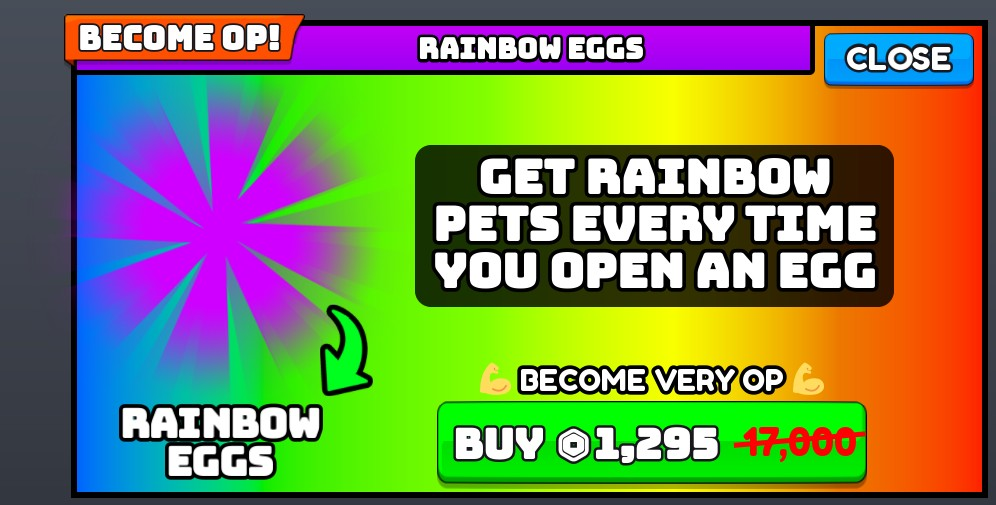

## At a glance

| | |
|---|---|
| Provenance | template with full source |
| Screens | 32 ScreenGuis, 1649 GUI objects → **46 screenshots** |
| Models (.rbxm) | 409 models, 16 model sets, 1 VFX sets |
| Lua builders (.lua) | 65 UI screens, 2 animation packs, 2 audio packs |
| Code | 518 scripts, 61,874 lines |
| Asset ids | 4 animations, 33 sounds |
| Safety scan | 1 HIGH / 5 MED flags ([flags.txt](source/flags.txt)) |

**Fonts:** `FredokaOne Regular`×385, `font asset 12187370000 Bold`×201, `GothamSSm Heavy`×11, `FredokaOne Bold`×4, `font asset 12187370000 Heavy`×2

## UI screenshots

Captured in Studio from the place's own ScreenGuis (scripts stripped). Each panel was opened on its own; click a thumbnail for the full 1519×886 frame. Runtime-filled lists (shop items, inventories) show their template state.

### Inventory / backpack / pets

<table>
<tr>
<td width="33%" valign="top"><a href="screenshots/37_Pet.jpg">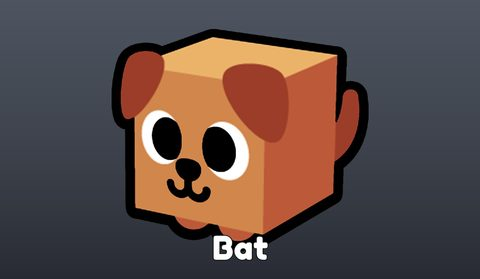</a> <b>Pet</b></td>
</tr>
</table>

### Rewards, daily, spin, codes

<table>
<tr>
<td width="33%" valign="top"><a href="screenshots/43_InviteReward.jpg">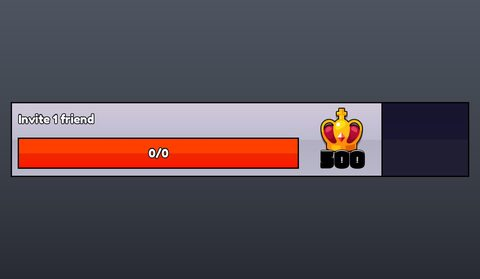</a> <b>InviteReward</b></td>
</tr>
</table>

### Quests & progression

<table>
<tr>
<td width="33%" valign="top"><a href="screenshots/39_Quest.jpg">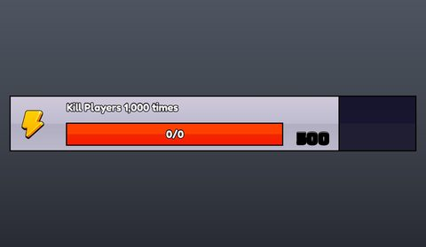</a> <b>Quest</b></td>
<td width="33%" valign="top"><a href="screenshots/41_Quest.jpg">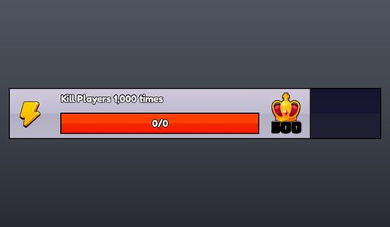</a> <b>Quest</b></td>
<td width="33%" valign="top"> <b>Quest</b></td>
</tr>
</table>

### Trading

<table>
<tr>
<td width="33%" valign="top"><a href="screenshots/17_Trade__You.jpg">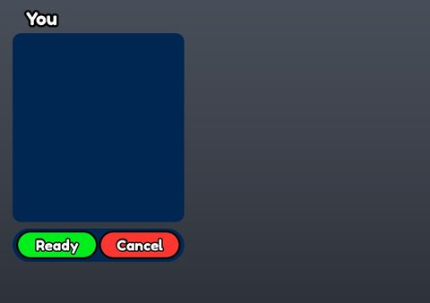</a> <b>Trade</b> › Main.You</td>
<td width="33%" valign="top"><a href="screenshots/19_Trade__Other.jpg">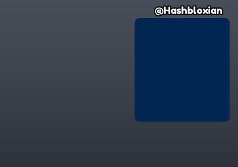</a> <b>Trade</b> › Main.Other</td>
</tr>
</table>

### Leaderboards & stats

<table>
<tr>
<td width="33%" valign="top"><a href="screenshots/18_Trade__Top.jpg">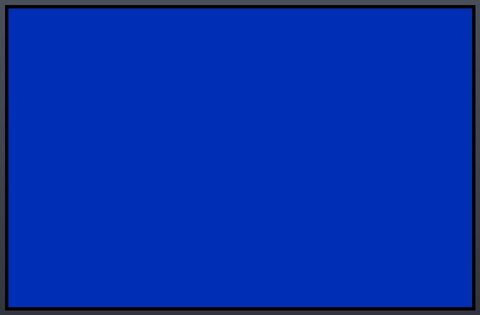</a> <b>Trade</b> › Main.Top</td>
</tr>
</table>

### HUD & currency

<table>
<tr>
<td width="33%" valign="top"><a href="screenshots/01_Main.jpg">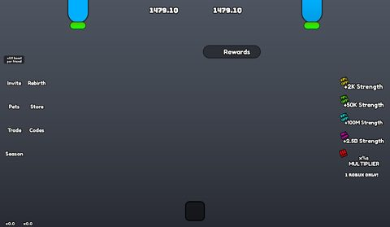</a> <b>Main</b></td>
<td width="33%" valign="top"><a href="screenshots/02_Wheel__Main.jpg">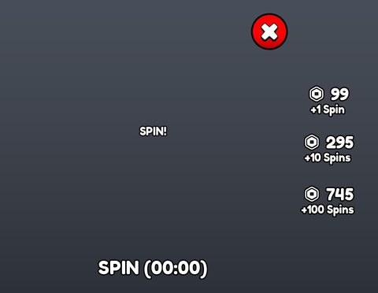</a> <b>Wheel</b> › Main</td>
<td width="33%" valign="top"><a href="screenshots/03_Daily__Main.jpg">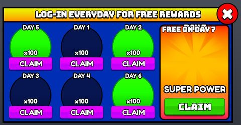</a> <b>Daily</b> › Main</td>
</tr>
<tr>
<td width="33%" valign="top"><a href="screenshots/04_Free__Main.jpg">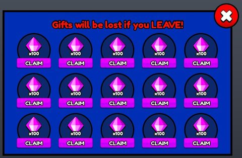</a> <b>Free</b> › Main</td>
<td width="33%" valign="top"><a href="screenshots/05_Pets__Main.jpg">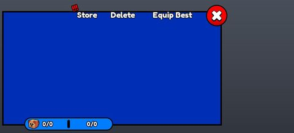</a> <b>Pets</b> › Main</td>
<td width="33%" valign="top"><a href="screenshots/06_Rebirth__Main.jpg">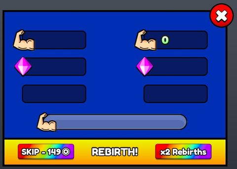</a> <b>Rebirth</b> › Main</td>
</tr>
<tr>
<td width="33%" valign="top"><a href="screenshots/07_Reward__Main.jpg">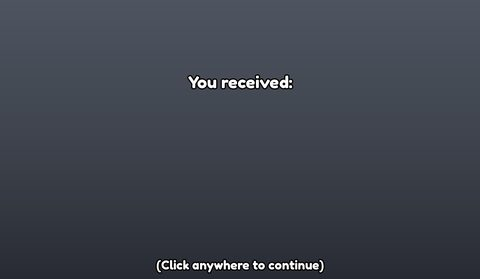</a> <b>Reward</b> › Main</td>
<td width="33%" valign="top"><a href="screenshots/08_Store__Main.jpg">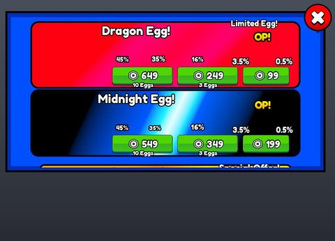</a> <b>Store</b> › Main</td>
<td width="33%" valign="top"><a href="screenshots/09_FreeHugeEvent__Main.jpg">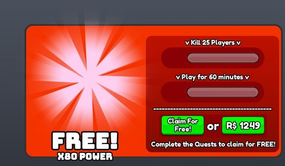</a> <b>FreeHugeEvent</b> › Main</td>
</tr>
<tr>
<td width="33%" valign="top"><a href="screenshots/10_Auras__Main.jpg">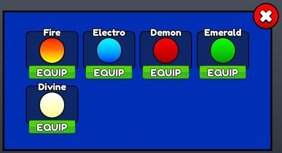</a> <b>Auras</b> › Main</td>
<td width="33%" valign="top"> <b>Pulse</b> › Main</td>
<td width="33%" valign="top"><a href="screenshots/12_PetPack__Main.jpg">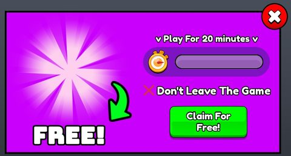</a> <b>PetPack</b> › Main</td>
</tr>
<tr>
<td width="33%" valign="top"><a href="screenshots/13_Confirm__Main.jpg">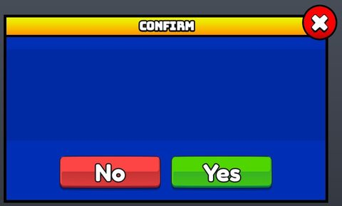</a> <b>Confirm</b> › Main</td>
<td width="33%" valign="top"><a href="screenshots/14_Settings__Main.jpg">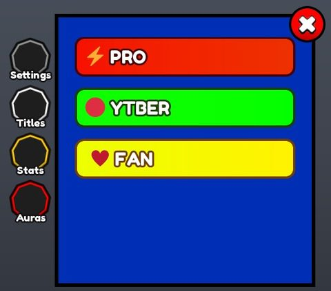</a> <b>Settings</b> › Main</td>
<td width="33%" valign="top"><a href="screenshots/15_InviteRewards__Main.jpg">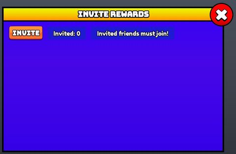</a> <b>InviteRewards</b> › Main</td>
</tr>
<tr>
<td width="33%" valign="top"><a href="screenshots/16_Season__Main.jpg">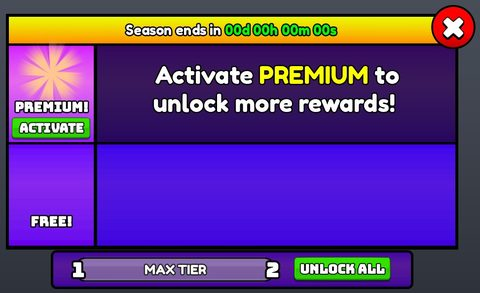</a> <b>Season</b> › Main</td>
<td width="33%" valign="top"><a href="screenshots/20_TradeList__Main.jpg">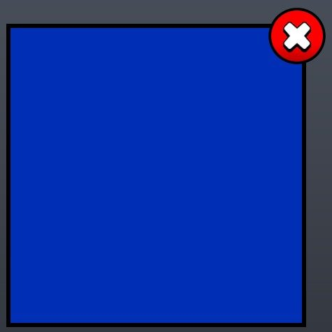</a> <b>TradeList</b> › Main</td>
<td width="33%" valign="top"><a href="screenshots/22_Clans__Members.jpg">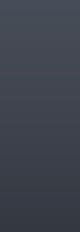</a> <b>Clans</b> › Main.Pages.ClanView.Content.Members</td>
</tr>
<tr>
<td width="33%" valign="top"><a href="screenshots/24_Clans__Creating.jpg">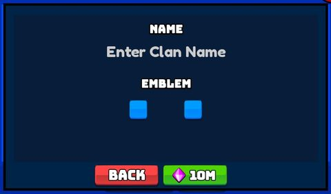</a> <b>Clans</b> › Main.Pages.MainView.Creating</td>
<td width="33%" valign="top"><a href="screenshots/25_Clans__Joining.jpg">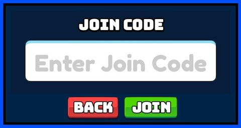</a> <b>Clans</b> › Main.Pages.MainView.Joining</td>
<td width="33%" valign="top"><a href="screenshots/26_Upgrades__Main.jpg">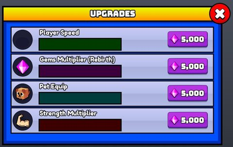</a> <b>Upgrades</b> › Main</td>
</tr>
<tr>
<td width="33%" valign="top"><a href="screenshots/27_Quests__Main.jpg">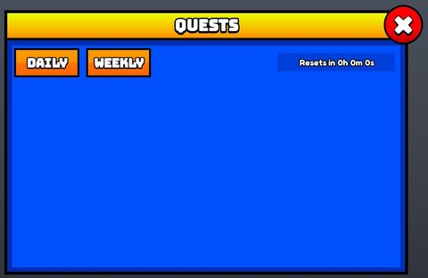</a> <b>Quests</b> › Main</td>
<td width="33%" valign="top"><a href="screenshots/28_DarkMatterPack__Main.jpg">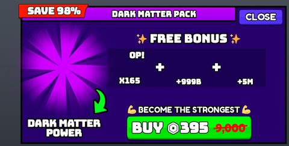</a> <b>DarkMatterPack</b> › Main</td>
<td width="33%" valign="top"><a href="screenshots/29_Tutorial__Main.jpg">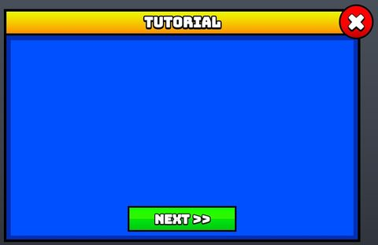</a> <b>Tutorial</b> › Main</td>
</tr>
<tr>
<td width="33%" valign="top"><a href="screenshots/30_HackerEvent__Main.jpg">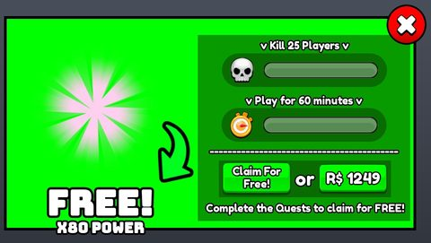</a> <b>HackerEvent</b> › Main</td>
<td width="33%" valign="top"><a href="screenshots/31_Ranks__Main.jpg">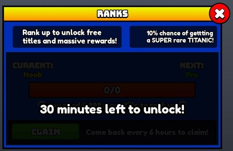</a> <b>Ranks</b> › Main</td>
<td width="33%" valign="top"><a href="screenshots/32_RainbowEggs__Main.jpg">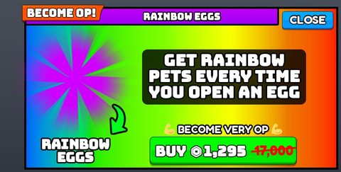</a> <b>RainbowEggs</b> › Main</td>
</tr>
<tr>
<td width="33%" valign="top"><a href="screenshots/33_SpecialEvent__Main.jpg">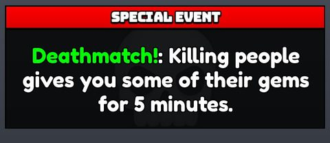</a> <b>SpecialEvent</b> › Main</td>
<td width="33%" valign="top"><a href="screenshots/34_DiscordVerification__Main.jpg">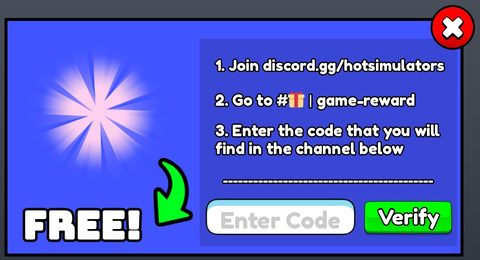</a> <b>DiscordVerification</b> › Main</td>
<td width="33%" valign="top"><a href="screenshots/35_ToolbarButton.jpg">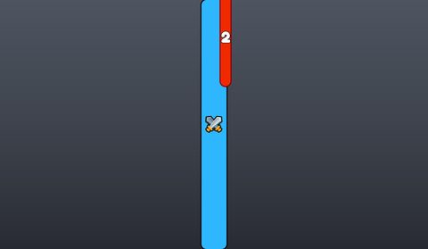</a> <b>ToolbarButton</b></td>
</tr>
<tr>
<td width="33%" valign="top"><a href="screenshots/36_ToolbarButton__AutoPunchBtn.jpg">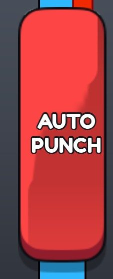</a> <b>ToolbarButton</b> › AutoPunchBtn</td>
</tr>
</table>

### Other

<table>
<tr>
<td width="33%" valign="top"><a href="screenshots/21_Clans.jpg">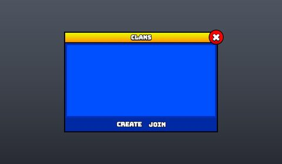</a> <b>Clans</b></td>
<td width="33%" valign="top"><a href="screenshots/38_Cell.jpg">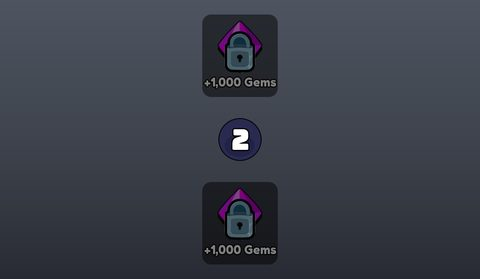</a> <b>Cell</b></td>
<td width="33%" valign="top"><a href="screenshots/40_Clan.jpg">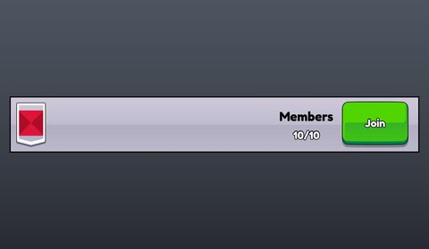</a> <b>Clan</b></td>
</tr>
<tr>
<td width="33%" valign="top"><a href="screenshots/44_1.jpg">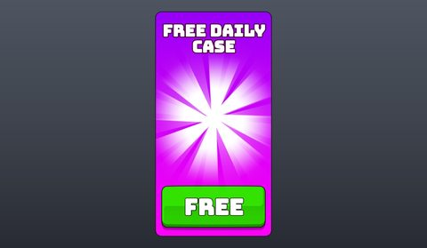</a> <b>1</b></td>
<td width="33%" valign="top"><a href="screenshots/45_2.jpg">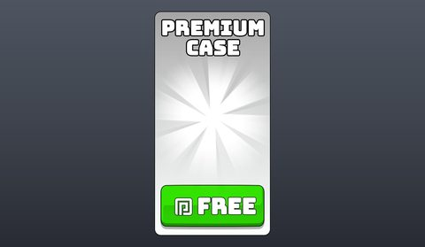</a> <b>2</b></td>
<td width="33%" valign="top"><a href="screenshots/46_3.jpg">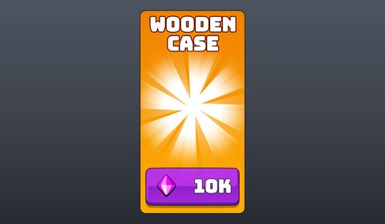</a> <b>3</b></td>
</tr>
<tr>
<td width="33%" valign="top"><a href="screenshots/47_4.jpg">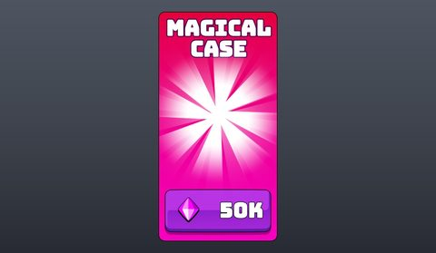</a> <b>4</b></td>
</tr>
</table>

## Model previews

<table>
<tr>
<td width="25%" valign="top"><a href="models/ServerStorage/Swords/Prismatic%20Star.rbxm">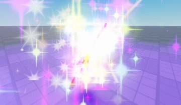</a> <b>Prismatic Star</b> <code>models/ServerStorage/Swords/Prismatic Star.rbxm</code></td>
<td width="25%" valign="top"><a href="models/Workspace/gift%20for%20brennan/Dummy.rbxm">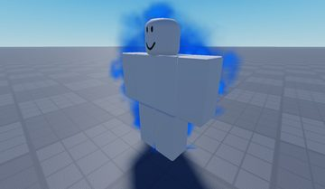</a> <b>Dummy</b> <code>models/Workspace/gift for brennan/Dummy.rbxm</code></td>
<td width="25%" valign="top"><a href="models/Workspace/__MAP/Eggs/Void_Egg/PetPriceGroup.rbxm">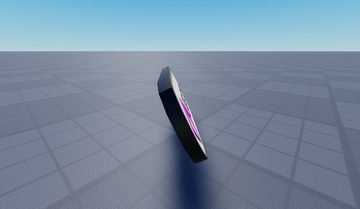</a> <b>PetPriceGroup</b> <code>models/Workspace/__MAP/Eggs/Void_Egg/PetPriceGroup.rbxm</code></td>
<td width="25%" valign="top"><a href="models/Workspace/Meshes_egg_platform_Plane.007%20%281%29.rbxm">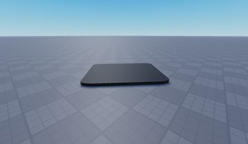</a> <b>Meshes_egg_platform_Plane.007 (1)</b> <code>models/Workspace/Meshes_egg_platform_Plane.007 (1).rbxm</code></td>
</tr>
<tr>
<td width="25%" valign="top"><a href="models/Workspace/__MAP/Leaderboards/Gems.rbxm">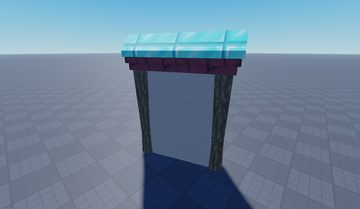</a> <b>Gems</b> <code>models/Workspace/__MAP/Leaderboards/Gems.rbxm</code></td>
<td width="25%" valign="top"> <b>6</b> <code>models/Workspace/__MAP/TrainingAreas/6.rbxm</code></td>
<td width="25%" valign="top"> <b>Rebirth</b> <code>models/ReplicatedStorage/Assets/Models/Other/Rebirth.rbxm</code></td>
<td width="25%" valign="top"> <b>Egg</b> <code>models/Workspace/__MAP/Eggs/Void_Egg/Egg.rbxm</code></td>
</tr>
<tr>
<td width="25%" valign="top"> <b>Main Portal Template</b> <code>models/Workspace/Main Portal Template.rbxm</code></td>
<td width="25%" valign="top"> <b>Strength</b> <code>models/Workspace/__MAP/Leaderboards/Strength.rbxm</code></td>
<td width="25%" valign="top"> <b>Tree</b> <code>models/Workspace/Tree.rbxm</code></td>
<td width="25%" valign="top"> <b>Double Lightsaber</b> <code>models/ServerStorage/Swords/Double Lightsaber.rbxm</code></td>
</tr>
<tr>
<td width="25%" valign="top"> <b>Dummy~2</b> <code>models/Workspace/gift for brennan/Dummy~2.rbxm</code></td>
<td width="25%" valign="top"> <b>Meshes_egg_platform_Plane.010 (1)</b> <code>models/Workspace/Meshes_egg_platform_Plane.010 (1).rbxm</code></td>
</tr>
</table>

## Notable scripts

Top-scored scripts of this game per topic (full tree in [source/scripts](source/scripts/)).

| Topic | Scripts |
|---|---|
| UI animation (tweens, hover / click, pop-ins, springs) | [`Cases`](source/scripts/ServerStorage/Cases.lua) 313 lines [`Reward`](source/scripts/StarterPlayer/StarterPlayerScripts/Client/Modules/UI/Reward.lua) 177 lines [`Egg`](source/scripts/StarterPlayer/StarterPlayerScripts/Client/Modules/Controllers/Egg.lua) 369 lines |
| UI controllers / window managers / menus | [`RainbowEggs`](source/scripts/StarterPlayer/StarterPlayerScripts/Client/Modules/UI/RainbowEggs.lua) 134 lines [`Clans`](source/scripts/StarterPlayer/StarterPlayerScripts/Client/Modules/UI/Clans.lua) 799 lines [`DarkMatterPack`](source/scripts/StarterPlayer/StarterPlayerScripts/Client/Modules/UI/DarkMatterPack.lua) 132 lines [`Character`](source/scripts/StarterPlayer/StarterPlayerScripts/Client/Modules/Controllers/Character.lua) 357 lines [`UI`](source/scripts/StarterPlayer/StarterPlayerScripts/Client/Modules/UI.lua) 124 lines |
| Notifications, toasts, popups, prompts | [`Notifications`](source/scripts/StarterPlayer/StarterPlayerScripts/Client/Modules/UI/Notifications.lua) 108 lines [`Trade`](source/scripts/StarterPlayer/StarterPlayerScripts/Client/Modules/UI/Trade.lua) 453 lines [`client-main`](source/scripts/StarterPlayer/StarterPlayerScripts/Client/Scripts/client-main.client.lua) 327 lines [`Clans`](source/scripts/StarterPlayer/StarterPlayerScripts/Client/Modules/UI/Clans.lua) 799 lines [`HUD`](source/scripts/StarterPlayer/StarterPlayerScripts/Client/Modules/UI/HUD.lua) 187 lines |
| Camera, cutscenes, screen shake | [`CameraShakePresets`](source/scripts/ReplicatedStorage/Common/Library/Physics/CameraShaker/CameraShakePresets.lua) 105 lines |
| VFX, particles, beams, hit effects | [`AdPortalEffectsController`](source/scripts/Workspace/Main%20Portal%20Template/Decorative/AdPortalEffectsController.server.lua) 62 lines [`Effects`](source/scripts/ReplicatedStorage/Common/Modules/Databases/Powers/Effects.lua) 199 lines [`Character`](source/scripts/StarterPlayer/StarterPlayerScripts/Client/Modules/Controllers/Character.lua) 357 lines [`client-main`](source/scripts/StarterPlayer/StarterPlayerScripts/Client/Scripts/client-main.client.lua) 327 lines |
| DataStore / player data | [`ProfileService`](source/scripts/ServerScriptService/Server/Library/ProfileService.lua) 2410 lines |
| Monetization (dev products, game passes, receipts) | [`Purchases`](source/scripts/ServerScriptService/Server/Modules/Classes/Purchases.lua) 270 lines [`Purchases`](source/scripts/StarterPlayer/StarterPlayerScripts/Client/Library/Classes/Purchases.lua) 195 lines |
| RNG, eggs, gacha, rarity rolls, pets | [`Eggs`](source/scripts/ReplicatedStorage/Common/Modules/Databases/Eggs.lua) 220 lines [`EggUtility`](source/scripts/ReplicatedStorage/Common/Modules/Utilities/EggUtility.lua) 88 lines [`Store`](source/scripts/StarterPlayer/StarterPlayerScripts/Client/Modules/UI/Store.lua) 286 lines [`Player`](source/scripts/ServerScriptService/Server/Modules/Controllers/Player.lua) 1889 lines [`LuckPasses`](source/scripts/ReplicatedStorage/Common/Modules/Databases/LuckPasses.lua) 32 lines |
| Trading systems | [`Trade`](source/scripts/StarterPlayer/StarterPlayerScripts/Client/Modules/UI/Trade.lua) 453 lines [`Trade`](source/scripts/ServerScriptService/Server/Modules/Controllers/Trade.lua) 256 lines [`TradeList`](source/scripts/StarterPlayer/StarterPlayerScripts/Client/Modules/UI/TradeList.lua) 164 lines |
| Character movement (sprint, dash, double jump, slide) | [`client-feature-double-jump`](source/scripts/StarterPlayer/StarterCharacterScripts/Scripts/Features/client-feature-double-jump.client.lua) 51 lines |
| Tycoon / plots / bases / building | [`Clans`](source/scripts/StarterPlayer/StarterPlayerScripts/Client/Modules/UI/Clans.lua) 799 lines [`Quests`](source/scripts/StarterPlayer/StarterPlayerScripts/Client/Modules/UI/Quests.lua) 267 lines [`InviteRewards`](source/scripts/StarterPlayer/StarterPlayerScripts/Client/Modules/UI/InviteRewards.lua) 165 lines [`Ranks`](source/scripts/StarterPlayer/StarterPlayerScripts/Client/Modules/UI/Ranks.lua) 151 lines [`FreeHugeEvent`](source/scripts/StarterPlayer/StarterPlayerScripts/Client/Modules/UI/FreeHugeEvent.lua) 185 lines |
| Leaderboards & stats | [`Leaderboard`](source/scripts/ServerScriptService/Server/Modules/Controllers/Leaderboard.lua) 155 lines |
| Admin panels & commands | [`givePet Command (no functionality yet)`](source/scripts/ServerScriptService/givePet%20Command%20%28no%20functionality%20yet%29.server.lua) 54 lines |
| Sound & music | [`Audio`](source/scripts/ReplicatedStorage/Common/Library/Audio.lua) 100 lines |
| Daily rewards, quests, codes, playtime | [`DailyCaseUtility`](source/scripts/ReplicatedStorage/Common/Modules/Utilities/DailyCaseUtility.lua) 31 lines [`DailyGiftUtility`](source/scripts/ReplicatedStorage/Common/Modules/Utilities/DailyGiftUtility.lua) 46 lines [`WheelRewardUtility`](source/scripts/ReplicatedStorage/Common/Modules/Utilities/WheelRewardUtility.lua) 46 lines [`Daily`](source/scripts/StarterPlayer/StarterPlayerScripts/Client/Modules/UI/Daily.lua) 198 lines [`Quests`](source/scripts/StarterPlayer/StarterPlayerScripts/Client/Modules/UI/Quests.lua) 267 lines |
| Utility modules (number format, signals, tables, timers) | [`Promise`](source/scripts/ReplicatedStorage/Common/Library/Classes/Promise.lua) 1978 lines [`Signal`](source/scripts/ReplicatedStorage/Common/Library/Classes/Signal.lua) 330 lines [`Signal`](source/scripts/ReplicatedStorage/Common/Library/Classes/Timer/Signal.lua) 383 lines [`TableTracker`](source/scripts/ReplicatedStorage/Common/Library/Classes/Tracker/TableTracker.lua) 114 lines [`NumberUtility`](source/scripts/ReplicatedStorage/Common/Library/Utilities/NumberUtility.lua) 222 lines |

### In the curated script library

- [Shared daily-gift rules (client + server)](../../Scripts/18-Daily-Rewards-Quests/DailyGiftUtility-Shared__punching-simulator.lua) — Tiny shared module: next gift id (1..7 loop), time left and canClaim from the saved {i, t} value, used by both the UI and the server check.
- [Products/passes as callback tables](../../Scripts/08-Monetization/Purchases-CallbackTable__punching-simulator.lua) — Per-player Purchases object: products and passes are database entries with a callback, pass ownership checked with Promises on join, PurchaseId cache in ProcessReceipt.
- [Double jump](../../Scripts/13-Movement/DoubleJump__punching-simulator.lua) — The standard Roblox double-jump recipe (JumpRequest + Freefall/Landed states).
- [Spring-animated notifications](../../Scripts/03-Notifications/SpringNotifications__punching-simulator.lua) — Framework notification service: respects a player "Notifications" setting, plays optional audio, spring-animates UIScale in/out (Spr), callable from server or client.
- [Promise-based sound player](../../Scripts/17-Sound-Music/AudioPlay__punching-simulator.lua) — Plays a named sound from an assets folder (clone, optional position part, pitch via PitchShiftSoundEffect), returns a Promise that resolves when it ends, and cleans up with a Trove. Server calls broadcast to clients; respects the SFX setting.
- [OOP trade class](../../Scripts/10-Trading/TradeClass__punching-simulator.lua) — Trade object with Trove cleanup, state tracker and attribute-replicated state; unreadies on data change.
- [OOP trade request](../../Scripts/10-Trading/TradeRequest__punching-simulator.lua) — Trade request object decided by the target via RemoteFunction, then creates the Trade.
- [Trade eligibility check](../../Scripts/10-Trading/TradeUtility__punching-simulator.lua) — canOccur gate: both loaded, target allows trades, neither already trading.
- [Gradient shine sweep](../../Scripts/01-UI-Animation/ShimmerSweep__punching-simulator.lua) — The classic shine sweep: tween a UIGradient Offset from (-1,0) to (1,0) every 2 s, then snap back.
- [Rainbow gradient sweep](../../Scripts/01-UI-Animation/RainbowGradientSweep__punching-simulator.lua) — Endless rainbow sweep across a label: Offset sweep while rotating through a 15-colour HSV palette, flipping Rotation 0/180 each pass.
- [spr spring animator library](../../Scripts/01-UI-Animation/SprSpringLibrary__punching-simulator.lua) — The open-source "spr" spring library (MIT, Fraktality): spr.Target(instance, dampingRatio, frequency, {props}) animates any property with a critically/under-damped spring.
- [Spin wheel + spring window](../../Scripts/01-UI-Animation/SpinWheel_SprWindow__punching-simulator.lua) — Reward wheel spin landing on a slot (5 full turns + slot offset, Quint out, 5 s) and window open/close driven by spr springs on Position, camera FOV and Blur.
- [UI router (module per screen)](../../Scripts/02-UI-Framework/UIRouter__punching-simulator.lua) — Loads every UI module, runs init/start, and opens/closes screens by name with one open at a time.
- [Number + timer formats, roman numerals](../../Scripts/19-Utility/NumberUtility-TimersRoman__punching-simulator.lua) — short() suffix formatter, decimal(), commas() via reverse+gsub, colon/short/long timer formats with auto unit choice, and roman numeral to/from (for tiers like 'Rebirth IV').
- [Table helpers (map/filter/deep get/set)](../../Scripts/19-Utility/TableUtility-Functional__punching-simulator.lua) — Functional table helpers: all, once, filter, max/min by mapper, entries, match, length, map, sort, and deep set/get by path, deep compare and deep copy.
- [Weighted random pick](../../Scripts/19-Utility/RandomUtility-Weighted__punching-simulator.lua) — chance(d) picks a key from a {key = weight} dictionary with a cumulative-weight roll.
- [Simple object pool](../../Scripts/19-Utility/Pool-Simple__punching-simulator.lua) — Minimal object pool: get() reuses a returned instance or clones the template, back() puts one back.
- [One remote, many named channels](../../Scripts/19-Utility/Network-Multiplexed__punching-simulator.lua) — Network module that sends every call through ONE RemoteEvent/RemoteFunction with a name, plus the same API for bindables; Fired/Invoked return a disconnect function.

## ⚠️ Safety

HIGH flags (backdoors, `require(id)`, `loadstring`, webhooks). Review or delete before reusing:

- `scripts/Workspace/Tree~10/Top/Script.server.lua`

## Folders

| Folder | What |
|---|---|
| `screenshots/` | full frames; `crops/` = the panel only; `models/` = 3D previews; `thumbs/` = gallery thumbnails |
| `ui/` | every screen as a Lua builder (`require(module)()` returns the ScreenGui); `_StarterGui-all.lua` builds every StarterGui screen |
| `models/` | every model as .rbxm (the only .rbxm files), mirroring the place tree, scripts removed |
| `map/` | `workspace.rbxm` (the map as a model), `lighting.lua` (sky + post effects), `materials.lua`, `Environment.lua` |
| `animations/`, `audio/` | KeyframeSequence / Sound builders (.lua), `AnimationIds.lua`, `Sounds.lua` |
| `source/` | all scripts as .luau, `tree.txt`, `ui.txt`, `remotes.txt`, `assets.txt`, `flags.txt` |
