# RCU (roll / mounts)

> 🎲 **RNG** · RNG roller (Knit, auto roll, mounts) · source file `RCU.rbxl`

[⬅ Back to the catalog](../../README.md) · [Assets inventory](ASSETS.md) · [Style numbers](reference.md) · [Scripts](source/scripts/) · [Code analysis](source/README.md)

## At a glance

| | |
|---|---|
| Provenance | copy of a live game (saveinstance / decompiled client code) |
| Screens | 2 ScreenGuis, 5063 GUI objects → **41 screenshots** |
| Models (.rbxm) | 601 models, 58 model sets, 5 VFX sets |
| Lua builders (.lua) | 82 UI screens, 1 animation packs, 1 audio packs |
| Code | 513 scripts, 95,662 lines |
| Asset ids | 6 animations, 49 sounds |
| Safety scan | 0 HIGH / 0 MED flags ([flags.txt](source/flags.txt)) |

**Fonts:** `FredokaOne Regular`×1235, `SourceSansPro Regular`×434, `font asset 12187373592 Bold`×21, `font asset 12187370000 Bold`×6, `Builder Sans Bold`×1

## UI screenshots

Captured in Studio from the place's own ScreenGuis (scripts stripped). Each panel was opened on its own; click a thumbnail for the full 1519×886 frame. Runtime-filled lists (shop items, inventories) show their template state.

### Shop & Robux store

<table>
<tr>
<td width="33%" valign="top"><a href="screenshots/22_MainUI__AncientShopFrame.jpg">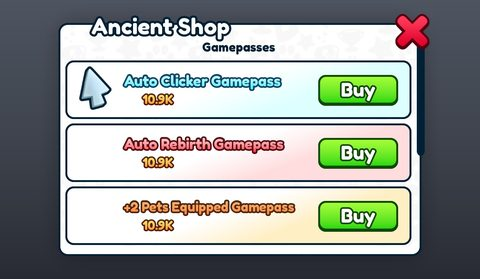</a> <b>MainUI</b> › Menus.AncientShopFrame</td>
<td width="33%" valign="top"><a href="screenshots/33_BoothOffer.jpg">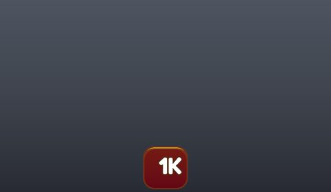</a> <b>BoothOffer</b></td>
</tr>
</table>

### Inventory / backpack / pets

<table>
<tr>
<td width="33%" valign="top"><a href="screenshots/02_MainUI__HoverPets.jpg">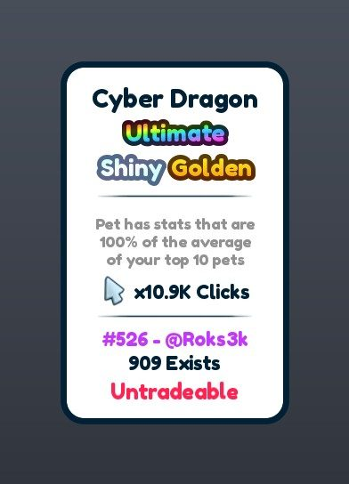</a> <b>MainUI</b> › HUD.Hovers.HoverPets</td>
<td width="33%" valign="top"><a href="screenshots/08_MainUI__YouDontHaveAny.jpg">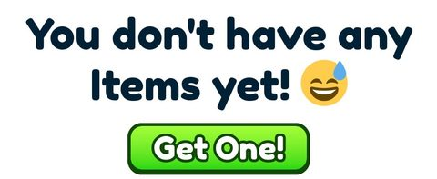</a> <b>MainUI</b> › Menus.InventoryFrame.YouDontHaveAny</td>
<td width="33%" valign="top"><a href="screenshots/09_MainUI__ItemConfirmFrame.jpg">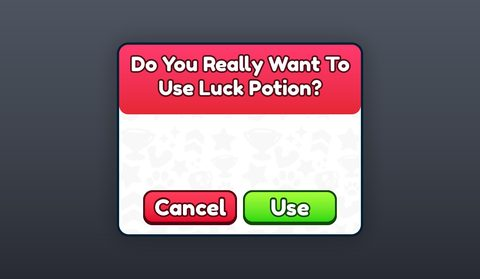</a> <b>MainUI</b> › Menus.ItemConfirmFrame</td>
</tr>
<tr>
<td width="33%" valign="top"><a href="screenshots/25_Pet.jpg">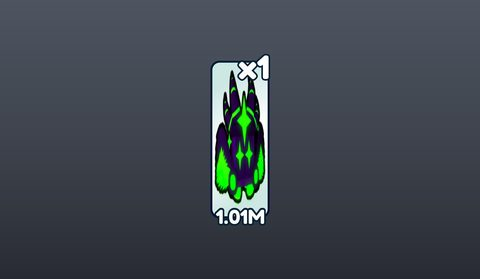</a> <b>Pet</b></td>
<td width="33%" valign="top"><a href="screenshots/39_Item.jpg">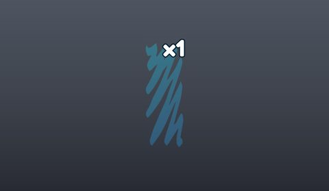</a> <b>Item</b></td>
</tr>
</table>

### Index / codex / glossary

<table>
<tr>
<td width="33%" valign="top"><a href="screenshots/17_MainUI__IndexFrame.jpg">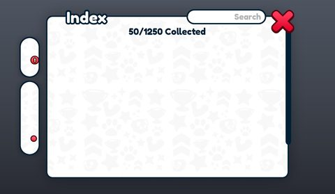</a> <b>MainUI</b> › Menus.IndexFrame</td>
<td width="33%" valign="top"><a href="screenshots/30_IndexReward.jpg">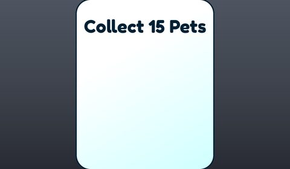</a> <b>IndexReward</b></td>
</tr>
</table>

### Rewards, daily, spin, codes

<table>
<tr>
<td width="33%" valign="top"><a href="screenshots/23_MainUI__AncientSpinWheelFrame.jpg">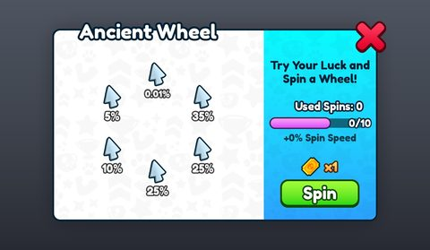</a> <b>MainUI</b> › Menus.AncientSpinWheelFrame</td>
<td width="33%" valign="top"><a href="screenshots/37_DailyReward.jpg">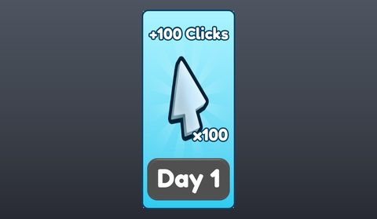</a> <b>DailyReward</b></td>
</tr>
</table>

### Quests & progression

<table>
<tr>
<td width="33%" valign="top"><a href="screenshots/05_MainUI__HoverPrestigeInfo.jpg">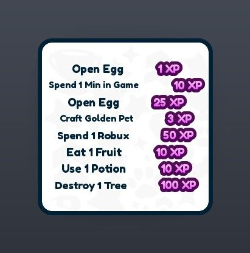</a> <b>MainUI</b> › HUD.Hovers.HoverPrestigeInfo</td>
<td width="33%" valign="top"><a href="screenshots/13_MainUI__RebirthFrame.jpg">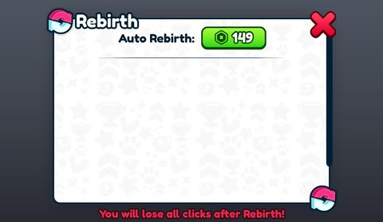</a> <b>MainUI</b> › Menus.RebirthFrame</td>
<td width="33%" valign="top"><a href="screenshots/15_MainUI__TradeRequestFrame.jpg">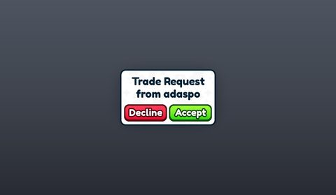</a> <b>MainUI</b> › Menus.TradeRequestFrame</td>
</tr>
<tr>
<td width="33%" valign="top"><a href="screenshots/19_MainUI__UpgradesFrame.jpg">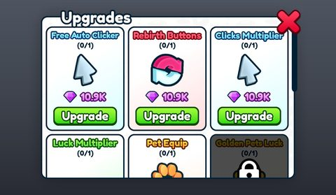</a> <b>MainUI</b> › Menus.UpgradesFrame</td>
<td width="33%" valign="top"><a href="screenshots/35_FarmUpgrade.jpg">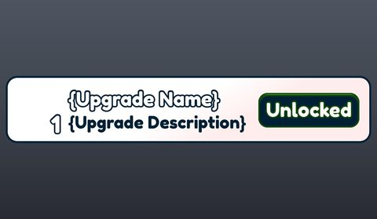</a> <b>FarmUpgrade</b></td>
<td width="33%" valign="top"><a href="screenshots/38_Achievement.jpg">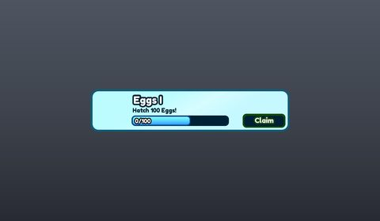</a> <b>Achievement</b></td>
</tr>
</table>

### Trading

<table>
<tr>
<td width="33%" valign="top"><a href="screenshots/04_MainUI__HoverTradeList.jpg">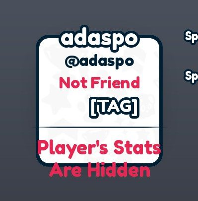</a> <b>MainUI</b> › HUD.Hovers.HoverTradeList</td>
<td width="33%" valign="top"><a href="screenshots/06_MainUI__HoverTradeList.jpg">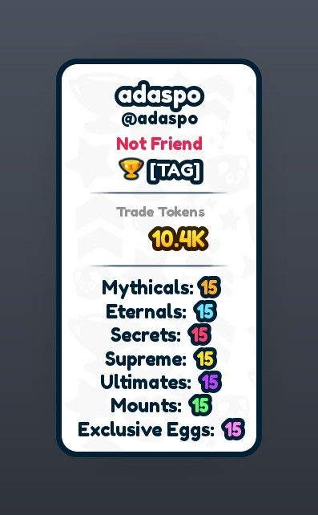</a> <b>MainUI</b> › HUD.Hovers.HoverTradeList</td>
<td width="33%" valign="top"><a href="screenshots/14_MainUI__TradeListFrame.jpg">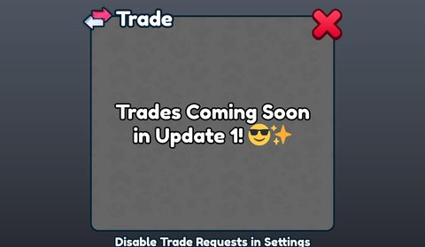</a> <b>MainUI</b> › Menus.TradeListFrame</td>
</tr>
<tr>
<td width="33%" valign="top"><a href="screenshots/16_MainUI__TradeFrame.jpg">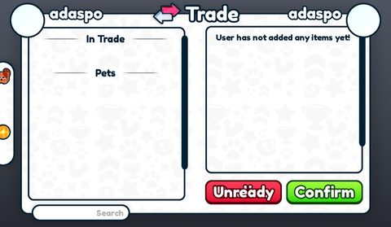</a> <b>MainUI</b> › Menus.TradeFrame</td>
<td width="33%" valign="top"><a href="screenshots/29_TradeListPlayer.jpg">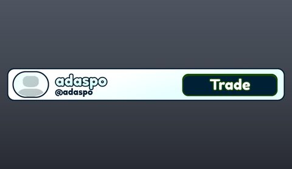</a> <b>TradeListPlayer</b></td>
<td width="33%" valign="top"><a href="screenshots/40_TradingPlazaServer.jpg">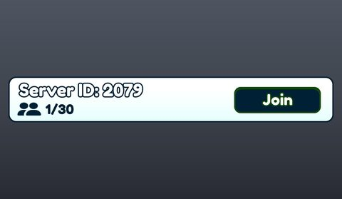</a> <b>TradingPlazaServer</b></td>
</tr>
</table>

### Settings & menus

<table>
<tr>
<td width="33%" valign="top"><a href="screenshots/10_MainUI__EggDisplayFrame.jpg">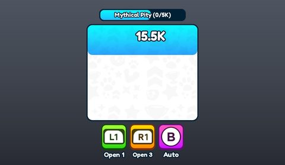</a> <b>MainUI</b> › Menus.EggDisplayFrame</td>
<td width="33%" valign="top"><a href="screenshots/18_MainUI__TeleportFrame.jpg">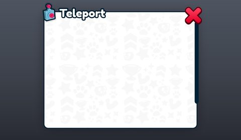</a> <b>MainUI</b> › Menus.TeleportFrame</td>
<td width="33%" valign="top"><a href="screenshots/34_Title.jpg">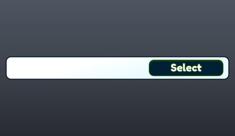</a> <b>Title</b></td>
</tr>
</table>

### Popups, notifications, prompts

<table>
<tr>
<td width="33%" valign="top"><a href="screenshots/11_MainUI__ExclusiveEggConfirmFrame.jpg">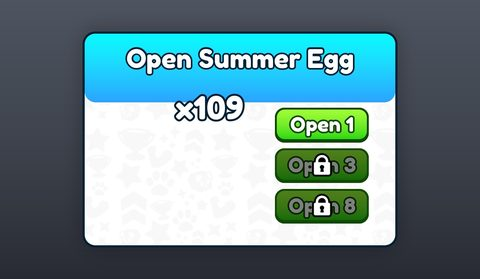</a> <b>MainUI</b> › Menus.ExclusiveEggConfirmFrame</td>
<td width="33%" valign="top"><a href="screenshots/12_MainUI__MessagePopupFrame.jpg">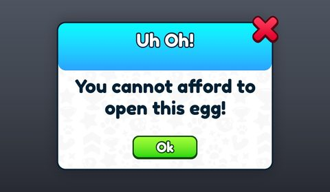</a> <b>MainUI</b> › Menus.MessagePopupFrame</td>
</tr>
</table>

### Leaderboards & stats

<table>
<tr>
<td width="33%" valign="top"><a href="screenshots/28_ClanTop.jpg">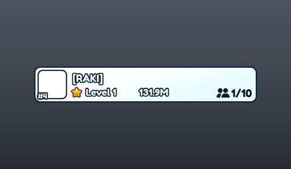</a> <b>ClanTop</b></td>
<td width="33%" valign="top"><a href="screenshots/41_Leaderboard.jpg">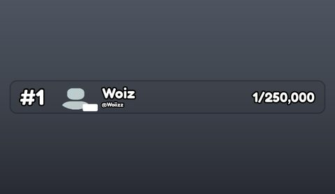</a> <b>Leaderboard</b></td>
</tr>
</table>

### Crafting, fusing, machines

<table>
<tr>
<td width="33%" valign="top"><a href="screenshots/20_MainUI__GoldenMachineFrame.jpg">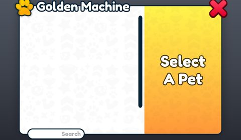</a> <b>MainUI</b> › Menus.GoldenMachineFrame</td>
<td width="33%" valign="top"><a href="screenshots/21_MainUI__FarmingMachineFrame.jpg">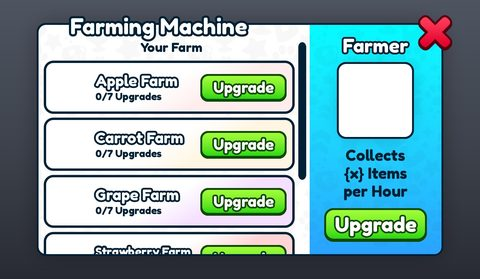</a> <b>MainUI</b> › Menus.FarmingMachineFrame</td>
<td width="33%" valign="top"><a href="screenshots/24_MainUI__AurasMachineFrame.jpg">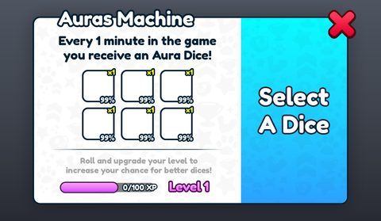</a> <b>MainUI</b> › Menus.AurasMachineFrame</td>
</tr>
</table>

### HUD & currency

<table>
<tr>
<td width="33%" valign="top"><a href="screenshots/01_MainUI.jpg">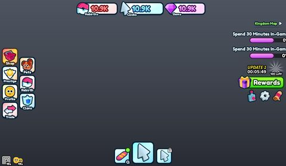</a> <b>MainUI</b></td>
<td width="33%" valign="top"><a href="screenshots/03_MainUI__HoverExclusive.jpg">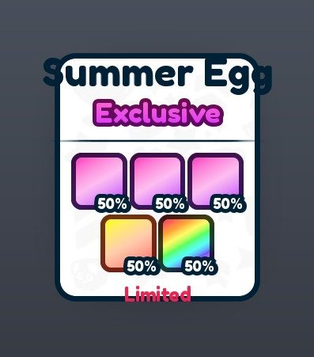</a> <b>MainUI</b> › HUD.Hovers.HoverExclusive</td>
<td width="33%" valign="top"> <b>MainUI</b> › Menus.InventoryFrame.Bottom</td>
</tr>
</table>

### Other

<table>
<tr>
<td width="33%" valign="top"><a href="screenshots/26_ClanInvite.jpg">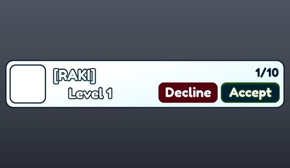</a> <b>ClanInvite</b></td>
<td width="33%" valign="top"> <b>Player</b></td>
<td width="33%" valign="top"><a href="screenshots/31_Teleport.jpg">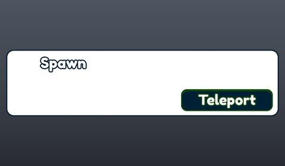</a> <b>Teleport</b></td>
</tr>
<tr>
<td width="33%" valign="top"><a href="screenshots/32_Hatch.jpg">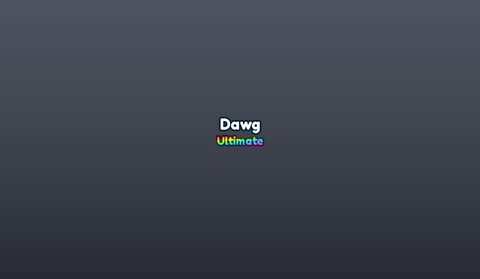</a> <b>Hatch</b></td>
<td width="33%" valign="top"> <b>SupporterPack</b></td>
</tr>
</table>

## Model previews

<table>
<tr>
<td width="25%" valign="top"><a href="models/Workspace/Game/Maps/Desert/Models/_.rbxm">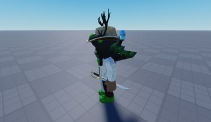</a> <b>_</b> <code>models/Workspace/Game/Maps/Desert/Models/_.rbxm</code></td>
<td width="25%" valign="top"><a href="models/Workspace/Game/Maps/Spawn/MiniChests/MiniChest__x10.rbxm">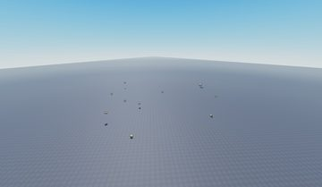</a> <b>MiniChest__x10</b> <code>models/Workspace/Game/Maps/Spawn/MiniChests/MiniChest__x10.rbxm</code></td>
<td width="25%" valign="top"><a href="models/Workspace/Game/Maps/Kingdom/ClanCastle/MainUpgrades/Candle%20Stands.rbxm">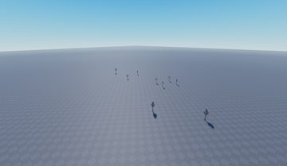</a> <b>Candle Stands</b> <code>models/Workspace/Game/Maps/Kingdom/ClanCastle/MainUpgrades/Candle Stands.rbxm</code></td>
<td width="25%" valign="top"><a href="models/ReplicatedStorage/Assets/Axes/RubyAxe.rbxm">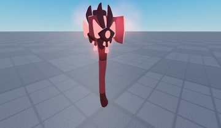</a> <b>RubyAxe</b> <code>models/ReplicatedStorage/Assets/Axes/RubyAxe.rbxm</code></td>
</tr>
<tr>
<td width="25%" valign="top"><a href="models/ReplicatedStorage/Assets/Pets/Cthulhu.rbxm">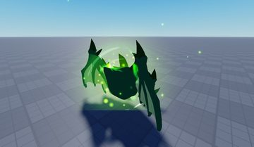</a> <b>Cthulhu</b> <code>models/ReplicatedStorage/Assets/Pets/Cthulhu.rbxm</code></td>
<td width="25%" valign="top"><a href="models/Workspace/Game/Maps/Spawn/Leaderboards/EggsOpened.rbxm">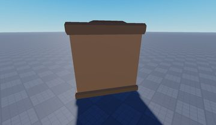</a> <b>EggsOpened</b> <code>models/Workspace/Game/Maps/Spawn/Leaderboards/EggsOpened.rbxm</code></td>
<td width="25%" valign="top"><a href="models/Workspace/Game/Maps/Farm/Machines/GoldenMachine.rbxm">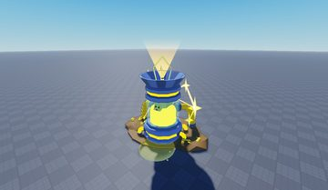</a> <b>GoldenMachine</b> <code>models/Workspace/Game/Maps/Farm/Machines/GoldenMachine.rbxm</code></td>
<td width="25%" valign="top"><a href="models/ReplicatedStorage/Assets/Booths/MagmaBooth.rbxm">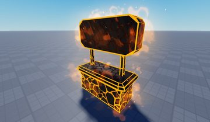</a> <b>MagmaBooth</b> <code>models/ReplicatedStorage/Assets/Booths/MagmaBooth.rbxm</code></td>
</tr>
<tr>
<td width="25%" valign="top"><a href="models/ReplicatedStorage/Assets/Other/Hammer.rbxm">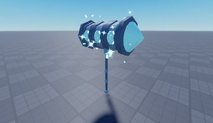</a> <b>Hammer</b> <code>models/ReplicatedStorage/Assets/Other/Hammer.rbxm</code></td>
<td width="25%" valign="top"><a href="models/Workspace/Game/Maps/Spawn/Leaderboards/Rewards.rbxm">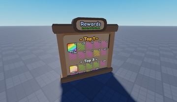</a> <b>Rewards</b> <code>models/Workspace/Game/Maps/Spawn/Leaderboards/Rewards.rbxm</code></td>
<td width="25%" valign="top"><a href="models/Workspace/Game/Maps/Farm/Models/Meshes_stuff_Plane.rbxm">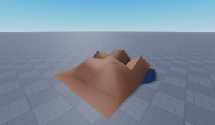</a> <b>Meshes_stuff_Plane</b> <code>models/Workspace/Game/Maps/Farm/Models/Meshes_stuff_Plane.rbxm</code></td>
<td width="25%" valign="top"><a href="models/Workspace/Game/Maps/Desert/Trees/Tree13/Model.rbxm">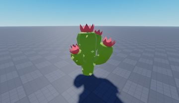</a> <b>Model</b> <code>models/Workspace/Game/Maps/Desert/Trees/Tree13/Model.rbxm</code></td>
</tr>
<tr>
<td width="25%" valign="top"> <b>Key</b> <code>models/ReplicatedStorage/Assets/Other/Key.rbxm</code></td>
<td width="25%" valign="top"> <b>InfoTP</b> <code>models/Workspace/Game/Maps/Spawn/Machines/TradingPlaza/InfoTP.rbxm</code></td>
</tr>
</table>

## Notable scripts

Top-scored scripts of this game per topic (full tree in [source/scripts](source/scripts/)).

| Topic | Scripts |
|---|---|
| UI animation (tweens, hover / click, pop-ins, springs) | [`UIController`](source/scripts/StarterPlayer/StarterPlayerScripts/Client/Controllers/UIController.lua) 937 lines [`HatchingController`](source/scripts/StarterPlayer/StarterPlayerScripts/Client/Controllers/HatchingController.lua) 642 lines [`Pet`](source/scripts/StarterPlayer/StarterPlayerScripts/Client/Controllers/UIController/UIs/Pet.lua) 354 lines [`ShopFrame`](source/scripts/StarterPlayer/StarterPlayerScripts/Client/Components/UI/Frames/ShopFrame.lua) 1302 lines [`ExclusiveEggController`](source/scripts/StarterPlayer/StarterPlayerScripts/Client/Controllers/ExclusiveEggController.lua) 530 lines |
| UI controllers / window managers / menus | [`UIController`](source/scripts/StarterPlayer/StarterPlayerScripts/Client/Controllers/UIController.lua) 937 lines [`Menu`](source/scripts/StarterPlayer/StarterPlayerScripts/Client/Modules/Iris/widgets/Menu.lua) 677 lines [`demoWindow`](source/scripts/StarterPlayer/StarterPlayerScripts/Client/Modules/Iris/demoWindow.lua) 1456 lines [`Window`](source/scripts/StarterPlayer/StarterPlayerScripts/Client/Modules/Iris/widgets/Window.lua) 915 lines [`UpgradesFrame`](source/scripts/StarterPlayer/StarterPlayerScripts/Client/Components/UI/Frames/UpgradesFrame.lua) 146 lines |
| Notifications, toasts, popups, prompts | [`MessagePopupFrame`](source/scripts/StarterPlayer/StarterPlayerScripts/Client/Components/UI/Frames/MessagePopupFrame.lua) 137 lines [`TradingPlazaController`](source/scripts/StarterPlayer/StarterPlayerScripts/Client/Controllers/TradingPlazaController.lua) 414 lines [`LightSwitch`](source/scripts/StarterPlayer/StarterPlayerScripts/Client/Components/World/LightSwitch.lua) 171 lines [`EggController`](source/scripts/StarterPlayer/StarterPlayerScripts/Client/Controllers/EggController.lua) 744 lines [`RebirthFrame`](source/scripts/StarterPlayer/StarterPlayerScripts/Client/Components/UI/Frames/RebirthFrame.lua) 422 lines |
| Camera, cutscenes, screen shake | [`Secret`](source/scripts/StarterPlayer/StarterPlayerScripts/Client/Controllers/HatchingController/Animations/Secret.lua) 395 lines [`AuraController`](source/scripts/StarterPlayer/StarterPlayerScripts/Client/Controllers/AuraController.lua) 642 lines [`Eternal`](source/scripts/StarterPlayer/StarterPlayerScripts/Client/Controllers/HatchingController/Animations/Eternal.lua) 162 lines [`ExclusiveEggController`](source/scripts/StarterPlayer/StarterPlayerScripts/Client/Controllers/ExclusiveEggController.lua) 530 lines [`MapController`](source/scripts/StarterPlayer/StarterPlayerScripts/Client/Controllers/MapController.lua) 194 lines |
| VFX, particles, beams, hit effects | [`AuraController`](source/scripts/StarterPlayer/StarterPlayerScripts/Client/Controllers/AuraController.lua) 642 lines [`Mythical`](source/scripts/StarterPlayer/StarterPlayerScripts/Client/Controllers/HatchingController/Animations/Mythical.lua) 148 lines [`MiniChest`](source/scripts/StarterPlayer/StarterPlayerScripts/Client/Components/World/MiniChest.lua) 193 lines [`PlayerController`](source/scripts/StarterPlayer/StarterPlayerScripts/Client/Controllers/PlayerController.lua) 188 lines |
| DataStore / player data | [`DataService`](source/scripts/ServerScriptService/Services/DataService.lua) 507 lines [`ClanService`](source/scripts/ServerScriptService/Services/ClanService.lua) 921 lines |
| Monetization (dev products, game passes, receipts) | [`ShopService`](source/scripts/ServerScriptService/Services/ShopService.lua) 378 lines [`ShopFrame`](source/scripts/StarterPlayer/StarterPlayerScripts/Client/Components/UI/Frames/ShopFrame.lua) 1302 lines |
| RNG, eggs, gacha, rarity rolls, pets | [`EggService`](source/scripts/ServerScriptService/Services/EggService.lua) 407 lines [`InventoryService`](source/scripts/ServerScriptService/Services/InventoryService.lua) 361 lines [`EggController`](source/scripts/StarterPlayer/StarterPlayerScripts/Client/Controllers/EggController.lua) 744 lines [`RewardService`](source/scripts/ServerScriptService/Services/RewardService.lua) 337 lines [`PetUtils`](source/scripts/ReplicatedStorage/Shared/Util/PetUtils.lua) 133 lines |
| Trading systems | [`TradeService`](source/scripts/ServerScriptService/Services/TradeService.lua) 518 lines [`TradingPlazaController`](source/scripts/StarterPlayer/StarterPlayerScripts/Client/Controllers/TradingPlazaController.lua) 414 lines [`TradeRequestFrame`](source/scripts/StarterPlayer/StarterPlayerScripts/Client/Components/UI/Frames/TradeRequestFrame.lua) 134 lines [`TradeFrame`](source/scripts/StarterPlayer/StarterPlayerScripts/Client/Components/UI/Frames/TradeFrame.lua) 950 lines [`TradeListFrame`](source/scripts/StarterPlayer/StarterPlayerScripts/Client/Components/UI/Frames/TradeListFrame.lua) 235 lines |
| Character movement (sprint, dash, double jump, slide) | [`demoWindow`](source/scripts/StarterPlayer/StarterPlayerScripts/Client/Modules/Iris/demoWindow.lua) 1456 lines [`Input`](source/scripts/StarterPlayer/StarterPlayerScripts/Client/Modules/Iris/widgets/Input.lua) 1741 lines [`IconOld`](source/scripts/StarterPlayer/StarterPlayerScripts/Client/Modules/IconOld.lua) 4686 lines |
| Tycoon / plots / bases / building | [`DataService`](source/scripts/ServerScriptService/Services/DataService.lua) 507 lines [`BuildConfirmFrame`](source/scripts/StarterPlayer/StarterPlayerScripts/Client/Components/UI/Frames/BuildConfirmFrame.lua) 314 lines [`PetController`](source/scripts/StarterPlayer/StarterPlayerScripts/Client/Controllers/PetController.lua) 492 lines [`config`](source/scripts/StarterPlayer/StarterPlayerScripts/Client/Modules/Iris/config.lua) 223 lines [`demoWindow`](source/scripts/StarterPlayer/StarterPlayerScripts/Client/Modules/Iris/demoWindow.lua) 1456 lines |
| Leaderboards & stats | [`LeaderboardService`](source/scripts/ServerScriptService/Services/LeaderboardService.lua) 125 lines |
| Sound & music | [`SoundController`](source/scripts/StarterPlayer/StarterPlayerScripts/Client/Controllers/SoundController.lua) 284 lines [`IconOld`](source/scripts/StarterPlayer/StarterPlayerScripts/Client/Modules/IconOld.lua) 4686 lines |
| Daily rewards, quests, codes, playtime | [`RewardService`](source/scripts/ServerScriptService/Services/RewardService.lua) 337 lines [`RewardsFrame`](source/scripts/StarterPlayer/StarterPlayerScripts/Client/Components/UI/Frames/RewardsFrame.lua) 515 lines [`DataService`](source/scripts/ServerScriptService/Services/DataService.lua) 507 lines [`CodesService`](source/scripts/ServerScriptService/Services/CodesService.lua) 52 lines [`FarmService`](source/scripts/ServerScriptService/Services/FarmService.lua) 239 lines |
| Utility modules (number format, signals, tables, timers) | [`PetUtils`](source/scripts/ReplicatedStorage/Shared/Util/PetUtils.lua) 133 lines [`MapWall`](source/scripts/StarterPlayer/StarterPlayerScripts/Client/Components/World/MapWall.lua) 194 lines [`RebirthFrame`](source/scripts/StarterPlayer/StarterPlayerScripts/Client/Components/UI/Frames/RebirthFrame.lua) 422 lines [`EggController`](source/scripts/StarterPlayer/StarterPlayerScripts/Client/Controllers/EggController.lua) 744 lines [`FormatTime`](source/scripts/ReplicatedStorage/Shared/Functions/FormatTime.lua) 20 lines |

### In the curated script library

- [Chests, playtime and achievement claims](../../Scripts/18-Daily-Rewards-Quests/RewardService-ChestsPlaytimeAchievements__rcu-roller.lua) — Timed chests with cooldowns and weighted loot, one-time mini chests, playtime milestones checked against session time, tiered achievements (category+tier keys), ticket shop and a weighted wheel.
- [Knit DataService with big template](../../Scripts/07-Data-Saving/DataService-Knit-Replica__rcu-roller.lua) — Knit service with a very large commented default template, deep reconcile, path-based Set/Increment through a Replica, 5-minute autosave, and a 1-second boost countdown.
- [Config-driven Knit board service](../../Scripts/15-Leaderboards/LeaderboardService-Knit__rcu-roller.lua) — Knit service that, for each board in a shared config, uploads online players, reads the top 100, attaches cached user infos (display name, verified badge) and fires one signal to clients.
- [Server egg hatching (Knit)](../../Scripts/09-RNG-Gacha-Pets/EggHatchService__rcu-roller.lua) — Full server-authoritative egg opening: rate limit, amount clamp, currency check, luck via weight^(1/luck), Golden/Toxic tier roll, stacking duplicates, index tracking, quest hooks, global luck events.
- [Pet equip / lock / delete service](../../Scripts/09-RNG-Gacha-Pets/PetEquipService__rcu-roller.lua) — Server pet inventory actions: equip with slot cap from upgrades + gamepasses, unequip, delete (blocked if locked), lock toggle, nickname length cap.
- [Pet formation offsets (rows / arcs)](../../Scripts/09-RNG-Gacha-Pets/PetRowFormation__rcu-roller.lua) — Pure function that lays equipped pets out in up to 3 arcs behind the player (small pets front, big pets middle, huge pets back) and returns a CFrame offset per pet.
- [Luck multiplier stacking](../../Scripts/09-RNG-Gacha-Pets/LuckStack__rcu-roller.lua) — One function that adds every luck source together: server flag, global event, upgrades, gamepasses, potions, fruits, events and the equipped aura. Same code runs on client (for display) and server (for the roll).
- [Luck that moves % from common to rare](../../Scripts/09-RNG-Gacha-Pets/LuckChanceShift__rcu-roller.lua) — getNewChances: multiplies the chance of 'luck-affected' pets and subtracts the same total from the common pets so the egg still sums to 100%. Also pet descriptor / rarity helpers.
- [Aura dice roll + aura levels](../../Scripts/09-RNG-Gacha-Pets/AuraRoll__rcu-roller.lua) — Bundle of AuraService (consume a dice item, roll an aura on the server) and AuraUtils (luck redistribution with clamping, aura XP level/progress).
- [Knit trade service](../../Scripts/10-Trading/KnitTradeService__rcu-roller.lua) — Knit trade of stackable items plus currency tokens with separate ready and confirm stages.
- [Trading plaza booths](../../Scripts/10-Trading/TradingPlazaBooths__rcu-roller.lua) — Booth marketplace with escrowed listings and token purchases (has known bugs, see README).
- [Truncating suffix formatter](../../Scripts/19-Utility/Suffixes-Truncating__rcu-roller.lua) — One-function abbreviator that FLOORS to N decimals instead of rounding, so 1999 shows 1.99K and never more money than the player has.

## Folders

| Folder | What |
|---|---|
| `screenshots/` | full frames; `crops/` = the panel only; `models/` = 3D previews; `thumbs/` = gallery thumbnails |
| `ui/` | every screen as a Lua builder (`require(module)()` returns the ScreenGui); `_StarterGui-all.lua` builds every StarterGui screen |
| `models/` | every model as .rbxm (the only .rbxm files), mirroring the place tree, scripts removed |
| `map/` | `workspace.rbxm` (the map as a model), `lighting.lua` (sky + post effects), `materials.lua`, `Environment.lua` |
| `animations/`, `audio/` | KeyframeSequence / Sound builders (.lua), `AnimationIds.lua`, `Sounds.lua` |
| `source/` | all scripts as .luau, `tree.txt`, `ui.txt`, `remotes.txt`, `assets.txt`, `flags.txt` |
