# Retro Studio

> 🧱 **Sandbox** · retro sandbox (2008-style UI, bevels) · source file `Retro-Studio.rbxl`

[⬅ Back to the catalog](../../README.md) · [Assets inventory](ASSETS.md) · [Style numbers](reference.md) · [Scripts](source/scripts/) · [Code analysis](source/README.md)

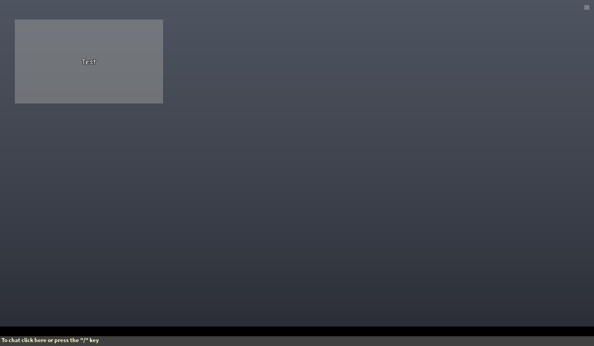

## At a glance

| | |
|---|---|
| Provenance | template with full source |
| Screens | 2 ScreenGuis, 66 GUI objects → **2 screenshots** |
| Models (.rbxm) | 27 models, 0 model sets, 1 VFX sets |
| Lua builders (.lua) | 5 UI screens, 0 animation packs, 0 audio packs |
| Code | 125 scripts, 15,454 lines |
| Asset ids | 0 animations, 21 sounds |
| Safety scan | 0 HIGH / 0 MED flags ([flags.txt](source/flags.txt)) |

**Fonts:** `ComicNeueAngular Regular`×15, `Arial Bold`×2, `SourceSansPro Regular`×1, `SourceSansPro Bold`×1

## UI screenshots

Captured in Studio from the place's own ScreenGuis (scripts stripped). Each panel was opened on its own; click a thumbnail for the full 1519×886 frame. Runtime-filled lists (shop items, inventories) show their template state.

### End of round, death, results

<table>
<tr>
<td width="33%" valign="top"><a href="screenshots/02_UI__HelpWindow.jpg">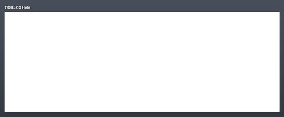</a> <b>UI</b> › HelpWindow</td>
</tr>
</table>

### Other

<table>
<tr>
<td width="33%" valign="top"><a href="screenshots/01_UI.jpg">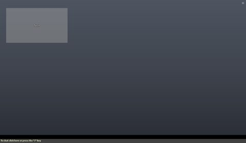</a> <b>UI</b></td>
</tr>
</table>

## Model previews

<table>
<tr>
<td width="25%" valign="top"><a href="models/ServerStorage/StandardTools/Plane.rbxm">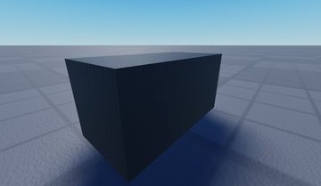</a> <b>Plane</b> <code>models/ServerStorage/StandardTools/Plane.rbxm</code></td>
<td width="25%" valign="top"><a href="models/ServerStorage/StandardTools/PaintballGun.rbxm">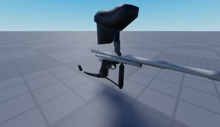</a> <b>PaintballGun</b> <code>models/ServerStorage/StandardTools/PaintballGun.rbxm</code></td>
<td width="25%" valign="top"><a href="models/ServerStorage/StandardTools/RocketLauncher.rbxm">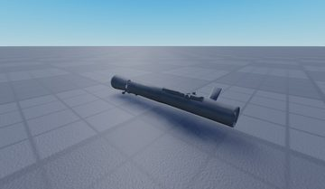</a> <b>RocketLauncher</b> <code>models/ServerStorage/StandardTools/RocketLauncher.rbxm</code></td>
<td width="25%" valign="top"><a href="models/ServerStorage/StandardTools/Sword.rbxm">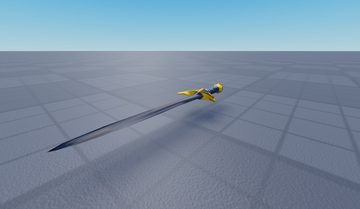</a> <b>Sword</b> <code>models/ServerStorage/StandardTools/Sword.rbxm</code></td>
</tr>
<tr>
<td width="25%" valign="top"><a href="models/ServerStorage/StandardTools/GravityHammer.rbxm">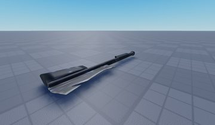</a> <b>GravityHammer</b> <code>models/ServerStorage/StandardTools/GravityHammer.rbxm</code></td>
<td width="25%" valign="top"><a href="models/ServerStorage/StandardTools/Slingshot.rbxm">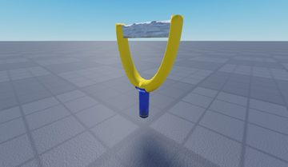</a> <b>Slingshot</b> <code>models/ServerStorage/StandardTools/Slingshot.rbxm</code></td>
<td width="25%" valign="top"><a href="models/ServerStorage/StandardTools/Trowel.rbxm">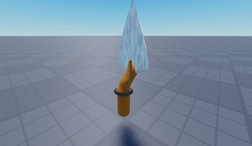</a> <b>Trowel</b> <code>models/ServerStorage/StandardTools/Trowel.rbxm</code></td>
<td width="25%" valign="top"><a href="models/ServerStorage/StandardTools/Superball.rbxm">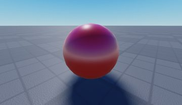</a> <b>Superball</b> <code>models/ServerStorage/StandardTools/Superball.rbxm</code></td>
</tr>
<tr>
<td width="25%" valign="top"><a href="models/ServerStorage/StandardTools/Timebomb.rbxm">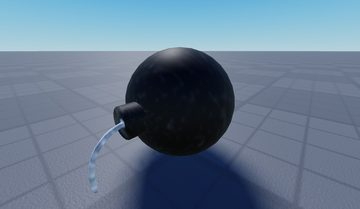</a> <b>Timebomb</b> <code>models/ServerStorage/StandardTools/Timebomb.rbxm</code></td>
</tr>
</table>

## Notable scripts

Top-scored scripts of this game per topic (full tree in [source/scripts](source/scripts/)).

| Topic | Scripts |
|---|---|
| UI animation (tweens, hover / click, pop-ins, springs) | [`Dragger`](source/scripts/ServerScriptService/BuildTools/Dragger.client.lua) 250 lines |
| UI controllers / window managers / menus | [`Main`](source/scripts/StarterPlayer/StarterPlayerScripts/Camera/Main.lua) 1042 lines [`Topbar`](source/scripts/ReplicatedFirst/JoinScript/UI/Topbar/Topbar.client.lua) 191 lines |
| Notifications, toasts, popups, prompts | [`Chat`](source/scripts/ReplicatedFirst/JoinScript/UI/Chat/Chat.client.lua) 188 lines [`Topbar`](source/scripts/ReplicatedFirst/JoinScript/UI/Topbar/Topbar.client.lua) 191 lines [`JoinScript`](source/scripts/ReplicatedFirst/JoinScript.client.lua) 260 lines |
| Loading / intro screens | [`JoinScript`](source/scripts/ReplicatedFirst/JoinScript.client.lua) 260 lines |
| VFX, particles, beams, hit effects | [`Explosions`](source/scripts/ServerScriptService/Explosions.server.lua) 186 lines [`Explosions`](source/scripts/StarterPlayer/StarterPlayerScripts/Explosions.client.lua) 58 lines [`SwordScript`](source/scripts/ServerStorage/StandardTools/GravityHammer/SwordScript.server.lua) 158 lines [`RocketScript`](source/scripts/ServerStorage/StandardTools/RocketLauncher/RocketScript.server.lua) 92 lines |
| DataStore / player data | [`PlayerDataStore`](source/scripts/ServerStorage/PlayerDataStore.lua) 831 lines |
| Combat, weapons, hitboxes, abilities | [`SwordScript`](source/scripts/ServerStorage/StandardTools/Sword/SwordScript.server.lua) 181 lines |
| Character movement (sprint, dash, double jump, slide) | [`RetroClimbing`](source/scripts/StarterPlayer/StarterCharacterScripts/RetroClimbing.client.lua) 239 lines [`Animator`](source/scripts/StarterPlayer/StarterPlayerScripts/Animator.client.lua) 276 lines [`HumanoidSound`](source/scripts/StarterPlayer/StarterPlayerScripts/HumanoidSound.client.lua) 142 lines [`GoofyMotion`](source/scripts/StarterPlayer/StarterCharacterScripts/GoofyMotion.client.lua) 72 lines |
| Tycoon / plots / bases / building | [`BuildTools`](source/scripts/ServerScriptService/BuildTools.server.lua) 243 lines |
| Leaderboards & stats | [`Leaderboard`](source/scripts/ServerScriptService/Leaderboard.server.lua) 195 lines |

### In the curated script library

- [Classic explosion physics](../../Scripts/11-Combat/ClassicExplosionPhysics__retro-studio.lua) — How the original Roblox explosion worked, ported to Lua with the engine code in comments.
- [Classic sword (slash / lunge)](../../Scripts/11-Combat/ClassicSword__retro-studio.lua) — The classic Linked Sword: slash vs lunge damage, Touched hitbox, creator tag.
- [Stravant's PlayerDataStore (classic)](../../Scripts/07-Data-Saving/PlayerDataStore-Stravant__retro-studio.lua) — The classic community PlayerDataStore module (by Stravant): cached SaveData objects, passive saves, Flush, and atomic multi-key Update meant for dev product purchases.
- [Retro Bricks/Connectors join screen](../../Scripts/04-Loading-Screens/RetroJoinScreen__retro-studio.lua) — Old-Roblox-style join screen: 'Bricks / Connectors' counter from RequestQueueSize, camera orbiting the map's visible extents while loading, timeout + exit override.
- [Custom climbing](../../Scripts/13-Movement/CustomClimbing__retro-studio.lua) — Hand-made ladder/truss climbing (rung detection + velocity mover + debug rays).

## Folders

| Folder | What |
|---|---|
| `screenshots/` | full frames; `crops/` = the panel only; `models/` = 3D previews; `thumbs/` = gallery thumbnails |
| `ui/` | every screen as a Lua builder (`require(module)()` returns the ScreenGui); `_StarterGui-all.lua` builds every StarterGui screen |
| `models/` | every model as .rbxm (the only .rbxm files), mirroring the place tree, scripts removed |
| `map/` | `workspace.rbxm` (the map as a model), `lighting.lua` (sky + post effects), `materials.lua`, `Environment.lua` |
| `animations/`, `audio/` | KeyframeSequence / Sound builders (.lua), `AnimationIds.lua`, `Sounds.lua` |
| `source/` | all scripts as .luau, `tree.txt`, `ui.txt`, `remotes.txt`, `assets.txt`, `flags.txt` |
