# RIVALS (modded)

> 🔫 **Shooter** · arena FPS (duels) · source file `SLBR - RIVALS MODDED - BOOSTER.rbxl`

[⬅ Back to the catalog](../../README.md) · [Assets inventory](ASSETS.md) · [Style numbers](reference.md) · [Scripts](source/scripts/) · [Code analysis](source/README.md)

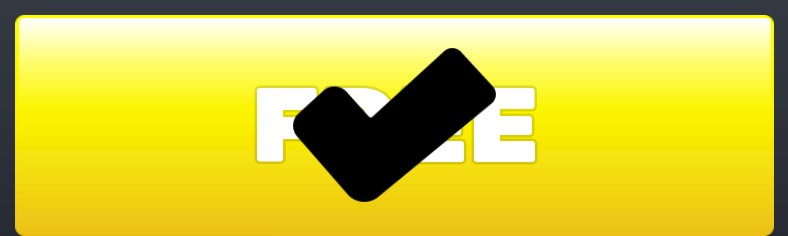

## At a glance

| | |
|---|---|
| Provenance | copy of a live game (saveinstance / decompiled client code) |
| Screens | 11 ScreenGuis, 1269 GUI objects → **107 screenshots** |
| Models (.rbxm) | 2429 models, 41 model sets, 6 VFX sets |
| Lua builders (.lua) | 282 UI screens, 1 animation packs, 51 audio packs |
| Code | 2154 scripts, 247,103 lines |
| Asset ids | 89 animations, 155 sounds |
| Safety scan | 0 HIGH / 8 MED flags ([flags.txt](source/flags.txt)) |

**Fonts:** `Rubik Bold`×53, `Rubik Heavy`×41, `Rubik Medium`×35, `Rubik ExtraBold`×33, `Rubik SemiBold`×12

## UI screenshots

Captured in Studio from the place's own ScreenGuis (scripts stripped). Each panel was opened on its own; click a thumbnail for the full 1519×886 frame. Runtime-filled lists (shop items, inventories) show their template state.

### Shop & Robux store

<table>
<tr>
<td width="33%" valign="top"><a href="screenshots/27_StoredStreakSlot.jpg">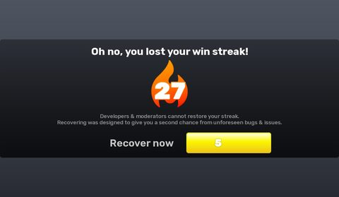</a> <b>StoredStreakSlot</b></td>
<td width="33%" valign="top"><a href="screenshots/44_BattlePassRewardSlot.jpg">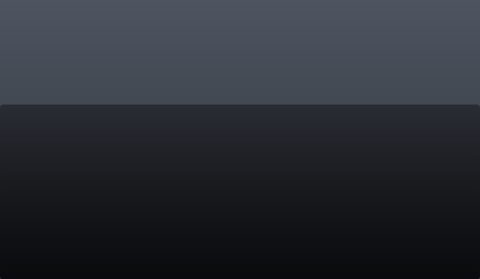</a> <b>BattlePassRewardSlot</b></td>
<td width="33%" valign="top"><a href="screenshots/58_ShopSlot__Price.jpg">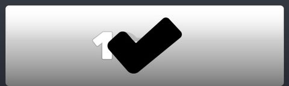</a> <b>ShopSlot</b> › Details.Buy.Price</td>
</tr>
<tr>
<td width="33%" valign="top"><a href="screenshots/59_ShopSlot__Locked.jpg">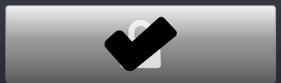</a> <b>ShopSlot</b> › Details.Buy.Locked</td>
<td width="33%" valign="top"><a href="screenshots/60_ShopSlot__Robux.jpg">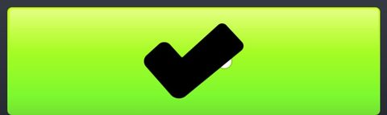</a> <b>ShopSlot</b> › Details.Buy.Robux</td>
<td width="33%" valign="top"> <b>ShopSlot</b> › Details.Buy.Limited</td>
</tr>
<tr>
<td width="33%" valign="top"> <b>ShopSlot</b> › Details.Buy.Free</td>
<td width="33%" valign="top"><a href="screenshots/63_ShopBigSlot.jpg">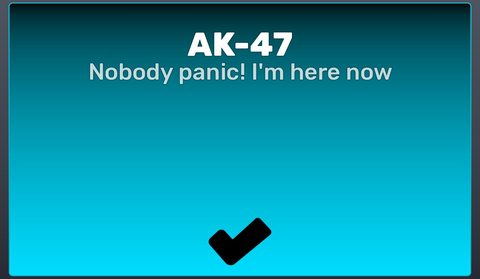</a> <b>ShopBigSlot</b></td>
<td width="33%" valign="top"> <b>ShopBigSlot</b> › Button.Buy.Free</td>
</tr>
<tr>
<td width="33%" valign="top"> <b>ShopBigSlot</b> › Button.Buy.Limited</td>
<td width="33%" valign="top"> <b>ShopBigSlot</b> › Button.Buy.Locked</td>
<td width="33%" valign="top"> <b>ShopBigSlot</b> › Button.Buy.Price</td>
</tr>
<tr>
<td width="33%" valign="top"><a href="screenshots/68_ShopBigSlot__Robux.jpg">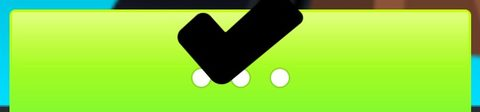</a> <b>ShopBigSlot</b> › Button.Buy.Robux</td>
<td width="33%" valign="top"><a href="screenshots/74_CurrencySlot__Buy.jpg">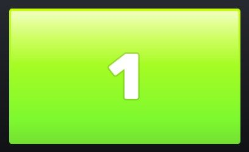</a> <b>CurrencySlot</b> › Buy</td>
<td width="33%" valign="top"> <b>ShopEntryBuyButton</b></td>
</tr>
<tr>
<td width="33%" valign="top"> <b>ShopEntryBuyButton</b> › Free</td>
<td width="33%" valign="top"><a href="screenshots/85_InspectShopEntry.jpg">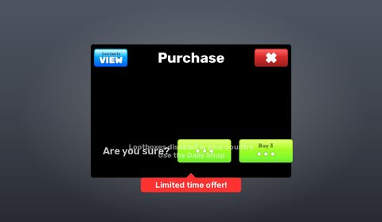</a> <b>InspectShopEntry</b></td>
<td width="33%" valign="top"><a href="screenshots/94_InspectBundle.jpg">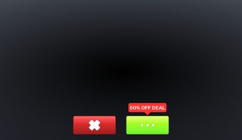</a> <b>InspectBundle</b></td>
</tr>
</table>

### Inventory / backpack / pets

<table>
<tr>
<td width="33%" valign="top"><a href="screenshots/21_ItemInterface.jpg">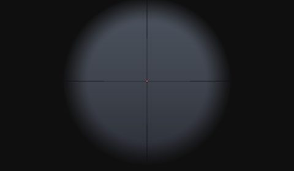</a> <b>ItemInterface</b></td>
<td width="33%" valign="top"><a href="screenshots/84_InspectBackpackReward.jpg">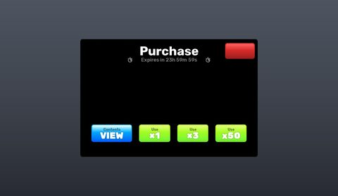</a> <b>InspectBackpackReward</b></td>
<td width="33%" valign="top"><a href="screenshots/110_EquipmentClassSlot.jpg">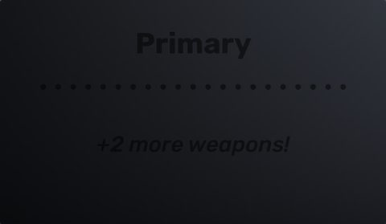</a> <b>EquipmentClassSlot</b></td>
</tr>
</table>

### Rewards, daily, spin, codes

<table>
<tr>
<td width="33%" valign="top"><a href="screenshots/23_TeammateSlot__Streak.jpg">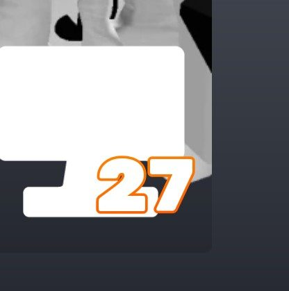</a> <b>TeammateSlot</b> › Container.Streak</td>
<td width="33%" valign="top"> <b>VideoAdRewards</b></td>
<td width="33%" valign="top"><a href="screenshots/36_VideoAdRewards__Unavailable.jpg">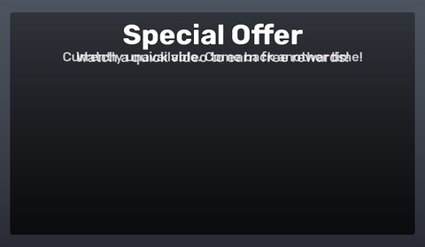</a> <b>VideoAdRewards</b> › Container.Unavailable</td>
</tr>
<tr>
<td width="33%" valign="top"> <b>BattlePassRewardSlot</b> › Container.Claimed</td>
<td width="33%" valign="top"><a href="screenshots/51_RewardSlot__Reward.jpg">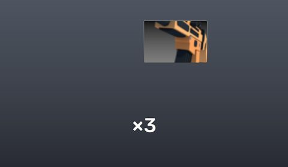</a> <b>RewardSlot</b> › Reward</td>
<td width="33%" valign="top"><a href="screenshots/92_SendOfflineGiftRewards.jpg">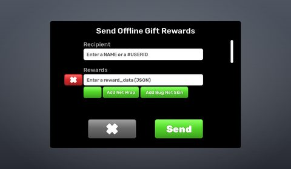</a> <b>SendOfflineGiftRewards</b></td>
</tr>
<tr>
<td width="33%" valign="top"><a href="screenshots/95_SendBugRewards.jpg">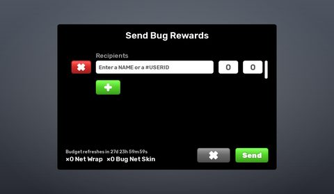</a> <b>SendBugRewards</b></td>
<td width="33%" valign="top"><a href="screenshots/97_InternalViewRewardSlot.jpg">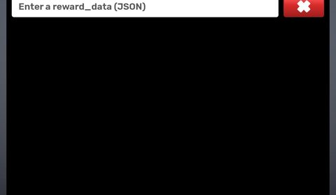</a> <b>InternalViewRewardSlot</b></td>
</tr>
</table>

### Quests & progression

<table>
<tr>
<td width="33%" valign="top"><a href="screenshots/24_TeammateSlot__Level.jpg">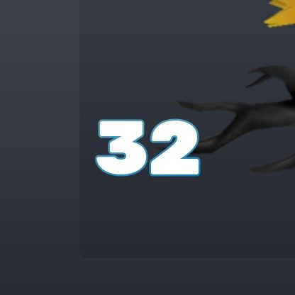</a> <b>TeammateSlot</b> › Container.Level</td>
<td width="33%" valign="top"><a href="screenshots/38_DuelScoresTeamScoreNeededSlot__Progress.jpg">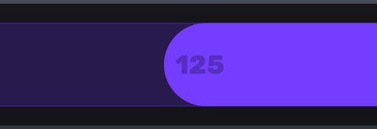</a> <b>DuelScoresTeamScoreNeededSlot</b> › Container.Progress</td>
<td width="33%" valign="top"><a href="screenshots/39_SideTaskSlot.jpg">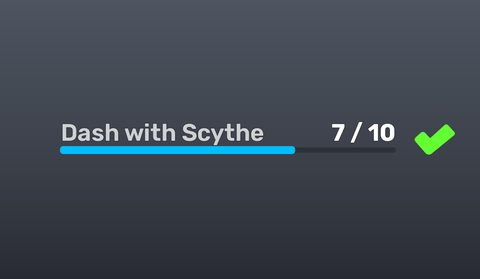</a> <b>SideTaskSlot</b></td>
</tr>
<tr>
<td width="33%" valign="top"><a href="screenshots/49_TaskSlot.jpg">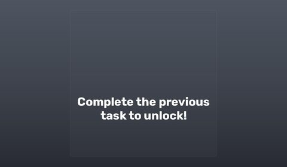</a> <b>TaskSlot</b></td>
<td width="33%" valign="top"><a href="screenshots/50_TaskSlot__Unlocked.jpg">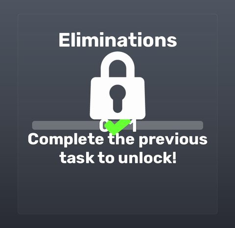</a> <b>TaskSlot</b> › Unlocked</td>
<td width="33%" valign="top"><a href="screenshots/78_TaskContainer.jpg">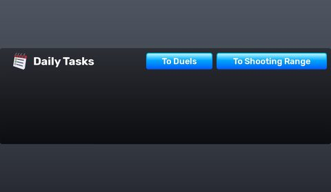</a> <b>TaskContainer</b></td>
</tr>
<tr>
<td width="33%" valign="top"><a href="screenshots/96_ViewPermissionsRoles.jpg">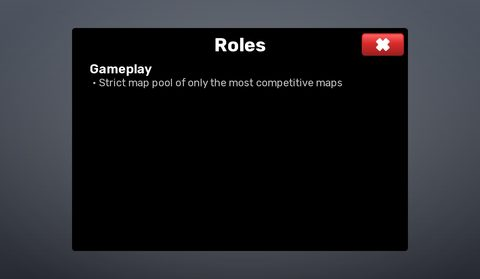</a> <b>ViewPermissionsRoles</b></td>
</tr>
</table>

### Settings & menus

<table>
<tr>
<td width="33%" valign="top"><a href="screenshots/18_SettingHotkeySlot.jpg">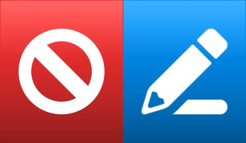</a> <b>SettingHotkeySlot</b></td>
<td width="33%" valign="top"><a href="screenshots/41_SettingInputHotkeysSlot.jpg">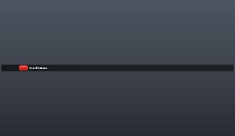</a> <b>SettingInputHotkeysSlot</b></td>
<td width="33%" valign="top"><a href="screenshots/43_LobbyButtonSlot.jpg">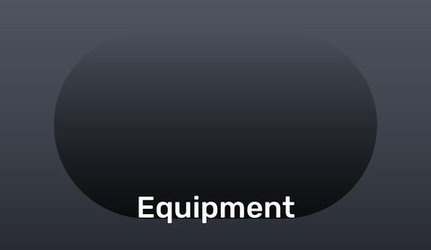</a> <b>LobbyButtonSlot</b></td>
</tr>
<tr>
<td width="33%" valign="top"><a href="screenshots/79_SettingFrame.jpg">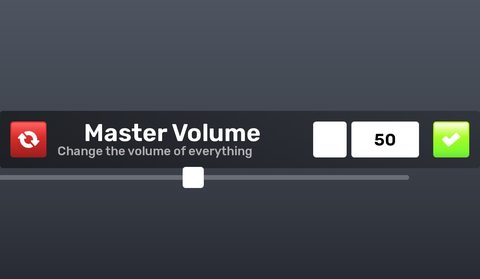</a> <b>SettingFrame</b></td>
<td width="33%" valign="top"><a href="screenshots/80_SettingFrame__Dropdown.jpg">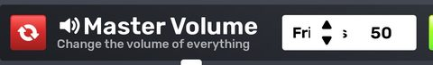</a> <b>SettingFrame</b> › Container.Controls.Container.Dropdown</td>
<td width="33%" valign="top"><a href="screenshots/81_SettingFrame__Toggle.jpg">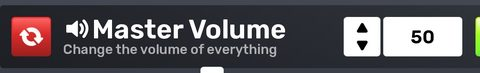</a> <b>SettingFrame</b> › Container.Controls.Container.Toggle</td>
</tr>
<tr>
<td width="33%" valign="top"> <b>SettingFrame</b> › Container.Controls.Container.Hotkey</td>
<td width="33%" valign="top"><a href="screenshots/83_SettingFrame__Color.jpg">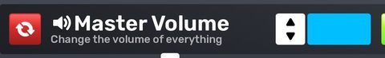</a> <b>SettingFrame</b> › Container.Controls.Container.Color</td>
</tr>
</table>

### Popups, notifications, prompts

<table>
<tr>
<td width="33%" valign="top"><a href="screenshots/16_FighterInterface__Container.jpg">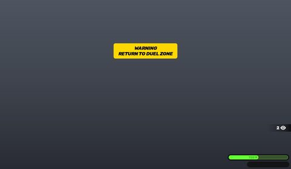</a> <b>FighterInterface</b> › WarningVignette.Container</td>
<td width="33%" valign="top"><a href="screenshots/52_NotificationSlot.jpg">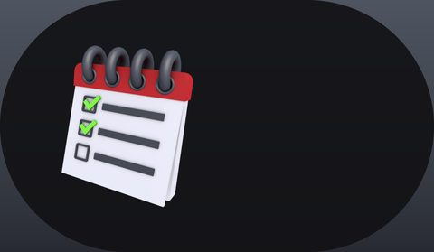</a> <b>NotificationSlot</b></td>
<td width="33%" valign="top"><a href="screenshots/53_NotificationSlot__Container.jpg">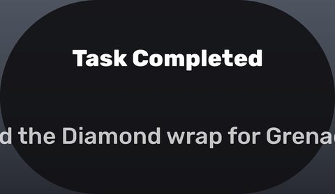</a> <b>NotificationSlot</b> › Visuals.Container</td>
</tr>
<tr>
<td width="33%" valign="top"><a href="screenshots/69_WarningCard.jpg">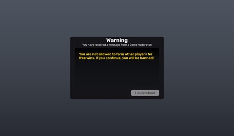</a> <b>WarningCard</b></td>
</tr>
</table>

### Loading & intro

<table>
<tr>
<td width="33%" valign="top"> <b>LoadingScreen</b> › MainFrame.Logo.N</td>
<td width="33%" valign="top"><a href="screenshots/03_LoadingScreen__Device.jpg">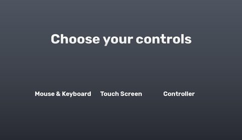</a> <b>LoadingScreen</b> › MainFrame.Device</td>
<td width="33%" valign="top"><a href="screenshots/103_MainGui__CameraFade.jpg">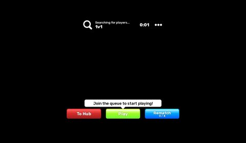</a> <b>MainGui</b> › MainFrame.Equipment.CameraFade</td>
</tr>
</table>

### Leaderboards & stats

<table>
<tr>
<td width="33%" valign="top"><a href="screenshots/10_DuelInterface__Scoreboard.jpg">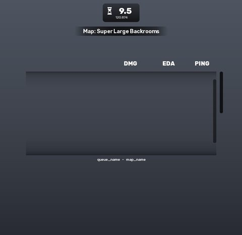</a> <b>DuelInterface</b> › Scoreboard</td>
<td width="33%" valign="top"><a href="screenshots/20_ScoreboardPlayerSlot.jpg">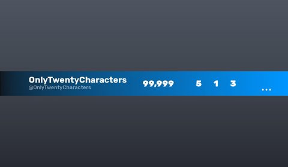</a> <b>ScoreboardPlayerSlot</b></td>
<td width="33%" valign="top"><a href="screenshots/34_LeaderboardPlayerSlot.jpg">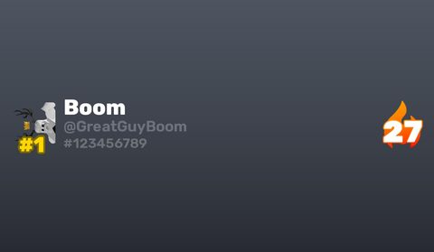</a> <b>LeaderboardPlayerSlot</b></td>
</tr>
<tr>
<td width="33%" valign="top"><a href="screenshots/105_MainGui__Top.jpg">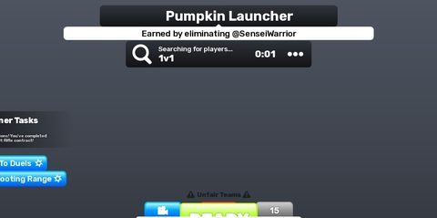</a> <b>MainGui</b> › MainFrame.Equipment.Customize.Top</td>
</tr>
</table>

### End of round, death, results

<table>
<tr>
<td width="33%" valign="top"><a href="screenshots/08_DuelInterface__Summary.jpg">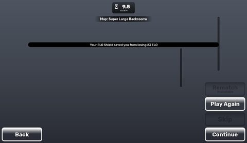</a> <b>DuelInterface</b> › FinalResults.Summary</td>
<td width="33%" valign="top"><a href="screenshots/55_FinalResultsPlayerSlot.jpg">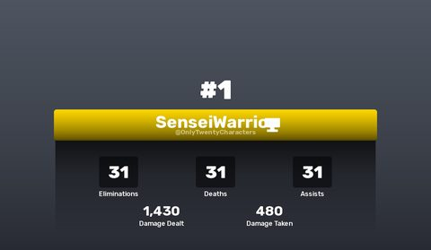</a> <b>FinalResultsPlayerSlot</b></td>
</tr>
</table>

### HUD & currency

<table>
<tr>
<td width="33%" valign="top"><a href="screenshots/06_DuelInterface__LeftSpeaker.jpg">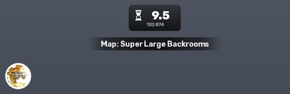</a> <b>DuelInterface</b> › Top.StoryDialog.Container.LeftSpeaker</td>
<td width="33%" valign="top"><a href="screenshots/07_DuelInterface__RightSpeaker.jpg">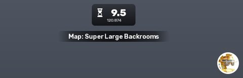</a> <b>DuelInterface</b> › Top.StoryDialog.Container.RightSpeaker</td>
<td width="33%" valign="top"><a href="screenshots/54_ELOBar.jpg">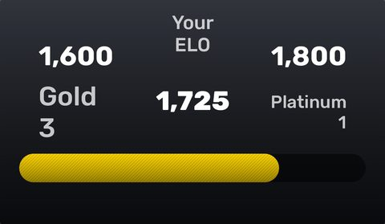</a> <b>ELOBar</b></td>
</tr>
<tr>
<td width="33%" valign="top"><a href="screenshots/73_CurrencySlot.jpg">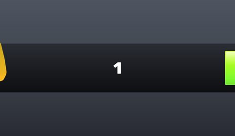</a> <b>CurrencySlot</b></td>
<td width="33%" valign="top"> <b>MainGui</b></td>
<td width="33%" valign="top"> <b>MainGui</b> › MainFrame.Equipment.Customize.Bottom</td>
</tr>
<tr>
<td width="33%" valign="top"> <b>MainGui</b> › Teleporting.Container</td>
</tr>
</table>

### Map vote / teams / matchmaking

<table>
<tr>
<td width="33%" valign="top"> <b>DuelInterface</b></td>
<td width="33%" valign="top"> <b>DuelInterface</b> › Top.MatchPoint</td>
<td width="33%" valign="top"> <b>DuelInterface</b> › Voting.Maps.ArcadeMode</td>
</tr>
<tr>
<td width="33%" valign="top"> <b>DuelInterface</b> › UpNext</td>
<td width="33%" valign="top"> <b>DuelInterface</b> › HeadHoncho</td>
<td width="33%" valign="top"> <b>DuelInterface</b> › HardcoreParkour</td>
</tr>
<tr>
<td width="33%" valign="top"> <b>SettingHotkeySlot</b> › Edit.BackgroundFull</td>
<td width="33%" valign="top"> <b>TeammateSlot</b></td>
<td width="33%" valign="top"> <b>MapSlot</b> › Button.Votes</td>
</tr>
<tr>
<td width="33%" valign="top"> <b>LocalQueuePlayerSlot</b></td>
<td width="33%" valign="top"> <b>DuelHistorySlot</b></td>
<td width="33%" valign="top"> <b>DuelHistorySlot</b> › Container.Duelers</td>
</tr>
<tr>
<td width="33%" valign="top"> <b>MatchmakingQueueSlot</b></td>
</tr>
</table>

### Other

<table>
<tr>
<td width="33%" valign="top"> <b>MobileButton</b></td>
<td width="33%" valign="top"> <b>FighterInterface</b></td>
<td width="33%" valign="top"> <b>BowCharge</b></td>
</tr>
<tr>
<td width="33%" valign="top"> <b>MapSlot</b></td>
<td width="33%" valign="top"> <b>PartyInviteSlot</b></td>
<td width="33%" valign="top"> <b>PartyInviteSlot</b> › Buttons.Challenge.Button.Off</td>
</tr>
<tr>
<td width="33%" valign="top"> <b>PartyInviteSlot</b> › Buttons.Invite.Button.Off</td>
<td width="33%" valign="top"> <b>PartyInviteSlot</b> › Buttons.InviteExternal.Button.Off</td>
<td width="33%" valign="top"> <b>EliminatedCard</b></td>
</tr>
<tr>
<td width="33%" valign="top"> <b>PartyMemberBigSlot</b></td>
<td width="33%" valign="top"> <b>Crosshair</b></td>
<td width="33%" valign="top"> <b>CosmeticSlot</b></td>
</tr>
<tr>
<td width="33%" valign="top"> <b>WeaponSlot</b></td>
<td width="33%" valign="top"> <b>WeaponSlot</b> › Button.Banned</td>
<td width="33%" valign="top"> <b>PatchNotesSlot</b></td>
</tr>
<tr>
<td width="33%" valign="top"> <b>EliminationFeedSlot</b></td>
<td width="33%" valign="top"> <b>PrivateServerPlayerSlot</b></td>
<td width="33%" valign="top"> <b>ViewRankedDetails</b></td>
</tr>
<tr>
<td width="33%" valign="top"> <b>ViewPlayerData</b></td>
<td width="33%" valign="top"> <b>Pardon</b></td>
<td width="33%" valign="top"> <b>Ban</b></td>
</tr>
<tr>
<td width="33%" valign="top"> <b>Unban</b></td>
<td width="33%" valign="top"> <b>Kick</b></td>
<td width="33%" valign="top"> <b>InspectConceptor</b></td>
</tr>
<tr>
<td width="33%" valign="top"> <b>Warn</b></td>
<td width="33%" valign="top"> <b>Restrict</b></td>
<td width="33%" valign="top"> <b>TeleportingGui</b></td>
</tr>
<tr>
<td width="33%" valign="top"> <b>InsetGui</b></td>
<td width="33%" valign="top"> <b>FlashbangGui</b></td>
<td width="33%" valign="top"> <b>FlashbangGui</b> › Polaroid</td>
</tr>
</table>

## Model previews

<table>
<tr>
<td width="25%" valign="top"> <b>Nosniy</b> <code>models/Workspace/Lobby/Hub/Important/Weapons/Nosniy.rbxm</code></td>
<td width="25%" valign="top"> <b>Cerulean Axe</b> <code>models/StarterPlayer/StarterPlayerScripts/Assets/ViewModels/Skin Case 3/Cerulean Axe.rbxm</code></td>
<td width="25%" valign="top"> <b>Base~2</b> <code>models/ReplicatedStorage/Modules/Emotes/Police Car/CarProp/Base~2.rbxm</code></td>
<td width="25%" valign="top"> <b>Frost Warper</b> <code>models/StarterPlayer/StarterPlayerScripts/Assets/ViewModels/Festive Skin Case/Frost Warper.rbxm</code></td>
</tr>
<tr>
<td width="25%" valign="top"> <b>sleigh~2</b> <code>models/ReplicatedStorage/Modules/Emotes/Sleigh Ride/SleighProp/sleigh~2.rbxm</code></td>
<td width="25%" valign="top"> <b>CandyLayer3</b> <code>models/StarterPlayer/StarterPlayerScripts/Assets/ViewModels/Spooky Skin Case/Bucket of Candy/CandyLayer3.rbxm</code></td>
<td width="25%" valign="top"> <b>Queue Pad #3__x10</b> <code>models/Workspace/Lobby/Hub/Important/Duels/Queue Pad #3__x10.rbxm</code></td>
<td width="25%" valign="top"> <b>board~2</b> <code>models/ReplicatedStorage/Modules/Emotes/Surfing/SurfProp/board~2.rbxm</code></td>
</tr>
<tr>
<td width="25%" valign="top"> <b>shovel~2</b> <code>models/ReplicatedStorage/Modules/Emotes/X Marks The Spot/ShovelProp/shovel~2.rbxm</code></td>
<td width="25%" valign="top"> <b>2</b> <code>models/StarterPlayer/StarterPlayerScripts/Assets/Misc/Portals/Glitter Warper/2.rbxm</code></td>
<td width="25%" valign="top"> <b>Key</b> <code>models/ReplicatedStorage/Modules/Emotes/X Marks The Spot/Objects/Key.rbxm</code></td>
<td width="25%" valign="top"> <b>Street Sign</b> <code>models/StarterPlayer/StarterPlayerScripts/Assets/ViewModels/Bundles/Street Sign.rbxm</code></td>
</tr>
<tr>
<td width="25%" valign="top"> <b>Beach Ball</b> <code>models/StarterPlayer/StarterPlayerScripts/Assets/Misc/SmokeClouds/Beach Ball.rbxm</code></td>
<td width="25%" valign="top"> <b>Burger</b> <code>models/ReplicatedStorage/Modules/Emotes/X Marks The Spot/Objects/Burger.rbxm</code></td>
</tr>
</table>

## Notable scripts

Top-scored scripts of this game per topic (full tree in [source/scripts](source/scripts/)).

| Topic | Scripts |
|---|---|
| UI animation (tweens, hover / click, pop-ins, springs) | [`NovaUI`](source/scripts/ReplicatedStorage/NovaUI.lua) 712 lines [`AdminPanel_v2_Backup`](source/scripts/ServerStorage/AdminPanel_v2_Backup.client.lua) 1555 lines [`AdminPanel`](source/scripts/StarterPlayer/StarterPlayerScripts/AdminPanel.client.lua) 1850 lines [`AdminPanel_v1_Backup`](source/scripts/ServerStorage/AdminPanel_v1_Backup.client.lua) 1127 lines [`Maps`](source/scripts/StarterPlayer/StarterPlayerScripts/Modules/Pages/Maps.lua) 482 lines |
| UI controllers / window managers / menus | [`UserInterfaceController`](source/scripts/StarterPlayer/StarterPlayerScripts/Controllers/UserInterfaceController.lua) 310 lines [`Interface`](source/scripts/StarterPlayer/StarterPlayerScripts/Modules/UserInterface/Equipment/Interface.lua) 107 lines [`ItemInterface`](source/scripts/StarterPlayer/StarterPlayerScripts/Modules/ClientReplicatedClasses/ClientFighter/ClientItem/ItemInterface.lua) 271 lines [`RewardService`](source/scripts/ServerScriptService/Server/RewardService.lua) 275 lines [`HUD`](source/scripts/StarterPlayer/StarterPlayerScripts/Modules/UserInterface/HUD.lua) 113 lines |
| Notifications, toasts, popups, prompts | [`NovaUI`](source/scripts/ReplicatedStorage/NovaUI.lua) 712 lines [`QueuePadService`](source/scripts/ServerScriptService/Server/QueuePadService.lua) 439 lines [`ProximityPromptController`](source/scripts/StarterPlayer/StarterPlayerScripts/Controllers/ProximityPromptController.lua) 184 lines [`Notifications`](source/scripts/StarterPlayer/StarterPlayerScripts/Modules/UserInterface/Notifications.lua) 112 lines [`WarningMessages`](source/scripts/StarterPlayer/StarterPlayerScripts/Modules/UserInterface/WarningMessages.lua) 122 lines |
| Loading / intro screens | [`LoadingScreen`](source/scripts/ReplicatedFirst/Root/LoadingScreen.lua) 295 lines [`Emote`](source/scripts/ReplicatedStorage/Modules/Emote.lua) 386 lines [`ClientGiantChombie`](source/scripts/StarterPlayer/StarterPlayerScripts/Modules/ClientReplicatedClasses/Enemies/ClientGiantChombie.lua) 98 lines [`Zombie Tower`](source/scripts/StarterPlayer/StarterPlayerScripts/Modules/Maps/Zombie%20Tower.lua) 541 lines [`UILoadingDots`](source/scripts/StarterPlayer/StarterPlayerScripts/Modules/GameComponents/UILoadingDots.lua) 36 lines |
| Camera, cutscenes, screen shake | [`CameraController`](source/scripts/StarterPlayer/StarterPlayerScripts/Controllers/CameraController.lua) 717 lines [`CameraShaker`](source/scripts/StarterPlayer/StarterPlayerScripts/Modules/CameraShaker.lua) 156 lines [`ViewportCameras`](source/scripts/StarterPlayer/StarterPlayerScripts/Modules/ViewportCameras.lua) 43 lines [`Camera`](source/scripts/StarterPlayer/StarterPlayerScripts/Modules/UserInterface/Equipment/Camera.lua) 301 lines [`CameraShakeInstance`](source/scripts/StarterPlayer/StarterPlayerScripts/Modules/CameraShaker/CameraShakeInstance.lua) 159 lines |
| VFX, particles, beams, hit effects | [`FlashbangEffect`](source/scripts/StarterPlayer/StarterPlayerScripts/Modules/Functions/FlashbangEffect.lua) 44 lines [`LootboxEffect`](source/scripts/StarterPlayer/StarterPlayerScripts/Modules/Functions/LootboxEffect.lua) 155 lines [`ViewModelParticlesLogic`](source/scripts/StarterPlayer/StarterPlayerScripts/Modules/ViewModelParticlesLogic.lua) 82 lines [`Paintball Gun`](source/scripts/StarterPlayer/StarterPlayerScripts/Modules/Items/Paintball%20Gun.lua) 151 lines [`TracerEffect`](source/scripts/StarterPlayer/StarterPlayerScripts/Modules/TracerEffect.lua) 165 lines |
| DataStore / player data | [`PlayerDataService`](source/scripts/ServerScriptService/Server/PlayerDataService.lua) 272 lines [`LeaderboardService`](source/scripts/ServerScriptService/Server/LeaderboardService.lua) 224 lines |
| Monetization (dev products, game passes, receipts) | [`MonetizationController`](source/scripts/StarterPlayer/StarterPlayerScripts/Controllers/MonetizationController.lua) 226 lines |
| RNG, eggs, gacha, rarity rolls, pets | [`Lucky`](source/scripts/StarterPlayer/StarterPlayerScripts/Modules/PatchNotes/Lucky.lua) 171 lines [`ItemService`](source/scripts/ServerScriptService/Server/ItemService.lua) 1715 lines [`CosmeticLibrary`](source/scripts/ReplicatedStorage/Modules/CosmeticLibrary.lua) 9302 lines [`EmoteWheel`](source/scripts/StarterPlayer/StarterPlayerScripts/Modules/EmoteWheel.lua) 323 lines [`LootboxEffect`](source/scripts/StarterPlayer/StarterPlayerScripts/Modules/Functions/LootboxEffect.lua) 155 lines |
| Combat, weapons, hitboxes, abilities | [`ItemService`](source/scripts/ServerScriptService/Server/ItemService.lua) 1715 lines [`Projectiles`](source/scripts/ServerScriptService/Server/Projectiles.lua) 220 lines [`DamageNumbers_ToppleStyle_Backup`](source/scripts/ServerStorage/DamageNumbers_ToppleStyle_Backup.lua) 259 lines [`ClientItem`](source/scripts/StarterPlayer/StarterPlayerScripts/Modules/ClientReplicatedClasses/ClientFighter/ClientItem.lua) 415 lines [`EnemyService`](source/scripts/ServerScriptService/Server/EnemyService.lua) 329 lines |
| NPC / AI / monsters | [`EnemyService`](source/scripts/ServerScriptService/Server/EnemyService.lua) 329 lines |
| Character movement (sprint, dash, double jump, slide) | [`Gameplay`](source/scripts/StarterPlayer/StarterPlayerScripts/Modules/ClientReplicatedClasses/ClientFighter/ClientFighterCharacter/Gameplay.lua) 171 lines [`ItemService`](source/scripts/ServerScriptService/Server/ItemService.lua) 1715 lines [`FighterService`](source/scripts/ServerScriptService/Server/FighterService.lua) 414 lines [`Slider`](source/scripts/StarterPlayer/StarterPlayerScripts/Modules/Settings/Slider.lua) 281 lines [`MechanicsController`](source/scripts/StarterPlayer/StarterPlayerScripts/Controllers/MechanicsController.lua) 1452 lines |
| Tycoon / plots / bases / building | [`NovaUI`](source/scripts/ReplicatedStorage/NovaUI.lua) 712 lines [`UGCShop`](source/scripts/StarterPlayer/StarterPlayerScripts/Modules/Pages/UGCShop.lua) 348 lines [`AdminPanel_v1_Backup`](source/scripts/ServerStorage/AdminPanel_v1_Backup.client.lua) 1127 lines [`AdminPanel_v2_Backup`](source/scripts/ServerStorage/AdminPanel_v2_Backup.client.lua) 1555 lines [`AdminPanel`](source/scripts/StarterPlayer/StarterPlayerScripts/AdminPanel.client.lua) 1850 lines |
| Leaderboards & stats | [`LeaderboardService`](source/scripts/ServerScriptService/Server/LeaderboardService.lua) 224 lines |
| Admin panels & commands | [`AdminPanelService`](source/scripts/ServerScriptService/Server/AdminPanelService.lua) 719 lines [`AdminPanel_v1_Backup`](source/scripts/ServerStorage/AdminPanel_v1_Backup.client.lua) 1127 lines [`AdminPanel_v2_Backup`](source/scripts/ServerStorage/AdminPanel_v2_Backup.client.lua) 1555 lines [`AdminPanel`](source/scripts/StarterPlayer/StarterPlayerScripts/AdminPanel.client.lua) 1850 lines [`ModerationLibrary`](source/scripts/ReplicatedStorage/Modules/ModerationLibrary.lua) 135 lines |
| Sound & music | [`MusicController`](source/scripts/StarterPlayer/StarterPlayerScripts/Controllers/MusicController.lua) 337 lines [`Minigun`](source/scripts/StarterPlayer/StarterPlayerScripts/Modules/ViewModels/Minigun.lua) 237 lines [`AudioVisualizers`](source/scripts/StarterPlayer/StarterPlayerScripts/Modules/ClientReplicatedClasses/ClientFighter/FighterInterface/AudioVisualizers.lua) 198 lines [`SoundLibrary`](source/scripts/ReplicatedStorage/Modules/SoundLibrary.lua) 77 lines [`Sounds`](source/scripts/StarterPlayer/StarterPlayerScripts/Modules/ClientReplicatedClasses/ClientFighter/ClientFighterCharacter/Sounds.lua) 120 lines |
| Daily rewards, quests, codes, playtime | [`RewardService`](source/scripts/ServerScriptService/Server/RewardService.lua) 275 lines [`DailyService`](source/scripts/ServerScriptService/Server/DailyService.lua) 62 lines [`ShopService`](source/scripts/ServerScriptService/Server/ShopService.lua) 278 lines [`DataTemplate`](source/scripts/ServerScriptService/Server/DataTemplate.lua) 186 lines [`VideoAdRewards`](source/scripts/StarterPlayer/StarterPlayerScripts/Modules/VideoAdRewards.lua) 256 lines |
| Utility modules (number format, signals, tables, timers) | [`DamageNumbers_ToppleStyle_Backup`](source/scripts/ServerStorage/DamageNumbers_ToppleStyle_Backup.lua) 259 lines [`DamageNumbers`](source/scripts/StarterPlayer/StarterPlayerScripts/Modules/DamageNumbers.lua) 200 lines [`AdminPanelService`](source/scripts/ServerScriptService/Server/AdminPanelService.lua) 719 lines [`DebugService`](source/scripts/ServerScriptService/Server/DebugService.lua) 236 lines [`ShopService`](source/scripts/ServerScriptService/Server/ShopService.lua) 278 lines |

### In the curated script library

- [Server-simulated projectiles](../../Scripts/11-Combat/ServerProjectiles__rivals-modded.lua) — Server projectile simulation: spherecast sweeps, crits, pierce limit, explode on stop, afterburn.
- [Damage numbers (toss style)](../../Scripts/11-Combat/DamageNumbersToss__rivals-modded.lua) — Damage numbers that accumulate in place and get tossed away spinning (Rivals look).
- [Damage numbers (topple style)](../../Scripts/11-Combat/DamageNumbersTopple__rivals-modded.lua) — Per-hit numbers that topple over + combo total after a pause.
- [Daily reset at 00:00 UTC](../../Scripts/18-Daily-Rewards-Quests/DailyService-UTCReset__rivals-modded.lua) — Day number = os.time() // 86400; on join and every 15s it resets daily counters, refreshes the daily shop and rolls new daily tasks when the day changes (and tells TaskService if a day was missed).
- [Event-driven quests (beginner + daily)](../../Scripts/18-Daily-Rewards-Quests/TaskService-EventQuests__rivals-modded.lua) — Quests progress from events (TaskService.Record(player, 'DuelWon')), beginner sets of three until finished, then three daily Core tasks; completing a set grants rewards and keeps a daily streak.
- [Login reward, codes, group/like rewards](../../Scripts/18-Daily-Rewards-Quests/ClaimService-LoginCodesSocial__rivals-modded.lua) — Once-per-day login reward, one-off social rewards (group checked with IsInGroup; like/favourite trusted because Roblox cannot check them), battle-pass tier claims with validation, and a case-insensitive code table saved per player.
- [ProfileStore session + legacy import](../../Scripts/07-Data-Saving/PlayerDataService-ProfileStore__rivals-modded.lua) — ProfileStore usage: StartSessionAsync with Cancel, OnSessionEnd kick, OnSave hook that encodes data, one-time import from an older plain DataStore, server-validated settings remotes.
- [Template built by functions + reconcile](../../Scripts/07-Data-Saving/DataTemplate__rivals-modded.lua) — Data template as a New() function (fresh tables every call), per-season record ensured on load, and a shallow Reconcile for fields added later.
- [Live merge + write-on-change](../../Scripts/15-Leaderboards/LeaderboardService-LiveMerge__rivals-modded.lua) — Reads each board's top every minute, merges everyone in the server at their live value so a new win shows instantly, writes only values that changed, request cooldown and name validation on the client remote.
- [Staged client bootstrap with progress](../../Scripts/04-Loading-Screens/StagedBootstrap__rivals-modded.lua) — Client entry point that drives a loading screen through stages (game loaded 30%, constants 45%, player data 75%, controllers 100%), asks the device type when ambiguous, and always tells the server LoadingScreenDone so it spawns the character.
- [Fallback handlers + remote logger (dev tool)](../../Scripts/19-Utility/RemoteFallbacks-DevTool__rivals-modded.lua) — Gives every RemoteFunction that has no handler one that returns nil (so clients never hang forever) and logs the first calls to each remote with argument types.

## Folders

| Folder | What |
|---|---|
| `screenshots/` | full frames; `crops/` = the panel only; `models/` = 3D previews; `thumbs/` = gallery thumbnails |
| `ui/` | every screen as a Lua builder (`require(module)()` returns the ScreenGui); `_StarterGui-all.lua` builds every StarterGui screen |
| `models/` | every model as .rbxm (the only .rbxm files), mirroring the place tree, scripts removed |
| `map/` | `workspace.rbxm` (the map as a model), `lighting.lua` (sky + post effects), `materials.lua`, `Environment.lua` |
| `animations/`, `audio/` | KeyframeSequence / Sound builders (.lua), `AnimationIds.lua`, `Sounds.lua` |
| `source/` | all scripts as .luau, `tree.txt`, `ui.txt`, `remotes.txt`, `assets.txt`, `flags.txt` |
