# Scooter Obby

> 🧗 **Obby** · obby (scooter) · source file `ScooterObby%20(1).rbxl`

[⬅ Back to the catalog](../../README.md) · [Assets inventory](ASSETS.md) · [Style numbers](reference.md) · [Scripts](source/scripts/) · [Code analysis](source/README.md)

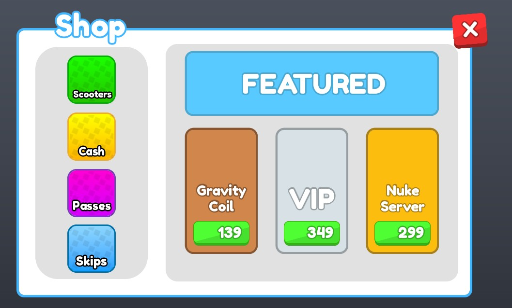

## At a glance

| | |
|---|---|
| Provenance | template with full source |
| Screens | 15 ScreenGuis, 1696 GUI objects → **32 screenshots** |
| Models (.rbxm) | 297 models, 47 model sets, 0 VFX sets |
| Lua builders (.lua) | 30 UI screens, 0 animation packs, 2 audio packs |
| Code | 834 scripts, 25,343 lines |
| Asset ids | 1 animations, 126 sounds |
| Safety scan | 0 HIGH / 0 MED flags ([flags.txt](source/flags.txt)) |

**Fonts:** `FredokaOne Regular`×292, `SourceSansPro Regular`×134, `GothamSSm Bold`×22, `LegacyArial Regular`×5, `GothamSSm Heavy`×4

## UI screenshots

Captured in Studio from the place's own ScreenGuis (scripts stripped). Each panel was opened on its own; click a thumbnail for the full 1519×886 frame. Runtime-filled lists (shop items, inventories) show their template state.

### Shop & Robux store

<table>
<tr>
<td width="33%" valign="top"><a href="screenshots/16_GameGUI__ShopFrame.jpg">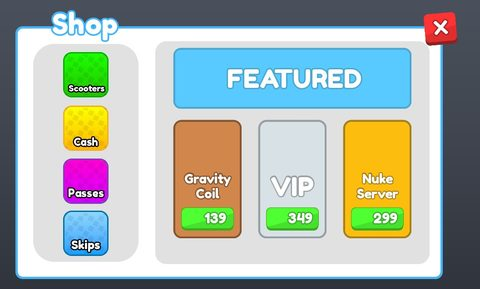</a> <b>GameGUI</b> › Frame.ShopFrame</td>
<td width="33%" valign="top"><a href="screenshots/18_GameGUI__GigaBundleFrame.jpg">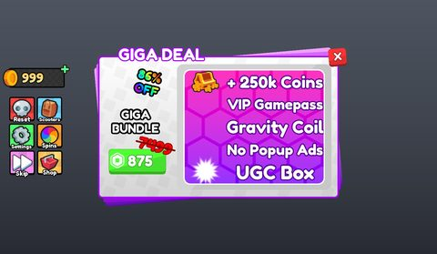</a> <b>GameGUI</b> › Frame.GigaBundleFrame</td>
<td width="33%" valign="top"><a href="screenshots/33_GameGUI__ShopFrame.jpg">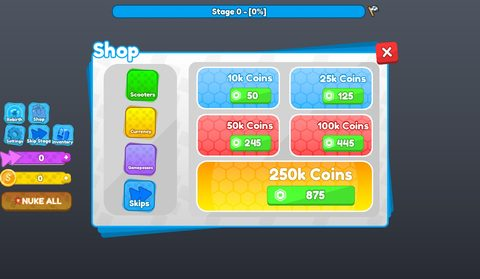</a> <b>GameGUI</b> › Frame.ShopFrame</td>
</tr>
</table>

### Inventory / backpack / pets

<table>
<tr>
<td width="33%" valign="top"><a href="screenshots/17_GameGUI__InventoryFrame.jpg">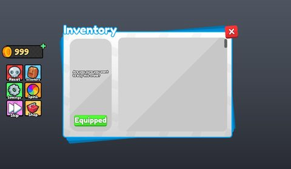</a> <b>GameGUI</b> › Frame.InventoryFrame</td>
<td width="33%" valign="top"><a href="screenshots/34_GameGUI__InventoryFrame.jpg">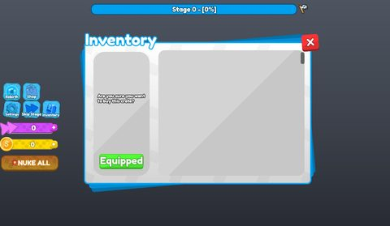</a> <b>GameGUI</b> › Frame.InventoryFrame</td>
</tr>
</table>

### Rewards, daily, spin, codes

<table>
<tr>
<td width="33%" valign="top"><a href="screenshots/01_DailyReward.jpg">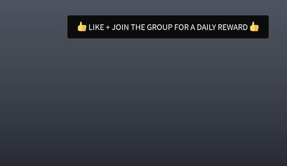</a> <b>DailyReward</b></td>
<td width="33%" valign="top"><a href="screenshots/20_GameGUI__PlayTimeRewards.jpg">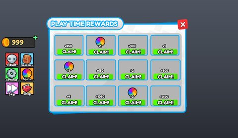</a> <b>GameGUI</b> › Frame.PlayTimeRewards</td>
<td width="33%" valign="top"><a href="screenshots/21_GameGUI__WheelSpin.jpg">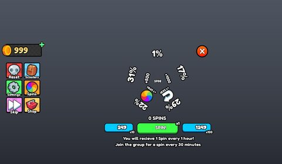</a> <b>GameGUI</b> › Frame.WheelSpin</td>
</tr>
</table>

### Quests & progression

<table>
<tr>
<td width="33%" valign="top"><a href="screenshots/30_GameGUI__RebirthConfirmation.jpg">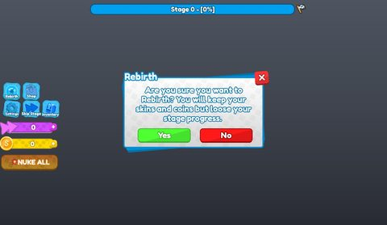</a> <b>GameGUI</b> › Frame.RebirthConfirmation</td>
</tr>
</table>

### Settings & menus

<table>
<tr>
<td width="33%" valign="top"><a href="screenshots/13_GameGUI__SettingsGUI.jpg">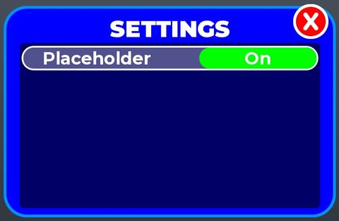</a> <b>GameGUI</b> › Frame.SettingsGUI</td>
<td width="33%" valign="top"><a href="screenshots/14_GameGUI__SettingsFrame.jpg">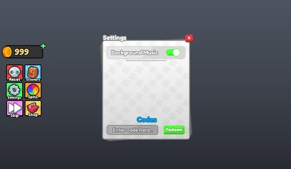</a> <b>GameGUI</b> › Frame.SettingsFrame</td>
<td width="33%" valign="top"> <b>GameGUI</b> › Frame.SettingsGUI</td>
</tr>
<tr>
<td width="33%" valign="top"><a href="screenshots/31_GameGUI__SettingsFrame.jpg">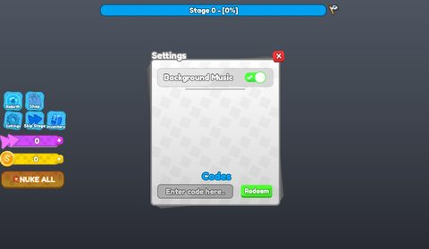</a> <b>GameGUI</b> › Frame.SettingsFrame</td>
</tr>
</table>

### Popups, notifications, prompts

<table>
<tr>
<td width="33%" valign="top"> <b>Confirmation</b></td>
<td width="33%" valign="top"><a href="screenshots/24_Confirmation.jpg">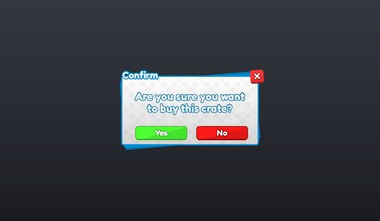</a> <b>Confirmation</b></td>
</tr>
</table>

### Loading & intro

<table>
<tr>
<td width="33%" valign="top"><a href="screenshots/03_Confirmation__Loading.jpg">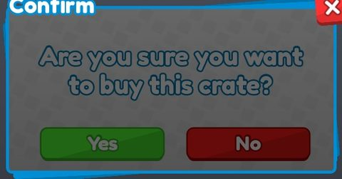</a> <b>Confirmation</b> › BoxConfirmation.Main.Inside.Content.Loading</td>
<td width="33%" valign="top"><a href="screenshots/10_LoadingScreen__Frame.jpg">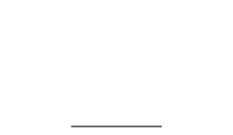</a> <b>LoadingScreen</b> › Frame</td>
<td width="33%" valign="top"><a href="screenshots/25_Confirmation__Loading.jpg">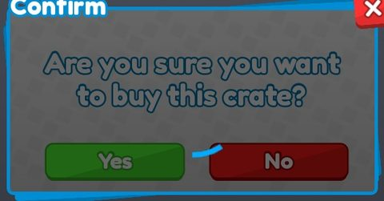</a> <b>Confirmation</b> › BoxConfirmation.Main.Inside.Content.Loading</td>
</tr>
</table>

### Map vote / teams / matchmaking

<table>
<tr>
<td width="33%" valign="top"><a href="screenshots/04_Countdown.jpg">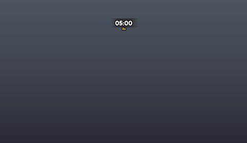</a> <b>Countdown</b></td>
</tr>
</table>

### Other

<table>
<tr>
<td width="33%" valign="top"><a href="screenshots/05_Progession.jpg">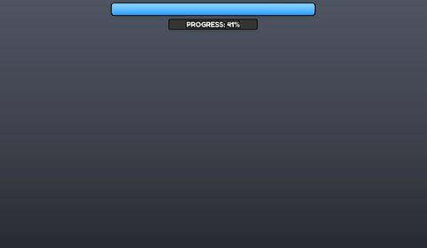</a> <b>Progession</b></td>
<td width="33%" valign="top"><a href="screenshots/06_Version_.jpg">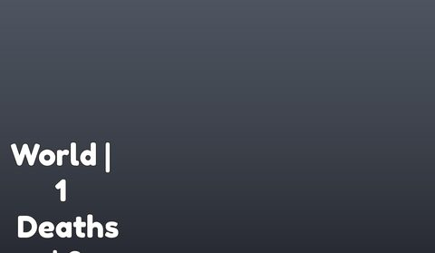</a> <b>Version </b></td>
<td width="33%" valign="top"><a href="screenshots/07_Version___Frame.jpg">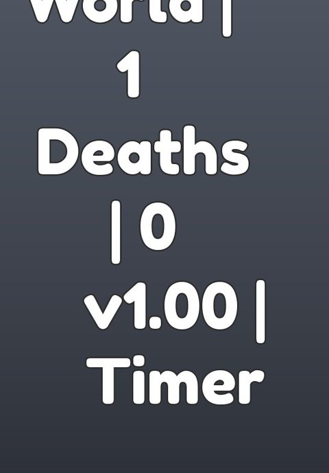</a> <b>Version </b> › Frame</td>
</tr>
<tr>
<td width="33%" valign="top"><a href="screenshots/08_NewUGC.jpg">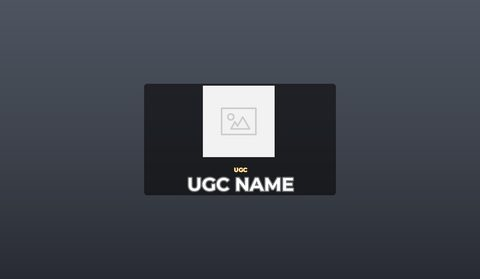</a> <b>NewUGC</b></td>
<td width="33%" valign="top"><a href="screenshots/09_NewScooter.jpg">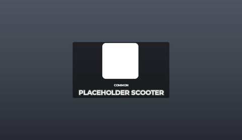</a> <b>NewScooter</b></td>
<td width="33%" valign="top"><a href="screenshots/11_GameGUI.jpg">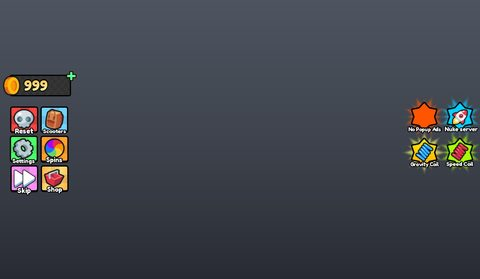</a> <b>GameGUI</b></td>
</tr>
<tr>
<td width="33%" valign="top"><a href="screenshots/12_GameGUI__ResetGUI.jpg">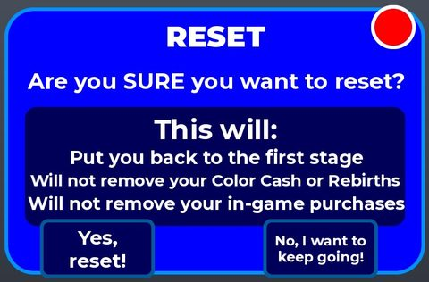</a> <b>GameGUI</b> › Frame.ResetGUI</td>
<td width="33%" valign="top"><a href="screenshots/15_GameGUI__SkipStageFrame.jpg">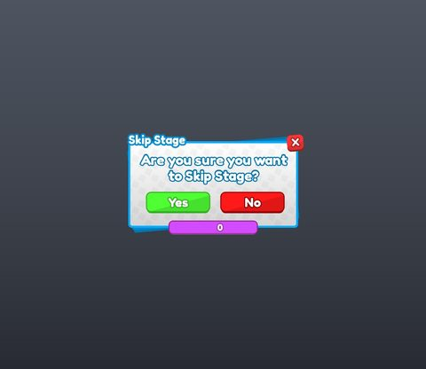</a> <b>GameGUI</b> › Frame.SkipStageFrame</td>
<td width="33%" valign="top"><a href="screenshots/19_GameGUI__UGCFrame.jpg">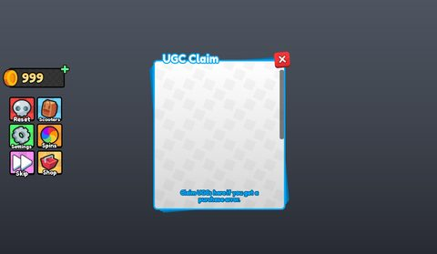</a> <b>GameGUI</b> › Frame.UGCFrame</td>
</tr>
<tr>
<td width="33%" valign="top"><a href="screenshots/27_GameGUI.jpg">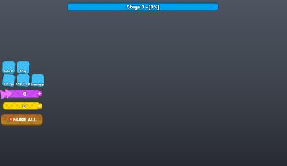</a> <b>GameGUI</b></td>
<td width="33%" valign="top"><a href="screenshots/28_GameGUI__ResetGUI.jpg">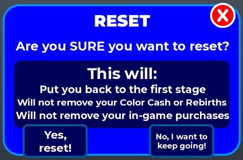</a> <b>GameGUI</b> › Frame.ResetGUI</td>
<td width="33%" valign="top"><a href="screenshots/32_GameGUI__SkipStageFrame.jpg">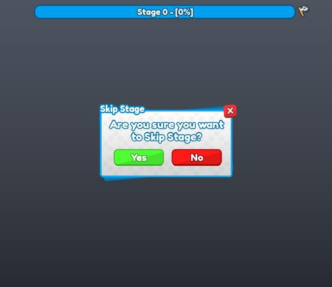</a> <b>GameGUI</b> › Frame.SkipStageFrame</td>
</tr>
<tr>
<td width="33%" valign="top"><a href="screenshots/37_Exclusive.jpg">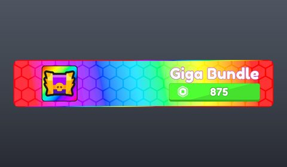</a> <b>Exclusive</b></td>
</tr>
</table>

## Model previews

<table>
<tr>
<td width="25%" valign="top"><a href="models/ReplicatedStorage/Resource/SkinnedScooters/ZxchDevSkin.rbxm">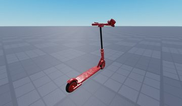</a> <b>ZxchDevSkin</b> <code>models/ReplicatedStorage/Resource/SkinnedScooters/ZxchDevSkin.rbxm</code></td>
<td width="25%" valign="top"><a href="models/ReplicatedStorage/Resource/SkinnedScooters/GrassGreenScooter.rbxm">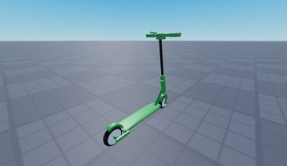</a> <b>GrassGreenScooter</b> <code>models/ReplicatedStorage/Resource/SkinnedScooters/GrassGreenScooter.rbxm</code></td>
<td width="25%" valign="top"><a href="models/ReplicatedStorage/Resource/SkinnedScooters/ForestScooter.rbxm">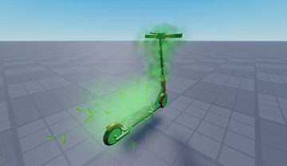</a> <b>ForestScooter</b> <code>models/ReplicatedStorage/Resource/SkinnedScooters/ForestScooter.rbxm</code></td>
<td width="25%" valign="top"><a href="models/ServerStorage/StagesInRotation/Chunk21/Build.rbxm">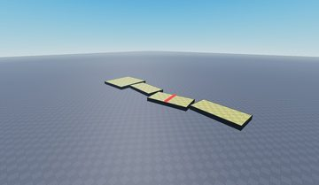</a> <b>Build</b> <code>models/ServerStorage/StagesInRotation/Chunk21/Build.rbxm</code></td>
</tr>
<tr>
<td width="25%" valign="top"><a href="models/ReplicatedStorage/BoxParts/BoxAnim.rbxm">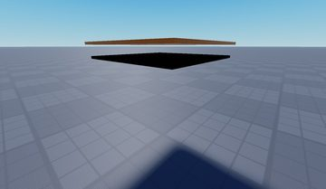</a> <b>BoxAnim</b> <code>models/ReplicatedStorage/BoxParts/BoxAnim.rbxm</code></td>
<td width="25%" valign="top"><a href="models/Workspace/Lobby/Main%20Portal%20Template.rbxm">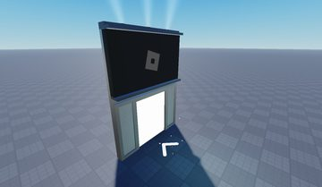</a> <b>Main Portal Template</b> <code>models/Workspace/Lobby/Main Portal Template.rbxm</code></td>
<td width="25%" valign="top"> <b>TopRunLeaderboard</b> <code>models/Workspace/Lobby/TopRunLeaderboard.rbxm</code></td>
<td width="25%" valign="top"><a href="models/ReplicatedStorage/Resource/SkinnedScooters/ShockwaveScooter.rbxm">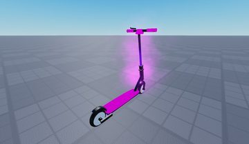</a> <b>ShockwaveScooter</b> <code>models/ReplicatedStorage/Resource/SkinnedScooters/ShockwaveScooter.rbxm</code></td>
</tr>
<tr>
<td width="25%" valign="top"> <b>VerifiedRunLeaderboard</b> <code>models/Workspace/Lobby/VerifiedRunLeaderboard.rbxm</code></td>
<td width="25%" valign="top"><a href="models/ServerStorage/Skibidi%20Toilet%20Scooter.rbxm">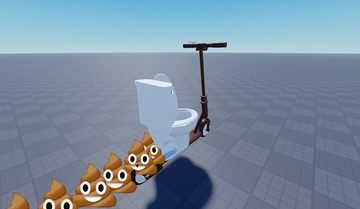</a> <b>Skibidi Toilet Scooter</b> <code>models/ServerStorage/Skibidi Toilet Scooter.rbxm</code></td>
<td width="25%" valign="top"><a href="models/Workspace/Lobby/TopWinsLeaderboard.rbxm">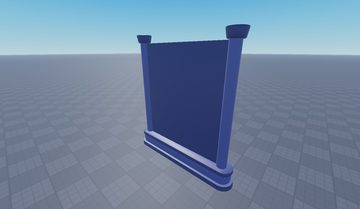</a> <b>TopWinsLeaderboard</b> <code>models/Workspace/Lobby/TopWinsLeaderboard.rbxm</code></td>
</tr>
</table>

## Notable scripts

Top-scored scripts of this game per topic (full tree in [source/scripts](source/scripts/)).

| Topic | Scripts |
|---|---|
| UI animation (tweens, hover / click, pop-ins, springs) | [`Tweens`](source/scripts/ServerStorage/Exclusive/Inside/Buy/Tweens.server.lua) 34 lines [`Tweens`](source/scripts/StarterGui/GameGUI/Frame/Menu/Inventory/Back/Button/Tweens.server.lua) 34 lines [`Tweens`](source/scripts/StarterGui/GameGUI/Frame/ShopFrame/Main/Inside/Content/LeftSide/Inside/Currency/Tweens.server.lua) 40 lines [`Tweens`](source/scripts/StarterGui/GameGUI/Frame/ShopFrame/Main/Inside/Content/LeftSide/Inside/Gamepasses/Tweens.server.lua) 40 lines [`Tweens`](source/scripts/StarterGui/GameGUI/GigaBundle/Back/Button/Tweens.server.lua) 34 lines |
| UI controllers / window managers / menus | [`Handler`](source/scripts/ServerStorage/OldUi/GameGUI/Frame/Stat/Handler.client.lua) 43 lines [`OpenScript`](source/scripts/StarterGui/GameGUI/Frame/Menu/Spin/Back/Button/OpenScript.server.lua) 24 lines |
| Notifications, toasts, popups, prompts | [`CashNotificationHandler`](source/scripts/ServerStorage/OldUi/GameGUI/Frame/CashNotificationHandler.client.lua) 69 lines [`Popups`](source/scripts/StarterPlayer/StarterCharacterScripts/Popups.client.lua) 75 lines [`Wheel`](source/scripts/StarterGui/GameGUI/Frame/WheelSpin/Container/Wheel.client.lua) 96 lines [`CurrencyPurchases`](source/scripts/ServerScriptService/CurrencyPurchases.server.lua) 185 lines [`MapGeneration`](source/scripts/ServerScriptService/CoreScripts/MapGeneration.server.lua) 136 lines |
| VFX, particles, beams, hit effects | [`Scooter`](source/scripts/ReplicatedStorage/Module/Scooter.lua) 556 lines [`CheckpointHandler`](source/scripts/ReplicatedStorage/CollectionServiceScripts/CheckpointHandler.server.lua) 221 lines [`CheckpointHandler`](source/scripts/ReplicatedStorage/Old/CheckpointHandler.server.lua) 88 lines [`ConfettiBlockTracing`](source/scripts/ReplicatedStorage/SpecialFX/ConfettiBlockTracing.server.lua) 21 lines |
| DataStore / player data | [`DataStore2`](source/scripts/ReplicatedStorage/ModuleScripts/DataStore2.lua) 614 lines [`HighestStageSave`](source/scripts/ServerScriptService/HighestStageSave.server.lua) 31 lines [`HighestStageSave`](source/scripts/ServerScriptService/Old/HighestStageSave.server.lua) 30 lines [`StageSave`](source/scripts/ServerScriptService/Old/StageSave.server.lua) 32 lines [`DataHandler`](source/scripts/ServerScriptService/DataHandler.server.lua) 24 lines |
| Monetization (dev products, game passes, receipts) | [`CurrencyPurchases`](source/scripts/ServerScriptService/CurrencyPurchases.server.lua) 185 lines [`ProductHandler`](source/scripts/ServerScriptService/Skips/ProductHandler.server.lua) 78 lines [`GamepassHandler (Coils)`](source/scripts/ServerScriptService/GamepassHandler%20%28Coils%29.server.lua) 24 lines |
| RNG, eggs, gacha, rarity rolls, pets | [`SpinScript`](source/scripts/ServerScriptService/SpinScript.server.lua) 152 lines [`InventoryHandler`](source/scripts/ServerScriptService/InventoryHandler.lua) 346 lines [`InventoryHandler`](source/scripts/ServerScriptService/Old/InventoryHandler.lua) 203 lines [`CrateSystem`](source/scripts/ServerStorage/OldUi/GameGUI/Frame/ShopFrame/Main/Inside/Content/RightSide/Inside/CrateFrame/BuyCoins/Back/Button/CrateSystem.server.lua) 149 lines [`CrateSystem`](source/scripts/StarterGui/GameGUI/Frame/ShopFrame/Main/Inside/Content/RightSide/Inside/CrateFrame/ClassicBox1/BuyCoins/Back/Button/CrateSystem.server.lua) 266 lines |
| Daily rewards, quests, codes, playtime | [`ClaimReward`](source/scripts/ServerScriptService/ClaimReward.server.lua) 224 lines [`LocalScript`](source/scripts/StarterGui/GameGUI/Frame/PlayTimeRewards/Main/Inside/Content/Inside/Reward1/Inside/Claim/Back/Button/LocalScript.client.lua) 59 lines [`LocalScript`](source/scripts/StarterGui/GameGUI/Frame/PlayTimeRewards/Main/Inside/Content/Inside/Reward10/Inside/Claim/Back/Button/LocalScript.client.lua) 59 lines [`LocalScript`](source/scripts/StarterGui/GameGUI/Frame/PlayTimeRewards/Main/Inside/Content/Inside/Reward11/Inside/Claim/Back/Button/LocalScript.client.lua) 59 lines [`LocalScript`](source/scripts/StarterGui/GameGUI/Frame/PlayTimeRewards/Main/Inside/Content/Inside/Reward12/Inside/Claim/Back/Button/LocalScript.client.lua) 59 lines |
| Utility modules (number format, signals, tables, timers) | [`Promise`](source/scripts/ReplicatedStorage/ModuleScripts/DataStore2/Promise.lua) 1391 lines [`TableUtil`](source/scripts/ReplicatedStorage/ModuleScripts/DataStore2/TableUtil.lua) 18 lines |

### In the curated script library

- [Floating cash and error text](../../Scripts/03-Notifications/CashAndErrorText__scooter-obby.lua) — Floating "+N coins!" / "+N skips!" text with random drift and rotation, plus red error text from client (BindableEvent) or server (RemoteEvent).

## Folders

| Folder | What |
|---|---|
| `screenshots/` | full frames; `crops/` = the panel only; `models/` = 3D previews; `thumbs/` = gallery thumbnails |
| `ui/` | every screen as a Lua builder (`require(module)()` returns the ScreenGui); `_StarterGui-all.lua` builds every StarterGui screen |
| `models/` | every model as .rbxm (the only .rbxm files), mirroring the place tree, scripts removed |
| `map/` | `workspace.rbxm` (the map as a model), `lighting.lua` (sky + post effects), `materials.lua`, `Environment.lua` |
| `animations/`, `audio/` | KeyframeSequence / Sound builders (.lua), `AnimationIds.lua`, `Sounds.lua` |
| `source/` | all scripts as .luau, `tree.txt`, `ui.txt`, `remotes.txt`, `assets.txt`, `flags.txt` |
