# SCP Tycoon

> 🏭 **Tycoon** · tycoon (SCP containment) · source file `SCP_Tycoon.rbxl`

[⬅ Back to the catalog](../../README.md) · [Assets inventory](ASSETS.md) · [Style numbers](reference.md) · [Scripts](source/scripts/) · [Code analysis](source/README.md)

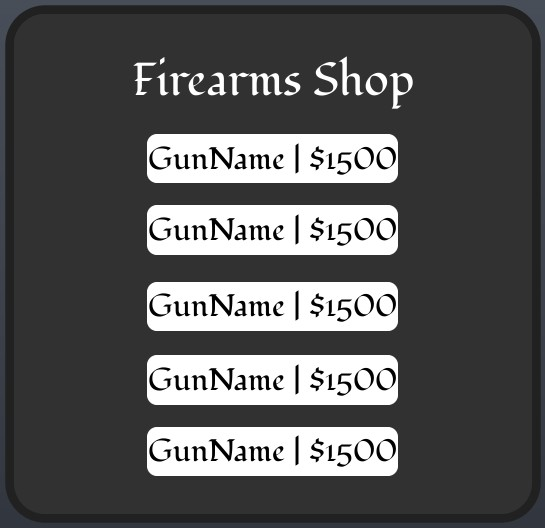

## At a glance

| | |
|---|---|
| Provenance | template with full source |
| Screens | 4 ScreenGuis, 312 GUI objects → **9 screenshots** |
| Models (.rbxm) | 133 models, 0 model sets, 0 VFX sets |
| Lua builders (.lua) | 10 UI screens, 0 animation packs, 3 audio packs |
| Code | 202 scripts, 24,639 lines |
| Asset ids | 4 animations, 456 sounds |
| Safety scan | 2 HIGH / 0 MED flags ([flags.txt](source/flags.txt)) |

**Fonts:** `SourceSansPro Regular`×70, `FredokaOne Regular`×19, `Fondamento Regular`×12, `Fondamento Bold`×8, `Arial Bold`×8

## UI screenshots

Captured in Studio from the place's own ScreenGuis (scripts stripped). Each panel was opened on its own; click a thumbnail for the full 1519×886 frame. Runtime-filled lists (shop items, inventories) show their template state.

### Shop & Robux store

<table>
<tr>
<td width="33%" valign="top"><a href="screenshots/03_InterfaceGUI__BuyCashFrame.jpg">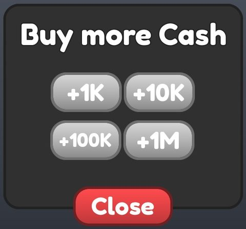</a> <b>InterfaceGUI</b> › BuyCashFrame</td>
<td width="33%" valign="top"><a href="screenshots/05_InterfaceGUI__WeaponShopFrame.jpg">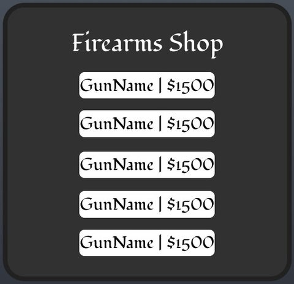</a> <b>InterfaceGUI</b> › WeaponShopFrame</td>
</tr>
</table>

### Rewards, daily, spin, codes

<table>
<tr>
<td width="33%" valign="top"> <b>InterfaceGUI</b> › ClaimTycoonFrame</td>
</tr>
</table>

### Settings & menus

<table>
<tr>
<td width="33%" valign="top"><a href="screenshots/08_StatusUI__InteractionMenu.jpg">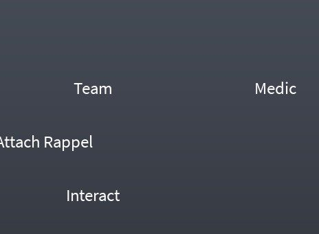</a> <b>StatusUI</b> › InteractionMenu</td>
</tr>
</table>

### Loading & intro

<table>
<tr>
<td width="33%" valign="top"><a href="screenshots/06_LoadingGUI__Frame.jpg">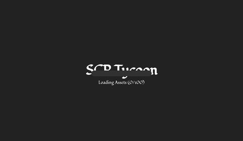</a> <b>LoadingGUI</b> › Frame</td>
</tr>
</table>

### HUD & currency

<table>
<tr>
<td width="33%" valign="top"> <b>GPShud</b></td>
</tr>
</table>

### Other

<table>
<tr>
<td width="33%" valign="top"><a href="screenshots/01_InterfaceGUI.jpg">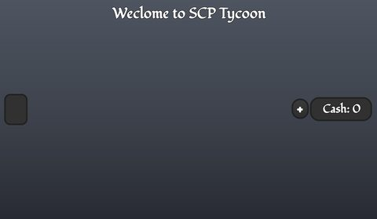</a> <b>InterfaceGUI</b></td>
<td width="33%" valign="top"><a href="screenshots/04_InterfaceGUI__GuideFrame.jpg">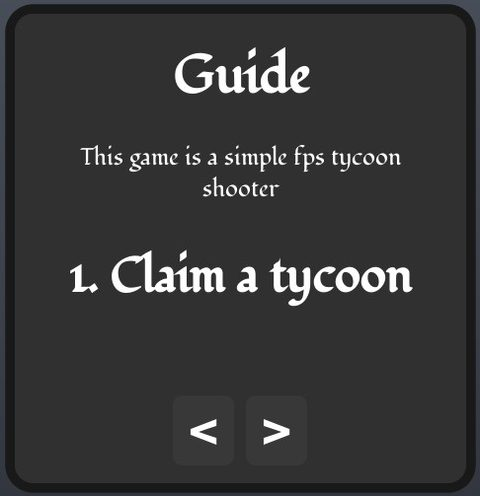</a> <b>InterfaceGUI</b> › GuideFrame</td>
<td width="33%" valign="top"><a href="screenshots/09_StatusUI__Sistema.jpg">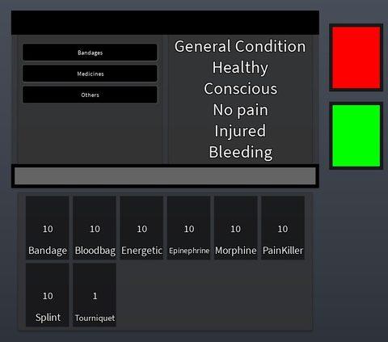</a> <b>StatusUI</b> › Sistema</td>
</tr>
</table>

## Model previews

<table>
<tr>
<td width="25%" valign="top"><a href="models/Workspace/Buildings/Appartment%20w_abandonned%20car.rbxm">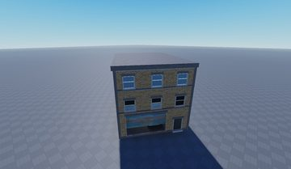</a> <b>Appartment w_abandonned car</b> <code>models/Workspace/Buildings/Appartment w_abandonned car.rbxm</code></td>
<td width="25%" valign="top"><a href="models/ReplicatedStorage/EnemyContainer/Enemy_HMG.rbxm">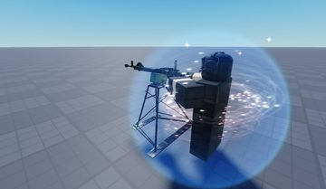</a> <b>Enemy_HMG</b> <code>models/ReplicatedStorage/EnemyContainer/Enemy_HMG.rbxm</code></td>
<td width="25%" valign="top"><a href="models/ReplicatedStorage/ACS_Engine/GunModels/Client/HK416%20Mod.rbxm">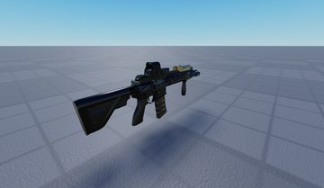</a> <b>HK416 Mod</b> <code>models/ReplicatedStorage/ACS_Engine/GunModels/Client/HK416 Mod.rbxm</code></td>
<td width="25%" valign="top"><a href="models/Workspace/Buildings/1.rbxm">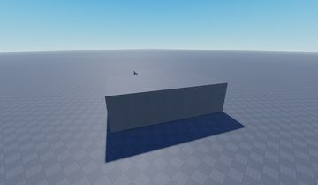</a> <b>1</b> <code>models/Workspace/Buildings/1.rbxm</code></td>
</tr>
<tr>
<td width="25%" valign="top"><a href="models/Workspace/Trees/Tree.rbxm">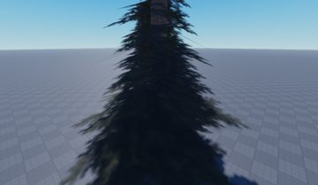</a> <b>Tree</b> <code>models/Workspace/Trees/Tree.rbxm</code></td>
<td width="25%" valign="top"><a href="models/ReplicatedStorage/ACS_Engine/FX/BreachCharge.rbxm">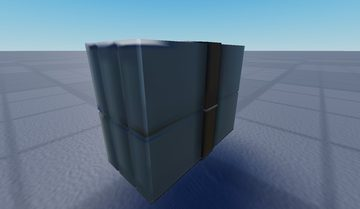</a> <b>BreachCharge</b> <code>models/ReplicatedStorage/ACS_Engine/FX/BreachCharge.rbxm</code></td>
<td width="25%" valign="top"><a href="models/ReplicatedStorage/Texture%20Pack.rbxm">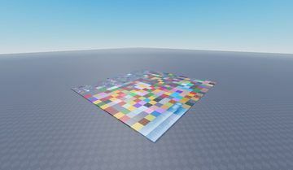</a> <b>Texture Pack</b> <code>models/ReplicatedStorage/Texture Pack.rbxm</code></td>
<td width="25%" valign="top"><a href="models/ReplicatedStorage/EnemyContainer/Enemy_Gunner.rbxm">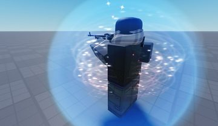</a> <b>Enemy_Gunner</b> <code>models/ReplicatedStorage/EnemyContainer/Enemy_Gunner.rbxm</code></td>
</tr>
<tr>
<td width="25%" valign="top"><a href="models/ReplicatedStorage/ACS_Engine/GunModels/Client/G17.rbxm">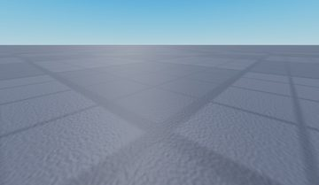</a> <b>G17</b> <code>models/ReplicatedStorage/ACS_Engine/GunModels/Client/G17.rbxm</code></td>
<td width="25%" valign="top"><a href="models/Workspace/Buildings/1957%20CHEVROLET%20BEL%20AIR.rbxm">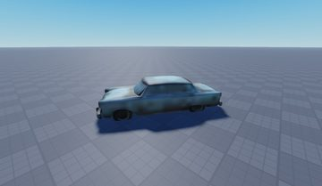</a> <b>1957 CHEVROLET BEL AIR</b> <code>models/Workspace/Buildings/1957 CHEVROLET BEL AIR.rbxm</code></td>
<td width="25%" valign="top"><a href="models/Workspace/Trees/Tree~2.rbxm">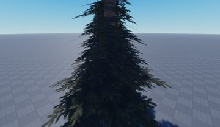</a> <b>Tree~2</b> <code>models/Workspace/Trees/Tree~2.rbxm</code></td>
<td width="25%" valign="top"><a href="models/ReplicatedStorage/EnemyContainer/Enemy_Sniper.rbxm">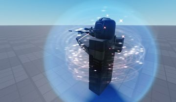</a> <b>Enemy_Sniper</b> <code>models/ReplicatedStorage/EnemyContainer/Enemy_Sniper.rbxm</code></td>
</tr>
<tr>
<td width="25%" valign="top"><a href="models/Workspace/Buildings/GunGiver.rbxm">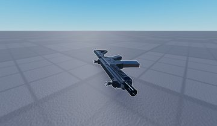</a> <b>GunGiver</b> <code>models/Workspace/Buildings/GunGiver.rbxm</code></td>
<td width="25%" valign="top"><a href="models/Workspace/Buildings/Model.rbxm">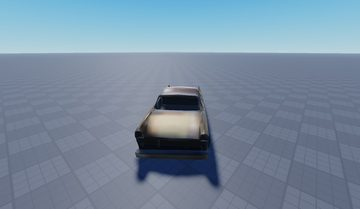</a> <b>Model</b> <code>models/Workspace/Buildings/Model.rbxm</code></td>
</tr>
</table>

## Notable scripts

Top-scored scripts of this game per topic (full tree in [source/scripts](source/scripts/)).

| Topic | Scripts |
|---|---|
| UI animation (tweens, hover / click, pop-ins, springs) | [`ACS_Client`](source/scripts/StarterPlayer/StarterCharacterScripts/Saude/ACS_Client.client.lua) 3167 lines [`MedSys_FX`](source/scripts/StarterPlayer/StarterCharacterScripts/Saude/MedSys_FX.client.lua) 201 lines [`Animations`](source/scripts/ReplicatedStorage/Weapons/AK74M/ACS_Modulo/Variaveis/Animations.lua) 210 lines [`Animations`](source/scripts/ReplicatedStorage/Weapons/AUG%20A3/ACS_Modulo/Variaveis/Animations.lua) 206 lines [`Animations`](source/scripts/ReplicatedStorage/Weapons/Binoculars/ACS_Modulo/Variaveis/Animations.lua) 98 lines |
| UI controllers / window managers / menus | [`ACS_Server`](source/scripts/ServerScriptService/ACS_Server.server.lua) 1466 lines [`MainNVG`](source/scripts/ServerScriptService/MainServerNVG%20%28Put%20in%20server%20script%20sevice%29/MainNVG.client.lua) 249 lines [`ACS_Client`](source/scripts/StarterPlayer/StarterCharacterScripts/Saude/ACS_Client.client.lua) 3167 lines |
| Notifications, toasts, popups, prompts | [`GameEventsHandler`](source/scripts/ServerScriptService/GameEventsHandler.server.lua) 109 lines [`ACS_Server`](source/scripts/ServerScriptService/ACS_Server.server.lua) 1466 lines |
| Loading / intro screens | [`LoadHandler`](source/scripts/StarterGui/LoadingGUI/Frame/LoadHandler.client.lua) 37 lines |
| Camera, cutscenes, screen shake | [`ACS_Client`](source/scripts/StarterPlayer/StarterCharacterScripts/Saude/ACS_Client.client.lua) 3167 lines |
| VFX, particles, beams, hit effects | [`ACS_Server`](source/scripts/ServerScriptService/ACS_Server.server.lua) 1466 lines [`Hitmarker`](source/scripts/ReplicatedStorage/ACS_Engine/Modulos/Hitmarker.lua) 882 lines [`ACS_Client`](source/scripts/StarterPlayer/StarterCharacterScripts/Saude/ACS_Client.client.lua) 3167 lines |
| RNG, eggs, gacha, rarity rolls, pets | [`ACS_Client`](source/scripts/StarterPlayer/StarterCharacterScripts/Saude/ACS_Client.client.lua) 3167 lines |
| Combat, weapons, hitboxes, abilities | [`AI`](source/scripts/ReplicatedStorage/EnemyContainer/Enemy_CQC/AI.server.lua) 606 lines [`AI`](source/scripts/ReplicatedStorage/EnemyContainer/Enemy_Gunner/AI.server.lua) 606 lines [`AI`](source/scripts/ReplicatedStorage/EnemyContainer/Enemy_HMG/AI.server.lua) 606 lines [`AI`](source/scripts/ReplicatedStorage/EnemyContainer/Enemy_Sniper/AI.server.lua) 606 lines [`AI`](source/scripts/ReplicatedStorage/EnemyContainer/Enemy_Unarmed/AI.server.lua) 507 lines |
| NPC / AI / monsters | [`AI`](source/scripts/ReplicatedStorage/EnemyContainer/Enemy_CQC/AI.server.lua) 606 lines [`AI`](source/scripts/ReplicatedStorage/EnemyContainer/Enemy_Gunner/AI.server.lua) 606 lines [`AI`](source/scripts/ReplicatedStorage/EnemyContainer/Enemy_HMG/AI.server.lua) 606 lines [`AI`](source/scripts/ReplicatedStorage/EnemyContainer/Enemy_Sniper/AI.server.lua) 606 lines [`AI`](source/scripts/ReplicatedStorage/EnemyContainer/Enemy_Unarmed/AI.server.lua) 507 lines |
| Character movement (sprint, dash, double jump, slide) | [`Stances`](source/scripts/ReplicatedStorage/ACS_Engine/HUD/StatusUI/Stances.client.lua) 623 lines [`ACS_Client`](source/scripts/StarterPlayer/StarterCharacterScripts/Saude/ACS_Client.client.lua) 3167 lines [`Config`](source/scripts/ReplicatedStorage/ACS_Engine/ServerConfigs/Config.lua) 72 lines |
| Tycoon / plots / bases / building | [`ACS_Client`](source/scripts/StarterPlayer/StarterCharacterScripts/Saude/ACS_Client.client.lua) 3167 lines [`EventsHandler`](source/scripts/ServerScriptService/EventsHandler.server.lua) 40 lines |
| Sound & music | [`Hitmarker`](source/scripts/ReplicatedStorage/ACS_Engine/Modulos/Hitmarker.lua) 882 lines [`ACS_Server`](source/scripts/ServerScriptService/ACS_Server.server.lua) 1466 lines |

### In the curated script library

- [Studio splash + fake progress](../../Scripts/04-Loading-Screens/StudioSplashFakeProgress__scp-tycoon.lua) — Studio splash ('X Presents' then game title) using TweenPosition, followed by a cosmetic 'Loading Assets (n/482)' counter and bar, then the whole frame slides away.
- [Soldier AI with perception meter](../../Scripts/12-NPC-AI/PerceptionGunnerAI__scp-tycoon.lua) — ACS-gun enemy soldier: patrol / chase / memory modes, a perception value that fills while the player is visible before it starts shooting, memory that decays when sight is lost, walk speeds per state, spread, and armour-aware damage. (Same script is reused for CQC/HMG/Sniper with different settings.)
- [Hand-made tycoon (claim, buy pads, droppers, collector, laser)](../../Scripts/14-Tycoon-Plots/TycoonKit__scp-tycoon.lua) — A small hand-made tycoon: claim via RemoteEvent, buy pads that reveal a dropper/upgrade and enable it, droppers that clone a Drop on a cooldown, an upgrader that doubles each drop once, a...

## ⚠️ Safety

HIGH flags (backdoors, `require(id)`, `loadstring`, webhooks). Review or delete before reusing:

- `scripts/Workspace/Boards/AssetLoader.server.lua`
- `scripts/Workspace/Boards/R15Loader/Loader.server.lua`

## Folders

| Folder | What |
|---|---|
| `screenshots/` | full frames; `crops/` = the panel only; `models/` = 3D previews; `thumbs/` = gallery thumbnails |
| `ui/` | every screen as a Lua builder (`require(module)()` returns the ScreenGui); `_StarterGui-all.lua` builds every StarterGui screen |
| `models/` | every model as .rbxm (the only .rbxm files), mirroring the place tree, scripts removed |
| `map/` | `workspace.rbxm` (the map as a model), `lighting.lua` (sky + post effects), `materials.lua`, `Environment.lua` |
| `animations/`, `audio/` | KeyframeSequence / Sound builders (.lua), `AnimationIds.lua`, `Sounds.lua` |
| `source/` | all scripts as .luau, `tree.txt`, `ui.txt`, `remotes.txt`, `assets.txt`, `flags.txt` |
