# Shattered Aether (map)

> 📦 **Model Pack** · map / environment pack · source file `Shattered Aether Map.rbxl`

[⬅ Back to the catalog](../../README.md) · [Assets inventory](ASSETS.md) · [Style numbers](reference.md) · [Scripts](source/scripts/) · [Code analysis](source/README.md)

## At a glance

| | |
|---|---|
| Provenance | template with full source |
| Screens | 0 ScreenGuis, 0 GUI objects → **0 screenshots** |
| Models (.rbxm) | 106 models, 31 model sets, 0 VFX sets |
| Lua builders (.lua) | 1 UI screens, 0 animation packs, 0 audio packs |
| Code | 1 scripts, 544 lines |
| Asset ids | 0 animations, 0 sounds |
| Safety scan | 0 HIGH / 0 MED flags ([flags.txt](source/flags.txt)) |

## Model previews

<table>
<tr>
<td width="25%" valign="top"><a href="models/Workspace/Shattered%20Aether%20Map/Ruins/Shrines/Model~3.rbxm">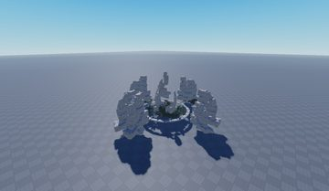</a> <b>Model~3</b> <code>models/Workspace/Shattered Aether Map/Ruins/Shrines/Model~3.rbxm</code></td>
<td width="25%" valign="top"><a href="models/Workspace/Shattered%20Aether%20Map/Foliage/Trees/flower%20tree%201.rbxm">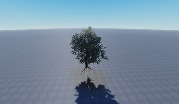</a> <b>flower tree 1</b> <code>models/Workspace/Shattered Aether Map/Foliage/Trees/flower tree 1.rbxm</code></td>
<td width="25%" valign="top"><a href="models/Workspace/Shattered%20Aether%20Map/Ruins/Base%20Parts/MeshPart.rbxm">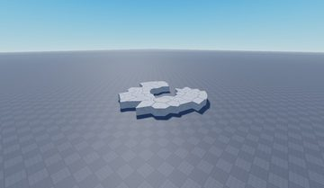</a> <b>MeshPart</b> <code>models/Workspace/Shattered Aether Map/Ruins/Base Parts/MeshPart.rbxm</code></td>
<td width="25%" valign="top"><a href="models/Workspace/Shattered%20Aether%20Map/Ruins/Shrines/Model.rbxm">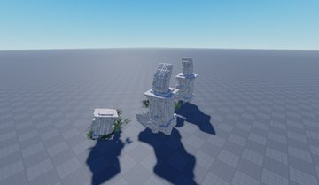</a> <b>Model</b> <code>models/Workspace/Shattered Aether Map/Ruins/Shrines/Model.rbxm</code></td>
</tr>
<tr>
<td width="25%" valign="top"><a href="models/Workspace/Shattered%20Aether%20Map/Foliage/Trees/flower%20tree%201~2.rbxm">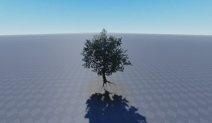</a> <b>flower tree 1~2</b> <code>models/Workspace/Shattered Aether Map/Foliage/Trees/flower tree 1~2.rbxm</code></td>
<td width="25%" valign="top"><a href="models/Workspace/Shattered%20Aether%20Map/Ruins/Base%20Parts/Pillar.rbxm">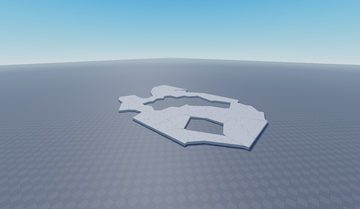</a> <b>Pillar</b> <code>models/Workspace/Shattered Aether Map/Ruins/Base Parts/Pillar.rbxm</code></td>
<td width="25%" valign="top"><a href="models/Workspace/Shattered%20Aether%20Map/Ruins/Base%20Parts/Union.rbxm">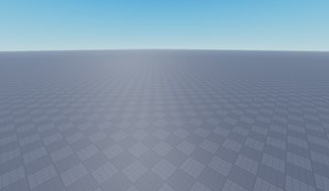</a> <b>Union</b> <code>models/Workspace/Shattered Aether Map/Ruins/Base Parts/Union.rbxm</code></td>
<td width="25%" valign="top"><a href="models/Workspace/Shattered%20Aether%20Map/Clouds/Cloud.rbxm">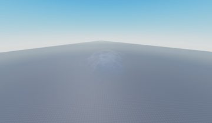</a> <b>Cloud</b> <code>models/Workspace/Shattered Aether Map/Clouds/Cloud.rbxm</code></td>
</tr>
<tr>
<td width="25%" valign="top"><a href="models/Workspace/Shattered%20Aether%20Map/Rocks/Big%20Rock%205__x17.rbxm">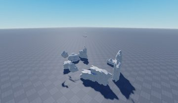</a> <b>Big Rock 5__x17</b> <code>models/Workspace/Shattered Aether Map/Rocks/Big Rock 5__x17.rbxm</code></td>
<td width="25%" valign="top"><a href="models/Workspace/Shattered%20Aether%20Map/Ruins/Other%20Stuff/Mid%20Rock%209__x12.rbxm">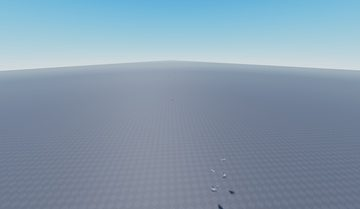</a> <b>Mid Rock 9__x12</b> <code>models/Workspace/Shattered Aether Map/Ruins/Other Stuff/Mid Rock 9__x12.rbxm</code></td>
<td width="25%" valign="top"><a href="models/Workspace/Shattered%20Aether%20Map/Islands/Inaccessable%20islands%20%28cc%20false%29/Tree%203.rbxm">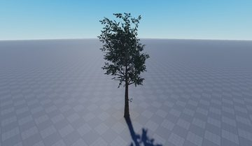</a> <b>Tree 3</b> <code>models/Workspace/Shattered Aether Map/Islands/Inaccessable islands (cc false)/Tree 3.rbxm</code></td>
<td width="25%" valign="top"><a href="models/Workspace/Shattered%20Aether%20Map/Ruins/Pillars/Broken%20Pillar%204.rbxm">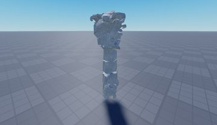</a> <b>Broken Pillar 4</b> <code>models/Workspace/Shattered Aether Map/Ruins/Pillars/Broken Pillar 4.rbxm</code></td>
</tr>
<tr>
<td width="25%" valign="top"><a href="models/Workspace/Shattered%20Aether%20Map/Foliage/Trees/BeechwoodTree_Var01.rbxm">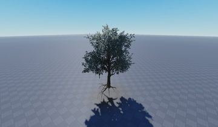</a> <b>BeechwoodTree_Var01</b> <code>models/Workspace/Shattered Aether Map/Foliage/Trees/BeechwoodTree_Var01.rbxm</code></td>
</tr>
</table>

## Notable scripts

Top-scored scripts of this game per topic (full tree in [source/scripts](source/scripts/)).

| Topic | Scripts |
|---|---|
| UI animation (tweens, hover / click, pop-ins, springs) | [`FreecamShowcase`](source/scripts/StarterGui/FreecamShowcase.client.lua) 544 lines |
| Camera, cutscenes, screen shake | [`FreecamShowcase`](source/scripts/StarterGui/FreecamShowcase.client.lua) 544 lines |

## Folders

| Folder | What |
|---|---|
| `screenshots/` | full frames; `crops/` = the panel only; `models/` = 3D previews; `thumbs/` = gallery thumbnails |
| `ui/` | every screen as a Lua builder (`require(module)()` returns the ScreenGui); `_StarterGui-all.lua` builds every StarterGui screen |
| `models/` | every model as .rbxm (the only .rbxm files), mirroring the place tree, scripts removed |
| `map/` | `workspace.rbxm` (the map as a model), `lighting.lua` (sky + post effects), `materials.lua`, `Environment.lua` |
| `animations/`, `audio/` | KeyframeSequence / Sound builders (.lua), `AnimationIds.lua`, `Sounds.lua` |
| `source/` | all scripts as .luau, `tree.txt`, `ui.txt`, `remotes.txt`, `assets.txt`, `flags.txt` |
