# Site Excalibur (Lunor)

> 🏙️ **Roleplay** · SCP facility roleplay (detain, solitary, gun shop) · source file `BY LUNOR - site_excalibur (1).rbxl`

[⬅ Back to the catalog](../../README.md) · [Assets inventory](ASSETS.md) · [Style numbers](reference.md) · [Scripts](source/scripts/) · [Code analysis](source/README.md)

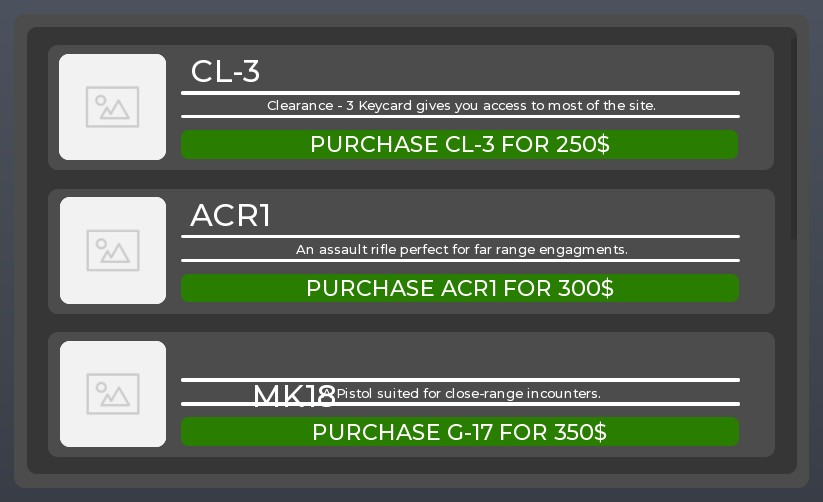

## At a glance

| | |
|---|---|
| Provenance | template with full source |
| Screens | 9 ScreenGuis, 118 GUI objects → **11 screenshots** |
| Models (.rbxm) | 818 models, 79 model sets, 7 VFX sets |
| Lua builders (.lua) | 20 UI screens, 11 animation packs, 42 audio packs |
| Code | 780 scripts, 51,504 lines |
| Asset ids | 136 animations, 655 sounds |
| Safety scan | 1 HIGH / 11 MED flags ([flags.txt](source/flags.txt)) |

**Fonts:** `LegacyArial Regular`×22, `GothamSSm Medium`×19, `SourceSansPro Light`×9, `RobotoMono Regular`×9, `GothamSSm Regular`×4

## UI screenshots

Captured in Studio from the place's own ScreenGuis (scripts stripped). Each panel was opened on its own; click a thumbnail for the full 1519×886 frame. Runtime-filled lists (shop items, inventories) show their template state.

### Shop & Robux store

<table>
<tr>
<td width="33%" valign="top"><a href="screenshots/09_GunShop__Frame.jpg">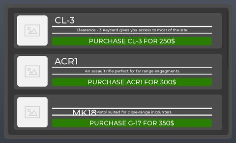</a> <b>GunShop</b> › Frame</td>
</tr>
</table>

### Popups, notifications, prompts

<table>
<tr>
<td width="33%" valign="top"> <b>AnnouncementUI</b></td>
</tr>
</table>

### End of round, death, results

<table>
<tr>
<td width="33%" valign="top"><a href="screenshots/10_DeathGui.jpg">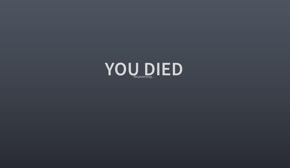</a> <b>DeathGui</b></td>
</tr>
</table>

### HUD & currency

<table>
<tr>
<td width="33%" valign="top"> <b>HUD</b> › ScopeFrame</td>
<td width="33%" valign="top"><a href="screenshots/07_AnnouncementShowUI__Main.jpg">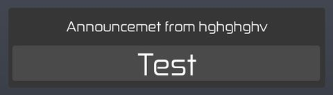</a> <b>AnnouncementShowUI</b> › Main</td>
</tr>
</table>

### Other

<table>
<tr>
<td width="33%" valign="top"><a href="screenshots/01_AdvanceToolGiver.jpg">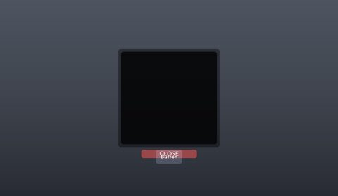</a> <b>AdvanceToolGiver</b></td>
<td width="33%" valign="top"><a href="screenshots/02_HelmGUI.jpg">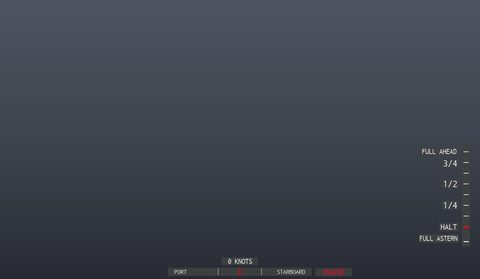</a> <b>HelmGUI</b></td>
<td width="33%" valign="top"> <b>Overlay</b></td>
</tr>
<tr>
<td width="33%" valign="top"><a href="screenshots/06_SolitaryUI__Frame.jpg">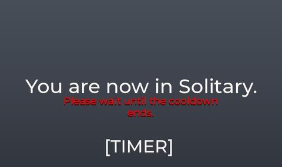</a> <b>SolitaryUI</b> › Frame</td>
<td width="33%" valign="top"> <b>DetainUI</b> › Frame</td>
<td width="33%" valign="top"> <b>Interface</b></td>
</tr>
</table>

## Model previews

<table>
<tr>
<td width="25%" valign="top"><a href="models/Workspace/GunShop.rbxm">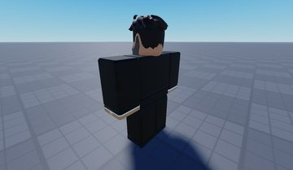</a> <b>GunShop</b> <code>models/Workspace/GunShop.rbxm</code></td>
<td width="25%" valign="top"><a href="models/Workspace/gun/GK5D__x6.rbxm">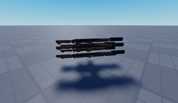</a> <b>GK5D__x6</b> <code>models/Workspace/gun/GK5D__x6.rbxm</code></td>
<td width="25%" valign="top"><a href="models/Workspace/radio%20tower.rbxm">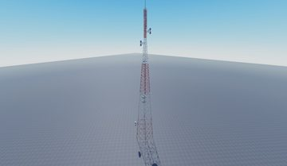</a> <b>radio tower</b> <code>models/Workspace/radio tower.rbxm</code></td>
<td width="25%" valign="top"><a href="models/Workspace/Site/Entrance%20Zone/potted%20plant__x9.rbxm">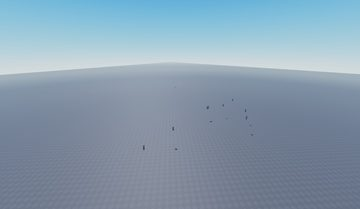</a> <b>potted plant__x9</b> <code>models/Workspace/Site/Entrance Zone/potted plant__x9.rbxm</code></td>
</tr>
<tr>
<td width="25%" valign="top"><a href="models/Workspace/Site/Light%20Containment%20Zone/S2%20Hallway.rbxm">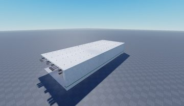</a> <b>S2 Hallway</b> <code>models/Workspace/Site/Light Containment Zone/S2 Hallway.rbxm</code></td>
<td width="25%" valign="top"><a href="models/ServerStorage/REMINGTON%20870.rbxm">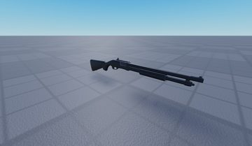</a> <b>REMINGTON 870</b> <code>models/ServerStorage/REMINGTON 870.rbxm</code></td>
<td width="25%" valign="top"><a href="models/Workspace/Site/Props%20%26%20Other/potted%20plant.rbxm">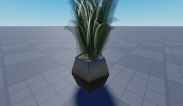</a> <b>potted plant</b> <code>models/Workspace/Site/Props & Other/potted plant.rbxm</code></td>
<td width="25%" valign="top"><a href="models/Workspace/Site/Entrance%20Zone/Crate.rbxm">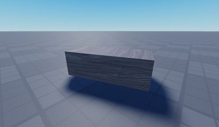</a> <b>Crate</b> <code>models/Workspace/Site/Entrance Zone/Crate.rbxm</code></td>
</tr>
<tr>
<td width="25%" valign="top"><a href="models/Workspace/Site/Entrance%20Zone/Sign.rbxm">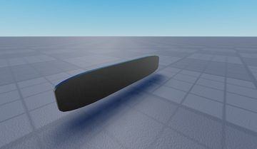</a> <b>Sign</b> <code>models/Workspace/Site/Entrance Zone/Sign.rbxm</code></td>
<td width="25%" valign="top"><a href="models/Workspace/Bacon.rbxm">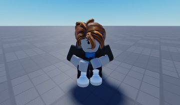</a> <b>Bacon</b> <code>models/Workspace/Bacon.rbxm</code></td>
<td width="25%" valign="top"><a href="models/Workspace/Site/Entrance%20Zone/Gun%20Rack/Gun%20Rack%20870.rbxm">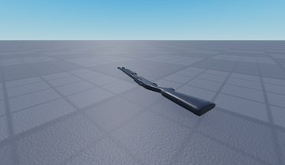</a> <b>Gun Rack 870</b> <code>models/Workspace/Site/Entrance Zone/Gun Rack/Gun Rack 870.rbxm</code></td>
<td width="25%" valign="top"><a href="models/Workspace/radio%20tower~2.rbxm">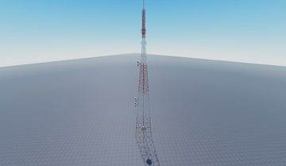</a> <b>radio tower~2</b> <code>models/Workspace/radio tower~2.rbxm</code></td>
</tr>
<tr>
<td width="25%" valign="top"><a href="models/Workspace/Site/Light%20Containment%20Zone/S2%20Hallway~7.rbxm">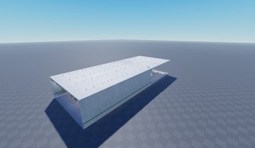</a> <b>S2 Hallway~7</b> <code>models/Workspace/Site/Light Containment Zone/S2 Hallway~7.rbxm</code></td>
</tr>
</table>

## Notable scripts

Top-scored scripts of this game per topic (full tree in [source/scripts](source/scripts/)).

| Topic | Scripts |
|---|---|
| UI animation (tweens, hover / click, pop-ins, springs) | [`ClientGunHandler`](source/scripts/StarterPlayer/StarterPlayerScripts/ClientGunHandler.client.lua) 2818 lines [`Camera`](source/scripts/ServerStorage/GunFramework/SubModules/Camera.lua) 204 lines [`ArmoredDoor`](source/scripts/StarterPlayer/StarterPlayerScripts/ClientFramework/Classes/ObjectVisualiser/ArmoredDoor.lua) 39 lines [`Combat`](source/scripts/ServerStorage/GunFramework/SubModules/Combat.lua) 1087 lines [`tweenModule`](source/scripts/ReplicatedStorage/Modules/tweenModule.lua) 134 lines |
| UI controllers / window managers / menus | [`DoorsMain`](source/scripts/StarterPlayer/StarterPlayerScripts/DoorsMain.client.lua) 25 lines [`interactionClient`](source/scripts/StarterPlayer/StarterPlayerScripts/interactionClient.client.lua) 193 lines [`ArmoredDoor`](source/scripts/StarterPlayer/StarterPlayerScripts/ClientFramework/Classes/ObjectVisualiser/ArmoredDoor.lua) 39 lines [`ArmoredFireGate`](source/scripts/StarterPlayer/StarterPlayerScripts/ClientFramework/Classes/ObjectVisualiser/ArmoredFireGate.lua) 32 lines [`CellDoor`](source/scripts/StarterPlayer/StarterPlayerScripts/ClientFramework/Classes/ObjectVisualiser/CellDoor.lua) 32 lines |
| Notifications, toasts, popups, prompts | [`ClientController`](source/scripts/ServerScriptService/RadioService/Assets/ClientController.client.lua) 105 lines [`GuiController`](source/scripts/StarterPlayer/StarterPlayerScripts/GuiController.client.lua) 81 lines [`LocalScript`](source/scripts/ServerScriptService/GiveUI/AnnouncementUI/Button/Main/ShoutSystem/ShoutButton/LocalScript.client.lua) 19 lines |
| Camera, cutscenes, screen shake | [`CameraClient`](source/scripts/StarterGui/ConsoleDisable/CameraMain/CameraClient.client.lua) 803 lines [`Camera`](source/scripts/ServerStorage/GunFramework/SubModules/Camera.lua) 204 lines [`ClientGunHandler`](source/scripts/StarterPlayer/StarterPlayerScripts/ClientGunHandler.client.lua) 2818 lines |
| VFX, particles, beams, hit effects | [`Combat`](source/scripts/ServerStorage/GunFramework/SubModules/Combat.lua) 1087 lines [`Control`](source/scripts/Workspace/Events/Control.server.lua) 78 lines [`ClientGunHandler`](source/scripts/StarterPlayer/StarterPlayerScripts/ClientGunHandler.client.lua) 2818 lines [`WeaponHandler~2`](source/scripts/ServerScriptService/Scripts/WeaponHandler~2.server.lua) 107 lines |
| DataStore / player data | [`Datastore`](source/scripts/ServerScriptService/Scripts/Datastore.server.lua) 21 lines |
| RNG, eggs, gacha, rarity rolls, pets | [`ClientGunHandler`](source/scripts/StarterPlayer/StarterPlayerScripts/ClientGunHandler.client.lua) 2818 lines [`Animate1`](source/scripts/ServerStorage/610s/SCP-610-1/Animate1.server.lua) 543 lines [`CameraClient`](source/scripts/StarterGui/ConsoleDisable/CameraMain/CameraClient.client.lua) 803 lines [`Character`](source/scripts/ServerStorage/GunFramework/SubModules/Character.lua) 923 lines [`Combat`](source/scripts/ServerStorage/GunFramework/SubModules/Combat.lua) 1087 lines |
| Combat, weapons, hitboxes, abilities | [`WeaponHandler~2`](source/scripts/ServerScriptService/Scripts/WeaponHandler~2.server.lua) 107 lines [`WeaponHandler`](source/scripts/ServerScriptService/NewWeapons/WeaponHandler.server.lua) 76 lines [`WeaponHandler`](source/scripts/ServerScriptService/Scripts/WeaponHandler.server.lua) 87 lines [`ClientGunHandler`](source/scripts/StarterPlayer/StarterPlayerScripts/ClientGunHandler.client.lua) 2818 lines [`AttackScript`](source/scripts/Workspace/SCP000/AttackScript.server.lua) 48 lines |
| NPC / AI / monsters | [`AI`](source/scripts/Workspace/SCPs/SCP025%20%28DISABLED%29/AI.server.lua) 276 lines [`NPCHandler`](source/scripts/Workspace/SCPs/SCP-457/NPCHandler.server.lua) 38 lines |
| Character movement (sprint, dash, double jump, slide) | [`Character`](source/scripts/ServerStorage/GunFramework/SubModules/Character.lua) 923 lines [`ClientGunHandler`](source/scripts/StarterPlayer/StarterPlayerScripts/ClientGunHandler.client.lua) 2818 lines [`Animate1`](source/scripts/ServerStorage/610s/SCP-610-1/Animate1.server.lua) 543 lines [`LocalMain`](source/scripts/Workspace/Zodiac/Body/Main_Model/DriveSeat/HelmGUI/LocalMain.client.lua) 198 lines [`Combat`](source/scripts/ServerStorage/GunFramework/SubModules/Combat.lua) 1087 lines |
| Tycoon / plots / bases / building | [`Settings`](source/scripts/Workspace/Adonis%20%20Admin%20%5BUSM%5D/Config/Settings.lua) 460 lines |
| Admin panels & commands | [`Commands`](source/scripts/ServerScriptService/RadioService/Commands.lua) 185 lines [`Settings`](source/scripts/Workspace/Adonis%20%20Admin%20%5BUSM%5D/Config/Settings.lua) 460 lines |
| Sound & music | [`Audio`](source/scripts/ServerStorage/GunFramework/SubModules/Audio.lua) 25 lines |
| Utility modules (number format, signals, tables, timers) | [`tweenModule`](source/scripts/ReplicatedStorage/Modules/tweenModule.lua) 134 lines [`wearCloths`](source/scripts/ReplicatedStorage/InteractionKeys/lockerTag/wearCloths.lua) 142 lines [`Signal`](source/scripts/ServerStorage/GunFramework/Classes/VisualizerClass/Signal.lua) 49 lines [`Commands`](source/scripts/ServerScriptService/RadioService/Commands.lua) 185 lines |

## ⚠️ Safety

HIGH flags (backdoors, `require(id)`, `loadstring`, webhooks). Review or delete before reusing:

- `scripts/ServerScriptService/RadioService.server.lua`

## Folders

| Folder | What |
|---|---|
| `screenshots/` | full frames; `crops/` = the panel only; `models/` = 3D previews; `thumbs/` = gallery thumbnails |
| `ui/` | every screen as a Lua builder (`require(module)()` returns the ScreenGui); `_StarterGui-all.lua` builds every StarterGui screen |
| `models/` | every model as .rbxm (the only .rbxm files), mirroring the place tree, scripts removed |
| `map/` | `workspace.rbxm` (the map as a model), `lighting.lua` (sky + post effects), `materials.lua`, `Environment.lua` |
| `animations/`, `audio/` | KeyframeSequence / Sound builders (.lua), `AnimationIds.lua`, `Sounds.lua` |
| `source/` | all scripts as .luau, `tree.txt`, `ui.txt`, `remotes.txt`, `assets.txt`, `flags.txt` |
