# Slime RNG

> 🎲 **RNG** · RNG / slime rolling · source file `Slime RNG (But with admin cmds!!) (2).rbxl`

[⬅ Back to the catalog](../../README.md) · [Assets inventory](ASSETS.md) · [Style numbers](reference.md) · [Scripts](source/scripts/) · [Code analysis](source/README.md)

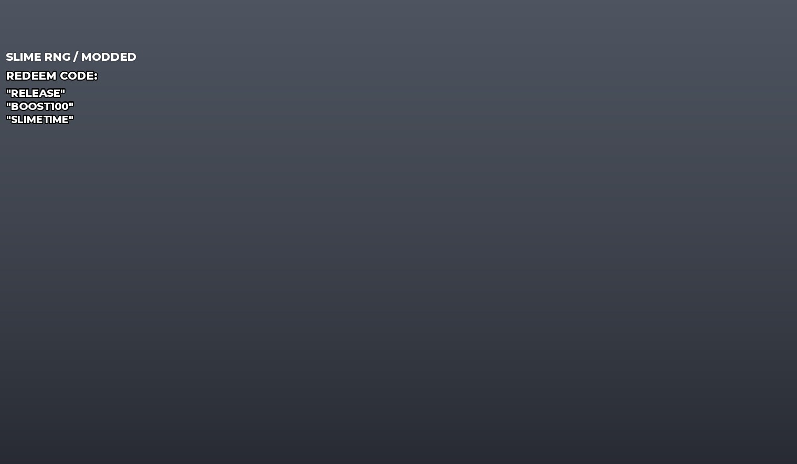

## At a glance

| | |
|---|---|
| Provenance | copy of a live game (saveinstance / decompiled client code) |
| Screens | 1 ScreenGuis, 20 GUI objects → **1 screenshots** |
| Models (.rbxm) | 145 models, 0 model sets, 1 VFX sets |
| Lua builders (.lua) | 4 UI screens, 1 animation packs, 1 audio packs |
| Code | 538 scripts, 76,050 lines |
| Asset ids | 2 animations, 63 sounds |
| Safety scan | 1 HIGH / 1 MED flags ([flags.txt](source/flags.txt)) |

**Fonts:** `GothamSSm ExtraBold`×5, `BuilderSans ExtraBold`×4, `Builder Sans ExtraBold`×1

## UI screenshots

Captured in Studio from the place's own ScreenGuis (scripts stripped). Each panel was opened on its own; click a thumbnail for the full 1519×886 frame. Runtime-filled lists (shop items, inventories) show their template state.

### HUD & currency

<table>
<tr>
<td width="33%" valign="top"><a href="screenshots/01_HUD.jpg">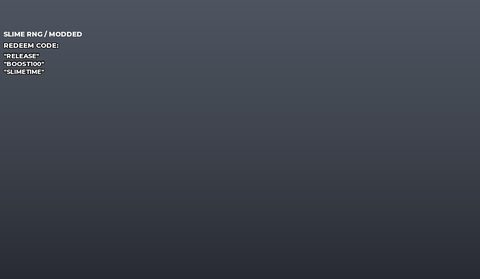</a> <b>HUD</b></td>
</tr>
</table>

## Model previews

<table>
<tr>
<td width="25%" valign="top"><a href="models/Workspace/Zones/2.rbxm">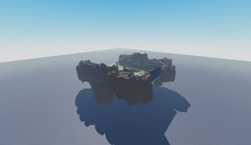</a> <b>2</b> <code>models/Workspace/Zones/2.rbxm</code></td>
<td width="25%" valign="top"><a href="models/Workspace/Leaderboards.rbxm">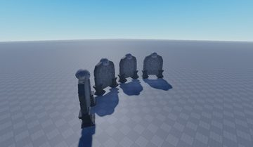</a> <b>Leaderboards</b> <code>models/Workspace/Leaderboards.rbxm</code></td>
<td width="25%" valign="top"><a href="models/ReplicatedStorage/Assets/Loot/coinPotion.rbxm">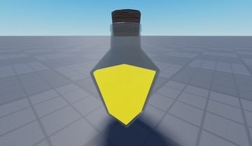</a> <b>coinPotion</b> <code>models/ReplicatedStorage/Assets/Loot/coinPotion.rbxm</code></td>
<td width="25%" valign="top"><a href="models/ReplicatedStorage/Assets/Loot/shinyDice.rbxm">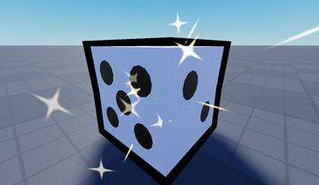</a> <b>shinyDice</b> <code>models/ReplicatedStorage/Assets/Loot/shinyDice.rbxm</code></td>
</tr>
<tr>
<td width="25%" valign="top"><a href="models/ReplicatedStorage/Assets/Slimes/halo.rbxm">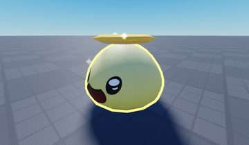</a> <b>halo</b> <code>models/ReplicatedStorage/Assets/Slimes/halo.rbxm</code></td>
<td width="25%" valign="top"><a href="models/ReplicatedStorage/Assets/Slimes/ember.rbxm">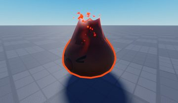</a> <b>ember</b> <code>models/ReplicatedStorage/Assets/Slimes/ember.rbxm</code></td>
<td width="25%" valign="top"><a href="models/ReplicatedStorage/Assets/Slimes/stormy.rbxm">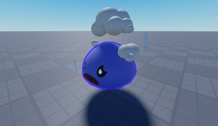</a> <b>stormy</b> <code>models/ReplicatedStorage/Assets/Slimes/stormy.rbxm</code></td>
<td width="25%" valign="top"><a href="models/ReplicatedStorage/Assets/Slimes/unicorn.rbxm">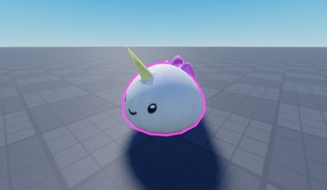</a> <b>unicorn</b> <code>models/ReplicatedStorage/Assets/Slimes/unicorn.rbxm</code></td>
</tr>
<tr>
<td width="25%" valign="top"><a href="models/ReplicatedStorage/Assets/Loot/rollSpeedPotion.rbxm">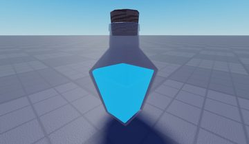</a> <b>rollSpeedPotion</b> <code>models/ReplicatedStorage/Assets/Loot/rollSpeedPotion.rbxm</code></td>
</tr>
</table>

## Notable scripts

Top-scored scripts of this game per topic (full tree in [source/scripts](source/scripts/)).

| Topic | Scripts |
|---|---|
| UI animation (tweens, hover / click, pop-ins, springs) | [`SlimeHoverInfo`](source/scripts/ReplicatedStorage/Source/Features/App/Components/SlimeHoverInfo.lua) 469 lines [`ItemsInventoryPage`](source/scripts/ReplicatedStorage/Source/Features/Inventory/UI/Components/ItemsInventoryPage.lua) 888 lines [`LeftSideBar`](source/scripts/ReplicatedStorage/Source/Features/Hud/Components/LeftSideBar.lua) 203 lines [`UpgradeTilesContainer`](source/scripts/ReplicatedStorage/Source/Features/Upgrades/UI/Components/UpgradeTilesContainer.lua) 257 lines [`CraftingMachineVisualsClient`](source/scripts/ReplicatedStorage/Source/Features/Crafting/Classes/CraftingMachineVisualsClient.lua) 613 lines |
| UI controllers / window managers / menus | [`InventoryMenu`](source/scripts/ReplicatedStorage/Source/Features/Inventory/UI/InventoryMenu.lua) 115 lines [`OfflineEarningsMenu`](source/scripts/ReplicatedStorage/Source/Features/OfflineEarnings/UI/OfflineEarningsMenu.lua) 154 lines [`SubMenu`](source/scripts/ReplicatedStorage/Source/Features/App/Components/SubMenu.lua) 181 lines [`Menu`](source/scripts/ReplicatedStorage/Source/Features/App/Components/Menu.lua) 347 lines [`JackpotPurchaseSubMenu`](source/scripts/ReplicatedStorage/Source/Features/Monetization/UI/JackpotPurchaseSubMenu.lua) 175 lines |
| Notifications, toasts, popups, prompts | [`AnnouncementMessages`](source/scripts/ReplicatedStorage/Source/Core/UI/Components/AnnouncementMessages.lua) 148 lines [`Notifications`](source/scripts/ReplicatedStorage/Source/Features/Notifications/UI/Notifications.lua) 134 lines [`TextNotifications`](source/scripts/ReplicatedStorage/Source/Features/Notifications/UI/TextNotifications.lua) 153 lines [`ErrorMessages`](source/scripts/ReplicatedStorage/Source/Core/UI/Components/ErrorMessages.lua) 114 lines [`NotificationBadge`](source/scripts/ReplicatedStorage/Source/Features/App/Components/NotificationBadge.lua) 129 lines |
| Camera, cutscenes, screen shake | [`RareRollCutsceneVisuals`](source/scripts/ReplicatedStorage/Source/Features/Roll/RareRollCutsceneVisuals.lua) 670 lines [`ZonePurchase`](source/scripts/ReplicatedStorage/Source/Features/Zones/Components/ZonePurchase.lua) 581 lines [`RareRollCutscene`](source/scripts/ReplicatedStorage/Source/Features/Roll/UI/Components/RareRollCutscene.lua) 447 lines [`ScreenShake`](source/scripts/ReplicatedStorage/Source/Core/UI/Components/ScreenShake.lua) 69 lines [`RebirthRoot`](source/scripts/ReplicatedStorage/Source/Features/Rebirth/UI/RebirthRoot.lua) 399 lines |
| VFX, particles, beams, hit effects | [`Explosion`](source/scripts/ReplicatedStorage/CustomPackages/Explosion.lua) 354 lines [`VfxUtils`](source/scripts/ReplicatedStorage/Source/Core/Platform/VfxUtils.lua) 93 lines [`ClientActorUtils`](source/scripts/ReplicatedStorage/Source/Features/Gameplay/Classes/ClientActorUtils.lua) 304 lines [`RareRollCutsceneVisuals`](source/scripts/ReplicatedStorage/Source/Features/Roll/RareRollCutsceneVisuals.lua) 670 lines |
| Monetization (dev products, game passes, receipts) | [`MonetizationService`](source/scripts/ServerScriptService/Services/MonetizationService.lua) 334 lines [`MonetizationServiceClient`](source/scripts/ReplicatedStorage/Source/Features/Monetization/MonetizationServiceClient.lua) 269 lines |
| RNG, eggs, gacha, rarity rolls, pets | [`RollService`](source/scripts/ServerScriptService/Services/RollService.lua) 385 lines [`AutoLuckService`](source/scripts/ServerScriptService/Services/AutoLuckService.lua) 140 lines [`AutoCountdownLuckService`](source/scripts/ServerScriptService/Services/AutoCountdownLuckService.lua) 86 lines [`RollServiceUtils`](source/scripts/ReplicatedStorage/Source/Features/Roll/RollServiceUtils.lua) 338 lines [`JackpotUtils`](source/scripts/ReplicatedStorage/Source/Features/Roll/JackpotUtils.lua) 575 lines |
| Character movement (sprint, dash, double jump, slide) | [`SettingMenuPage`](source/scripts/ReplicatedStorage/Source/Features/Settings/UI/SettingMenuPage.lua) 472 lines [`OptionSlider`](source/scripts/ReplicatedStorage/Source/Core/UI/Components/OptionSlider.lua) 226 lines |
| Tycoon / plots / bases / building | [`IndexServiceUtils`](source/scripts/ReplicatedStorage/Source/Features/Index/IndexServiceUtils.lua) 373 lines [`AdminMenu`](source/scripts/ReplicatedStorage/Source/Features/Admin/UI/AdminMenu.lua) 700 lines [`SettingMenuPage`](source/scripts/ReplicatedStorage/Source/Features/Settings/UI/SettingMenuPage.lua) 472 lines [`ShopCodes`](source/scripts/ReplicatedStorage/Source/Features/Monetization/UI/Frames/ShopCodes.lua) 96 lines |
| Leaderboards & stats | [`LeaderboardServiceServer`](source/scripts/ServerScriptService/Services/LeaderboardServiceServer.lua) 268 lines |
| Admin panels & commands | [`AdminServiceClient`](source/scripts/ReplicatedStorage/Source/Features/Admin/AdminServiceClient.lua) 125 lines [`AdminLuckService`](source/scripts/ServerScriptService/Services/AdminLuckService.lua) 115 lines [`AdminService`](source/scripts/ServerScriptService/Services/AdminService.lua) 338 lines [`AdminLuckServiceClient`](source/scripts/ReplicatedStorage/Source/Features/Admin/AdminLuckServiceClient.lua) 82 lines [`AdminMenu`](source/scripts/ReplicatedStorage/Source/Features/Admin/UI/AdminMenu.lua) 700 lines |
| Sound & music | [`Sounds`](source/scripts/ReplicatedStorage/Source/Game/AssetIds/Sounds.lua) 203 lines [`MusicPlayer`](source/scripts/ReplicatedStorage/Source/Core/Platform/MusicPlayer.lua) 254 lines |
| Daily rewards, quests, codes, playtime | [`CodeService`](source/scripts/ServerScriptService/Services/CodeService.lua) 151 lines [`OfflineEarningsService`](source/scripts/ServerScriptService/Services/OfflineEarningsService.lua) 162 lines [`IndexRewardUtils`](source/scripts/ReplicatedStorage/Source/Features/Index/IndexRewardUtils.lua) 325 lines [`IndexRewardsFrame`](source/scripts/ReplicatedStorage/Source/Features/Index/UI/Components/IndexRewardsFrame.lua) 237 lines [`ShopCodes`](source/scripts/ReplicatedStorage/Source/Features/Monetization/UI/Frames/ShopCodes.lua) 96 lines |
| Utility modules (number format, signals, tables, timers) | [`AdminService`](source/scripts/ServerScriptService/Services/AdminService.lua) 338 lines [`LuckLadderServiceUtils`](source/scripts/ReplicatedStorage/Source/Features/LuckLadder/LuckLadderServiceUtils.lua) 317 lines [`InventoryService`](source/scripts/ServerScriptService/Services/InventoryService.lua) 442 lines [`MonetizationService`](source/scripts/ServerScriptService/Services/MonetizationService.lua) 334 lines [`RollService`](source/scripts/ServerScriptService/Services/RollService.lua) 385 lines |

### In the curated script library

- [RNG roll with zone pools, mutations and special rolls](../../Scripts/09-RNG-Gacha-Pets/ZonePoolRollMutations__slime-rng.lua) — Server roll: builds a pool from zone-unlocked slimes, boosts rare tiers with amplifiers, rolls independent mutations (huge/big/shiny/inverted), auto-equips, updates the index and counts down golden/diamond/void 'every N rolls' special rolls.
- [Random timed server luck events](../../Scripts/09-RNG-Gacha-Pets/RandomLuckEvents__slime-rng.lua) — Every 5-10 minutes picks a weighted luck multiplier (x2 common ... x50 rare) and turns on a 5 minute server luck event through the admin luck service.
- [Index / collection tracking + rewards](../../Scripts/09-RNG-Gacha-Pets/IndexCollectionTracking__slime-rng.lua) — Index service: migrates old saves into the index (retroactively unlocking owned slimes), tracks counts per category/mutation and hands out index milestone rewards.

## ⚠️ Safety

HIGH flags (backdoors, `require(id)`, `loadstring`, webhooks). Review or delete before reusing:

- `scripts/ReplicatedStorage/Packages/_Index/csqrl_sift@0.0.11/sift/Array.lua`

## Folders

| Folder | What |
|---|---|
| `screenshots/` | full frames; `crops/` = the panel only; `models/` = 3D previews; `thumbs/` = gallery thumbnails |
| `ui/` | every screen as a Lua builder (`require(module)()` returns the ScreenGui); `_StarterGui-all.lua` builds every StarterGui screen |
| `models/` | every model as .rbxm (the only .rbxm files), mirroring the place tree, scripts removed |
| `map/` | `workspace.rbxm` (the map as a model), `lighting.lua` (sky + post effects), `materials.lua`, `Environment.lua` |
| `animations/`, `audio/` | KeyframeSequence / Sound builders (.lua), `AnimationIds.lua`, `Sounds.lua` |
| `source/` | all scripts as .luau, `tree.txt`, `ui.txt`, `remotes.txt`, `assets.txt`, `flags.txt` |
